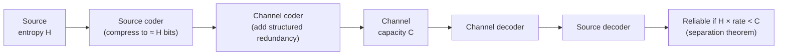
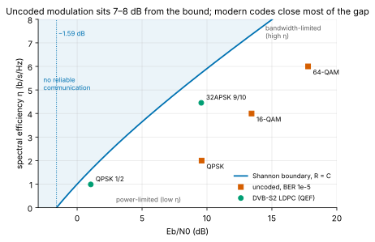
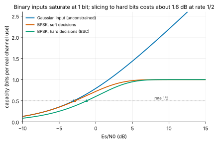

<!-- status: reviewed -->
# 17-07 · Information Theory and Shannon Capacity

| | |
|---|---|
| **Course** | [17 · Communication Systems](../README.md) |
| **University equivalent** | The information-theory chapter of a senior communications course, with the core of an introductory information-theory course: entropy and source coding, mutual information, the capacity of discrete and Gaussian channels, the Shannon–Hartley theorem and the Shannon limit (Cover & Thomas, *Elements of Information Theory*, chapters 2, 5, 7 and 9; Proakis & Salehi, information sources and channel capacity; MacKay, *Information Theory, Inference, and Learning Algorithms*) |
| **Prerequisites** | [03-01](../../03-probability-statistics-and-random-variables/chapters/03-01-probability-in-ee-language.md) to [03-04](../../03-probability-statistics-and-random-variables/chapters/03-04-joint-distributions-and-clt.md) (probability, joint distributions), [17-02](17-02-noise-and-snr.md) ($E_b/N_0$), [17-05](17-05-matched-filters-and-detection.md) (detection), [17-06](17-06-bandpass-digital-modulation.md) (constellations), [01-04](../../01-calculus-for-engineers/chapters/01-04-applications-of-derivatives.md) (optimization) |
| **Estimated study hours** | 8 |
| **Last verified** | 2026-11-21 |

**Learning objectives.** After this chapter you can:

1. Compute the information content and entropy of a source, explain entropy as the limit of lossless compression, and build a Huffman code.
2. Compute joint and conditional entropy and mutual information, and the capacity of the binary symmetric and binary erasure channels.
3. Derive the capacity of the AWGN channel and the Shannon–Hartley formula $C = B\log_2(1 + S/N)$, and explain the power-limited and bandwidth-limited regimes.
4. Derive the Shannon limit $E_b/N_0 \ge (2^\eta - 1)/\eta$, its −1.59 dB floor, and the gap of uncoded and coded schemes to it.
5. Compare constrained-input (BPSK, hard-decision) capacities with the unconstrained bound and quantify the value of soft decisions.
6. Allocate power across parallel Gaussian channels by water-filling.

---

## 1. Big picture

Every chapter so far has traded something for reliability: bandwidth for SNR (FM, spreading), power for distance (constellations), redundancy for error rate (coding, next chapter). In 1948 Claude Shannon showed that these trades have a hard, computable limit. For a channel with bandwidth $B$ and signal-to-noise ratio $S/N$, no system can send more than $C = B\log_2(1 + S/N)$ bits per second reliably, and, astonishingly, every rate below $C$ **can** be sent with an error probability as small as desired. The proof did not say how; it took fifty years of coding research (turbo codes in 1993, LDPC codes rediscovered in the mid-1990s, polar codes in 2009) to come within a fraction of a decibel. Today the bound is the yardstick against which every modem, SerDes and radio standard is judged, and the vocabulary of entropy and mutual information has spread to compression, cryptography and machine learning.

- **Link budgets end at Shannon.** The gap between a system's required $E_b/N_0$ and the Shannon limit is the room left for better coding; DVB-S2 sits 1–3 dB away, uncoded modulation 7–10 dB (§9).
- **Spectral efficiency has a price in SNR.** Every extra bit per second per hertz at high SNR costs about 3 dB, which is why the last steps of Wi-Fi and 5G peak rates (1024- and 4096-QAM) need such clean channels.
- **Compression and entropy.** Lossless compression of files, images and model weights stops at the source's entropy. Quantizing weights to low-precision formats for AI accelerators (16-10) is lossy and governed by rate–distortion theory instead; entropy-coding the quantized values can shrink them further, down to their entropy.
- **Water-filling** is how OFDM systems and DSL modems allocate power and bits across subcarriers (17-10).

## 2. Intuition first

How much do you learn from a message? If someone tells you the Sun rose this morning, almost nothing: it was certain. If they tell you which of 1024 equally likely numbers was drawn, you learn exactly 10 bits: you would have needed ten yes-or-no questions to find out. **Information is surprise**, measured as the logarithm of how unlikely the message was. **Entropy** is the average surprise of a source: how many yes-or-no questions, on average, you need to identify its output, and therefore how many bits it takes to store or send it. A noisy channel loses some of the questions' answers; **capacity** is how many reliable answers per use survive.

**Analogy: diversification and the information in a portfolio's returns.** A financial analyst knows that the uncertainty of a fair coin flip and of a highly predictable stock differ: the stock's tomorrow is mostly known, the coin's is not. Entropy quantifies this as a number of bits, and it adds over independent sources as variance does over independent bets. Capacity is like a bound on how much independent information a noisy market signal can carry about the true value, however cleverly you trade on it. **Where it breaks down:** entropy depends only on the probabilities, not on what the outcomes mean or are worth, so it says nothing about value; and Shannon's theorems are about long blocks and averages, while a trader faces one path.

## 3. Theory

### 3.1 Information and entropy

The **information** in an outcome of probability $p$ is $-\log_2p$ bits: 1 bit for a fair coin, 10 bits for one of 1024 equally likely outcomes, and additive for independent events (probabilities multiply, logarithms add). The **entropy** of a discrete random variable $X$ with probabilities $p_i$ is the average information:

$$
H(X) = -\sum_ip_i\log_2p_i\quad\text{bits} ,
$$

with $0\log0 = 0$. Two facts make it the right measure:

- **Bounds.** $0 \le H(X) \le \log_2M$ for $M$ outcomes, with equality on the left for a certain outcome and on the right only for the uniform distribution. (Proof of the right side: $\log_2M - H = \sum p_i\log_2(Mp_i) \ge 0$ by Jensen's inequality, or by $\ln x \le x - 1$.)
- **The binary entropy function.** A binary source with probabilities $p$ and $1 - p$ has $h(p) = -p\log_2p - (1 - p)\log_2(1 - p)$, which is 1 bit at $p = 1/2$ and only 0.469 bits at $p = 0.1$.

> **Math refresher — logarithms in base 2.** $\log_2x = \ln x/\ln2 = \log_{10}x/\log_{10}2$. $\log_21024 = 10$, $\log_2(1/8) = -3$. Information in nats uses $\ln$ and is smaller by a factor $\ln2 = 0.693$.

### 3.2 Source coding: entropy is the compression limit

A **prefix code** assigns each symbol a binary codeword such that no codeword is the beginning of another, so a stream decodes without separators. Codeword lengths $\ell_i$ are possible exactly when they satisfy the **Kraft inequality** $\sum_i2^{-\ell_i} \le 1$. Minimizing the average length $\bar\ell = \sum p_i\ell_i$ subject to Kraft (a Lagrange-multiplier problem, Problem 17-07.12) gives ideal lengths $\ell_i = -\log_2p_i$, so

$$
H(X) \le \bar\ell < H(X) + 1 ,
$$

the upper bound by rounding the ideal lengths up: $\ell_i = \lceil -\log_2p_i\rceil$ satisfies Kraft, because $2^{-\ell_i} \le p_i$, and is less than $-\log_2p_i + 1$. The lower bound holds for **every** prefix code, not only at the Lagrange stationary point. Write $\bar\ell - H = -\sum_ip_i\log_2(2^{-\ell_i}/p_i)$ and apply Jensen's inequality to the concave logarithm, $\mathbb{E}[\log_2W] \le \log_2\mathbb{E}[W]$ with $W = 2^{-\ell_i}/p_i$:

$$
\bar\ell - H \ge -\log_2\sum_ip_i\frac{2^{-\ell_i}}{p_i} = -\log_2\sum_i2^{-\ell_i} \ge 0 ,
$$

the last step by Kraft. Coding blocks of $n$ symbols together makes the overhead $1/n$ per symbol: **the entropy is the minimum average number of bits per symbol for lossless compression** (Shannon's source coding theorem).

**Huffman's algorithm** finds the optimal prefix code: repeatedly merge the two least likely symbols into one node, then read codewords off the tree. For probabilities 1/2, 1/4, 1/8, 1/8 it gives lengths 1, 2, 3, 3, an average of exactly the entropy, **1.75** bits (Example 17-07.1).

### 3.3 Joint and conditional entropy, mutual information

For two random variables, the **joint entropy** $H(X, Y)$ uses the joint distribution, and the **conditional entropy** $H(Y\mid X) = \sum_xp(x)H(Y\mid X = x)$ is the uncertainty left in $Y$ once $X$ is known. They obey the chain rule $H(X, Y) = H(X) + H(Y\mid X)$. The **mutual information**

$$
I(X; Y) = H(Y) - H(Y\mid X) = H(X) - H(X\mid Y) = \sum_{x,y}p(x, y)\log_2\frac{p(x, y)}{p(x)p(y)}
$$

is the reduction in uncertainty about one variable from observing the other. It is symmetric, non-negative, and zero exactly when $X$ and $Y$ are independent. For a channel with input $X$ and output $Y$, it is the information per channel use that gets through.

**Relative entropy.** For two distributions $p$ and $q$ on the same alphabet, the **relative entropy** (Kullback–Leibler divergence) is

$$
D(p\,\Vert\,q) = \sum_xp(x)\log_2\frac{p(x)}{q(x)} \ge 0 ,
$$

with equality only when $p = q$. The inequality (Gibbs') is Jensen again: $-D = \sum p\log_2(q/p) \le \log_2\sum q = 0$. In coding terms, $D$ is the number of extra bits per symbol paid for compressing a $p$-source with a code designed for $q$. Mutual information is a divergence, $I(X; Y) = D(p_{XY}\,\Vert\,p_Xp_Y)$, the distance of the joint distribution from independence; that is why $I \ge 0$, with equality only for independent variables. The same definition with integrals applies to densities.

**The data-processing inequality.** If $Z$ depends on $X$ only through $Y$ (a Markov chain $X \to Y \to Z$), then

$$
I(X; Z) \le I(X; Y) :
$$

no processing of the received signal, however clever, creates information about the input. Proof: with the conditional mutual information $I(X; Y\mid Z) = H(X\mid Z) - H(X\mid Y, Z) \ge 0$, the chain rule expands $I(X; Y, Z)$ two ways, $I(X; Z) + I(X; Y\mid Z) = I(X; Y) + I(X; Z\mid Y)$. The Markov property makes $I(X; Z\mid Y) = 0$, so $I(X; Z) = I(X; Y) - I(X; Y\mid Z) \le I(X; Y)$. A hard slicer, $Z = \operatorname{sgn}Y$, is such a processing step, so hard decisions can only lose capacity; §3.7 measures how much.

### 3.4 Channel capacity

A **discrete memoryless channel** is described by transition probabilities $p(y\mid x)$. Its **capacity** is the largest mutual information over input distributions:

$$
C = \max_{p(x)}I(X; Y)\quad\text{bits per channel use} .
$$

**Shannon's channel coding theorem.** For every rate $R < C$ there exist codes of block length $n$ whose error probability goes to zero as $n \to \infty$; for $R > C$ the error probability is bounded away from zero for every code. Capacity is a sharp threshold. Together with the source coding theorem it gives Shannon's **source–channel separation theorem**: a source of entropy $H$ bits per symbol, emitting $r$ symbols per second, can be sent reliably over a channel of capacity $C$ bits per second if $Hr < C$ and cannot if $Hr > C$, and compressing first, then channel coding separately, loses nothing (for a single link with no limit on delay).

> **Going deeper — why random codes work.** Shannon's proof picks $2^{nR}$ codewords at random and decodes by finding the codeword "jointly typical" with the received sequence. For long blocks, the received sequence lies, with high probability, in a "noise cloud" of about $2^{nH(Y\mid X)}$ sequences around the transmitted codeword, inside a space of about $2^{nH(Y)}$ typical outputs. About $2^{n[H(Y) - H(Y\mid X)]} = 2^{nI(X;Y)}$ clouds fit without overlapping, so any rate below $I$ can be decoded reliably. The converse uses Fano's inequality. Cover & Thomas, chapter 7, gives the full argument.

**The binary symmetric channel (BSC)** flips each bit with probability $p$. For **any** input distribution, $H(Y\mid X) = h(p)$: whichever bit is sent, the output is uncertain only through the flip. So $I(X; Y) = H(Y) - h(p) \le 1 - h(p)$, because a binary $Y$ has at most 1 bit of entropy, and a uniform input makes $Y$ uniform and achieves the bound:

$$
C_{\text{BSC}} = 1 - h(p) .
$$

At $p$ = 0.01, $C$ = **0.919**: a 1% raw error rate costs 8% of the bits as redundancy, not 1%. At $p$ = 0.11, $C \approx$ **0.500**.

**The binary erasure channel (BEC)** loses each bit with probability ε but marks the loss. An unerased output reveals $X$ exactly; an erasure, which happens with probability ε whatever was sent, leaves $X$ as uncertain as before. So $H(X\mid Y) = \varepsilon H(X)$, $I(X; Y) = (1 - \varepsilon)H(X) \le 1 - \varepsilon$, and the uniform input gives capacity $1 - \varepsilon$: knowing where the errors are is worth a lot.

### 3.5 The Gaussian channel and the Shannon–Hartley theorem

For continuous variables, the **differential entropy** $h(X) = -\int f(x)\log_2f(x)\,dx$ plays the role of entropy. Two facts drive everything:

1. **A Gaussian with variance σ² has** $h = \tfrac12\log_2(2\pi e\sigma^2)$ (integrate $-\log_2$ of the Gaussian density against itself).
2. **Among all densities with variance σ², the Gaussian has the largest differential entropy** (the maximum-entropy property). Proof: let φ be the Gaussian density with the same mean μ and variance σ² as a density $f$. Relative entropy (§3.3) is non-negative for densities too, so $0 \le D(f\,\Vert\,\varphi) = \int f\log_2(f/\varphi) = -h(f) - \int f\log_2\varphi$. But $\log_2\varphi(x) = -\tfrac12\log_2(2\pi\sigma^2) - (x - \mu)^2/(2\sigma^2\ln2)$ is a quadratic in $x$, so its average depends only on the mean and variance, which $f$ and φ share: $\int f\log_2\varphi = \int\varphi\log_2\varphi = -h(\varphi)$. Hence $h(f) \le h(\varphi)$, with equality only when $f = \varphi$.

Now send real samples $x$ with average power $P$ through $Y = X + Z$, $Z \sim \mathcal N(0, \sigma^2)$ independent. Then $I(X; Y) = h(Y) - h(Y\mid X) = h(Y) - h(Z)$. The output has variance $P + \sigma^2$, so $h(Y) \le \tfrac12\log_2(2\pi e(P + \sigma^2))$, with equality when $X$ is Gaussian. Therefore

$$
C = \tfrac12\log_2\Big(1 + \frac{P}{\sigma^2}\Big)\quad\text{bits per real sample} .
$$

**From samples to seconds.** A signal of bandwidth $B$ can be expanded on $2B$ orthonormal sinc functions per second (17-01 §3.6), so it has $2B$ independent real coefficients per second. Each coefficient carries signal energy $P = S/(2B)$ and, for white noise of two-sided density $N_0/2$, noise variance $\sigma^2 = N_0/2$; both are energies per dimension (J). Equivalently, literal samples of the band-limited signal and noise have powers $S$ and $N_0B$ (W). Either way $P/\sigma^2 = S/(N_0B)$. Multiplying by $2B$ samples per second:

$$
C = B\log_2\Big(1 + \frac{S}{N_0B}\Big)\quad\text{bits per second} .
$$

This is the **Shannon–Hartley theorem**. For a complex (I/Q) baseband signal with $B$ hertz of RF bandwidth it is the same formula, with $B$ complex samples per second each carrying $\log_2(1 + \text{SNR})$ bits. A 20 MHz channel at 20 dB SNR carries at most **133.2** Mb/s; at 30 dB, 199.3 Mb/s.

**Two regimes.** At high SNR, $C \approx B\log_2\text{SNR}$: capacity grows linearly with bandwidth but only logarithmically with power, 3 dB of SNR per extra bit/s/Hz (**bandwidth-limited**). At low SNR, $\log_2(1 + x) \approx x/\ln2$ and $C \approx S/(N_0\ln2)$: capacity is proportional to power and independent of bandwidth (**power-limited**). As $B \to \infty$, $C \to C_\infty = S/(N_0\ln 2) = 1.443\,S/N_0$.

### 3.6 The Shannon limit

At capacity, the spectral efficiency is $\eta = R/B = \log_2(1 + \text{SNR})$. Substituting $\text{SNR} = \eta E_b/N_0$ (17-02 §3.7) and solving:

$$
\frac{E_b}{N_0} \ge \frac{2^\eta - 1}{\eta} .
$$

Three consequences:

- **The ultimate limit.** As $\eta \to 0$ (unlimited bandwidth), $(2^\eta - 1)/\eta \to \ln2$: no system can communicate reliably below $E_b/N_0$ = **−1.59** dB, whatever its bandwidth.
- **The price of efficiency.** At 2 b/s/Hz the minimum is **1.76** dB; at 4, 5.74 dB; at 6, **10.21** dB.
- **The gap.** Uncoded QPSK (2 b/s/Hz with ideal Nyquist pulses) needs 9.59 dB for a BER of $10^{-5}$, 7.83 dB above the bound at its efficiency: room that coding can recover (17-08).

### 3.7 Constrained inputs and soft decisions

The Gaussian input in §3.5 is an idealization; real transmitters use finite constellations. The capacity of an AWGN channel with equiprobable BPSK input, $C_{\text{BPSK}} = 1 - \mathbb{E}\big[\log_2(1 + e^{-2Y\sqrt{E_s}/\sigma^2})\big]$ with $Y$ the received sample given +√E_s, can never exceed 1 bit per use; at low SNR it approaches the Gaussian bound. Throwing away the received amplitude by slicing to hard bits turns the channel into a BSC with $p = Q(\sqrt{2E_s/N_0})$, whose capacity is lower still. For a rate-1/2 code:

- unconstrained (Gaussian input) real channel: $E_b/N_0 \ge$ **0** dB;
- BPSK input, soft decisions: **0.19** dB;
- BPSK input, hard decisions: **1.77** dB.

The **1.59** dB between soft and hard decisions is why every modern decoder works with soft information (log-likelihood ratios, 17-08), and why receivers quantize the demodulator output to several bits rather than one.

### 3.8 Parallel channels and water-filling

Suppose a transmitter can split total power $P$ among parallel Gaussian channels with noise-normalized gains $g_k$ (SNR per unit power), as across OFDM subcarriers or MIMO eigenmodes. The capacity $\sum_k\log_2(1 + g_kp_k)$ is maximized, subject to $\sum p_k = P$, by the **water-filling** solution. Derivation: the objective is concave and the constraints are linear, so the Karush–Kuhn–Tucker conditions identify the global maximum. With a multiplier λ for the total power and $\nu_k \ge 0$ for each constraint $p_k \ge 0$, the Lagrangian is $L = \sum_k\log_2(1 + g_kp_k) - \lambda(\sum_kp_k - P) + \sum_k\nu_kp_k$. Setting $\partial L/\partial p_k = 0$ gives $g_k/[(1 + g_kp_k)\ln2] = \lambda - \nu_k$. Where $p_k > 0$, complementary slackness makes $\nu_k = 0$, so $1/g_k + p_k = 1/(\lambda\ln2) \equiv \mu$, the same for every active channel. Where $p_k = 0$, $\nu_k \ge 0$ requires $g_k/\ln2 \le \lambda$, that is $1/g_k \ge \mu$. Together:

$$
p_k = \Big(\mu - \frac{1}{g_k}\Big)^+ ,
$$

with the "water level" μ chosen so the powers add to $P$. Pour power into the strongest channels first; channels whose "floor" $1/g_k$ lies above the water level get nothing (Example 17-07.6). At high SNR equal power is nearly optimal; at low SNR concentrating power on the best channel matters most.

## 4. Worked examples

### Example 17-07.1 · Entropy and a Huffman code (tier A)

**Setup.** A source emits A, B, C, D with probabilities 1/2, 1/4, 1/8, 1/8. Find its entropy, a Huffman code and its average length, and the average length of a fixed-length code.

**Solution.** $H = \tfrac12(1) + \tfrac14(2) + 2 \times \tfrac18(3)$ = **1.75** bits. Huffman: merge C and D (1/4), then that node with B (1/2), then with A; codewords A = 0, B = 10, C = 110, D = 111, average $\tfrac12 \cdot 1 + \tfrac14 \cdot 2 + \tfrac14 \cdot 3$ = **1.75** bits, exactly the entropy because every probability is a power of 1/2. A fixed-length code needs **2** bits.

**Units check.** Bits per symbol.

**Sanity check.** Kraft: $2^{-1} + 2^{-2} + 2 \cdot 2^{-3} = 1$, a complete prefix code.

### Example 17-07.2 · What a raw error rate costs (tier B)

**Setup.** A link delivers hard bits with error probability 1%. What fraction of its raw bit rate can carry reliable data? At what raw error rate does the capacity fall to one half?

**Solution.** $C = 1 - h(0.01)$, with $h(0.01) = 0.0808$: **0.919**, so at least 8.1% redundancy is needed, eight times the raw error rate. Solving $h(p) = 0.5$ gives $p$ ≈ **0.110** ($C$ = 0.500 at $p$ = 0.11).

**Units check.** Bits per channel use.

**Sanity check.** At $p$ = 0.5 the output is independent of the input and $C$ = 0; at $p$ = 1 every bit is inverted and $C$ = 1 again (just invert).

### Example 17-07.3 · Capacity of a 20 MHz channel (tier B)

**Setup.** A 20 MHz channel has SNR 0, 20 and 30 dB. Find its capacity in each case. At 20 dB, what happens if the same signal power is spread over 40 MHz (noise doubles), and what is the infinite-bandwidth limit?

**Solution.** $C = 20\log_2(1 + \text{SNR})$ Mb/s: **20.0**, **133.2** and **199.3** Mb/s. In 40 MHz the SNR halves to 50: $40\log_2 51$ = **226.9** Mb/s, more than in 20 MHz despite the lower SNR. The limit is $S/(N_0\ln2)$ with $S/N_0 = 100 \times 20$ MHz $= 2 \times 10^9$ Hz: **2885** Mb/s.

**Units check.** Hz × bits = bits/s.

**Sanity check.** From 20 to 30 dB (ten times the power) capacity grows by only 50%: high SNR is bandwidth-limited.

### Example 17-07.4 · How far is uncoded QAM from Shannon? (tier B)

**Setup.** Find the Shannon limit on $E_b/N_0$ at 2, 4 and 6 b/s/Hz, and compare with uncoded QPSK, 16-QAM and 64-QAM at a BER of $10^{-5}$ (with Nyquist pulses, so η = log₂M).

**Solution.** Limits: **1.76**, **5.74** and **10.21** dB. Uncoded (17-06 formulas): QPSK **9.59** dB, 16-QAM **13.43** dB, 64-QAM **17.79** dB. Gaps, from the unrounded values: **7.83**, **7.69** and **7.57** dB.

**Units check.** dB.

**Sanity check.** The gap is nearly the same, about 7.5–8 dB, at every efficiency: uncoded modulation at $10^{-5}$ wastes a roughly constant amount of power, which is what coding recovers.

### Example 17-07.5 · Soft against hard decisions (tier C)

**Setup.** For a rate-1/2 code over BPSK in AWGN, find the minimum $E_b/N_0$ with soft decisions (BPSK-input capacity) and with hard decisions (BSC), by solving $C(E_s/N_0) = 1/2$ numerically with $E_b = 2E_s$.

**Solution.** Soft: $C_{\text{BPSK}} = 1/2$ at $E_s/N_0$ = **−2.82** dB, so $E_b/N_0$ = **0.19** dB. Hard: $1 - h(Q(\sqrt{2E_s/N_0})) = 1/2$ at $E_s/N_0$ = **−1.24** dB, $E_b/N_0$ = **1.77** dB. Soft decisions are worth **1.59** dB at rate 1/2. The unconstrained bound for the real channel at 1/2 bit per sample is exactly **0** dB.

**Units check.** dB; capacity in bits per use.

**Sanity check.** At rate 1/2 the BPSK restriction costs only 0.19 dB: binary inputs are nearly optimal at low rates, and the real cost is in hard slicing.

### Example 17-07.6 · Water-filling two channels (tier C)

**Setup.** Two parallel channels have noise-normalized gains 1 and 0.25. Allocate total power $P$ = 2 and $P$ = 6 by water-filling, and compare the capacity (b/s/Hz) with an equal split.

**Solution.** The floors are $1/g$ = 1 and 4. With $P$ = 2, the water level would be $(2 + 1 + 4)/2 = 3.5$, below the second floor, so only channel 1 is used: $p$ = (2, 0), $C = \log_2(1 + 2)$ = **1.585**, against **1.322** for an equal split. With $P$ = 6, μ = (6 + 5)/2 = 5.5: $p$ = (**4.5**, **1.5**), $C = \log_2 5.5 + \log_2 1.375$ = **2.919**, against 2.807 equal.

**Units check.** Power in the same units as $1/g$; capacity in b/s/Hz.

**Sanity check.** The gain from water-filling over equal power falls as $P$ grows (0.26 to 0.11 b/s/Hz): at high SNR the allocation matters little.

<!-- answer-key -->

| ID | Quantity | Value | Unit |
|---|---|---|---|
| Txt 17-07.a | h(0.1) | 0.469 | bits |
| Txt 17-07.b | BSC capacity at p = 0.01 | 0.919 | bits/use |
| Txt 17-07.c | BSC capacity at p = 0.11 | 0.500 | bits/use |
| Txt 17-07.d | C_inf / (S/N0) | 1.443 | — |
| Txt 17-07.e | Shannon limit | −1.59 | dB |
| Txt 17-07.f | limit at 2 b/s/Hz | 1.76 | dB |
| Txt 17-07.g | limit at 6 b/s/Hz | 10.21 | dB |
| Txt 17-07.h | uncoded QPSK gap at 1e-5 | 7.83 | dB |
| Txt 17-07.i | soft-hard difference at rate 1/2 | 1.59 | dB |
| Txt 17-07.j | 20 MHz at 20 dB | 133.2 | Mb/s |
| Ex 17-07.1a | entropy | 1.75 | bits |
| Ex 17-07.1b | Huffman average length | 1.75 | bits |
| Ex 17-07.1c | fixed-length code | 2 | bits |
| Ex 17-07.2a | BSC capacity at 1% | 0.919 | bits/use |
| Ex 17-07.2b | error rate for C = 1/2 | 0.110 | — |
| Ex 17-07.3a | capacity at 0 dB | 20.0 | Mb/s |
| Ex 17-07.3b | capacity at 20 dB | 133.2 | Mb/s |
| Ex 17-07.3c | capacity at 30 dB | 199.3 | Mb/s |
| Ex 17-07.3d | 40 MHz at the same power | 226.9 | Mb/s |
| Ex 17-07.3e | infinite-bandwidth limit | 2885 | Mb/s |
| Ex 17-07.4a | limit at 2 b/s/Hz | 1.76 | dB |
| Ex 17-07.4b | limit at 4 b/s/Hz | 5.74 | dB |
| Ex 17-07.4c | limit at 6 b/s/Hz | 10.21 | dB |
| Ex 17-07.4d | uncoded QPSK at 1e-5 | 9.59 | dB |
| Ex 17-07.4e | uncoded 16-QAM at 1e-5 | 13.43 | dB |
| Ex 17-07.4f | uncoded 64-QAM at 1e-5 | 17.79 | dB |
| Ex 17-07.4g | QPSK gap | 7.83 | dB |
| Ex 17-07.4h | 16-QAM gap | 7.69 | dB |
| Ex 17-07.4i | 64-QAM gap | 7.57 | dB |
| Ex 17-07.5a | soft Es/N0 | −2.82 | dB |
| Ex 17-07.5b | soft Eb/N0 | 0.19 | dB |
| Ex 17-07.5c | hard Es/N0 | −1.24 | dB |
| Ex 17-07.5d | hard Eb/N0 | 1.77 | dB |
| Ex 17-07.5e | soft-decision gain | 1.59 | dB |
| Ex 17-07.5f | unconstrained bound at rate 1/2 | 0 | dB |
| Ex 17-07.6a | capacity, P = 2, water-filling | 1.585 | b/s/Hz |
| Ex 17-07.6b | capacity, P = 2, equal | 1.322 | b/s/Hz |
| Ex 17-07.6c | power to channel 1, P = 6 | 4.5 | — |
| Ex 17-07.6d | power to channel 2, P = 6 | 1.5 | — |
| Ex 17-07.6e | capacity, P = 6, water-filling | 2.919 | b/s/Hz |
| Ex 17-07.6f | capacity, P = 6, equal | 2.807 | b/s/Hz |

*Every value is recomputed by [verify_17_07.py](../verify/verify_17_07.py): entropies and a Huffman code by implementation, BSC capacity both in closed form and by the Blahut–Arimoto algorithm, AWGN capacities from the formula and the Gaussian entropy integral, constrained-input capacities by numerical integration and root finding, uncoded thresholds from 17-06's error-rate formulas, and water-filling by a numerical optimizer.*

## 5. Simulate it

The lab, [labs/17-07-lab](../labs/17-07-lab/README.md), provides `infotheory.py`: entropy and empirical entropy, Huffman coding and decoding, the Kraft sum, mutual information from a joint table, the Blahut–Arimoto algorithm for any discrete channel, BSC and BEC capacity, AWGN, BPSK-input and hard-decision capacities, the Shannon limit and water-filling. In the notebook, **predict, then run**:

1. **Compression.** Predict the entropy of English letters from their frequencies in a sample text, then Huffman-code the text and compare the average length.
2. **Capacity by algorithm.** Predict the BSC capacity at $p$ = 0.1, then confirm it with Blahut–Arimoto, and find the capacity of a Z-channel (Problem 17-07.6), whose optimal input is not uniform.
3. **Shannon–Hartley.** Predict how capacity changes when bandwidth doubles at fixed power, at low and high SNR, then compute.
4. **Constrained inputs.** Plot Gaussian-input, BPSK-soft and BPSK-hard capacity against $E_b/N_0$ and find where each reaches rate 1/2.
5. **Water-filling.** For a frequency-selective channel of 64 subcarriers, predict which subcarriers get no power, then compute the allocation.

## 6. Engineering tradeoffs

| Knob | Improves | Costs | Typical decision owner |
|---|---|---|---|
| More bandwidth at fixed power | Capacity (strongly at low SNR, weakly at high) | Spectrum (licences, interference), ADC rate, power of wideband circuits | Spectrum strategy, system architect |
| More power at fixed bandwidth | Capacity, logarithmically (≈ 3 dB per b/s/Hz at high SNR) | Battery, PA cost and heat, interference to others | RF system architect |
| Stronger code (lower rate, longer blocks) | Approaches capacity; lower required $E_b/N_0$ | Throughput (rate), latency, decoder area and power | PHY architect |
| Soft decisions | About 1.6–2 dB | ADC and demodulator resolution, decoder memory | Modem designer |
| Water-filling / adaptive bit loading | Capacity on frequency-selective channels | Channel feedback, signalling overhead | Standards body, scheduler designer |
| Compression | Fewer bits to send or store | Latency, compute, loss of robustness to errors | Software and system architects |

## 7. Numbers to know

| Quantity | Value | Note |
|---|---|---|
| Shannon–Hartley | $C = B\log_2(1 + S/N)$ | complex baseband: $B$ = RF bandwidth |
| Ultimate Shannon limit | $E_b/N_0$ = ln 2 = −1.59 dB | infinite bandwidth |
| Limit at η = 1, 2, 4, 6 b/s/Hz | 0, 1.76, 5.74, 10.21 dB | $(2^\eta - 1)/\eta$ |
| Infinite-bandwidth capacity | $1.443\,S/N_0$ | power-limited regime |
| High-SNR slope | about 3 dB per extra b/s/Hz | bandwidth-limited regime |
| BSC capacity | $1 - h(p)$; 0.919 at 1% | |
| Soft vs hard decisions | ≈ 1.6 dB at rate 1/2 (BPSK) | |
| Uncoded gap at $10^{-5}$ | ≈ 7.6–7.8 dB | QPSK to 64-QAM |

## 8. Common mistakes

- **Confusing SNR with $E_b/N_0$ in the Shannon formula.** $C = B\log_2(1 + S/N)$ uses SNR in the bandwidth $B$; the Shannon limit is in $E_b/N_0$ and needs η.
- **Thinking capacity is achievable by uncoded modulation.** Capacity requires long codes (and, at high efficiency, shaping); uncoded schemes sit 7–10 dB away.
- **Using real-channel and complex-channel formulas interchangeably.** Per real sample, $\tfrac12\log_2(1 + P/\sigma^2)$; per complex sample, $\log_2(1 + \text{SNR})$.
- **Believing more bandwidth always helps a lot.** At high SNR doubling bandwidth (at fixed power) adds less than doubling; at low SNR it adds almost nothing because capacity is power-limited.
- **Treating entropy as a property of a single message.** It is an average over the source's distribution; a particular message may compress better or worse.
- **Claiming a system "beats Shannon".** MIMO adds parallel channels (17-11), each obeying its own bound. Feedback simplifies coding but does not raise the capacity of a memoryless channel (Shannon, 1956); side information or a different noise model changes the channel, not the theorem.

## 9. Practitioner lens

### State of the art (as of Nov 2026)

- **Satellite broadcasting is within about 1–3 dB.** DVB-S2's quasi-error-free requirements (ETSI EN 302 307-1, Table 13) sit 1.07 dB from the Shannon bound for QPSK rate 1/2 and 2.85 dB for 32APSK rate 9/10 (Example 17-06.5, [R-276]) **[Established]**, the comparison is ours.
- **Cellular reference sensitivity is near capacity too.** 3GPP's NR sensitivity assumptions use an SNR of −1 dB for QPSK with a rate-1/3 code ([R-260]), that is 2 × 1/3 = 0.667 b/s/Hz. The criterion is 95% of maximum throughput with a single transmission (a block error rate near 5%), not error-free operation. Shannon requires only $2^{0.667} - 1$, an SNR of −2.31 dB, so the assumption leaves 1.31 dB for the code's shortfall and finite block length **[Established]**, the comparison is ours.
- **LoRa trades almost all its bandwidth for sensitivity.** At spreading factor 12, 293 b/s in 125 kHz is η = 0.0023 b/s/Hz, deep in the power-limited regime; its −20 dB SNR limit corresponds to $E_b/N_0$ = 6.3 dB ([R-274], 17-05), about 7.9 dB above the −1.59 dB ultimate limit: the price of simple, low-power, noncoherent-friendly modulation without strong codes **[Established]**, the comparison is ours.
- **Modern codes approach capacity.** LDPC codes in Wi-Fi, 5G data channels and DVB-S2, and polar codes in 5G control channels, are designed to operate within a fraction of a decibel to about a decibel of the constrained capacity at long block lengths; the gap grows at short block lengths, where finite-length bounds rather than capacity apply (17-08) **[Established]**.

### Why it matters commercially

Shannon's bound turns "faster wireless" into arithmetic. If a channel already runs within 1–2 dB of capacity, the only ways to more throughput are more bandwidth (spectrum, at auction prices), more SNR (power, antennas, smaller cells) or more parallel channels (MIMO, 17-11). A startup claiming large gains on a mature link must be exploiting one of these, or a channel the standard modelled poorly. Inside datacenters the same logic applies to SerDes and optics: near the bound, each extra bit per hertz costs about 3 dB of SNR, and that SNR costs equalizer power and lower loss tolerance.

### Marketing vs Reality

- **"Our modem beats Shannon."** Check what channel was assumed: spatial multiplexing, interference cancellation or a better noise model can raise the achievable rate, but no system exceeds the capacity of the channel it actually faces.
- **"10× faster with the same spectrum."** Each extra b/s/Hz costs about 3 dB of SNR, so going from 1 to 10 b/s/Hz raises the required SNR from 0 to 30 dB, and from 4 to 40 b/s/Hz by more than 100 dB. Ask where the SNR, the extra antennas or the extra bandwidth comes from.
- **"Within 0.1 dB of capacity."** At what block length, error rate and decoding complexity? Long-block results do not transfer to latency-limited control channels or short packets.
- **"Lossless compression of 10:1."** Only if the source's entropy is a tenth of its raw size; random-looking data (already compressed, encrypted) does not compress at all.

### Questions for engineering leaders

1. **"How far is your link from capacity at its operating point, and what dominates the gap?"** *Strong:* gives the required $E_b/N_0$ against the constrained-capacity bound, and splits the gap among code, block length, implementation loss and modulation. *Evasive:* "we use LDPC, it's near Shannon".
2. **"Is your design power-limited or bandwidth-limited, and which resource would you buy more of?"** *Strong:* reasons from the operating SNR (log versus linear regime). *Evasive:* "we want more of both".
3. **"Do your decoders use soft information end to end?"** *Strong:* states the demodulator's bit width and the loss measured against infinite resolution. *Evasive:* treats the demodulator as a slicer.
4. **"How do you allocate power and bits across subcarriers or streams?"** *Strong:* describes water-filling-like adaptation with its feedback overhead. *Evasive:* "equal power everywhere".
5. **"What compression ratio do you assume, and on what data?"** *Strong:* measures entropy of representative data. *Evasive:* quotes a best case.

## 10. Concept check

**Q1.** A source has 8 equally likely symbols. What is its entropy, and can any lossless code average fewer bits?

Answer

$\log_28 = 3$ bits; no: entropy is the minimum average length, and here a fixed 3-bit code already meets it.

**Q2.** Why does a 1% bit-error rate require about 8% redundancy rather than 1%?

Answer

The decoder must locate as well as correct errors; the capacity $1 - h(0.01)$ = 0.919 accounts for the uncertainty about where the errors are, $h(0.01)$ ≈ 0.08 bits per use.

**Q3.** Doubling bandwidth at fixed power: roughly how much does capacity change at an SNR of 30 dB and of −10 dB?

Answer

At 30 dB, $C$ goes from $B\log_2 1001 = 9.97B$ to $2B\log_2 501 = 17.9B$: about 1.8×. At −10 dB, from $B\log_2 1.1 = 0.1375B$ to $2B\log_2 1.05 = 0.1408B$: almost unchanged, because the channel is power-limited.

**Q4.** What is the minimum $E_b/N_0$ for any reliable communication, and why is it not zero?

Answer

ln 2 = −1.59 dB. Even with unlimited bandwidth, each bit needs enough energy to stand out from noise of density $N_0$ over the long run; the bound follows from $C_\infty = S/(N_0\ln2)$.

**Q5.** Why do decoders prefer soft decisions?

Answer

Slicing to hard bits discards the reliability information in the received amplitude; for BPSK at rate 1/2 that costs about 1.6 dB of $E_b/N_0$.

**Q6.** In water-filling, why can a channel receive zero power?

Answer

If its noise-to-gain floor $1/g_k$ lies above the water level μ, any power spent there buys less capacity than the same power spent on better channels.

Practice: [17-07 problems](../problems/17-07-problems.md) · [worked solutions](../solutions/17-07-solutions.md).

## 11. Key terms

[Information content](../../../reference/glossary.md#information-content) · [Entropy (information)](../../../reference/glossary.md#entropy-information) · [Binary entropy function](../../../reference/glossary.md#binary-entropy-function) · [Prefix code](../../../reference/glossary.md#prefix-code) · [Kraft inequality](../../../reference/glossary.md#kraft-inequality) · [Huffman code](../../../reference/glossary.md#huffman-code) · [Mutual information](../../../reference/glossary.md#mutual-information) · [Channel capacity](../../../reference/glossary.md#channel-capacity) · [Binary symmetric channel](../../../reference/glossary.md#binary-symmetric-channel) · [Binary erasure channel](../../../reference/glossary.md#binary-erasure-channel) · [Differential entropy](../../../reference/glossary.md#differential-entropy) · [Shannon–Hartley theorem](../../../reference/glossary.md#shannon-hartley-theorem) · [Shannon limit](../../../reference/glossary.md#shannon-limit) · [Soft decision](../../../reference/glossary.md#soft-decision) · [Water-filling](../../../reference/glossary.md#water-filling) · [Relative entropy](../../../reference/glossary.md#relative-entropy) · [Data-processing inequality](../../../reference/glossary.md#data-processing-inequality)

## 12. Connections

- **Builds on:** [03-01](../../03-probability-statistics-and-random-variables/chapters/03-01-probability-in-ee-language.md)–[03-04](../../03-probability-statistics-and-random-variables/chapters/03-04-joint-distributions-and-clt.md) (probability and joint distributions), [17-01](17-01-random-processes-and-psd.md) (2B samples per second), [17-02](17-02-noise-and-snr.md) ($E_b/N_0$), [17-05](17-05-matched-filters-and-detection.md) and [17-06](17-06-bandpass-digital-modulation.md) (constellations and their error rates).
- **Next:** [17-08](17-08-channel-coding.md) builds the codes that close the gap to capacity.
- **Used later:** fading and diversity ([17-09](17-09-wireless-channels.md)), ergodic capacity ([17-11](17-11-mimo-and-beamforming.md)), OFDM bit loading ([17-10](17-10-ofdm.md)), MIMO capacity ([17-11](17-11-mimo-and-beamforming.md)), and the quantization and number formats of AI accelerators ([16-10](../../16-digital-signal-processing/chapters/16-10-quantization-and-fixed-point.md)).

## 13. Further study

- Cover & Thomas, *Elements of Information Theory*, 2nd ed., chapters 2 (entropy), 5 (data compression), 7 (channel capacity) and 9 (Gaussian channel).
- MacKay, *Information Theory, Inference, and Learning Algorithms* (free online), for an intuitive and computational treatment.
- C. E. Shannon, "A mathematical theory of communication," *Bell System Technical Journal*, 1948, still readable and remarkably modern.
- Proakis & Salehi, *Communication Systems Engineering*, the chapter on information sources and channel capacity.
- MIT OCW 6.441 (Information Theory) lecture notes.

## 14. Sources

1. C. E. Shannon, "A mathematical theory of communication," *Bell System Technical Journal*, vol. 27, pp. 379–423 and 623–656, 1948.
2. C. E. Shannon, "Communication in the presence of noise," *Proceedings of the IRE*, vol. 37, pp. 10–21, 1949.
3. T. M. Cover and J. A. Thomas, *Elements of Information Theory*, 2nd ed., Wiley, 2006.
4. D. A. Huffman, "A method for the construction of minimum-redundancy codes," *Proceedings of the IRE*, vol. 40, pp. 1098–1101, 1952.
5. R. Blahut, "Computation of channel capacity and rate-distortion functions," *IEEE Transactions on Information Theory*, vol. 18, pp. 460–473, 1972; S. Arimoto, same journal and volume, pp. 14–20.
6. ETSI EN 302 307-1 V1.4.1, Table 13. Research log [R-276].
7. 3GPP TR 38.817-01 reference-sensitivity assumptions. Research log [R-260].
8. Semtech SX1276 data sheet, Rev. 5. Research log [R-274].
