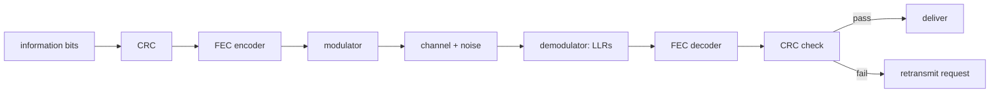
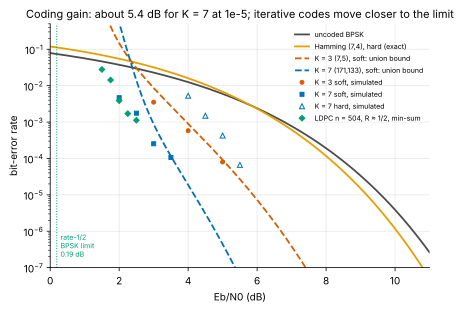
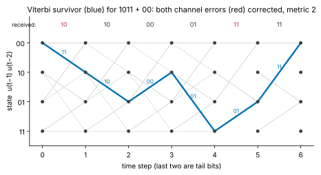

<!-- status: verified -->
# 17-08 · Channel Coding

| | |
|---|---|
| **Course** | [17 · Communication Systems](../README.md) |
| **University equivalent** | The channel-coding chapters of a senior communications course, with the core of an introductory error-control-coding course: linear block codes, cyclic codes and CRCs, Reed–Solomon codes, convolutional codes and the Viterbi algorithm, an introduction to LDPC and polar codes, and coding gain (Lin & Costello, *Error Control Coding*, chapters 3–5, 7, 12 and 17; Proakis & Salehi, *Digital Communications*, linear block and convolutional codes; Moon, *Error Correction Coding*) |
| **Prerequisites** | [17-07](17-07-information-theory-and-shannon.md) (capacity, soft decisions), [17-05](17-05-matched-filters-and-detection.md) (detection from distance), [08-01](../../08-digital-logic-design/chapters/08-01-number-systems-and-codes.md) (parity, Hamming(7,4), SEC-DED, CRC basics), [02-06](../../02-complex-numbers-des-and-linear-algebra/chapters/02-06-vectors-matrices-and-linear-systems.md) (matrices), [03-02](../../03-probability-statistics-and-random-variables/chapters/03-02-random-variables-and-distributions.md) (the binomial distribution) |
| **Estimated study hours** | 9 |
| **Last verified** | 2026-11-21 |

**Learning objectives.** After this chapter you can:

1. Compute a block code's rate, minimum distance and error-detecting and error-correcting capability, and apply the Hamming bound.
2. Encode and syndrome-decode linear block codes from their generator and parity-check matrices.
3. State and use the detection guarantees of a CRC, and identify the CRCs of a real standard.
4. Encode a convolutional code, decode it with the Viterbi algorithm, and estimate its bit-error rate from its distance spectrum.
5. Explain how Reed–Solomon, LDPC and polar codes work and why each is used where it is (Ethernet, 5G NR, storage).
6. Quantify coding gain (asymptotic and at a target error rate, hard against soft decisions) and the gap that remains to capacity.

## 1. Big picture

Chapter 17-07 proved that reliable communication is possible at any rate below capacity, but only by coding: adding structured redundancy so that the receiver can locate and undo the channel's errors. This chapter builds the codes. They range from a single parity bit to codes whose decoders run a million message-passing operations per packet, and they are why a modern radio works within a decibel or two of Shannon's bound and why a 400 Gb/s Ethernet link can run with one raw bit error in every few thousand and still deliver essentially error-free frames.

- **Every link and memory has a code.** DRAM uses SEC-DED words; Ethernet frames end in a CRC; 400G Ethernet adds a Reed–Solomon code; 5G NR uses LDPC codes for data and polar codes for control; deep-space links still fly the 1970s-era convolutional code with Viterbi decoding.
- **Coding gain is power.** A code that saves 6 dB of $E_b/N_0$ lets a transmitter use a quarter of the power, or doubles range in free space, or allows a denser constellation in the same spectrum.
- **Detection and correction are different jobs.** CRCs detect errors cheaply and trigger retransmission; forward error correction (FEC) fixes errors without asking. Real systems layer both.
- **Decoding is where the silicon goes.** Encoders are XOR gates and shift registers. Decoders, especially soft-decision ones, dominate the area, power and latency of a baseband or SerDes chip, so code choice is an architecture decision.

## 2. Intuition first

**Spheres around codewords.** A code with $k$ information bits and $n$ coded bits uses only $2^k$ of the $2^n$ possible $n$-bit words. If any two codewords differ in at least $d$ positions, a received word with up to $t = \lfloor(d - 1)/2\rfloor$ errors is still closer to the transmitted codeword than to any other: draw a "sphere" of radius $t$ around each codeword, and the spheres do not overlap. Decoding means finding which sphere the received word landed in. Coding design is the art of placing many codewords far apart, and decoding design is the art of finding the nearest one without comparing against all $2^k$.

**An analogy: double-entry bookkeeping.** Every transaction is recorded twice, so the books balance; when they do not, an auditor knows something is wrong (detection), and a well-designed set of control totals (by account, by month, by department) can point to the exact wrong entry (correction). Parity checks are control totals over subsets of the bits. *Where it breaks:* an auditor reasons about intent and plausibility; a decoder knows only the code's structure and the channel's statistics. Two compensating errors that keep every control total balanced pass unnoticed, exactly as an error pattern equal to a codeword passes every parity check.

**Soft information.** A receiver that decides each bit before decoding (a **hard decision**) throws away how confident it was. A received BPSK sample of +0.05 is a weak "0", while +1.3 is a strong one; a decoder that keeps the amplitudes (**soft decisions**) can overrule a weak bit when the code's structure says it is wrong. 17-07 showed that this is worth about 1.6 dB at rate 1/2; every modern decoder uses it.

## 3. Theory

### 3.1 Block codes: rate, distance and what they buy

An $(n, k)$ **block code** maps each block of $k$ information bits to a **codeword** of $n$ bits. Its **code rate** is $R = k/n$, and $n - k$ bits are redundancy. The **Hamming distance** between two words is the number of positions in which they differ (08-01), and the code's **minimum distance** $d_{min}$ is the smallest distance between two distinct codewords. From the sphere picture:

- the code **detects** every pattern of up to $d_{min} - 1$ errors (fewer cannot turn one codeword into another);
- it **corrects** every pattern of up to $t = \lfloor(d_{min} - 1)/2\rfloor$ errors;
- it can **correct up to $d_{min} - 1$ erasures** (positions known to be unreliable), because the remaining positions still distinguish every codeword;
- it can correct $t'$ errors and simultaneously detect up to $s > t'$ whenever $t' + s + 1 \le d_{min}$.

**The Hamming (sphere-packing) bound.** Each sphere of radius $t$ contains $\sum_{i=0}^{t}\binom{n}{i}$ words, and the $2^k$ spheres must fit in the space of $2^n$ words:

$$
2^k\sum_{i=0}^{t}\binom{n}{i} \le 2^n .
$$

A code that meets it with equality is **perfect**: every word lies within distance $t$ of exactly one codeword. Hamming codes ($t$ = 1) and the (23,12) Golay code ($t$ = 3) are perfect (Problem 17-08.2).

**Energy accounting.** A rate-$R$ code sends $n$ coded bits for $k$ information bits, so with the same energy per information bit $E_b$ each coded bit carries only $E_c = RE_b$. Coding must win back more through distance than it loses through this dilution, which is why coding gain is always computed at equal $E_b/N_0$.

### 3.2 Linear block codes: generator and parity-check matrices

A code is **linear** if the XOR of any two codewords is a codeword. Then the codewords form a $k$-dimensional subspace of the $n$-bit vectors, and two matrices describe everything:

- The **generator matrix** $\mathbf{G}$ ($k \times n$) has a basis of the code as its rows; the message row vector $\mathbf{m}$ encodes as $\mathbf{c} = \mathbf{m}\mathbf{G}$.
- The **parity-check matrix** $\mathbf{H}$ ($(n - k) \times n$) has every codeword in its null space: $\mathbf{c}\mathbf{H}^\mathsf{T} = \mathbf{0}$, so $\mathbf{G}\mathbf{H}^\mathsf{T} = 0$.

In **systematic form** the message appears unchanged in the codeword: $\mathbf{G} = [\mathbf{I}_k \mid \mathbf{P}]$ and $\mathbf{H} = [\mathbf{P}^\mathsf{T} \mid \mathbf{I}_{n-k}]$, where $\mathbf{P}$ is $k \times (n - k)$; then $\mathbf{G}\mathbf{H}^\mathsf{T} = \mathbf{P} + \mathbf{P} = 0$.

> **Math refresher — arithmetic in GF(2).** The two-element field has $0 + 0 = 0$, $1 + 1 = 0$, $1 + 0 = 1$ (addition is XOR), and multiplication is AND. Subtraction equals addition, so $\mathbf{P} + \mathbf{P} = 0$. Matrix products are ordinary products with every sum reduced modulo 2. Everything you know about rank, null spaces and row reduction from 02-06 carries over, with "divide by a pivot" trivial because the only nonzero element is 1.

**Minimum distance from weights.** For a linear code, the distance between $\mathbf{c}_1$ and $\mathbf{c}_2$ is the weight (number of 1s) of $\mathbf{c}_1 + \mathbf{c}_2$, itself a codeword. So $d_{min}$ is the smallest weight of a nonzero codeword, and the **weight distribution** $A_w$ (the number of codewords of weight $w$) gives every distance in the code. Equivalently, $d_{min}$ is the smallest number of columns of $\mathbf{H}$ that add to zero.

**Syndrome decoding.** Received $\mathbf{r} = \mathbf{c} + \mathbf{e}$, with $\mathbf{e}$ the error pattern. The **syndrome** is

$$
\mathbf{s} = \mathbf{r}\mathbf{H}^\mathsf{T} = \mathbf{c}\mathbf{H}^\mathsf{T} + \mathbf{e}\mathbf{H}^\mathsf{T} = \mathbf{e}\mathbf{H}^\mathsf{T} ,
$$

which depends only on the error, not on the message. There are $2^{n-k}$ syndromes; the decoder stores, for each, the most likely (lowest-weight) error pattern that produces it, and subtracts it. For a single error in position $j$, $\mathbf{s}$ is the $j$th column of $\mathbf{H}$.

### 3.3 Hamming codes and SEC-DED, in matrix form

A **Hamming code** with $r$ check bits takes as the columns of $\mathbf{H}$ all $2^r - 1$ nonzero $r$-bit vectors, so $n = 2^r - 1$ and $k = n - r$. No column is zero and no two are equal, so no one or two columns add to zero, while three can (e.g. 001 + 010 + 011): $d_{min}$ = 3 and $t$ = 1. Every single error has a distinct nonzero syndrome, and because $2^k(1 + n) = 2^{n-r}2^r = 2^n$ the code is perfect. Example 17-08.1 builds the (7,4) code with $\mathbf{G}$, $\mathbf{H}$ and a syndrome table, the matrix form of 08-01's positional construction.

Appending an overall parity bit makes every codeword weight even, so the weight-3 codewords become weight 4: the **extended Hamming code** has $d_{min}$ = 4 and is **SEC-DED** (single-error-correcting, double-error-detecting, 08-01). For a memory word of $k$ data bits, the Hamming part needs the smallest $r$ with $2^r \ge k + r + 1$; for $k$ = 64 that is $r$ = 7, plus the parity bit: 8 check bits, a (72,64) code.

### 3.4 Cyclic codes and CRCs

A **cyclic code** is linear and closed under cyclic shifts. Writing an $n$-bit word as a polynomial $c(x) = c_{n-1}x^{n-1} + \dots + c_0$ over GF(2), every codeword is a multiple of a **generator polynomial** $g(x)$ of degree $r = n - k$. The systematic encoder appends to the message $m(x)$ the remainder of $m(x)x^r$ divided by $g(x)$, so the whole word divides evenly; a shift register with XOR feedback taps performs the division one bit per clock (08-01 works an example by hand).

Used for detection, this is a **cyclic redundancy check (CRC)**. An error pattern $e(x)$ escapes only if $g(x)$ divides it. With $g(x)$ of degree $r$ and a nonzero constant term (08-01's "Going deeper" proves the first three):

- every single-bit error is detected;
- every **burst** (errors confined to $b$ consecutive positions) with $b \le r$ is detected;
- if $(x + 1)$ divides $g(x)$, every odd-weight error pattern is detected; since $g(1)$ is the number of terms modulo 2, this holds exactly when $g$ has an even number of terms;
- of bursts of length $r + 1$, a fraction $2^{-(r-1)}$ goes undetected, and of longer bursts $2^{-r}$; for random error patterns the undetected fraction is also close to $2^{-r}$.

**The CRCs of 5G NR** ([R-279]) show how a standard chooses. TS 38.212 defines six generator polynomials: CRC24A, CRC24B and CRC24C ($r$ = 24), CRC16, CRC11 and CRC6. Data transport blocks carry CRC24A if they exceed 3824 bits and CRC16 otherwise; each LDPC code block after segmentation carries CRC24B; the broadcast channel and downlink control information carry CRC24C; uplink control information uses CRC11 or CRC6 depending on its size. CRC16 ($x^{16} + x^{12} + x^5 + 1$), CRC24A and CRC24B have an even number of terms and catch every odd-weight error; CRC24C, CRC11 and CRC6 do not. TS 38.212 states no rationale for these choices. One relevant consideration is that the CRCs on polar-coded channels do double duty: with CRC-aided list decoding (§3.8) the CRC also picks among $L$ candidate decodings, which spends about $\log_2L$ of its $r$ bits, so the false-alarm rate is roughly $2^{-(r - \log_2L)}$.

> **Going deeper — undetected error probability.** For a binary symmetric channel with bit-error probability $p$, a linear code's undetected-error probability is exactly $P_u = \sum_{w \ge 1}A_wp^w(1 - p)^{n-w}$, the probability that the error pattern is a nonzero codeword. For long CRC-protected blocks and moderate $p$ it approaches $2^{-r}$, but not for every $p$: some polynomials are "improper" and exceed $2^{-r}$ at particular error rates. Koopman's tables of CRC polynomials list the minimum distance each achieves for each data length, which is how standards bodies choose them.

### 3.5 How well block codes perform

**Hard decisions.** If the demodulator slices each coded bit with error probability $p$ and the decoder corrects any pattern of up to $t$ errors (bounded-distance decoding), a block fails when more than $t$ of its $n$ bits are wrong:

$$
P_{block} = \sum_{i=t+1}^{n}\binom{n}{i}p^i(1 - p)^{n-i} \approx \binom{n}{t+1}p^{t+1} \quad (p \ll 1) .
$$

**Soft decisions.** With BPSK, a coded bit is sent as $\pm\sqrt{E_c}$. Two codewords at Hamming distance $d$ differ in $d$ positions, each by $2\sqrt{E_c}$, so their Euclidean distance is $d_E = 2\sqrt{dE_c}$. The probability that the maximum-likelihood decoder prefers the wrong one of the pair is (17-05)

$$
Q\Big(\frac{d_E}{\sqrt{2N_0}}\Big) = Q\Big(\sqrt{\frac{2dE_c}{N_0}}\Big) = Q\Big(\sqrt{2Rd\frac{E_b}{N_0}}\Big) ,
$$

and the **union bound** over all competitors is $P_{block} \le \sum_dA_dQ\big(\sqrt{2RdE_b/N_0}\big)$, dominated at high SNR by the $d_{min}$ term.

**Asymptotic coding gain.** Compare with uncoded BPSK, $Q(\sqrt{2E_b/N_0})$. At high SNR only the argument of $Q$ matters, so soft decoding behaves as if $E_b/N_0$ were multiplied by $Rd_{min}$:

$$
G_{soft} = 10\log_{10}(Rd_{min})\ \text{dB}, \qquad G_{hard} \approx 10\log_{10}\big(R(t + 1)\big)\ \text{dB} .
$$

The hard-decision form uses $Q(\sqrt{2x}) \approx e^{-x}$ to leading order in the exponent: the block error behaves like $p^{t+1} \sim e^{-(t+1)RE_b/N_0}$ against the uncoded $e^{-E_b/N_0}$. Since $t + 1 \approx d_{min}/2$, hard decisions lose about 3 dB asymptotically; at practical error rates the loss is closer to 2 dB. For the (7,4) Hamming code, $G_{soft} = 10\log_{10}(12/7)$ = **2.34** dB but $G_{hard} = 10\log_{10}(8/7)$ = **0.58** dB: hard-decision Hamming coding barely pays in a power-limited link (Example 17-08.3), and repetition codes never pay at all (Problem 17-08.7).

### 3.6 Reed–Solomon codes

**Reed–Solomon (RS)** codes work on $m$-bit symbols, elements of the finite field GF($2^m$). An RS$(n, k)$ code has $n \le 2^m - 1$ symbols (shorter codes are made by fixing leading message symbols to zero) and achieves

$$
d_{min} = n - k + 1 ,
$$

the largest possible for any code with these $n$ and $k$ (the **Singleton bound** $d_{min} \le n - k + 1$ holds for every code, because deleting $d_{min} - 1$ positions must leave the codewords distinct). Such codes are called **maximum-distance separable**. An RS code corrects $t = (n - k)/2$ symbol errors, or $n - k$ symbol erasures.

Because a symbol counts as one error however many of its bits are wrong, RS codes are natural for **burst errors**. A burst of $b$ bits, in the worst alignment, starts at the last bit of a symbol and touches $1 + \lceil(b - 1)/m\rceil$ symbols, so every burst of up to $(t - 1)m + 1$ bits is correctable.

**Interleaving.** A burst longer than one codeword can absorb is spread across several codewords by an **interleaver**. A **block interleaver** of depth $I$ writes $I$ codewords of $n$ symbols as the rows of an $I \times n$ array and transmits it column by column. A channel burst of $b$ consecutive symbols then puts at most $\lceil b/I\rceil$ errors into any one codeword, so $I$ codewords that each correct $t$ symbol errors survive every burst of up to $tI$ symbols. The price is latency and memory: the receiver must buffer the whole array, $In$ symbols (twice that with double buffering), before it can decode. Problem 17-08.18 sizes one.

**BCH codes.** Reed–Solomon codes have binary cousins. A binary **BCH code** of length $n = 2^m - 1$ is the cyclic code whose generator polynomial has as roots $\alpha, \alpha^2, \dots, \alpha^{2t}$, with α a primitive element of GF($2^m$). Over GF(2) each root brings its whole minimal polynomial, of degree at most $m$, and the even powers come free ($\alpha^{2i}$ is a root of the same minimal polynomial as $\alpha^i$), so $g(x)$ is the product of at most $t$ minimal polynomials and $n - k \le mt$. The **BCH bound** guarantees $d_{min} \ge 2t + 1$, the **designed distance**. With $m$ = 4: $t$ = 1 gives the (15,11) Hamming code, and $t$ = 2 gives $g(x) = (x^4 + x + 1)(x^4 + x^3 + x^2 + x + 1) = x^8 + x^7 + x^6 + x^4 + 1$, a (15,7) code with $d_{min}$ = 5. RS codes are the non-binary case of the same construction: with symbols in GF($2^m$) itself every minimal polynomial has degree 1, so $n - k = 2t$ exactly. BCH codes are decoded with the same syndrome, Berlekamp–Massey and Chien machinery; they are DVB-S2's outer code (§3.9) and the classic ECC of NAND flash.

With independent bit errors of probability $p$, a symbol is wrong with probability $q = 1 - (1 - p)^m$, and a codeword is uncorrectable with probability $P_{cw} = \sum_{i > t}\binom{n}{i}q^i(1 - q)^{n-i}$. Ethernet's "KP4" code is RS(544,514) over GF($2^{10}$), $t$ = 15 ([R-280]); Example 17-08.6 works its numbers.

> **Going deeper — decoding RS codes.** A codeword is the evaluation of a degree-$(k - 1)$ message polynomial at $n$ field points (or, equivalently, a multiple of $g(x) = \prod_{i=1}^{n-k}(x - \alpha^i)$). The decoder computes $n - k$ syndromes, finds the error-locator polynomial with the Berlekamp–Massey algorithm, finds its roots by Chien search, and computes the error values with Forney's formula. All of it is finite-field arithmetic on short polynomials, which is why RS decoders are compact and fast enough for 100 Gb/s lanes.

### 3.7 Convolutional codes and the Viterbi algorithm

A **convolutional code** encodes a continuous bit stream rather than blocks. A rate-$1/n$ encoder holds the last $K - 1$ input bits in a shift register (the **constraint length** $K$ counts the current bit too) and, for each input bit, emits $n$ output bits, each the XOR of a subset of the $K$ register bits given by a **generator** written in octal. The simplest useful code has $K$ = 3 and generators $(7, 5)_8$ = (111, 101): output 1 is $u_t \oplus u_{t-1} \oplus u_{t-2}$ and output 2 is $u_t \oplus u_{t-2}$.

**States and the trellis.** The encoder's state is its memory $(u_{t-1}, u_{t-2})$: four states for $K$ = 3, $2^{K-1}$ in general. Each input bit moves the state along one of two branches, labelled with the output bits. Unrolled in time, the state diagram becomes a **trellis**, and every encoded sequence is a path through it. To end in a known state, the encoder appends $K - 1$ zero "tail" bits, costing a rate factor $L/(L + K - 1)$ for an $L$-bit message.

**Free distance and the distance spectrum.** The code is linear, so its error behaviour is set by the weights of paths that leave the all-zero state and later rejoin it. The smallest such weight is the **free distance** $d_{free}$. For the (7,5) code the state equations give the full spectrum. Label each branch $D^{w}N^{u}$, where $w$ is the branch's output weight and $u$ its input bit, and split state 00 into a start and an end. With $X_b, X_c, X_d$ the path sums reaching states 10, 01 and 11:

$$
\begin{aligned}
X_b &= D^2N + NX_c, & X_c &= DX_b + DX_d, & X_d &= DNX_b + DNX_d, & T &= D^2X_c .
\end{aligned}
$$

From the third, $X_d = DNX_b/(1 - DN)$; then $X_c = DX_b/(1 - DN)$, and substituting into the first gives $X_b = D^2N(1 - DN)/(1 - 2DN)$. So

$$
T(D, N) = \frac{D^5N}{1 - 2DN} = \sum_{j=0}^{\infty}2^jD^{5+j}N^{j+1} .
$$

There is $A_5$ = 1 path of weight 5 (so $d_{free}$ = **5**), 2 of weight 6, 4 of weight 7, and in general $A_d = 2^{d-5}$ paths of weight $d$, each with $d - 4$ information 1s. Their total information weight is $B_d = (d - 4)2^{d-5}$, the coefficient of $D^d$ in $\partial T/\partial N$ at $N$ = 1.

**The Viterbi algorithm** finds the maximum-likelihood path without enumerating paths. At each time step, for every state, it keeps only the best path (the **survivor**) into that state:

1. **Add:** for each of the two branches into a state, add the branch metric (Hamming distance between the branch output and the received bits for hard decisions; minus the correlation with the received samples for soft decisions) to the survivor metric of the state it comes from.
2. **Compare:** keep the smaller.
3. **Select:** record which branch won.

At the end, trace back from the zero state through the recorded choices. The principle that makes this optimal is that if the best overall path passes through a state, its prefix must be the best path into that state. The cost is $2^{K-1}$ add-compare-select (ACS) operations per bit, linear in message length instead of exponential. A practical decoder traces back after a window of about five constraint lengths rather than waiting for the end.

**Bit-error rate.** A union bound over error events gives, for a rate-$1/n$ code with soft decisions,

$$
P_b \le \sum_{d \ge d_{free}}B_d\,Q\Big(\sqrt{2Rd\frac{E_b}{N_0}}\Big) ,
$$

tight once $P_b$ is below about $10^{-3}$. The asymptotic soft coding gain is $10\log_{10}(Rd_{free})$: 3.98 dB for the (7,5) code.

**The industry-standard code.** The rate-1/2, $K$ = 7 code with generators $(171, 133)_8$ is the convolutional code of CCSDS space links ([R-281]) and of the original 802.11 OFDM PHY (from a secondary source, [R-281]). It has 64 states, $d_{free}$ = 10, and with puncturing (deleting coded bits in a fixed pattern, so that one decoder serves rates 2/3, 3/4 and 5/6) it served as the workhorse of digital communications from the 1970s into the 2000s. Example 17-08.5 computes its gain.

### 3.8 Codes that approach capacity

Viterbi-decoded convolutional codes leave about 4 dB on the table at $10^{-5}$ (Example 17-08.5). Closing that gap took codes whose decoders iterate: **turbo codes** (two convolutional codes joined by an interleaver, decoded by exchanging soft information; used in 3G and 4G cellular data), **LDPC** codes and **polar** codes.

**LDPC codes.** A **low-density parity-check** code is a linear code whose $\mathbf{H}$ is sparse: each of the $n$ bits takes part in only a few checks (say 3) and each check involves only a few bits (say 6). Draw $\mathbf{H}$ as a bipartite **Tanner graph**, with variable nodes for bits, check nodes for parity equations, and an edge for each 1 in $\mathbf{H}$. Decoding is **belief propagation**: nodes exchange **log-likelihood ratios** along the edges, and each iteration refines every bit's belief using what its checks say about it.

> **Math refresher — log-likelihood ratios.** For a bit $b$, $L = \ln\frac{P(b = 0)}{P(b = 1)}$: positive favours 0, and $|L|$ is the confidence. For BPSK with amplitude $\sqrt{E_c}$ ($b \mapsto \sqrt{E_c}(1 - 2b)$) in Gaussian noise of variance σ², the channel LLR of a received $y$ is $L = 2\sqrt{E_c}\,y/\sigma^2$, which is $2y/\sigma^2$ for unit amplitude. Independent evidence about the same bit adds: $L_{total} = L_1 + L_2$.

The two update rules follow from that definition:

- **Variable node:** a bit's outgoing message to one check is its channel LLR plus the messages from all its *other* checks (independent evidence adds).
- **Check node:** a check says the XOR of its bits is 0. With $\tanh(L/2) = P(0) - P(1)$, the "expected sign" of an XOR is the product of the expected signs, so the message to one bit is $2\tanh^{-1}\prod_j\tanh(L_j/2)$ over the *other* bits. Its **min-sum** approximation keeps the product of signs and the smallest magnitude, usually scaled by about 0.75 to correct its overconfidence (Problem 17-08.16).

Random sparse graphs have almost no short cycles, so over many iterations each bit's neighbourhood looks like a tree, the messages stay nearly independent, and belief propagation approximately computes each bit's posterior probability. It is **not** maximum-likelihood decoding. For the (3,6)-regular ensemble on the erasure channel, density evolution gives a BP threshold of ε ≈ **0.429**, against about 0.488 for optimal (MAP) decoding and 0.5 for capacity (Richardson & Urbanke, ch. 3). What brings practical codes close to capacity is the design of irregular degree distributions, which push the BP threshold to within a fraction of a decibel of capacity. Long LDPC codes show a **threshold**: below a certain $E_b/N_0$ they fail, and just above it the error rate falls off a cliff (the "waterfall"). Well-designed codes put the threshold within a fraction of a decibel of capacity.

For hardware, $\mathbf{H}$ is built from a small **base graph** whose entries are replaced by $Z_c \times Z_c$ cyclically shifted identity matrices, so the decoder processes $Z_c$ edges in parallel with simple barrel shifters. 5G NR ([R-279]) uses two base graphs: BG1 (46 × 68, codeword length $66Z_c$) and BG2 (42 × 52, $50Z_c$), with lifting sizes up to $Z_c$ = 384. BG1 has $68 - 46 = 22$ information columns, so its largest code block is $22 \times 384$ = **8448** bits and its lowest rate $22/66$ = **1/3**; BG2's are $10 \times 384$ = 3840 bits and $10/50$ = **1/5**. Small blocks, or low rates, use BG2. Higher rates are reached by not transmitting some parity bits (rate matching), so one decoder serves every rate.

**Codes with QAM: bit LLRs and BICM.** Every code above is described on binary inputs, yet Wi-Fi and NR send up to 4096-QAM. The standard bridge is **bit-interleaved coded modulation (BICM)**: encode with a binary code, interleave the coded bits, and map each group of $\log_2M$ bits to one Gray-labelled QAM symbol. The demodulator computes one LLR per bit from each received symbol $y$:

$$
L_i = \ln\frac{\sum_{s \in \mathcal S_i^0}e^{-\lvert y - s\rvert^2/N_0}}{\sum_{s \in \mathcal S_i^1}e^{-\lvert y - s\rvert^2/N_0}}
\approx \frac{\min_{s \in \mathcal S_i^1}\lvert y - s\rvert^2 - \min_{s \in \mathcal S_i^0}\lvert y - s\rvert^2}{N_0} ,
$$

where $\mathcal S_i^b$ is the set of constellation points whose $i$th bit is $b$ and the approximation ("max-log") keeps only the nearest point of each set. The binary decoder then runs unchanged. With Gray labelling, BICM loses little against the constellation-constrained capacity of 17-07 (Caire, Taricco and Biglieri, *IEEE Trans. Inf. Theory*, 1998), which is why Wi-Fi, LTE and NR all use it. Historically, **trellis-coded modulation** (Ungerboeck, 1982) instead designed the code and the constellation labelling together to maximize Euclidean distance; it gave the voiceband modems of the 1980s and 1990s gains of several decibels without extra bandwidth.

**Polar codes.** Take two uses of a binary erasure channel with erasure probability ε and send $x_1 = u_1 \oplus u_2$ and $x_2 = u_2$. Decode $u_1$ first: it needs both $x_1$ and $x_2$, so it is lost if either is erased, probability $2\varepsilon - \varepsilon^2$ (a worse channel). Then, knowing $u_1$, recover $u_2$ from $x_2$ or from $x_1 \oplus u_1$: lost only if both are erased, probability $\varepsilon^2$ (a better channel). The total capacity is unchanged, $(1 - 2\varepsilon + \varepsilon^2) + (1 - \varepsilon^2) = 2(1 - \varepsilon)$, but it has been redistributed. Applying the step recursively $n$ times makes $N = 2^n$ synthesized channels that **polarize**: almost all become nearly perfect or nearly useless, and the fraction of good ones tends to the capacity. For $N$ = 8 and ε = 0.5, the erasure probabilities range from **0.0039** to **0.9961** while still summing to 4.

A **polar code** puts information on the $K$ most reliable channels and fixes ("freezes") the others to 0. The encoder is $\log_2N$ stages of XOR butterflies, like an FFT. The **successive-cancellation** decoder decodes the bits in order, each using the earlier decisions, with the same LLR rules as LDPC. Practical decoders keep a short list of candidate paths and use a CRC to pick the right one (CRC-aided list decoding). NR uses polar codes for its control channels and broadcast channel, with a mother code of at most 512 bits for the broadcast channel and downlink control information and at most 1024 bits for uplink control information ([R-279]): short blocks, where polar codes with list decoding are strong and their simple structure helps latency.

### 3.9 Coding gain against the Shannon limit

At $P_b = 10^{-5}$ uncoded BPSK needs 9.59 dB. The rate-1/2 BPSK-input bound of 17-07 is 0.19 dB. Between them sit the codes:

- a $K$ = 7 Viterbi decoder: the union bound puts it at about 4.2 dB (Example 17-08.5), and simulation needs slightly less, a gain of about 5.4 dB that still leaves about 4 dB to the bound;
- long LDPC codes. DVB-S2's QPSK rate-1/2 code needs $E_b/N_0$ = 1.05 dB for quasi-error-free operation (packet error rate $10^{-7}$, [R-276], 17-06), only **0.89** dB above the BPSK-input limit at its 0.494 bits per dimension (**0.16** dB).

The remaining fraction of a decibel buys diminishing returns at the cost of longer blocks (latency), more iterations (power) and more memory, which is why standards stop where they do.

## 4. Worked examples

### Example 17-08.1 · The (7,4) Hamming code in matrix form (tier A)

**Setup.** Use the systematic (7,4) code with parity bits $p_1 = d_1 \oplus d_2 \oplus d_4$, $p_2 = d_1 \oplus d_3 \oplus d_4$ and $p_3 = d_2 \oplus d_3 \oplus d_4$. Write $\mathbf{G}$ and $\mathbf{H}$, encode 1011, decode the received word 1001 010, find the weight distribution and check that the code is perfect.

**Solution.** With codeword order $(d_1, d_2, d_3, d_4, p_1, p_2, p_3)$:

$$
\mathbf{G} = \left[\begin{array}{cccc|ccc}1&0&0&0&1&1&0\\0&1&0&0&1&0&1\\0&0&1&0&0&1&1\\0&0&0&1&1&1&1\end{array}\right], \qquad
\mathbf{H} = \left[\begin{array}{cccc|ccc}1&1&0&1&1&0&0\\1&0&1&1&0&1&0\\0&1&1&1&0&0&1\end{array}\right] .
$$

Encoding 1011: $p_1 = 1 \oplus 0 \oplus 1 = 0$, $p_2 = 1 \oplus 1 \oplus 1 = 1$, $p_3 = 0 \oplus 1 \oplus 1 = 0$, so $\mathbf{c}$ = 1011 010. The received 1001 010 has syndrome $\mathbf{r}\mathbf{H}^\mathsf{T}$ = 011, which is column 3 of $\mathbf{H}$: flip bit 3 to recover 1011 010. The rate is $4/7$ = **0.571**. Enumerating the 16 codewords gives weights $A_0 = 1$, $A_3$ = **7**, $A_4 = 7$, $A_7 = 1$, so $d_{min}$ = **3**. Spheres of radius 1 hold $1 + 7 = 8$ words each, and $16 \times 8$ = **128** = $2^7$: the spheres fill the space exactly.

**Units check.** Counts of words and bits.

**Sanity check.** $\mathbf{G}\mathbf{H}^\mathsf{T}$ = 0 (each row of $\mathbf{G}$ satisfies all three checks), and the seven columns of $\mathbf{H}$ are the seven distinct nonzero 3-bit vectors.

### Example 17-08.2 · Choosing CRCs in 5G NR (tier B)

**Setup.** NR attaches CRC24A to data transport blocks larger than 3824 bits and CRC16 otherwise ([R-279]). For random errors, what fraction of corrupted blocks does a 24-bit CRC miss? What fraction of 25-bit bursts? What is the CRC overhead for a 3824-bit block and for a 3840-bit block? How many of NR's six CRC polynomials catch every odd-weight error?

**Solution.** Random errors: $2^{-24}$ = **5.96e-8**. Bursts of length $r + 1$ = 25: $2^{-23}$ = **1.19e-7**. Overhead: $16/3824$ = **0.42** % and $24/3840$ = **0.63** %. Counting terms (from §3.4): CRC24A has 14, CRC24B 6, CRC16 4 (even, so $x + 1$ divides them), CRC24C 13, CRC11 5, CRC6 3 (odd): **3** polynomials catch every odd-weight pattern.

**Units check.** Probabilities and percentages are dimensionless.

**Sanity check.** Going from 16 to 24 bits costs eight bits per block but cuts the miss rate by $2^8$ = 256: cheap insurance once blocks are a few thousand bits long.

### Example 17-08.3 · Does a Hamming code pay with hard decisions? (tier B)

**Setup.** BPSK at $E_b/N_0$ = 7 dB. Compare sending 4 information bits uncoded with sending them as a (7,4) Hamming codeword decoded by hard decisions, at the same $E_b/N_0$. Find the raw bit-error probabilities and the probability that the 4-bit block is wrong.

**Solution.** $E_b/N_0 = 10^{0.7} = 5.012$. Uncoded: $p = Q(\sqrt{2 \times 5.012})$ = **7.73e-4**, and the block is wrong with probability $1 - (1 - p)^4$ = **3.09e-3**. Coded: each coded bit has $E_c = \tfrac47E_b$, so $p_c = Q(\sqrt{2 \times \tfrac47 \times 5.012})$ = **8.35e-3**, ten times worse. The decoder fails only with two or more errors among seven: $1 - (1 - p_c)^7 - 7p_c(1 - p_c)^6$ = **1.42e-3** (close to $21p_c^2$).

**Units check.** Probabilities.

**Sanity check.** Coding helps, but only by a factor of about 2, consistent with the 0.58 dB asymptotic hard-decision gain of §3.5. Soft decoding of the same code would gain about 2 dB more.

### Example 17-08.4 · Viterbi decoding by hand (tier B)

**Setup.** Encode 1011 with the (7,5) code and two tail zeros. The channel flips the 2nd and 9th coded bits. Decode with hard-decision Viterbi, then state the code's free distance and asymptotic gains.

**Solution.** From state 00, the inputs 1, 0, 1, 1, 0, 0 produce 11 10 00 01 01 11. The received sequence is 10 10 00 01 11 11. The survivor metrics (Hamming distance of the best path into each state, states written $u_{t-1}u_{t-2}$) are:

| State | after 1 | after 2 | after 3 | after 4 | after 5 | after 6 |
|---|---|---|---|---|---|---|
| 00 | 1 | 2 | 2 | 3 | 3 | **2** |
| 10 | 1 | 2 | 1 | 3 | — | — |
| 01 | — | 1 | 3 | 3 | 2 | — |
| 11 | — | 3 | 3 | 1 | — | — |

The last two steps are tail bits, so only input 0 is allowed. Tracing back from state 00 gives the path 00 → 10 → 01 → 10 → 11 → 01 → 00, inputs **1011** then 00, with path metric **2**: both errors corrected. The free distance is **5** (§3.7), so $G_{soft} = 10\log_{10}(\tfrac12 \times 5)$ = **3.98** dB and $G_{hard} = 10\log_{10}(\tfrac12 \times 3)$ = **1.76** dB.

**Units check.** Metrics count bit disagreements.

**Sanity check.** Because the trellis is terminated, any two codewords differ in at least $d_{free}$ = 5 positions, so the Viterbi (ML) decoder corrects any two errors anywhere in the block, however close together. Three or more errors are also corrected when they lie several constraint lengths apart.

### Example 17-08.5 · The K = 7 code against Shannon (tier C)

**Setup.** For the rate-1/2, $K$ = 7, $(171, 133)_8$ code, the distance spectrum (computed by the lab from the state diagram) begins $d_{free}$ = 10 with $A_{10}$ = 11 paths of total information weight $B_{10}$ = 36, then $B_{12}$ = 211, $B_{14}$ = 1404, $B_{16}$ = 11 633, $B_{18}$ = 77 433, $B_{20}$ = 502 690, $B_{22}$ = 3 322 763 and $B_{24}$ = 21 292 910 (odd weights do not occur; terms beyond $d$ = 24 change the result below by less than 0.001 dB). Find the asymptotic soft gain, the $E_b/N_0$ at which the union bound gives $P_b = 10^{-5}$, the coding gain there, and the remaining gap to the rate-1/2 BPSK-input limit of 0.19 dB.

**Solution.** $G_{soft} = 10\log_{10}(\tfrac12 \times 10)$ = **6.99** dB. Solving $\sum_dB_dQ(\sqrt{dE_b/N_0}) = 10^{-5}$ (with $2R = 1$) numerically, with the eight listed terms, gives $E_b/N_0$ = **4.17** dB (the first four terms alone give 4.16 dB: the tail matters at the second decimal). Uncoded BPSK needs 9.59 dB, so the gain at $10^{-5}$ is **5.41** dB, and the gap to 0.19 dB is **3.99** dB.

**Units check.** The argument of $Q$ is dimensionless: $R$ and $d$ are pure numbers and $E_b/N_0$ is a ratio.

**Sanity check.** The gain at $10^{-5}$ (5.4 dB) is below the asymptotic 7.0 dB because the many paths at weights 12–16 add up: at 4.17 dB the $d$ = 10 term contributes only 57% of the bound. Simulations at 3.5 dB land below the bound, as an upper bound should, but scatter widely: three independent runs of a million bits each gave 0.35, 0.53 and 1.0 times the bound. Viterbi errors arrive in bursts of several bits, so even a million bits holds only a few dozen independent error events.

### Example 17-08.6 · Ethernet's KP4 Reed–Solomon code (tier C)

**Setup.** RS(544,514) over GF($2^{10}$) protects 200G and 400G Ethernet ([R-280]); 100GBASE-KR4 used RS(528,514). For each: find $t$, the overhead, the longest burst always corrected, the codeword failure probability at a raw bit-error rate of $10^{-4}$ (independent errors), and the raw BER at which the failure probability is $10^{-12}$. Then show that 400 Gb/s with 256b/257b transcoding and KP4 needs exactly 425 Gb/s on the line.

**Solution.** RS(544,514): $t = 30/2$ = **15**, overhead $544/514 - 1$ = **5.84** %, burst $(15 - 1) \times 10 + 1$ = **141** bits. At $p = 10^{-4}$, $q = 1 - (1 - 10^{-4})^{10} = 1.0 \times 10^{-3}$, and $P(N > 15)$ for $N \sim \text{Binomial}(544, q)$ is **1.36e-18**. Solving $P_{cw} = 10^{-12}$ gives a raw BER of **2.43e-4**. RS(528,514): $t$ = 7, overhead 2.72%, bursts of 61 bits, $P_{cw} = 8.9 \times 10^{-8}$ at $10^{-4}$, and the $10^{-12}$ threshold falls to **2.30e-5**: doubling the parity symbols tolerates a tenfold worse raw channel, which is what made PAM4 lanes (17-04) practical. Line rate: $400 \times \tfrac{257}{256} \times \tfrac{544}{514} = 400 \times 1.0625$ = **425** Gb/s.

**Units check.** $q$, $P_{cw}$ and BER are probabilities; rates in Gb/s.

**Sanity check.** At the threshold, a codeword carries $5440 \times 2.43 \times 10^{-4} \approx 1.3$ wrong bits on average, far below 15: failures need rare clusters, which is why the tail falls so steeply. Real errors are not independent (DFE error propagation, 17-04), so standards specify the post-FEC requirement with burst models; treat these numbers as the independent-error baseline.

<!-- answer-key -->

| ID | Quantity | Value | Unit |
|---|---|---|---|
| Txt 17-08.a | (7,4) soft asymptotic gain | 2.34 | dB |
| Txt 17-08.b | (7,4) hard asymptotic gain | 0.58 | dB |
| Txt 17-08.c | NR BG1 largest code block | 8448 | bits |
| Txt 17-08.d | NR BG1 lowest rate | 0.333 | — |
| Txt 17-08.e | NR BG2 lowest rate | 0.2 | — |
| Txt 17-08.f | best polar channel, N = 8, ε = 0.5 | 0.0039 | — |
| Txt 17-08.g | worst polar channel, N = 8, ε = 0.5 | 0.9961 | — |
| Txt 17-08.h | free distance of (7,5) | 5 | — |
| Txt 17-08.i | DVB-S2 QPSK 1/2 gap to BPSK-input limit | 0.89 | dB |
| Txt 17-08.j | BPSK-input limit at 0.494 b/dimension | 0.16 | dB |
| Ex 17-08.1a | rate | 0.571 | — |
| Ex 17-08.1b | codewords of weight 3 | 7 | — |
| Ex 17-08.1c | minimum distance | 3 | — |
| Ex 17-08.1d | words covered by the spheres | 128 | — |
| Ex 17-08.2a | random-error miss rate, 24-bit CRC | 5.96e-8 | — |
| Ex 17-08.2b | 25-bit burst miss rate | 1.19e-7 | — |
| Ex 17-08.2c | CRC16 overhead at 3824 bits | 0.42 | % |
| Ex 17-08.2d | CRC24A overhead at 3840 bits | 0.63 | % |
| Ex 17-08.2e | NR CRCs catching all odd-weight errors | 3 | — |
| Ex 17-08.3a | uncoded bit-error probability | 7.73e-4 | — |
| Ex 17-08.3b | uncoded 4-bit block error | 3.09e-3 | — |
| Ex 17-08.3c | coded bit-error probability | 8.35e-3 | — |
| Ex 17-08.3d | Hamming block error | 1.42e-3 | — |
| Ex 17-08.4a | path metric | 2 | — |
| Ex 17-08.4b | free distance | 5 | — |
| Ex 17-08.4c | soft asymptotic gain | 3.98 | dB |
| Ex 17-08.4d | hard asymptotic gain | 1.76 | dB |
| Ex 17-08.5a | K = 7 soft asymptotic gain | 6.99 | dB |
| Ex 17-08.5b | union-bound Eb/N0 at 1e-5 | 4.17 | dB |
| Ex 17-08.5c | coding gain at 1e-5 | 5.41 | dB |
| Ex 17-08.5d | gap to the BPSK-input limit | 3.99 | dB |
| Ex 17-08.6a | KP4 t | 15 | symbols |
| Ex 17-08.6b | KP4 overhead | 5.84 | % |
| Ex 17-08.6c | KP4 guaranteed burst | 141 | bits |
| Ex 17-08.6d | KP4 failure at BER 1e-4 | 1.36e-18 | — |
| Ex 17-08.6e | KP4 raw BER for 1e-12 | 2.43e-4 | — |
| Ex 17-08.6f | RS(528,514) raw BER for 1e-12 | 2.30e-5 | — |
| Ex 17-08.6g | 400G line rate with KP4 | 425 | Gb/s |

*Every value is recomputed by [verify_17_08.py](../verify/verify_17_08.py): code properties by enumerating codewords and by GF(2) linear algebra, CRCs by polynomial division (including exhaustive burst tests on small generators), block and RS error rates from the binomial tail and by Monte Carlo, distance spectra from the state diagram and against the transfer-function formula, union-bound thresholds by root finding, and Viterbi, LDPC and polar decoders by simulation.*

## 5. Simulate it

The lab, [labs/17-08-lab](../labs/17-08-lab/README.md), provides `coding.py`: GF(2) linear algebra, Hamming codes, syndrome decoding, CRCs with the NR polynomials, convolutional encoding with hard and soft Viterbi decoding, distance spectra and union bounds, a Gallager LDPC code with a min-sum decoder, polar encoding with successive-cancellation decoding, and Reed–Solomon failure probabilities. In the notebook, **predict, then run**:

1. **Hamming and SEC-DED.** Predict the weight distribution of the (15,11) Hamming code's lightest words and the block error rate at $p = 10^{-2}$; enumerate and simulate.
2. **CRC bursts.** Predict which bursts a CRC6 misses; test every burst of length 5 to 9 exhaustively.
3. **Viterbi.** Predict the BER of the $K$ = 3 and $K$ = 7 codes at 3.5 dB from their union bounds; simulate with soft and hard decisions and measure the soft-decision advantage.
4. **LDPC.** Predict where a rate-1/2 LDPC code of length 504 starts to work; simulate the frame-error rate and the average number of iterations against $E_b/N_0$.
5. **Polar codes.** Watch channels polarize as $N$ grows from 8 to 1024; then design and simulate a (256, 128) polar code.
6. **Reed–Solomon.** Plot KP4 and KR4 failure probability against raw BER and find their thresholds.

## 6. Engineering tradeoffs

| Knob | Improves | Costs | Typical decision owner |
|---|---|---|---|
| Lower code rate | Coding gain, robustness | Throughput (rate), spectrum | PHY architect, standards body |
| Longer blocks or constraint length | Gain closer to capacity | Latency, memory, decoder area; for $K$, 2× states per extra bit | PHY architect |
| Soft-decision decoding | ≈ 2 dB over hard | ADC/demodulator resolution, decoder memory and power | Modem / SerDes designer |
| More decoder iterations (LDPC, turbo) | Lower error floor and threshold | Power, worst-case latency, throughput per area | Baseband architect |
| Stronger CRC | Fewer undetected errors (≈ 2^−r) | r bits per block | Protocol designer |
| RS parity symbols (2t) | Tolerates worse raw BER and longer bursts | Overhead (line rate), latency of block buffering | SerDes / PCS architect |
| Interleaving | Spreads bursts into correctable random errors | Latency, buffer memory | System architect |

## 7. Numbers to know

| Quantity | Value | Note |
|---|---|---|
| Correctable errors | $t = \lfloor(d_{min} - 1)/2\rfloor$ | detect $d_{min} - 1$; erasures $d_{min} - 1$ |
| Asymptotic gain | soft $10\log_{10}(Rd_{min})$, hard ≈ $10\log_{10}(R(t + 1))$ | soft ≈ 3 dB better asymptotically |
| Hamming (7,4) | $d_{min}$ = 3; gain 2.34 dB soft, 0.58 dB hard | perfect code |
| SEC-DED for 64 bits | 8 check bits, (72,64), 12.5% | 08-01 |
| CRC of degree r | all bursts ≤ r; misses ≈ $2^{-r}$ of random errors | NR: CRC24A/B/C, 16, 11, 6 [R-279] |
| (7,5) convolutional code | $d_{free}$ = 5, 4 states, 3.98 dB soft | $T(D) = D^5/(1 - 2D)$ |
| (171,133), K = 7 | $d_{free}$ = 10, 64 states; ≈ 4.2 dB at $10^{-5}$ | CCSDS, 802.11 [R-281] |
| KP4 RS(544,514) | t = 15, 5.84% overhead, raw BER ≈ 2.4 × 10⁻⁴ for $10^{-12}$ | independent errors [R-280] |
| NR LDPC | BG1 rate ≥ 1/3, ≤ 8448 bits; BG2 rate ≥ 1/5, ≤ 3840 bits | $Z_c$ ≤ 384 [R-279] |
| NR polar | mother code ≤ 512 bits (broadcast, downlink control), ≤ 1024 bits (uplink control) | control and broadcast [R-279] |
| Best long codes | ≈ 0.5–1 dB from the constrained limit | DVB-S2 QPSK 1/2: 0.89 dB |

## 8. Common mistakes

- **Comparing codes at equal $E_c/N_0$ instead of $E_b/N_0$.** The coded system spends $1/R$ times as many symbols per information bit; only equal $E_b/N_0$ is a fair comparison.
- **Quoting the asymptotic gain as the gain at your error rate.** At $10^{-5}$ the $K$ = 7 code gains 5.4 dB, not 7.0 dB; many low-weight paths matter at moderate SNR.
- **Assuming a CRC corrects errors.** It detects; correction needs FEC or retransmission. And a CRC computed over corrected data catches FEC miscorrections, which is why NR attaches one before encoding.
- **Using independent-error formulas on bursty channels.** DFE error propagation, fading and flash-cell failures cluster errors; interleave, or use symbol-based (RS) codes, or model the bursts.
- **Forgetting the tail and rate-matching overhead.** A terminated convolutional code of $L$ bits sends $L + K - 1$ input bits; punctured or shortened codes change the effective rate.
- **Ignoring error floors.** LDPC and turbo codes can flatten out at low error rates because of small trapping sets or low-weight codewords; a waterfall plot that stops at $10^{-5}$ says nothing about $10^{-12}$.
- **Hard-slicing before a soft decoder.** Feeding 1-bit decisions to an LDPC or Viterbi decoder throws away about 2 dB.

## 9. Practitioner lens

### State of the art (as of Nov 2026)

- **5G NR codes.** TS 38.212 (V19.4.0, June 2026) assigns LDPC to the data and paging channels and polar codes to the broadcast channel and downlink control information, with block or polar codes for uplink control; it specifies two quasi-cyclic LDPC base graphs (46 × 68 and 42 × 52), lifting sizes up to 384, maximum code blocks of 8448 and 3840 bits, a polar mother code of at most 512 bits for the broadcast channel and downlink control and 1024 bits for uplink control, and six CRC polynomials ([R-279]) **[Established]**.
- **Ethernet FEC.** RS(544,514) over GF($2^{10}$), the "KP4" code, corrects up to 15 symbol errors and is the FEC of 200G and 400G Ethernet (802.3bs Clause 119) and is required for the 50 and 100 Gb/s-per-lane interfaces of 802.3cd, 802.3ck and 802.3cu; RS(528,514) remains for 25 Gb/s lanes ([R-280], from an IEEE draft and task-force slides; the published standard is paywalled) **[Established]**.
- **Space and legacy Wi-Fi.** CCSDS 131.0-B-5 (Sept 2023) still specifies the rate-1/2, $K$ = 7, $(171, 133)_8$ convolutional code with maximum-likelihood (Viterbi) decoding, alongside its newer turbo and LDPC options; the same code is the mother code of 802.11's binary convolutional coding (a secondary source) ([R-281]) **[Established]**.
- **Near-capacity broadcast.** DVB-S2's LDPC+BCH codes reach quasi-error-free operation within about 1 dB of the BPSK-input limit at rate 1/2 (§3.9, [R-276]) **[Established]**, the comparison is ours.

### Why it matters commercially

FEC is where communications and silicon economics meet. A stronger code lets a SerDes tolerate a raw BER of $2 \times 10^{-4}$ instead of $2 \times 10^{-5}$ (Example 17-08.6), which relaxes the equalizer, the channel's loss budget and the cost of the board or cable. But the decoder adds latency (a full 5440-bit codeword must arrive before correction completes), area and power, and those matter in AI clusters where every link hop adds to synchronization time. In radios, the LDPC decoder must keep pace with the peak data rate, so its throughput per watt and per square millimetre constrains the whole modem. In flash storage the same idea, soft reads feeding an LDPC decoder, is how controllers tolerate the higher raw error rates of denser cells. The choice of code, its rate and its decoder architecture is therefore a product decision as much as a theoretical one.

> **Deeper:** see companion repo *Datacenter Networking* for how FEC latency and link-level retry interact in scale-out fabrics.

### Marketing vs Reality

- **"Our FEC adds 7 dB of coding gain."** At what output BER, with what decoder (soft or hard), and is that the asymptotic figure? Ask for the waterfall and the error floor with the measurement depth.
- **"Error-free link."** A post-FEC BER of $10^{-15}$ claimed from a raw BER of $10^{-4}$ usually assumes independent errors; ask how bursts (DFE propagation, crosstalk events) were modelled and what the uncorrectable-codeword counter shows in the field.
- **"LDPC is near Shannon."** Long LDPC codes are; short-block, low-latency ones are 1–3 dB further away. Ask for the block length and iteration count behind the number.
- **"Zero-latency FEC."** Every block code must buffer at least a codeword before correcting; light codes trade gain for latency, and the trade should be quantified.

### Questions for engineering leaders

1. **"What raw BER does your link operate at, and what post-FEC error rate do you guarantee under bursty errors?"** *Strong:* gives the pre-FEC BER distribution across units, the code's correction limit, and a burst model with measured uncorrectable-codeword counts. *Evasive:* quotes only the independent-error formula.
2. **"How far from capacity is your code at your block length?"** *Strong:* compares with the constrained-input or finite-length bound and splits the gap into code, iterations and quantization. *Evasive:* "it's LDPC, so it's near Shannon".
3. **"What is the FEC latency and does it scale with lane rate?"** *Strong:* gives codeword accumulation plus decode time, and how interleaving across lanes affects both. *Evasive:* gives decode time alone.
4. **"How many soft bits does your demodulator pass, and what did quantization cost?"** *Strong:* states the LLR width (for example 4–6 bits) and the measured loss against floating point. *Evasive:* has not measured it.
5. **"What is your error floor and how did you verify it?"** *Strong:* hardware emulation to $10^{-12}$ or below, with trapping-set analysis. *Evasive:* simulation curves that stop at $10^{-6}$.

## 10. Concept check

**Q1.** A code has $d_{min}$ = 6. How many errors can it correct, how many can it detect, and how many erasures can it fill?

Answer

Correct $t = \lfloor 5/2\rfloor = 2$; detect 5; fill 5 erasures. It can also correct 2 and simultaneously detect 3 (2 + 3 + 1 = 6).

**Q2.** Why does a syndrome depend only on the error pattern?

Answer

Because every codeword satisfies $\mathbf{c}\mathbf{H}^\mathsf{T} = 0$, so $(\mathbf{c} + \mathbf{e})\mathbf{H}^\mathsf{T} = \mathbf{e}\mathbf{H}^\mathsf{T}$; the decoder never needs to know which codeword was sent to find the error.

**Q3.** Why is hard-decision decoding about 2–3 dB worse than soft?

Answer

Slicing discards each bit's reliability. Soft decoding exploits the full Euclidean distance $2\sqrt{dE_c}$ between codewords, behaving like $Rd_{min}$ times the SNR; hard decoding must out-vote errors and behaves like $R(t + 1) \approx Rd_{min}/2$.

**Q4.** What makes the Viterbi algorithm's cost linear in message length?

Answer

At each step only one survivor per state can be part of the best path (any better continuation of a worse prefix would also extend the better prefix), so the decoder keeps $2^{K-1}$ paths, not $2^L$.

**Q5.** Why are Reed–Solomon codes good against bursts?

Answer

They count symbol errors, not bit errors: a burst of up to $m$ bits damages at most two symbols, and $t$ correctable symbols cover bursts of about $(t - 1)m$ bits.

**Q6.** In one sentence each, how do LDPC and polar codes approach capacity?

Answer

LDPC: long sparse codes decoded by iterative message passing on a nearly cycle-free graph approximate bitwise MAP decoding, and well-chosen degree distributions put the iterative threshold near capacity. Polar: recursive channel combining polarizes synthetic channels into nearly perfect and nearly useless ones, and data rides only on the good ones.

**Q7.** Why does NR attach a CRC before LDPC encoding when the LDPC decoder can already tell whether all parity checks are satisfied?

Answer

A decoder can converge to the wrong codeword (a miscorrection) that satisfies every check; the CRC catches it, so HARQ can request a retransmission instead of delivering bad data.

Practice: [17-08 problems](../problems/17-08-problems.md) · [worked solutions](../solutions/17-08-solutions.md).

## 11. Key terms

[Code rate](../../../reference/glossary.md#code-rate) · [Hamming distance](../../../reference/glossary.md#hamming-distance) · [Minimum distance](../../../reference/glossary.md#minimum-distance) · [Hamming bound](../../../reference/glossary.md#hamming-bound) · [Linear block code](../../../reference/glossary.md#linear-block-code) · [Generator matrix](../../../reference/glossary.md#generator-matrix) · [Parity-check matrix](../../../reference/glossary.md#parity-check-matrix) · [Syndrome](../../../reference/glossary.md#syndrome) · [Hamming code](../../../reference/glossary.md#hamming-code) · [SEC-DED](../../../reference/glossary.md#sec-ded) · [Cyclic redundancy check (CRC)](../../../reference/glossary.md#cyclic-redundancy-check-crc) · [Burst error](../../../reference/glossary.md#burst-error) · [Reed–Solomon code](../../../reference/glossary.md#reed-solomon-code) · [Convolutional code](../../../reference/glossary.md#convolutional-code) · [Constraint length](../../../reference/glossary.md#constraint-length) · [Trellis](../../../reference/glossary.md#trellis) · [Viterbi algorithm](../../../reference/glossary.md#viterbi-algorithm) · [Free distance](../../../reference/glossary.md#free-distance) · [Puncturing](../../../reference/glossary.md#puncturing) · [Coding gain](../../../reference/glossary.md#coding-gain) · [Log-likelihood ratio (LLR)](../../../reference/glossary.md#log-likelihood-ratio-llr) · [LDPC code](../../../reference/glossary.md#ldpc-code) · [Tanner graph](../../../reference/glossary.md#tanner-graph) · [Belief propagation](../../../reference/glossary.md#belief-propagation) · [Polar code](../../../reference/glossary.md#polar-code) · [Forward error correction (FEC)](../../../reference/glossary.md#forward-error-correction-fec)

## 12. Connections

- **Builds on:** [17-07](17-07-information-theory-and-shannon.md) (capacity, the Shannon limit and soft decisions), [17-05](17-05-matched-filters-and-detection.md) (pairwise error probability from distance), [17-06](17-06-bandpass-digital-modulation.md) (DVB-S2 thresholds), [08-01](../../08-digital-logic-design/chapters/08-01-number-systems-and-codes.md) (parity, Hamming, SEC-DED, CRC), [17-04](17-04-baseband-digital-transmission.md) (PAM4 and DFE error propagation).
- **Next:** [17-09](17-09-wireless-channels.md) (fading makes errors bursty and motivates interleaving and diversity), [17-10](17-10-ofdm.md) (coded OFDM spreads a codeword over subcarriers), [17-12](17-12-multiple-access-and-cellular-wifi.md) (HARQ and how NR and Wi-Fi apply these codes).
- **Used later:** SerDes and link design, storage controllers and the capstones that budget a link end to end.

## 13. Further study

- Lin & Costello, *Error Control Coding* (2nd ed.): chapters 3–5 (linear and cyclic codes), 7 (Reed–Solomon), 12 (Viterbi), 17 (LDPC).
- Moon, *Error Correction Coding*: a programmer-friendly treatment with algorithms for every decoder here.
- Richardson & Urbanke, *Modern Coding Theory*: density evolution and LDPC thresholds.
- MacKay, *Information Theory, Inference, and Learning Algorithms*, chapters 1, 47–50: free online; an intuitive path from Hamming codes to LDPC.
- Arıkan, "Channel Polarization", *IEEE Trans. Information Theory*, 2009: the original polar-code paper, readable after §3.8.
- MIT OpenCourseWare 6.02, *Introduction to EECS II: Digital Communication Systems*: lectures on block codes, convolutional codes and Viterbi decoding.

## 14. Sources

1. Lin, S. and Costello, D. J., *Error Control Coding: Fundamentals and Applications*, 2nd ed., Pearson, 2004.
2. Proakis, J. G. and Salehi, M., *Digital Communications*, 5th ed., McGraw-Hill, 2008: linear block codes, convolutional codes, union bounds.
3. Moon, T. K., *Error Correction Coding: Mathematical Methods and Algorithms*, Wiley, 2005.
4. Richardson, T. and Urbanke, R., *Modern Coding Theory*, Cambridge University Press, 2008.
5. Arıkan, E., "Channel Polarization: A Method for Constructing Capacity-Achieving Codes for Symmetric Binary-Input Memoryless Channels", *IEEE Trans. Information Theory* 55(7), 2009.
6. Koopman, P. and Chakravarty, T., "Cyclic Redundancy Code (CRC) Polynomial Selection for Embedded Networks", *Proc. DSN*, 2004.
7. [R-279] 3GPP TS 38.212 V19.4.0 (2026-06): coding schemes, CRC polynomials, LDPC base graphs and lifting sizes, polar mother-code length.
8. [R-280] IEEE P802.3bs draft Clause 119 (RS(544,514), t = 15, GF($2^{10}$)); Cideciyan et al., *IEEE Communications Magazine*, Dec 2013; IEEE P802.3db task-force FEC overview (2020).
9. [R-281] CCSDS 131.0-B-5 (Sept 2023), §3.3 and sections 6–8; Yan and Dai, arXiv:2502.15475 (2025) for 802.11's use of the same code (secondary).
10. [R-276] ETSI EN 302 307-1 V1.4.1, Table 13 (DVB-S2 QEF thresholds).
