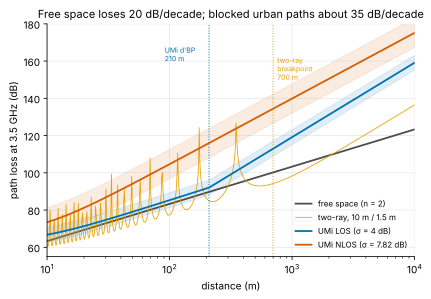
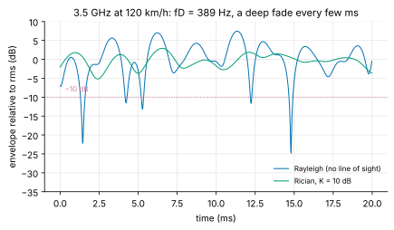
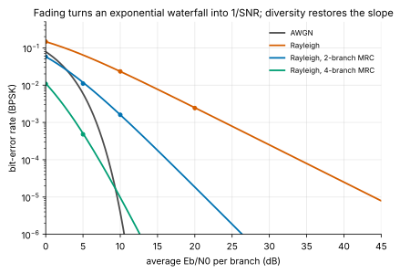

<!-- status: verified -->
# 17-09 · Wireless Channels: Fading and Multipath

| | |
|---|---|
| **Course** | [17 · Communication Systems](../README.md) |
| **University equivalent** | The wireless-channel chapters of a senior communications or wireless course: path loss and link budgets, shadowing, multipath and delay spread, Doppler and coherence time, Rayleigh and Rician fading, and error rates in fading (Rappaport, *Wireless Communications*, chapters 4–5; Goldsmith, *Wireless Communications*, chapters 2–3 and 6; Tse & Viswanath, *Fundamentals of Wireless Communication*, chapter 2) |
| **Prerequisites** | [17-02](17-02-noise-and-snr.md) (link budgets, $E_b/N_0$), [17-05](17-05-matched-filters-and-detection.md) (BPSK error rate), [17-01](17-01-random-processes-and-psd.md) (autocorrelation and PSD), [03-04](../../03-probability-statistics-and-random-variables/chapters/03-04-joint-distributions-and-clt.md) (the Gaussian and the CLT), [11-06](../../11-signals-and-systems/chapters/11-06-continuous-time-fourier-transform.md) (Fourier transform) |
| **Estimated study hours** | 6 |
| **Last verified** | 2026-11-21 |

**Learning objectives.** After this chapter you can:

1. Derive and apply the Friis free-space equation and the two-ray model, and build a link budget with a log-distance or 3GPP path-loss model and a shadowing margin.
2. Compute the mean excess delay, rms delay spread and coherence bandwidth of a power-delay profile, and classify a channel as flat or frequency-selective.
3. Compute Doppler shift and coherence time from the Clarke (Jakes) model, and classify fading as slow or fast.
4. Derive the Rayleigh distribution, compute outage probabilities for Rayleigh and Rician fading, and use the level-crossing rate and average fade duration.
5. Derive the average BPSK error rate in Rayleigh fading and quantify the fading penalty and the benefit of diversity.

## 1. Big picture

A wire is a well-behaved channel: fixed loss, fixed delay, slowly varying. A radio channel is not. Its loss grows with distance and depends on terrain, buildings and frequency; the signal arrives by many paths at once, whose sum interferes constructively in one place and destructively a few centimetres away; and anything that moves makes the whole pattern change in milliseconds. This chapter quantifies those effects with a handful of numbers (path loss, shadowing σ, delay spread, Doppler spread) that every radio design and every cellular standard is built around.

- **Path loss sets range and cell size.** Every link budget starts with it; 3GPP's channel model (TR 38.901) provides the formulas the industry uses to compare 5G proposals.
- **Delay spread sets the equalizer.** If echoes last longer than a fraction of a symbol, the channel is frequency-selective and the receiver needs an equalizer or OFDM (17-10) with a cyclic prefix longer than the echoes.
- **Doppler sets how often to re-measure the channel.** Pilot spacing, slot length and how fast beams and link adaptation must track all follow from the coherence time.
- **Fading sets the margin and drives diversity.** A Rayleigh-fading link needs tens of decibels more SNR than an AWGN link at low error rates, unless it combines several independently fading copies (diversity, 17-11) or spreads codewords across fades.

## 2. Intuition first

**Many paths, one sum.** Picture a phone in a street. The base station's signal reaches it directly (perhaps), by reflection off buildings and the ground, and by scattering off cars and lamp posts. Each path has its own length, so its own delay and phase. The receiver sees their vector sum. Move half a wavelength (4 cm at 3.5 GHz) and every path's phase changes, so the sum can swing from reinforcement to near-cancellation: **small-scale fading**. Average over a few metres and the swings wash out, leaving a mean power that falls with distance (**path loss**) and varies from street to street as buildings block or open the view (**shadowing**).

**An analogy: a portfolio of correlated returns.** The received signal is like a portfolio's return: a sum of many components. With one dominant asset (a line-of-sight path), the total is stable (Rician fading with a large K-factor). With many comparable, independent components of random sign, the sum is approximately Gaussian, and its magnitude is occasionally near zero (Rayleigh fading). Diversification across *independent* channels (antennas far enough apart, frequencies farther apart than the coherence bandwidth, times farther apart than the coherence time) reduces the probability of a deep loss, just as diversification across uncorrelated assets reduces the probability of a large drawdown. *Where it breaks:* portfolio returns add in value, while radio paths add as phasors, so two equal paths can cancel completely; and a radio channel's "correlations" are set by geometry and wavelength, which an engineer can partly design by spacing antennas.

```text
  BS ─────────────────────────────── direct path (delay τ0)
   \                                   ╲
    \──── building reflection (τ1) ─────►  UE: sum of phasors
     \                                   ╱    |a0 + a1 e^{-jφ1} + a2 e^{-jφ2} + ...|
      \── ground reflection (τ2) ───────╱     changes every half wavelength of motion
```

## 3. Theory

### 3.1 Free-space path loss

An isotropic antenna radiating power $P_t$ spreads it over a sphere, so at distance $d$ the power density is $P_t/(4\pi d^2)$ (W/m²). An antenna with gain $G_t$ concentrates it by that factor in its preferred direction. A receiving antenna collects power from an **effective area** $A_e = G_r\lambda^2/(4\pi)$, where λ is the wavelength (for an isotropic antenna, $A_e = \lambda^2/4\pi$; [13-11](../../13-electromagnetics/chapters/13-11-radiation-and-antennas.md) develops gain and aperture). The received power is their product, the **Friis equation**:

$$
P_r = P_t\,G_t\,G_r\Big(\frac{\lambda}{4\pi d}\Big)^2 .
$$

The **free-space path loss** between isotropic antennas is $L_{fs} = (4\pi d/\lambda)^2$, or in decibels $20\log_{10}(4\pi d/\lambda)$. With $\lambda = c/f$, $f$ in MHz and $d$ in km, $20\log_{10}(4\pi \times 10^6 \times 10^3/c)$ = **32.45** dB, which ITU-R Recommendation P.525 rounds to

$$
L_{fs} = 32.4 + 20\log_{10}f_{\text{MHz}} + 20\log_{10}d_{\text{km}}\quad\text{dB}\quad[\text{R-282}] .
$$

Two features matter. Loss grows as $d^2$: 6 dB per doubling of distance, 20 dB per decade. And the $f^2$ term is an antenna effect, not a propagation one: an isotropic antenna's aperture $\lambda^2/4\pi$ shrinks with frequency. If both antennas instead have fixed physical areas $A_t$ and $A_r$, their gains grow as $f^2$ and $P_r = P_tA_tA_r/(\lambda^2d^2)$ *rises* with frequency, which is why millimetre-wave links use high-gain arrays (17-11).

### 3.2 The two-ray model and the path-loss exponent

Near the ground, a direct ray (length $d_1$) and a ground-reflected ray (length $d_2$, reflection coefficient Γ ≈ −1 at grazing incidence) arrive together. For antenna heights $h_t$ and $h_r$ and horizontal distance $d \gg h_t, h_r$, the path difference is

$$
\Delta = d_2 - d_1 = \sqrt{d^2 + (h_t + h_r)^2} - \sqrt{d^2 + (h_t - h_r)^2} \approx \frac{2h_th_r}{d} ,
$$

using $\sqrt{d^2 + x^2} \approx d + x^2/2d$. The phase difference is $\Delta\phi = 2\pi\Delta/\lambda$, and the received field is proportional to $|1 - e^{-j\Delta\phi}| = 2|\sin(\Delta\phi/2)|$. Beyond the **breakpoint** $d_{BP} = 4h_th_r/\lambda$ (where $\Delta\phi$ falls below π), $\sin(\Delta\phi/2) \approx \Delta\phi/2$ and

$$
P_r \approx P_tG_tG_r\Big(\frac{\lambda}{4\pi d}\Big)^2\Big(\frac{4\pi h_th_r}{\lambda d}\Big)^2 = P_tG_tG_r\frac{h_t^2h_r^2}{d^4} :
$$

loss now grows as $d^4$ (40 dB per decade) and no longer depends on frequency. Before the breakpoint the two rays alternately reinforce and cancel.

Real environments are summarized by a **log-distance model** with a **path-loss exponent** $n$:

$$
PL(d) = PL(d_0) + 10n\log_{10}\frac{d}{d_0} + X_\sigma ,
$$

where $n$ ≈ 2 in free space, 2–4 in urban environments, and $X_\sigma$ is the shadowing term of §3.3.

### 3.3 3GPP path-loss models and shadowing

TR 38.901 ([R-283]) is the channel model 3GPP uses from 0.5 to 100 GHz. For the **UMi-Street Canyon** scenario (base station at 10 m, below rooftops), with $f_c$ in GHz and the 3-D distance $d_{3D}$ in metres:

- **LOS**, up to the breakpoint $d'_{BP} = 4h'_{BS}h'_{UT}f_c/c$ (effective heights $h' = h - 1$ m): $PL = 32.4 + 21\log_{10}d_{3D} + 20\log_{10}f_c$, shadowing σ = 4 dB;
- **NLOS**: $PL = \max\big(PL_{LOS},\ 35.3\log_{10}d_{3D} + 22.4 + 21.3\log_{10}f_c - 0.3(h_{UT} - 1.5)\big)$, σ = 7.82 dB.

Compare with free space at 1 m: $32.4 + 20\log_{10}f_c$ (GHz, metres). The LOS model is free space with a slightly steeper exponent (2.1), and NLOS adds an exponent of 3.53. The UMa (macro) and InH (indoor office) models have the same form with different coefficients ([R-283]).

**Shadowing.** At a fixed distance, the local mean power varies from place to place with a roughly lognormal distribution: $X_\sigma$ is Gaussian in decibels with standard deviation σ (4–8 dB in TR 38.901). To meet a power budget with probability $p$ at a given distance, the design adds a **shadowing margin**

$$
M = \sigma\,Q^{-1}(1 - p) ,
$$

so 90% coverage at the cell edge costs $1.28\sigma$: 5.1 dB in UMi LOS, 10.0 dB in UMi NLOS (Example 17-09.2).

### 3.4 Multipath: delay spread and coherence bandwidth

With $M$ paths of complex gains $a_i$ and delays $\tau_i$, the channel is a linear filter with impulse response and frequency response

$$
h(\tau) = \sum_ia_i\delta(\tau - \tau_i),\qquad H(f) = \sum_ia_ie^{-j2\pi f\tau_i} .
$$

The **power-delay profile** (PDP) lists the average powers $P_i = \mathbb E|a_i|^2$ against delay. Its first two moments define the **mean excess delay** $\bar\tau = \sum P_i\tau_i/\sum P_i$ and the **rms delay spread**

$$
\tau_{rms} = \sqrt{\overline{\tau^2} - \bar\tau^2},\qquad \overline{\tau^2} = \frac{\sum P_i\tau_i^2}{\sum P_i} .
$$

**Coherence bandwidth.** If the path gains are uncorrelated with zero mean (the usual "wide-sense stationary, uncorrelated scattering" assumption), the correlation between the channel's responses at two frequencies Δf apart is

$$
R_H(\Delta f) = \mathbb E[H(f)H^*(f + \Delta f)] = \sum_iP_ie^{j2\pi\Delta f\tau_i} ,
$$

the Fourier transform of the PDP. The **coherence bandwidth** $B_c$ is the separation at which $|R_H|$ falls to a chosen level, often 0.5. For TR 38.901's exponential delay distribution ([R-284]), $P(\tau) = e^{-\tau/\tau_{rms}}/\tau_{rms}$ (whose mean and rms are both $\tau_{rms}$),

$$
R_H(\Delta f) = \int_0^\infty\frac{e^{-\tau/\tau_{rms}}}{\tau_{rms}}e^{j2\pi\Delta f\tau}d\tau = \frac{1}{1 - j2\pi\Delta f\tau_{rms}},\qquad |R_H| = \frac{1}{\sqrt{1 + (2\pi\Delta f\tau_{rms})^2}} ,
$$

which equals 0.5 at $\Delta f = \sqrt3/(2\pi\tau_{rms}) = $ **0.276**$/\tau_{rms}$. The textbook rule $B_c \approx 1/(5\tau_{rms})$ is a conservative version of the same idea.

**Flat or frequency-selective.** If the signal bandwidth is well below $B_c$ (equivalently, the symbol time is much longer than $\tau_{rms}$), every frequency in the signal fades together: **flat fading**, one complex gain. If it is wider, different parts of the band fade differently: **frequency-selective fading**, intersymbol interference in the time domain. TR 38.901's median delay spreads ([R-284]) range from about 20 ns indoors to about 270 ns in urban macro NLOS, so a 100 MHz 5G carrier is always frequency-selective, while each 30 kHz OFDM subcarrier sees flat fading. That is OFDM's central idea (17-10).

> **Going deeper — the delay-spread distribution.** TR 38.901 models the delay spread itself as random: $\log_{10}(\text{DS}/1\,\text{s})$ is Gaussian with mean μ and standard deviation σ that depend on scenario and frequency. For UMi LOS at 3.5 GHz, μ = $-0.18\log_{10}(1 + f_c) - 7.28$ = −7.40, a median of **40** ns; for UMa NLOS (with $f_c$ = 6 below 6 GHz) μ = −6.57, a median of **267** ns. Release 19 updated several of these values for 7–24 GHz ([R-284]), so check the version before quoting a table.

### 3.5 Doppler and coherence time

A receiver moving at speed $v$ toward a path arriving at angle α (from its direction of motion) sees the path's frequency shifted by $f_D\cos\alpha$, where the **maximum Doppler shift** is

$$
f_D = \frac{v}{\lambda} = \frac{vf_c}{c} .
$$

**The Clarke (Jakes) model.** With many scattered paths arriving uniformly from all directions, each with a random phase, the complex gain $h(t) = \sum_ia_ie^{j(2\pi f_D\cos\alpha_it + \phi_i)}$ has autocorrelation

$$
R_h(\Delta t) = \mathbb E\big[e^{j2\pi f_D\cos\alpha\,\Delta t}\big] = \frac{1}{2\pi}\int_0^{2\pi}e^{j2\pi f_D\Delta t\cos\alpha}d\alpha = J_0(2\pi f_D\Delta t) ,
$$

the Bessel function of order zero (17-03 used $J_n$ for FM). Its Fourier transform, the **Doppler spectrum**, is the density of $f_D\cos\alpha$ for uniform α:

$$
S(f) = \frac{1}{\pi f_D\sqrt{1 - (f/f_D)^2}},\qquad |f| < f_D ,
$$

U-shaped, with peaks at $\pm f_D$ where many angles map to nearly the same shift.

**Coherence time** $T_c$ is the time separation over which the channel stays correlated. With a 0.5 correlation threshold, $J_0(x) = 0.5$ at $x$ = **1.521**, so

$$
T_c = \frac{1.521}{2\pi f_D} = \frac{0.242}{f_D} .
$$

(A widely quoted rule of thumb, $0.423/f_D$, uses a different convention; the order of magnitude, $1/f_D$, is what matters.) A symbol, slot or pilot interval much shorter than $T_c$ sees **slow fading** (the channel is constant over it); one comparable to or longer than $T_c$ sees **fast fading**.

### 3.6 Rayleigh and Rician fading

**Rayleigh.** With many scattered paths and no dominant one, the in-phase and quadrature parts of $h$ are sums of many small independent terms, so by the central limit theorem $h = X + jY$ with $X, Y$ independent $\mathcal N(0, \sigma^2)$. The envelope $r = |h|$ then has the **Rayleigh** density (change to polar coordinates and integrate out the uniform phase):

$$
f_r(r) = \frac{r}{\sigma^2}e^{-r^2/(2\sigma^2)},\qquad r \ge 0 ,
$$

and the power $|h|^2$ is exponential with mean $\Omega = 2\sigma^2$:

$$
P\big(|h|^2 < x\big) = 1 - e^{-x/\Omega} \approx \frac{x}{\Omega}\quad(x \ll \Omega) .
$$

So the probability of fading more than 10 dB below the mean is $1 - e^{-0.1}$ = 9.5%, 20 dB about 1%, 30 dB about 0.1%: each extra 10 dB of margin buys only a factor of ten in **outage probability**. This one-decade-per-10-dB slope is the signature of a single fading path (diversity order 1).

**Rician.** With a line-of-sight component of power $|A|^2$ plus scattered power $2\sigma^2$, the **K-factor** $K = |A|^2/2\sigma^2$ measures how dominant it is. $K = 0$ is Rayleigh; large $K$ approaches no fading. The power then follows a noncentral chi-square distribution with two degrees of freedom, and deep fades become much rarer (Example 17-09.5).

> **Going deeper — how often and how long.** For the Clarke model, the envelope crosses a level $R$ downward at a rate $N_R = \sqrt{2\pi}f_D\rho e^{-\rho^2}$ per second and stays below it for an average $\bar t_R = (e^{\rho^2} - 1)/(\sqrt{2\pi}f_D\rho)$, where $\rho = R/R_{rms}$. At 3.5 GHz and 120 km/h ($f_D$ = 389 Hz), a 10 dB fade ($\rho$ = 0.316) happens **279** times a second and lasts **0.341** ms on average: a few OFDM symbols, which is why interleaving and coding across a slot work.

### 3.7 Error rates in fading

With a flat-fading channel, the instantaneous $E_b/N_0$ is $\gamma = |h|^2E_b/N_0$, exponentially distributed with mean $\bar\gamma$. The average BPSK error rate is

$$
\bar P_b = \int_0^\infty Q\big(\sqrt{2\gamma}\big)\frac{1}{\bar\gamma}e^{-\gamma/\bar\gamma}d\gamma .
$$

Integrate by parts with $u = Q(\sqrt{2\gamma})$, $dv = e^{-\gamma/\bar\gamma}d\gamma/\bar\gamma$, using $\frac{d}{d\gamma}Q(\sqrt{2\gamma}) = -\frac{e^{-\gamma}}{2\sqrt{\pi\gamma}}$:

$$
\bar P_b = \Big[-Q(\sqrt{2\gamma})e^{-\gamma/\bar\gamma}\Big]_0^\infty - \int_0^\infty\frac{e^{-\gamma}e^{-\gamma/\bar\gamma}}{2\sqrt{\pi\gamma}}d\gamma = \frac12 - \frac{1}{2\sqrt\pi}\cdot\frac{\Gamma(1/2)}{\sqrt{1 + 1/\bar\gamma}} = \frac12\Big(1 - \sqrt{\frac{\bar\gamma}{1 + \bar\gamma}}\Big) ,
$$

using $\int_0^\infty\gamma^{-1/2}e^{-a\gamma}d\gamma = \Gamma(1/2)/\sqrt a$ and $\Gamma(1/2) = \sqrt\pi$. At high SNR, $\sqrt{\bar\gamma/(1 + \bar\gamma)} \approx 1 - 1/(2\bar\gamma)$, so

$$
\bar P_b \approx \frac{1}{4\bar\gamma} .
$$

The error rate falls only *inversely* with SNR, not exponentially as in AWGN: the average is dominated by the occasional deep fade. At $10^{-5}$ BPSK needs 9.6 dB in AWGN but about 44 dB in Rayleigh fading (Example 17-09.6).

**Diversity.** If the receiver has $L$ independently fading copies (antennas spaced by more than about half a wavelength in rich scattering, frequencies separated by more than $B_c$, or times separated by more than $T_c$) and combines them optimally (**maximal-ratio combining**, MRC, 17-11), the combined SNR is the sum of $L$ exponentials, and

$$
\bar P_b \approx \binom{2L - 1}{L}\Big(\frac{1}{4\bar\gamma}\Big)^L ,
$$

falling as $\bar\gamma^{-L}$: the **diversity order** $L$. Coding with interleaving achieves the same effect across time or frequency: a code of minimum distance $d$ whose bits fade independently gets diversity order $d$ (with soft decisions). This is why fading channels, more than AWGN, made coding indispensable in cellular systems.



## 4. Worked examples

### Example 17-09.1 · Free-space links (tier A)

**Setup.** (a) A 2.4 GHz link over 100 m with isotropic antennas and 20 dBm transmit power: find the path loss by Friis and by the P.525 formula, and the received power. (b) Find the free-space loss of a 12 GHz geostationary satellite link over 36 000 km.

**Solution.** (a) $\lambda = c/f$ = 0.1249 m; $20\log_{10}(4\pi \times 100/0.1249)$ = **80.05** dB. P.525: $32.4 + 20\log_{10}2400 + 20\log_{10}0.1$ = **80.00** dB; the 0.05 dB difference is P.525's rounding of 32.45 to 32.4. Received power $20 - 80.05$ = **−60.05** dBm. (b) $20\log_{10}(4\pi \times 3.6 \times 10^7 \times 12 \times 10^9/c)$ = **205.16** dB, which is why satellite dishes and low-noise receivers matter.

**Units check.** $4\pi d/\lambda$ is dimensionless; dBm − dB = dBm.

**Sanity check.** Ten times the distance adds 20 dB; doubling the frequency adds 6 dB (for isotropic antennas).

### Example 17-09.2 · A UMi link budget (tier B)

**Setup.** UMi-Street Canyon at $f_c$ = 3.5 GHz, base station at 10 m, user at 1.5 m, horizontal distance 100 m. Find the LOS breakpoint, the LOS and NLOS path losses, the free-space loss at the same distance, and the shadowing margins for 90% coverage.

**Solution.** $d'_{BP} = 4 \times 9 \times 0.5 \times 3.5 \times 10^9/(3 \times 10^8)$ = **210** m, so 100 m is before the breakpoint. $d_{3D} = \sqrt{100^2 + 8.5^2}$ = 100.36 m. LOS: $32.4 + 21\log_{10}100.36 + 20\log_{10}3.5$ = **85.31** dB. NLOS: $35.3\log_{10}100.36 + 22.4 + 21.3\log_{10}3.5$ = 104.64 dB, larger than LOS, so **104.64** dB. Free space: **83.36** dB. Margins: $1.2816 \times 4$ = **5.13** dB (LOS) and $1.2816 \times 7.82$ = **10.02** dB (NLOS).

**Units check.** $f_c$ in GHz and distances in metres, as TR 38.901 specifies.

**Sanity check.** LOS is 2 dB worse than free space, NLOS about 19 dB worse: blocking the direct path costs as much as a tenfold increase in distance.

### Example 17-09.3 · Delay spread and coherence bandwidth (tier B)

**Setup.** A measured PDP has paths at 0, 1, 2 and 5 μs with relative powers 0, −3, −6 and −10 dB. Find the mean excess delay, the rms delay spread, the 50% coherence bandwidth (numerically), and compare with the $1/(5\tau_{rms})$ rule. Is a 1 MHz signal flat-faded?

**Solution.** Linear powers 1, 0.501, 0.251, 0.1 (sum 1.852). $\bar\tau$ = **0.812** μs; $\overline{\tau^2}$ = 2.163 μs², so $\tau_{rms}$ = **1.226** μs. Solving $|R_H(\Delta f)| = 0.5$ gives $B_c$ = **255** kHz; the rule gives **163** kHz. A 1 MHz signal is about four coherence bandwidths wide: frequency-selective.

**Units check.** $\Delta f\tau$ is dimensionless; delays in μs give bandwidths in MHz.

**Sanity check.** The weak path at 5 μs contributes most of the spread: delay spread weights late energy by the square of its delay.

### Example 17-09.4 · How fast does the channel change? (tier B)

**Setup.** Find $f_D$ and the 0.5-correlation coherence time at 3.5 GHz for 120 km/h and 3 km/h, and at 28 GHz for 120 km/h. Compare with NR slot durations: 14 OFDM symbols per slot, 1 ms subframes holding $2^\mu$ slots at subcarrier spacing $15 \times 2^\mu$ kHz ([R-285]).

**Solution.** At 3.5 GHz, 120 km/h (33.3 m/s): $f_D = 33.3 \times 3.5 \times 10^9/c$ = **389** Hz, $T_c = 0.242/f_D$ = **0.622** ms, slightly longer than a 0.5 ms slot at 30 kHz spacing: the channel changes noticeably within a few slots. At 3 km/h: $f_D$ = 9.73 Hz, $T_c$ = **24.9** ms, essentially static. At 28 GHz, 120 km/h: $f_D$ = **3113** Hz, $T_c$ = **77.8** μs, shorter than a 0.125 ms slot at 120 kHz spacing, so pilots must recur within the slot.

**Units check.** (m/s)·Hz/(m/s) = Hz; $1/f_D$ in seconds.

**Sanity check.** $f_D$ scales with both speed and carrier frequency: millimetre waves at vehicle speeds are the hard case.

### Example 17-09.5 · Fade margins (tier B)

**Setup.** For Rayleigh fading, find the outage probability with 10, 20 and 30 dB of margin above the threshold, and the margin for 1% outage. Then find the outage with 10 dB margin when a line-of-sight path gives K = 10 dB.

**Solution.** $1 - e^{-0.1}$ = **9.52** %; $1 - e^{-0.01}$ = **0.995** %; $1 - e^{-0.001}$ = **0.100** %. For 1%: $10\log_{10}\big(1/(-\ln0.99)\big)$ = **19.98** dB. Rician, K = 10 (linear), 10 dB margin: the noncentral chi-square CDF gives **7.39e-4**, more than 100 times less than Rayleigh.

**Units check.** Probabilities; margins in dB.

**Sanity check.** Rayleigh outage falls exactly tenfold per 10 dB at small values ($1 - e^{-x} \approx x$); the strong LOS path removes most deep fades.

### Example 17-09.6 · The cost of fading and the value of diversity (tier C)

**Setup.** BPSK on a Rayleigh-fading channel. Find $\bar P_b$ at $\bar\gamma$ = 20 dB, the $\bar\gamma$ needed for $10^{-5}$, the penalty against AWGN, and the requirement with 2- and 4-branch MRC.

**Solution.** $\bar\gamma$ = 100: $\tfrac12(1 - \sqrt{100/101})$ = **2.48e-3** (≈ $1/400$). For $10^{-5}$: **43.98** dB, against 9.59 dB in AWGN, a penalty of **34.39** dB. With exact MRC formulas (§3.7): **21.34** dB for $L$ = 2 and **9.96** dB for $L$ = 4 (per-branch average), a saving of 22.6 and 34.0 dB.

**Units check.** $\bar\gamma$ is a power ratio; BER is a probability.

**Sanity check.** The $L$ = 2 approximation $3/(16\bar\gamma^2) = 10^{-5}$ gives $\bar\gamma$ = 21.37 dB, close to the exact 21.34. With four branches, the fading penalty is almost gone.

<!-- answer-key -->

| ID | Quantity | Value | Unit |
|---|---|---|---|
| Txt 17-09.a | free-space constant (MHz, km) | 32.45 | dB |
| Txt 17-09.b | exponential-PDP coherence factor | 0.276 | — |
| Txt 17-09.c | J0 = 0.5 argument | 1.521 | — |
| Txt 17-09.d | UMi LOS median delay spread, 3.5 GHz | 40 | ns |
| Txt 17-09.e | UMa NLOS median delay spread | 267 | ns |
| Txt 17-09.f | 10 dB fade crossing rate | 279 | 1/s |
| Txt 17-09.g | 10 dB average fade duration | 0.341 | ms |
| Ex 17-09.1a | Friis loss, 2.4 GHz, 100 m | 80.05 | dB |
| Ex 17-09.1b | P.525 loss | 80.00 | dB |
| Ex 17-09.1c | received power | −60.05 | dBm |
| Ex 17-09.1d | GEO loss at 12 GHz | 205.16 | dB |
| Ex 17-09.2a | UMi breakpoint | 210 | m |
| Ex 17-09.2b | UMi LOS loss | 85.31 | dB |
| Ex 17-09.2c | UMi NLOS loss | 104.64 | dB |
| Ex 17-09.2d | free-space loss | 83.36 | dB |
| Ex 17-09.2e | LOS margin, 90% | 5.13 | dB |
| Ex 17-09.2f | NLOS margin, 90% | 10.02 | dB |
| Ex 17-09.3a | mean excess delay | 0.812 | μs |
| Ex 17-09.3b | rms delay spread | 1.226 | μs |
| Ex 17-09.3c | 50% coherence bandwidth | 255 | kHz |
| Ex 17-09.3d | 1/(5 τrms) rule | 163 | kHz |
| Ex 17-09.4a | Doppler at 3.5 GHz, 120 km/h | 389 | Hz |
| Ex 17-09.4b | coherence time | 0.622 | ms |
| Ex 17-09.4c | coherence time at 3 km/h | 24.9 | ms |
| Ex 17-09.4d | Doppler at 28 GHz, 120 km/h | 3113 | Hz |
| Ex 17-09.4e | coherence time at 28 GHz | 77.8 | μs |
| Ex 17-09.5a | Rayleigh outage, 10 dB margin | 9.52 | % |
| Ex 17-09.5b | Rayleigh outage, 20 dB margin | 0.995 | % |
| Ex 17-09.5c | Rayleigh outage, 30 dB margin | 0.100 | % |
| Ex 17-09.5d | margin for 1% outage | 19.98 | dB |
| Ex 17-09.5e | Rician K = 10 dB outage, 10 dB margin | 7.39e-4 | — |
| Ex 17-09.6a | BER at 20 dB | 2.48e-3 | — |
| Ex 17-09.6b | Rayleigh requirement at 1e-5 | 43.98 | dB |
| Ex 17-09.6c | fading penalty | 34.39 | dB |
| Ex 17-09.6d | 2-branch MRC requirement | 21.34 | dB |
| Ex 17-09.6e | 4-branch MRC requirement | 9.96 | dB |

*Every value is recomputed by [verify_17_09.py](../verify/verify_17_09.py): path losses from the formulas and from an exact two-ray field sum, PDP moments directly and coherence bandwidth by root finding, the Jakes correlation by averaging over arrival angles, Rayleigh and Rician statistics in closed form and by Monte Carlo, crossing rates from simulated fading, and error rates by numerical integration and simulation.*



## 5. Simulate it

The lab, [labs/17-09-lab](../labs/17-09-lab/README.md), provides `channels.py`: free-space, two-ray and log-distance loss, TR 38.901 UMi path loss and shadowing margins, PDP statistics and coherence bandwidth, Doppler and the Jakes correlation, level-crossing statistics, a sum-of-sinusoids Rayleigh/Rician generator, outage probabilities and fading error rates with MRC. In the notebook, **predict, then run**:

1. **Two rays.** Predict the breakpoint for antennas at 10 m and 1.5 m at 3.5 GHz and the slope beyond it; plot the exact two-ray loss.
2. **Coverage.** Predict the fraction of NLOS users at a given distance whose shadowed path loss stays within 10 dB above the median loss; simulate lognormal shadowing.
3. **Frequency selectivity.** Generate random channels with an exponential PDP (τ_rms = 100 ns) and predict the frequency separation at which their responses decorrelate to 0.5.
4. **Doppler.** Simulate fading at $f_D$ = 100 Hz, measure its autocorrelation against $J_0$, and count fades below −10 dB against the level-crossing formula.
5. **Outage.** Predict the Rayleigh and Rician outage at 10 dB margin; simulate.
6. **BER in fading.** Simulate BPSK over Rayleigh fading with 1, 2 and 4 MRC branches and compare with the formulas.



## 6. Engineering tradeoffs

| Knob | Improves | Costs | Typical decision owner |
|---|---|---|---|
| Lower carrier frequency | Range, penetration, diffraction around obstacles | Spectrum is scarce and narrow; larger antennas | Spectrum strategy, regulators |
| Higher carrier (mmWave) with arrays | Bandwidth; array gain at fixed aperture | Blockage, short coherence time, beam tracking, many RF chains | System architect |
| Fade and shadowing margin | Coverage probability | Transmit power, cell density (capital cost) | Network planner |
| Diversity (antennas, frequency, time) | Turns the $1/\bar\gamma$ slope into $1/\bar\gamma^L$ | Antennas and RF chains, bandwidth, latency (interleaving) | PHY architect |
| Shorter slots / denser pilots | Tracks fast fading, lower latency | Pilot overhead, more control signalling | Standards body, PHY architect |
| Longer cyclic prefix / equalizer | Tolerates larger delay spread | Overhead (CP), equalizer complexity | Standards body |

## 7. Numbers to know

| Quantity | Value | Note |
|---|---|---|
| Free-space loss | $32.45 + 20\log f_{\text{MHz}} + 20\log d_{\text{km}}$ dB | P.525 rounds to 32.4 [R-282] |
| Free-space slope | 20 dB/decade (6 dB per doubling) | two-ray beyond breakpoint: 40 dB/decade |
| Two-ray breakpoint | $4h_th_r/\lambda$ | 700 m for 10 m and 1.5 m at 3.5 GHz |
| UMi shadowing σ | 4 dB LOS, 7.82 dB NLOS | TR 38.901 [R-283] |
| 90% coverage margin | 1.28 σ | 95%: 1.64 σ |
| Median delay spread | ≈ 20 ns indoor to ≈ 270 ns urban macro NLOS | TR 38.901 [R-284] |
| Coherence bandwidth (50%) | $0.276/\tau_{rms}$ (exponential PDP) | rule of thumb $1/(5\tau_{rms})$ |
| Doppler | $f_D = vf_c/c$: 389 Hz at 3.5 GHz, 120 km/h | |
| Coherence time (50%) | $0.242/f_D$ | |
| Rayleigh outage | ≈ $10^{-M/10}$ for margin M dB | one decade per 10 dB |
| BPSK in Rayleigh | $\approx 1/(4\bar\gamma)$; 44 dB for $10^{-5}$ | AWGN: 9.6 dB |
| NR numerology | 14 symbols/slot, $2^\mu$ slots/ms, $15 \cdot 2^\mu$ kHz | [R-285] |

## 8. Common mistakes

- **Treating free-space loss as a property of frequency.** The $20\log f$ term comes from isotropic antenna apertures; with fixed antenna areas, higher frequency gives more received power, not less (but suffers more from blockage).
- **Mixing units in path-loss formulas.** P.525 uses MHz and km; TR 38.901 uses GHz and metres. The constants differ accordingly.
- **Confusing shadowing with fast fading.** Shadowing (lognormal, metres to tens of metres) sets the local mean; Rayleigh fading (half-wavelength scale) fluctuates around it. Margins for each are separate.
- **Using the mean BER in fading as if the link were AWGN at the mean SNR.** At 20 dB average, AWGN BPSK is essentially error-free, while Rayleigh gives $2.5 \times 10^{-3}$.
- **Assuming antennas are independent because they are separate.** Diversity needs decorrelated fading: about half a wavelength apart in rich scattering, many wavelengths at a base station with a narrow angle spread.
- **Quoting a single delay spread for a scenario.** Delay spread is a distribution that depends on scenario, LOS state and, in TR 38.901, frequency and release.

## 9. Practitioner lens

### State of the art (as of Nov 2026)

- **The 3GPP channel model.** TR 38.901 V19.5.0 (Sept 2026) covers 0.5–100 GHz with path-loss formulas for UMa, UMi-Street Canyon, RMa and indoor office, shadowing standard deviations of 3–8.3 dB, and lognormal delay-spread distributions; Release 19 updated several large-scale parameters for 7–24 GHz ([R-283], [R-284]) **[Established]**.
- **Free-space loss.** ITU-R P.525-5 (Nov 2024) is the in-force recommendation, with the 32.4 dB form used throughout the industry ([R-282]) **[Established]**.
- **NR's answer to time variation.** NR scales its slot with subcarrier spacing: 14 symbols per slot and $2^\mu$ slots per 1 ms subframe, from 15 kHz ($\mu$ = 0) to 960 kHz ($\mu$ = 6), so higher-frequency, higher-Doppler deployments get shorter slots ([R-285]) **[Established]**.
- **Upper mid-band.** Release 19's study of channel modelling for 7–24 GHz is why several delay-spread values changed in TR 38.901 ([R-284]); models for these frequencies are still being refined **[Established]**.

### Why it matters commercially

Propagation decides how many base stations a network needs, which is most of its capital cost. Shadowing and fading margins of 10–20 dB at a cell edge translate directly into cell radius through the path-loss exponent: with $n$ = 3.5, 10 dB of margin costs a factor of $10^{10/35}$ ≈ 1.9 in radius, or about 3.7 in the number of sites per area. The same physics drives device design: diversity antennas, MIMO, and the beam-tracking machinery of millimetre-wave phones exist because fading and blockage otherwise eat the link. Claims about range and coverage in a pitch deck should be traced back to a path-loss model, a margin and a target coverage probability.

### Marketing vs Reality

- **"mmWave doesn't propagate."** Free-space loss between fixed-area antennas does not grow with frequency; what grows is the difficulty of diffraction around obstacles, penetration losses and the need to steer narrow beams. Ask which effect dominates the deployment.
- **"Our radio reaches 10 km."** In what environment, at what height, with what margin and coverage probability? Free-space and two-ray estimates can differ by tens of decibels from urban NLOS.
- **"Works at highway speeds."** Check the Doppler against the pilot spacing and slot length: $f_D$ at 28 GHz and 120 km/h is 3.1 kHz.
- **"10 dB better sensitivity" (in a fading channel).** Sensitivity is usually quoted in AWGN; in fading, diversity order may matter more than a few decibels of AWGN sensitivity.

### Questions for engineering leaders

1. **"Which channel model and parameters were your link-budget and capacity numbers computed with?"** *Strong:* names the TR 38.901 scenario and version, LOS probability, shadowing σ and coverage target. *Evasive:* "free space plus some margin".
2. **"What delay spread and Doppler does your design tolerate, and how was that tested?"** *Strong:* quotes the cyclic-prefix or equalizer limit against the scenario's delay-spread distribution, and Doppler tests with a channel emulator. *Evasive:* tested only in the lab without fading.
3. **"What is your diversity order, and where does it come from?"** *Strong:* counts antennas, frequency spread and coding/interleaving depth, and shows the BER slope. *Evasive:* quotes AWGN sensitivity.
4. **"How do you handle blockage at millimetre wave?"** *Strong:* beam management latency, multi-panel antennas, fallback to lower bands, measured outage statistics. *Evasive:* "the array gain makes up for it".
5. **"How sensitive is your network cost model to the shadowing margin?"** *Strong:* shows sites per area against margin and path-loss exponent. *Evasive:* uses a fixed cell radius.

## 10. Concept check

**Q1.** Why does free-space path loss in decibels include $20\log_{10}f$, and when does that term disappear or reverse?

<details><summary>Answer</summary>

Because an isotropic receive antenna's effective area is $\lambda^2/4\pi$, which shrinks with frequency. With fixed-area antennas at both ends the gains grow as $f^2$ each, and received power grows with frequency.

</details>

**Q2.** Beyond the two-ray breakpoint, how does received power depend on distance and frequency?

<details><summary>Answer</summary>

As $h_t^2h_r^2/d^4$: 40 dB per decade of distance, and independent of frequency.

</details>

**Q3.** A channel has τ_rms = 300 ns. Roughly what is its 50% coherence bandwidth, and does a 15 kHz subcarrier see flat fading?

<details><summary>Answer</summary>

For an exponential PDP, $0.276/300\,\text{ns}$ ≈ 0.92 MHz. A 15 kHz subcarrier is far narrower, so it sees flat fading.

</details>

**Q4.** Why is the Doppler spectrum U-shaped?

<details><summary>Answer</summary>

The shift is $f_D\cos\alpha$ with α uniform; near α = 0 and π, cos α changes slowly, so many arrival angles map to shifts near $\pm f_D$, piling up density there.

</details>

**Q5.** Why does each extra 10 dB of margin reduce Rayleigh outage only tenfold?

<details><summary>Answer</summary>

For small thresholds the exponential CDF is linear: $P(|h|^2 < x) \approx x/\Omega$. Outage is proportional to the threshold-to-mean ratio, so a tenfold (10 dB) change in that ratio changes outage tenfold.

</details>

**Q6.** What does diversity order $L$ do to the BER curve, and name three ways to get it.

<details><summary>Answer</summary>

It makes the error rate fall as $\bar\gamma^{-L}$ instead of $\bar\gamma^{-1}$. Sources: multiple antennas (space), spreading a codeword over frequencies more than $B_c$ apart (frequency), and interleaving over times more than $T_c$ apart (time).

</details>

Practice: [17-09 problems](../problems/17-09-problems.md) · [worked solutions](../solutions/17-09-solutions.md).

## 11. Key terms

[Path loss](../../../reference/glossary.md#path-loss) · [Friis transmission equation](../../../reference/glossary.md#friis-transmission-equation) · [Effective aperture](../../../reference/glossary.md#effective-aperture) · [Path-loss exponent](../../../reference/glossary.md#path-loss-exponent) · [Shadowing](../../../reference/glossary.md#shadowing) · [Multipath](../../../reference/glossary.md#multipath) · [Power-delay profile](../../../reference/glossary.md#power-delay-profile) · [RMS delay spread](../../../reference/glossary.md#rms-delay-spread) · [Coherence bandwidth](../../../reference/glossary.md#coherence-bandwidth) · [Flat fading](../../../reference/glossary.md#flat-fading) · [Frequency-selective fading](../../../reference/glossary.md#frequency-selective-fading) · [Doppler shift](../../../reference/glossary.md#doppler-shift) · [Coherence time](../../../reference/glossary.md#coherence-time) · [Rayleigh fading](../../../reference/glossary.md#rayleigh-fading) · [Rician fading](../../../reference/glossary.md#rician-fading) · [Outage probability](../../../reference/glossary.md#outage-probability) · [Diversity order](../../../reference/glossary.md#diversity-order) · [Maximal-ratio combining](../../../reference/glossary.md#maximal-ratio-combining)

## 12. Connections

- **Builds on:** [13-11](../../13-electromagnetics/chapters/13-11-radiation-and-antennas.md) (antenna gain, aperture and the Friis equation), [17-02](17-02-noise-and-snr.md) (link budgets and sensitivity), [17-05](17-05-matched-filters-and-detection.md) (BPSK in AWGN), [17-01](17-01-random-processes-and-psd.md) (autocorrelation and spectra), [17-08](17-08-channel-coding.md) (coding, which gains diversity order across fades).
- **Next:** [17-10](17-10-ofdm.md) (OFDM turns a frequency-selective channel into flat subchannels), [17-11](17-11-mimo-and-beamforming.md) (diversity, MRC and spatial multiplexing), [17-12](17-12-multiple-access-and-cellular-wifi.md) (how cellular and Wi-Fi systems are dimensioned).
- **Used later:** [21-10](../../21-rf-and-microwave-engineering/chapters/21-10-antennas-arrays-mmwave.md) (arrays and mmWave), [21-11](../../21-rf-and-microwave-engineering/chapters/21-11-link-budgets.md) (link budgets) and the capstones.

## 13. Further study

- Rappaport, *Wireless Communications: Principles and Practice* (2nd ed.): chapters 4 (large-scale path loss, two-ray model, log-distance and shadowing) and 5 (small-scale fading, delay spread, Doppler, Clarke's model, level crossings).
- Goldsmith, *Wireless Communications*: chapters 2–3 (path loss, shadowing, statistical multipath) and 6 (performance in fading).
- Tse & Viswanath, *Fundamentals of Wireless Communication*: chapter 2 (physical modelling) and chapter 3 (detection, diversity); free online from the authors.
- 3GPP TR 38.901: §7.4 (path loss, shadowing) and §7.5 (fast-fading model), for anyone building a system simulator.
- MIT OpenCourseWare 6.450, *Principles of Digital Communication I*: lectures on wireless channels.

## 14. Sources

1. Rappaport, T. S., *Wireless Communications: Principles and Practice*, 2nd ed., Prentice Hall, 2002.
2. Goldsmith, A., *Wireless Communications*, Cambridge University Press, 2005.
3. Tse, D. and Viswanath, P., *Fundamentals of Wireless Communication*, Cambridge University Press, 2005.
4. Jakes, W. C. (ed.), *Microwave Mobile Communications*, Wiley, 1974 (Clarke's model and level-crossing statistics).
5. Proakis, J. G. and Salehi, M., *Digital Communications*, 5th ed., McGraw-Hill, 2008: error rates with diversity in Rayleigh fading.
6. [R-282] ITU-R P.525-5 (11/2024), *Calculation of free-space attenuation*, eq. (6).
7. [R-283] 3GPP TR 38.901 V19.5.0 (2026-09), Table 7.4.1-1 and its notes (path loss, shadowing, breakpoint).
8. [R-284] 3GPP TR 38.901 V19.5.0, Table 7.5-6 (delay-spread distributions, notes on frequency floors, exponential delays and Release 19 updates).
9. [R-285] 3GPP TS 38.211 V19.5.0 (2026-09), Tables 4.2-1 and 4.3.2-1, clauses 4.3.1 and 4.4.4.1 (numerology, slots, frames, resource blocks).
