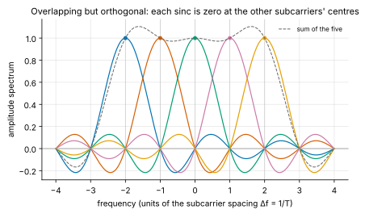
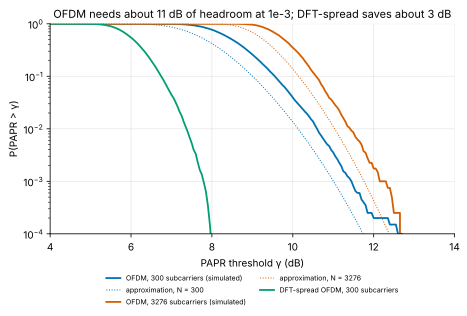

<!-- status: verified -->
# 17-10 · OFDM

| | |
|---|---|
| **Course** | [17 · Communication Systems](../README.md) |
| **University equivalent** | The multicarrier-modulation chapter of a senior communications or wireless course: orthogonal subcarriers, IFFT/FFT implementation, the cyclic prefix and one-tap equalization, frequency-offset and Doppler sensitivity, peak-to-average power, OFDMA and numerology design (Goldsmith, *Wireless Communications*, chapter 12; Proakis & Salehi, *Digital Communications*, multicarrier chapter; Dahlman, Parkvall & Sköld, *5G NR*, chapters on the physical layer) |
| **Prerequisites** | [16-03](../../16-digital-signal-processing/chapters/16-03-the-dft.md) (DFT, circular convolution, the cyclic prefix), [16-04](../../16-digital-signal-processing/chapters/16-04-the-fft.md) (FFT), [17-06](17-06-bandpass-digital-modulation.md) (QAM, EVM), [17-09](17-09-wireless-channels.md) (delay spread, Doppler, coherence), [17-07](17-07-information-theory-and-shannon.md) (water-filling) |
| **Estimated study hours** | 7 |
| **Last verified** | 2026-11-21 |

**Learning objectives.** After this chapter you can:

1. Show that subcarriers spaced by $1/T$ are orthogonal over a symbol of length $T$, and explain why their overlapping spectra do not interfere.
2. Relate FFT size, sampling rate, subcarrier spacing, occupied bandwidth and guard bands, and size an OFDM system for a given channel.
3. Explain how the cyclic prefix gives one-tap equalization per subcarrier, compute its overhead, and choose a numerology from delay spread and Doppler.
4. Derive the inter-carrier interference caused by a frequency offset and by Doppler spread, and set oscillator and tracking requirements from it.
5. Compute the PAPR distribution of OFDM, and explain DFT-spread OFDM and other mitigations.
6. Explain OFDMA, the resource grid and pilot-based channel estimation as used in 5G NR and Wi-Fi.

## 1. Big picture

Every high-rate wireless standard of the last two decades (Wi-Fi from 802.11a on, LTE, 5G NR, digital TV) and much of wired broadband (DSL, cable) uses **orthogonal frequency-division multiplexing**. The reason is 17-09's delay spread. A 100 MHz radio channel with a few hundred nanoseconds of echoes smears each single-carrier symbol over dozens of its neighbours, demanding a long, power-hungry equalizer. OFDM splits the band into thousands of narrow subcarriers, each so narrow that it sees flat fading, and the FFT does the splitting and recombining at a cost of $N\log_2N$ operations per symbol. A short guard interval, the cyclic prefix, absorbs the echoes.

- **Equalization collapses to one complex multiply per subcarrier.** This is what made 100 MHz, 256-QAM radios affordable in phones.
- **The frequency grid is a scheduling grid.** OFDMA hands different subcarrier blocks to different users, which lets a base station serve many phones at once and exploit their frequency-selective fades.
- **The costs are specific and quantifiable.** The cyclic prefix and guard bands cost 7–10% of capacity; the sum of many subcarriers has a high peak-to-average ratio that forces the power amplifier to back off; and the tight subcarrier spacing makes OFDM sensitive to frequency offset, phase noise and Doppler.
- **Numerology is a design decision.** Subcarrier spacing trades delay-spread tolerance against Doppler and phase-noise tolerance and latency; NR scales it by powers of two from 15 to 960 kHz.

## 2. Intuition first

**Many slow lanes instead of one fast one.** A single carrier at 100 Msymbols/s has a 10 ns symbol; a 300 ns echo overlaps 30 symbols. Split the same bandwidth into 3000 subcarriers and each carries a symbol of about 33 μs; the 300 ns echo now overlaps only 1% of one symbol, and a guard interval slightly longer than the echo removes the overlap completely. Each subcarrier is so narrow that the channel's frequency response is flat across it: one complex gain, one division to undo.

**Overlap without interference.** Unlike old frequency-division systems, which left guard gaps between channels, OFDM's subcarriers overlap heavily: each has a sinc-shaped spectrum that extends across its neighbours. They still do not interfere because the receiver integrates over exactly one symbol, over which every other subcarrier completes a whole number of cycles and integrates to zero. Each subcarrier's spectrum passes through zero at every other subcarrier's centre.

**An analogy: a fund split into sleeves.** A large fund that must trade through a volatile market can split its order into many small sleeves, each executed in a quiet window, rather than one large order that moves the price. *Where it breaks:* OFDM's sleeves run simultaneously, not sequentially, and their independence depends on a precise mathematical property (orthogonality over one symbol) that a frequency error destroys; the financial sleeves have no analogue of that fragility.

```text
  bits ─► QAM map ─► X[0..N−1] ─► IFFT ─► add CP ─► DAC/RF ─► channel h(τ) ─► RF/ADC ─► drop CP ─► FFT ─► Y[k] = H[k]X[k] + W[k] ─► ÷H[k] ─► decide
```

## 3. Theory

### 3.1 Orthogonal subcarriers

Take $N$ complex exponentials at frequencies $k\Delta f$, $k = 0, \dots, N - 1$, over a symbol of length $T$. Their inner product over the symbol is

$$
\int_0^Te^{j2\pi k\Delta ft}e^{-j2\pi m\Delta ft}dt = \frac{e^{j2\pi(k - m)\Delta fT} - 1}{j2\pi(k - m)\Delta f}\quad(k \ne m) ,
$$

which is zero exactly when $(k - m)\Delta fT$ is an integer, that is when the **subcarrier spacing** is $\Delta f = 1/T$ (or a multiple). With that choice the subcarriers are orthogonal, and the OFDM symbol

$$
x(t) = \sum_{k=0}^{N-1}X_ke^{j2\pi k\Delta ft},\qquad 0 \le t < T ,
$$

carries $N$ complex data symbols $X_k$ (QAM points, 17-06) that a correlator for each subcarrier recovers without crosstalk. Each subcarrier, being a tone gated by a rectangle of length $T$, has the spectrum $T\,\text{sinc}((f - k\Delta f)T)$, which is zero at every other subcarrier frequency. The total spectrum is nearly flat over $N\Delta f$ hertz, so the occupied bandwidth is about $B = N\Delta f$ and the symbol rate $N/T = B$: the same spectral efficiency as ideal Nyquist signalling (17-04).

### 3.2 IFFT implementation and sizing

Sample $x(t)$ at $f_s = N\Delta f$, that is at $t = nT/N$:

$$
x[n] = \sum_{k=0}^{N-1}X_ke^{j2\pi kn/N} ,
$$

which is $N$ times the inverse DFT of $X_k$ (16-03). The transmitter is an IFFT; the receiver's bank of correlators is an FFT, at $\tfrac N2\log_2N$ complex multiplications each (16-04). In practice:

- **Not every bin carries data.** The bins at the band edges are left empty (**guard bands**) so the spectrum falls off before the neighbouring channel, and the DC bin is often left empty or tolerated, because direct-conversion receivers have a DC offset there.
- **The FFT is larger than the number of used subcarriers.** Choosing $N_{FFT}$ a power of two above the active count oversamples the signal, which eases the anti-aliasing and reconstruction filters. The sampling rate is $N_{FFT}\Delta f$.

NR, for example, fills a 100 MHz channel at 30 kHz spacing with 273 resource blocks of 12 subcarriers ([R-285], [R-287]): 3276 subcarriers occupying 98.28 MHz, leaving guard bands of 845 kHz per side. A 4096-point FFT then runs at 122.88 Msamples/s (Example 17-10.2).

### 3.3 The cyclic prefix and one-tap equalization

A multipath channel of length $L$ samples convolves each symbol with $h[0], \dots, h[L - 1]$, which would smear the end of each symbol into the next and break orthogonality within it. 16-03 §3.8 showed the remedy: prefix each symbol with a copy of its last $N_{CP} \ge L - 1$ samples. The receiver discards the prefix; over the $N$ samples it keeps, the linear convolution equals a circular one, so by the DFT's convolution theorem

$$
Y_k = H_kX_k + W_k,\qquad H_k = \sum_{l=0}^{L-1}h[l]e^{-j2\pi kl/N} ,
$$

where $W_k$ is the noise on subcarrier $k$ (still white and Gaussian, with the same variance, because the normalized DFT is unitary). Each subcarrier is a flat channel with gain $H_k$, the channel's frequency response at its frequency. A **one-tap equalizer** divides by it (zero-forcing, $\hat X_k = Y_k/H_k$). Because each subcarrier is a scalar channel, this loses nothing: its SNR is $|H_k|^2E_s/N_0$ before or after the division, and the MMSE weight $H_k^*/(|H_k|^2 + N_0/E_s)$ differs from $1/H_k$ only by a positive real factor, so once its bias is removed it makes the same decisions (MMSE matters when several streams share a subcarrier, 17-11). What the receiver must not forget is that faded subcarriers are unreliable: their log-likelihood ratios scale with $|H_k|^2$, so a coded OFDM link spreads each codeword over many subcarriers and loses far less to a few deep notches than an uncoded one. A frequency-selective channel thus becomes a set of parallel flat channels of different quality, exactly the setting for water-filling and adaptive bit loading (17-07 §3.8).

**Overhead.** The prefix carries no new information, so it costs a fraction $T_{CP}/(T + T_{CP})$ of time and of transmitted energy. NR's normal cyclic prefix is $144/2048$ of the useful symbol at every numerology ([R-286]), 6.57% of the total symbol duration; its 30 kHz numerology has $T$ = 33.33 μs and $T_{CP}$ = 2.34 μs, enough for echoes with up to about 700 m of extra path length (Example 17-10.1).

**If the prefix is too short.** Energy arriving after the prefix leaks into the next symbol (inter-symbol interference) and breaks the circular structure (inter-carrier interference). The lab shows the error rate rising sharply once the channel outlasts the prefix.

### 3.4 Choosing the subcarrier spacing

Two channel properties from 17-09 bound $\Delta f$ from opposite sides:

- **Delay spread wants small $\Delta f$.** The prefix must exceed the channel's maximum excess delay, and its overhead $T_{CP}/T = T_{CP}\Delta f$ grows with $\Delta f$. A long symbol (small $\Delta f$) makes a fixed prefix cheap.
- **Doppler, frequency offset and phase noise want large $\Delta f$.** A frequency error that is small compared with $\Delta f$ is harmless; one that is a sizeable fraction of it destroys orthogonality (§3.5). Wider spacing also shortens the symbol, and hence the latency.

The design target is roughly $T_{CP} > \tau_{max}$ and $f_D \ll \Delta f$ (in practice $f_D/\Delta f$ of order 1% or less). NR resolves the conflict by offering several numerologies, $\Delta f = 15 \times 2^\mu$ kHz with $\mu$ = 0 to 6 ([R-285]): wide-area, sub-6 GHz deployments with long delay spreads use 15 or 30 kHz; millimetre-wave carriers, with short delay spreads (narrow beams, short cells) but large Doppler and phase noise, use 120 kHz and above. Because NR keeps $T_{CP}/T$ constant, the prefix shrinks in proportion: 4.69 μs at 15 kHz, 0.59 μs at 120 kHz.

### 3.5 Frequency offset, Doppler and inter-carrier interference

Suppose the receiver's oscillator is off by $\delta f$, a fraction $\varepsilon = \delta f/\Delta f$ of the spacing. Over one symbol, subcarrier $k$ arrives as $e^{j2\pi(k + \varepsilon)n/N}$. Correlating it against subcarrier $m$ gives

$$
\frac1N\sum_{n=0}^{N-1}e^{j2\pi(k - m + \varepsilon)n/N} = \frac{\sin(\pi(k - m + \varepsilon))}{N\sin(\pi(k - m + \varepsilon)/N)}e^{j\pi(k - m + \varepsilon)(N - 1)/N} .
$$

For $m = k$ the magnitude is $|\sin(\pi\varepsilon)/(N\sin(\pi\varepsilon/N))| \approx \text{sinc}(\varepsilon)$: the wanted subcarrier is attenuated (and rotated). For $m \ne k$ it is not zero: energy leaks into every other subcarrier, **inter-carrier interference** (ICI). Because the total energy is preserved (the DFT is unitary), the ICI power on a subcarrier, with unit-power independent data everywhere, equals what the wanted term lost:

$$
P_{ICI}(\varepsilon) = 1 - \Big|\frac{\sin\pi\varepsilon}{N\sin(\pi\varepsilon/N)}\Big|^2 \approx 1 - \text{sinc}^2\varepsilon \approx \frac{(\pi\varepsilon)^2}{3}\quad(\varepsilon \ll 1) ,
$$

using $\sin x/x \approx 1 - x^2/6$, so $(\sin x/x)^2 \approx 1 - x^2/3$. ICI acts like extra noise: the subcarrier's signal-to-interference ratio is about $3/(\pi\varepsilon)^2$. An offset of 1% of the spacing gives ICI at −34.8 dB; 10% gives −14.8 dB, enough to spoil 64-QAM (17-06's EVM limits). Receivers therefore estimate and remove the common offset (from the cyclic prefix's correlation with the symbol end, or from pilots) before the FFT.

**Doppler.** A Doppler spectrum cannot be removed as one offset, because each path has its own shift $f_D\cos\alpha$. Averaging the small-offset ICI over the Clarke model's uniformly distributed angles, with $\mathbb E[\cos^2\alpha] = 1/2$:

$$
P_{ICI,Doppler} \approx \frac{(\pi f_DT)^2}{6} = \frac{(\pi f_D/\Delta f)^2}{6} .
$$

At 3.5 GHz and 120 km/h ($f_D$ = 389 Hz) with 30 kHz spacing this is −35.6 dB, negligible; at 28 GHz and 120 kHz spacing it is −29.6 dB, which is why millimetre-wave numerologies widen the spacing as the carrier rises (Example 17-10.4).

> **Going deeper — phase noise.** An oscillator's phase noise (21-06) has two effects on OFDM. Its slow part rotates all subcarriers of a symbol by the same angle (common phase error), which pilots can measure and remove; NR adds dedicated phase-tracking reference signals for this at millimetre wave. Its fast part, at offsets comparable to $\Delta f$ and beyond, acts like a random frequency offset and produces ICI that cannot be removed symbol by symbol, so oscillator phase noise integrated beyond about $\Delta f/2$ sets an EVM floor. Wider subcarrier spacing pushes more of the phase-noise spectrum inside the correctable region.

### 3.6 Peak-to-average power ratio

An OFDM sample is a sum of $N$ independent subcarrier contributions, so by the central limit theorem it is close to complex Gaussian, and its instantaneous power $|x|^2$ is close to exponential with mean $P_{avg}$ (03-03). The probability that one sample exceeds $\gamma P_{avg}$ is $e^{-\gamma}$. Treating the $N$ Nyquist-rate samples of a symbol as independent, the probability that the symbol's **peak-to-average power ratio** exceeds γ is

$$
P(\text{PAPR} > \gamma) \approx 1 - (1 - e^{-\gamma})^N ,
$$

so the PAPR exceeded by one symbol in a thousand is about $\ln(N/10^{-3})$: 11.8 dB for 3276 subcarriers, against 2.6 dB for single-carrier 16-QAM without pulse shaping (17-06). The approximation misses the peaks between samples; oversampling the signal by four raises the measured value by about 0.1–0.4 dB (the lab measures it).

A power amplifier that must pass those peaks without clipping operates **backed off** from saturation, where it is inefficient (21-07). Mitigations:

- **Clipping and filtering**: trim peaks and filter the regrowth, at a cost of in-band EVM.
- **Tone reservation and active constellation extension**: spend a few unused subcarriers, or move outer constellation points outward, to cancel peaks.
- **DFT-spread OFDM** (also called SC-FDMA): precode each block of data symbols with a DFT before mapping them to adjacent subcarriers. The IFFT then largely undoes the DFT, and the transmitted waveform is close to single-carrier, with a PAPR several decibels lower (lab: about 8 dB against 11 dB for QPSK at $10^{-3}$). NR offers it as "transform precoding" on the uplink ([R-286]), where phone battery life and amplifier cost matter most, at the price of contiguous allocation and a less flexible receiver.

### 3.7 Channel estimation and pilots

The one-tap equalizer needs $H_k$ for every subcarrier and symbol. The transmitter inserts known **pilots** (reference signals) on some resource elements; the receiver estimates $H_k$ there and interpolates. 17-09 sets the spacing: pilots must be closer in frequency than the coherence bandwidth and closer in time than the coherence time (by the sampling theorem, the time spacing must be below $1/(2f_D)$, Problem 17-09.14). Pilots are overhead, so standards configure their density for the expected delay spread and speed, and denser pilots are one cost of supporting high-speed trains.

### 3.8 OFDMA and the resource grid

In **OFDMA**, the base station gives different users different sets of subcarriers in different symbols. The basic unit in NR is a **resource block** of 12 consecutive subcarriers ([R-285]) for the duration of a slot of 14 symbols. Scheduling on this grid exploits **multi-user diversity**: users fade independently, so at any moment each subcarrier block is good for someone, and a scheduler that favours each user's good blocks raises total throughput above what any fixed allocation achieves. Wi-Fi added OFDMA in 802.11ax, dividing a channel into resource units for several stations ([R-288]).

The uplink needs extra care. Each phone's subcarriers arrive with its own frequency offset and timing; the base station must align them (by timing advance and frequency correction) so they stay orthogonal at the receiver. Leakage from a strong user's subcarriers into a weak user's (the near-far problem in frequency) is one reason uplink power control matters.



## 4. Worked examples

### Example 17-10.1 · NR timing at 30 kHz (tier A)

**Setup.** TS 38.211 defines $T_c = 1/(480\,\text{kHz} \times 4096)$ and κ = 64; the useful symbol is $2048\kappa \cdot 2^{-\mu}T_c$ and the normal cyclic prefix $144\kappa \cdot 2^{-\mu}T_c$, plus $16\kappa T_c$ on symbols 0 and $7 \cdot 2^\mu$ of each 1 ms subframe ([R-286]). For $\mu$ = 1 (30 kHz) find $T$, $T_{CP}$, the symbol duration, the CP fraction, the slot length, and the extra path length the prefix tolerates.

**Solution.** $\kappa T_c = 1/(15\,\text{kHz} \times 2048)$ = 32.55 ns. $T = 2048 \times 32.55\,\text{ns}/2$ = **33.33** μs $= 1/30$ kHz; $T_{CP} = 144 \times 32.55\,\text{ns}/2$ = **2.344** μs; symbol **35.68** μs; CP fraction $144/2192$ = **6.57** %. A slot of 14 symbols with one extended prefix ($16\kappa T_c$ = 0.52 μs) lasts $14 \times 35.677 + 0.521$ = **500** μs, so two slots fill the 1 ms subframe exactly. The prefix covers an excess path of $c \times 2.344\,\mu\text{s}$ = **703** m.

**Units check.** $T_c$ in seconds; $\kappa T_c$ is the LTE-era basic time $T_s$.

**Sanity check.** $T\Delta f = 1$, as orthogonality requires; the prefix ratio 144/2048 is the same at every μ.

### Example 17-10.2 · Sizing a 100 MHz carrier (tier B)

**Setup.** An NR carrier of 100 MHz at 30 kHz spacing uses 273 resource blocks ([R-287]). Find the number of subcarriers, the occupied bandwidth and spectrum utilization, the guard band per side from TS 38.101's formula $(BW - N_{RB} \cdot 12 \cdot \Delta f)/2 - \Delta f/2$, the sampling rate with a 4096-point FFT, and the oversampling factor. Compare a 20 MHz carrier at 15 kHz with 106 RBs.

**Solution.** $273 \times 12$ = **3276** subcarriers occupying $3276 \times 30$ kHz = **98.28** MHz, 98.3% of the channel. Guard band $(100\,000 - 98\,280)/2 - 15$ = **845** kHz. Sampling rate $4096 \times 30$ kHz = **122.88** MHz; oversampling $4096/3276$ = **1.25**. At 20 MHz: $106 \times 12 \times 15$ kHz = 19.08 MHz, **95.4** % utilization, guard band **452.5** kHz.

**Units check.** kHz × count = kHz.

**Sanity check.** Wider carriers spend a smaller fraction on guard bands, one reason NR's wide carriers are more efficient than LTE-style 20 MHz carriers.

### Example 17-10.3 · One-tap equalization on a two-path channel (tier B)

**Setup.** An 8-subcarrier OFDM system with a sufficient prefix sees the channel $h = [1, 0.5]$. Find $|H_k|$ for every subcarrier, the weakest subcarrier's SNR penalty, and the ZF equalizer for subcarrier 2.

**Solution.** $H_k = 1 + 0.5e^{-j2\pi k/8}$: $|H_k|$ = **1.5**, 1.399, **1.118**, 0.737, **0.5**, 0.737, 1.118, 1.399 for $k$ = 0…7. Subcarrier 4 ($e^{-j\pi} = -1$) has $|H|$ = 0.5, an SNR penalty of $20\log_{10}0.5$ = **−6.02** dB relative to a flat channel of unit gain. Subcarrier 2: $H_2 = 1 - 0.5j$, so the equalizer multiplies by $1/(1 - 0.5j) = 0.8 + 0.4j$.

**Units check.** Gains are dimensionless.

**Sanity check.** The average of $|H_k|^2$ over all subcarriers is $1 + 0.25$ = 1.25, the channel's total energy (Parseval).

### Example 17-10.4 · How accurate must the oscillator be? (tier B)

**Setup.** A 3.5 GHz receiver with 30 kHz subcarriers has an uncorrected frequency error of 0.1 ppm, then of 1 ppm. Find ε and the ICI level for each. Then find the Doppler ICI for 120 km/h at 3.5 GHz with 30 kHz spacing and at 28 GHz with 120 kHz spacing.

**Solution.** 0.1 ppm of 3.5 GHz is 350 Hz: ε = 0.0117, ICI $(\pi\varepsilon)^2/3$ = 4.48e-4, **−33.5** dB. 1 ppm: 3500 Hz, ε = 0.117, ICI **−13.5** dB (the exact form gives −13.6 dB): unusable for high-order QAM, so the offset must be estimated and removed. Doppler: $f_D$ = 389 Hz, $(\pi \times 389/30\,000)^2/6$ → **−35.6** dB; at 28 GHz, $f_D$ = 3113 Hz and $(\pi \times 3113/120\,000)^2/6$ → **−29.6** dB.

**Units check.** ε is a ratio of frequencies.

**Sanity check.** Crystal oscillators in phones are specified to a few ppm, far above the 0.1 ppm needed, so every OFDM receiver tracks frequency continuously from the downlink signal.

### Example 17-10.5 · PAPR and amplifier back-off (tier B)

**Setup.** Using the Nyquist-sample approximation, find the PAPR exceeded with probability $10^{-3}$ for $N$ = 64, 1024 and 3276 subcarriers. If the amplifier's back-off must equal this PAPR, how much more back-off does 3276-subcarrier OFDM need than single-carrier 16-QAM (2.55 dB, 17-06)?

**Solution.** $\gamma = -\ln\big(1 - (1 - 10^{-3})^{1/N}\big)$: **10.44** dB, **11.41** dB and **11.76** dB. The extra back-off is $11.76 - 2.55$ = **9.21** dB.

**Units check.** PAPR is a power ratio in dB.

**Sanity check.** PAPR grows only logarithmically with $N$: going from 64 to 3276 subcarriers adds 1.3 dB.

### Example 17-10.6 · What does a 100 MHz carrier deliver? (tier C)

**Setup.** Use Example 17-10.2's carrier with 256-QAM, a code rate of 0.9, and an assumed 14% overhead for reference signals and control, on one spatial layer. Find the information rate and spectral efficiency, and the minimum SNR any code could need for 256-QAM at rate 0.9.

**Solution.** Symbols per second: $3276 \times 14/0.5\,\text{ms} = 91.73 \times 10^6$. Rate: $91.73 \times 10^6 \times 8 \times 0.9 \times 0.86$ = **568** Mb/s, or **5.68** b/s/Hz over the 100 MHz channel. Each resource element carries $8 \times 0.9 = 7.2$ bits, which needs at least $2^{7.2} - 1$, **21.64** dB, by Shannon–Hartley (17-07), before any implementation loss.

**Units check.** (symbols/s) × (bits/symbol) = b/s.

**Sanity check.** Four spatial layers (17-11) would quadruple the rate to about 2.3 Gb/s, provided the SNR on each layer stays above about 22 dB.

<!-- answer-key -->

| ID | Quantity | Value | Unit |
|---|---|---|---|
| Txt 17-10.a | ICI at 1% offset | −34.8 | dB |
| Txt 17-10.b | NR normal CP at 15 kHz | 4.69 | μs |
| Txt 17-10.c | NR normal CP at 120 kHz | 0.59 | μs |
| Ex 17-10.1a | useful symbol | 33.33 | μs |
| Ex 17-10.1b | cyclic prefix | 2.344 | μs |
| Ex 17-10.1c | symbol duration | 35.68 | μs |
| Ex 17-10.1d | CP fraction | 6.57 | % |
| Ex 17-10.1e | slot length | 500 | μs |
| Ex 17-10.1f | excess path covered | 703 | m |
| Ex 17-10.2a | subcarriers | 3276 | — |
| Ex 17-10.2b | occupied bandwidth | 98.28 | MHz |
| Ex 17-10.2c | guard band per side | 845 | kHz |
| Ex 17-10.2d | sampling rate | 122.88 | MHz |
| Ex 17-10.2e | oversampling factor | 1.25 | — |
| Ex 17-10.2f | 20 MHz utilization | 95.4 | % |
| Ex 17-10.2g | 20 MHz guard band | 452.5 | kHz |
| Ex 17-10.3a | gain at k = 0 | 1.5 | — |
| Ex 17-10.3b | gain at k = 2 | 1.118 | — |
| Ex 17-10.3c | gain at k = 4 | 0.5 | — |
| Ex 17-10.3d | weakest-subcarrier penalty | −6.02 | dB |
| Ex 17-10.4a | ICI at 0.1 ppm | −33.5 | dB |
| Ex 17-10.4b | ICI at 1 ppm | −13.5 | dB |
| Ex 17-10.4c | Doppler ICI, 3.5 GHz, 30 kHz | −35.6 | dB |
| Ex 17-10.4d | Doppler ICI, 28 GHz, 120 kHz | −29.6 | dB |
| Ex 17-10.5a | PAPR at 1e-3, N = 64 | 10.44 | dB |
| Ex 17-10.5b | PAPR at 1e-3, N = 1024 | 11.41 | dB |
| Ex 17-10.5c | PAPR at 1e-3, N = 3276 | 11.76 | dB |
| Ex 17-10.5d | extra back-off over 16-QAM | 9.21 | dB |
| Ex 17-10.6a | information rate | 568 | Mb/s |
| Ex 17-10.6b | spectral efficiency | 5.68 | b/s/Hz |
| Ex 17-10.6c | minimum SNR | 21.64 | dB |

*Every value is recomputed by [verify_17_10.py](../verify/verify_17_10.py): orthogonality by numerical integration, NR timing from the TS 38.211 definitions (including a full subframe), guard bands against TS 38.101's table, equalization by simulating a link with the lab's modulator, ICI by applying offsets to random OFDM symbols, Doppler ICI by simulating a Jakes channel inside a symbol, and PAPR by Monte Carlo against the approximation.*

## 5. Simulate it

The lab, [labs/17-10-lab](../labs/17-10-lab/README.md), provides `ofdm.py`: an IFFT/CP modulator and demodulator, multipath channels with ZF and MMSE one-tap equalizers, an end-to-end QAM link simulator, frequency-offset and Doppler ICI (exact and approximate), PAPR measurement for OFDM and DFT-spread OFDM, and NR timing and guard-band helpers. In the notebook, **predict, then run**:

1. **Orthogonality.** Predict the correlation between two subcarriers one spacing apart over one symbol and over 0.9 of a symbol; compute both.
2. **The cyclic prefix.** Send 16-QAM over a 6-tap channel with prefixes of 0, 3, 5 and 8 samples; predict which succeed.
3. **Per-subcarrier quality.** On a channel with a deep notch at 20 dB SNR, predict each subcarrier's symbol-error rate from $|H_k|^2 \cdot$ SNR, measure it, and check that ZF and bias-corrected MMSE make identical decisions.
4. **Frequency offset.** Predict the ICI for ε = 0.02, 0.05 and 0.1, then measure it.
5. **PAPR.** Measure the CCDF of OFDM and DFT-spread OFDM with 300 subcarriers and compare with the approximation.
6. **NR numerology.** Tabulate $T$, $T_{CP}$ and slot length for μ = 0 to 4 and check that each subframe is exactly 1 ms.



## 6. Engineering tradeoffs

| Knob | Improves | Costs | Typical decision owner |
|---|---|---|---|
| Smaller subcarrier spacing (longer symbol) | Cheaper prefix for a given delay spread; finer frequency scheduling | Doppler, CFO and phase-noise sensitivity; latency | Standards body (numerology), system architect |
| Longer cyclic prefix | Tolerates longer echoes (larger cells, SFN broadcast) | Overhead in time and energy | Standards body |
| Narrower guard bands | Spectrum utilization | Sharper filters, tighter emission masks, more adjacent-channel leakage | RF and baseband designers |
| Denser pilots | Tracks fast fading and long delay spreads | Overhead | PHY architect, scheduler |
| PAPR reduction (clipping, DFT-spread) | PA efficiency, battery life, coverage | EVM, scheduling flexibility, receiver complexity | RF system architect |
| Larger FFT / more subcarriers | Wider bandwidth at the same spacing | Memory, power, ADC/DAC rate | Baseband SoC architect |

## 7. Numbers to know

| Quantity | Value | Note |
|---|---|---|
| Orthogonal spacing | $\Delta f = 1/T$ | sinc spectra, zeros at neighbours |
| NR numerology | $15 \cdot 2^\mu$ kHz, μ = 0–6; 14 symbols per slot; $2^\mu$ slots per ms | [R-285] |
| NR normal CP | $144/2048$ of $T$: 4.69 μs (15 kHz), 2.34 μs (30 kHz), 0.59 μs (120 kHz) | 6.57% of the symbol [R-286] |
| NR 100 MHz carrier | 273 RB at 30 kHz = 3276 subcarriers, 98.28 MHz | guard 845 kHz/side [R-287] |
| Resource block | 12 subcarriers | [R-285] |
| CFO ICI | $(\pi\varepsilon)^2/3$: −34.8 dB at 1%, −14.8 dB at 10% | ε = offset/spacing |
| Doppler ICI | $(\pi f_D/\Delta f)^2/6$ | Clarke model |
| PAPR at $10^{-3}$ | ≈ $\ln(N/10^{-3})$: 10.4–11.8 dB for 64–3276 subcarriers | +0.1–0.4 dB oversampled |
| DFT-spread OFDM | several dB lower PAPR than OFDM | NR uplink option [R-286] |

## 8. Common mistakes

- **Thinking overlapping spectra must interfere.** Orthogonality is a property of integration over exactly one symbol, not of spectral separation; it fails if the receiver's window is misaligned or the frequency is off.
- **Sizing the cyclic prefix to the rms delay spread.** The prefix must cover the channel's maximum excess delay (most of its energy), which is several times the rms value.
- **Forgetting that the prefix costs energy as well as time.** The receiver discards it, so $E_b/N_0$ effectively falls by $10\log_{10}(1 + T_{CP}/T)$, about 0.3 dB in NR.
- **Equating the FFT size with the number of data subcarriers.** Guard bands, the DC bin and pilots all take bins; the FFT size sets the sampling rate.
- **Ignoring PAPR in power budgets.** Average-power link budgets assume the amplifier can pass 10+ dB peaks; it cannot without back-off or PAPR reduction.
- **Treating ICI from Doppler as correctable.** A single frequency offset can be removed; a Doppler spread cannot, which is why spacing must grow with carrier frequency and speed.

## 9. Practitioner lens

### State of the art (as of Nov 2026)

- **5G NR.** TS 38.211 V19.5.0 defines seven numerologies from 15 to 960 kHz with 14-symbol slots and 1 ms subframes, a normal cyclic prefix of $144\kappa \cdot 2^{-\mu}T_c$, 12-subcarrier resource blocks and optional DFT-spread ("transform precoding") on the uplink ([R-285], [R-286]). TS 38.101-1 V20.1.0 allows FR1 carriers up to 100 MHz (273 RBs at 30 kHz) over 410–7125 MHz; TS 38.101-2 allows FR2-1 carriers up to 400 MHz at 120 kHz and, with the optional 480 and 960 kHz numerologies of FR2-2 (52.6–71 GHz), up to 2000 MHz ([R-287]) **[Established]**.
- **Wi-Fi.** 802.11ax (Wi-Fi 6) added OFDMA with resource units and multi-user MIMO, 1024-QAM and four times longer symbols (narrower subcarrier spacing) than 802.11ac; Wi-Fi 7 (802.11be, approved by the IEEE SA Standards Board in September 2024) adds 320 MHz channels and 4096-QAM ([R-288], from IEEE and Wi-Fi Alliance pages and Keysight's documentation; the IEEE standards themselves were not read) **[Established, secondary]**.
- **PAPR in practice.** Every OFDM transmitter with a meaningful power budget uses some combination of crest-factor reduction, digital predistortion and back-off (21-07); DFT-spread OFDM keeps the uplink option for coverage-limited phones **[Established]**.

### Why it matters commercially

OFDM made wideband radio a silicon problem rather than an RF problem: equalization became FFTs and per-subcarrier multiplies, which scale with process technology. The remaining hard parts are the ones this chapter quantifies. Oscillator phase noise and frequency accuracy (21-06) set how high the modulation order can go; PAPR sets amplifier efficiency and therefore battery life and base-station power bills; FFT size and sampling rate set ADC/DAC power. When a modem or radio vendor claims a peak rate, it can be reconstructed from the numerology, the number of resource blocks, the modulation and code rate, the number of layers and an overhead assumption, as in Example 17-10.6.

> **Deeper:** see companion repo *Datacenter Networking* for how OFDM-like discrete multitone appears in wireline and optical links.

### Marketing vs Reality

- **"Peak rate X Gb/s."** Check that it is consistent with bandwidth × spectral efficiency × layers, and what SNR the top MCS needs (above 20 dB for 256-QAM): peak rates are reached near the base station, not at the cell edge.
- **"OFDM is immune to multipath."** Only to echoes shorter than the cyclic prefix; longer ones (large cells, single-frequency networks) cause ISI and ICI.
- **"Our radio supports 4096-QAM."** That requires an EVM around −38 dB (17-06), which constrains phase noise, frequency tracking and PA linearity; ask at what SNR and distance it is actually used.
- **"Lower latency with wider subcarrier spacing."** True for the air-interface slot, but end-to-end latency depends on scheduling, retransmissions and the core network.

### Questions for engineering leaders

1. **"Which numerology do you use, and how did you choose it?"** *Strong:* relates subcarrier spacing to the deployment's delay-spread distribution, Doppler and the oscillator's phase noise. *Evasive:* "the default".
2. **"What limits your top modulation order: SNR, phase noise or PA linearity?"** *Strong:* gives the EVM budget split across those contributors. *Evasive:* quotes only the SNR.
3. **"How much back-off does your PA run, and what crest-factor reduction do you use?"** *Strong:* gives the PAPR at the CCDF point used, the EVM and ACLR cost of the reduction, and the efficiency gained. *Evasive:* "the DPD handles it".
4. **"How do you track frequency offset and Doppler at high speed?"** *Strong:* describes CFO estimation from the prefix or pilots, residual offset, and pilot density for the speed range. *Evasive:* lab tests only at walking speed.
5. **"What is your FFT and sampling architecture for the widest carrier?"** *Strong:* gives FFT size, sampling rate, guard bands and DC handling, and the ADC/DAC power. *Evasive:* gives only the channel bandwidth.

## 10. Concept check

**Q1.** Why are subcarriers spaced by exactly $1/T$ orthogonal?

<details><summary>Answer</summary>

Over a window of length $T$, the product of two subcarriers is a tone at their difference frequency, an integer multiple of $1/T$, which completes a whole number of cycles and integrates to zero.

</details>

**Q2.** What does the cyclic prefix buy, and what does it cost?

<details><summary>Answer</summary>

It makes the channel's linear convolution look circular over the FFT window, so each subcarrier sees one complex gain and symbols do not interfere, provided the channel is shorter than the prefix. It costs $T_{CP}/(T + T_{CP})$ of airtime and energy (6.57% in NR).

</details>

**Q3.** Why does NR use 120 kHz spacing at 28 GHz rather than 15 kHz?

<details><summary>Answer</summary>

Doppler and phase noise scale with carrier frequency; at 15 kHz spacing their ICI would be 64 times larger (the square of the spacing ratio). Millimetre-wave channels have short delay spreads, so the shorter prefix of the wider spacing is acceptable.

</details>

**Q4.** A receiver's frequency error is 5% of the subcarrier spacing. Roughly what SIR does ICI allow?

<details><summary>Answer</summary>

$3/(\pi \times 0.05)^2 \approx 122$, about 20.8 dB: adequate for QPSK and 16-QAM, marginal for 64-QAM, so the offset should be corrected.

</details>

**Q5.** Why is OFDM's PAPR high, and why does it grow only slowly with the number of subcarriers?

<details><summary>Answer</summary>

The samples are sums of many independent terms, nearly complex Gaussian, so occasional large peaks occur. The peak of $N$ exponential samples grows like $\ln N$, so doubling $N$ adds only about 0.2 dB at practical probabilities.

</details>

**Q6.** What is multi-user diversity in OFDMA?

<details><summary>Answer</summary>

Users fade independently across frequency and time, so a scheduler can give each resource block to a user whose channel is currently strong there; the system's total throughput rises because it rides the peaks of many independent fading processes.

</details>

Practice: [17-10 problems](../problems/17-10-problems.md) · [worked solutions](../solutions/17-10-solutions.md).

## 11. Key terms

[OFDM](../../../reference/glossary.md#ofdm) · [Subcarrier spacing](../../../reference/glossary.md#subcarrier-spacing) · [Cyclic prefix](../../../reference/glossary.md#cyclic-prefix) · [One-tap equalizer](../../../reference/glossary.md#one-tap-equalizer) · [Guard band](../../../reference/glossary.md#guard-band) · [Numerology](../../../reference/glossary.md#numerology) · [Inter-carrier interference (ICI)](../../../reference/glossary.md#inter-carrier-interference-ici) · [Carrier frequency offset (CFO)](../../../reference/glossary.md#carrier-frequency-offset-cfo) · [Peak-to-average power ratio (PAPR)](../../../reference/glossary.md#peak-to-average-power-ratio-papr) · [DFT-spread OFDM](../../../reference/glossary.md#dft-spread-ofdm) · [Pilot](../../../reference/glossary.md#pilot) · [OFDMA](../../../reference/glossary.md#ofdma) · [Resource block](../../../reference/glossary.md#resource-block) · [Multi-user diversity](../../../reference/glossary.md#multi-user-diversity)

## 12. Connections

- **Builds on:** [16-03](../../16-digital-signal-processing/chapters/16-03-the-dft.md) and [16-04](../../16-digital-signal-processing/chapters/16-04-the-fft.md) (DFT, circular convolution, FFT), [17-09](17-09-wireless-channels.md) (delay spread, Doppler, coherence), [17-06](17-06-bandpass-digital-modulation.md) (QAM and EVM), [17-07](17-07-information-theory-and-shannon.md) (parallel channels and water-filling), [03-03](../../03-probability-statistics-and-random-variables/chapters/03-03-expectation-and-functions-of-rvs.md) (PAPR of Gaussian signals).
- **Next:** [17-11](17-11-mimo-and-beamforming.md) (MIMO per subcarrier), [17-12](17-12-multiple-access-and-cellular-wifi.md) (OFDMA scheduling in NR and Wi-Fi).
- **Used later:** [21-06](../../21-rf-and-microwave-engineering/chapters/21-06-oscillators-and-vcos.md) (phase noise), [21-07](../../21-rf-and-microwave-engineering/chapters/21-07-power-amplifiers.md) (back-off and crest-factor reduction), [21-12](../../21-rf-and-microwave-engineering/chapters/21-12-modem-baseband-and-standards.md) (modem datapaths).

## 13. Further study

- Goldsmith, *Wireless Communications*, chapter 12 (multicarrier modulation): the matrix view of the cyclic prefix, PAPR, and frequency-offset effects.
- Dahlman, Parkvall & Sköld, *5G NR: The Next Generation Wireless Access Technology*: the NR numerology, resource grid and transform precoding.
- Tse & Viswanath, *Fundamentals of Wireless Communication*, §3.4: OFDM as a diagonalization of the circulant channel.
- Proakis & Salehi, *Digital Communications*: multicarrier systems and their performance.
- 3GPP TS 38.211, clauses 4 and 5.3: the definitive NR timing definitions used in this chapter.

## 14. Sources

1. Goldsmith, A., *Wireless Communications*, Cambridge University Press, 2005.
2. Dahlman, E., Parkvall, S. and Sköld, J., *5G NR: The Next Generation Wireless Access Technology*, Academic Press.
3. Tse, D. and Viswanath, P., *Fundamentals of Wireless Communication*, Cambridge University Press, 2005.
4. Proakis, J. G. and Salehi, M., *Digital Communications*, 5th ed., McGraw-Hill, 2008.
5. [R-285] 3GPP TS 38.211 V19.5.0: numerologies, slots and frames, resource blocks.
6. [R-286] 3GPP TS 38.211 V19.5.0, clauses 4.1 and 5.3.1 (Tc, κ, useful-symbol and cyclic-prefix lengths) and 6.3.1.4 (transform precoding).
7. [R-287] 3GPP TS 38.101-1 V20.1.0 (FR1, Tables 5.1-1, 5.3.2-1, 5.3.3-1) and TS 38.101-2 V20.1.0 (FR2-1/FR2-2 bandwidths).
8. [R-288] IEEE 802.11 TGbe status page; Wi-Fi Alliance MAC/PHY page and Wi-Fi CERTIFIED 7 highlights; Keysight 802.11ax/be introductions (secondary).
