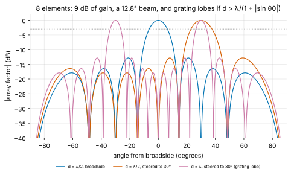
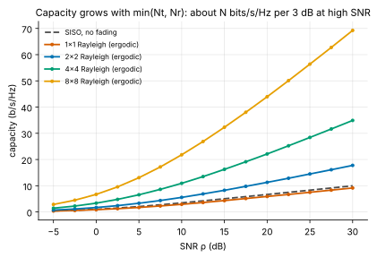

<!-- status: verified -->
# 17-11 · MIMO and Beamforming Basics

| | |
|---|---|
| **Course** | [17 · Communication Systems](../README.md) |
| **University equivalent** | The multiple-antenna chapters of a senior wireless course: receive and transmit diversity, beamforming with antenna arrays, MIMO capacity and spatial multiplexing, linear MIMO receivers, and massive MIMO (Tse & Viswanath, *Fundamentals of Wireless Communication*, chapters 3, 7 and 8; Goldsmith, *Wireless Communications*, chapters 7 and 10; Heath & Lozano, *Foundations of MIMO Communication*) |
| **Prerequisites** | [17-09](17-09-wireless-channels.md) (Rayleigh fading, MRC, diversity order), [17-07](17-07-information-theory-and-shannon.md) (capacity, water-filling), [17-10](17-10-ofdm.md) (OFDM, so MIMO can work per subcarrier), [02-08](../../02-complex-numbers-des-and-linear-algebra/chapters/02-08-eigenvalues-and-eigenvectors.md) (eigenvalues), [17-05](17-05-matched-filters-and-detection.md) (matched filtering) |
| **Estimated study hours** | 6 |
| **Last verified** | 2026-11-21 |

**Learning objectives.** After this chapter you can:

1. Distinguish array gain, diversity gain and spatial-multiplexing gain, and say which a given technique provides.
2. Compute the SNR and error-rate benefits of maximal-ratio, equal-gain and selection combining, and of Alamouti transmit diversity.
3. Derive the array factor of a uniform linear array and compute its gain, beamwidth, null positions and grating-lobe limit.
4. Derive MIMO capacity from the singular-value decomposition, with and without transmitter channel knowledge, and explain why it scales with $\min(N_t, N_r)$.
5. Compute the post-detection SINR of zero-forcing and MMSE MIMO receivers, and explain their losses against capacity.
6. Connect these ideas to 5G NR layers, peak data rates, massive MIMO and millimetre-wave beamforming.

## 1. Big picture

Every radio since the early 2010s that claims a high data rate uses several antennas at each end. Multiple antennas do three different things, and confusing them is the most common error in conversations about MIMO. They can **add power coherently** (array gain: $N$ antennas give $N$ times the SNR), **average out fading** (diversity: deep fades become rare), or **carry several independent streams in the same band at the same time** (spatial multiplexing: capacity grows linearly with the number of antennas instead of logarithmically with power). Which one you get depends on the channel and on whether the transmitter knows it.

- **Capacity without new spectrum.** Spatial multiplexing is the only way to raise throughput in a fixed bandwidth faster than $\log_2$ of the power (17-07). A 4×4 link at 20 dB has almost four times the ergodic capacity of a single antenna.
- **Beamforming is array gain made steerable.** Millimetre-wave systems need 20–30 dB of array gain to overcome their small antenna apertures (17-09 §3.1), which only large phased arrays provide.
- **Diversity makes links reliable.** Two receive antennas cut the SNR needed for $10^{-5}$ BER in Rayleigh fading by about 22 dB (17-09).
- **Antennas cost RF chains.** Each fully digital antenna needs a mixer, ADC/DAC and baseband processing; hybrid analog-digital beamforming and massive MIMO are architectures for spending those chains wisely.

## 2. Intuition first

**Three gains, one picture.** Imagine two receive antennas.

- If the signal at both is the same, adding them coherently doubles the signal amplitude (four times the power) while the independent noises add in power (twice): **array gain** of 2, or 3 dB.
- If the two antennas fade independently, the chance that both are in a deep fade at once is the square of the chance for one: **diversity**.
- If the transmitter also has two antennas and the four paths between them differ enough, the receiver can separate two different signals sent simultaneously, like two people in a room recognizable by where their voices come from: **spatial multiplexing**.

**An analogy: a trading desk with several brokers.** Splitting a large order across brokers who see *the same* market just lets you trade the same quantity with less slippage per broker (array gain). Using brokers on *uncorrelated* venues protects you when one venue freezes (diversity). Executing *different* orders through different venues at the same time increases the total volume you can trade (multiplexing). *Where it breaks:* radio "venues" are spatial directions set by physics; you cannot have more independent streams than the smaller number of antennas at either end, or than the channel's rank, however many brokers you hire.

```text
 Tx antennas                     channel H (Nr × Nt)                    Rx antennas
  x1 ──┐                     h11  h12  ...  h1Nt                     ┌── y1
  x2 ──┼──►  y = H x + n     h21  h22  ...                           ├── y2
  ...  │                     ...                    ──► separate or  │   ...
  xNt ─┘                     hNr1 ...       hNrNt       combine      └── yNr
```

## 3. Theory

### 3.1 Receive diversity: combining several antennas

One transmit antenna, $N$ receive antennas: $\mathbf y = \mathbf hs + \mathbf n$, with $\mathbf h$ the vector of branch gains and white noise of variance $N_0$ on each branch. A linear combiner forms $z = \mathbf w^H\mathbf y$. The output SNR is

$$
\text{SNR}(\mathbf w) = \frac{|\mathbf w^H\mathbf h|^2E_s}{\|\mathbf w\|^2N_0} \le \frac{\|\mathbf w\|^2\|\mathbf h\|^2E_s}{\|\mathbf w\|^2N_0} = \|\mathbf h\|^2\frac{E_s}{N_0}
$$

by the Cauchy–Schwarz inequality, with equality for $\mathbf w \propto \mathbf h$. This is **maximal-ratio combining** (MRC): weight each branch by the conjugate of its gain, the spatial version of the matched filter (17-05). Its SNR is the *sum* of the branch SNRs. With i.i.d. Rayleigh branches of mean SNR $\bar\gamma$:

- **Array gain:** the mean is $N\bar\gamma$ (3 dB for two branches, 6 dB for four).
- **Diversity:** the sum of $N$ exponentials has an Erlang distribution with $P(\gamma < x\bar\gamma) = 1 - e^{-x}\sum_{k<N}x^k/k! \approx x^N/N!$, so the outage and the error rate fall as $\bar\gamma^{-N}$ (17-09 §3.7).

Two simpler combiners trade performance for hardware:

- **Selection combining** (SC) uses the strongest branch. Its outage is $(1 - e^{-x})^N$, the same diversity order, but its mean SNR is only $\bar\gamma\sum_{k=1}^N1/k$: 1.5$\bar\gamma$ for two branches, not 2$\bar\gamma$. It needs one receiver chain and a switch.
- **Equal-gain combining** co-phases the branches without weighting by amplitude, needing only phase estimates; it performs within about 1 dB of MRC.

### 3.2 Transmit diversity: the Alamouti code

With two transmit antennas and one receive antenna, the transmitter cannot simply send the same symbol from both: the two copies would add with random phases and sometimes cancel. Without channel knowledge at the transmitter, diversity requires coding across space and time. **Alamouti's scheme** sends a pair of symbols $(s_1, s_2)$ over two symbol periods:

| | antenna 1 | antenna 2 |
|---|---|---|
| time 1 | $s_1$ | $s_2$ |
| time 2 | $-s_2^*$ | $s_1^*$ |

each antenna at half power. If the gains $h_1, h_2$ are constant over the two periods, the receiver sees $r_1 = (h_1s_1 + h_2s_2)/\sqrt2 + n_1$ and $r_2 = (-h_1s_2^* + h_2s_1^*)/\sqrt2 + n_2$. Forming

$$
\tilde s_1 = h_1^*r_1 + h_2r_2^* = \frac{|h_1|^2 + |h_2|^2}{\sqrt2}s_1 + h_1^*n_1 + h_2n_2^* ,
$$

and similarly $\tilde s_2 = h_2^*r_1 - h_1r_2^*$, the cross terms cancel exactly, leaving each symbol scaled by $|h_1|^2 + |h_2|^2$ with noise of variance $(|h_1|^2 + |h_2|^2)N_0$. The SNR is $(|h_1|^2 + |h_2|^2)E_s/(2N_0)$: full diversity order 2, at the full rate of one symbol per period, but **3 dB less than two-branch MRC** because the transmit power is split without knowing where to point it (Example 17-11.2).

### 3.3 Beamforming with a uniform linear array

Place $N$ antennas in a line with spacing $d$. A plane wave arriving from angle θ (measured from broadside) reaches element $k$ with an extra path $kd\sin\theta$, a phase shift $2\pi kd\sin\theta/\lambda$. The **steering vector** collects these phases:

$$
\mathbf a(\theta) = \big[1,\ e^{-j2\pi(d/\lambda)\sin\theta},\ \dots,\ e^{-j2\pi(N-1)(d/\lambda)\sin\theta}\big]^T .
$$

Weighting the elements by $\mathbf w = \mathbf a(\theta_0)/N$ steers the array to $\theta_0$. Its response to a wave from θ is the **array factor**, a geometric sum:

$$
|AF(\theta)| = \Big|\frac1N\sum_{k=0}^{N-1}e^{jk\psi}\Big| = \Big|\frac{\sin(N\psi/2)}{N\sin(\psi/2)}\Big|,\qquad \psi = 2\pi\frac d\lambda(\sin\theta - \sin\theta_0) .
$$

Its properties, for $d = \lambda/2$:

- **Gain.** In the steered direction the signals add coherently: the power gain over one element is $N$ (9.03 dB for eight elements). Transmitting with the same weights gives the same gain toward the target, and since the radiated power is the same, it also reduces the energy sent elsewhere.
- **Beamwidth.** The main lobe narrows as $1/N$: the half-power beamwidth at broadside is about $0.886\lambda/(Nd)$ radians, 12.8° for eight elements, and it widens by $1/\cos\theta_0$ when steered off broadside.
- **Nulls.** The first null is at $\sin\theta = \sin\theta_0 + \lambda/(Nd)$; a receiver can place nulls on interferers by choosing other weights.
- **Grating lobes.** If $d > \lambda/2$, the factor ψ can reach $2\pi$ inside visible space, creating full-strength copies of the main beam; scanning to $\theta_0$ without grating lobes needs $d \le \lambda/(1 + |\sin\theta_0|)$. This is why arrays use half-wavelength spacing: 4.3 cm at 3.5 GHz, 5.4 mm at 28 GHz.

With channel knowledge, the transmitter can do better than steering at a geometric angle: **maximum-ratio transmission** weights antenna $k$ by $h_k^*/\|\mathbf h\|$ and achieves SNR $\|\mathbf h\|^2E_s/N_0$, exactly MRC's, in any multipath channel.

### 3.4 MIMO capacity

With $N_t$ transmit and $N_r$ receive antennas, $\mathbf y = \mathbf H\mathbf x + \mathbf n$, where $H_{ij}$ is the gain from transmit antenna $j$ to receive antenna $i$, the noise has unit variance per receive antenna, and the total transmit power is ρ (the SNR a single antenna pair would see). Write the **singular-value decomposition** $\mathbf H = \mathbf U\boldsymbol\Sigma\mathbf V^H$ with unitary $\mathbf U$, $\mathbf V$ and non-negative singular values $\sigma_1 \ge \sigma_2 \ge \dots$ on the diagonal of $\boldsymbol\Sigma$.

> **Math refresher — the SVD.** Every complex matrix factors as $\mathbf U\boldsymbol\Sigma\mathbf V^H$: rotate the input ($\mathbf V^H$), scale each coordinate by $\sigma_i$, rotate again ($\mathbf U$). The $\sigma_i^2$ are the eigenvalues of $\mathbf H^H\mathbf H$ (02-08), and the number of nonzero $\sigma_i$ is the rank of $\mathbf H$, at most $\min(N_t, N_r)$. Rotations by unitary matrices preserve lengths and white noise.

If the transmitter sends $\mathbf x = \mathbf V\tilde{\mathbf x}$ and the receiver computes $\tilde{\mathbf y} = \mathbf U^H\mathbf y$, then

$$
\tilde{\mathbf y} = \mathbf U^H\mathbf U\boldsymbol\Sigma\mathbf V^H\mathbf V\tilde{\mathbf x} + \mathbf U^H\mathbf n = \boldsymbol\Sigma\tilde{\mathbf x} + \tilde{\mathbf n} ,
$$

with $\tilde{\mathbf n}$ still white. The MIMO channel has become $r = \text{rank}(\mathbf H)$ parallel scalar channels ("eigenmodes") with power gains $\sigma_i^2$, and 17-07's results apply:

- **With channel knowledge at the transmitter**, water-filling the power ρ over the gains $\sigma_i^2$ achieves $C = \sum_i\log_2(1 + \sigma_i^2p_i)$.
- **Without it**, the best the transmitter can do (for i.i.d. Rayleigh fading) is to spread power equally over its $N_t$ antennas, giving

$$
C = \log_2\det\Big(\mathbf I_{N_r} + \frac{\rho}{N_t}\mathbf H\mathbf H^H\Big) = \sum_{i=1}^{r}\log_2\Big(1 + \frac{\rho}{N_t}\sigma_i^2\Big)\quad\text{b/s/Hz} ,
$$

the two forms being equal because the determinant is the product of the eigenvalues $1 + \rho\sigma_i^2/N_t$.

**Why capacity scales with $\min(N_t, N_r)$.** At high SNR each nonzero eigenmode contributes about $\log_2\rho$, so $C \approx r\log_2\rho + \text{const}$: the capacity curve's slope, the **multiplexing gain**, is the rank. In rich scattering with i.i.d. Rayleigh entries the rank is $\min(N_t, N_r)$ almost surely, and the ergodic capacity of an $N \times N$ system grows nearly linearly in $N$ (Example 17-11.5). In a pure line-of-sight channel between two compact arrays, $\mathbf H$ is close to rank 1: one eigenmode carries almost all the energy, and MIMO gives array gain but little multiplexing.

### 3.5 Linear MIMO receivers

Capacity requires joint processing; practical receivers often separate the streams linearly first.

- **Zero-forcing (ZF)** inverts the channel: $\hat{\mathbf x} = (\mathbf H^H\mathbf H)^{-1}\mathbf H^H\mathbf y$, which removes inter-stream interference completely but amplifies noise. Stream $k$'s SNR is $\dfrac{\rho/N_t}{[(\mathbf H^H\mathbf H)^{-1}]_{kk}}$. When $\mathbf H$ is ill-conditioned (two columns nearly parallel), the inverse is large and the SNR collapses. With $N_r$ receive antennas and $N_t$ streams over i.i.d. Rayleigh fading, each ZF stream has diversity order $N_r - N_t + 1$: a 2×2 ZF receiver has no diversity at all.
- **MMSE** balances interference and noise: $\hat{\mathbf x} = (\mathbf H^H\mathbf H + \tfrac{N_t}{\rho}\mathbf I)^{-1}\mathbf H^H\mathbf y$, with stream SINR $1/[(\mathbf I + \tfrac{\rho}{N_t}\mathbf H^H\mathbf H)^{-1}]_{kk} - 1$. It is never worse than ZF and approaches it at high SNR.
- **Successive interference cancellation** (decode one stream, subtract it, repeat) with MMSE filtering achieves capacity when each stream's rate is matched to its SINR; **maximum-likelihood** detection searches all combinations and gains full diversity, at a cost exponential in the number of streams (sphere decoders reduce it).

### 3.6 Massive MIMO and hybrid beamforming

With many more base-station antennas than users ($M \gg K$), two effects simplify everything. **Channel hardening:** $\|\mathbf h\|^2/M \to 1$ as $M$ grows (its standard deviation falls as $1/\sqrt M$), so each user's beamformed channel stops fading. **Favourable propagation:** different users' channel vectors become nearly orthogonal, so simple MRT/MRC beamforming separates them with little interference. Base stations learn the channels from uplink pilots and, in time-division duplex, use reciprocity to beamform the downlink.

At millimetre wave, hundreds of elements are needed for array gain, but one ADC and RF chain per element is too costly in power. **Hybrid beamforming** splits the job: analog phase shifters form a few beams, each fed by one RF chain, and digital precoding across the chains handles multiplexing. The cost is that each analog beam must be found by a beam search, and switching takes time.

### 3.7 How 5G NR uses multiple antennas

NR maps one codeword onto up to four layers, and two codewords onto five to eight, so the downlink supports up to eight spatial layers; the uplink maps each codeword onto up to four layers, with Release 18 adding eight-port uplink precoders for up to eight layers ([R-290]). Phones must support at least four downlink layers in bands where four receive antennas are mandatory, and at least two in FR2 ([R-289]). TS 38.306 defines the approximate peak rate a device must support:

$$
\text{rate} = 10^{-6}\,v_{layers}\,Q_m\,f\,R_{max}\,\frac{12N_{PRB}}{T_s^\mu}\,(1 - OH)\ \text{Mb/s} ,
$$

with $R_{max} = 948/1024$, $T_s^\mu = 10^{-3}/(14 \cdot 2^\mu)$ s the average symbol duration, and overhead $OH$ = 0.14 for FR1 downlink, 0.18 for FR2 downlink, 0.08 and 0.10 for the uplinks ([R-289]). For a 100 MHz FR1 carrier with four layers of 256-QAM it gives about 2.34 Gb/s (Example 17-11.6): the capacity gain of §3.4 is what makes that figure possible.



## 4. Worked examples

### Example 17-11.1 · Combining two and four antennas (tier A)

**Setup.** Each branch has mean SNR 10 dB, i.i.d. Rayleigh. Find the mean output SNR of MRC and SC with 2 and 4 branches, and the outage probability for a threshold 5 dB below the per-branch mean with one branch, SC and MRC (2 and 4 branches).

**Solution.** MRC means: $10 \times 2$ → **13.01** dB; $10 \times 4$ → **16.02** dB. SC means: $10 \times 1.5$ → **11.76** dB; $10 \times (1 + \tfrac12 + \tfrac13 + \tfrac14) = 20.83$ → **13.19** dB. Threshold $x = 10^{-0.5}$ = 0.316: one branch $1 - e^{-x}$ = **0.271**; SC2 $(1 - e^{-x})^2$ = **0.0735**; MRC2 $1 - e^{-x}(1 + x)$ = **0.0406**; SC4 = 0.00540; MRC4 = **3.24e-4**.

**Units check.** SNRs in dB; outages are probabilities.

**Sanity check.** SC and MRC have the same slope (diversity order) but MRC's extra array gain lowers its outage further.

### Example 17-11.2 · Alamouti at work (tier B)

**Setup.** (a) With $h_1 = 0.8 + 0.6j$, $h_2 = -0.3 + 0.4j$ and symbols $s_1 = 1 + j$, $s_2 = 1 - j$, verify noise-free Alamouti decoding. (b) Compare the BPSK error rate at 15 dB average SNR of 2×1 Alamouti and 1×2 MRC.

**Solution.** (a) $|h_1|^2 + |h_2|^2 = 1 + 0.25$ = **1.25**. Encoding and combining as in §3.2 gives $\tilde s_1 = (1.25/\sqrt2)(1 + j)$ and $\tilde s_2 = (1.25/\sqrt2)(1 - j)$: both symbols recovered exactly after dividing by $1.25/\sqrt2$. (b) MRC with two branches at 15 dB: $\bar P_b$ = **1.78e-4**. Alamouti's SNR is half: the MRC formula at 12 dB gives **6.77e-4**, the same slope, shifted by 3 dB.

**Units check.** $|h|^2$ is a power gain; symbols are dimensionless.

**Sanity check.** Simulation in the lab reproduces the Alamouti rate within a few percent.

### Example 17-11.3 · An 8-element beam (tier B)

**Setup.** An 8-element ULA with $d = \lambda/2$. Find its array gain, the half-power beamwidth at broadside and steered to 30°, the first null at broadside, and the largest spacing that avoids grating lobes when scanning to 60°.

**Solution.** Gain $10\log_{10}8$ = **9.03** dB. Beamwidth (solving $|AF|^2 = 0.5$ numerically): **12.80**° at broadside, **14.84**° at 30° (the $0.886\lambda/(Nd)$ rule gives 12.69° and 14.65°). First null: $\sin\theta = 2/8$, θ = **14.48**°. Grating-lobe-free spacing at 60°: $1/(1 + \sin60°)$ = **0.536** λ.

**Units check.** ψ in radians; angles in degrees.

**Sanity check.** Doubling $N$ halves the beamwidth and adds 3 dB of gain.

### Example 17-11.4 · A 2×2 channel, three ways (tier B)

**Setup.** $\mathbf H = \begin{bmatrix}1 & 0.5\\ 0.2j & 0.8\end{bmatrix}$ at ρ = 20 dB. Find the singular values, the capacity with equal power and with water-filling, the per-stream ZF SNRs and the resulting sum rate, and compare with a single antenna pair of gain 1.

**Solution.** $\sigma_1$ = **1.223**, $\sigma_2$ = **0.659** (condition number 1.85). Equal power: $\log_2(1 + 50 \times 1.4953) + \log_2(1 + 50 \times 0.4347)$ = **10.75** b/s/Hz; water-filling adds only 0.0004 at this SNR. ZF: $(\mathbf H^H\mathbf H)^{-1}$ has diagonal 1.369 and 1.600, so the stream SNRs are $50/1.369$ = **15.62** dB and $50/1.6$ = **14.95** dB, a sum rate of $\log_2(1 + 36.52) + \log_2(1 + 31.25)$ = **10.24** b/s/Hz. A single pair: $\log_2101$ = **6.66** b/s/Hz.

**Units check.** b/s/Hz throughout.

**Sanity check.** Two streams give 1.6 times the SISO rate here, not 2, because the second eigenmode is weaker and power is split; ZF loses 0.5 b/s/Hz to noise enhancement.

### Example 17-11.5 · How capacity scales (tier C)

**Setup.** For i.i.d. Rayleigh channels at ρ = 20 dB, find the ergodic capacity of 1×1 (closed form $\log_2(e)e^{1/\rho}E_1(1/\rho)$), 2×2 (integrating the eigenvalue density $p(\lambda) = \tfrac12(1 + (1 - \lambda)^2)e^{-\lambda}$), and 4×4 (Monte Carlo).

**Solution.** 1×1: **5.88** b/s/Hz (against 6.66 for an unfaded channel at 20 dB). 2×2: $2\int_0^\infty\log_2(1 + 10\lambda)p(\lambda)d\lambda$ = **11.29** b/s/Hz. 4×4: **22.1** b/s/Hz. The ratios to SISO are 1.92 and 3.76.

**Units check.** Capacity per channel use in b/s/Hz; λ is dimensionless.

**Sanity check.** Nearly linear growth with $N$, as $\min(N_t, N_r)\log_2\rho$ predicts; each doubling of antennas at both ends almost doubles capacity, whereas doubling power adds only 1 b/s/Hz per stream.

### Example 17-11.6 · NR peak rate (tier C)

**Setup.** Use TS 38.306's formula for a 100 MHz FR1 downlink carrier at 30 kHz (273 RBs), 256-QAM ($Q_m$ = 8), $f$ = 1, with 4 layers and with 2 layers. Find the spectral efficiency of the 4-layer case.

**Solution.** $T_s = 10^{-3}/28$ s; $12 \times 273/T_s = 91.73 \times 10^6$ resource elements per second. Rate $= 10^{-6} \times 4 \times 8 \times (948/1024) \times 91.73 \times 10^6 \times 0.86$ = **2337** Mb/s; with 2 layers, **1169** Mb/s. Spectral efficiency $2337/100$ = **23.4** b/s/Hz.

**Units check.** Resource elements/s × bits/RE = b/s.

**Sanity check.** 23.4 b/s/Hz over four layers is 5.84 b/s/Hz per layer, about 6.4 bits per resource element before overhead: each layer needs an SNR above roughly 20 dB, so peak rates occur only near the cell centre.

<!-- answer-key -->

| ID | Quantity | Value | Unit |
|---|---|---|---|
| Txt 17-11.a | SC mean gain, 2 branches | 1.5 | — |
| Txt 17-11.b | Alamouti loss against MRC | 3.01 | dB |
| Txt 17-11.c | NR Rmax | 0.926 | — |
| Ex 17-11.1a | MRC mean, 2 branches | 13.01 | dB |
| Ex 17-11.1b | MRC mean, 4 branches | 16.02 | dB |
| Ex 17-11.1c | SC mean, 2 branches | 11.76 | dB |
| Ex 17-11.1d | SC mean, 4 branches | 13.19 | dB |
| Ex 17-11.1e | outage, one branch | 0.271 | — |
| Ex 17-11.1f | outage, SC2 | 0.0735 | — |
| Ex 17-11.1g | outage, MRC2 | 0.0406 | — |
| Ex 17-11.1h | outage, MRC4 | 3.24e-4 | — |
| Ex 17-11.2a | combined gain | 1.25 | — |
| Ex 17-11.2b | MRC2 BER at 15 dB | 1.78e-4 | — |
| Ex 17-11.2c | Alamouti BER at 15 dB | 6.77e-4 | — |
| Ex 17-11.3a | array gain | 9.03 | dB |
| Ex 17-11.3b | beamwidth at broadside | 12.80 | ° |
| Ex 17-11.3c | beamwidth steered to 30° | 14.84 | ° |
| Ex 17-11.3d | first null | 14.48 | ° |
| Ex 17-11.3e | grating-free spacing at 60° | 0.536 | λ |
| Ex 17-11.4a | largest singular value | 1.223 | — |
| Ex 17-11.4b | smallest singular value | 0.659 | — |
| Ex 17-11.4c | equal-power capacity | 10.75 | b/s/Hz |
| Ex 17-11.4d | ZF stream 1 SNR | 15.62 | dB |
| Ex 17-11.4e | ZF stream 2 SNR | 14.95 | dB |
| Ex 17-11.4f | ZF sum rate | 10.24 | b/s/Hz |
| Ex 17-11.4g | SISO capacity | 6.66 | b/s/Hz |
| Ex 17-11.5a | 1×1 ergodic capacity | 5.88 | b/s/Hz |
| Ex 17-11.5b | 2×2 ergodic capacity | 11.29 | b/s/Hz |
| Ex 17-11.5c | 4×4 ergodic capacity | 22.1 | b/s/Hz |
| Ex 17-11.6a | NR rate, 4 layers | 2337 | Mb/s |
| Ex 17-11.6b | NR rate, 2 layers | 1169 | Mb/s |
| Ex 17-11.6c | spectral efficiency, 4 layers | 23.4 | b/s/Hz |

*Every value is recomputed by [verify_17_11.py](../verify/verify_17_11.py): combining statistics by Monte Carlo and closed forms, Alamouti by encoding and decoding, beam patterns by direct summation over elements, capacities by SVD and by determinant, ergodic capacities by integration, Monte Carlo and closed form, ZF/MMSE SINRs by matrix algebra and simulation, and the NR rate from the TS 38.306 formula.*

## 5. Simulate it

The lab, [labs/17-11-lab](../labs/17-11-lab/README.md), provides `mimo.py`: combining (MRC, EGC, SC) with outage and BER, Alamouti encoding and decoding, ULA steering vectors, array factors, beamwidths and grating-lobe limits, MIMO capacity (equal power, SVD, water-filling, ergodic by Monte Carlo and by integration), ZF and MMSE detectors with their SINRs and BER, and the NR peak-rate formula. In the notebook, **predict, then run**:

1. **Combining.** Predict the BER at 10 dB for 1, 2 and 4 branches with SC, EGC and MRC; simulate.
2. **Alamouti.** Predict the gap between 2×1 Alamouti and 1×2 MRC; simulate both.
3. **Beams.** Plot the array factor of an 8-element array at broadside and steered to 30°; then increase the spacing to one wavelength and find the grating lobes.
4. **Capacity scaling.** Predict the ergodic capacity of $N \times N$ systems for $N$ = 1 to 8 at 20 dB; compute it.
5. **Linear receivers.** Simulate a 2×2 QPSK link with ZF and MMSE from 0 to 30 dB and measure their slopes; add a third receive antenna and watch ZF's diversity improve.
6. **Channel hardening.** Measure the spread of $\|\mathbf h\|^2/M$ as $M$ grows from 1 to 256.



## 6. Engineering tradeoffs

| Knob | Improves | Costs | Typical decision owner |
|---|---|---|---|
| More receive antennas (MRC) | Array gain and diversity | RF chains, power, device volume | Device architect |
| Transmit diversity (Alamouti) | Diversity without CSI at transmitter | 3 dB against MRC; rate limited to one symbol per use | Standards body |
| Beamforming array size | Gain (N), narrower beam, interference rejection | Beam management, calibration, cost per element | RF system architect |
| Spatial multiplexing layers | Throughput (∝ rank) | Higher SNR per layer, rich scattering, CSI feedback, receiver complexity | PHY architect, scheduler |
| ZF/MMSE vs ML/SIC receiver | Complexity and power | Diversity and SNR loss with ill-conditioned channels | Modem designer |
| Hybrid vs fully digital arrays | Fewer RF chains, lower power | Fewer simultaneous beams, beam-search latency | mmWave system architect |

## 7. Numbers to know

| Quantity | Value | Note |
|---|---|---|
| MRC | SNR = $\|\mathbf h\|^2E_s/N_0$; mean $N\bar\gamma$; diversity $N$ | matched filter in space |
| Selection combining | mean $\bar\gamma\sum1/k$ (1.5 for 2, 2.08 for 4) | diversity $N$ |
| Alamouti 2×1 | diversity 2, rate 1, 3 dB below 1×2 MRC | no CSI at transmitter |
| ULA, $d = \lambda/2$ | gain $N$; HPBW ≈ $101.5°/N$ at broadside | grating-free: $d \le \lambda/(1 + \sin\theta_0)$ |
| MIMO capacity | $\log_2\det(\mathbf I + \tfrac{\rho}{N_t}\mathbf H\mathbf H^H)$ | slope = rank ≤ $\min(N_t, N_r)$ |
| Ergodic at 20 dB | 5.88 (1×1), 11.29 (2×2), 22.1 (4×4) b/s/Hz | i.i.d. Rayleigh |
| ZF diversity | $N_r - N_t + 1$ per stream | |
| NR layers | up to 8 DL (2 codewords above 4); UE ≥ 4 where 4Rx mandatory | [R-289], [R-290] |
| NR peak rate | ≈ 2.34 Gb/s per 100 MHz FR1 carrier with 4 layers of 256-QAM | TS 38.306 [R-289] |

## 8. Common mistakes

- **Calling every multi-antenna gain "MIMO capacity".** Array gain adds decibels; diversity changes the slope of the error curve; only multiplexing multiplies capacity.
- **Expecting multiplexing in line of sight.** Two compact arrays facing each other produce a nearly rank-1 channel; extra streams need angular spread (or very wide antenna separation).
- **Ignoring the transmit-power split.** With $N_t$ antennas and no channel knowledge, each antenna gets $\rho/N_t$; Alamouti's 3 dB loss and the $\rho/N_t$ in the capacity formula both come from this.
- **Assuming antennas are independent.** Correlation from close spacing or a narrow angle spread reduces both diversity and multiplexing.
- **Using ZF on ill-conditioned channels without checking the noise enhancement.** A condition number of 10 can cost 20 dB on the weak stream.
- **Ignoring grating lobes.** Element spacing above half a wavelength creates copies of the beam that radiate energy in unintended directions when scanning.

## 9. Practitioner lens

### State of the art (as of Nov 2026)

- **NR layers and peak rates.** TS 38.211 V19.5.0 maps up to eight downlink layers onto one or two codewords and up to four uplink layers per codeword, with eight-port uplink codebooks supporting up to eight layers ([R-290]); TS 38.306 V19.4.0 requires at least four downlink layers in bands where four receive antennas are mandatory and at least two in FR2, and defines the peak-rate formula used in Example 17-11.6 ([R-289]) **[Established]**.
- **Wi-Fi.** 802.11ax added multi-user MIMO on resource units of at least 106 tones, with up to eight users and at most eight space-time streams in total (from Keysight's documentation); the maximum number of spatial streams in the final 802.11be standard could not be confirmed from a primary source ([R-288]) **[Established, secondary]**.
- **Massive MIMO and mmWave.** The architectures of §3.6 (large arrays at base stations, hybrid analog-digital beamforming at millimetre wave) follow directly from the theory here; specific base-station antenna counts and RF-chain configurations are vendor-specific and are not covered by the sources logged for this chapter, so none are quoted.

### Why it matters commercially

Spatial multiplexing is the cheapest capacity a network can buy after spectrum, but it is not free: each layer needs its own RF chain, a well-conditioned channel and an SNR high enough for its modulation. For devices, the number of receive antennas (two or four in a phone) sets the peak layer count and also gives diversity at the cell edge. For base stations, the trade is between fully digital massive MIMO (flexible, power-hungry) and hybrid beamforming (efficient, slower to adapt). For investors, peak-rate headlines are products of bandwidth, layers and modulation; the typical user rate depends on how often the channel supports more than one or two layers.

### Marketing vs Reality

- **"8×8 MIMO means 8× throughput."** Only if the channel has rank 8 and every eigenmode has high SNR; real channels are correlated and the weaker modes carry far less.
- **"Beamforming increases range by N×."** Array gain of $N$ in power increases free-space range by $\sqrt N$ (more with both ends), and less in heavily attenuated paths.
- **"Massive MIMO eliminates interference."** Favourable propagation reduces it, but pilot contamination, channel aging and hardware impairments limit how far.
- **"Our phone supports 4 layers."** Ask how often the network schedules four layers in practice and at what SNR.

### Questions for engineering leaders

1. **"What rank does your typical deployment channel support, and how do you measure it?"** *Strong:* rank and eigenvalue spread statistics from field data, by scenario. *Evasive:* quotes the antenna count.
2. **"What does your receiver do on ill-conditioned channels?"** *Strong:* MMSE-SIC or near-ML detection with measured loss against capacity. *Evasive:* ZF only, no data on condition numbers.
3. **"How do you get channel state at the transmitter, and how old is it when used?"** *Strong:* explains feedback or reciprocity, the delay, and the coherence-time budget (17-09). *Evasive:* assumes perfect CSI.
4. **"Why hybrid rather than fully digital, at your frequency and array size?"** *Strong:* compares power per RF chain, beam-search latency and multi-user capacity. *Evasive:* "industry standard".
5. **"How is your array calibrated across temperature and over life?"** *Strong:* describes over-the-air or loopback calibration and the residual phase error's effect on gain and nulls. *Evasive:* factory calibration only.

## 10. Concept check

**Q1.** Two receive antennas see the same fading (fully correlated). Which gains remain?

<details><summary>Answer</summary>

Array gain (3 dB from coherent combining against independent noise) remains; diversity is lost because both fade together.

</details>

**Q2.** Why does MRC weight each branch by $h_k^*$?

<details><summary>Answer</summary>

By Cauchy–Schwarz, the output SNR $|\mathbf w^H\mathbf h|^2/\|\mathbf w\|^2$ is maximized when $\mathbf w$ is parallel to $\mathbf h$: co-phase every branch and weight it by its amplitude, the matched filter in space.

</details>

**Q3.** What does Alamouti give up relative to receive MRC, and why?

<details><summary>Answer</summary>

3 dB: without channel knowledge the transmitter splits its power equally between antennas instead of steering it, so the combined SNR is $(|h_1|^2 + |h_2|^2)E_s/(2N_0)$.

</details>

**Q4.** An 8-element array is spaced one wavelength apart. What happens when it steers to 30°?

<details><summary>Answer</summary>

Grating lobes appear: the spacing exceeds $\lambda/(1 + \sin30°)$ = 0.67λ, so copies of the main beam enter visible space (for d = λ even at broadside, endfire directions see a full lobe).

</details>

**Q5.** Why is MIMO capacity's high-SNR slope equal to the channel's rank?

<details><summary>Answer</summary>

The SVD turns the channel into rank-many parallel scalar channels; each contributes about $\log_2\rho$ at high SNR, so capacity grows as rank × $\log_2\rho$.

</details>

**Q6.** What is channel hardening, and why does it help massive MIMO?

<details><summary>Answer</summary>

With $M$ antennas, $\|\mathbf h\|^2/M$ concentrates around its mean (spread ∝ $1/\sqrt M$), so the beamformed channel barely fades; scheduling and rate adaptation can rely on its average instead of tracking fast fading.

</details>

Practice: [17-11 problems](../problems/17-11-problems.md) · [worked solutions](../solutions/17-11-solutions.md).

## 11. Key terms

[Array gain](../../../reference/glossary.md#array-gain) · [Diversity order](../../../reference/glossary.md#diversity-order) · [Maximal-ratio combining](../../../reference/glossary.md#maximal-ratio-combining) · [Selection combining](../../../reference/glossary.md#selection-combining) · [Alamouti code](../../../reference/glossary.md#alamouti-code) · [Steering vector](../../../reference/glossary.md#steering-vector) · [Array factor](../../../reference/glossary.md#array-factor) · [Grating lobe](../../../reference/glossary.md#grating-lobe) · [Spatial multiplexing](../../../reference/glossary.md#spatial-multiplexing) · [Singular value decomposition](../../../reference/glossary.md#singular-value-decomposition) · [MIMO capacity](../../../reference/glossary.md#mimo-capacity) · [Zero-forcing receiver](../../../reference/glossary.md#zero-forcing-receiver) · [MMSE receiver](../../../reference/glossary.md#mmse-receiver) · [Channel hardening](../../../reference/glossary.md#channel-hardening) · [Hybrid beamforming](../../../reference/glossary.md#hybrid-beamforming) · [Layer (MIMO)](../../../reference/glossary.md#layer-mimo)

## 12. Connections

- **Builds on:** [17-09](17-09-wireless-channels.md) (fading, MRC, diversity order), [17-07](17-07-information-theory-and-shannon.md) (capacity, water-filling), [17-10](17-10-ofdm.md) (OFDM, where MIMO runs per subcarrier), [17-05](17-05-matched-filters-and-detection.md) (matched filter), [02-08](../../02-complex-numbers-des-and-linear-algebra/chapters/02-08-eigenvalues-and-eigenvectors.md) (eigenvalues).
- **Next:** [17-12](17-12-multiple-access-and-cellular-wifi.md) (how NR and Wi-Fi schedule layers and users).
- **Used later:** [21-10](../../21-rf-and-microwave-engineering/chapters/21-10-antennas-arrays-mmwave.md) (phased arrays, hybrid beamforming hardware), [21-12](../../21-rf-and-microwave-engineering/chapters/21-12-modem-baseband-and-standards.md) (MIMO detectors in modem datapaths).

## 13. Further study

- Tse & Viswanath, *Fundamentals of Wireless Communication*: chapter 3 (diversity, Alamouti), chapter 7 (MIMO channel modelling, degrees of freedom), chapter 8 (MIMO capacity, receivers); free from the authors.
- Heath & Lozano, *Foundations of MIMO Communication*: a modern, thorough treatment including massive MIMO.
- Goldsmith, *Wireless Communications*: chapter 7 (diversity) and chapter 10 (MIMO).
- Marzetta, Larsson, Yang & Ngo, *Fundamentals of Massive MIMO*: channel hardening and favourable propagation.
- Van Trees, *Optimum Array Processing*: array factors, beam patterns and nulling.

## 14. Sources

1. Tse, D. and Viswanath, P., *Fundamentals of Wireless Communication*, Cambridge University Press, 2005.
2. Telatar, E., "Capacity of Multi-antenna Gaussian Channels", *European Transactions on Telecommunications* 10(6), 1999 (ergodic capacity and the Wishart eigenvalue density).
3. Alamouti, S. M., "A Simple Transmit Diversity Technique for Wireless Communications", *IEEE JSAC* 16(8), 1998.
4. Heath, R. W. and Lozano, A., *Foundations of MIMO Communication*, Cambridge University Press, 2018.
5. Goldsmith, A., *Wireless Communications*, Cambridge University Press, 2005.
6. [R-289] 3GPP TS 38.306 V19.4.0 (2026-09): clause 4.1.2 maximum data-rate formula; maxNumberMIMO-LayersPDSCH requirements.
7. [R-290] 3GPP TS 38.211 V19.5.0 (2026-09): clause 7.3.1.3 (downlink codeword-to-layer mapping), 6.3.1.3 and Table 6.3.1.5-47 (uplink layers).
8. [R-288] Keysight 802.11ax introduction (secondary) for Wi-Fi MU-MIMO.
