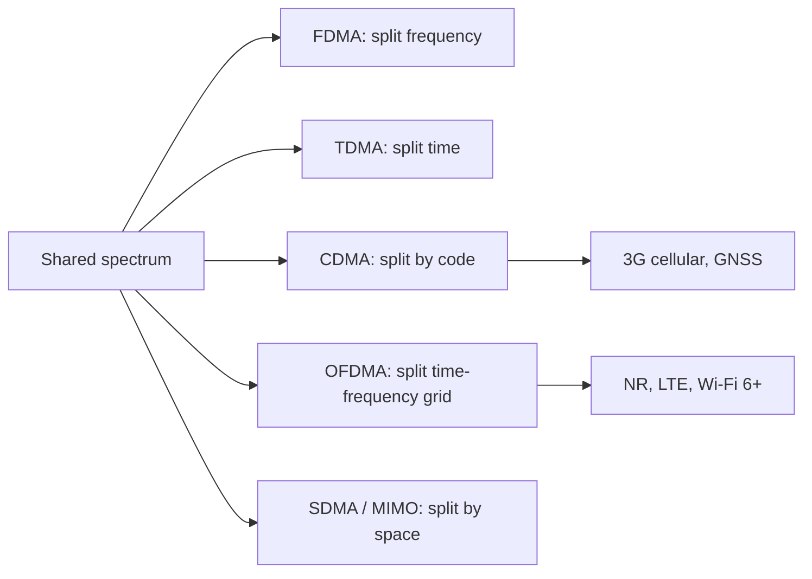
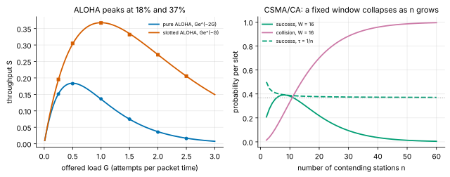
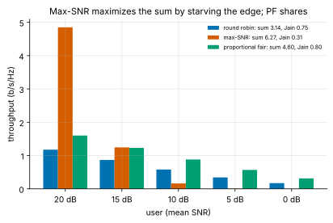

<!-- status: reviewed -->
# 17-12 · Multiple Access, Cellular and Wi-Fi Systems

| | |
|---|---|
| **Course** | [17 · Communication Systems](../README.md) |
| **University equivalent** | The multiple-access and wireless-systems chapters of a senior communications or wireless-networking course: FDMA, TDMA, CDMA and OFDMA, the cellular concept and frequency reuse, random access (ALOHA, CSMA/CA), traffic engineering, scheduling and HARQ, and how 4G/5G and Wi-Fi combine them (Rappaport, *Wireless Communications*, chapters 3 and 9; Goldsmith, *Wireless Communications*, chapters 13–15; Bertsekas & Gallager, *Data Networks*, chapter 4) |
| **Prerequisites** | [17-10](17-10-ofdm.md) (OFDM and OFDMA), [17-11](17-11-mimo-and-beamforming.md) (MIMO, layers), [17-09](17-09-wireless-channels.md) (path loss, fading), [17-08](17-08-channel-coding.md) (codes, CRC), [03-02](../../03-probability-statistics-and-random-variables/chapters/03-02-random-variables-and-distributions.md) (Poisson and exponential distributions) |
| **Estimated study hours** | 8 |
| **Last verified** | 2026-11-21 |

**Learning objectives.** After this chapter you can:

1. Compare FDMA, TDMA, CDMA and OFDMA (and FDD and TDD), and compute channel counts and CDMA processing gain and capacity.
2. Apply the cellular concept: cluster sizes, reuse distance and the signal-to-interference ratio from first-tier interferers.
3. Derive the throughput of ALOHA and slotted ALOHA, and analyse CSMA/CA's collision behaviour as the number of stations grows.
4. Use the Erlang B formula to size a system for a blocking target.
5. Compare round-robin, max-SNR and proportional-fair scheduling, quantify multi-user diversity, and compute HARQ throughput.
6. Map the course's main techniques (modulation, coding, OFDM, MIMO, multiple access, HARQ) onto the physical and access layers of 5G NR and Wi-Fi.

## 1. Big picture

The previous eleven chapters built one link: a transmitter, a channel, a receiver. Real systems serve many users on shared spectrum, and the rules for sharing decide most of their capacity. Cellular networks schedule almost every resource centrally from the base station (initial access is the exception: a phone announces itself on a random-access channel by contention, slotted ALOHA over a set of preambles, §3.4); Wi-Fi lets stations contend for the medium and back off when they collide. Both reuse the same spectrum in neighbouring cells, accepting interference in exchange for capacity. This chapter adds the multi-user layer and then shows how 5G NR and Wi-Fi assemble the whole course into working systems.

- **Spectrum is shared in frequency, time, code and space.** Each axis has its own orthogonality condition and its own cost.
- **Reuse is the multiplier.** A cellular network's capacity grows with the number of cells, not the amount of spectrum; interference between cells is the price.
- **Contention versus scheduling is an architecture choice.** Random access is simple and decentralized but wastes airtime on collisions as load grows; scheduling is efficient but needs a controller and signalling.
- **Fading becomes an asset with many users.** A scheduler that serves each user when its channel is good harvests multi-user diversity.

## 2. Intuition first

**A shared conference room.** Several teams must share one meeting room. They can split the room with partitions (frequency division), book time slots (time division), all talk at once in different languages that listeners can filter (code division), or rent several rooms in different buildings and accept a little noise through the walls (cellular reuse). Within a free-for-all room, people speak when it seems quiet and back off if two start at once (carrier sensing with random backoff), or a chair calls on speakers in turn (scheduling).

*Where the analogy breaks:* radio "languages" (codes) are only perfectly separable when synchronized and power-balanced, and walls between cells are not fixed: interference depends on distance, terrain and how loudly the neighbours transmit. The analogy also hides the radio-specific problem of the hidden terminal, where two speakers cannot hear each other but both reach the listener.

## 3. Theory

### 3.1 Dividing a channel: FDMA, TDMA, CDMA, OFDMA

- **FDMA** gives each user a separate frequency channel, separated by guard bands so that filters can isolate them. With total bandwidth $B$ and channel width $B_c$, there are $\lfloor B/B_c\rfloor$ channels.
- **TDMA** gives each user a time slot in a repeating frame, separated by guard times that absorb timing error and propagation delay; users transmit in bursts at the full channel rate. Most practical TDMA systems combine it with FDMA: $\lfloor B/B_c\rfloor \times$ (slots per frame) users.
- **CDMA** lets all users transmit at once over the whole band, each multiplying its data by a fast **spreading code**; the receiver correlates with the wanted user's code (§3.2).
- **OFDMA** (17-10) divides a time-frequency grid of subcarriers and symbols among users, combining FDMA's flexibility with TDMA's burst scheduling and OFDM's robustness to multipath.
- **SDMA** (17-11) separates users by direction with beamforming or multi-user MIMO, reusing the same time-frequency resource.

**Duplexing** separates the two directions of one link. **FDD** uses paired bands (uplink and downlink at different frequencies, separated by a duplex gap and a duplexer filter). **TDD** alternates in time on one band, which lets the split between uplink and downlink follow traffic and makes the channel reciprocal (useful for massive MIMO, 17-11 §3.6), at the cost of guard periods and the need for neighbouring cells to synchronize their switching.

### 3.2 CDMA and processing gain

Spread a data stream of rate $R_b$ by a pseudo-random ±1 code at chip rate $R_c \gg R_b$. The transmitted signal occupies about $R_c$ hertz. At the receiver, multiplying by the same code (synchronized) restores the data, while any other signal, including interference, stays spread over $R_c$ hertz and only a fraction $R_b/R_c$ of its power falls in the data bandwidth. The **processing gain**

$$
G_p = \frac{R_c}{R_b}
$$

is the factor by which despreading raises the signal relative to wideband interference (17-02 introduced the same idea as despreading gain for GNSS).

**Orthogonal codes.** Walsh codes (rows of a Hadamard matrix) are exactly orthogonal when synchronized: for length 4, $[1,1,1,1]$, $[1,-1,1,-1]$, $[1,1,-1,-1]$, $[1,-1,-1,1]$, whose pairwise products sum to zero. Downlinks from one transmitter can keep them synchronized, although multipath delays partly destroy the orthogonality at the receiver (an "orthogonality factor" below 1 accounts for it); uplinks from different phones cannot, so they use pseudo-noise codes with small (not zero) cross-correlation and see each other as noise.

**Single-cell uplink capacity.** With $N$ users received at equal power $P$ (by power control), each sees $N - 1$ interferers. If interference is treated as white noise spread over $R_c$, the energy per bit to interference density is

$$
\frac{E_b}{I_0} = \frac{P/R_b}{(N - 1)P/R_c} = \frac{G_p}{N - 1}\quad\Rightarrow\quad N = 1 + \frac{G_p}{E_b/I_0} ,
$$

ignoring thermal noise. Voice activity (silence is not transmitted) multiplies the interference by the activity factor α (about 0.4–0.5), and interference from neighbouring cells multiplies it by $(1 + f)$, so $N \approx 1 + G_p/\big((E_b/I_0)\,\alpha(1 + f)\big)$. CDMA's capacity is **soft**: adding users degrades everyone gradually instead of being refused. Its Achilles heel is the **near-far problem**: a nearby phone received 30 dB stronger than a distant one swamps it, so uplink power control must be fast and accurate.

### 3.3 The cellular concept and frequency reuse

A **cellular** network divides the coverage area into cells, each with a base station, and reuses the same frequencies in cells far enough apart. In the classic hexagonal model, a **cluster** of $N$ cells shares the spectrum without reuse, and the pattern repeats. Hexagonal geometry allows only $N = i^2 + ij + j^2$ (1, 3, 4, 7, 9, 12, …), and the distance between co-channel cells relative to the cell radius is

$$
\frac DR = \sqrt{3N} .
$$

With path-loss exponent $n$ (17-09) and the six nearest co-channel cells at distance about $D$, a user at the cell edge (distance $R$) sees

$$
\text{SIR} \approx \frac{R^{-n}}{6D^{-n}} = \frac{(\sqrt{3N})^n}{6} .
$$

For $n$ = 4, $N$ = 7 gives 18.7 dB and $N$ = 1 gives only 1.8 dB (Example 17-12.2), though the six-interferer approximation fails for $N$ = 1: a user at a cell corner is equidistant from its own and two neighbouring base stations, so its SIR is below −3 dB, and a full lattice sum gives −3.85 dB at $n$ = 4. Larger clusters buy SIR at the cost of capacity per cell (each cell gets $1/N$ of the spectrum). Sectorized antennas cut the number of interferers each cell sees: with three 120° sectors, a sector faces about two of the six first-tier interferers, which raises the SIR by about $10\log_{10}3$ = **4.77** dB ($N$ = 7, $n$ = 4: 23.4 dB), at the cost of splitting each cell's channels among its sectors and so reducing trunking efficiency.

**Reuse 1 in modern systems.** OFDMA systems with strong coding and link adaptation (NR, LTE) use the full band in every cell ($N$ = 1) and live with low cell-edge SIR, because users near the centre enjoy high SIR and the scheduler, interference coordination and MIMO manage the edge. The total capacity of a network then grows with the number of cells: halving the cell radius quadruples the number of cells per area, the **cell-splitting** dividend that has been a major source of capacity growth in cellular history **[Industry estimate]**.

**Handover** moves a connection between cells as a user crosses a boundary; hysteresis margins and time-to-trigger settings prevent ping-ponging between cells whose signals fluctuate with shadowing (17-09).

### 3.4 Random access: ALOHA and CSMA/CA

When users transmit without coordination, packets collide. Model packet attempts (new and retransmitted) as a Poisson process with $G$ attempts per packet time.

> **Math refresher — the Poisson process.** If attempts arrive independently at an average rate λ, the number in an interval of length $t$ is Poisson, $P(k) = (\lambda t)^ke^{-\lambda t}/k!$ (03-02), so the probability of none is $e^{-\lambda t}$. With time measured in packet times and λ = $G$, the chance that no other packet starts in a window of length $x$ packet times is $e^{-Gx}$.

- **Pure ALOHA.** A packet survives if no other starts within one packet time before or after it, a window of two packet times: probability $e^{-2G}$. Throughput (successful packets per packet time) is $S = Ge^{-2G}$, maximized at $G$ = 1/2 with $S_{max} = 1/(2e)$ = **0.184**.
- **Slotted ALOHA.** Transmissions start only at slot boundaries, so the vulnerable window shrinks to one slot: $S = Ge^{-G}$, with $S_{max} = 1/e$ = **0.368** at $G$ = 1.

**Carrier sensing.** Listening before talking (CSMA) avoids most collisions when the propagation delay is short compared with a packet. Wi-Fi's **CSMA/CA** adds collision avoidance: a station that finds the medium busy waits until it has been idle for a fixed interframe space (DIFS, or AIFS for prioritized traffic), then counts down a random backoff of $0$ to $W - 1$ slots, freezing the counter whenever the medium becomes busy again, transmitting when the counter reaches zero; after a collision (no acknowledgement) it doubles $W$ (**binary exponential backoff**). Because a radio cannot detect a collision while transmitting, every successful frame is acknowledged.

**A slot model.** If each of $n$ backlogged stations transmits in a given slot with probability τ, then

$$
P_{idle} = (1 - \tau)^n,\qquad P_{success} = n\tau(1 - \tau)^{n-1},\qquad P_{coll} = 1 - P_{idle} - P_{success} .
$$

With a fixed window, τ ≈ $2/(W + 1)$ (the mean of a uniform backoff); for $W$ = 16, τ = 0.118. Ten stations then succeed in 38% of slots and collide in 33%; fifty stations collide in 98.5% (Example 17-12.4). The success probability is maximized where its derivative $n(1 - \tau)^{n-2}(1 - n\tau)$ vanishes, at τ = $1/n$, where it equals $(1 - 1/n)^{n-1}$ and tends to $1/e$: the window must grow with the number of contenders, which is what exponential backoff approximates.

**Hidden and exposed terminals.** Carrier sensing fails when two stations cannot hear each other but both reach the access point (**hidden terminals**): both sense an idle medium and collide at the receiver. A short **RTS/CTS** handshake reserves the medium, because the access point's CTS is heard by both. Wi-Fi 6 added scheduled OFDMA uplinks triggered by the access point, moving part of Wi-Fi toward cellular-style scheduling ([R-288]).

### 3.5 Traffic engineering: Erlang B

Circuit-style resources (voice channels, connections, or any pool of servers) are sized with the **Erlang B** formula. Calls arrive as a Poisson process at rate λ and hold for an exponentially distributed time of mean $1/\mu$; the offered traffic is $A = \lambda/\mu$ Erlangs. With $c$ channels and blocked calls cleared, the number of calls in progress is a birth-death chain with stationary probabilities $p_k \propto A^k/k!$ for $k = 0, \dots, c$ (balance $\lambda p_{k-1} = k\mu p_k$: in steady state the rate of moves up from $k - 1$ busy channels equals the rate of moves down from $k$). Each step multiplies by $A/k$, so $p_k = p_{k-1}A/k = p_0A^k/k!$, and normalizing over $k = 0$ to $c$ fixes $p_0$. A new call is blocked when all $c$ are busy, and because Poisson arrivals see the system in its time-average state (**PASTA**: an arrival is equally likely at any instant, independent of the past), the fraction of arriving calls blocked equals the fraction of time all channels are busy, $p_c$:

$$
B(c, A) = \frac{A^c/c!}{\sum_{k=0}^{c}A^k/k!} ,
$$

computed stably by the recursion $B(k) = AB(k - 1)/(k + AB(k - 1))$, $B(0) = 1$, which follows from dividing the formula for $B(k)$ by that for $B(k - 1)$: $1/B(k) = 1 + k/(AB(k - 1))$. Ten channels carrying 5 Erlangs block 1.84% of calls; carrying 20 Erlangs at 2% blocking needs 28 channels (Example 17-12.5). Large pools are more efficient (**trunking gain**): 28 channels carry 20 Erlangs (70% occupancy, counting the carried traffic), while 10 channels carry only 5 at a similar blocking rate (49%).

**Erlang C: calls that wait.** If blocked requests queue instead of being cleared (a call centre, a server pool, a scheduler's buffer), the same birth-death chain continues past $c$ with departure rate $c\mu$, and the probability that an arrival must wait is $C(c, A) = cB/(c - A(1 - B))$ with $B = B(c, A)$, requiring $A < c$. The mean wait is $C/(c\mu - \lambda)$. Twelve servers offered 10 Erlangs make **44.9%** of arrivals wait, on average **0.225** holding times: running near capacity is cheap in blocking but expensive in delay, the queueing lesson of 17-13 §3.6.

### 3.6 Scheduling and multi-user diversity

A base station with $K$ users and one resource per slot must choose whom to serve.

- **Round robin** serves users in turn, ignoring their channels: fair in time. Each of $K$ users gets $1/K$ of the slots, so its throughput is $\mathbb E[\log_2(1 + \bar\gamma_kX)]/K$ with $X$ ~ Exp(1), and with equal means the sum rate is $\mathbb E[\log_2(1 + \bar\gamma X)]$.
- **Max-SNR (max C/I)** serves whichever user has the best instantaneous channel, maximizing total throughput. With $K$ users fading independently, the scheduled SNR is the *maximum* of $K$ exponentials (with equal mean SNR), whose mean is $\bar\gamma\sum_{k=1}^K1/k$: **multi-user diversity**. At 10 dB with 10 users, the sum rate rises from 2.91 to 4.81 b/s/Hz (Example 17-12.6). But users with weaker average channels (at the cell edge) are starved.
- **Proportional fair** (PF) serves the user maximizing $r_k(t)/\bar R_k$, its instantaneous rate relative to its own recent average throughput. Each user is served near its own peaks, so PF keeps most of the multi-user diversity gain while giving every user a share; with equal average SNRs it behaves like max-SNR. With unequal ones it gives up a substantial part of max-SNR's sum rate (about a quarter in the lab's five-user case, 4.59 against 6.27 b/s/Hz) for much better fairness (Jain index 0.80 against 0.31), while still beating round robin by about 45%.

**Jain's fairness index** $J = (\sum x_k)^2/(K\sum x_k^2)$ summarizes how evenly throughput $x_k$ is shared: 1 when equal, $1/K$ when one user takes everything.

### 3.7 HARQ and link adaptation

**Link adaptation** chooses the modulation and code rate per transmission from the reported channel quality, aiming at a target block error rate (often around 10%) rather than a near-zero one: a few retransmissions are cheaper than always using a conservative rate. **Hybrid ARQ** (HARQ) retransmits blocks whose CRC fails (17-08). With independent attempts that each fail with probability $p$ and at most $M$ transmissions, the expected number of transmissions is $\sum_{k=0}^{M-1}p^k$ and the residual error rate is $p^M$; the normalized throughput is $(1 - p^M)/\sum_{k<M}p^k$. With $p$ = 0.1 and $M$ = 4, throughput is 0.9 of the first-attempt rate and the residual error $10^{-4}$. The throughput simplifies to exactly $1 - p$ for any $M$: with independent attempts, retransmissions buy reliability, not throughput. Real HARQ does better than independent attempts by **combining** the received copies (Chase combining) or sending new parity bits (incremental redundancy), so each retransmission is more likely to succeed. Because the transmitter waits for each acknowledgement, several HARQ processes run in parallel to keep the link busy during the round trip.

### 3.8 How 5G NR and Wi-Fi apply this course

| Layer of the course | 5G NR | Wi-Fi 6/7 |
|---|---|---|
| Modulation (17-06) | QPSK to 256-QAM; 1024-QAM on the FR1 downlink ([R-275]); π/2-BPSK on the uplink with transform precoding | up to 1024-QAM (6) and 4096-QAM (7) [R-288] |
| Channel coding (17-08) | LDPC for data, polar for control, CRC24A/B/C, 16, 11, 6 [R-279] | LDPC and binary convolutional codes [R-281] |
| Multicarrier (17-10) | OFDM, 15–960 kHz numerologies, 12-subcarrier RBs, DFT-spread uplink option [R-285]–[R-287] | OFDM with 4× longer symbols than 802.11ac (6), up to 320 MHz channels (7) [R-288] |
| Antennas (17-11) | up to 8 DL layers; UE ≥ 4 layers where 4Rx mandatory [R-289], [R-290] | MU-MIMO on resource units [R-288] |
| Multiple access (this chapter) | scheduled OFDMA from the gNB; HARQ; reuse 1 | CSMA/CA contention; OFDMA with trigger-based uplink (6) |
| Duplexing | FDD and TDD bands | TDD on one channel (contention) |

The table is a map, not a list to memorize: each entry is a design choice that this course has derived. NR's scheduler-centric design trades complexity at the base station for efficiency under load; Wi-Fi's contention keeps unlicensed-band devices simple and independent of any operator.

## 4. Worked examples

### Example 17-12.1 · Counting users (tier A)

**Setup.** (a) A 20 MHz allocation is divided into 200 kHz channels with 8 TDMA slots each. How many simultaneous users? (b) A CDMA system spreads 12.2 kb/s voice over 5 MHz. Find the processing gain, and the single-cell uplink capacity for a required $E_b/I_0$ of 7 dB. (c) Repeat (b) with voice activity 0.5 and other-cell interference equal to 60% of in-cell interference.

**Solution.** (a) $100 \times 8$ = **800** users. (b) $G_p = 5 \times 10^6/12\,200$ = 409.8, **26.13** dB (taking the whole 5 MHz as the chip rate; WCDMA's actual 3.84 Mchip/s gives **25.0** dB). $N = 1 + 409.8/5.012$ = **82.8**, so 82 users. (c) $N = 1 + 409.8/(5.012 \times 0.5 \times 1.6)$ = **103.2**, so 103 users.

**Units check.** Hz/(b/s) is dimensionless; $E_b/I_0$ converted to linear (5.012).

**Sanity check.** CDMA's capacity depends on interference statistics (activity, other-cell interference), not on a fixed slot count: halving the activity nearly doubles capacity.

### Example 17-12.2 · How much reuse? (tier B)

**Setup.** For hexagonal cells with six first-tier interferers, find $D/R$ and the edge SIR for clusters $N$ = 1, 3 and 7 with $n$ = 4, and for $N$ = 7 with $n$ = 3.5. Which is the smallest cluster that gives 15 dB with $n$ = 4?

**Solution.** $D/R = \sqrt{3N}$: 1.732, 3.000, 4.583. SIR $= (D/R)^4/6$: **1.76** dB, **11.30** dB, **18.66** dB. With $n$ = 3.5 and $N$ = 7: **15.36** dB. Valid cluster sizes are 1, 3, 4, 7, …; $N$ = 4 gives 13.80 dB (too low), so $N$ = **7** is the smallest meeting 15 dB.

**Units check.** Distances cancel in the ratio.

**Sanity check.** A smaller path-loss exponent lets interference travel further, cutting the SIR of the same cluster by 3.3 dB.

### Example 17-12.3 · ALOHA's ceiling (tier B)

**Setup.** Find the maximum throughput of pure and slotted ALOHA, the offered load at which each occurs, and the throughput of pure ALOHA at $G$ = 1. What useful rate does a 1 Mb/s channel deliver at each maximum?

**Solution.** Pure: $S = Ge^{-2G}$, $dS/dG = e^{-2G}(1 - 2G) = 0$ at $G$ = 0.5, $S_{max} = 1/(2e)$ = **0.184**, so **184** kb/s. Slotted: $S = Ge^{-G}$, maximum at $G$ = 1, $1/e$ = **0.368**, **368** kb/s. Pure ALOHA at $G$ = 1: $e^{-2}$ = **0.135**: pushing more traffic past the optimum reduces throughput.

**Units check.** Packets per packet time × channel rate = useful bit rate.

**Sanity check.** Slotting halves the vulnerable period and doubles the ceiling.

### Example 17-12.4 · CSMA/CA as stations multiply (tier B)

**Setup.** Stations use a fixed backoff window $W$ = 16 (τ = 2/17). Find the probabilities of an idle, successful and collided slot for 10 and 50 stations, and the success probability for 10 stations at the optimal τ = 1/n.

**Solution.** τ = **0.1176**. $n$ = 10: idle $0.8824^{10}$ = **0.286**, success $10\tau(0.8824)^9$ = **0.381**, collision **0.333**. $n$ = 50: success **0.0128**, collision **0.985**. At τ = 0.1 with 10 stations: success $(0.9)^9$ = **0.387**.

**Units check.** Probabilities per slot.

**Sanity check.** With a fixed window, collisions explode as stations are added; adapting the window toward τ ≈ 1/n holds the success probability near $1/e$ for any $n$.

### Example 17-12.5 · Sizing with Erlang B (tier B)

**Setup.** Find the blocking probability of 10 channels offered 5 Erlangs, and the number of channels needed to carry 20 Erlangs with at most 2% blocking.

**Solution.** The recursion gives $B(10, 5)$ = **1.84** %. For $A$ = 20: $B(27, 20)$ = 2.68% and $B(28, 20)$ = 1.88%, so **28** channels.

**Units check.** Erlangs are dimensionless (call-hours per hour).

**Sanity check.** The large pool runs at $20 \times 0.981/28$ = 70% occupancy, the small one at $5 \times 0.982/10$ = 49%: trunking efficiency rises with size.

### Example 17-12.6 · Multi-user diversity (tier C)

**Setup.** Ten users with i.i.d. Rayleigh fading at a mean SNR of 10 dB share one channel. Find the sum rate (b/s/Hz) with round robin and with the max-SNR scheduler, the gain, and the mean SNR of the scheduled user. Repeat the max-SNR rate for 2 users.

**Solution.** Round robin: $\log_2(e)e^{1/10}E_1(1/10)$ = **2.91** b/s/Hz. Max-SNR: the scheduled SNR is the maximum of 10 exponentials, with density $10e^{-x}(1 - e^{-x})^9$; integrating $\log_2(1 + 10x)$ against it gives **4.81** b/s/Hz, a gain of **1.65**×. Its mean is $10 \times \sum_{k=1}^{10}1/k$ = **29.3** (14.7 dB). With 2 users: **3.66** b/s/Hz.

**Units check.** b/s/Hz; the SNR mean is linear.

**Sanity check.** The gain grows slowly (like $\ln K$) with the number of users; it needs independent fading and fast channel feedback, and disappears in a static channel.

<!-- answer-key -->

| ID | Quantity | Value | Unit |
|---|---|---|---|
| Txt 17-12.a | pure ALOHA maximum | 0.184 | — |
| Txt 17-12.b | slotted ALOHA maximum | 0.368 | — |
| Txt 17-12.c | HARQ throughput, p = 0.1, 4 transmissions | 0.9 | — |
| Txt 17-12.d | HARQ residual error | 1e-4 | — |
| Txt 17-12.e | reuse-1 corner SIR, lattice sum, n = 4 | -3.85 | dB |
| Txt 17-12.j | Erlang C wait probability, 12 servers, 10 E | 44.9 | % |
| Txt 17-12.k | Erlang C mean wait | 0.225 | holding times |
| Txt 17-12.l | three-sector SIR gain | 4.77 | dB |
| Txt 17-12.m | WCDMA processing gain for 12.2 kb/s | 25.0 | dB |
| Txt 17-12.f | PF sum rate, five users (lab) | 4.59 | b/s/Hz |
| Txt 17-12.g | max-SNR sum rate, five users (lab) | 6.27 | b/s/Hz |
| Txt 17-12.h | Jain index, PF | 0.80 | — |
| Txt 17-12.i | Jain index, max-SNR | 0.31 | — |
| Ex 17-12.1a | FDMA/TDMA users | 800 | — |
| Ex 17-12.1b | processing gain | 26.13 | dB |
| Ex 17-12.1c | single-cell CDMA users | 82.8 | — |
| Ex 17-12.1d | with activity and other-cell interference | 103.2 | — |
| Ex 17-12.2a | SIR, N = 1 | 1.76 | dB |
| Ex 17-12.2b | SIR, N = 3 | 11.30 | dB |
| Ex 17-12.2c | SIR, N = 7 | 18.66 | dB |
| Ex 17-12.2d | SIR, N = 7, n = 3.5 | 15.36 | dB |
| Ex 17-12.2e | smallest cluster for 15 dB | 7 | — |
| Ex 17-12.3a | pure ALOHA maximum | 0.184 | — |
| Ex 17-12.3b | pure ALOHA useful rate | 184 | kb/s |
| Ex 17-12.3c | slotted ALOHA maximum | 0.368 | — |
| Ex 17-12.3d | slotted ALOHA useful rate | 368 | kb/s |
| Ex 17-12.3e | pure ALOHA at G = 1 | 0.135 | — |
| Ex 17-12.4a | attempt probability | 0.1176 | — |
| Ex 17-12.4b | idle, 10 stations | 0.286 | — |
| Ex 17-12.4c | success, 10 stations | 0.381 | — |
| Ex 17-12.4d | collision, 10 stations | 0.333 | — |
| Ex 17-12.4e | success, 50 stations | 0.0128 | — |
| Ex 17-12.4f | collision, 50 stations | 0.985 | — |
| Ex 17-12.4g | success at optimal τ, 10 stations | 0.387 | — |
| Ex 17-12.5a | blocking, 10 channels, 5 Erl | 1.84 | % |
| Ex 17-12.5b | channels for 20 Erl at 2% | 28 | — |
| Ex 17-12.6a | round-robin rate | 2.91 | b/s/Hz |
| Ex 17-12.6b | max-SNR rate, 10 users | 4.81 | b/s/Hz |
| Ex 17-12.6c | multi-user diversity gain | 1.65 | — |
| Ex 17-12.6d | mean scheduled SNR | 29.3 | — |
| Ex 17-12.6e | max-SNR rate, 2 users | 3.66 | b/s/Hz |

*Every value is recomputed by [verify_17_12.py](../verify/verify_17_12.py): channel counts and processing gain directly, reuse geometry from hexagonal-lattice coordinates, ALOHA by maximization and simulation, the CSMA slot model by closed form and by simulated slots, Erlang B by the factorial formula and the recursion and by simulating a loss system, scheduling by integration and by simulating the three schedulers, and HARQ by simulation.*

## 5. Simulate it

The lab, [labs/17-12-lab](../labs/17-12-lab/README.md), provides `access.py`: FDMA/TDMA counts and CDMA capacity, reuse geometry and SIR, ALOHA and slotted-ALOHA throughput (analytic and simulated), the CSMA/CA slot model with simulation, Erlang B, three schedulers with Jain's index, and HARQ throughput. In the notebook, **predict, then run**:

1. **Reuse.** Tabulate SIR against cluster size for $n$ = 3, 3.5 and 4, and find the smallest cluster meeting 12 dB for each.
2. **ALOHA.** Predict where slotted ALOHA's throughput peaks; simulate it from $G$ = 0.1 to 3.
3. **CSMA/CA.** For $W$ = 16 and $W$ = 64, predict which window serves 5 and 50 stations better; simulate slots.
4. **Erlang B.** Simulate a 10-channel loss system at 5 Erlangs and compare its blocking with the formula.
5. **Schedulers.** Simulate five users at mean SNRs of 20, 15, 10, 5 and 0 dB under round robin, max-SNR and proportional fair; compare sum rate and fairness.
6. **HARQ.** Predict throughput and residual error for $p$ = 0.1 and 0.3 with up to four transmissions; simulate.

## 6. Engineering tradeoffs

| Knob | Improves | Costs | Typical decision owner |
|---|---|---|---|
| Smaller reuse cluster (down to 1) | Spectrum per cell, total capacity | Cell-edge SIR; needs coordination and robust coding | Network planner, standards body |
| Cell splitting (smaller cells) | Capacity per area ∝ $1/R^2$ | Sites, backhaul, handovers, interference management | Operator (capital budget) |
| Scheduling vs contention | Efficiency under load, QoS control | Central controller, signalling, feedback | System architect |
| Larger backoff window | Fewer collisions with many stations | Idle airtime with few stations, latency | MAC designer |
| Max-SNR → proportional fair → round robin | Fairness | Sum throughput | Operator policy, scheduler designer |
| HARQ target BLER | Spectral efficiency (aggressive MCS) | Latency, buffer memory | PHY/MAC designer |
| TDD vs FDD | Flexible UL/DL split, reciprocity | Guard periods, inter-cell synchronization | Regulator, operator |

## 7. Numbers to know

Rows citing the research log describe the standards as of Nov 2026.

| Quantity | Value | Note |
|---|---|---|
| CDMA processing gain | $R_c/R_b$ | single-cell users ≈ $1 + G_p/(E_b/I_0)$ |
| Hexagonal reuse | $D/R = \sqrt{3N}$; $N = i^2 + ij + j^2$ | SIR ≈ $(\sqrt{3N})^n/6$ |
| Edge SIR ($n$ = 4) | 11.3 dB ($N$ = 3), 18.7 dB ($N$ = 7) | $N$ = 1: formula 1.8 dB, but a cell corner is below −3 dB |
| ALOHA maximum | 0.184 (pure, $G$ = 0.5), 0.368 (slotted, $G$ = 1) | |
| CSMA slot success | $n\tau(1 - \tau)^{n-1}$; best ≈ $1/e$ at τ = $1/n$ | |
| Erlang B | 10 channels at 5 Erl: 1.84%; 20 Erl at 2%: 28 channels | trunking gain |
| Multi-user diversity | mean of best of $K$ = $\bar\gamma\sum_{k\le K}1/k$ | 1.65× rate for 10 users at 10 dB |
| HARQ | throughput $(1 - p^M)/\sum_{k<M}p^k$ | 0.9 at $p$ = 0.1 |
| 3GPP releases | Rel-15 frozen 2019; Rel-19 complete Dec 2025; Rel-20 Stage 3 Mar 2027 | [R-291] |

## 8. Common mistakes

- **Treating CDMA users as orthogonal.** Only synchronized Walsh codes are; asynchronous uplinks interfere, and capacity depends on power control and activity.
- **Using the SIR formula as exact.** $(\sqrt{3N})^n/6$ assumes six interferers at distance $D$; real geometry, sectorization, shadowing and loading change it by several decibels.
- **Assuming random access scales.** ALOHA peaks at 37% at best and collapses beyond its optimum; CSMA/CA degrades as contenders multiply unless the window adapts.
- **Sizing with average load.** Blocking depends on the whole distribution; Erlang B shows that 10 channels at 5 Erlangs still block about 2% of calls.
- **Reporting sum throughput without fairness.** Max-SNR scheduling maximizes the sum by starving the cell edge; always report per-user or percentile rates.
- **Ignoring HARQ latency.** Each retransmission costs a round trip; latency-critical traffic needs conservative link adaptation instead.

## 9. Practitioner lens

### State of the art (as of Nov 2026)

- **3GPP releases.** Release 19, the second 5G-Advanced release, was declared complete in December 2025; Release 20 is scheduled for Stage 3 (protocol) completion in March 2027 and ASN.1 freeze in June 2027, and includes the first 6G studies alongside 5G-Advanced work ([R-291]) **[Established]**.
- **Wi-Fi.** 802.11be (Wi-Fi 7) was approved in September 2024 with a throughput target of at least 30 Gb/s; 802.11bn (aimed at ultra-high reliability, 1–7.25 GHz) is at Draft 2.0 with approval projected for May 2028 ([R-288]) **[Established]**.
- **NR access.** NR combines scheduled OFDMA, LDPC/polar coding with HARQ, flexible numerologies and up to eight downlink layers; its peak-rate formula (TS 38.306) makes headline rates checkable ([R-279], [R-285]–[R-290]) **[Established]**.

### Why it matters commercially

Much of a wireless operator's capacity comes from reuse and cell density rather than from spectral efficiency per link **[Industry estimate]**: once links run within a few decibels of Shannon (17-07), capacity per area grows by adding cells, spectrum and spatial layers. Access design decides how close a system gets to its link capacity under real load. Contention-based Wi-Fi is excellent when lightly loaded and degrades in dense deployments, which is why Wi-Fi 6 and 7 added scheduled, cellular-like features; cellular scheduling extracts multi-user diversity but requires the operator's controller and spectrum. For chip vendors, these choices set the complexity of the MAC and scheduler, the number of HARQ processes and buffers, and the feedback loops a modem must run.

> **Deeper:** see companion repo *Datacenter Networking* for contention, scheduling and congestion in wired fabrics, where the same throughput-fairness tradeoffs reappear.

### Marketing vs Reality

- **"Wi-Fi 7 delivers 30 Gb/s."** That is the standard's maximum-throughput target, requiring the widest channels, the highest modulation and many spatial streams at short range; per-user rates in a busy network are a small fraction.
- **"5G peak 2+ Gb/s per carrier."** Reproduce it with TS 38.306's formula: bandwidth × layers × modulation × code rate × (1 − overhead). Then ask what fraction of users see more than one layer and 64-QAM.
- **"Our scheduler doubles throughput."** Over which baseline (round robin?), with what fairness, and with how much channel-feedback overhead?
- **"Unlimited users with CDMA/OFDMA."** Capacity is interference-limited; adding users always lowers someone's rate.

### Questions for engineering leaders

1. **"What limits your network's capacity today: spectrum, sites, interference or backhaul?"** *Strong:* quantifies each with measured utilization and SINR distributions. *Evasive:* "we need more spectrum".
2. **"How does your scheduler trade sum throughput against cell-edge throughput?"** *Strong:* gives 5th-percentile user rates and a fairness index under real load. *Evasive:* quotes cell peak rates.
3. **"How does your Wi-Fi design behave with 50 active clients?"** *Strong:* measured airtime efficiency and collision rates, use of OFDMA triggers, RTS/CTS policy. *Evasive:* single-client throughput tests.
4. **"What is your HARQ target BLER and how many processes do you support?"** *Strong:* relates them to round-trip time and latency targets. *Evasive:* does not know.
5. **"Which 3GPP release does your roadmap target, and which features from it matter commercially?"** *Strong:* names features (for example specific MIMO or coverage enhancements) and their measured value. *Evasive:* lists release numbers.

## 10. Concept check

**Q1.** What is the processing gain of a CDMA system, and what does it buy?

Answer

$R_c/R_b$: despreading collapses the wanted signal into the data bandwidth while interference stays spread, so the SIR improves by that factor; it is what lets many users share a band.

**Q2.** Why do OFDMA cellular systems use reuse 1 despite a cell-edge SIR near 0 dB?

Answer

Most users are not at the edge; strong coding, link adaptation, scheduling, interference coordination and MIMO make low-SIR users workable, and using all the spectrum in every cell maximizes total capacity.

**Q3.** Why does pure ALOHA's throughput fall when the offered load exceeds 0.5?

Answer

More attempts raise the collision probability $1 - e^{-2G}$ faster than they add successes; beyond $G$ = 0.5 the product $Ge^{-2G}$ decreases.

**Q4.** What problem does RTS/CTS solve?

Answer

Hidden terminals: two stations that cannot hear each other both reach the access point; the AP's CTS, heard by both, reserves the medium so they do not collide.

**Q5.** Where does multi-user diversity come from, and what does it require?

Answer

From serving whichever user's independently fading channel is currently strongest; it requires independent fading across users, timely channel feedback and traffic for many users.

**Q6.** Why does a link-adaptation loop target about 10% block errors rather than almost none?

Answer

A more aggressive modulation and code rate carries more data per attempt; HARQ cheaply repairs the occasional failure, so average throughput is higher than with a conservative rate that almost never fails, at some cost in latency.

Practice: [17-12 problems](../problems/17-12-problems.md) · [worked solutions](../solutions/17-12-solutions.md).

## 11. Key terms

[FDMA](../../../reference/glossary.md#fdma) · [TDMA](../../../reference/glossary.md#tdma) · [CDMA](../../../reference/glossary.md#cdma) · [Processing gain](../../../reference/glossary.md#processing-gain) · [Near-far problem](../../../reference/glossary.md#near-far-problem) · [FDD and TDD](../../../reference/glossary.md#fdd-and-tdd) · [Frequency reuse](../../../reference/glossary.md#frequency-reuse) · [Cluster size](../../../reference/glossary.md#cluster-size) · [Handover](../../../reference/glossary.md#handover) · [ALOHA](../../../reference/glossary.md#aloha) · [CSMA/CA](../../../reference/glossary.md#csma-ca) · [Hidden terminal](../../../reference/glossary.md#hidden-terminal) · [Erlang B](../../../reference/glossary.md#erlang-b) · [Proportional-fair scheduling](../../../reference/glossary.md#proportional-fair-scheduling) · [Multi-user diversity](../../../reference/glossary.md#multi-user-diversity) · [Hybrid ARQ (HARQ)](../../../reference/glossary.md#hybrid-arq-harq) · [Link adaptation](../../../reference/glossary.md#link-adaptation) · [OFDMA](../../../reference/glossary.md#ofdma)

## 12. Connections

- **Builds on:** [17-10](17-10-ofdm.md) (OFDMA), [17-11](17-11-mimo-and-beamforming.md) (spatial layers, SDMA), [17-09](17-09-wireless-channels.md) (path-loss exponent, shadowing, fading), [17-08](17-08-channel-coding.md) (CRC, codes for HARQ), [17-02](17-02-noise-and-snr.md) (despreading gain).
- **Next:** [17-13](17-13-computer-networks-fundamentals.md) (the layers above: Ethernet, IP, TCP, where contention and scheduling reappear).
- **Used later:** [21-12](../../21-rf-and-microwave-engineering/chapters/21-12-modem-baseband-and-standards.md) (modem baseband for cellular and Wi-Fi), the capstones' system budgets.

## 13. Further study

- Rappaport, *Wireless Communications*: chapter 3 (cellular concept, reuse, trunking and Erlang B) and chapter 9 (multiple access).
- Goldsmith, *Wireless Communications*: chapters 13 (spread spectrum), 14 (multiuser systems) and 15 (cellular systems).
- Bertsekas & Gallager, *Data Networks*: chapter 4 (multiaccess communication: ALOHA, CSMA, stability).
- Tse & Viswanath, *Fundamentals of Wireless Communication*, chapter 6: multi-user capacity and opportunistic (multi-user-diversity) scheduling.
- Dahlman, Parkvall & Sköld, *5G NR*: scheduling, HARQ and the overall NR architecture.

## 14. Sources

1. Rappaport, T. S., *Wireless Communications: Principles and Practice*, 2nd ed., Prentice Hall, 2002.
2. Goldsmith, A., *Wireless Communications*, Cambridge University Press, 2005.
3. Bertsekas, D. and Gallager, R., *Data Networks*, 2nd ed., Prentice Hall, 1992.
4. Tse, D. and Viswanath, P., *Fundamentals of Wireless Communication*, Cambridge University Press, 2005.
5. Bianchi, G., "Performance Analysis of the IEEE 802.11 Distributed Coordination Function", *IEEE JSAC* 18(3), 2000 (the detailed CSMA/CA model behind §3.4's slot approximation).
6. [R-291] 3GPP "Releases", "Release 19" and "Release 20" pages (read 20 Nov 2026).
7. [R-288] IEEE 802.11 TGbe/TGbn status pages; Wi-Fi Alliance; Keysight (secondary).
8. [R-279], [R-281], [R-285]–[R-290] for the NR and Wi-Fi rows of §3.8.
