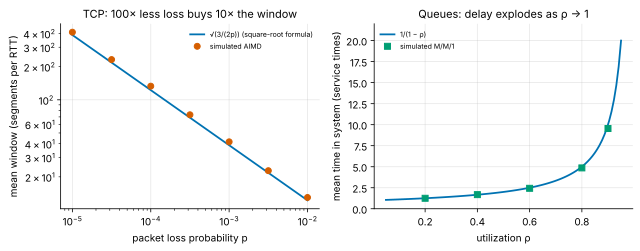

<!-- status: reviewed -->
# 17-13 · Computer Networks Fundamentals

| | |
|---|---|
| **Course** | [17 · Communication Systems](../README.md) |
| **University equivalent** | An introductory computer-networks course compressed to its engineering core, aligned with the FE Electrical and Computer "Computer Networks" knowledge area: layered models, Ethernet and switching, IP addressing and subnetting, routing algorithms, TCP and UDP, and network-security basics (Kurose & Ross, *Computer Networking: A Top-Down Approach*, chapters 1–6 and 8; Peterson & Davie, *Computer Networks: A Systems Approach*) |
| **Prerequisites** | [17-12](17-12-multiple-access-and-cellular-wifi.md) (multiple access, ALOHA, Erlang B), [08-01](../../08-digital-logic-design/chapters/08-01-number-systems-and-codes.md) (binary, hexadecimal, CRC), [17-08](17-08-channel-coding.md) (error detection), [03-02](../../03-probability-statistics-and-random-variables/chapters/03-02-random-variables-and-distributions.md) (exponential and Poisson) |
| **Estimated study hours** | 8 |
| **Last verified** | 2026-11-21 |

**Learning objectives.** After this chapter you can:

1. Explain the OSI and TCP/IP models, encapsulation and protocol overhead, and classify network types and topologies.
2. Compute Ethernet framing efficiency and frame rates, and explain how switches learn and forward.
3. Subnet and aggregate IPv4 networks with CIDR, apply longest-prefix matching, and state the essentials of IPv6.
4. Run Dijkstra's and the Bellman–Ford algorithms on a network, and explain link-state and distance-vector routing.
5. Analyse TCP: the handshake, window-limited throughput and the bandwidth-delay product, slow start and AIMD congestion control, and the retransmission timeout; contrast UDP.
6. Explain the security triad, firewalls and intrusion detection, scanning and penetration testing, and the cryptographic tools TLS uses, with order-of-magnitude arithmetic.

## 1. Big picture

Everything in this course so far moves bits across one link. A network moves *packets* across many links, between devices that may be on different continents, using equipment from hundreds of vendors that has never been tested together. It works because of **layering**: each layer offers a simple service to the one above and hides the details below. A radio (17-06 to 17-12), a SerDes lane (17-04) or a fibre all look, to IP, like a pipe that carries frames with some loss. This chapter covers the layers above the physical one at the depth the FE exam and an engineering conversation need.

- **The internet is a best-effort packet network.** IP delivers packets without guarantees; TCP builds reliability and congestion control on top, end to end.
- **Overheads and windows set real throughput.** Header bytes, round-trip times and window sizes, not just link rates, decide what an application sees.
- **Routing is graph algorithms at scale.** Shortest-path computations (Dijkstra, Bellman–Ford) run continuously in every router.
- **Security is part of the architecture.** Confidentiality, integrity and availability are designed in with cryptography, segmentation, firewalls and monitoring.

## 2. Intuition first

**The postal analogy, carefully.** Sending a document through a company's mail system: you put it in an envelope addressed to a person and department (transport: which application), the mailroom puts that in a shipping box addressed to a building (network: which host), and a courier puts the box on a truck for the next depot (link: the next hop). Each depot reads only the outer label it needs, removes it, and adds a new one for the next leg. That is **encapsulation**: each layer adds its own header and treats everything inside as opaque payload.

*Where it breaks:* mail does not lose a third of its parcels when a depot is busy, and senders do not deliberately slow down when they notice losses. Networks drop packets under congestion by design, and TCP's congestion control is a distributed agreement to back off, with no central authority enforcing it. The analogy also hides that every hop re-decides the route; there is no fixed path.

```text
 Application data                                   [ HTTP message ]
 Transport (TCP)                          [TCP hdr | HTTP message ]                  segment
 Network (IP)                     [IP hdr | TCP hdr | HTTP message ]                 packet
 Link (Ethernet)  [pre|Eth hdr | IP hdr | TCP hdr | HTTP message | FCS] gap          frame
 Physical         bits on copper, fibre or radio (17-04 … 17-12)
```

## 3. Theory

### 3.1 Layers, network types and topologies

The **OSI model** has seven layers: physical, data link, network, transport, session, presentation and application. The **TCP/IP model** used in practice has four or five: link (often split into physical and data link), internet (IP), transport (TCP, UDP) and application (HTTP, DNS, …), with OSI's session and presentation folded into the application. Each layer's protocol data unit has a name: frame (link), packet or datagram (network), segment (TCP) or datagram (UDP), message (application).

**Network types** are classified by scale: a **LAN** within a building or campus (Ethernet, Wi-Fi), a **WAN** across cities or countries (carrier links, optical transport), and the **internet**, the network of independently operated networks interconnected by IP. **Topologies** describe how nodes connect: a **bus** (one shared medium, early Ethernet), a **star** (all nodes to a central switch, today's LANs), a **ring** (each node to two neighbours, some metro optical networks), and a **mesh** (multiple paths; a full mesh of $n$ nodes needs $n(n - 1)/2$ links, 45 for ten nodes). Real networks are hierarchical: stars within buildings, meshes in the core.

### 3.2 Ethernet and switching

An Ethernet frame carries a 14-byte header (destination and source MAC addresses, 6 bytes each, and a 2-byte type field), a payload of 46 to 1500 bytes, and a 4-byte frame check sequence, a CRC-32 (08-01, 17-08) ([R-292]). Short payloads are padded to 46 bytes, so the minimum frame is 64 bytes. On the wire each frame is preceded by an 8-byte preamble and start-of-frame delimiter and followed by an inter-frame gap of 96 bit times (12 bytes) ([R-292]). The **wire efficiency** for an application payload $L$ is therefore

$$
\eta = \frac{L}{8 + 14 + \max(L + H, 46) + 4 + 12} ,
$$

with $H$ the transport and network headers (20 + 20 bytes for TCP/IPv4, [R-293]). A full 1460-byte TCP payload achieves 94.9% (Example 17-13.1); a 100-byte UDP payload only 60%. Minimum frames occupy 84 bytes on the wire, so a 10 Gb/s port carries at most 14.88 million frames per second: the number a switch's forwarding pipeline must sustain at line rate.

**Switching.** A switch forwards frames by destination MAC address. It **learns** by reading source addresses: a frame from address X arriving on port 3 means X is reachable through port 3. Frames to unknown or broadcast addresses are **flooded** to all other ports. Because flooding loops forever in a network with redundant paths, switches run a spanning-tree protocol that disables enough links to make the topology a tree (or, in data centres, use routed fabrics instead). Today's switched, full-duplex Ethernet has no collisions; the CSMA/CD contention of early shared Ethernet (17-12's random access on a wire) survives only in its minimum frame size.

**ARP** (RFC 826) connects the layers: to send an IP packet to a neighbour, a host broadcasts "who has IP address A?" and caches the MAC address in the reply ([R-293]).

### 3.3 IP addressing, subnetting and IPv6

An IPv4 address is 32 bits, written as four decimal bytes (192.168.10.77). A **prefix** of length $p$ (written /p) fixes the first $p$ bits; the remaining $32 - p$ bits number the hosts in that **subnet**. Two host values are reserved (all zeros for the network itself, all ones for broadcast), so a /p subnet has $2^{32-p} - 2$ usable addresses (for $p \le 30$).

**Subnetting** borrows host bits to split a network: dividing 192.168.10.0/24 into subnets of at least 60 hosts needs 6 host bits ($2^6 - 2 = 62$), so /26, giving four subnets starting at .0, .64, .128 and .192 (Example 17-13.2). **CIDR aggregation** (RFC 4632) does the reverse: four contiguous /24s that share their first 22 bits are advertised as one /22, keeping routing tables small ([R-293]). Three ranges are reserved for private networks (RFC 1918): 10.0.0.0/8, 172.16.0.0/12 and 192.168.0.0/16; **network address translation** (NAT) maps many private hosts to one public address.

**Forwarding.** A router's table maps prefixes to next hops; for each packet it chooses the entry with the **longest matching prefix**, the most specific route. Every packet carries a **time-to-live** (hop limit in IPv6) that each router decrements, so packets caught in a routing loop eventually die. IPv4 datagrams can be up to 65 535 bytes long, and every host must accept at least 576 bytes ([R-293]); larger packets are fragmented when a link's maximum transmission unit (MTU, 1500 bytes for Ethernet) requires it.

**IPv6** (RFC 8200) uses 128-bit addresses, written as eight groups of four hexadecimal digits, a fixed 40-byte header, a hop limit, a flow label, and no fragmentation by routers; every IPv6 link must carry packets of at least 1280 bytes ([R-293]). Its address space ($2^{128}$) ends the scarcity that drove NAT.

### 3.4 Routing algorithms

Routers compute forwarding tables with distributed shortest-path algorithms over a graph whose edges have costs (delay, inverse bandwidth or an administrator's choice).

**Link state (Dijkstra).** Every router floods its links and their costs to all others, so each has the whole graph, and each runs **Dijkstra's algorithm**: keep a set of nodes whose shortest distance is final; repeatedly finalize the unfinalized node with the smallest tentative distance and relax the edges out of it ($d(w) \leftarrow \min(d(w), d(u) + c(u, w))$). Because edge costs are non-negative, the node with the smallest tentative distance cannot be reached more cheaply through a node finalized later. With a priority queue the cost is $O((V + E)\log V)$. OSPF and IS-IS are link-state protocols.

**Distance vector (Bellman–Ford).** Each router keeps only its distance to every destination and periodically tells its neighbours; each updates $d_x(y) = \min_v\big(c(x, v) + d_v(y)\big)$. Iterating converges to the shortest paths in at most $V - 1$ rounds when costs are stable. When a link fails, distance-vector protocols can **count to infinity**: two routers keep advertising stale routes through each other, increasing the cost by the cost of the link between them (one, with unit costs) per exchange; split horizon and a small "infinity" (RIP uses 16) limit the damage.

**Between networks**, the Border Gateway Protocol (BGP) is a path-vector protocol in which each autonomous system advertises reachable prefixes with the list of networks on the path, and chooses routes by policy (business relationships) rather than by shortest distance.

### 3.5 Transport: UDP and TCP

**UDP** (RFC 768) adds only ports (to identify applications), a length and a checksum: an 8-byte header and no reliability ([R-293]). It suits applications that prefer timeliness to completeness (voice, video, DNS queries) or that build their own reliability.

**TCP** (RFC 9293) provides a reliable, in-order byte stream with a 20-byte minimum header ([R-293]). Its mechanisms:

- **Connection setup** by a **three-way handshake**: SYN, SYN-ACK, ACK, exchanging initial sequence numbers. Data can flow after one round trip.
- **Reliability** by sequence numbers, cumulative acknowledgements and retransmission after a timeout or after three duplicate acknowledgements (fast retransmit).
- **Flow control**: the receiver advertises a **window**, the bytes it can accept beyond the last acknowledged one.
- **Congestion control** (RFC 5681): the sender also limits itself to a **congestion window** cwnd and sends at most $\min(\text{cwnd}, \text{rwnd})$ unacknowledged bytes ([R-294]).

**Window-limited throughput.** A sender allowed $W$ unacknowledged bytes sends $W$ per round-trip time:

$$
\text{throughput} \le \frac{W}{\text{RTT}} .
$$

To keep a link of rate $R$ busy, $W$ must be at least the **bandwidth-delay product** $R \times \text{RTT}$: 5 MB for 1 Gb/s across 40 ms. TCP's window field is 16 bits, so without extensions $W \le 65\,535$ bytes, which caps that path at 13.1 Mb/s; the window-scale option (RFC 7323) multiplies the field by $2^s$ with $s \le 14$, allowing windows up to $2^{30}$ bytes ([R-294], Example 17-13.4).

**Slow start and congestion avoidance.** A new connection starts with an initial window of two to four segments (RFC 5681; three for a 1460-byte segment) and **doubles** cwnd every round trip (each ACK adds one segment) until a loss or the slow-start threshold; it then adds **one segment per round trip** (congestion avoidance) and **halves** cwnd on a loss signalled by duplicate ACKs: additive increase, multiplicative decrease (**AIMD**) ([R-294]). AIMD is what makes TCP flows sharing a bottleneck converge toward equal shares when their RTTs are equal; a flow's share scales as 1/RTT (the square-root formula below). A **retransmission timeout** is treated more severely than duplicate ACKs: RFC 5681 sets the slow-start threshold to half the data in flight (at least two segments) and cwnd to one segment, the loss window, and restarts slow start ([R-296]). Deployed stacks go beyond this baseline: CUBIC, the default in the Linux, Windows and Apple stacks, grows the window as a cubic function of time since the last loss and cuts it by a factor of 0.7 rather than 0.5 (RFC 9438), and an initial window of ten segments is widely used (RFC 6928, Experimental) ([R-296]) **[Established]**.

**The square-root formula.** In steady state with one loss every $1/p$ packets (periodic loss), the window saws between $W_m/2$ and $W_m$ segments, growing by one per RTT, so a cycle lasts $W_m/2$ RTTs and carries about $\tfrac34W_m \times \tfrac{W_m}{2} = \tfrac38W_m^2$ packets, which must equal $1/p$ (one loss per cycle). Hence $W_m = \sqrt{8/(3p)}$, the average window is $\tfrac34W_m$, and

$$
\text{throughput} \approx \frac{\text{MSS}}{\text{RTT}}\sqrt{\frac{3}{2p}} .
$$

With random, independent losses the cycles vary in length and the constant rises by about 7% (the lab's simulation gives about 1.3 instead of $\sqrt{3/2}$ = 1.22). With **delayed ACKs** (one ACK per $b$ segments), the window grows by $1/b$ per RTT, a cycle lasts $bW_m/2$ RTTs, and the same counting gives $\sqrt{3/(2bp)}$: $\sqrt2$ less for $b$ = 2. Throughput falls with the square root of the loss rate and inversely with RTT: on a long path, even $10^{-5}$ loss limits a single TCP flow to about 113 Mb/s (Example 17-13.5). This is why high-speed transfers use many parallel flows or different congestion controllers, and why data-centre networks engineer for near-zero loss.

**Retransmission timeout** (RFC 6298). The sender smooths RTT samples $R$ with $\text{SRTT} \leftarrow \tfrac78\text{SRTT} + \tfrac18R$ and the deviation $\text{RTTVAR} \leftarrow \tfrac34\text{RTTVAR} + \tfrac14|\text{SRTT} - R|$ (updating RTTVAR first), sets $\text{RTO} = \text{SRTT} + \max(G, 4\,\text{RTTVAR})$ with $G$ the clock granularity, and rounds RTO up to at least 1 second ([R-294], Example 17-13.6). The first sample initializes $\text{SRTT} = R$ and $\text{RTTVAR} = R/2$. On each timeout the RTO doubles (exponential backoff), and by **Karn's rule** no RTT sample is taken from a retransmitted segment, since its acknowledgement could belong to either copy ([R-296]).

### 3.6 Queues and delay

**Where delay comes from.** A packet's delay at each hop is the sum of four parts: processing (header lookup, typically microseconds), **queueing** (waiting behind other packets), **transmission** $L/R$ (pushing $L$ bits onto a link of rate $R$) and **propagation** $d/s$ (distance over signal speed, about $2 \times 10^8$ m/s in fibre). A 1500-byte packet takes 12 μs to transmit at 1 Gb/s but 5 ms to cross 1000 km of fibre: on long paths propagation dominates and only queueing is under the network's control (Problem 17-13.17).

Packets wait in router and switch buffers. The simplest model, the **M/M/1 queue** (Poisson arrivals at rate λ, exponential service at rate μ), gives a mean time in the system of

$$
T = \frac{1}{\mu - \lambda} = \frac{1/\mu}{1 - \rho},\qquad \rho = \frac\lambda\mu ,
$$

so at 80% utilization a packet spends on average five times its transmission time in the system (see the callout for the derivation), and delay grows without bound as ρ → 1. **Little's law** ($N = \lambda T$: mean number in the system equals arrival rate times mean time) holds for any stable queue. These curves are why networks are provisioned well below full utilization and why latency-sensitive traffic gets priority queues.

> **Going deeper — deriving the M/M/1 delay.** Let $p_n$ be the probability that $n$ packets are in the system. In steady state, the rate of moves up from $n$ to $n + 1$ (arrivals, $\lambda p_n$) equals the rate of moves down from $n + 1$ (departures, $\mu p_{n+1}$), so $p_{n+1} = \rho p_n$ and $p_n = (1 - \rho)\rho^n$ after normalizing (a geometric distribution, valid for ρ < 1). The mean number in the system is $\bar N = \sum np_n = \rho/(1 - \rho)$, and Little's law gives $T = \bar N/\lambda = 1/(\mu - \lambda)$. The waiting part, excluding the packet's own service, is $T - 1/\mu = \rho/(\mu - \lambda)$.

### 3.7 Network security basics

**The security triad.** **Confidentiality** (only authorized parties read data), **integrity** (data is not altered undetected) and **availability** (systems keep serving legitimate users, despite denial-of-service attacks or failures). Every control maps to one or more of these.

**Cryptographic building blocks.**

- **Symmetric ciphers** (for example AES with 128- or 256-bit keys) encrypt bulk data fast with a shared key. Their strength is the key length: an exhaustive search of $2^{128}$ keys at $10^{12}$ keys per second takes on average (half the key space) about $5 \times 10^{18}$ years, while a 56-bit key falls in about 10 hours on average (Problem 17-13.11).
- **Public-key cryptography** (RSA, elliptic-curve Diffie–Hellman and signatures) lets parties agree on keys and authenticate without a prior shared secret, at much higher computational cost.
- **Hash functions** (for example SHA-256) map any input to a fixed-length digest; finding any two inputs with the same digest takes about $2^{n/2}$ attempts (the **birthday bound**), so a 256-bit hash offers 128-bit collision resistance. The bound follows from counting: with $N = 2^n$ equally likely digests, $k$ hashes are all distinct with probability $\prod_{i<k}(1 - i/N) \approx e^{-k^2/(2N)}$ (using $1 - x \approx e^{-x}$), so a collision becomes likely (probability 1/2) after $k = \sqrt{2N\ln2} = 1.177\sqrt N$. A hash keyed with a secret (HMAC) protects integrity.
- **TLS 1.3** (RFC 8446) combines them: an ephemeral Diffie–Hellman exchange agrees on keys, certificates and signatures authenticate the server, and symmetric authenticated encryption protects the data, with a full handshake in one round trip (and an optional 0-RTT mode that is vulnerable to replay) ([R-293]).

**Network defences.**

- A **firewall** filters traffic by rules on addresses, ports and protocol (packet filters), by connection state (stateful firewalls, which allow replies to connections initiated inside), or by application content (application-layer gateways). Rules are checked in order and the first match decides; a final "deny all" makes the policy explicit.
- An **intrusion detection system** (IDS) watches traffic or hosts for attacks, using **signatures** of known attacks or **anomaly** detection against a baseline; an **intrusion prevention system** (IPS) sits in the path and blocks them. **Endpoint detection** runs on hosts; **network detection** inspects traffic at chokepoints. The hard part is false alarms: attacks are rare, so even a detector with a 99% detection rate and a 0.1% false-positive rate, watching traffic in which 1 flow in $10^5$ is malicious, raises about 100 false alerts for every true one (Bayes' theorem, 03-01; Problem 17-13.16). Alert fatigue, not detection rate, usually limits an IDS.
- **Segmentation** (separate subnets or VLANs for different trust levels) limits how far an intruder can move.

**Testing.** **Port scanning** probes which TCP/UDP ports answer (for example by sending SYNs and watching for SYN-ACKs), revealing exposed services: attackers use it for reconnaissance, defenders to audit their own exposure. **Vulnerability scanning** checks those services against known weaknesses; **web vulnerability testing** probes applications for flaws such as injection; **penetration testing** is an authorized, goal-directed attempt to exploit weaknesses, which measures real exposure rather than theoretical findings. These appear explicitly in the FE specification's Computer Networks area ([R-001], [R-295]).

## 4. Worked examples

### Example 17-13.1 · How much of the wire is data? (tier A)

**Setup.** Find the wire efficiency of (a) a full-size TCP/IPv4 segment carrying 1460 bytes, (b) the same over IPv6 (1440 bytes of data in a 1500-byte packet), and (c) a 100-byte UDP/IPv4 payload. Then find the maximum frame rate of a 10 Gb/s port with minimum-size frames.

**Solution.** (a) Wire bytes $8 + 14 + 1500 + 4 + 12 = 1538$; efficiency $1460/1538$ = **94.9** %. (b) $1440/1538$ = **93.6** %. (c) Packet $100 + 8 + 20 = 128$ bytes; wire $8 + 14 + 128 + 4 + 12 = 166$; efficiency **60.2** %. (d) Minimum frames take $8 + 14 + 46 + 4 + 12 = 84$ bytes = 672 bits: $10^{10}/672$ = **14.88** Mpackets/s.

**Units check.** Bytes over bytes; bits per second over bits per frame.

**Sanity check.** Overheads are fixed per frame, so small packets pay proportionally more, which is why packet rate, not bit rate, limits switches with small-packet traffic.

### Example 17-13.2 · Subnetting a /24 (tier B)

**Setup.** Split 192.168.10.0/24 into the smallest subnets that hold 60 hosts each. Give the prefix, usable hosts per subnet, number of subnets and the first subnet's broadcast address. Then aggregate 10.1.0.0/24 through 10.1.3.0/24.

**Solution.** 60 hosts need 6 host bits ($2^6 - 2 = 62 \ge 60$; 5 bits give 30): prefix **/26**, **62** usable hosts, $2^{26-24}$ = **4** subnets (192.168.10.0, .64, .128, .192). The first subnet's broadcast is 192.168.10.**63**. The four /24s share their first 22 bits (10.1.000000xx), so they aggregate to **10.1.0.0/22**.

**Units check.** Prefix lengths and host counts are integers.

**Sanity check.** Four /26 subnets of 64 addresses fill exactly the 256 addresses of the /24.

### Example 17-13.3 · Dijkstra by hand (tier B)

**Setup.** Five routers with link costs A–B 2, A–C 5, B–C 1, B–D 4, C–D 1, C–E 6, D–E 2. Find the shortest-path costs from A and the path to E; confirm with Bellman–Ford.

**Solution.** Start: A = 0. Finalize A; tentative B = 2, C = 5. Finalize B (2); relax: C = min(5, 2 + 1) = 3, D = 2 + 4 = 6. Finalize C (3); D = min(6, 3 + 1) = 4, E = 3 + 6 = 9. Finalize D (4); E = min(9, 4 + 2) = 6. Finalize E (6). Distances: B **2**, C **3**, D **4**, E **6**, path A–B–C–D–E. Bellman–Ford reaches the same table after four synchronous rounds of updates.

**Units check.** Costs are additive along a path.

**Sanity check.** The direct A–C link (5) loses to A–B–C (3): shortest paths need not use direct links.

### Example 17-13.4 · Filling a long pipe (tier B)

**Setup.** A 1 Gb/s path has a 40 ms round-trip time. Find the bandwidth-delay product, the throughput with TCP's unscaled maximum window of 65 535 bytes, and the smallest window-scale shift that allows a window of at least the BDP.

**Solution.** BDP $= 10^9 \times 0.04/8$ = **5.00** MB. Unscaled: $8 \times 65\,535/0.04$ = **13.1** Mb/s, 1.3% of the link. Shift: $65\,535 \times 2^s \ge 5 \times 10^6$ needs $s$ = **7** (window 8.39 MB).

**Units check.** bits/s × s = bits; bytes × 8 / s = bits/s.

**Sanity check.** On a 1 ms LAN the same unscaled window would allow 524 Mb/s: RTT, not link speed, makes windows matter.

### Example 17-13.5 · Slow start and steady state (tier B)

**Setup.** On the path of Example 17-13.4 with a 1460-byte MSS: what initial window does RFC 5681 allow, and how many RTTs of slow start (doubling) reach the BDP? Then estimate the steady-state throughput of one TCP flow with random loss of $10^{-5}$ and $10^{-7}$.

**Solution.** For $1095 < \text{MSS} \le 2190$ bytes, IW = **3** segments. The BDP is $5 \times 10^6/1460$ = 3425 segments; doubling from 3 needs $\lceil\log_2(3425/3)\rceil$ = **11** RTTs, **0.44** s. Steady state: $\frac{1460 \times 8}{0.04}\sqrt{\frac{3}{2 \times 10^{-5}}}$ = **113** Mb/s; at $10^{-7}$, **1131** Mb/s, so the link (1 Gb/s) becomes the limit.

**Units check.** (bits/s) × dimensionless.

**Sanity check.** Throughput rises by $\sqrt{100}$ = 10 for a hundredfold lower loss rate.

### Example 17-13.6 · Computing the retransmission timeout (tier C)

**Setup.** A connection measures RTT samples of 100, 120, 80 and 200 ms. Apply RFC 6298 (α = 1/8, β = 1/4, K = 4, clock granularity negligible). Give SRTT, RTTVAR and RTO after each sample, before and after the 1-second minimum.

**Solution.** First sample: SRTT = 100 ms, RTTVAR = 50 ms, RTO = 300 ms. Second (120): RTTVAR = 0.75 × 50 + 0.25 × 20 = 42.5 ms; SRTT = 102.5 ms; RTO = 272.5 ms. Third (80): RTTVAR = 0.75 × 42.5 + 0.25 × 22.5 = 37.5 ms; SRTT = 99.69 ms; RTO = 249.7 ms. Fourth (200): RTTVAR = 0.75 × 37.5 + 0.25 × 100.3 = **53.2** ms; SRTT = **112.2** ms; RTO = **325.0** ms. Every computed RTO is below 1 s, so the RTO actually used is **1** s throughout.

**Units check.** All in milliseconds until the 1-second floor.

**Sanity check.** The 200 ms outlier raises RTTVAR more than SRTT: the timeout reacts to variability, not just to the mean.

<!-- answer-key -->

| ID | Quantity | Value | Unit |
|---|---|---|---|
| Txt 17-13.a | full-mesh links for 10 nodes | 45 | — |
| Txt 17-13.b | M/M/1 delay at 80% load (service times) | 5 | — |
| Txt 17-13.c | SHA-256 collision effort (log2) | 128 | — |
| Ex 17-13.1a | TCP/IPv4 efficiency | 94.9 | % |
| Ex 17-13.1b | TCP/IPv6 efficiency | 93.6 | % |
| Ex 17-13.1c | 100-byte UDP efficiency | 60.2 | % |
| Ex 17-13.1d | maximum frame rate at 10 Gb/s | 14.88 | Mpps |
| Ex 17-13.2a | prefix length | 26 | — |
| Ex 17-13.2b | usable hosts per subnet | 62 | — |
| Ex 17-13.2c | number of subnets | 4 | — |
| Ex 17-13.2d | last octet of the first broadcast address | 63 | — |
| Ex 17-13.2e | aggregate prefix length | 22 | — |
| Ex 17-13.3a | distance to B | 2 | — |
| Ex 17-13.3b | distance to C | 3 | — |
| Ex 17-13.3c | distance to D | 4 | — |
| Ex 17-13.3d | distance to E | 6 | — |
| Ex 17-13.4a | bandwidth-delay product | 5.00 | MB |
| Ex 17-13.4b | unscaled-window throughput | 13.1 | Mb/s |
| Ex 17-13.4c | window-scale shift | 7 | — |
| Ex 17-13.5a | initial window | 3 | segments |
| Ex 17-13.5b | slow-start round trips | 11 | — |
| Ex 17-13.5c | slow-start time | 0.44 | s |
| Ex 17-13.5d | steady state at 1e-5 loss | 113 | Mb/s |
| Ex 17-13.5e | steady state at 1e-7 loss | 1131 | Mb/s |
| Ex 17-13.6a | final RTTVAR | 53.2 | ms |
| Ex 17-13.6b | final SRTT | 112.2 | ms |
| Ex 17-13.6c | final computed RTO | 325.0 | ms |
| Ex 17-13.6d | RTO used | 1 | s |

*Every value is recomputed by [verify_17_13.py](../verify/verify_17_13.py): overheads from the header sizes, subnets with Python's `ipaddress` module, shortest paths by Dijkstra, Bellman–Ford and brute-force path enumeration, window and slow-start arithmetic, the square-root formula against a simulated AIMD sawtooth, the RTO recursion written out independently, and the M/M/1 delay by simulation.*

## 5. Simulate it

The lab, [labs/17-13-lab](../labs/17-13-lab/README.md), provides `netlab.py`: protocol overheads and frame rates, IPv4/IPv6 subnetting and aggregation, longest-prefix matching, Dijkstra and Bellman–Ford, TCP window, slow-start, AIMD and RTO models, an M/M/1 simulator, brute-force and birthday arithmetic, and a first-match firewall. In the notebook, **predict, then run**:

1. **Overhead.** Predict the wire efficiency for TCP payloads of 64, 512 and 1460 bytes; plot efficiency against payload size.
2. **Addressing.** Split 10.20.0.0/16 into subnets for 1000 hosts each; build a forwarding table and test longest-prefix matches.
3. **Routing.** Run Dijkstra on a 6-router network; then fail a link and watch Bellman–Ford count up before converging.
4. **TCP.** Simulate the AIMD sawtooth at loss rates from $10^{-2}$ to $10^{-5}$ and compare the mean window with $\sqrt{3/(2p)}$.
5. **Queues.** Simulate an M/M/1 queue from 10% to 95% load and compare with $1/(\mu - \lambda)$.
6. **Security.** Write a firewall rule list for a web server and test packets against it; compute brute-force times for 56-, 80- and 128-bit keys.



## 6. Engineering tradeoffs

| Knob | Improves | Costs | Typical decision owner |
|---|---|---|---|
| Larger frames / jumbo MTU | Wire efficiency, fewer packets per second | Latency per packet, compatibility, larger loss per error | Network architect |
| Larger TCP windows and buffers | Throughput on long paths | Memory; queueing delay ("bufferbloat") in routers | Host and router designers |
| Smaller subnets | Isolation, smaller broadcast domains | Address waste, more routes | Network administrator |
| Link-state vs distance-vector routing | Faster convergence, no count-to-infinity (transient micro-loops still possible) | Memory and CPU for the full topology, flooding | Network architect |
| Lower link utilization | Queueing delay (∝ 1/(1 − ρ)) | Capacity cost | Capacity planner |
| Stronger cryptography | Confidentiality and integrity margin | CPU, latency of handshakes | Security architect |
| Stateful firewalls and IPS inline | Protection | Throughput, latency, single points of failure | Security and network architects |
| IDS sensitivity threshold | Detection rate | False alerts, analyst load | Security operations |

## 7. Numbers to know

| Quantity | Value | Note |
|---|---|---|
| Header sizes | Ethernet 14 + 4 FCS; IPv4 20; IPv6 40; TCP 20; UDP 8 bytes | [R-292], [R-293] |
| Ethernet payload | 46–1500 bytes; + 8 preamble/SFD + 12 inter-frame gap on the wire | [R-292] |
| Wire efficiency | 94.9% for 1460-byte TCP/IPv4 payloads | |
| Minimum-frame rate | 14.88 Mpps at 10 Gb/s | 84 bytes per frame |
| IPv4 subnet | $2^{32-p} - 2$ usable hosts | private: 10/8, 172.16/12, 192.168/16 |
| IPv6 | 128-bit addresses; minimum link MTU 1280 bytes | [R-293] |
| TCP window | ≤ 65 535 bytes unscaled; scale shift ≤ 14 (window < $2^{30}$) | [R-294] |
| Window-limited rate | $W/\text{RTT}$; BDP = $R \times$ RTT | |
| Loss-limited rate | $(\text{MSS}/\text{RTT})\sqrt{3/(2p)}$ | AIMD |
| RTO | SRTT + 4 RTTVAR, at least 1 s | RFC 6298 [R-294] |
| M/M/1 | $T = 1/(\mu - \lambda)$; 5× service time at 80% load | |

## 8. Common mistakes

- **Confusing link rate with throughput.** Headers, gaps, windows, loss and RTT all intervene; a 1 Gb/s link rarely gives one TCP flow 1 Gb/s across a continent.
- **Forgetting the two reserved addresses** when counting IPv4 hosts, or the preamble and gap when computing wire efficiency.
- **Matching the first route instead of the longest prefix.** Forwarding picks the most specific matching route, not the first listed.
- **Treating TCP's window as fixed.** The effective window is the minimum of the receiver's advertisement and the congestion window, which changes every RTT.
- **Running links near 100% utilization.** Queueing delay grows as $1/(1 - \rho)$; at 95% load an M/M/1 packet spends twenty service times in the system, nineteen of them waiting.
- **Equating a firewall with security.** Firewalls control reachability; vulnerabilities in allowed services, stolen credentials and insiders require other controls (patching, authentication, monitoring, segmentation).

## 9. Practitioner lens

### State of the art (as of Nov 2026)

- **The standards.** TCP is specified by RFC 9293 (2022), which consolidated the original 1981 specification and its updates; congestion control by RFC 5681; timers by RFC 6298; TLS 1.3 by RFC 8446; IPv6 by RFC 8200 ([R-293], [R-294]) **[Established]**.
- **The FE exam.** The NCEES FE Electrical and Computer specification (effective July 2020) devotes 4–6 questions to Computer Networks: routing and switching, topologies, network types, the OSI and TCP/IP models, intrusion detection and prevention, and security testing and the security triad ([R-001], [R-295]) **[Established]**.
- **Ethernet framing.** The 96-bit inter-frame gap and the 1518-byte maximum frame with an 8-byte preamble appear in IEEE 802.3's own interpretation documents; the standard itself is paywalled ([R-292]) **[Established]**.

### Why it matters commercially

For a semiconductor company, networking is both a market and a constraint. Switch and NIC silicon is designed around packet rates (Example 17-13.1), table sizes (longest-prefix-match lookups at line rate) and buffer sizes (bandwidth-delay products). AI clusters push the same arithmetic to extremes: thousands of accelerators exchange data with microsecond RTTs; a TCP-style timeout, at least 1 s by RFC 6298's minimum, would stall a training step for orders of magnitude longer than the RTT, which is why those fabrics use lossless or specially engineered transports **[Industry estimate]**. In enterprise deals, network security architecture (segmentation, monitoring, patch processes) is a standard diligence item.

> **Deeper:** see companion repo *Datacenter Networking* for RDMA, lossless Ethernet, congestion control in AI fabrics and switch silicon architecture.

### Marketing vs Reality

- **"10 Gb/s networking."** Ask for throughput at the packet sizes and flow counts that matter; minimum-size packets and a single long-RTT TCP flow both fall far short of line rate.
- **"Our firewall makes the system secure."** Security needs defence in depth; ask about patching, authentication, segmentation, logging and the results of the last penetration test.
- **"Military-grade encryption."** A meaningless phrase; ask which algorithms, key lengths, protocols (TLS 1.3?) and key management.
- **"Zero packet loss."** Under what load and traffic pattern? Lossless fabrics move the problem into pauses and head-of-line blocking rather than eliminating congestion.

### Questions for engineering leaders

1. **"What is the packet-rate requirement at your worst-case packet size, and where does your design bottleneck?"** *Strong:* gives Mpps at 64-byte frames, table lookup rates and buffer sizing. *Evasive:* quotes only bandwidth.
2. **"How do your flows behave on long-RTT, lossy paths?"** *Strong:* knows the window and loss limits and which congestion control is used. *Evasive:* "TCP handles it".
3. **"How is your network segmented, and what does an attacker reach after compromising one host?"** *Strong:* describes zones, firewall policy and monitoring. *Evasive:* "we have a firewall".
4. **"When was your last penetration test, what did it find, and what was fixed?"** *Strong:* specific findings and remediation timelines. *Evasive:* only automated scans.
5. **"What utilization do you plan links to, and what latency does that imply?"** *Strong:* relates utilization targets to queueing delay and tail latency. *Evasive:* plans to average utilization only.

## 10. Concept check

**Q1.** Which layer adds MAC addresses, which adds IP addresses, and which adds port numbers?

<details><summary>Answer</summary>

The link layer (Ethernet) adds MAC addresses, the network layer (IP) adds IP addresses, and the transport layer (TCP or UDP) adds ports.

</details>

**Q2.** How does a switch learn where a MAC address lives, and what does it do with a frame to an unknown address?

<details><summary>Answer</summary>

It records each frame's source address against its arrival port; frames to unknown (or broadcast) destinations are flooded out of all other ports.

</details>

**Q3.** A router has routes for 10.0.0.0/8 and 10.1.2.0/24. Which does it use for 10.1.2.9?

<details><summary>Answer</summary>

The /24: forwarding uses the longest matching prefix, the most specific route.

</details>

**Q4.** Why does Dijkstra's algorithm require non-negative link costs?

<details><summary>Answer</summary>

It finalizes the node with the smallest tentative distance, assuming no later path can be cheaper; a negative edge could make a path through a later node cheaper, breaking that guarantee (Bellman–Ford handles negative costs, provided there are no negative cycles).

</details>

**Q5.** Why can a single TCP flow fail to fill a fast link even with no loss?

<details><summary>Answer</summary>

Its throughput is at most window/RTT; if the window (receiver advertisement or congestion window) is smaller than the bandwidth-delay product, the link idles while the sender waits for acknowledgements.

</details>

**Q6.** What does each element of the security triad protect, and give one control for each.

<details><summary>Answer</summary>

Confidentiality (encryption, access control), integrity (hashes/MACs, signatures), availability (redundancy, rate limiting and denial-of-service protection).

</details>

Practice: [17-13 problems](../problems/17-13-problems.md) · [worked solutions](../solutions/17-13-solutions.md).

## 11. Key terms

[OSI model](../../../reference/glossary.md#osi-model) · [TCP/IP model](../../../reference/glossary.md#tcp-ip-model) · [Encapsulation](../../../reference/glossary.md#encapsulation) · [Network topology](../../../reference/glossary.md#network-topology) · [MAC address](../../../reference/glossary.md#mac-address) · [Ethernet frame](../../../reference/glossary.md#ethernet-frame) · [Switch learning](../../../reference/glossary.md#switch-learning) · [ARP](../../../reference/glossary.md#arp) · [Subnet mask and CIDR](../../../reference/glossary.md#subnet-mask-and-cidr) · [Longest-prefix match](../../../reference/glossary.md#longest-prefix-match) · [NAT](../../../reference/glossary.md#nat) · [IPv6](../../../reference/glossary.md#ipv6) · [Dijkstra's algorithm](../../../reference/glossary.md#dijkstras-algorithm) · [Bellman–Ford algorithm](../../../reference/glossary.md#bellman-ford-algorithm) · [TCP](../../../reference/glossary.md#tcp) · [UDP](../../../reference/glossary.md#udp) · [Bandwidth-delay product](../../../reference/glossary.md#bandwidth-delay-product) · [Congestion window](../../../reference/glossary.md#congestion-window) · [Security triad (CIA)](../../../reference/glossary.md#security-triad-cia) · [Firewall](../../../reference/glossary.md#firewall) · [Intrusion detection system](../../../reference/glossary.md#intrusion-detection-system) · [Penetration testing](../../../reference/glossary.md#penetration-testing)

## 12. Connections

- **Builds on:** [17-12](17-12-multiple-access-and-cellular-wifi.md) (multiple access, ALOHA, scheduling), [17-08](17-08-channel-coding.md) (CRC), [08-01](../../08-digital-logic-design/chapters/08-01-number-systems-and-codes.md) (binary and hexadecimal), [17-04](17-04-baseband-digital-transmission.md) (the physical links underneath).
- **Next:** Course 18 (embedded systems), whose devices connect over these protocols; the Term 5 checkpoint.
- **Used later:** [27-xx system architectures](../../27-system-architectures/README.md) (data-centre and AI-cluster networks), [28-xx technical diligence](../../28-technical-diligence-and-leadership-fluency/README.md) (security and architecture questions).

## 13. Further study

- Kurose & Ross, *Computer Networking: A Top-Down Approach*: chapters 1 (layers, delay), 3 (TCP, congestion control), 4–5 (IP, routing algorithms), 6 (link layer, Ethernet, switching) and 8 (security).
- Peterson & Davie, *Computer Networks: A Systems Approach*: free online; strong on congestion control and switching.
- The RFCs themselves (RFC 9293, 5681, 6298, 8200, 8446) are readable and authoritative.
- MIT OpenCourseWare 6.829, *Computer Networks*: congestion control and routing at graduate depth.
- NCEES FE Reference Handbook: the computer-networks section used on the exam.

## 14. Sources

1. Kurose, J. F. and Ross, K. W., *Computer Networking: A Top-Down Approach*, 8th ed., Pearson, 2021.
2. Peterson, L. L. and Davie, B. S., *Computer Networks: A Systems Approach*, 6th ed., Morgan Kaufmann.
3. Mathis, M., Semke, J., Mahdavi, J. and Ott, T., "The Macroscopic Behavior of the TCP Congestion Avoidance Algorithm", *ACM SIGCOMM CCR* 27(3), 1997 (the square-root formula).
4. Kleinrock, L., *Queueing Systems, Volume 1: Theory*, Wiley, 1975 (M/M/1 and Little's law).
5. [R-292] IEEE 802.3 interpretation request 1-11/09 (inter-frame gap, frame accounting); RFC 894 (Ethernet payload limits).
6. [R-293] RFC 768, 791, 826, 1918, 4632, 8200, 8446, 9293 (header sizes, addressing, ARP, TLS 1.3).
7. [R-294] RFC 5681, 6298, 7323 (congestion control, retransmission timer, window scaling).
8. [R-295] NCEES FE Electrical and Computer CBT specification, Computer Networks topics (extends [R-001]).
