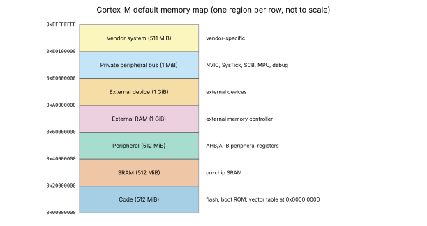
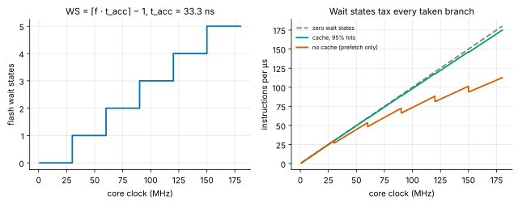

<!-- status: verified -->
# 18-01 · Microcontroller Architecture

| | |
|---|---|
| **Course** | [18 · Embedded Systems and Microcontrollers](../README.md) |
| **University equivalent** | The architecture chapters of a junior embedded-systems course: the core and its programmer's model, memory-mapped I/O, the memory map and buses, flash and SRAM, clocks and resets, and choosing a part (Valvano, *Embedded Systems: Introduction to ARM Cortex-M Microcontrollers*, chapters 2–3; Yiu, *The Definitive Guide to Arm Cortex-M3 and Cortex-M4 Processors*, chapters 2–6; UT Austin EE319K; Berkeley EECS149, memory architectures) |
| **Prerequisites** | [14-02](../../14-computer-organization-and-architecture/chapters/14-02-isa-risc-v-arm-x86.md) (ISAs, RISC-V and Arm), [14-06](../../14-computer-organization-and-architecture/chapters/14-06-pipelining-and-hazards.md) (pipelines and hazards), [14-09](../../14-computer-organization-and-architecture/chapters/14-09-memory-hierarchy-and-caches.md) (caches), [08-01](../../08-digital-logic-design/chapters/08-01-number-systems-and-codes.md) (hexadecimal), [10-02](../../10-electronics-1/chapters/10-02-mosfet-dc-operation-and-biasing.md) (CMOS switching power) |
| **Estimated study hours** | 7 |
| **Last verified** | 2026-11-21 |

**Learning objectives.** After this chapter you can:

1. Describe the blocks of a microcontroller (core, interrupt controller, bus matrix, flash, SRAM, peripherals, clocks, reset and power) and explain how they differ from an application processor.
2. Compare Cortex-M and RISC-V microcontroller cores by architecture version, pipeline, extensions and performance per MHz.
3. Decode a memory map: find a register's address from a base and offset, the size of a region from its bounds, and a bit-band alias.
4. Compute the flash wait states a clock frequency needs and the effective instruction rate with and without a prefetch buffer or cache.
5. Configure a PLL within its input, VCO and divider limits, and explain clock sources, resets and brown-out protection.
6. Select a microcontroller for a requirement by gating on hard limits and scoring the rest, and find where the choice flips.

## 1. Big picture

A microcontroller (MCU) is a whole computer on one die: a processor core, the non-volatile memory that holds its program, the SRAM that holds its data, and the peripherals that connect it to the physical world, timers, serial ports, analog-to-digital converters and radios, all clocked, reset and powered by on-chip circuits. It costs from tens of cents to a few dollars, draws microamps when asleep, and runs one program forever without an operating system or with a small real-time one. Tens of billions ship every year inside watches, earbuds, motor drives, thermostats, car body controllers and the management controllers of data-centre servers. This chapter is the map of the chip that the rest of Course 18 programs.

- **Integration is the product.** An MCU wins designs by replacing a board of parts: memory, analog, timers and often a radio are on the same die, so the bill of materials, board area and standby power all shrink.
- **Everything is an address.** The core talks to memory and peripherals the same way, by loading and storing at addresses; the memory map is the contract between hardware and software.
- **Flash is slower than the core.** At more than a few tens of megahertz the program memory needs wait states, and caches or prefetch buffers decide how much of the clock rate reaches the program.
- **Clocks set both speed and power.** The clock tree chooses frequency, accuracy and current; most of a battery-powered design's energy decisions are clock decisions.
- **Choosing the part is an engineering and a commercial decision.** Cores, memory sizes, peripherals, power, security, ecosystem, supply and price trade against each other, and a socket, once won, typically stays won for the life of the product.

## 2. Intuition first

Think of an MCU as a small, self-contained factory. The core is the single worker who follows a written procedure (the program in flash). The procedure binder is in a vault across the room (flash): the worker can read a page at a time, but each trip takes a fixed time, so a fast worker spends part of the day waiting for pages unless an assistant fetches the next page in advance (the prefetch buffer) or keeps the most-used pages on the desk (the cache). The workbench is SRAM: small, fast, and wiped when the power goes. Around the walls are machines (peripherals), each with a control panel of switches and dials at a fixed location (memory-mapped registers): to start a machine, the worker walks to its panel and sets a switch, exactly as he would write a number on a page. A bell system (the interrupt controller) lets any machine summon the worker. A clock on the wall (the clock tree) sets the pace of everything, and running the whole factory faster costs more electricity per hour but finishes the job sooner.

*The 4 GiB address space of every Cortex-M core is divided into fixed regions. Flash and the vector table sit at the bottom, SRAM at 0x2000 0000, peripheral registers at 0x4000 0000, and the core's own control registers (interrupt controller, system timer, fault and debug registers) at 0xE000 0000. Vendors place their memories and peripherals inside these regions.*

**Where the analogy breaks.** The worker never walks: an MCU can have several masters (the core's instruction and data ports and one or more DMA engines) using different memories at the same time through a crossbar, which a single worker cannot. And the "procedure" can be rewritten while the factory runs (in-application flash programming, 18-08), which is precisely what makes firmware updates both possible and dangerous.

## 3. Theory

### 3.1 What makes a microcontroller

A general-purpose **application processor** (a phone's Cortex-A cores, a PC's x86 cores) runs from external DRAM through a memory-management unit (MMU) that gives each process its own virtual address space, and it relies on an operating system such as Linux. A **microcontroller** is built for a different job:

- **On-chip memory.** The program executes in place from on-chip flash (or ROM), and data live in on-chip SRAM: no DRAM, no disk, and no boot delay to copy an image.
- **Physical addresses.** There is no MMU. An optional **memory protection unit** (MPU) can mark regions read-only, non-executable or privileged, but addresses are not translated.
- **Deterministic response.** Interrupt latency is specified in clock cycles (12 for a Cortex-M3 or M4 with zero-wait-state memory, 18-03), so the worst case can be guaranteed rather than measured statistically.
- **Peripherals for the physical world.** Timers with capture and PWM, serial buses, ADCs and DACs, comparators, and on many parts a radio or a USB, CAN or Ethernet controller.
- **Power management.** Several sleep modes, from stopping the core clock to switching off everything except a real-time clock and a few kilobytes of retained SRAM, with wake-up in microseconds (18-09).

The boundary is not sharp. High-end MCUs reach several hundred megahertz with caches and external memory, and crossover parts run Linux-class workloads. But the defining choices, execute-in-place from on-chip non-volatile memory, physical addressing and bounded interrupt latency, hold across the range.

### 3.2 The core and its programmer's model

**Cortex-M.** Arm's Cortex-M family dominates 32-bit microcontrollers. Every member executes only the **Thumb** instruction set (16-bit encodings, extended by **Thumb-2** with 32-bit encodings), is a load-store RISC machine, and presents the same programmer's model:

- sixteen 32-bit registers: R0–R12 general purpose, **R13** the stack pointer (two banked copies: the main stack pointer MSP, used after reset and by exception handlers, and the process stack pointer PSP, used by RTOS tasks), **R14** the link register (return address of a call) and **R15** the program counter;
- the **program status register** xPSR: condition flags N, Z, C, V (and Q for saturation), the number of the exception being handled, and the Thumb state bit;
- special registers that mask interrupts (PRIMASK, FAULTMASK, BASEPRI) and choose the stack and privilege level (CONTROL);
- two modes, **Thread** (normal code, privileged or unprivileged) and **Handler** (exception handlers, always privileged).

The exception model is the family's signature feature: on an interrupt the hardware itself saves R0–R3, R12, LR, PC and xPSR on the stack, so an interrupt handler is an ordinary C function. 18-03 builds on this.

The family is organized by **architecture version**, which fixes the instruction set and programmer's model, while each **core** is one implementation with its own pipeline and options:

- **Armv6-M** (Cortex-M0, M0+): the smallest. Mostly 16-bit instructions plus a handful of 32-bit ones (calls, barriers, special-register moves); no hardware divide; a two- or three-stage pipeline. Used where gate count, leakage and cost dominate.
- **Armv7-M** (Cortex-M3) adds the full Thumb-2 set, hardware divide, more addressing modes and, as an implementation option of the M3 and M4 that most vendors include, **bit-banding** (§3.3). **Armv7E-M** (Cortex-M4, M7) adds the **DSP extension**: single-cycle multiply-accumulate, saturating arithmetic and 8- and 16-bit SIMD. An optional single-precision floating-point unit (M4F) or double-precision unit (M7) adds hardware floating point.
- **Armv8-M** comes in a Baseline (Cortex-M23, the successor of Armv6-M) and a Mainline (Cortex-M33, M35P) profile. Its headline addition is the **TrustZone** security extension, which splits the chip into Secure and Non-secure worlds (18-11). Bit-banding was dropped.
- **Armv8.1-M** (Cortex-M55, M85, M52) adds **Helium**, the M-Profile Vector Extension: 128-bit vectors processed in beats by a narrow datapath, aimed at DSP and machine-learning inference, plus low-overhead loop instructions.

The current cores, their pipelines and Arm's published performance figures are in §9.

**RISC-V.** RISC-V (14-02) is an open instruction set: anyone may implement it without a licence fee, which has made it popular for MCUs in cost-sensitive and in-house designs. An MCU core typically implements **RV32IMC** plus Zicsr: the 32-bit base integer ISA with 32 registers (x0 is hardwired to zero), the **M** extension (multiply and divide), the **C** extension (16-bit compressed encodings for the most common instructions, comparable in purpose to Thumb) and the control-and-status-register instructions that exception handling needs. **RV32E** halves the register file to 16 for the smallest cores; **F** adds single-precision floating point; **A** adds atomics; **P** (packed SIMD) and **V** (vectors) target DSP and ML. Unlike Cortex-M, the base RISC-V privileged architecture does not prescribe an interrupt controller with hardware stacking; vendors add one (the core-local interrupt controller, CLIC, renamed the Advanced CLIC and still unratified as of Nov 2026, is RISC-V International's effort to standardize one, §9), and interrupt entry and register saving are partly the compiler's job.

**Measuring a core.** Two synthetic benchmarks dominate data sheets. **Dhrystone** (reported as DMIPS/MHz) is old, small and easily optimized by compilers, so it is now used mainly for historical comparison. **CoreMark** (EEMBC), reported as CoreMark/MHz, exercises list processing, matrix arithmetic, a state machine and a CRC with rules that prevent the compiler from precomputing the answer. Both are measured with code and data in zero-wait-state memory, so they describe the **core**, not the **chip**: a part whose flash adds wait states (§3.5) delivers less.

### 3.3 The memory map and memory-mapped I/O

A Cortex-M core has one flat 32-bit address space of $2^{32}$ bytes = 4 GiB, shared by code, data and peripherals. The architecture divides it into fixed regions with default attributes (executable or not, cacheable or not, ordered or not), and vendors place their memories inside them:

| Region | Addresses | Size | Typical contents |
|---|---|---|---|
| Code | 0x0000 0000–0x1FFF FFFF | 512 MiB | flash, boot ROM; the vector table at address 0 after reset |
| SRAM | 0x2000 0000–0x3FFF FFFF | 512 MiB | on-chip SRAM |
| Peripheral | 0x4000 0000–0x5FFF FFFF | 512 MiB | peripheral registers on AHB and APB |
| External RAM | 0x6000 0000–0x9FFF FFFF | 1 GiB | memory behind an external memory controller |
| External device | 0xA000 0000–0xDFFF FFFF | 1 GiB | external devices (not executable) |
| Private peripheral bus | 0xE000 0000–0xE00F FFFF | 1 MiB | the core's own registers: NVIC, SysTick, system control block, MPU, debug |
| Vendor system | 0xE010 0000–0xFFFF FFFF | 511 MiB | vendor-specific |

A memory of $2^n$ bytes needs $n$ address bits. A 128 KiB SRAM ($2^{17}$ bytes) starting at 0x2000 0000 ends at $0x2000\,0000 + 2^{17} - 1$ = 0x2001 FFFF; read in reverse, a range's size is its last address minus its first, plus one.

**Memory-mapped I/O.** A peripheral is controlled through **registers** that occupy addresses in the peripheral region. Writing a 1 to bit 5 of a GPIO port's output data register drives pin 5 high; reading a status register reports whether a UART has a received byte. The reference manual gives each peripheral instance a **base address** and each register an **offset**, so

$$
\text{register address} = \text{peripheral base} + \text{register offset} .
$$

C code reaches a register through a pointer to that address; the `volatile` qualifier tells the compiler that every read and write must actually happen, in order (18-02). Unlike memory, peripheral registers can change on their own (a status bit set by hardware), can have side effects when read (reading a data register may clear a flag), and can ignore or redefine writes (write-1-to-clear flags). A register is a hardware interface, not storage.

**Bit-banding (Armv7-M).** Changing one bit of a register shared with an interrupt handler normally takes a read-modify-write sequence: load, change the bit, store. If an interrupt between the load and the store changes another bit of the same register, the store overwrites it. Armv7-M's bit-band feature removes the race in hardware. Each bit of the first 1 MiB of the SRAM region (0x2000 0000–0x200F FFFF) and of the peripheral region (0x4000 0000–0x400F FFFF) is mapped to its own 32-bit word in a 32 MiB **alias** region (at 0x2200 0000 and 0x4200 0000). Writing 1 or 0 to the alias word sets or clears that single bit, atomically, as one bus transaction. The mapping follows from counting: one byte holds 8 bits, each bit gets a 4-byte word, so each byte of the bit-band region owns 32 bytes of alias space:

$$
\text{alias address} = \text{alias base} + 32 \times \text{byte offset} + 4 \times \text{bit number} ,
$$

where the byte offset is the target address minus the region base and the bit number is 0–7 within that byte (or, equivalently for a word-aligned target, 0–31 within the word). Armv8-M dropped bit-banding; its parts provide separate set and reset registers for GPIO, atomic exclusive-access instructions (LDREX/STREX) and, on some parts, hardware bit-set/clear aliases of their own.

### 3.4 Buses and the bus matrix

Inside the chip, Arm's AMBA bus protocols connect masters (devices that start transfers) to slaves (devices that respond):

- **AHB** (Advanced High-performance Bus) is pipelined: the address of one transfer overlaps the data of the previous one, so a slave with no wait states moves one 32-bit word per clock. It carries the core's accesses to flash and SRAM and the DMA traffic.
- **APB** (Advanced Peripheral Bus) is simple and low power: each access takes at least two cycles (setup and access), with no pipelining or bursts. Most peripheral registers sit on APB buses, often clocked at half or a quarter of the core clock, behind AHB-to-APB **bridges**.
- **AXI** (Advanced eXtensible Interface), used by the larger cores (Cortex-M7, M55, M85), allows several outstanding transactions and separate read and write channels, which suits caches and high-bandwidth memories.

A Cortex-M3 or M4 has three bus ports: an instruction-fetch port (I-code) and a data port (D-code) for the code region, and a system port (S) for everything else. With DMA engines and, on larger parts, USB or Ethernet controllers with their own DMA, a chip has several masters. A **bus matrix** (crossbar) connects them: transfers between different master–slave pairs proceed in parallel, and when two masters want the same slave in the same cycle, an arbiter (round robin or fixed priority) makes one wait. This is why vendors split SRAM into separately connected banks: the core can run from one while DMA fills another (18-04).

Two consequences reach the programmer. First, peripheral accesses are **slow and buffered**: an APB register read takes several core cycles, and a write may be held in a write buffer while the core moves on. A classic bug is clearing an interrupt flag as the last instruction of a handler: the write has not reached the peripheral when the handler returns, so the interrupt fires again. The fix is to read the register back (or use a barrier instruction) before returning. Second, peak bandwidth is easy to compute: a 32-bit AHB slave port at 168 MHz moves at most $4 \times 168 \times 10^6$ = 672 MB/s, shared among every master that uses it.

### 3.5 Flash, SRAM and wait states

**Flash.** Embedded NOR flash stores the program. It is read like memory but written only after erasing: a page or sector (kilobytes) is erased in milliseconds, and words are then programmed in microseconds each. Its cells wear out after a limited number of program/erase cycles (typically 10 000 or more), and the data must be retained for years at temperature; both are data-sheet specifications. Reading the flash takes a fixed **access time** $t_{acc}$, set by the sense amplifiers and the long bit lines of a large array, of the order of tens of nanoseconds and longer at lower supply voltage.

**Deriving the wait states.** The flash interface is synchronous to the core clock of period $T = 1/f$. A read must complete within a whole number of clock cycles, $1 + \text{WS}$, where WS is the number of added **wait states**:

$$
(1 + \text{WS})\,T \ge t_{acc} \quad\Longrightarrow\quad \text{WS} = \lceil f\,t_{acc}\rceil - 1 \quad (\text{and at least } 0).
$$

Each wait state therefore buys a band of frequencies of width $1/t_{acc}$: zero wait states up to $1/t_{acc}$, one up to $2/t_{acc}$, and so on. A flash with $t_{acc}$ = 33.3 ns gives bands 30 MHz wide. Real parts differ: Microchip's SAM D5x has bands of about 25 MHz and Renesas's RA6M5 bands of 50 MHz (§9). Because $t_{acc}$ rises as the supply voltage falls, the same chip needs more wait states at 1.8 V than at 3.3 V.

**Why it matters, and how chips hide it.** Without help, every instruction fetched from flash would cost $1 + \text{WS}$ cycles, and a 168 MHz core with 5 wait states would run like a 28 MHz one. Two mechanisms recover most of it:

- **Wide lines and prefetch.** The flash reads a whole line, typically 64 or 128 bits, in one access. A 128-bit line holds eight 16-bit Thumb instructions, so while the core executes them, the interface reads the next sequential line. If a line holds at least $1 + \text{WS}$ instructions, straight-line code runs at full speed.
- **Caches.** A **taken branch** jumps to code that has not been prefetched, and the core stalls for the access. An instruction cache (or a vendor "accelerator", a small cache of recently used lines) serves repeated targets, such as loop bodies, without touching the flash.

A first-order model follows. Let $s$ be the average instruction size in bytes, $L$ the line size in bytes, $b$ the number of taken branches per instruction and $m$ the fraction of branch targets that miss in the buffer or cache. Sequential code needs one line per $L/s$ instructions and the flash supplies one per $1 + \text{WS}$ cycles, so its cycles per instruction (CPI) is $\max(1, (1 + \text{WS})s/L)$. Each missing branch target adds WS stall cycles beyond the pipeline refill that a zero-wait-state memory would also cost. Relative to the same core with zero-wait-state memory,

$$
\text{CPI}_{\text{eff}} \approx \max\Big(1, \frac{(1 + \text{WS})s}{L}\Big) + b\,m\,\text{WS} ,
$$

and the delivered instruction rate is $f/\text{CPI}_{\text{eff}}$. The model assumes branch targets at the start of a line (compilers align loop heads) and instructions that do not straddle lines. Targets in the middle of a line leave fewer instructions in the buffer before the next line is needed and add stalls, so the model is optimistic there; the lab's cycle simulator measures how much.

*With 0.12 taken branches per instruction, a prefetch buffer alone loses 37% of the clock at 168 MHz (5 wait states); a cache that catches 95% of branch targets loses 3%. The sawtooth shows that the clock just below a wait-state boundary delivers more than the clock just above it.*

**Other memories.** **SRAM** is single-cycle at the core clock and retains data only while powered; keeping it powered in sleep costs leakage current, which is why low-power parts let software choose how many banks to retain (18-09). **Tightly coupled memories** (TCM) on Cortex-M7 and M55/M85 are zero-wait-state SRAMs attached directly to the core for deterministic code and data. Large parts add **execute-in-place** from external quad or octal SPI flash through a cache. **ECC** on flash and SRAM corrects single-bit errors and is standard on safety-rated parts. And because embedded flash has not followed logic transistors to the most advanced nodes, newer MCUs use other non-volatile memories, magnetic (MRAM), resistive (RRAM) or phase-change (PCM), on the same die (§9).

### 3.6 Clocks

An MCU usually has four or five clock sources, chosen for accuracy, start-up time and current:

- an **internal RC oscillator** (several to tens of megahertz), trimmed at the factory to about ±1%, which starts in microseconds and is used after reset;
- an **external crystal oscillator** (typically 4–48 MHz) accurate to tens of parts per million, needed for USB, CAN, Ethernet and radios, which takes milliseconds to start;
- a **32.768 kHz crystal** for the real-time clock: $32\,768 = 2^{15}$, so a 15-bit counter overflows exactly once per second, and the oscillator runs on well under a microamp;
- a **low-speed internal RC** (tens of kilohertz, accurate to several percent) for the independent watchdog, which must keep running if the main clock fails;
- a **phase-locked loop** (PLL) that multiplies a reference up to the core clock.

**The PLL.** An integer-N PLL (15-12) divides its input $f_{in}$ by $M$ to a phase-detector frequency $f_{in}/M$, locks a voltage-controlled oscillator (VCO) to $N$ times that, and divides the VCO output by $P$ for the system clock (and by another divider $Q$ for a second clock such as USB's 48 MHz):

$$
f_{VCO} = f_{in}\frac{N}{M}, \qquad f_{SYS} = \frac{f_{VCO}}{P}, \qquad f_{48} = \frac{f_{VCO}}{Q} .
$$

The data sheet constrains each stage: the phase-detector frequency must lie in a range (loop stability and jitter), the VCO must stay within its tuning range, and $P$ and $Q$ take only certain values. A configuration is a search over integers that satisfies every constraint exactly; Example 18-01.3 shows that some pairs of target frequencies have no solution.

**The clock tree.** The system clock feeds the core and the AHB bus, and prescalers derive the APB bus clocks. Every peripheral has a **clock-enable bit**; after reset most are off, and a peripheral whose clock is off ignores writes and reads as zero, the most common first bug on a new chip. Turning clocks off is also the first power-saving tool, because CMOS dynamic power is $P = \alpha CV^2f$ (10-02): halving a block's clock halves its dynamic power, and gating it removes it. Since the maximum frequency depends on supply voltage, many MCUs offer **voltage scaling** ranges, each with its own maximum clock and flash wait-state table.

**Accuracy requirements.** A UART tolerates a few percent of total clock mismatch (18-05), so the internal RC is often enough. USB full speed requires its 12 Mb/s within ±0.25% (2500 ppm) by the USB 2.0 specification, beyond a typical RC oscillator, so USB devices use a crystal or recover the host's timing from its once-per-millisecond start-of-frame packets. Radios need tens of parts per million and always use a crystal.

### 3.7 Reset, boot and supervision

A reset puts the chip into a known state. Sources include:

- **power-on reset** (POR), which holds the chip in reset until the supply is valid;
- **brown-out reset** (BOR), which resets it when the supply falls below a threshold (with hysteresis), because a core or a flash write running at too low a voltage can corrupt memory;
- the external **reset pin**;
- **watchdog** timers, which reset the chip if software stops refreshing them (18-03);
- **software reset** and **lockup** (a fault inside a fault handler).

A reset-cause register records which one occurred; logging it is the cheapest field-diagnostic tool there is.

**What a Cortex-M does after reset.** The core reads two words from the start of the vector table, at address 0x0000 0000 (or wherever the vendor's boot logic maps the boot memory at that address): word 0 is loaded into the main stack pointer and word 1, the address of the reset handler, into the program counter. The handler address has its least significant bit set to 1 to mark Thumb code. The core starts in Thread mode, privileged, using MSP. Everything else, from copying initialized data into SRAM to calling `main`, is software (18-02). Many MCUs sample **boot pins** or option bytes at reset to choose which memory appears at address 0: user flash, a ROM bootloader that can program the flash over a serial port, or SRAM (18-08).

### 3.8 Choosing a microcontroller

Part selection is a structured decision, and it is worth doing explicitly because a socket is rarely changed after a product ships.

1. **Write the requirements as numbers.** Compute (worst-case cycles per second, need for floating point, DSP or ML acceleration), memory (code, data, RTOS, buffers, and twice the code size if firmware updates keep two images, 18-08), peripherals (counts and specifications), power (active current per MHz, sleep current with the real-time clock and the needed RAM retained, wake-up time), environment (temperature grade, automotive qualification), security (18-11), package and pins, and price at volume.
2. **Gate on hard limits.** Discard any candidate that misses one. Plan headroom: firmware grows, and a design that starts with flash, SRAM or CPU nearly full has no room for the features and fixes of its life.
3. **Score the rest.** Weight the soft criteria (power, cost, performance headroom, ecosystem and tools, vendor support and longevity, supply security) and compute a weighted score.
4. **Test the decision's robustness.** Find how far a weight must move before the winner changes. A choice that flips with a small change in weights is a judgement call that deserves discussion; one that survives large changes is not.

The ecosystem term is often underweighted by people who have not shipped firmware. The quality of the vendor's drivers, examples, debug tools, RTOS support and errata handling decides months of engineering time.

## 4. Worked examples

### Example 18-01.1 · Reading a memory map (tier A)

**Setup.** A Cortex-M4 MCU's reference manual places GPIO port A at base address 0x4002 0000, with its output data register (ODR) at offset 0x14. Its SRAM occupies 0x2000 0000–0x2001 FFFF. Find (a) the ODR's address and region, (b) the bit-band alias that sets pin 5 of port A, (c) the SRAM size, and (d) the bit-band alias of bit 3 of the SRAM word at 0x2000 0100.

**Solution.** (a) 0x4002 0000 + 0x14 = **0x40020014**, in the peripheral region (0x4000 0000–0x5FFF FFFF).

(b) The byte offset from the peripheral bit-band base is 0x2 0014, and pin 5 is bit 5 of byte 0 of the register. The alias is $0x4200\,0000 + 32 \times 0x2\,0014 + 4 \times 5 = 0x4200\,0000 + 0x40\,0280 + 0x14$ = **0x42400294**. Writing 1 to that word sets the pin without a read-modify-write.

(c) $0x2001\,FFFF - 0x2000\,0000 + 1 = 0x2\,0000 = 2^{17}$ bytes = **128** KiB.

(d) Byte offset 0x100, bit 3: $0x2200\,0000 + 32 \times 0x100 + 4 \times 3$ = **0x2200200C**.

**Units check.** Addresses are byte addresses; the factor 32 is bytes of alias per byte of target (8 bits × 4 bytes).

**Sanity check.** The alias of the last bit of the 1 MiB region, $0x4200\,0000 + 32 \times (2^{20} - 1) + 4 \times 7 = 0x43FF\,FFFC$, is the last word of the 32 MiB alias region, so the mapping fills it exactly.

### Example 18-01.2 · How fast does the program run from flash? (tier B)

**Setup.** A Cortex-M4 MCU's flash has an access time of 33.3 ns (1/30 MHz) at 3.3 V and reads 128-bit lines. Code is all 16-bit instructions with 0.12 taken branches per instruction, targets line-aligned. Find the wait states and the instruction rate at 24, 84 and 168 MHz with a prefetch buffer only, and at 168 MHz with a cache that holds 95% of branch targets.

**Solution.** $\text{WS} = \lceil f \times 33.3\ \text{ns}\rceil - 1$: 24 MHz gives $\lceil 0.8\rceil - 1$ = **0**; 84 MHz gives $\lceil 2.8\rceil - 1$ = **2**; 168 MHz gives $\lceil 5.6\rceil - 1$ = **5**. A 16-byte line holds 8 instructions, at least $1 + \text{WS} = 6$, so sequential code streams at full speed and $\text{CPI}_{\text{eff}} = 1 + 0.12\,\text{WS}$:

- 24 MHz: CPI 1, **24.0** instructions per µs;
- 84 MHz: CPI 1.24, $84/1.24$ = **67.7** per µs;
- 168 MHz: CPI = 1 + 0.12 × 5 = **1.60**, $168/1.6$ = **105.0** per µs, only 1.56 times the 84 MHz figure for twice the clock.

With the cache, $\text{CPI}_{\text{eff}} = 1 + 0.12 \times 0.05 \times 5$ = **1.030** and the rate is $168/1.03$ = **163.1** per µs, 97% of the clock.

**Units check.** $f\,t_{acc}$ is dimensionless (Hz × s); instructions per µs = MHz / CPI.

**Sanity check.** Real wait-state tables have this form. Microchip's SAM D5x allows 24, 51, 77, 101 and 119 MHz for 0 to 4 wait states above 2.7 V ([R-300]): bands of about 25 MHz, which by $f_{max} = (\text{WS} + 1)/t_{acc}$ imply an access time of 39–42 ns, slower than this example's flash. The lab's cycle simulator reproduces these CPIs for line-aligned targets; when targets fall mid-line, the CPI at 168 MHz rises by about 13% (to about 1.81).

### Example 18-01.3 · Configuring the PLL (tier B)

**Setup.** An 8 MHz crystal drives a PLL with $f_{SYS} = 8\ \text{MHz} \times N/(MP)$ and $f_{48} = 8\ \text{MHz} \times N/(MQ)$. The data sheet requires a phase-detector frequency $8/M$ of 1–2 MHz, a VCO of 100–432 MHz, $P \in \{2, 4, 6, 8\}$, $2 \le Q \le 15$ and $50 \le N \le 432$. (a) Find a configuration for $f_{SYS}$ = 168 MHz with exactly 48 MHz for USB. How many exist? (b) Can 180 MHz and 48 MHz be had together?

**Solution.** (a) $f_{SYS} = f_{VCO}/P \le 432/2$, and only $P = 2$ keeps $f_{VCO} = 168P$ within range: $f_{VCO}$ = 336 MHz. Then $Q = 336/48$ = **7**, an integer. $M$ may be 4 to 8 (phase-detector frequency 2 to 1 MHz), with $N = 336M/8 = 42M$: the configurations are $(M, N)$ = (4, 168), (5, 210), (6, 252), (7, 294), (8, 336), **5** in all. A common choice is $M$ = 8, $N$ = 336, $P$ = 2, $Q$ = 7, whose 1 MHz phase-detector frequency is a round number.

(b) 180 MHz needs $f_{VCO}$ = 360 MHz ($P$ = 2; $P$ = 4 would need 720 MHz, outside the range). Then $Q = 360/48 = 7.5$, not an integer: **no** configuration gives both. The designer must choose 168 MHz with exact USB timing, or 180 MHz with USB clocked from another source.

**Units check.** Every frequency is in MHz; $M$, $N$, $P$, $Q$ are pure numbers.

**Sanity check.** The lab's exhaustive search over all $M$, $N$, $P$, $Q$ finds the same five solutions for 168 MHz and none for 180 MHz.

### Example 18-01.4 · Which core for a sensor-fusion workload? (tier B)

**Setup.** Profiling estimates that a wearable's sensor-fusion and gesture code needs the throughput of 300 CoreMark (300 CoreMark iterations per second), and it uses single-precision floating point throughout. Arm publishes 2.46, 3.54 and 4.10 CoreMark/MHz for the Cortex-M0+, M4 and M33 ([R-297]). (a) Find the clock each core needs at its published rate. (b) The candidate parts run their flash at zero wait states only up to 30 MHz, and above that their caches recover all but 3% of the clock. Find the clock each now needs. (c) Which choices are realistic? (d) Microchip quotes "403 CoreMark at 120 MHz" for its Cortex-M4F SAM D5x ([R-300]). What does that say about the published core figure?

**Solution.** (a) Clock = required CoreMark ÷ (CoreMark/MHz): M0+ $300/2.46$ = **122.0** MHz; M4 $300/3.54$ = **84.7** MHz; M33 $300/4.10$ = **73.2** MHz.

(b) Every clock is above 30 MHz, so the delivered rate is 0.97 of the core's: divide again by 0.97. M0+ **125.7** MHz, M4 **87.4** MHz, M33 **75.4** MHz.

(c) The Cortex-M0+ is out. Armv6-M has no floating-point unit and no DSP extension (§3.2), so every floating-point operation becomes a library call costing tens of cycles, and CoreMark, an integer benchmark, does not even measure that cost. The M4F and M33F both have single-precision FPUs, and 87 MHz and 75 MHz are well within parts on the market: the SAM D5x runs its M4F at up to 120 MHz and Renesas's RA6M5 its M33 at up to 200 MHz ([R-300]). The M33 needs **13.7** % less clock for the same work ($1 - 3.54/4.10$), which at a fixed µA/MHz is roughly that much less dynamic current, and it adds TrustZone (18-11). Unless cost or a software base favours the M4F, the M33 is the better choice.

(d) $403/120$ = **3.36** CoreMark/MHz, **94.9** % of Arm's 3.54 for the core. Even the vendor's own benchmark run, with its cache and its chosen compiler, delivers about 5% less than the core figure, because the core figure assumes zero-wait-state memory.

**Units check.** CoreMark per second ÷ (CoreMark per second per MHz) = MHz.

**Sanity check.** The ratio of required clocks, $122.0/73.2 = 1.67$, equals the ratio of the published figures, $4.10/2.46$, as it must when the workload is fixed.

### Example 18-01.5 · Race to idle, with wait states (tier C)

**Setup.** A sensor node wakes every 100 ms to run a task of $1.2 \times 10^6$ instructions (16-bit, 0.12 taken branches per instruction, no cache) from the flash of Example 18-01.2. Running, the MCU draws $I = 0.6\ \text{mA} + 40\ \mu\text{A/MHz} \times f$ at 1.8 V; asleep it draws 3 µA. Compare the energy per period at 30, 60 and 168 MHz, and find the best clock.

**Solution.** The energy per period is

$$
E(f) = V\,(I_0 + kf)\,\frac{N\,\text{CPI}(f)}{f} + V\,I_{sleep}\Big(T - \frac{N\,\text{CPI}(f)}{f}\Big) .
$$

- 30 MHz (0 WS, CPI 1): active time 40.0 ms, current 1.80 mA, active energy 129.6 µJ; total **129.9** µJ.
- 60 MHz (1 WS, CPI 1.12): $1.344 \times 10^6$ cycles, 22.4 ms at 3.00 mA, 121.0 µJ; total **121.4** µJ.
- 168 MHz (5 WS, CPI 1.60): $1.92 \times 10^6$ cycles, 11.43 ms at 7.32 mA, 150.6 µJ; total **151.1** µJ.

Two effects compete. The fixed current $I_0$ (the regulator, oscillators, flash and leakage of an awake chip) is paid per unit time, so finishing sooner saves it; this is **race to idle**. The wait states raise the cycles needed, and the term $kf \times N\,\text{CPI}/f = kN\,\text{CPI}$ makes the dynamic energy proportional to CPI. A sweep over every frequency up to 168 MHz finds the minimum at **60** MHz, the top of the one-wait-state band, saving 6.6% against 30 MHz and 20% against 168 MHz. The average power is $121.4\ \mu\text{J}/100\ \text{ms}$ = **1.21** mW.

**Units check.** V × A × s = J; µA/MHz × MHz = µA.

**Sanity check.** Within a wait-state band CPI is constant, so $E$ falls as $f$ rises (the $I_0$ term shrinks); at each band edge CPI jumps and $E$ jumps up. The minimum must therefore lie at the top of a band, and which band wins depends on $I_0$ against $k$.

### Example 18-01.6 · Choosing the part, and when the choice flips (tier C)

**Setup.** A wearable sensor hub needs at least 256 KB of flash (100 KB of firmware, two images for updates, and headroom), 64 KB of SRAM, a floating-point unit, active current at most 40 µA/MHz and sleep current with the real-time clock at most 2 µA. Four hypothetical candidates:

| | A | B | C | D |
|---|---|---|---|---|
| Core | M0+, 64 MHz | M4F, 80 MHz | M33F, 160 MHz | M4F, 120 MHz |
| Flash / SRAM | 256 KB / 32 KB | 512 KB / 128 KB | 1 MB / 256 KB | 512 KB / 160 KB |
| Active / sleep | 30 µA/MHz / 0.5 µA | 45 µA/MHz / 1.2 µA | 25 µA/MHz / 1.5 µA | 35 µA/MHz / 1.0 µA |
| Price at volume | \$0.90 | \$1.50 | \$2.40 | \$1.80 |

(a) Which pass the gate? (b) Score the survivors with weights power 0.35, cost 0.25, compute headroom 0.15, memory headroom 0.10, security 0.10 and ecosystem 0.05, using the team's 1–5 scores: C = (5, 2, 5, 5, 5, 4) and D = (4, 4, 3, 3, 2, 4) in that order. (c) If the cost weight changes and the other weights keep their proportions, at what cost weight does the winner change? (d) What does the price difference cost at 1 million units a year?

**Solution.** (a) A fails (32 KB of SRAM, no FPU); B fails (45 µA/MHz). **C and D** survive.

(b) C: $0.35(5) + 0.25(2) + 0.15(5) + 0.10(5) + 0.10(5) + 0.05(4)$ = **4.20**. D: $0.35(4) + 0.25(4) + 0.15(3) + 0.10(3) + 0.10(2) + 0.05(4)$ = **3.55**. C wins.

(c) With cost weight $w$, the other weights are scaled by $(1 - w)/0.75$. The non-cost parts contribute $(4.20 - 0.50)/0.75 = 4.933$ for C and $(3.55 - 1.00)/0.75 = 3.400$ for D per unit of $(1 - w)$, so

$$
2w + 4.933(1 - w) = 4w + 3.400(1 - w) \quad\Longrightarrow\quad w = \frac{1.533}{3.533} = \textbf{0.434} .
$$

D wins only if cost carries more than 43% of the weight, much more than 25%, so C's lead is robust to reasonable disagreement about cost.

(d) $(2.40 - 1.80) \times 10^6$ = **\$600 000** a year, which the team must weigh against what C buys (security, headroom) and against engineering cost: a few engineer-months saved by better tools or a longer-lived platform can be worth as much.

**Units check.** Scores are dimensionless; the weights sum to 1.

**Sanity check.** At $w$ = 0.434 both scores are $2(0.434) + 4.933(0.566) = 3.66$ and $4(0.434) + 3.4(0.566) = 3.66$.

<!-- answer-key -->

| ID | Quantity | Value | Unit |
|---|---|---|---|
| Txt 18-01.a | Cortex-M address space | 4 | GiB |
| Txt 18-01.b | bit-band alias bytes per target byte | 32 | — |
| Txt 18-01.c | AHB peak at 168 MHz | 672 | MB/s |
| Txt 18-01.d | USB full-speed tolerance | 2500 | ppm |
| Txt 18-01.e | RTC crystal frequency | 32768 | Hz |
| Txt 18-01.f | prefetch-only loss at 168 MHz | 37 | % |
| Txt 18-01.g | cached loss at 168 MHz | 3 | % |
| Ex 18-01.1a | ODR address | 0x40020014 | — |
| Ex 18-01.1b | bit-band alias for pin 5 | 0x42400294 | — |
| Ex 18-01.1c | SRAM size | 128 | KiB |
| Ex 18-01.1d | bit-band alias for SRAM bit 3 | 0x2200200C | — |
| Ex 18-01.1e | last alias word | 0x43FFFFFC | — |
| Ex 18-01.2a | wait states at 24 MHz | 0 | — |
| Ex 18-01.2b | wait states at 84 MHz | 2 | — |
| Ex 18-01.2c | wait states at 168 MHz | 5 | — |
| Ex 18-01.2d | instruction rate at 24 MHz | 24.0 | per µs |
| Ex 18-01.2e | instruction rate at 84 MHz | 67.7 | per µs |
| Ex 18-01.2f | CPI at 168 MHz | 1.60 | — |
| Ex 18-01.2g | instruction rate at 168 MHz | 105.0 | per µs |
| Ex 18-01.2h | CPI with cache | 1.030 | — |
| Ex 18-01.2i | instruction rate with cache | 163.1 | per µs |
| Ex 18-01.3a | USB divider Q | 7 | — |
| Ex 18-01.3b | number of configurations | 5 | — |
| Ex 18-01.4a | M0+ clock for 300 CoreMark | 122.0 | MHz |
| Ex 18-01.4b | M4 clock for 300 CoreMark | 84.7 | MHz |
| Ex 18-01.4c | M33 clock for 300 CoreMark | 73.2 | MHz |
| Ex 18-01.4d | M0+ clock with the 3% loss | 125.7 | MHz |
| Ex 18-01.4e | M4 clock with the 3% loss | 87.4 | MHz |
| Ex 18-01.4f | M33 clock with the 3% loss | 75.4 | MHz |
| Ex 18-01.4g | clock saved by the M33 against the M4 | 13.7 | % |
| Ex 18-01.4h | SAM D5x delivered CoreMark/MHz | 3.36 | — |
| Ex 18-01.4i | delivered as a fraction of the core figure | 94.9 | % |
| Ex 18-01.5a | energy at 30 MHz | 129.9 | µJ |
| Ex 18-01.5b | energy at 60 MHz | 121.4 | µJ |
| Ex 18-01.5c | energy at 168 MHz | 151.1 | µJ |
| Ex 18-01.5d | best clock | 60 | MHz |
| Ex 18-01.5e | average power | 1.21 | mW |
| Ex 18-01.6a | weighted score C | 4.20 | — |
| Ex 18-01.6b | weighted score D | 3.55 | — |
| Ex 18-01.6c | break-even cost weight | 0.434 | — |
| Ex 18-01.6d | annual price difference | 600000 | \$ |

*Every value is recomputed by [verify_18_01.py](../verify/verify_18_01.py): addresses by bit arithmetic and against the region table, wait states by searching for the smallest whole number of cycles, CPIs by the cycle simulator as well as the formula, PLL settings by exhaustive search, energies by a dense frequency sweep, and the break-even weight by root finding.*

## 5. Simulate it

The lab, [labs/18-01-lab](../labs/18-01-lab/README.md), provides `mcuarch.py`: the Cortex-M memory map and bit-band aliases, flash wait states, a cycle-level instruction-fetch simulator with a prefetch buffer and an optional cache, the analytic CPI model, an exhaustive PLL configuration search, energy per task, and weighted-score selection. In the notebook, **predict, then run**:

1. **Addresses.** Predict the bit-band alias of bit 13 of the word at 0x4001 1008, then compute it and decode it back.
2. **Wait states.** Predict the instruction rate at 30 MHz and at 31 MHz for a 33.3 ns flash with no cache; sweep the clock from 1 to 180 MHz and find each band's best point.
3. **The fetch simulator.** Run line-aligned and unaligned branch targets, and 16-bit-only and mixed 16/32-bit code. Where does the analytic CPI stop matching, and why?
4. **Caches.** Add a 16-line and a 64-line cache to a loop-heavy program and a random-branch program. Which benefits?
5. **PLL.** Find every configuration for 168, 120 and 180 MHz with and without an exact 48 MHz output.
6. **Energy.** Repeat Example 18-01.5 with $I_0$ = 0.2 mA and with $I_0$ = 2 mA. How does the best clock move?

## 6. Engineering tradeoffs

| Knob | Improves | Costs | Typical decision owner |
|---|---|---|---|
| Bigger core (M0+ → M4 → M7 or M55) | Throughput, DSP and FP, ML | Area, leakage, price, complexity | System architect |
| Higher clock | Latency, race to idle | Wait states, dynamic power, EMI | Firmware lead |
| Instruction cache or accelerator | Delivered performance at high clock | Area, less predictable timing | Silicon architect |
| More flash and SRAM | Features, A/B updates, buffers | Die area, leakage in retention, price | Product manager with firmware lead |
| External memory (QSPI/OSPI XIP) | Capacity at low cost | Latency, pins, security of external code | System architect |
| Crystal instead of RC oscillator | Accuracy (USB, radio, timing) | Part cost, board area, start-up time | Hardware designer |
| TrustZone / security subsystem | Isolation of keys and secure code | Software complexity, certification effort | Security architect |
| One vendor's ecosystem | Faster development, mature drivers | Lock-in, supply concentration | Engineering management, procurement |

## 7. Numbers to know

| Quantity | Value | Note |
|---|---|---|
| Cortex-M address space | 4 GiB; code at 0x0000 0000, SRAM at 0x2000 0000, peripherals at 0x4000 0000, core registers at 0xE000 0000 | Armv7-M/Armv8-M default map |
| Reset sequence | word 0 → MSP, word 1 → PC (LSB = 1 for Thumb) | vector table at address 0 by default |
| Bit-band alias | base + 32 × byte offset + 4 × bit | Armv7-M only; 1 MiB regions |
| Flash wait states | $\lceil f\,t_{acc}\rceil - 1$; bands of 25–50 MHz per wait state on current parts | more at lower voltage; SAM D5x, RA6M5 [R-300] |
| Interrupt entry | 12 cycles on Cortex-M3/M4 (6 when tail-chaining), 15 on M0+, at zero wait states | Arm TRMs [R-298]; 18-03 |
| Core performance | 2.46 (M0+), 3.54 (M4), 4.10 (M33), 5.29 (M7) CoreMark/MHz | Arm, from zero-wait-state memory [R-297] |
| AHB peak | 4 bytes per clock per slave port | APB: ≥ 2 cycles per access |
| RTC crystal | 32 768 Hz = $2^{15}$ Hz | 1 Hz from a 15-bit counter |
| USB full-speed clock tolerance | ±0.25% (2500 ppm) | USB 2.0 §7.1.11 |
| Internal RC accuracy | about ±1% after trim | fine for a UART, not for USB or radios |

## 8. Common mistakes

- **Forgetting the peripheral clock.** After reset most peripheral clocks are off; writes to an unclocked peripheral are lost and reads return zero.
- **Treating registers like memory.** Reading a data register can clear a flag; a write-1-to-clear flag is cleared by writing 1, not 0; read-modify-write of a register shared with an interrupt handler races unless done atomically.
- **Raising the clock without raising the wait states.** Configure the flash latency before switching to the faster clock (and lower the clock before reducing it), or the core fetches garbage.
- **Quoting the core's CoreMark/MHz as the chip's.** Benchmarks run from zero-wait-state memory; the chip's delivered performance depends on flash, caches and buses.
- **Clearing an interrupt flag as the last instruction of a handler.** Buffered writes may not reach the peripheral before the return; the interrupt re-enters.
- **Sizing flash for today's firmware.** Two images for updates plus growth over the product's life need two to three times the initial code size.
- **Assuming RISC-V interrupts work like Cortex-M's.** The base RISC-V privileged architecture has no hardware register stacking or standard nested vectored controller; latency and handler conventions depend on the vendor's interrupt controller.

## 9. Practitioner lens

### State of the art (as of Nov 2026)

- **The Cortex-M line-up.** Arm's comparison table ([R-297]) gives, for each core, its architecture, pipeline and published performance (measured from zero-wait-state memory with Arm's compiler) **[Established]**:

  | Core | Architecture | Pipeline | CoreMark/MHz | DMIPS/MHz | Notable options |
  |---|---|---|---|---|---|
  | M0+ | Armv6-M | 2-stage | 2.46 | 0.99 | none: no FPU, DSP or TrustZone |
  | M3 | Armv7-M | 3-stage | 3.45 | 1.24 | |
  | M4 | Armv7E-M | 3-stage | 3.54 | 1.26 | DSP; single-precision FPU option |
  | M7 | Armv7E-M | 6-stage superscalar | 5.29 | 2.31 | caches and TCMs; SP/DP FPU option |
  | M23 | Armv8-M Baseline | 2-stage | 2.64 | 1.03 | TrustZone option |
  | M33 | Armv8-M Mainline | 3-stage | 4.10 | 1.54 | DSP and FPU options; TrustZone option |
  | M52 | Armv8.1-M | 4-stage | 4.30 | 1.60 | Helium (single-beat) option |
  | M55 | Armv8.1-M | 4-stage | 4.40 | 1.69 | Helium (dual-beat) option |
  | M85 | Armv8.1-M | 7-stage | 6.28 | 3.13 | Helium (dual-beat) option; TrustZone |

  Older Arm data sheets quote lower figures for the same cores (for example 3.42 CoreMark/MHz for the M4), because compilers improved; compare figures from the same table.
- **Interrupt latency.** Arm's technical reference manuals give 12 cycles from request to the first handler instruction on the Cortex-M3 and M4, 6 cycles to tail-chain into the next handler, and 15 cycles on the M0+ and on the M23 (25 when a Non-secure interrupt preempts Secure code and the full register set is stacked), all at zero wait states ([R-298]) **[Established]**. Arm states no figure for the M52, M55 or M85.
- **RISC-V MCUs.** The ratified unprivileged ISA manual is version 20250508 ([R-299]). Representative parts: Espressif's ESP32-C3 (RV32IMC, 4-stage pipeline, 160 MHz, 400 KB SRAM, flash in the package or outside it, 3.02 CoreMark/MHz) and ESP32-C6 (an RV32IMAC core at 160 MHz plus a 20 MHz low-power RISC-V core); GigaDevice's GD32VF103 (108 MHz with zero-wait-state flash); and Renesas's own-core R9A02G021 at 48 MHz ([R-299]) **[Established]**. The standard fast interrupt controller is not finished: RISC-V International's CLIC work, now the "Advanced Core-Local Interrupt Controller", is in the *Stable* state, short of ratification ([R-299]) **[Established]**.
- **Wait states in real parts.** The SAM D5x (Cortex-M4F, 120 MHz) allows 24, 51, 77, 101, 119 and 120 MHz for 0 to 5 wait states above 2.7 V, but only 22, 44, 67, 89, 111 and 120 MHz at 1.71–2.7 V: lower voltage, slower flash, as §3.5 predicts. The RA6M5 (Cortex-M33, 200 MHz) needs 0 wait states to 50 MHz, then one more per 50 MHz, and its manual warns software to "set FLWT.FLWT before changing the clock frequency" ([R-300]) **[Established]**.
- **Beyond embedded flash.** Embedded flash has stalled at about 28 nm **[Industry estimate]**, so vendors moving MCUs to finer nodes are switching memories ([R-301]) **[Established]**: ST's STM32V8 (announced November 2025) uses phase-change memory on an 18 nm FD-SOI process co-developed with Samsung Foundry, with a Cortex-M85 at up to 800 MHz; NXP's S32K5 is a 16 nm FinFET automotive MCU with embedded MRAM; Renesas's RA8P1 uses MRAM on TSMC's 22 nm ULL process, with a 1 GHz Cortex-M85; and Infineon announced in 2022 that its AURIX TC4x family would move to TSMC's 28 nm RRAM. **Deeper:** see companion repo *Semiconductor Capital Equipment* for the process side.

### Why it matters commercially

- **Consolidation.** The MCU industry consolidated in a series of large deals ([R-302]) **[Established]**: NXP–Freescale (closed 7 December 2015; Freescale's enterprise value about \$16.7 billion), Microchip–Atmel (closed 4 April 2016; about \$3.40 billion enterprise value), Renesas–IDT (closed 30 March 2019 JST, about \$6.3 billion), Infineon–Cypress (closed 16 April 2020, enterprise value €9.0 billion) and Renesas–Dialog (closed 31 August 2021, about €4.8 billion). The buyers paid for portfolios and design-wins, and for the software ecosystems that keep customers in a family.
- **Stickiness is the asset.** A design-win lasts the product's life because changing the MCU means re-porting drivers, re-qualifying and re-certifying (Example 18-01.6, Problem 18-01.13). That is why vendors invest in free tools, middleware and reference designs, and why "pin-compatible" migration paths within a family matter more to customers than a better core elsewhere.
- **Automotive concentration.** Infineon reported a 32.0% share of automotive microcontrollers for 2024, citing TechInsights ([R-302]) **[Industry estimate]**: a market where safety qualification makes the stickiness even stronger.
- **Process and memory roadmaps decide the next round.** Moving to 16–22 nm with MRAM, PCM or RRAM buys SRAM density, clock speed and AI acceleration (Helium, NPUs) at a cost; which vendors own or secure that technology through foundry partnerships is a strategic question for anyone valuing an MCU business.

### Marketing vs Reality

- **"Up to 480 MHz."** Ask what fraction of that the application sees: from which memory the code runs, with how many wait states, and what cache hit rate, and at what supply voltage and temperature the maximum clock applies.
- **"x CoreMark/MHz."** That is the core, running from zero-wait-state memory with a specific compiler. Ask for the chip running the customer's code.
- **"y µA/MHz."** Ask at which frequency, voltage, temperature and code (often a loop in SRAM or cache, with peripherals off), and what the fixed current is; at low clocks the fixed current dominates.
- **"Ultra-low standby current."** Ask what is retained (RAM, real-time clock, brown-out detector) and how long wake-up takes; the lowest figure usually retains nothing.
- **"Pin-compatible family."** Check that peripherals, register maps, flash timing and errata are also compatible; package compatibility alone does not make software portable.

### Questions for engineering leaders

1. **"Why this MCU, and what would make you change?"** *Strong:* a requirement-by-requirement rationale with headroom figures and named alternatives. *Evasive:* "it's what we used last time".
2. **"How much flash, SRAM and CPU headroom do you have at launch, and how do firmware updates fit?"** *Strong:* percentages, with the A/B image plan. *Evasive:* "plenty".
3. **"What is your delivered performance, not the core's benchmark?"** *Strong:* measured cycles of the real workload, with wait states and cache behaviour. *Evasive:* repeats the data-sheet CoreMark.
4. **"What is your second source or migration path if this part goes on allocation or end of life?"** *Strong:* a qualified alternative or an abstraction layer that makes a port weeks, not quarters. *Evasive:* none.
5. **"Why Arm or RISC-V for this product?"** *Strong:* cost, ecosystem, security certification, tools and team experience weighed explicitly. *Evasive:* ideology or licensing headlines alone.

## 10. Concept check

**Q1.** Why can a Cortex-M interrupt handler be an ordinary C function, with no assembly wrapper?

Answer

On exception entry the hardware itself pushes R0–R3, R12, LR, PC and xPSR, exactly the registers the C calling convention lets a called function overwrite, and loads LR with a special return value. The compiled handler saves any other registers it uses, as every C function does, and returns normally; the special LR value makes the core unstack the frame.

**Q2.** Why does an MCU put its peripherals at fixed memory addresses instead of giving them special I/O instructions?

Answer

Memory-mapped I/O lets ordinary loads and stores, and therefore ordinary C pointers and structures, reach every register; the bus matrix routes each address to the right block. The price is that the compiler must be told (with `volatile`) that such reads and writes have side effects and must not be removed or reordered.

**Q3.** In Example 18-01.2, doubling the clock from 84 to 168 MHz without a cache raised the instruction rate only 1.56 times. Why, and what are two ways to recover the loss?

Answer

The flash's access time is fixed in nanoseconds, so at twice the clock each taken branch waits five cycles instead of two. A cache (or branch-target buffer) that holds most branch targets removes most of those stalls; running the hot code from SRAM or a tightly coupled memory removes them entirely. Reducing taken branches (loop unrolling, inlining) also helps.

**Q4.** Why must software raise the flash wait states before raising the clock, and lower the clock before reducing the wait states?

Answer

At every instant the wait-state setting must be enough for the current clock. Raising the clock first, or reducing wait states first, leaves a window in which the core reads flash faster than the flash can deliver, and it fetches wrong instructions. Renesas's RA6M5 manual states the rule explicitly (§9).

**Q5.** Why does a PLL divide its reference before the phase detector, and why does its VCO have a range?

Answer

The loop is designed (bandwidth, stability and jitter, 15-12) for a particular comparison frequency, so the input divider brings any crystal into that window. The VCO only tunes over a limited range, so the feedback multiplier and the output dividers must place it inside that range; a configuration outside either window may lock poorly or not at all.

**Q6.** A team proposes a part whose flash would be 92% full at launch. Why should the selection gate reject it?

Answer

Firmware grows over a product's life, and a safe over-the-air update keeps two images, so the flash must hold about twice the code plus growth. At 92% there is no room for either, and the product will need a costly redesign or will lose updates.

**Q7.** Arm quotes 3.54 CoreMark/MHz for the Cortex-M4; Microchip's SAM D5x delivers 403 CoreMark at 120 MHz. Why do they differ, and which should a design use?

Answer

Arm's figure is the core alone running from zero-wait-state memory; the chip's figure includes its flash, wait states and cache, which cost about 5% here (Example 18-01.4). A design should use measured performance of the actual part running the actual workload, and treat both published figures as upper bounds.

**Problems:** [18-01 problem set](../problems/18-01-problems.md) · [Worked solutions](../solutions/18-01-solutions.md)

## 11. Key terms

[Microcontroller](../../../reference/glossary.md#microcontroller) · [Memory map](../../../reference/glossary.md#memory-map) · [Memory-mapped I/O](../../../reference/glossary.md#memory-mapped-i-o) · [Bit-banding](../../../reference/glossary.md#bit-banding) · [Vector table](../../../reference/glossary.md#vector-table) · [Thumb-2](../../../reference/glossary.md#thumb-2) · [Bus matrix](../../../reference/glossary.md#bus-matrix) · [Flash wait state](../../../reference/glossary.md#flash-wait-state) · [Prefetch buffer](../../../reference/glossary.md#prefetch-buffer) · [CoreMark](../../../reference/glossary.md#coremark) · [Phase-locked loop (PLL)](../../../reference/glossary.md#phase-locked-loop-pll) · [Crystal oscillator](../../../reference/glossary.md#crystal-oscillator) · [Brown-out reset](../../../reference/glossary.md#brown-out-reset) · [RISC-V](../../../reference/glossary.md#risc-v)

## 12. Connections

- **Builds on:** [14-02](../../14-computer-organization-and-architecture/chapters/14-02-isa-risc-v-arm-x86.md) (instruction sets), [14-06](../../14-computer-organization-and-architecture/chapters/14-06-pipelining-and-hazards.md) (pipelines), [14-09](../../14-computer-organization-and-architecture/chapters/14-09-memory-hierarchy-and-caches.md) (caches), [14-11](../../14-computer-organization-and-architecture/chapters/14-11-io-buses-and-interconnect.md) (buses), [15-12](../../15-control-systems/chapters/15-12-control-applications-pll-regulators-thermal.md) (PLLs), [10-02](../../10-electronics-1/chapters/10-02-mosfet-dc-operation-and-biasing.md) (CMOS power).
- **Next:** [18-02](18-02-bare-metal-c-and-toolchain.md) (bare-metal C, startup code and linker scripts on this memory map).
- **Used later:** [18-03](18-03-interrupts-exceptions-timers.md) (the NVIC and exception model), [18-04](18-04-dma-and-data-movement.md) (the bus matrix and DMA), [18-09](18-09-ultra-low-power-design.md) (clocks and power modes), [18-11](18-11-hardware-security.md) (TrustZone).

## 13. Further study

- Yiu, *The Definitive Guide to Arm Cortex-M3 and Cortex-M4 Processors*, 3rd ed.: chapters 2–6 (architecture, programmer's model, memory system).
- Valvano, *Embedded Systems: Introduction to ARM Cortex-M Microcontrollers*: chapters on the memory map and I/O.
- Arm, *Armv7-M Architecture Reference Manual* and *Armv8-M Architecture Reference Manual*: the authoritative memory map and exception model.
- The reference manual of any one MCU you might use: read its memory map, clock tree and flash interface chapters alongside this one.
- Lee & Seshia, *Introduction to Embedded Systems* (free online): chapter on memory architectures.

## 14. Sources

1. Yiu, J., *The Definitive Guide to Arm Cortex-M3 and Cortex-M4 Processors*, 3rd ed., Newnes, 2014.
2. Arm, *Armv7-M Architecture Reference Manual* (DDI 0403) and *Armv8-M Architecture Reference Manual* (DDI 0553).
3. Valvano, J. W., *Embedded Systems: Introduction to ARM Cortex-M Microcontrollers*, 5th ed., 2014.
4. USB Implementers Forum, *Universal Serial Bus Specification, Revision 2.0*, 2000, §7.1.11 (data-rate tolerances).
5. Waterman, A. and Asanović, K. (eds.), *The RISC-V Instruction Set Manual, Volume I: Unprivileged ISA*, RISC-V International, version 20250508.
6. [R-297] Arm, *Cortex-M Processor Comparison Table*, document 102787 v3.0, and Arm product pages (architectures, pipelines, CoreMark/MHz, DMIPS/MHz).
7. [R-298] Arm technical reference manuals for the Cortex-M0+ (DDI0484C), M3 (DDI0337H), M4 (DDI0439B) and M23 (DDI0550D): interrupt latency.
8. [R-299] RISC-V ISA manual tag 20250508; RISC-V fast-interrupt (ACLIC) repository; Espressif ESP32-C3 and ESP32-C6 data sheets; GigaDevice GD32VF103 and Renesas R9A02G021 product pages.
9. [R-300] Microchip, *SAM D5x/E5x Family Data Sheet* DS60001507N, Tables 54-38 and 54-39; Renesas, *RA6M5 Group User's Manual: Hardware* R01UH0891EJ0150 Rev.1.50.
10. [R-301] ST press releases (19 Mar 2024; 18 Nov 2025), NXP (11 Mar 2025), Renesas (1 Jul 2025), Infineon and TSMC (Nov 2022): embedded PCM, MRAM and RRAM.
11. [R-302] Merger announcements and completions: NXP–Freescale, Microchip–Atmel, Renesas–IDT, Infineon–Cypress, Renesas–Dialog; Infineon automotive MCU share citing TechInsights.
