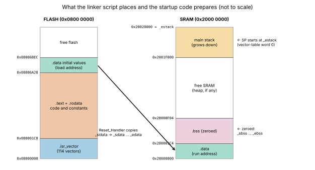
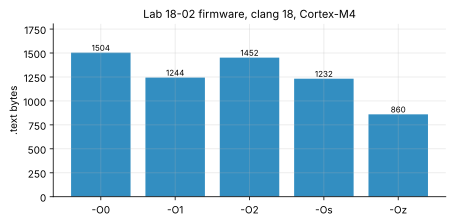

<!-- status: verified -->
# 18-02 · Bare-Metal C and the Build Toolchain

| | |
|---|---|
| **Course** | [18 · Embedded Systems and Microcontrollers](../README.md) |
| **University equivalent** | The toolchain and startup chapters of a junior embedded-systems course: cross-compilation, sections and linker scripts, startup code and the vector table, register access in C and `volatile`, and hardware abstraction layers (Valvano, *Embedded Systems: Introduction to ARM Cortex-M Microcontrollers*, chapters 2–4; Yiu, *The Definitive Guide to Arm Cortex-M3 and Cortex-M4 Processors*, chapters 2 and 16; UT Austin EE319K; Berkeley EECS149 labs) |
| **Prerequisites** | [18-01](18-01-microcontroller-architecture.md) (memory map, vector table, flash and SRAM), [05-07](../../05-programming-for-engineers/chapters/05-07-bit-manipulation.md) (bit manipulation, `volatile`), [05-06](../../05-programming-for-engineers/chapters/05-06-c-pointers-and-memory.md) (pointers, storage classes), [14-03](../../14-computer-organization-and-architecture/chapters/14-03-assembly-and-the-compilation-stack.md) (object files, linking, the ABI) |
| **Estimated study hours** | 8 |
| **Last verified** | 2026-11-21 |

**Learning objectives.** After this chapter you can:

1. Trace a C program from source to a flashed image: cross-compilation flags, object-file sections, linking and the output formats a programmer loads.
2. Predict which section each declaration lands in, and compute flash and SRAM use from a size report, including stack, heap and dual-image update slots.
3. Read and write a linker script: memory regions, section placement, load versus run addresses, alignment, symbols and size checks.
4. Write the startup code that runs before `main`: the vector table, copying `.data`, zeroing `.bss`, and estimate its time cost.
5. Access peripheral registers correctly from C: field masks, read-modify-write hazards and their fixes, and what `volatile` does and does not guarantee.
6. Compare bare registers, CMSIS and vendor HALs on code size, speed, portability and engineering cost, and choose between them for a product.

## 1. Big picture

On a PC, a program starts long after the hard work is done: the operating system has loaded it, set up its memory, opened its files and called `main`. A microcontroller has none of that. When it comes out of reset, the core reads two words from address 0 and starts executing; everything else, from setting up the stack to giving C variables their initial values, is code that someone wrote and linked into the image. This chapter is about that code and the tools that produce it.

- **Every MCU product ships a toolchain decision.** Compiler, linker script, startup code and driver layer decide code size (and so the part's flash and price), boot time, and how hard the next port will be.
- **The linker script is the memory map in software.** It is where 18-01's flash and SRAM addresses become concrete places for code, constants, variables and the stack.
- **Most "impossible" embedded bugs live here:** a variable that never gets its initial value, an interrupt flag the compiler optimized away, a register update lost to an interrupt, a stack that silently grows into data.
- **The abstraction layer is a business choice.** A vendor's HAL saves engineering months and ties the product to that vendor; bare registers save flash and cycles and cost engineering time. §3.8 and Example 18-02.6 put numbers on the trade.

## 2. Intuition first

**Picture the image.** The linker produces one file that will be copied into flash. In it sit the vector table, the code, the constants, and one more thing that is easy to miss: the *initial values* of every initialized variable. Variables must live in SRAM, because they change, but SRAM forgets everything when power is removed. So the initial values travel in flash, and at every reset the startup code copies them into SRAM. Variables with no initializer (or initialized to zero) need no copy: the startup code simply writes zeros over their block of SRAM. Then it calls `main`.



**Analogy: opening a new branch office.** Head office (the build) packs a shipping container (the flash image): furniture plans (code), the procedures manual (constants), and boxes of starting files for each desk (initial values of `.data`). On opening day, before any employee arrives, the facilities crew (the startup code) unpacks each box onto its desk, clears the empty desks (`.bss`), and connects the phone line (the stack pointer). Only then does the manager (`main`) start work. If the crew skips a step, nobody notices until someone opens a drawer that should have held a file. **Where it breaks down:** an office can be reorganized while it runs; an MCU's placement is fixed at link time, and the "boxes" are reloaded at *every* reset, not just once, which is why startup time matters for products that reset or wake often.

**What `volatile` is for.** A C compiler assumes that memory changes only when the program writes it. For a status register that hardware updates, or a flag an interrupt sets, that assumption is false, and the compiler may legally read the value once and reuse it forever, or delete a loop that seems to wait for nothing. `volatile` tells it: every access in the source is a real access, in order. Example 18-02.5 shows clang deleting a polling loop outright when the flag is not `volatile`.

## 3. Theory

### 3.1 Cross-compiling for a bare-metal target

A **cross-compiler** runs on one machine (the host, an x86 or Arm laptop) and produces code for another (the target, here a Cortex-M4). With clang the target is named by a **target triple** and refined by CPU options; the lab builds with

```text
clang --target=thumbv7em-none-eabi -mcpu=cortex-m4 -mthumb -mfloat-abi=soft -O2
      -ffreestanding -nostdlib -fuse-ld=lld -Wl,-T,link.ld  startup.c main.c -o fw.elf
```

- `thumbv7em-none-eabi`: Thumb instructions of Armv7E-M (18-01 §3.2), no operating system ("none"), the Arm embedded ABI ("eabi").
- `-mcpu=cortex-m4` selects the core's exact instructions and scheduling model; `-mthumb` is implied on M-profile.
- `-mfloat-abi` chooses how floating point is done: `soft` (library calls, no FPU), `softfp` (FPU instructions, but floating-point arguments passed in integer registers, so it links with soft-float code) or `hard` (FPU instructions and arguments in FPU registers, the fastest but incompatible with soft-float libraries). A Cortex-M4F build normally adds `-mfpu=fpv4-sp-d16 -mfloat-abi=hard`, and the startup code must then enable the FPU before any floating-point instruction runs (§3.5).
- `-ffreestanding` tells the compiler there is no hosted C library: `main` is not special and functions such as `printf` do not exist. Two caveats. The compiler may still *emit calls* to `memcpy`, `memset`, `memmove` and `memcmp` (for structure copies or zeroing loops), so a freestanding project must provide them; and only a few headers are guaranteed to exist (`<stdint.h>`, `<stddef.h>`, `<stdbool.h>`, `<limits.h>`, `<float.h>` and a handful of others). `-nostdlib` keeps the host's startup files and libraries out of the link.
- `-fuse-ld=lld -Wl,-T,link.ld` links with LLVM's linker under the project's linker script (§3.4).

GCC users write the same with `arm-none-eabi-gcc -mcpu=cortex-m4 -mthumb …`; the concepts are identical. The output is an **ELF** file (Executable and Linkable Format, 14-03 §3.4): sections, symbols and debug information. A programmer or debugger either loads the ELF directly or flashes a raw image extracted from it (`llvm-objcopy -O binary` for a `.bin`, `-O ihex` for Intel HEX).

### 3.2 Where each declaration lands

The compiler sorts what it emits into named **sections**, and the linker gathers same-named sections from all object files:

| Section | Contents | Lives in | Example declarations |
|---|---|---|---|
| `.isr_vector` (name chosen by the project) | vector table | flash, at the address the core reads at reset | `const vector_t vector_table[]` placed with `__attribute__((section(".isr_vector")))` |
| `.text` | machine code | flash | every function |
| `.rodata` | constants, string literals, lookup tables | flash | `const uint8_t lut[256] = {…};` `"hello"` |
| `.data` | initialized variables | SRAM at run time; initial values in flash | `int limit = 10;` `uint8_t *p = buf;` |
| `.bss` | zero-initialized and uninitialized variables | SRAM, zeroed at startup | `int counter;` `static char buf[256];` `int n = 0;` |
| stack | locals, saved registers, exception frames | SRAM, top down | `int x = 3;` inside a function (or only a register) |
| heap | `malloc` blocks, if any | SRAM, between `.bss` and the stack | many embedded projects have none |

Static storage that is *explicitly* initialized to zero goes to `.bss` too: it costs no flash, because zero is what the startup code writes anyway. A `const` object usually lands in `.rodata`, but the compiler may fold a `const int k = 5;` into the instructions that use it and allocate nothing. One subtlety from the lab: a `static` array that nothing ever writes can be optimized away entirely, since the compiler can prove it always reads zero; that is why the lab's `.bss` test array is global.

**Flash and SRAM budgets follow directly.** With the Berkeley `size` report (`text` = vectors + code + constants, `data`, `bss`):

$$
\text{flash} = \text{text} + \text{data},\qquad \text{SRAM} = \text{data} + \text{bss} + \text{stack} + \text{heap} .
$$

`data` appears in both: its initial values occupy flash and its variables occupy SRAM. Example 18-02.1 applies this, including the halving of usable flash when the product keeps two firmware images for safe updates (18-08).

### 3.3 Load address and run address

Every section has two addresses. The **run address** (the linker's virtual memory address, VMA) is where the code expects the section while it executes; the **load address** (LMA) is where the section's bytes sit in the image. For code and constants they are equal: both in flash. For `.data` they differ: the linker resolves every reference to a `.data` variable to its SRAM run address, but stores its initial bytes at a flash load address. Nothing moves the bytes from one to the other except the startup code. For `.bss` there are no bytes at all, only a range of addresses that the startup code must clear.

### 3.4 The linker script

A **linker script** tells the linker what memory exists and where each output section goes. The lab's script (`labs/18-02-lab/fw/link.ld`), slightly abridged:

```text
ENTRY(Reset_Handler)
MEMORY
{
  FLASH (rx)  : ORIGIN = 0x00000000, LENGTH = 256K
  RAM   (rwx) : ORIGIN = 0x20000000, LENGTH = 64K
}
_stack_size = 0x1000;
_estack     = ORIGIN(RAM) + LENGTH(RAM);

SECTIONS
{
  .isr_vector : ALIGN(4) { KEEP(*(.isr_vector)) } > FLASH
  .text       : ALIGN(4) { *(.text .text.*) *(.rodata .rodata.*) . = ALIGN(4); _etext = .; } > FLASH
  .ARM.exidx  : { *(.ARM.exidx*) } > FLASH
  .data       : ALIGN(4) { _sdata = .; *(.data .data.*) . = ALIGN(4); _edata = .; } > RAM AT > FLASH
  _sidata = LOADADDR(.data);
  .bss (NOLOAD) : ALIGN(4) { _sbss = .; *(.bss .bss.* COMMON) . = ALIGN(4); _ebss = .; } > RAM
  ASSERT(_ebss + _stack_size <= _estack, "SRAM overflow")
}
```

- **`MEMORY`** declares the regions with their origins and lengths; the linker errors if a region overflows.
- **`SECTIONS`** places output sections in order. Within a section, `.` is the **location counter** (the current address); `*(.text .text.*)` collects those input sections from every object file; `. = ALIGN(4)` pads to a word boundary so the startup loops can copy whole words.
- **`.ARM.exidx`** holds the stack-unwinding index that the compiler emits for C++ exceptions and for debuggers; it is often present (24 bytes in the lab) even in C, and it sits between `_etext` and the load address of `.data`.
- **`KEEP`** stops the linker's garbage collection (`--gc-sections`) from discarding the vector table, which no code references by name.
- **`> RAM AT > FLASH`** gives `.data` its run address in SRAM and its load address in flash; **`LOADADDR(.data)`** exports that load address as `_sidata`.
- **`NOLOAD`** marks `.bss` as occupying addresses but no bytes in the image.
- **Symbols** such as `_sdata` and `_estack` are addresses, not variables. C code declares them `extern uint32_t _sdata;` and uses only their address, `&_sdata`.
- **`ASSERT`** turns "the stack would overlap `.bss`" from a field failure into a link error.

**The layout follows from sizes.** With the vector table at the flash origin, and every section start and end aligned to 4 bytes (round up with $\lceil x/4\rceil \cdot 4$):

$$
\begin{aligned}
\_etext &= \operatorname{align}_4(\text{origin}_F + V + T + R), &\quad \_sidata &= \_etext + E,\\
\_sdata &= \text{origin}_R, &\quad \_edata &= \operatorname{align}_4(\_sdata + D),\\
\_sbss &= \_edata, &\quad \_ebss &= \operatorname{align}_4(\_sbss + B),\\
\_estack &= \text{origin}_R + \text{length}_R, &\quad \text{free SRAM} &= \_estack - S - \_ebss ,
\end{aligned}
$$

for vector-table, text, rodata, data, bss and stack sizes $V, T, R, D, B, S$ in bytes ($V$ = 4 bytes per vector, itself a multiple of 4), and $E$ the size of any `.ARM.exidx` section (0 in the examples, 24 bytes in the lab). The model treats the input sections as packed end to end; the real linker pads each input section to its own alignment (word tables in `.rodata` to 4 bytes, for example), so `_etext` can come out a few bytes higher, which the lab's symbol table shows. The flash used is $\_sidata + (\_edata - \_sdata) - \text{origin}_F$. Example 18-02.2 works one layout in hexadecimal, and the lab checks the formulas against the linker's own symbol table.

> **Going deeper — what real scripts add.** Production linker scripts also place `.init_array` (constructors for C++ and for C functions marked `constructor`), `.ARM.exidx` (exception-unwinding index; clang emits a few "cannot unwind" entries even for C, 24 bytes in the lab's image), a heap region with `_end`, sections for tightly coupled memories or RAM-resident functions (`.ramfunc`, copied like `.data`), a no-init region that survives a warm reset (for crash logs), and fixed-address blocks for a bootloader and its image header (18-08). Each is just another output section with its own region and load address.

### 3.5 Startup code: from reset to `main`

At reset a Cortex-M core loads the **main stack pointer** from word 0 of the vector table and the **program counter** from word 1 (18-01 §3.7). Because the core runs only Thumb code, every handler address in the table has bit 0 set. The rest of the table lists the exception handlers. The lab writes the table in C:

```c
typedef union { void (*handler)(void); void *stack_top; } vector_t;

__attribute__((section(".isr_vector"), used))
const vector_t vector_table[16] = {
    {.stack_top = &_estack},   /* word 0: initial MSP       */
    {Reset_Handler},           /* word 1: reset             */
    {NMI_Handler}, {HardFault_Handler}, /* … SysTick_Handler */
};
```

Each handler other than `Reset_Handler` is declared `__attribute__((weak, alias("Default_Handler")))`: if the application defines a function of that name, the linker uses it; otherwise the weak alias points at a default that reports the fault and stops. A real part's table continues with one entry per peripheral interrupt (98 in Example 18-02.2), in the order the reference manual lists them.

The reset handler then does what a hosted C runtime would:

1. **Copy `.data`** from `_sidata` to `_sdata` … `_edata`, one word at a time.
2. **Zero `.bss`** from `_sbss` to `_ebss`.
3. **Optional platform set-up**, usually in a vendor `SystemInit()`: clock tree and PLL (18-01 §3.6), flash wait states, enabling the FPU (on Armv7-M, set bits 20–23 of the Coprocessor Access Control Register `CPACR` at 0xE000 ED88, then `DSB` and `ISB`), relocating the vector table through `VTOR`, and running C++ constructors from `.init_array`.
4. **Call `main`**, which on a bare-metal product never returns; if it does, loop or reset.

The lab's version is 20 lines of C and is checked on an emulated Cortex-M4: building it with the copy loop removed makes the firmware fail its `.data` tests. Building it with the zeroing loop removed still *passes*, because QEMU starts with zeroed SRAM, whereas real SRAM powers up with arbitrary contents. A test that passes in emulation is evidence, not proof.

**Startup costs time.** If the copy loop costs $c_d$ cycles per word and the zeroing loop $c_b$, the time before `main` is

$$
t_{startup} = \frac{c_d\lceil D/4\rceil + c_b\lceil B/4\rceil + c_0}{f_{reset}} ,
$$

where $c_0$ covers the remaining fixed set-up. It runs at the *reset* clock, often a 4–16 MHz internal RC oscillator, because the PLL has not been configured yet. Example 18-02.4 shows that zeroing tens of kilobytes then takes milliseconds, which matters for products that lose SRAM in deep sleep and repeat the startup at every wake (18-09).

### 3.6 Registers from C: fields, races and `volatile`

**Access.** A peripheral register is a memory location, so C reaches it through a pointer to `volatile` (05-07 §3.4):

```c
#define USART1_BRR (*(volatile uint32_t *)0x40013808u)
```

Vendors and Arm's **CMSIS** (Common Microcontroller Software Interface Standard) instead describe each peripheral as a `struct` laid over its base address, with members qualified `volatile` (macros `__IO` for read-write, `__I` for read-only), so that `USART1->BRR = 0x1D4C;` compiles to one store at base + offset. The structure must match the register map exactly, including `RESERVED` padding words between registers (Problem 18-02.10).

**Fields.** To write a field of `width` bits at bit position `lsb` without disturbing the rest, build the mask $M = (2^{width} - 1) \ll lsb$ and compute

$$
\text{new} = (\text{old} \mathbin{\&} \lnot M) \mathbin{|} ((v \ll lsb) \mathbin{\&} M) .
$$

The lab's `regbits.h` implements this (`field_mask`, `field_insert`, `field_extract`), and its host test checks every one of the 528 field positions and widths against a bit-by-bit reference.

**The read-modify-write race.** `REG = (REG & ~M) | x;` is three steps: load, modify in a register, store. If an interrupt handler changes *another* bit of the same register between the load and the store, the store writes back the stale snapshot and the handler's change is lost (Example 18-02.3). The window is a few cycles, but a few cycles out of millions per second, hit by interrupts thousands of times per second, adds up to many losses per hour (Problem 18-02.5). The fixes, in order of preference:

- **Hardware that needs no read:** dedicated set and clear registers (writing 1 sets or clears only that bit; many GPIO ports have one) and write-1-to-clear status flags. They help only if *every* context that changes the register uses them: one context that still writes back the whole register (Example 18-02.3) destroys the others' bits. 18-01's bit-band aliases on Armv7-M are a hardware-locked read-modify-write, safe against interrupts but never to be used on write-1-to-clear registers (18-01 §3.3).
- **Exclusive access:** `LDREX`/`STREX` retry the update if anything intervened (on a single core, an interrupt clears the exclusive monitor). Three caveats: Armv6-M (Cortex-M0/M0+) has no exclusive instructions; the architecture does not guarantee exclusive access to Device-memory peripheral registers, which the bus or peripheral may not support; and the local monitor sees exception entry and exit, not a change made by hardware or DMA. For peripheral registers the critical section below is the portable fix.
- **A short critical section:** save `PRIMASK`, disable interrupts, update, restore. Correct and simple, but it delays every interrupt by the length of the section.
- **Ownership:** design so that each register (or each bit group) is written from only one context.

**What `volatile` guarantees, and what it does not.** In C, an access to a `volatile` object is an observable side effect: the compiler must perform every such read and write the source performs, with the stated width, and must not reorder volatile accesses relative to one another. That is exactly what device registers need. It does **not**:

- make an access atomic (a 64-bit volatile counter on a 32-bit core is read in two halves);
- order ordinary memory accesses around the volatile one (the compiler may move a normal store across it; a "flag plus buffer" handshake needs the buffer to be volatile too, or a compiler barrier);
- order the *hardware's* view of memory: a write buffer or bus matrix may complete stores in a different order or later than the program issued them, which is why Arm specifies `DSB` (complete all memory accesses) and `ISB` (refetch instructions) after changes such as enabling the FPU or clearing an interrupt flag at the end of a handler (18-03).

**Why non-`volatile` polling fails badly.** C11 §6.8.5 ¶6 lets an implementation assume that a loop whose controlling expression is not a constant, and whose body performs no I/O, `volatile` access or synchronization, terminates. A loop that waits on an ordinary variable therefore may be compiled as if it ends at once. Example 18-02.5 shows clang 18 doing exactly that at `-O2`, while the same loop works at `-O0`: the classic "works in the debug build, hangs or skips in release" bug.

### 3.7 What the compiler does with your code

**Optimization levels trade size against speed.** `-O0` compiles each statement literally (best for stepping in a debugger); `-O1` and `-O2` optimize for speed; `-Os` and `-Oz` for size. Speed optimizations can *grow* code: at `-O2` clang unrolls the lab's startup copy and zeroing loops four times. The lab's firmware measures this:

| Level | `.text` bytes (clang 18, Cortex-M4) |
|---|---|
| `-O0` | 1504 |
| `-O1` | 1244 |
| `-O2` | 1452 |
| `-Os` | 1232 |
| `-Oz` | 860 |



On a small image, `-Oz` saves 41% over `-O2` here. On real firmware the spread is usually smaller, and many teams use `-Os` for the whole image and `-O2` only for hot code (by file or function attribute). Two link-level options matter more for size: `-ffunction-sections -fdata-sections` with `-Wl,--gc-sections` drops every unreferenced function and object, and **link-time optimization** (`-flto`) lets the compiler inline and discard across files.

**The calling convention.** The Arm Procedure Call Standard (AAPCS, 14-03 §3.5) passes the first four integer arguments in R0–R3, returns results in R0 (and R1), makes R4–R11 callee-saved, and requires 8-byte stack alignment at public function boundaries. It is also why Cortex-M hardware stacks exactly R0–R3, R12, LR, PC and xPSR on an exception: those are the registers a C function may clobber, so a handler can be an ordinary C function (18-01 Q1). The exception **stack frame** is 8 words (32 bytes), or 26 words (104 bytes) when the FPU's caller-saved registers S0–S15 and FPSCR are stacked too; stack sizing must include one frame per level of interrupt nesting (Problem 18-02.13).

**Integer types and layout.** Use the fixed-width types of `<stdint.h>` for anything that maps to hardware. Cortex-M is little-endian (on the parts in this course), and its ABI aligns each type to its size, so structure layout and padding follow 05-06 §3.5. `__attribute__((packed))` removes padding; the compiler then accesses packed members with byte (or, where the core allows it, unaligned) loads and stores, which is slower. The fault on Armv6-M comes from taking the address of a packed member, or casting a misaligned buffer, and dereferencing it as an aligned wider type.

### 3.8 Layers of abstraction: registers, CMSIS and HALs

| Layer | What it is | Strengths | Costs |
|---|---|---|---|
| Bare registers | the reference manual's addresses and bits, written directly | smallest and fastest code; every cycle visible; no dependency | slow to write; easy to get wrong; tied to one chip family |
| CMSIS-Core and device headers | Arm's standard names for core registers (NVIC, SysTick, SCB) and the vendor's `struct` definitions of peripherals | portable core code across Cortex-M vendors; zero run-time cost | still register-level for peripherals |
| Vendor HAL and low-level drivers | the vendor's library of functions (`HAL_UART_Transmit`, `LL_GPIO_SetOutputPin`) and its code generator | fast bring-up; examples; covers errata | larger and slower (argument checks, generality, callbacks); quality varies; ties the code to the vendor's API |
| RTOS driver model (Zephyr, for example) | a device-independent API configured by a hardware description (Zephyr's devicetree) | portability across vendors; ecosystem of drivers and stacks | the largest footprint; a learning curve; the RTOS's update cadence |

The usual answer in industry is a mix: a HAL or RTOS drivers for bring-up and for complex peripherals (USB, Ethernet, file systems), register-level code in the hot paths (interrupt handlers, DMA set-up, bit-banged protocols), and CMSIS-Core everywhere for the core. The quantitative question is where the flash and cycle costs of abstraction push the product into a bigger, more expensive part, and whether the engineering time saved is worth more than that (Example 18-02.6).

### 3.9 Getting the image onto the chip, and seeing inside it

A **debug probe** connects to the MCU's debug port: **SWD** (Serial Wire Debug, two pins: clock and data) on Cortex-M, or **JTAG** (four or five pins, and the standard for boundary scan). Through it a host runs a GDB server (OpenOCD, pyOCD or a vendor tool) that can halt the core, read and write memory and registers, set breakpoints and program the flash. Three ways to get output from a program without a UART:

- **Semihosting:** the program executes `BKPT 0xAB` with a request code in R0, and the debugger services it (prints a string, reads a file, ends the session). The lab uses it under QEMU. It halts the core for each request, so it is slow and only for test and debug.
- **ITM/SWO** (Instrumentation Trace Macrocell over the Serial Wire Output pin, on Cortex-M3 and above): a `printf` stream through the debug port at little cost to the running program.
- **RTT-style memory buffers:** the program writes into a ring buffer in SRAM, and the probe reads it in the background.

The linker's **map file** (`-Wl,-Map,fw.map`) lists where every input section, function and object landed, and is the first thing to read when the image does not fit.

## 4. Worked examples

### Example 18-02.1 · Reading a size report (tier A)

**Setup.** A wearable's firmware builds to `text` = 23 456, `data` = 1 204 and `bss` = 9 872 bytes. The MCU has 256 KiB of flash and 64 KiB of SRAM; the linker script reserves a 4 KiB stack and an 8 KiB heap. (a) How much flash and SRAM does the firmware use, as numbers and as percentages? (b) For safe updates the flash will hold a 16 KiB bootloader and two equal image slots (18-08). How large is each slot, and what fraction of it does the image fill?

**Solution.** (a) Flash holds the code, constants and vectors (`text`) plus the initial values of `.data`: $23\,456 + 1\,204$ = **24 660** bytes, $24\,660/262\,144$ = **9.41** % of the flash. SRAM holds `.data`, `.bss`, the stack and the heap: $1\,204 + 9\,872 + 4\,096 + 8\,192$ = **23 364** bytes, **35.65** % of 65 536.

(b) Each slot gets $(256 - 16)/2 = 120$ KiB = **122 880** bytes. The image fills $24\,660/122\,880$ = **20.07** % of a slot.

**Units check.** Bytes over bytes; 1 KiB = 1024 bytes.

**Sanity check.** `data` counts twice, once in each memory, as §3.2 predicts. The dual-image plan turns a part that looks 10% full into one whose effective code space is less than half the flash, which is why update strategy belongs in part selection (18-01 §3.8).

### Example 18-02.2 · Laying out the memory (tier B)

**Setup.** The chapter's linker script is used on an MCU with flash at 0x0800 0000 and 128 KiB of SRAM at 0x2000 0000. The part has 98 external interrupts. The compiler produces 0x5E2A bytes of `.text`, 0x0A35 of `.rodata`, 0x01C2 of `.data` and 0x0D3D of `.bss`; the stack is 0x1000 bytes. Find `_etext` (= `_sidata`), `_edata`, `_ebss`, `_estack` and the bottom of the stack, the free SRAM, and the flash used.

**Solution.** The vector table has $16 + 98 = 114$ words, $114 \times 4 = 456$ = 0x1C8 bytes, so code starts at 0x0800 01C8. Code and constants together are $0x5E2A + 0x0A35 = 0x685F$ bytes, ending at $0x0800\,01C8 + 0x685F = 0x0800\,6A27$; aligning up to 4 gives `_etext` = `_sidata` = **0x08006A28**.

In SRAM, `.data` starts at `_sdata` = 0x2000 0000 and ends at $\operatorname{align}_4(0x01C2)$ = 0x01C4 later: `_edata` = **0x200001C4**. `.bss` follows: $0x2000\,01C4 + 0x0D3D = 0x2000\,0F01$, aligned up to `_ebss` = **0x20000F04**. The stack top is the end of SRAM, `_estack` = $0x2000\,0000 + 0x2\,0000$ = **0x20020000**, and the reserved stack's bottom is $0x2002\,0000 - 0x1000$ = **0x2001F000**. Free SRAM is $0x2001\,F000 - 0x2000\,0F04 = 0x1\,E0FC$ = **123 132** bytes. Flash used is the code region plus the `.data` image: $0x6A28 + 0x01C4 = 0x6BEC$ = **27 628** bytes.

**Units check.** Address differences are byte counts; hexadecimal and decimal are the same quantities.

**Sanity check.** The linker's `ASSERT` holds with a large margin: $0x2000\,0F04 + 0x1000 \le 0x2002\,0000$. The lab's firmware applies the same formulas to its own sizes and compares them with the symbol table the linker writes.

### Example 18-02.3 · Changing a register field safely (tier B)

**Setup.** A peripheral control register reads 0x0000 8C31. Its 4-bit prescaler field PRESC occupies bits [11:8]. (a) Compute the mask, the register with the field cleared, and the value that sets PRESC = 6 without touching any other bit. (b) The main loop does this update as a read-modify-write. An interrupt handler that sets bit 3 (an enable bit) of the same register runs after main's read and before its write. What value ends up in the register, and what should it have been? (c) Give two fixes.

**Solution.** (a) $M = (2^4 - 1) \ll 8$ = **0x00000F00**. Clearing: $0x8C31 \mathbin{\&} \lnot M$ = **0x00008031**. Inserting $6 \ll 8 = 0x600$: **0x00008631**.

(b) Main reads 0x8C31 into a register. The handler sets bit 3: the hardware register becomes 0x8C39. Main then writes its own computation from the stale snapshot, 0x8631: the result is **0x00008631**, with the handler's bit lost. The correct result has both changes: $0x8631 \mathbin{|} 0x8 =$ **0x00008639**.

(c) The bit is lost because *main* writes back a stale copy of the whole register, so the fix must change what main does; making the handler's own write atomic is not enough (with a set register the handler's bit is set at once, and main's stale write-back still clears it). Fixes: make main's read-modify-write a critical section (save `PRIMASK`, disable interrupts, update, restore) or, where the core and the peripheral support exclusive access, retry it with `LDREX`/`STREX`; or, if the peripheral has set and clear registers, have *main* update PRESC through them (clear 0xF00, then set 0x600) so that it never writes back bit 3; or move all writes of this register into one context.

**Units check.** Hexadecimal bit patterns; each hex digit is 4 bits.

**Sanity check.** The lab's host test replays this exact interleaving and confirms both values; `volatile` was present throughout, which shows that `volatile` does not make a read-modify-write atomic.

### Example 18-02.4 · How long before `main`? (tier B)

**Setup.** An MCU resets onto a 4 MHz internal oscillator; its firmware has 6 KiB of `.data` and 40 KiB of `.bss`. Assume the startup copy loop costs 7 cycles per word (load from flash with one wait state, store, pointer updates, compare and branch) and the zeroing loop 4 cycles per word, and ignore other set-up. (a) How many cycles and how long does startup take? (b) How long if the clock were already 48 MHz? (c) The product loses SRAM in deep sleep and repeats the startup at each wake. At 3.0 V and 1.0 mA during startup, how much energy does each wake spend before `main`?

**Solution.** (a) $\lceil 6144/4\rceil = 1536$ words to copy and $\lceil 40\,960/4\rceil = 10\,240$ to zero: $1536 \times 7 + 10\,240 \times 4 = 10\,752 + 40\,960$ = **51 712** cycles, which at 4 MHz is $51\,712/(4 \times 10^6)$ = **12.93** ms.

(b) At 48 MHz: $51\,712/(48 \times 10^6)$ = **1.077** ms (ignoring that a faster clock would add flash wait states to the copy).

(c) $E = VIt = 3.0 \times 1.0 \times 10^{-3} \times 12.93 \times 10^{-3}$ = **38.8** µJ per wake.

**Units check.** cycles ÷ (cycles/s) = s; V × A × s = J.

**Sanity check.** Zeroing dominates (79% of the cycles) because `.bss` is 6.7 times larger than `.data`. At one wake per second, 38.8 µJ is a 38.8 µW average drain before the application does anything, about **7.2** times the 5.4 µW sleep power of Example 18-01.5's MCU (3 µA at 1.8 V); 18-09 returns to this with SRAM retention and wake-up strategies.

### Example 18-02.5 · The disappearing loop (tier B)

**Setup.** The lab's `poll.c` defines two versions of "wait until an interrupt handler sets the flag":

```c
uint32_t flag_plain;
volatile uint32_t flag_volatile;
void wait_plain(void)    { while (flag_plain == 0u) { } }
void wait_volatile(void) { while (flag_volatile == 0u) { } }
```

Compiled with clang 18 for the Cortex-M4 at `-O2`, `llvm-objdump -d` shows (alignment `nop`s removed):

```text
wait_plain:
    bx    lr
wait_volatile:
    movw  r0, #0x0
    movt  r0, #0x0
    b     <loop entry>
    ldr   r1, [r0]
    cmp   r1, #0x0
    it    ne
    bxne  lr
    ldr   r1, [r0]
    cbnz  r1, <return>
    ldr   r1, [r0]
    cbnz  r1, <return>
    ldr   r1, [r0]
    cmp   r1, #0x0
    beq   <top of loop>
    bx    lr
```

Explain each function's code, say what happens when `wait_plain` runs, and say why the same source works at `-O0`.

**Solution.** `wait_plain` has become a single instruction, **1**, a return. The loop's condition reads an ordinary variable that nothing in the loop changes, and the loop has no other effect, so C11 §6.8.5 ¶6 lets the compiler assume it terminates; with no effect left, it deletes it. The program then runs on as if the flag were already set: the "wait" never waits.

`wait_volatile` keeps every read. The two `movw`/`movt` instructions build the flag's address (zero here, filled in by the linker's relocation), and the loop, unrolled four times for speed, contains **4** loads of the flag, each followed by a test that returns once it is nonzero.

At `-O0` the compiler optimizes nothing, so `wait_plain` contains **1** load per iteration and does wait. The bug appears only when optimization is turned on, typically in the release build.

**Units check.** Instruction counts.

**Sanity check.** The fix is to declare the flag `volatile` (or to use C11 atomics). Making the loop body non-empty with a `nop` does not, in principle, help: the read of the flag can still be hoisted out of the loop.

### Example 18-02.6 · Registers or a HAL? (tier C)

**Setup.** A sensor product can be written on the vendor's HAL (image 58 KiB) or at register level with CMSIS headers (27 KiB), which costs 4 more engineer-months at \$20 000 each. Updates need two image slots plus an 8 KiB bootloader. The candidate parts differ only in flash: 64 KiB at \$0.92 and 128 KiB at \$1.05. Volume is 1.2 million units a year for three years. (a) What flash does each approach need, and which part fits? (b) Compare the part saving with the engineering cost. (c) How much headroom does the register-level design leave, and what happens if the image grows 10% in the first year? (d) Recommend.

**Solution.** (a) HAL: $2 \times 58 + 8$ = **124** KiB: only the 128 KiB part. Register level: $2 \times 27 + 8$ = **62** KiB: fits the 64 KiB part.

(b) The smaller part saves $\$0.13 \times 1.2 \times 10^6 \times 3$ = **\$468 000**, against **\$80 000** of extra engineering: on paper, a clear win for register-level code.

(c) On the 64 KiB part, headroom is $64 - 62$ = **2** KiB, **3.1** % of the flash. A 10% larger image needs $2 \times 27 \times 1.1 + 8$ = **67.4** KiB, which no longer fits: the first year of features or fixes forces a board change or abandons dual-image updates. The HAL design on the 128 KiB part is no better: $128 - 124$ = **4** KiB, also 3.1%.

(d) Neither "cheap" combination is shippable, because each fills 97% of its flash on day one. Register-level code on the 128 KiB part leaves $128 - 62$ = **66** KiB, **51.6** % of the flash, free for growth: it costs the \$468 000 parts premium plus \$80 000 of engineering, and buys a product that can be updated for its whole life. The alternatives are a HAL build on a larger part, if one is priced acceptably, or register-level code on the 64 KiB part with a different update scheme (a single 27 KiB slot plus an external flash staging area, 18-08), which leaves $64 - 8 - 27 = 29$ KiB, 45% of the flash, free and so meets the headroom rule. The cost comparison favoured the small part; the headroom rule (18-01 §3.8) overrules it.

**Units check.** KiB for memory; dollars for costs.

**Sanity check.** The cost comparison and the capacity check point in opposite directions, which is common: part-cost savings scale with volume, while the risk of running out of flash grows with the product's life. A diligence reviewer should ask for both numbers.

<!-- answer-key -->

| ID | Quantity | Value | Unit |
|---|---|---|---|
| Txt 18-02.a | field positions and widths in a 32-bit register | 528 | — |
| Txt 18-02.b | `.text` at -O0 | 1504 | bytes |
| Txt 18-02.c | `.text` at -O1 | 1244 | bytes |
| Txt 18-02.d | `.text` at -O2 | 1452 | bytes |
| Txt 18-02.e | `.text` at -Os | 1232 | bytes |
| Txt 18-02.f | `.text` at -Oz | 860 | bytes |
| Txt 18-02.g | -Oz saving against -O2 | 41 | % |
| Txt 18-02.h | basic exception frame | 32 | bytes |
| Txt 18-02.i | exception frame with FPU state | 104 | bytes |
| Txt 18-02.j | lab unwind index | 24 | bytes |
| Ex 18-02.1a | flash used | 24660 | bytes |
| Ex 18-02.1b | flash used | 9.41 | % |
| Ex 18-02.1c | SRAM used | 23364 | bytes |
| Ex 18-02.1d | SRAM used | 35.65 | % |
| Ex 18-02.1e | image slot | 122880 | bytes |
| Ex 18-02.1f | slot filled | 20.07 | % |
| Ex 18-02.2a | _etext = _sidata | 0x08006A28 | — |
| Ex 18-02.2b | _edata | 0x200001C4 | — |
| Ex 18-02.2c | _ebss | 0x20000F04 | — |
| Ex 18-02.2d | _estack | 0x20020000 | — |
| Ex 18-02.2e | stack bottom | 0x2001F000 | — |
| Ex 18-02.2f | free SRAM | 123132 | bytes |
| Ex 18-02.2g | flash used | 27628 | bytes |
| Ex 18-02.3a | PRESC mask | 0x00000F00 | — |
| Ex 18-02.3b | field cleared | 0x00008031 | — |
| Ex 18-02.3c | PRESC = 6 | 0x00008631 | — |
| Ex 18-02.3d | value after the race | 0x00008631 | — |
| Ex 18-02.3e | correct value | 0x00008639 | — |
| Ex 18-02.4a | startup cycles | 51712 | cycles |
| Ex 18-02.4b | startup time at 4 MHz | 12.93 | ms |
| Ex 18-02.4c | startup time at 48 MHz | 1.077 | ms |
| Ex 18-02.4d | energy per wake | 38.8 | µJ |
| Ex 18-02.4e | wake cost over Example 18-01.5's sleep power | 7.2 | — |
| Ex 18-02.5a | instructions in wait_plain at -O2 | 1 | — |
| Ex 18-02.5b | flag loads in the unrolled wait_volatile | 4 | — |
| Ex 18-02.5c | flag loads per iteration of wait_plain at -O0 | 1 | — |
| Ex 18-02.6a | HAL flash requirement | 124 | KiB |
| Ex 18-02.6b | register-level flash requirement | 62 | KiB |
| Ex 18-02.6c | part saving over three years | 468000 | \$ |
| Ex 18-02.6d | extra engineering cost | 80000 | \$ |
| Ex 18-02.6e | headroom | 2 | KiB |
| Ex 18-02.6f | headroom | 3.1 | % |
| Ex 18-02.6g | requirement after 10% growth | 67.4 | KiB |
| Ex 18-02.6h | HAL headroom on the 128 KiB part | 4 | KiB |
| Ex 18-02.6i | register-level headroom on the 128 KiB part | 66 | KiB |
| Ex 18-02.6j | register-level headroom on the 128 KiB part | 51.6 | % |

*Every value is recomputed by [verify_18_02.py](../verify/verify_18_02.py): sizes and layouts by the linker-rule model and, for the lab firmware, against the ELF files that clang 18 and ld.lld actually produce; listings by disassembling freshly compiled objects; the firmware itself by running it on QEMU's Cortex-M4 board; register values by bit arithmetic and by the host test.*

## 5. Simulate it

The lab, [labs/18-02-lab](../labs/18-02-lab/README.md), is a complete bare-metal project: a linker script, startup code, register helpers, semihosting output and a self-checking `main`, cross-compiled with clang and ld.lld and run on QEMU's `mps2-an386` board (a Cortex-M4). `bmbuild.py` builds, inspects and runs it from Python, and the notebook guides you. **Predict, then run**:

1. **Sections.** Predict which section each object in `main.c` lands in and its address; build and read the symbol table.
2. **Vector table.** Predict words 0 and 1 of the image; read them from the ELF and explain why word 1 is odd.
3. **Break the startup.** Predict what fails when the `.data` copy is removed, and when the `.bss` zeroing is removed; build both variants and run them. Explain the second result.
4. **`volatile`.** Predict the code of `wait_plain` and `wait_volatile` at `-O0`, `-O2` and `-Os`; disassemble.
5. **Optimization and size.** Predict the order of `.text` sizes for `-O0` to `-Oz`; build all five.
6. **Layout formulas.** Predict `_sidata`, `_edata` and `_ebss` from the section sizes with §3.4's formulas, and compare with the linker.

## 6. Engineering tradeoffs

| Knob | Improves | Costs | Typical decision owner |
|---|---|---|---|
| Optimize for size (`-Os`, `-Oz`) | fits a smaller, cheaper part; less flash to update | slower code; harder debugging | firmware lead |
| Optimize for speed (`-O2`, `-O3`) on hot paths | interrupt latency, throughput, energy per task (race to idle) | larger image; code layout changes between builds | firmware lead with profiling data |
| Link-time optimization and `--gc-sections` | smaller image across files | longer builds; can expose latent bugs (missing `volatile`) | build owner |
| Vendor HAL | months of bring-up saved; vendor examples and errata handling | flash, cycles and vendor lock-in | engineering manager |
| Register-level drivers | smallest, fastest, fully understood code | engineering time; fewer people can maintain it | firmware lead |
| RTOS driver model (e.g. Zephyr) | portability across vendors; shared stacks | footprint, learning curve, dependence on the RTOS's cadence | architecture lead |
| Startup work (zero all `.bss`, copy all `.data`) | C semantics hold everywhere | boot and wake time, energy per wake | firmware lead with power owner |
| Stack size margin | protection against overflow | SRAM | firmware lead |

## 7. Numbers to know

| Quantity | Value | Note |
|---|---|---|
| Flash used | text + data | `data` = initial values of initialized variables |
| SRAM used | data + bss + stack + heap | heap often zero in embedded firmware |
| Vector table | 4 bytes per entry; 16 system entries + one per interrupt | word 0 = initial SP, word 1 = reset handler (odd: Thumb) |
| Exception frame | 32 bytes (8 words); 104 bytes (26 words) with FPU state | Armv7-M; one per nesting level |
| Field positions in a 32-bit register | 528 (lsb, width) pairs | the lab tests all of them |
| Code size by optimization level | −41% from `-O2` to `-Oz` (lab firmware, clang 18) | real firmware: usually less |
| Startup time | (copy words × c + zero words × c) / reset clock | milliseconds for tens of KiB at a few MHz |
| Dual-image updates | usable code space < half the flash | 18-08 |

## 8. Common mistakes

- **Forgetting that `data` costs flash too.** The initial values are stored in flash; a large initialized table costs both memories. Make it `const` if it never changes.
- **Polling a non-`volatile` flag.** At `-O2` the loop may be deleted or read the flag only once (Example 18-02.5). Declare shared flags `volatile` (or use atomics), and remember that `volatile` alone does not make updates atomic.
- **Read-modify-write of a register shared with an interrupt.** Use set/clear registers, bit-band, exclusive access or a short critical section (§3.6).
- **Assuming `-ffreestanding` means "no library calls".** The compiler can still emit `memcpy` and `memset`; provide them, or the link fails, or worse, links a wrong one.
- **Enabling the FPU too late.** With a hard-float ABI, the first floating-point instruction before `CPACR` is set causes a UsageFault; that can happen in startup code or in a constructor.
- **Trusting emulation for uninitialized memory.** QEMU's SRAM starts zeroed; real SRAM does not. A missing `.bss` loop passes in emulation and fails on hardware.
- **Sizing the stack from `main`'s needs alone.** Add the deepest call chain, one exception frame (32 or 104 bytes) and handler frame per nesting level, and a margin (Problem 18-02.13).
- **Packing hardware structures with `packed`.** It changes access widths; registers must be accessed as the reference manual specifies (usually 32-bit words).
- **Debugging only at `-O0`.** Test the optimization level you ship; many timing and `volatile` bugs appear only there.

## 9. Practitioner lens

### State of the art (as of Nov 2026)

- **Free toolchains are fully capable for Cortex-M development** (commercial compilers such as IAR and Arm Compiler remain common, especially where a certified toolchain is needed). Arm's own GNU toolchain release is Arm GNU Toolchain 15.3.rel2 (GCC 15.3, Binutils 2.45, GDB 16), published in October 2026; LLVM's clang and lld build the same targets, as this chapter's lab shows ([R-303]) **[Established]**.
- **CMSIS** is at version 6.4.0 (8 October 2026), whose CMSIS-Core now also covers Armv8-A and Armv7-R/Armv8-R profiles ([R-303]) **[Established]**.
- **RTOS releases.** Zephyr 4.5.0 (28 October 2026) is the latest stable release; Zephyr 3.7 is the long-term-support line, supported to July 2029, and 4.6 (April 2027) is planned as the next LTS. FreeRTOS's long-term-support release is 202604.01-LTS (August 2026) with kernel V11.3.1 ([R-303]) **[Established]**.
- **Coding standards and the language.** MISRA C:2025 (March 2025) is the current edition of the coding guidelines most safety-related embedded C follows, and C23 (ISO/IEC 9899:2024) is the current language standard ([R-092]) **[Established]**. Memory-safety pressure is pushing Rust into systems code (Android, the Linux kernel; [R-094], [R-095]) **[Established]**; its use in shipping microcontroller products is growing but harder to measure **[Contested]**.

### Why it matters commercially

- **The software stack is the moat.** An MCU vendor's HAL, code generator, examples and RTOS support decide how fast a customer reaches a working product, and the resulting code base is what makes switching vendors expensive (18-01 §9). When evaluating an MCU business, the quality and adoption of its software is as important as its silicon.
- **Flash is priced in.** Every kilobyte of abstraction overhead can push a design into the next flash tier (Example 18-02.6). At millions of units, toolchain settings (`-Os`, LTO, garbage collection) are worth real money, and so is a firmware team that understands them.
- **Boot time is a product feature.** Startup work repeats at every reset and every wake from a memory-losing sleep state; for battery products it is an energy line item (Example 18-02.4).

### Marketing vs Reality

- **"Zero-overhead HAL."** Ask for the flash and cycle counts of the HAL call against the register write it replaces, in your configuration, and whether parameter checking is compiled in.
- **"Portable across our whole family."** Check the register maps and peripheral versions across the family, not only the API names; HAL portability often stops at the peripheral IP version.
- **"Certified toolchain."** Ask which compiler version and options the certificate or qualification kit covers; a safety argument built on one version does not carry to the next automatically.
- **"Our code is MISRA compliant."** Ask for the deviation list and the checker's report; compliance is a documented process, not a property of the source alone.
- **"It passed all tests in simulation."** Ask what the simulator does not model: uninitialized SRAM, timing, bus contention, interrupts at awkward moments (§3.5, §3.6).

### Questions for engineering leaders

1. **"How much of your flash and SRAM is used, by what, and what is the plan for growth and updates?"** *Strong:* a size and map-file breakdown, headroom per memory and the update scheme. *Evasive:* "it fits".
2. **"Which compiler, version and options do you ship, and do you test that build?"** *Strong:* a pinned toolchain, reproducible builds, tests at the release optimization level. *Evasive:* "whatever the IDE uses".
3. **"Where do you use the vendor HAL and where register-level code, and why?"** *Strong:* a layered rationale with measured costs on hot paths. *Evasive:* "the HAL handles it".
4. **"How do you handle registers and data shared with interrupt handlers?"** *Strong:* a rule (single writer, atomic set/clear registers, short critical sections), enforced by review or static analysis. *Evasive:* "we use volatile".
5. **"How long does your device take from reset to doing useful work, and from wake?"** *Strong:* measured numbers and what dominates them. *Evasive:* "fast".

## 10. Concept check

**Q1.** Why does an initialized global variable cost both flash and SRAM, while an uninitialized one costs only SRAM?

<details><summary>Answer</summary>

Its value must survive power-off, so the initial value is stored in flash, and its storage must be writable, so it lives in SRAM; the startup code copies one to the other. An uninitialized (or zero-initialized) static variable needs no stored value: the startup code writes zeros to its SRAM.

</details>

**Q2.** What do word 0 and word 1 of a Cortex-M vector table hold, and why is word 1 odd?

<details><summary>Answer</summary>

Word 0 is the initial main stack pointer (usually the top of SRAM) and word 1 the reset handler's address. Bit 0 of a branch target marks Thumb state, and Cortex-M runs only Thumb code, so every handler address in the table has bit 0 set.

</details>

**Q3.** In a linker script, what does `> RAM AT > FLASH` mean, and what must the program do because of it?

<details><summary>Answer</summary>

The section's run address (where code refers to it) is in RAM, and its load address (where its bytes are stored in the image) is in flash. The startup code must copy the bytes from the load address (`LOADADDR`, exported as `_sidata`) to the run address before anything uses them.

</details>

**Q4.** A polling loop works in the debug build and hangs or skips in release. What is the most likely cause?

<details><summary>Answer</summary>

The flag it polls is not `volatile`, so at higher optimization the compiler reads it once, or deletes the loop because it may assume a side-effect-free loop terminates (C11 §6.8.5 ¶6). Declare the flag `volatile` or use an atomic type.

</details>

**Q5.** Why is `REG |= BIT;` unsafe when an interrupt handler also writes `REG`, even if `REG` is `volatile`?

<details><summary>Answer</summary>

It compiles to a load, an OR and a store. If the handler changes the register between the load and the store, the store writes back the stale value and undoes the handler's change. `volatile` forces the accesses to happen but does not make the sequence atomic.

</details>

**Q6.** When does a vendor HAL cost real money, and when does it save it?

<details><summary>Answer</summary>

It costs money when its flash and cycle overhead pushes the product into a larger or faster, more expensive part at high volume, or when its API ties the product to one vendor. It saves money when it shortens bring-up, covers errata and lets a small team ship sooner, especially at low volume where engineering time dominates the bill of materials.

</details>

**Problems:** [18-02 problem set](../problems/18-02-problems.md) · [Worked solutions](../solutions/18-02-solutions.md)

## 11. Key terms

[Cross-compiler](../../../reference/glossary.md#cross-compiler) · [Object file](../../../reference/glossary.md#object-file) · [Linker](../../../reference/glossary.md#linker) · [Linker script](../../../reference/glossary.md#linker-script) · [Load and run addresses](../../../reference/glossary.md#load-and-run-addresses) · [Startup code](../../../reference/glossary.md#startup-code) · [Vector table](../../../reference/glossary.md#vector-table) · [Volatile](../../../reference/glossary.md#volatile) · [Read-modify-write hazard](../../../reference/glossary.md#read-modify-write-hazard) · [Calling convention](../../../reference/glossary.md#calling-convention) · [Exception stack frame](../../../reference/glossary.md#exception-stack-frame) · [CMSIS](../../../reference/glossary.md#cmsis) · [Hardware abstraction layer (HAL)](../../../reference/glossary.md#hardware-abstraction-layer-hal) · [Debug probe](../../../reference/glossary.md#debug-probe) · [Semihosting](../../../reference/glossary.md#semihosting)

## 12. Connections

- **Builds on:** [18-01](18-01-microcontroller-architecture.md) (memory map, vector table, flash and SRAM), [05-06](../../05-programming-for-engineers/chapters/05-06-c-pointers-and-memory.md) (storage classes and layout), [05-07](../../05-programming-for-engineers/chapters/05-07-bit-manipulation.md) (bit manipulation and `volatile`), [14-03](../../14-computer-organization-and-architecture/chapters/14-03-assembly-and-the-compilation-stack.md) (object files, linking, the ABI).
- **Next:** [18-03](18-03-interrupts-exceptions-timers.md) (the exception model, interrupt handlers and timers, using this chapter's vector table).
- **Used later:** [18-04](18-04-dma-and-data-movement.md) (buffers shared with DMA: `volatile` and ordering), [18-07](18-07-rtos-concepts.md) (stacks per task, critical sections), [18-08](18-08-boot-and-firmware-update.md) (bootloaders, image slots and linker scripts with several regions), [18-09](18-09-ultra-low-power-design.md) (wake-up cost and SRAM retention), [18-11](18-11-hardware-security.md) (secure and non-secure images).

## 13. Further study

- Yiu, *The Definitive Guide to Arm Cortex-M3 and Cortex-M4 Processors*, 3rd ed.: chapters on the programmer's model, exceptions and the software development flow.
- Valvano, *Embedded Systems: Introduction to ARM Cortex-M Microcontrollers*: chapters on I/O registers and the build process.
- The GNU `ld` manual, "Linker Scripts" chapter (memory regions, `AT`, `LOADADDR`, `KEEP`); LLD accepts the same syntax.
- Arm, *Procedure Call Standard for the Arm Architecture* (AAPCS32) and the *Armv7-M Architecture Reference Manual*, chapters on the exception model and stack frames.
- Arm, *CMSIS-Core* documentation: the device header conventions (`__IO`, `__I`) and startup templates.

## 14. Sources

1. Yiu, J., *The Definitive Guide to Arm Cortex-M3 and Cortex-M4 Processors*, 3rd ed., Newnes, 2014.
2. Arm, *Armv7-M Architecture Reference Manual* (DDI 0403), exception entry and stack frames; *Procedure Call Standard for the Arm Architecture* (AAPCS32).
3. ISO/IEC 9899:2011 (C11), §6.8.5 ¶6 (iteration statements) and §6.7.3 (type qualifiers, `volatile`); ISO/IEC 9899:2024 (C23).
4. Free Software Foundation, *Using ld, the GNU linker*, "Linker Scripts"; LLVM, *LLD documentation*.
5. QEMU project, *Arm MPS2 and MPS3 boards* (mps2-an386) and semihosting documentation; Arm, *Semihosting for AArch32 and AArch64*.
6. [R-303] Arm GNU Toolchain 15.3.rel2 release notes; CMSIS 6.4.0 release; Zephyr release list; FreeRTOS LTS changelog.
7. [R-092] C language and coding standards (C23, MISRA C:2025).
8. [R-094] Memory-safety vulnerability data and policy; [R-095] Rust adoption in Android and the Linux kernel.
