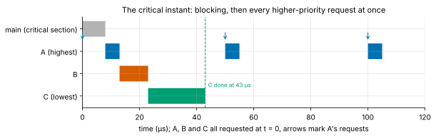
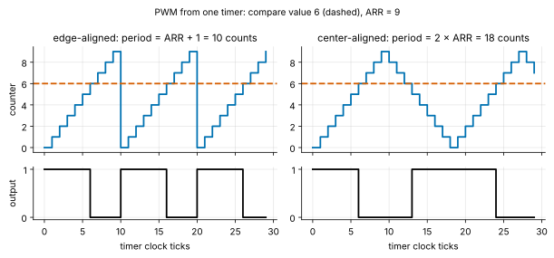

<!-- status: verified -->
# 18-03 · Interrupts, Exceptions and Timers

| | |
|---|---|
| **Course** | [18 · Embedded Systems and Microcontrollers](../README.md) |
| **University equivalent** | The interrupts and timers chapters of a junior embedded-systems course: the exception model, interrupt controllers and priorities, latency and response time, interrupt-handler design, faults, timers with capture, compare and PWM, and watchdogs (Valvano, *Embedded Systems: Introduction to ARM Cortex-M Microcontrollers*, chapters on interrupts and timers; Yiu, *The Definitive Guide to Arm Cortex-M3 and Cortex-M4 Processors*, chapters 7–9 and 12; UT Austin EE319K; Liu and Layland's fixed-priority analysis in Berkeley EECS149) |
| **Prerequisites** | [18-02](18-02-bare-metal-c-and-toolchain.md) (vector table, startup code, `volatile`, read-modify-write races, exception frames), [18-01](18-01-microcontroller-architecture.md) (the core, clocks), [08-07](../../08-digital-logic-design/chapters/08-07-registers-counters-shift-registers.md) (counters) |
| **Estimated study hours** | 8 |
| **Last verified** | 2026-11-21 |

**Learning objectives.** After this chapter you can:

1. Decide between polling and interrupts for an event stream, and compute the CPU load an interrupt stream costs.
2. Explain the Cortex-M exception model: exception numbers, stacking and `EXC_RETURN`, tail-chaining, and the fixed-priority exceptions.
3. Configure interrupt priorities, groups and masking (PRIMASK, BASEPRI) and predict the order in which handlers run.
4. Compute worst-case interrupt response times with the fixed-priority recurrence, including blocking by critical sections.
5. Design interrupt handlers that are short, safe with shared data, and defer work, and read a fault's cause from the fault status registers.
6. Configure timers for periodic interrupts, input capture and PWM, trading frequency against resolution, and size a watchdog timeout with its clock tolerance.

## 1. Big picture

A microcontroller's job is to respond to the world on time: a byte arriving on a UART, a motor-current sample due every 50 µs, a button press, a radio packet. **Interrupts** let hardware stop the program and run a handler within a fraction of a microsecond; **timers** turn a clock into precise time, for periodic work, measuring signals and generating waveforms. Together they decide whether an MCU meets its deadlines, and, through how much time it spends awake, how much energy it uses.

- **Real-time control** (motor drives, power converters, 15-12) runs control loops from timer interrupts at 10–100 kHz; a missed deadline is a failure, not a slowdown.
- **Communication peripherals** signal each received or sent byte, or each completed DMA block (18-04), through interrupts.
- **Low-power products** sleep until an interrupt wakes them (18-09); the interrupt is the only thing the core waits for.
- **Safety** depends on faults being caught (fault exceptions) and on hung software being reset (watchdogs).

## 2. Intuition first

**Polling versus interrupts.** Polling is checking the mailbox every few minutes: simple, but you waste trips when it is empty and may be late when it is not. An interrupt is a doorbell: you work on something else until it rings. The doorbell has a cost (you must stop, remember where you were, answer and come back), so for a mailbox that fills a million times a second, standing at the box (polling) or hiring a courier (DMA, 18-04) is better.

**Priorities.** An emergency-room triage nurse treats patients by urgency, not arrival: a cardiac arrest interrupts a sprained ankle, while two sprained ankles wait their turn. Cortex-M's interrupt controller does the same in hardware: a more urgent interrupt **preempts** a less urgent handler; one of equal or lower urgency waits and runs when the current one finishes. **Where the analogy breaks down:** a nurse can judge urgency on the spot; an MCU's priorities are fixed numbers chosen at design time, and a careless choice (or a long stretch with interrupts disabled) can make even the most urgent interrupt late. §3.4 shows how to compute exactly how late.

**Timers.** A timer is a counter clocked by a (possibly divided) clock. Everything it does follows from comparing that count with registers: when the count reaches the **auto-reload** value it wraps and raises an update event (periodic interrupts); when an input pin changes, the hardware **captures** the count (measuring time between edges); when the count passes a **compare** value, the hardware changes an output pin (PWM). No software runs in the timing path, which is why timers are exact to one clock tick.

## 3. Theory

### 3.1 Polling, interrupts and CPU load

An event source with rate $r$ (events per second) handled by interrupts costs

$$
U = \frac{r\,(c_{entry} + c_{work} + c_{exit})}{f_{CPU}}
$$

of the CPU, where the cycle counts include the hardware's entry and exit and the handler's own work. On a Cortex-M3 or M4 with zero-wait-state memory, entry takes 12 cycles from request to the handler's first instruction and the return 12 more; back-to-back handlers **tail-chain** in 6 cycles instead of 12 + 12 ([R-298]). Polling costs a loop iteration per check whether or not anything happened, and its latency is up to one loop period. Interrupts win when events are sparse and latency matters; polling (or DMA) wins when events are so frequent that the per-event overhead dominates. Example 18-03.1 shows a UART at 1.44% load and an ADC that would need 250% of the CPU.

### 3.2 The Cortex-M exception model

Every source of an exception has an **exception number**, which indexes the vector table of 18-02 §3.5: 1 is Reset, 2 NMI, 3 HardFault, 4–6 the configurable faults (MemManage, BusFault, UsageFault), 11 SVCall, 14 PendSV, 15 SysTick, and 16 onward the external interrupts IRQ0, IRQ1, …. The **NVIC** (Nested Vectored Interrupt Controller) holds, for each external interrupt, an enable bit, a pending bit, an active bit and a priority byte, all memory-mapped at 0xE000 E100 onward.

**Entry.** When an exception is accepted:

1. the core finishes (or abandons and later restarts) the current instruction;
2. it pushes the **stack frame** R0–R3, R12, LR, the return address and xPSR (8 words, or 26 with floating-point state; 18-02 §3.7) onto the current stack, while in parallel fetching the handler's address from the vector table;
3. it loads LR with a special **EXC_RETURN** value that records which stack the frame is on and whether it includes FP state (0xFFFF FFF9: return to Thread mode on the main stack, no FP state), switches to Handler mode and starts the handler.

**Exit.** When the handler executes a normal return (`bx lr`) with an EXC_RETURN value in LR, the core recognizes it, pops the frame and resumes the interrupted code. The handler is an ordinary C function because the frame holds exactly the registers C may clobber.

**Optimizations in hardware.** If another exception is pending when a handler returns, the core **tail-chains**: it skips the pop-and-push pair and starts the next handler. If a more urgent exception arrives during stacking, the core **late-arrives** it: it keeps the frame it is pushing and starts the more urgent handler first. With an FPU, **lazy stacking** reserves space for the FP registers but saves them only if the handler actually uses the FPU.

**Latency numbers** ([R-298]) **[Established]**: 12 cycles on the Cortex-M3 and M4, 15 on the M0+ and M23 (25 on an M23 that must stack a full Secure context), typically 12 and at worst 14 on the M7, all at zero wait states; Arm publishes no figure for the M52, M55 or M85. Flash wait states on the vector fetch and the handler's first instructions add to these, which is why time-critical handlers and the vector table are sometimes placed in SRAM or TCM.

### 3.3 Priorities, preemption and masking

**Priority values.** Each configurable exception has an 8-bit priority field; **a lower number is more urgent**. A chip implements only the top $n$ bits (Armv7-M: $n$ from 3 to 8, chosen by the silicon vendor; the STM32F4 implements 4; Armv6-M has 2 bits, four levels), and the unimplemented low bits read as zero ([R-304]). Reset (−3), NMI (−2) and HardFault (−1) have fixed priorities more urgent than any configurable one.

**Preemption.** A pending exception preempts the running code if its priority is strictly more urgent than the current execution priority. Equal priorities never preempt one another; among several pending exceptions of the same priority, the lowest exception number goes first.

**Groups and subpriorities.** The PRIGROUP field of the AIRCR register splits each priority byte into a **group priority** (upper bits), which decides preemption, and a **subpriority** (lower bits), which only orders pending exceptions within a group. With 4 implemented bits and a 2/2 split, there are 4 preemption levels with 4 subpriorities each (Example 18-03.2). Most projects use all bits as group priority.

**Masking.** Three special registers raise the current execution priority:

- **PRIMASK** = 1 (`cpsid i`) blocks every configurable exception: only NMI and HardFault get through.
- **BASEPRI** = $b$ blocks exceptions whose priority value is $\ge b$ and lets more urgent ones through. A critical section built on BASEPRI leaves the most urgent interrupts (say a motor current loop) running.
- **FAULTMASK** blocks everything except NMI; it is used by fault handlers.

The lab firmware tests all of this on QEMU's emulated Cortex-M4 NVIC: an interrupt at priority 0x40 preempts one at 0xC0 midway, an equal-priority one tail-chains afterwards, BASEPRI 0x80 holds back 0xC0 but not 0x40, and a pending interrupt held by PRIMASK runs the moment it is cleared.

### 3.4 Worst-case response time

For control and communication the question is not the average latency but the worst case: how long after a request can a handler finish? For fixed priorities, a handler of interrupt $i$ with worst-case execution time $C_i$ (including entry and exit) finishes at the latest $R_i$ after its request, where

$$
R_i = C_i + B_i + \sum_{j \in hp(i)} \left\lceil \frac{R_i}{T_j} \right\rceil C_j .
$$

Here $hp(i)$ are the more urgent interrupts, each recurring at most every $T_j$; $B_i$ is the longest **blocking** time, the longest stretch during which $i$ cannot start although it is the most urgent pending request (a critical section with interrupts disabled, or a lower-priority handler that cannot be preempted). The ceiling counts how many times each more urgent interrupt can arrive while $i$ waits and runs.

**Why it is true.** The worst case, the **critical instant**, is when $i$ is requested just as the longest blocking section begins and every more urgent interrupt is requested at the same moment, and then again as often as allowed. In the window $[0, R)$, interrupt $j$ arrives at most $\lceil R/T_j\rceil$ times and each arrival takes $C_j$ of the CPU before $i$ can finish; $i$ itself needs $C_i$, and the blocking takes $B_i$. $R_i$ is the smallest $R$ for which this demand fits in $R$. The recurrence is solved by iterating from $R^{(0)} = C_i + B_i$: each step can only increase $R$, so it either converges or exceeds the deadline. The method comes from the fixed-priority scheduling theory of real-time systems (18-07 applies it to tasks); here it is applied to interrupt handlers, with the hardware's priorities as the scheduler.

A useful necessary condition is the **utilization** $\sum_j C_j/T_j \le 1$: above it, no schedule works. Example 18-03.3 solves the recurrence and shows how a long critical section breaks the most urgent deadline; the lab checks the recurrence against a discrete-event simulation of the same interrupts.

### 3.5 Designing interrupt handlers

- **Keep handlers short.** Every cycle in a handler adds to the response time of everything less urgent ($C_j$ in §3.4). Do the minimum in the handler (read the data, clear the flag, record what happened) and **defer** the rest: to the main loop through a flag or a ring buffer, to an RTOS task (18-07), or to **PendSV**, the exception set aside for deferred work, configured at the lowest priority and pended from the urgent handler (the lab demonstrates this ordering).
- **Clear the request, then make sure the clear has landed.** A peripheral's interrupt flag must be cleared, or the interrupt fires again as soon as the handler returns. Because of write buffers, clearing it as the very last instruction can let the handler return before the write reaches the peripheral, and the interrupt re-enters once; clear it early, or follow the write with `DSB`.
- **Share data safely.** Variables shared between a handler and main code must be `volatile`, and multi-step updates need protection (18-02 §3.6): a short critical section, BASEPRI rather than PRIMASK where possible, or lock-free structures such as a single-producer, single-consumer ring buffer whose head is written only by one side and tail only by the other.
- **Never block.** No waiting loops, no `printf` to a slow port, no `malloc` in a handler.
- **Know the stack cost.** Each nesting level adds a frame and the handler's own frame (18-02 Problem 13).

**Faults are exceptions too.** An invalid memory access, an undefined instruction, a division by zero (when trapping is enabled) or an attempt to execute in ARM state raises **MemManage**, **BusFault** or **UsageFault**; if that fault is disabled (the default) or cannot be taken, it **escalates** to **HardFault**. The **Configurable Fault Status Register** CFSR (0xE000 ED28) records the cause (for example PRECISERR, bit 9, a precise data bus error, with BFARVALID, bit 15, meaning the **Bus Fault Address Register** holds the address); HFSR's FORCED bit (bit 30) says a configurable fault escalated. A fault handler that reads the stacked PC from the frame, together with these registers, tells the developer exactly which instruction failed and why. The lab's firmware does this on a deliberate read of an unmapped address, then skips the instruction and carries on.

### 3.6 Timers

A general-purpose timer counts pulses of its input clock $f_{clk}$ divided by a **prescaler** $PSC + 1$. In up-counting mode it counts from 0 to the **auto-reload** value $ARR$, wraps and raises an **update** event, so

$$
T_{update} = \frac{(PSC + 1)(ARR + 1)}{f_{clk}} .
$$

Choosing the pair is a factoring problem: $(PSC + 1)(ARR + 1) = f_{clk}T$ must be an integer, and each factor must fit its register (16 or 32 bits).

**SysTick**, the timer every Cortex-M core contains, is simpler: a 24-bit down-counter that reloads from its reload register $RVR$ and fires every $RVR + 1$ clocks. A 1 ms tick at 168 MHz needs $RVR$ = 167 999; the longest period at 168 MHz is $2^{24}/168\ \text{MHz}$ = 99.86 ms. RTOS kernels use SysTick for their tick.

**Input capture.** On a chosen edge of an input pin, the hardware copies the running count into a capture register and can raise an interrupt. The time between two edges is the difference of two captures, computed **modulo** $2^{N}$ for an $N$-bit counter, so a single wraparound between them is harmless (unsigned subtraction does this automatically). The resolution is one tick, $(PSC + 1)/f_{clk}$; a period longer than $2^N$ ticks wraps more than once and needs overflow counting.

**Output compare and PWM.** When the count passes a compare value $CCR$ the hardware sets, clears or toggles an output pin. In **edge-aligned PWM** the output is high while the count is below $CCR$:

$$
f_{PWM} = \frac{f_{clk}}{(PSC + 1)(ARR + 1)},\qquad D = \frac{CCR}{ARR + 1},\qquad \text{resolution} = \log_2(ARR + 1)\ \text{bits} .
$$

With $PSC = 0$, $f_{PWM} \cdot 2^{bits} = f_{clk}$: frequency and resolution trade one for one. **Center-aligned PWM** counts up to $ARR$ and back down, so the period is $2ARR$ ticks and the duty $CCR/ARR$: half the frequency (or half the resolution) for the same clock, in exchange for pulses centred in each period, which motor drives use so that the currents of several phases are sampled at a common, quiet instant.

### 3.7 Watchdogs

A **watchdog** is a timer that resets the MCU unless software restarts it ("kicks" or "feeds" it) before it expires. An **independent watchdog** runs from its own low-speed RC oscillator, so it keeps working even if the main clock fails; its timeout is

$$
T_{WDT} = \frac{\text{prescaler} \times \text{reload}}{f_{LSI}} ,
$$

and because that oscillator is inaccurate, the design must use the **shortest** timeout the tolerance allows when choosing the kick interval, and the **longest** when estimating how long a hang can last before reset (Example 18-03.6). A **window watchdog** also resets on a kick that comes *too early*, which catches code stuck in a tight loop that keeps kicking. Good practice: kick from the main loop only after checking that every task has made progress, never from a timer interrupt (which keeps running when the main loop hangs), and record the reset cause at startup so a watchdog reset is noticed in the field.

## 4. Worked examples

### Example 18-03.1 · Interrupts or something else? (tier A)

**Setup.** A Cortex-M4 at 48 MHz takes 12 cycles to enter a handler and 12 to return ([R-298]); each handler does 36 cycles of work. (a) A UART receives at 115 200 baud with 8 data bits, no parity and 1 stop bit, one interrupt per byte. What fraction of the CPU does it use? (b) What is the highest interrupt rate the CPU could sustain at all? (c) An ADC delivers 2 MS/s, one interrupt per sample. What load would that be?

**Solution.** (a) Each byte takes 10 bit times (start, 8 data, stop): $115\,200/10 = 11\,520$ bytes/s. Each costs $12 + 36 + 12 = 60$ cycles: $U = 11\,520 \times 60/(48 \times 10^6)$ = **1.44** %.

(b) At 100% load: $48 \times 10^6/60$ = **800 000** interrupts per second, with nothing left for anything else.

(c) $2 \times 10^6 \times 60/(48 \times 10^6)$ = **250** %: impossible. The ADC needs DMA (18-04), with an interrupt only per block of samples.

**Units check.** (events/s × cycles/event) / (cycles/s) is dimensionless.

**Sanity check.** At 12 + 12 cycles the hardware overhead is **0.5** µs per interrupt at 48 MHz, so interrupt rates above roughly 100 kHz should make a designer look for DMA or polling.

### Example 18-03.2 · Encoding priorities (tier A)

**Setup.** A Cortex-M4 part implements 4 priority bits (bits 7:4 of each priority byte). PRIGROUP splits them into 2 bits of group priority and 2 of subpriority. (a) How many preemption levels and subpriorities are there? (b) Write the priority byte for group 2, subpriority 1. (c) While a handler with priority byte 0xA0 runs, an interrupt with 0x90 is requested. Does it preempt? And one with 0x50?

**Solution.** (a) $2^2$ = **4** preemption levels, each with $2^2$ = **4** subpriorities.

(b) Group 2 = 0b10 in bits 7:6, subpriority 1 = 0b01 in bits 5:4: 0b1001 0000 = **0x90**.

(c) 0xA0 is group 2, subpriority 2. The new 0x90 is also group 2, so it does **not** preempt: it waits, and if several group-2 requests are pending when the handler finishes, its subpriority 1 puts it ahead of a subpriority-2 request. 0x50 is group 1 (0b01), more urgent, so it **preempts**.

**Units check.** Priority bytes are bit patterns.

**Sanity check.** If the part implemented 8 bits, 0x90 would still mean group 2, subpriority 1 under a split at bit 6; writing priorities as left-justified bytes keeps code portable across parts with different numbers of implemented bits.

### Example 18-03.3 · Worst-case response times (tier B)

**Setup.** Three interrupts on one Cortex-M4, most urgent first: A (motor current loop, $C$ = 5 µs, period 50 µs, deadline 20 µs), B (communications, $C$ = 10 µs, minimum spacing 200 µs) and C (housekeeping, $C$ = 20 µs, period 1 ms). The main code disables all interrupts (PRIMASK) for at most 8 µs. (a) Find each worst-case response time and check A's deadline. (b) A new feature lengthens the main code's critical section to 30 µs. Repeat. (c) What change restores A's deadline without shortening the critical section?

**Solution.** (a) Utilization is $5/50 + 10/200 + 20/1000 = 0.17$, so the set is not overloaded. For A, no interrupt is more urgent: $R_A = 5 + 8$ = **13** µs, within 20 µs. For B, start at $10 + 8 = 18$: $18 + \lceil 18/50\rceil 5 = 23$, then $18 + \lceil 23/50\rceil 5 = 23$: $R_B$ = **23** µs. For C, start at $20 + 8 = 28$: $28 + \lceil 28/50\rceil 5 + \lceil 28/200\rceil 10 = 43$, then the same expression at 43 gives 43: $R_C$ = **43** µs.

(b) With $B$ = 30 µs: $R_A = 5 + 30$ = **35** µs, which **misses** A's 20 µs deadline. $R_B$: $40 \to 40 + 5 = 45 \to 45$: **45** µs. $R_C$: $50 \to 50 + 5 + 10 = 65 \to 50 + \lceil 65/50\rceil 5 + 10 = 70 \to 70$: **70** µs.

(c) Build the critical section on BASEPRI set to B's priority instead of PRIMASK. A is then never blocked by it: $R_A = 5$ µs, as long as nothing else of A's priority or higher is masked. B and C keep their 45 and 70 µs, which may be acceptable for them.

**Units check.** Every term is a time in µs; the ceilings are counts.

**Sanity check.** The figure in §2 is the lab simulator's trace of case (a) at the critical instant: C finishes at exactly 43 µs. The simulator reproduces all six response times.

### Example 18-03.4 · A PWM for a motor drive (tier B)

**Setup.** A timer runs from an 84 MHz clock. A motor drive needs 20 kHz PWM (above the audible range). (a) Choose $PSC$ and $ARR$ for edge-aligned PWM with the finest resolution. (b) What is the resolution in bits, and what compare value gives 37.5% duty? (c) What are the auto-reload value and resolution in center-aligned mode at the same 20 kHz?

**Solution.** (a) $(PSC + 1)(ARR + 1) = 84 \times 10^6/20 \times 10^3 = 4200$. Finest resolution means the largest $ARR$: $PSC$ = **0**, $ARR$ = **4199**.

(b) $\log_2 4200$ = **12.04** bits. $CCR = 0.375 \times 4200$ = **1575**.

(c) The period is $2ARR$ ticks: $ARR = 4200/2$ = **2100**, and the resolution is $\log_2 2100$ = **11.04** bits: one bit less, the cost of centred pulses.

**Units check.** Ticks = Hz/Hz; bits = log₂ of a count.

**Sanity check.** $f_{PWM} \times 2^{12.04} = 20\ \text{kHz} \times 4200 = 84$ MHz: the trade-off of §3.6 holds exactly. A 16-bit duty resolution at 20 kHz would need a $20\ \text{kHz} \times 2^{16}$ = **1.31** GHz timer clock, which is why high-resolution timers in power-conversion MCUs use delay lines to subdivide the clock.

### Example 18-03.5 · Measuring a frequency with input capture (tier B)

**Setup.** A 16-bit timer is clocked at 84 MHz and measures a signal of about 1 kHz with input capture on rising edges. (a) Choose a prescaler giving 1 µs ticks. (b) Two consecutive captures read 0xFFF0 and 0x03D8. What are the period and frequency? (c) What is the measurement resolution at 1 kHz, and below what frequency does a period wrap the counter more than once?

**Solution.** (a) $PSC + 1 = 84$: $PSC$ = **83**.

(b) The counter wrapped between the captures. Modulo $2^{16}$: $(0x03D8 - 0xFFF0) \bmod 0x10000 = 0x03E8$ = **1000** ticks = 1000 µs, so the frequency is **1000** Hz.

(c) One tick in 1000: **0.1** %. The counter spans $2^{16}$ µs = 65.5 ms, so signals below $1/65.536\ \text{ms}$ = **15.26** Hz wrap more than once between edges and need an overflow count.

**Units check.** Ticks × µs/tick = µs; 1/period = Hz.

**Sanity check.** Unsigned 16-bit subtraction in C, `(uint16_t)(b - a)`, gives 0x03E8 directly, which is why capture code uses unsigned arithmetic of the counter's width.

### Example 18-03.6 · Sizing a watchdog (tier B)

**Setup.** An independent watchdog runs from an internal RC oscillator of nominally 32 kHz, which the data sheet allows to be anywhere from 24 to 40 kHz. The prescaler is 64 and the reload 1000. (a) What is the nominal timeout? (b) What are the shortest and longest timeouts? (c) The main loop's worst-case period, from one kick to the next, is 1.2 s. Is that safe, and how long can a hang last before reset?

**Solution.** (a) $64 \times 1000/32\,000$ = **2.0** s.

(b) Shortest at 40 kHz: $64\,000/40\,000$ = **1.6** s. Longest at 24 kHz: $64\,000/24\,000$ = **2.67** s.

(c) 1.2 s < 1.6 s, so even a fast oscillator never resets a healthy system, with 0.4 s of margin. A hang is detected within at most 2.67 s (plus the time since the last kick).

**Units check.** counts / (counts/s) = s.

**Sanity check.** Designing to the nominal 2.0 s alone would allow a 1.8 s loop, which would reset healthy units whose oscillators run fast: a field failure that depends on the individual part and its temperature, the hardest kind to reproduce.

<!-- answer-key -->

| ID | Quantity | Value | Unit |
|---|---|---|---|
| Txt 18-03.a | entry latency at 48 MHz (12 cycles) | 0.25 | µs |
| Txt 18-03.b | tail-chaining at 48 MHz (6 cycles) | 0.125 | µs |
| Txt 18-03.c | SysTick reload for 1 ms at 168 MHz | 167999 | — |
| Txt 18-03.d | longest SysTick period at 168 MHz | 99.86 | ms |
| Txt 18-03.e | EXC_RETURN, thread mode, main stack, no FP | 0xFFFFFFF9 | — |
| Ex 18-03.1a | UART interrupt load | 1.44 | % |
| Ex 18-03.1b | highest sustainable interrupt rate | 800000 | 1/s |
| Ex 18-03.1c | ADC interrupt load | 250 | % |
| Ex 18-03.1d | hardware overhead per interrupt at 48 MHz | 0.5 | µs |
| Ex 18-03.2a | preemption levels | 4 | — |
| Ex 18-03.2b | priority byte, group 2, subpriority 1 | 0x90 | — |
| Ex 18-03.3a | R_A with 8 µs blocking | 13 | µs |
| Ex 18-03.3b | R_B with 8 µs blocking | 23 | µs |
| Ex 18-03.3c | R_C with 8 µs blocking | 43 | µs |
| Ex 18-03.3d | R_A with 30 µs blocking | 35 | µs |
| Ex 18-03.3e | R_B with 30 µs blocking | 45 | µs |
| Ex 18-03.3f | R_C with 30 µs blocking | 70 | µs |
| Ex 18-03.3g | utilization | 0.17 | — |
| Ex 18-03.4a | auto-reload, edge-aligned | 4199 | — |
| Ex 18-03.4b | resolution, edge-aligned | 12.04 | bits |
| Ex 18-03.4c | compare value for 37.5% | 1575 | — |
| Ex 18-03.4d | auto-reload, center-aligned | 2100 | — |
| Ex 18-03.4e | resolution, center-aligned | 11.04 | bits |
| Ex 18-03.4f | timer clock for 16-bit resolution at 20 kHz | 1.31 | GHz |
| Ex 18-03.5a | prescaler for 1 µs ticks | 83 | — |
| Ex 18-03.5b | period between captures | 1000 | ticks |
| Ex 18-03.5c | resolution at 1 kHz | 0.1 | % |
| Ex 18-03.5d | lowest frequency without double wrap | 15.26 | Hz |
| Ex 18-03.6a | nominal timeout | 2.0 | s |
| Ex 18-03.6b | shortest timeout | 1.6 | s |
| Ex 18-03.6c | longest timeout | 2.67 | s |

*Every value is recomputed by [verify_18_03.py](../verify/verify_18_03.py): response times by the recurrence and by a discrete-event simulation of the same interrupts, timer settings by exhaustive factor search, capture differences by modular arithmetic, and the NVIC behaviour (priorities, preemption order, masking, EXC_RETURN, fault registers) by running the lab firmware on QEMU's emulated Cortex-M4.*

## 5. Simulate it

The lab, [labs/18-03-lab](../labs/18-03-lab/README.md), has two halves. The firmware, built with 18-02's toolchain and run on QEMU's `mps2-an386` Cortex-M4, exercises the real (emulated) NVIC: it reads how many priority bits are implemented, logs the order in which three interrupts run, tests BASEPRI and PRIMASK, defers work to PendSV, captures a stacked frame and EXC_RETURN, counts SysTick interrupts and recovers from a bus fault. `irqtime.py` computes response times, simulates interrupt schedules and sizes timers and watchdogs. **Predict, then run**:

1. **Priority bits.** Predict what the priority byte reads back after writing 0xFF on a part with 4 implemented bits; run on QEMU and explain its answer.
2. **Order.** Predict the event log when IRQ0 (0xC0) pends IRQ1 (0x40) and IRQ2 (0xC0); run.
3. **Masking.** Predict which interrupts run under BASEPRI = 0x80 and under PRIMASK; run.
4. **The fault.** Predict CFSR, HFSR and BFAR after reading address 0x5000 0000; run.
5. **Response times.** Predict $R_C$ when B's handler grows from 10 to 25 µs; compute and simulate.
6. **PWM.** Tabulate frequency against resolution for an 84 MHz timer, and find the highest PWM frequency with 10-bit resolution.

## 6. Engineering tradeoffs

| Knob | Improves | Costs | Typical decision owner |
|---|---|---|---|
| Interrupt per event | latency, CPU free between events | per-event overhead; limits the event rate | firmware lead |
| Polling | no overhead per event at very high rates | burns CPU and energy while idle; latency up to a loop period | firmware lead |
| DMA with block interrupts (18-04) | high data rates at low CPU load | buffering latency; DMA channel and bus contention | firmware lead with hardware lead |
| More priority levels | finer control of preemption | more nesting, more stack, harder analysis | firmware architect |
| PRIMASK critical sections | simple, protects everything | blocks the most urgent interrupts (Example 18-03.3) | firmware lead |
| BASEPRI critical sections | urgent interrupts keep running | they must not touch the protected data | firmware architect |
| Higher PWM frequency | quieter, smaller filter components | fewer bits of duty resolution, more switching loss | power-electronics designer |
| Shorter watchdog timeout | faster recovery from hangs | risk of resetting healthy units at the fast end of the oscillator's tolerance | firmware lead with system safety |

## 7. Numbers to know

| Quantity | Value | Note |
|---|---|---|
| Interrupt entry | 12 cycles (M3, M4), 15 (M0+, M23), 12–14 (M7) | zero wait states [R-298] |
| Return and tail-chain | 12 and 6 cycles (M3, M4) | [R-298] |
| Interrupts per NVIC | up to 496 (Armv7-M/Armv8-M architecture), 32 (Armv6-M) | cores and chips implement fewer [R-304] |
| Implemented priority bits | 3–8 (Armv7-M); 2 (Armv6-M); 4 on STM32F4 | lower number = more urgent [R-304] |
| Stack frame | 8 words (32 bytes); 26 words (104 bytes) with FP state | 18-02 §3.7 |
| SysTick | 24-bit down-counter; 1 ms at 168 MHz = reload 167 999 | longest period $2^{24}/f$ |
| PWM trade-off | $f_{PWM} \cdot 2^{bits} = f_{clk}$ (edge-aligned) | center-aligned: half |
| Capture arithmetic | difference modulo $2^N$ | one wrap is harmless |
| Watchdog timeout | prescaler × reload / $f_{LSI}$ | design to the shortest; budget for the longest |

## 8. Common mistakes

- **Doing the work in the handler.** Long handlers delay every less urgent interrupt; defer to the main loop, a task or PendSV.
- **Forgetting to clear the interrupt flag, or clearing it last.** The interrupt fires again immediately, or once more after return; clear early or follow the write with `DSB`.
- **Inverting priorities.** On Cortex-M a *smaller* number is *more* urgent; 0 is the most urgent configurable priority.
- **Using PRIMASK for every critical section.** It blocks the interrupts with the tightest deadlines (Example 18-03.3); use BASEPRI where they do not share the data.
- **Kicking the watchdog from a timer interrupt.** The interrupt keeps running when the main loop hangs, so the watchdog never fires; kick from the main loop after checking progress.
- **Using signed or wider arithmetic for capture differences.** Use unsigned arithmetic of the counter's width so one wraparound cancels.
- **Assuming the emulator matches the chip.** QEMU implements 8 priority bits and no cycle-accurate timing; real parts implement 3–4 bits and have wait states (the lab shows the first).
- **Ignoring the fault registers.** A HardFault handler that only loops wastes the CFSR, HFSR, BFAR and stacked PC that identify the bug.

## 9. Practitioner lens

### State of the art (as of Nov 2026)

- **Arm's NVIC** supports up to 496 external interrupts in the Armv7-M and Armv8-M architectures, and 32 with four priority levels in Armv6-M; Arm's cores configure up to 240 (Cortex-M4, M23) or 480 (M33, M52, M55, M85), with 3 to 8 priority bits on the M4 ([R-304]) **[Established]**. Entry latency is 12 cycles on the M3/M4 and 15 on the M0+, at zero wait states ([R-298]) **[Established]**.
- **RISC-V interrupts are still being standardized.** RISC-V International's fast interrupt controller specification (now the Advanced Core-Local Interrupt Controller, ACLIC) allows up to 1023 external interrupts and is in the *Stable* state, not ratified; vendors ship their own controllers meanwhile, such as Espressif's ESP32-C3 with 32 vectored interrupts at seven priority levels ([R-299], [R-304]) **[Established]**. Portable interrupt code is therefore easier on Cortex-M than across RISC-V MCUs today.

### Why it matters commercially

- **Determinism sells.** Motor control, power conversion and safety systems buy MCUs for guaranteed worst-case timing, not peak speed; vendors compete on interrupt latency, timer features (high-resolution PWM, synchronized timers) and documented worst cases.
- **Interrupt architecture affects porting cost.** Moving a product between Cortex-M vendors keeps the NVIC model and CMSIS calls; moving to RISC-V currently means adapting to a vendor-specific interrupt controller, a hidden cost in "switch to RISC-V" decisions.
- **Watchdogs and fault handling are field-reliability features.** A product that logs its reset causes and fault registers can be diagnosed from returns; one that silently resets cannot.

### Marketing vs Reality

- **"12-cycle interrupt latency."** That is the core at zero wait states. Ask for the latency with the vector table and handler in flash at the operating frequency, and the worst-case blocking from the vendor's drivers and RTOS.
- **"Up to 480 interrupts."** That is the core's configurable maximum; the chip implements its own number of sources and priority bits.
- **"Hard real-time."** Ask for the worst-case response analysis (or measurements under worst-case load) of the critical interrupts, including critical sections in vendor libraries.
- **"Safety watchdog."** Ask whether it is independent of the main clock, windowed, and how the software decides when to kick it.

### Questions for engineering leaders

1. **"What are your most time-critical interrupts, and what is their worst-case response time?"** *Strong:* named deadlines with computed or measured worst cases, including blocking. *Evasive:* "the MCU is fast enough".
2. **"How long are interrupts disabled, at most, and where?"** *Strong:* a measured bound per critical section, with BASEPRI used where urgent interrupts must stay live. *Evasive:* "only briefly".
3. **"How is your priority scheme decided and documented?"** *Strong:* a table of every interrupt with priority, rationale and handler budget. *Evasive:* vendor defaults.
4. **"What happens on a HardFault in the field?"** *Strong:* fault registers and the stacked PC saved to a no-init RAM area or flash, reported after reset. *Evasive:* "it resets".
5. **"How is the watchdog kicked, and what timeout tolerance did you design for?"** *Strong:* from the main loop after progress checks, timeout chosen at the fast end of the oscillator tolerance. *Evasive:* "a timer interrupt kicks it".

## 10. Concept check

**Q1.** Why can tail-chaining save half the overhead of two back-to-back interrupts?

Answer

Between two handlers the registers that would be popped at the end of the first are exactly those that would be pushed at the start of the second. The core skips the pop-and-push pair and fetches the next vector directly: 6 cycles instead of 12 + 12 on a Cortex-M3/M4.

**Q2.** An interrupt at priority 0x40 and one at 0x40 are both pending while a 0x80 handler runs. What happens?

Answer

Both are more urgent than 0x80, so one preempts at once: with equal priority, the one with the lower exception number goes first. The other waits until the first finishes (equal priorities do not preempt each other), then tail-chains, and the 0x80 handler resumes after both.

**Q3.** Why does a long PRIMASK critical section hurt the most urgent interrupt most?

Answer

Its response time has no interference term, only its own execution time and blocking, so blocking is a large fraction of it (Example 18-03.3). Less urgent interrupts are already delayed by more urgent ones; the critical section adds relatively less.

**Q4.** What does a timer's prescaler trade against its auto-reload value?

Answer

Their product sets the period. A larger prescaler gives coarser ticks (lower resolution) but allows longer periods with the same auto-reload width; a prescaler of 0 gives the finest resolution and the shortest maximum period.

**Q5.** Why is unsigned subtraction the right way to compute the time between two captures?

Answer

The counter wraps modulo $2^N$; unsigned subtraction in $N$-bit arithmetic is also modulo $2^N$, so if the counter wrapped once between the captures the difference is still correct.

**Q6.** Why should the watchdog be kicked from the main loop and not from a periodic timer interrupt?

Answer

The watchdog's purpose is to detect that the software has stopped making progress. A timer interrupt keeps running when the main loop or a task hangs, so kicking from it would keep a hung system alive.

**Problems:** [18-03 problem set](../problems/18-03-problems.md) · [Worked solutions](../solutions/18-03-solutions.md)

## 11. Key terms

[Nested Vectored Interrupt Controller (NVIC)](../../../reference/glossary.md#nested-vectored-interrupt-controller-nvic) · [Interrupt priority](../../../reference/glossary.md#interrupt-priority) · [Exception stack frame](../../../reference/glossary.md#exception-stack-frame) · [EXC_RETURN](../../../reference/glossary.md#exc-return) · [Tail-chaining](../../../reference/glossary.md#tail-chaining) · [BASEPRI](../../../reference/glossary.md#basepri) · [Worst-case response time](../../../reference/glossary.md#worst-case-response-time) · [Fault status registers](../../../reference/glossary.md#fault-status-registers) · [Input capture](../../../reference/glossary.md#input-capture) · [Pulse-width modulation (PWM)](../../../reference/glossary.md#pulse-width-modulation-pwm) · [Watchdog timer](../../../reference/glossary.md#watchdog-timer) · [Vector table](../../../reference/glossary.md#vector-table)

## 12. Connections

- **Builds on:** [18-02](18-02-bare-metal-c-and-toolchain.md) (vector table, exception frames, `volatile` and races), [18-01](18-01-microcontroller-architecture.md) (clocks, the core), [08-07](../../08-digital-logic-design/chapters/08-07-registers-counters-shift-registers.md) (counters), [15-12](../../15-control-systems/chapters/15-12-control-applications-pll-regulators-thermal.md) (control loops that run from timer interrupts).
- **Next:** [18-04](18-04-dma-and-data-movement.md) (DMA, for event rates interrupts cannot handle).
- **Used later:** [18-05](18-05-gpio-uart-spi-i2c.md) (peripheral interrupts), [18-06](18-06-adc-dac-pwm.md) (timer-triggered ADC and PWM as a DAC), [18-07](18-07-rtos-concepts.md) (the same response-time analysis for tasks; SysTick and PendSV in RTOS kernels), [18-09](18-09-ultra-low-power-design.md) (interrupts as wake-up sources).

## 13. Further study

- Yiu, *The Definitive Guide to Arm Cortex-M3 and Cortex-M4 Processors*, 3rd ed.: chapters on exceptions and interrupts, the NVIC, fault exceptions and SysTick.
- Arm, *Armv7-M Architecture Reference Manual*: the exception model, priority grouping and fault status registers.
- Liu, C. L. and Layland, J. W., "Scheduling algorithms for multiprogramming in a hard-real-time environment", *Journal of the ACM*, 1973: the origin of fixed-priority analysis.
- Any MCU reference manual's general-purpose timer chapter (counting modes, capture/compare, PWM) and watchdog chapter.

## 14. Sources

1. Yiu, J., *The Definitive Guide to Arm Cortex-M3 and Cortex-M4 Processors*, 3rd ed., Newnes, 2014.
2. Arm, *Armv7-M Architecture Reference Manual* (DDI 0403): exception model, NVIC, priority grouping, fault status registers.
3. Liu, C. L. and Layland, J. W., *Journal of the ACM* 20(1), 1973; Joseph, M. and Pandya, P., "Finding response times in a real-time system", *The Computer Journal* 29(5), 1986 (the response-time recurrence).
4. [R-298] Arm technical reference manuals: Cortex-M0+, M3, M4 and M23 interrupt latency.
5. [R-299] RISC-V fast-interrupt (ACLIC) repository; Espressif ESP32-C3 data sheet.
6. [R-304] Arm architecture reference manuals and core data sheets: NVIC sizes and priority bits; ST's CMSIS device header for the STM32F4.
