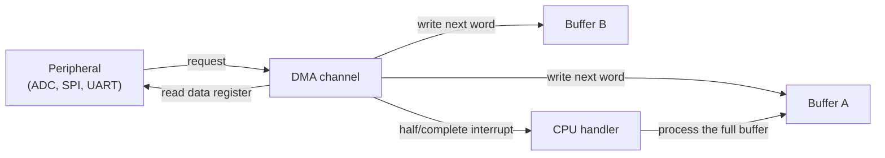
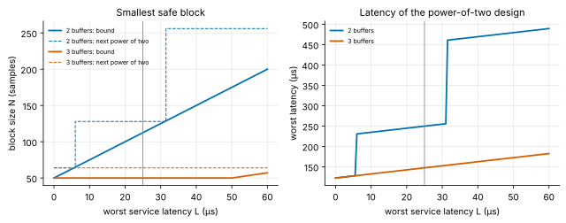

<!-- status: verified -->
# 18-04 · DMA and Data Movement

| | |
|---|---|
| **Course** | [18 · Embedded Systems and Microcontrollers](../README.md) |
| **University equivalent** | The DMA and buffering material of a senior embedded-systems course: DMA controller architecture, peripheral-to-memory streaming, double and circular buffering, bus arbitration and contention, and DMA with caches (Yiu, *The Definitive Guide to Arm Cortex-M3 and Cortex-M4 Processors*, chapter on the memory system; Valvano, *Embedded Systems: Real-Time Interfacing to ARM Cortex-M Microcontrollers*, chapters on DMA and FIFOs; UT Austin EE445L; Berkeley EECS149) |
| **Prerequisites** | [18-03](18-03-interrupts-exceptions-timers.md) (interrupt load, handler design), [18-02](18-02-bare-metal-c-and-toolchain.md) (`volatile`, memory ordering), [18-01](18-01-microcontroller-architecture.md) (bus matrix, SRAM banks), [14-09](../../14-computer-organization-and-architecture/chapters/14-09-memory-hierarchy-and-caches.md) (caches) |
| **Estimated study hours** | 5 |
| **Last verified** | 2026-11-21 |

**Learning objectives.** After this chapter you can:

1. Explain when DMA is needed, and compute the CPU load it saves compared with per-item interrupts.
2. Describe a DMA controller's channels, requests, addressing, widths, priorities, bursts, descriptors and completion events.
3. Size ping-pong, multi-buffer and circular buffers from data rate, processing time and service latency, and compute their latency and memory.
4. Estimate how DMA traffic slows the CPU on a shared memory port, and how bank placement and bursts reduce it.
5. Keep DMA buffers coherent: memory ordering, cache cleaning and invalidation, and alignment.
6. Build lock-free producer–consumer buffers between DMA or interrupt context and main code.

## 1. Big picture

A **DMA** (direct memory access) controller is a small bus master that moves data between peripherals and memory, or between two memories, without the CPU. The CPU sets up a transfer (where from, where to, how many, triggered by what) and is told only when a block is done. Once data rates reach hundreds of kilobytes per second, DMA turns impossible interrupt loads into a fraction of a percent (18-03 Example 1 showed a 2 MS/s ADC needing 250% of a CPU with one interrupt per sample).

- **Every streaming interface uses it:** audio (I²S), ADC sampling, SPI displays and flash, UART with unknown message lengths, Ethernet and USB.
- **It saves energy:** the CPU can sleep while the DMA moves data (18-09), so DMA is central to battery-life budgets.
- **It changes the software design:** data arrives in blocks, so code works on buffers, with explicit hand-over between DMA and CPU.
- **It shares the buses:** DMA traffic competes with the CPU for memory ports; layout decides whether the CPU notices.

## 2. Intuition first

**A conveyor belt and two trays.** Picture a factory: a conveyor (the peripheral) delivers parts one by one, a robot arm (the DMA) drops them into a tray, and a worker (the CPU) processes full trays. With one tray, the worker must finish before the arm drops the next part into it. With two trays (**ping-pong** buffering) the arm fills one while the worker empties the other, and they swap; the worker has a whole tray's filling time to finish. If the worker is sometimes called away (other interrupts, a busy period), a third tray buys more slack. **Where the analogy breaks down:** a real DMA does not wait politely when the tray is still in use; it keeps writing, and the data is silently corrupted. Detecting that (an **overrun**) is the designer's job.

**The shared corridor.** The DMA and the CPU walk the same corridor (the bus matrix) to the same rooms (SRAM banks). Most of the time they pass without meeting, but when both need the same room in the same cycle, one waits. The more often the DMA visits, the more often the CPU waits; putting the DMA's buffers in a different room (another SRAM bank) removes the meetings.

## 3. Theory

### 3.1 When DMA pays

With one interrupt per item at rate $r$, the CPU load is $r\,c_{item}/f_{CPU}$ (18-03 §3.1). With DMA moving blocks of $N$ items and one interrupt per block,

$$
U_{DMA} = \frac{r}{N}\cdot\frac{c_{block}}{f_{CPU}} ,
$$

where $c_{block}$ is the per-block handler cost (swap buffers, start the next transfer, signal a task). The ratio of the two loads is about $N c_{item}/c_{block}$: for blocks of hundreds of items, two to three orders of magnitude (Example 18-04.1). DMA is not free: its set-up costs time, so for a handful of bytes a CPU copy or a FIFO-assisted interrupt can be simpler; and the data arrives in blocks, which adds up to one block of latency.

### 3.2 Anatomy of a DMA controller

A DMA controller has several **channels** (streams), each describing one transfer:

- **Source and destination addresses**, each with an **increment** setting: a peripheral data register stays fixed, a memory buffer increments by the transfer width.
- **Transfer width** (8, 16 or 32 bits) and **count** (items per block).
- **Trigger:** a hardware **request** from a peripheral (the UART's "receive register full", the ADC's "conversion done", a timer event), or software for memory-to-memory copies.
- **Priority** among channels, and **arbitration** when several request at once.
- **Mode:** normal (stop after the block), **circular** (reload the address and count and continue forever), **double-buffer** (alternate between two memory addresses), or **linked descriptors** (a chain of transfer descriptors in memory, scatter-gather).
- **Bursts and FIFOs:** moving several items per bus arbitration, packing 8-bit peripheral data into 32-bit memory writes.
- **Events:** half-transfer, transfer-complete and error interrupts, which the software uses to hand buffers over.

Real controllers illustrate the range ([R-305]) **[Established]**: Arm's PL230 µDMA (up to 32 channels, single AHB-Lite transfers, 1 to 1024 transfers per DMA cycle, one programmed transfer, ping-pong and scatter-gather modes); Microchip's SAM D5x DMAC (up to 32 channels, four priority levels, linked descriptors for multi-buffer and circular modes, blocks up to 256 KB, four bus interfaces); and ST's STM32F4 (two controllers of eight streams, memory bursts of 4, 8 or 16 beats through a FIFO, and a double-buffer mode that is circular).

### 3.3 Buffering: ping-pong, multi-buffer and circular

**Ping-pong (double) buffering.** The DMA fills buffer A, raises an interrupt and moves to buffer B; the CPU processes A while B fills, and so on. The CPU has one block time, $N/f_s$, from the moment A completes until the DMA comes back to A. If the CPU needs a worst-case **service latency** $L$ before it starts (other interrupts, critical sections, a task switch) and then $t_{proc}(N) = a + bN$ (a fixed cost plus a per-sample cost), the design is safe when

$$
L + a + bN \le \frac{N}{f_s}\quad\Longrightarrow\quad N \ge \frac{(a + L)f_s}{1 - bf_s},\qquad bf_s < 1 .
$$

The condition $bf_s < 1$ says the per-sample processing must be faster than the samples arrive; no buffer size helps otherwise. The fixed cost $a$ and the latency $L$ are amortized over $N$: that is what larger blocks buy. With $k$ buffers the CPU has $(k - 1)N/f_s$ to finish a block, but blocks still arrive every $N/f_s$, so it must also keep up on average, $a + bN \le N/f_s$. Both conditions must hold:

$$
N \ge \max\left(\frac{(a + L)f_s}{(k - 1) - bf_s},\ \frac{a f_s}{1 - bf_s}\right) .
$$

For $k = 2$ the first term is always the larger, so the ping-pong condition above is complete. For $k \ge 3$ the second, the **throughput floor**, can bind: extra buffers absorb a long service latency, but they cannot make the CPU process a block faster than one arrives. More buffers therefore allow smaller blocks (less latency per block) for the same safety, down to that floor. The price of a block is **latency**: a sample at the start of a block waits $N/f_s$ for the block to fill, then up to $L + a + bN$ to be processed. Memory is $kN$ items. Example 18-04.2 sizes a design, and the lab's simulator shows overruns appearing exactly where the bound says.

**Circular buffering.** For streams without natural blocks (a UART receiving messages of unknown length), the DMA writes continuously into a ring of $S$ bytes, wrapping at the end. Software reads the DMA's remaining-count register to find the write position, $\text{head} = (S - \text{remaining}) \bmod S$, and consumes from its own tail; the number of unread bytes is $(\text{head} - \text{tail}) \bmod S$. Half-transfer and transfer-complete interrupts, plus the UART's **idle-line** interrupt (the line has been quiet for one character time, so a message has probably ended), tell the software when to look. The ring must hold everything that can arrive between two services: $S > r_{bytes} \times t_{service,max}$ (Example 18-04.6).

**Lock-free hand-over.** Between an interrupt handler (or DMA) and main code, a **single-producer, single-consumer ring buffer** needs no critical section: the producer writes only the head index, the consumer only the tail, and each reads the other's. With free-running 32-bit indices and a power-of-two size $S$, "full" is $\text{head} - \text{tail} = S$ and "empty" is $\text{head} = \text{tail}$, and unsigned arithmetic makes the index wrap at $2^{32}$ harmless. What ordering it needs depends on who the two sides are. **On one core** (an interrupt handler and `main`), the core always observes its own memory accesses in program order and takes exceptions between instructions, so no hardware barrier is needed; what *is* needed is to stop the **compiler** from reordering or caching the accesses: `volatile` indices and a compiler barrier (an `asm volatile("" ::: "memory")`, or C11 atomics) between writing the data and publishing the head. **Across cores**, or between a CPU and another bus master through shared memory, the hardware can also reorder, and both halves need a barrier: the producer must make the data visible before it publishes the new head (a release store: `DMB` on Arm, or C11 `memory_order_release`), and the consumer must read the head before the data (an acquire), *and* finish reading a slot before it publishes the new tail (another release), or the producer may overwrite the slot while it is still being read. A DMA controller is a special case: a CPU-side barrier cannot order the DMA's own writes, whose completion is signalled by its interrupt or status flag. The lab's firmware runs this ring between a SysTick handler and `main` on the emulated Cortex-M4, through the 32-bit index wrap, with the barriers of the multi-core version in place.

### 3.4 Bus bandwidth and contention

Each DMA item costs bus cycles: typically one access to read the source and one to write the destination, plus arbitration. A 32-bit AHB at $f_{bus}$ moves at most $4f_{bus}$ bytes per second per port, and a peripheral behind an APB bridge costs extra cycles per access. Two consequences:

- **Width and bursts matter for memory-to-memory copies.** Moving 64 KiB as bytes takes four times as many transfers as moving it as words (Example 18-04.4). Bursts reduce arbitration overhead per word.
- **Contention slows the CPU.** If a DMA master occupies a memory port for a fraction $\rho$ of the cycles, and a fraction $p$ of the CPU's cycles access that same port, then to first order the CPU loses

$$
\text{stall fraction} \approx p\,\rho
$$

of its cycles, each collision costing one cycle when the DMA wins arbitration. The lab's cycle-level model of one port shared by a CPU and a DMA master reproduces this estimate to within 1% for DMA occupancies up to about ρ = 0.5. That agreement is close to built in, because the model's CPU accesses are independent and its DMA requests single-cycle and evenly spaced; real contention is worse when CPU accesses come in bursts, when the DMA uses multi-beat bursts, or when wait states and flash fetches stretch the collisions, and above ρ ≈ 0.5 the simple product underestimates the stall. The fix is layout: put the DMA's buffers in a separate SRAM bank (many MCUs provide two or more, and a bus matrix lets different masters reach different banks in the same cycle; 18-01 §3.4), so $p\rho \to 0$ for the CPU's own data and stack.

### 3.5 DMA, memory ordering and caches

The DMA is another bus master, so the CPU's view of memory and the DMA's must be kept consistent.

- **Ordering.** Before starting a DMA that reads a buffer the CPU just filled, the CPU's writes must have reached memory: on Arm, a `DSB` (data synchronization barrier) before the write that enables the channel. When the DMA reports completion, a `DMB` before reading the buffer keeps the CPU from using values loaded too early. Buffers shared with DMA should be `volatile` or accessed only after such barriers.
- **Caches.** On a core with a data cache (Cortex-M7, M55, M85, and optionally M52; 18-01 §9), the CPU may hold a buffer's contents in cache while the DMA reads or writes memory directly.
  - Before a DMA **reads** a buffer (transmit): **clean** the cache lines covering it, so memory holds the CPU's latest data.
  - Before the CPU **reads** a buffer a DMA wrote (receive): **invalidate** those lines, so the CPU fetches the new data instead of stale cached copies (and invalidate *before* the DMA starts too, so no dirty line is evicted over the new data).
  - Cache maintenance works on whole **lines** (32 bytes on the Cortex-M7). A receive buffer that shares a line with another variable is dangerous: invalidating the line discards that variable's cached updates. Align DMA buffers to the line size and pad their length to a whole number of lines (Example 18-04.5).
  - The alternative is to place DMA buffers in a non-cacheable region configured through the MPU, or in a tightly coupled memory that the DMA can reach, at some cost in CPU access speed.

### 3.6 Common DMA patterns

- **ADC streaming:** a timer triggers conversions at exactly $f_s$ (18-03 §3.6), the ADC requests a DMA transfer per result, and the DMA fills ping-pong buffers; the CPU processes blocks (filtering, 16-06). The sampling instants are set by hardware, so they have no software jitter.
- **Audio:** I²S transmit and receive streams in circular double-buffer mode, with half-transfer and complete interrupts.
- **UART receive:** circular DMA plus idle-line detection for variable-length messages; transmit: one DMA per message from a buffer.
- **SPI displays and flash:** memory-to-peripheral DMA of whole frames or pages, with the CPU free to compute the next frame.
- **Memory-to-memory:** large copies or fills; worthwhile when the CPU can do something else meanwhile, or sleep.

## 4. Worked examples

### Example 18-04.1 · Audio without and with DMA (tier A)

**Setup.** An MCU at 64 MHz streams stereo audio at 48 kHz with 16-bit samples over I²S. (a) With one interrupt per sample at 60 cycles each, what is the CPU load? (b) With DMA blocks of 256 stereo frames (512 samples) and a 200-cycle block handler, how many interrupts per second, and what load? (c) How long is each block?

**Solution.** (a) $2 \times 48\,000 = 96\,000$ samples/s: $96\,000 \times 60/(64 \times 10^6)$ = **9.0** %.

(b) $96\,000/512$ = **187.5** interrupts/s: $187.5 \times 200/(64 \times 10^6)$ = **0.059** %, about 150 times less.

(c) $512/96\,000$ = **5.333** ms.

**Units check.** samples/s ÷ samples/block = blocks/s; (1/s × cycles)/(cycles/s) is dimensionless.

**Sanity check.** 5.3 ms of buffering is acceptable for playback, and in a two-way voice call it is a real part of the end-to-end delay budget, which is shared with the codec, the network and the far end's buffers; latency is the price of large blocks.

### Example 18-04.2 · Sizing a ping-pong buffer (tier B)

**Setup.** An ADC delivers 1 MS/s into 16-bit words by DMA. Processing a block of $N$ samples takes $20\ \mu\text{s} + 0.6\ \mu\text{s} \times N$. (a) What is the smallest safe $N$ with no service latency? (b) Other interrupts can delay the start of processing by up to 25 µs. Find the smallest safe $N$, round it to a power of two, and give the memory and the worst latency from a sample to the end of its processing. (c) Repeat (b) with three buffers.

**Solution.** (a) $bf_s = 0.6 \times 10^{-6} \times 10^6 = 0.6 < 1$, so a solution exists: $N \ge 20 \times 10^{-6} \times 10^6/(1 - 0.6)$ = **50** samples.

(b) $N \ge (20 + 25) \times 10^{-6} \times 10^6/0.4$ = **112.5**, so 113 at least; the next power of two is **128**. Memory: $2 \times 128 \times 2$ = **512** bytes. Worst latency, for the first sample of a block: $128\ \mu\text{s}$ to fill, plus $25 + 20 + 0.6 \times 128 = 121.8$ µs to process: **249.8** µs.

(c) With $k = 3$ the deadline condition gives $N \ge 45/(2 - 0.6)$ = **32.1**, but the throughput floor is the 50 samples of (a): a block of 32 would take $20 + 0.6 \times 32 = 39.2$ µs to process yet arrive every 32 µs, and the backlog would grow without limit. The floor binds, so $N \ge 50$, and 64 as a power of two. Memory $3 \times 64 \times 2$ = **384** bytes, and worst latency $64 + 25 + 20 + 38.4$ = **147.4** µs: less memory and less latency than (b).

**Units check.** (s × samples/s) / (dimensionless) = samples.

**Sanity check.** The lab's simulator, with service latencies drawn from 5 to 25 µs, finds overruns at $N$ = 112 with two buffers and none at 128; with three buffers it finds overruns at 48 (below the throughput floor, although above the deadline bound) and none at 64, exactly as the two conditions predict.

### Example 18-04.3 · DMA traffic and the CPU (tier B)

**Setup.** On a 100 MHz bus, a DMA stream writes one word into an SRAM bank every 4 cycles ($\rho$ = 0.25). The CPU's code makes an access to the same bank in 30% of its cycles, and the DMA wins arbitration. (a) Estimate the CPU's stall fraction. (b) What changes if the DMA buffers move to a second SRAM bank?

**Solution.** (a) $p\rho = 0.3 \times 0.25$ = **0.075**: the CPU loses about 7.5% of its cycles. The lab's cycle-level model (one million cycles) gives **7.52** %.

(b) The DMA and the CPU then use different bank ports, which the bus matrix serves in the same cycle: the collisions, and the 7.5%, disappear for the CPU's own data. Only the CPU's accesses to the DMA buffers themselves still contend.

**Units check.** Both factors are fractions of cycles.

**Sanity check.** A DMA at $\rho$ = 0.25 is heavy (100 MB/s of 32-bit writes on this bus); typical peripheral streams are a few percent, costing the CPU well under 1%.

### Example 18-04.4 · Byte or word transfers (tier A)

**Setup.** A DMA copies 64 KiB from one SRAM bank to another on a 100 MHz bus, taking 2 bus cycles per transfer (a read and a write). Compare byte and word transfers.

**Solution.** Bytes: **65 536** transfers, $65\,536 \times 2/10^8$ = **1.311** ms. Words: **16 384** transfers, **0.328** ms, four times faster for the same data.

**Units check.** transfers × cycles/transfer ÷ cycles/s = s.

**Sanity check.** Word transfers need word-aligned source, destination and length; a controller that packs bytes into words through a FIFO gets the same benefit for byte-oriented peripherals.

### Example 18-04.5 · A receive buffer on a Cortex-M7 (tier B)

**Setup.** A Cortex-M7 with a data cache of 32-byte lines receives 1000 bytes by DMA into a buffer the linker placed at 0x2000 0008. (a) How many cache lines does the buffer touch, and which are shared with other variables? (b) What can go wrong when the driver invalidates those lines before reading? (c) Fix the declaration.

**Solution.** (a) The buffer spans 0x2000 0008 to 0x2000 03EF. Its first byte is at offset 8 of line 0 and its last at offset $8 + 999 = 1007$, in line 31: **32** lines. Line 0 also holds bytes 0x2000 0000 to 0x2000 0007, and line 31 bytes 0x2000 03F0 to 0x2000 03FF, which belong to other variables.

(b) If the CPU has updated one of those neighbouring variables and the line is dirty in the cache, invalidating the line throws the update away: a corruption in a variable unrelated to the DMA, appearing only when the timing is unlucky.

(c) Align the buffer to the line size and round its length up to whole lines: `__attribute__((aligned(32))) uint8_t rx[1024];`, exactly **32** lines that no other variable shares. Clean and invalidate before starting the DMA, invalidate again after it completes, then read.

**Units check.** Addresses and lengths in bytes; lines of 32 bytes.

**Sanity check.** On a core without a data cache (Cortex-M0+, M3, M4, M33 and M52 without its optional cache) none of this applies, but the ordering barriers of §3.5 still do.

### Example 18-04.6 · A UART on circular DMA (tier B)

**Setup.** A UART receives at 921 600 baud, 8N1, into a circular DMA buffer; the consumer task runs at least every 5 ms. (a) What is the byte rate, and how many bytes can arrive between services? (b) Choose a power-of-two buffer size. (c) The DMA's remaining-count register reads 312 for a 512-byte ring, and the consumer's tail is 150. Where is the head, and how many bytes are unread?

**Solution.** (a) $921\,600/10$ = **92 160** bytes/s; in 5 ms, $92\,160 \times 0.005$ = **460.8** bytes.

(b) The ring must exceed 461 bytes: **512** bytes, with little margin; 1024 is the comfortable choice if SRAM allows.

(c) Head $= 512 - 312$ = **200**; unread $= (200 - 150) \bmod 512$ = **50** bytes.

**Units check.** bits/s ÷ bits/byte = bytes/s.

**Sanity check.** A burst at full line rate fills the 512-byte ring in **5.56** ms; if the consumer is late by more than 0.56 ms beyond its 5 ms bound, data is overwritten, so the consumer must detect overrun. The remaining-count register alone cannot show it, because a ring that has been lapped looks exactly like one with less data. Count the half-transfer and transfer-complete events in their interrupt (a lap counter) and compare the total bytes written with the consumer's total read, or use the UART's or DMA's overrun flag where the hardware has one.

<!-- answer-key -->

| ID | Quantity | Value | Unit |
|---|---|---|---|
| Ex 18-04.1a | per-sample interrupt load | 9.0 | % |
| Ex 18-04.1b | block interrupts per second | 187.5 | 1/s |
| Ex 18-04.1c | DMA load | 0.059 | % |
| Ex 18-04.1d | block period | 5.333 | ms |
| Ex 18-04.2a | smallest block, no latency | 50 | samples |
| Ex 18-04.2b | smallest block with 25 µs latency | 112.5 | samples |
| Ex 18-04.2c | chosen block | 128 | samples |
| Ex 18-04.2d | memory, two buffers | 512 | bytes |
| Ex 18-04.2e | worst latency, two buffers | 249.8 | µs |
| Ex 18-04.2f | deadline bound, three buffers | 32.1 | samples |
| Ex 18-04.2g | memory, three buffers of 64 | 384 | bytes |
| Ex 18-04.2h | worst latency, three buffers | 147.4 | µs |
| Ex 18-04.3a | estimated CPU stall fraction | 0.075 | — |
| Ex 18-04.3b | simulated stall | 7.52 | % |
| Ex 18-04.4a | byte transfers | 65536 | — |
| Ex 18-04.4b | time with bytes | 1.311 | ms |
| Ex 18-04.4c | word transfers | 16384 | — |
| Ex 18-04.4d | time with words | 0.328 | ms |
| Ex 18-04.5a | cache lines touched | 32 | — |
| Ex 18-04.5b | lines in the aligned 1024-byte buffer | 32 | — |
| Ex 18-04.6a | UART byte rate | 92160 | bytes/s |
| Ex 18-04.6b | bytes between services | 460.8 | bytes |
| Ex 18-04.6c | ring size | 512 | bytes |
| Ex 18-04.6d | head | 200 | — |
| Ex 18-04.6e | unread bytes | 50 | bytes |
| Ex 18-04.6f | time to fill the ring at line rate | 5.56 | ms |

*Every value is recomputed by [verify_18_04.py](../verify/verify_18_04.py): buffer bounds by the formula and by the lab's event simulator (overruns just below the bound, none above), contention by the cycle-level bus model against the estimate, cache lines by address arithmetic, and the lock-free ring buffer by running the lab firmware on QEMU's Cortex-M4.*

## 5. Simulate it

The lab, [labs/18-04-lab](../labs/18-04-lab/README.md), provides `dmasim.py` (buffer bounds, a ping-pong simulator with random service latency, a cycle-level shared-port model, ring and cache helpers) and firmware that runs a lock-free ring buffer between a SysTick interrupt and `main` on QEMU's Cortex-M4. **Predict, then run**:

1. **Block size.** Predict the smallest safe block for Example 18-04.2 with two and three buffers; simulate 20 000 blocks at, just below and above the bound.
2. **Latency against memory.** Plot worst latency and memory against the number of buffers for a fixed safety margin.
3. **Contention.** Predict the CPU's stall fraction for $\rho$ from 0.01 to 0.5 and $p$ = 0.3; run the bus model under both arbitration policies.
4. **The ring buffer on the core.** Predict what the firmware checks (order, no loss, counted overflow, index wrap); run it at `-O2` and `-O0`.
5. **Cache lines.** For buffers at several addresses and lengths, predict the lines touched and the padding needed.

## 6. Engineering tradeoffs

| Knob | Improves | Costs | Typical decision owner |
|---|---|---|---|
| Larger DMA blocks | CPU load per byte; tolerance of service latency | latency; SRAM | firmware lead |
| More buffers (3 or more) | slack for late service at the same block size | SRAM; bookkeeping | firmware lead |
| Circular DMA with idle-line detection | variable-length input with few interrupts | the consumer must keep up and detect overrun | firmware lead |
| DMA priority | the critical stream never starves | lower-priority streams and the CPU wait longer | firmware architect |
| Bursts and wider transfers | throughput; fewer arbitrations | alignment constraints; longer bus occupancy per grant | firmware lead |
| Separate SRAM bank for DMA buffers | CPU unaffected by DMA traffic | bank sizes constrain placement | firmware architect with hardware lead |
| Non-cacheable DMA buffers | no cache maintenance bugs | slower CPU access to those buffers | firmware architect |
| CPU sleeps during DMA | energy (18-09) | wake-up latency for the block interrupt | power owner with firmware lead |

## 7. Numbers to know

| Quantity | Value | Note |
|---|---|---|
| Load with one interrupt per item | $r\,c_{item}/f$ | 18-03 |
| Load with DMA blocks | $(r/N)\,c_{block}/f$ | $N$ items per block |
| Ping-pong bound | $N \ge (a + L)f_s/(1 - bf_s)$ | $k$ buffers: $N \ge \max\big((a + L)f_s/((k - 1) - bf_s),\ af_s/(1 - bf_s)\big)$ |
| Worst latency of a block scheme | $N/f_s + L + a + bN$ | first sample of a block |
| Circular buffer | $S > r_{bytes}\,t_{service}$; head $= S -$ remaining | power-of-two sizes |
| Contention | stall ≈ $p\rho$ | removed by separate banks |
| DMA controllers | up to 32 channels (SAM D5x, PL230); 2 × 8 streams (STM32F4) | [R-305] |
| Cache line (Cortex-M7) | 32 bytes | align and pad DMA buffers |

## 8. Common mistakes

- **Processing a buffer the DMA is still writing.** Hand buffers over only on half-transfer or complete events, and check for overrun.
- **Sizing buffers from average rates.** Use the worst-case service latency, including other interrupts and critical sections (Example 18-04.2).
- **Forgetting the barrier before starting a DMA.** The CPU's last writes to the buffer may still be in a write buffer or cache when the DMA reads it.
- **Invalidating a cache line that a buffer shares with a variable.** Align and pad DMA buffers to whole lines (Example 18-04.5).
- **Placing DMA buffers on the stack.** The function may return while the DMA still writes, corrupting later stack frames; DMA buffers belong in static storage.
- **Ignoring the DMA in timing analysis.** Bus contention lengthens the CPU's execution times; heavy DMA traffic belongs in the worst-case budget.
- **Using a counter shared by producer and consumer.** A shared "count" incremented by one side and decremented by the other is a read-modify-write race (18-02 §3.6); use separate head and tail indices.

## 9. Practitioner lens

### State of the art (as of Nov 2026)

- **DMA controllers scale with the chip.** Current MCUs offer up to 32 channels with linked descriptors for multi-buffer and circular operation (Microchip SAM D5x), the Arm PL230 µDMA provides up to 32 channels with ping-pong and scatter-gather modes for vendors who license it, and ST's STM32F4 family provides two controllers of eight streams with FIFOs and 4-, 8- and 16-beat bursts ([R-305]) **[Established]**.
- **Bus matrices with several SRAM ports** let DMA and CPU traffic proceed in parallel; the SAM D5x, for example, uses a symmetric crossbar that "allows concurrent accesses from different Hosts to different Clients", with DMAC read and write ports as separate hosts ([R-305]) **[Established]**.

### Why it matters commercially

- **Throughput per milliwatt.** In wearables and IoT, the ability to stream sensors and audio by DMA while the CPU sleeps is a direct battery-life lever (18-09); vendors advertise "autonomous peripherals" and low-power DMA for this reason **[Industry estimate]**.
- **Integration level.** MCUs with good DMA, multiple SRAM banks and peripheral-to-peripheral triggering can sometimes replace an FPGA or a second processor in data-acquisition designs, which shows up in bill-of-materials cost **[Industry estimate]**.
- **Software maturity.** DMA drivers with correct cache maintenance and overrun handling are hard to write; the quality of a vendor's DMA drivers and examples is part of the ecosystem value of 18-02 §9.

### Marketing vs Reality

- **"Zero-CPU data transfer."** The CPU still sets up transfers, handles block events and processes the data, and DMA traffic can slow the CPU through contention. Ask for the CPU load at the target data rate and the bus layout that achieves it.
- **"32 DMA channels."** Ask how many can run concurrently at full rate on the same bus, which peripherals each channel can serve, and how arbitration behaves under load.
- **"Up to X MB/s."** That is a peak with ideal alignment and bursts; ask for the throughput with your peripheral's width and the bus bridges in the path.

### Questions for engineering leaders

1. **"Which data streams use DMA, and what is each one's worst-case service deadline?"** *Strong:* a table of streams, block sizes, buffer counts and the margin against service latency. *Evasive:* "the DMA handles it".
2. **"How do you detect and report a DMA overrun?"** *Strong:* counters for overruns and dropped data, logged and tested under stress. *Evasive:* "it doesn't happen".
3. **"Where do DMA buffers live, and how is cache coherence handled?"** *Strong:* dedicated, aligned, padded buffers in a chosen bank or non-cacheable region, with clean and invalidate in the drivers. *Evasive:* "we turned the cache off".
4. **"What does DMA traffic cost the CPU in your worst case?"** *Strong:* measured or estimated contention included in the timing budget. *Evasive:* "nothing, it's in hardware".

## 10. Concept check

**Q1.** Why does DMA reduce CPU load by roughly the block size?

Answer

The fixed per-event cost (interrupt entry, exit and bookkeeping) is paid once per block instead of once per item, so the load falls by about $N c_{item}/c_{block}$; the data still has to be processed, but in a tight loop over a buffer rather than item by item.

**Q2.** In a ping-pong scheme, what must hold for any block size to work, and what does a larger block buy?

Answer

The per-sample processing must be faster than the sample arrival rate, $bf_s < 1$. A larger block amortizes the fixed processing cost and the service latency over more samples, at the price of memory and latency.

**Q3.** Why can a third buffer reduce latency rather than increase it?

Answer

With three buffers the CPU has two block times instead of one to service a block, so the same service latency is tolerated with smaller blocks, down to the throughput floor $af_s/(1 - bf_s)$; smaller blocks mean each sample waits less to be processed.

**Q4.** How can a single-producer, single-consumer ring buffer avoid disabling interrupts?

Answer

Each index has one writer: the producer only writes the head, the consumer only the tail. Each side reads the other's index, and a barrier orders the data write before the head update. No read-modify-write of a shared variable remains.

**Q5.** Why must a DMA receive buffer on a Cortex-M7 be aligned to the cache line and padded to whole lines?

Answer

Cache maintenance works on whole lines; invalidating a line that also holds another variable can discard that variable's newer cached value. Aligned, padded buffers share no line with anything else.

**Q6.** What is the simplest way to stop DMA traffic slowing the CPU?

Answer

Put the DMA's buffers in a different SRAM bank from the CPU's working data and stack, so the bus matrix serves both masters in the same cycle without conflict.

**Problems:** [18-04 problem set](../problems/18-04-problems.md) · [Worked solutions](../solutions/18-04-solutions.md)

## 11. Key terms

[Direct memory access (DMA)](../../../reference/glossary.md#direct-memory-access-dma) · [Ping-pong buffering](../../../reference/glossary.md#ping-pong-buffering) · [Circular buffer](../../../reference/glossary.md#circular-buffer) · [Ring buffer](../../../reference/glossary.md#ring-buffer) · [Scatter-gather DMA](../../../reference/glossary.md#scatter-gather-dma) · [DMA overrun](../../../reference/glossary.md#dma-overrun) · [Bus contention](../../../reference/glossary.md#bus-contention) · [Bus matrix](../../../reference/glossary.md#bus-matrix) · [Cache coherence](../../../reference/glossary.md#cache-coherence)

## 12. Connections

- **Builds on:** [18-03](18-03-interrupts-exceptions-timers.md) (interrupt load and response time), [18-02](18-02-bare-metal-c-and-toolchain.md) (`volatile`, ordering, read-modify-write races), [18-01](18-01-microcontroller-architecture.md) (bus matrix, SRAM banks), [14-09](../../14-computer-organization-and-architecture/chapters/14-09-memory-hierarchy-and-caches.md) (caches and coherence).
- **Next:** [18-05](18-05-gpio-uart-spi-i2c.md) (the serial peripherals whose data DMA moves).
- **Used later:** [18-06](18-06-adc-dac-pwm.md) (timer-triggered ADC streaming), [18-07](18-07-rtos-concepts.md) (queues and task notification from DMA events), [18-09](18-09-ultra-low-power-design.md) (sleeping while DMA works), [16-09](../../16-digital-signal-processing/chapters/16-09-multirate-dsp.md) (block processing of sampled streams).

## 13. Further study

- Yiu, *The Definitive Guide to Arm Cortex-M3 and Cortex-M4 Processors*: the memory system and bus interfaces; Arm's application notes on cache maintenance for the Cortex-M7.
- Valvano, *Embedded Systems: Real-Time Interfacing to ARM Cortex-M Microcontrollers*: FIFOs and DMA.
- Any MCU reference manual's DMA chapter (channel registers, request mapping, circular and double-buffer modes) and its bus-matrix chapter.
- Arm, *PrimeCell µDMA Controller (PL230) Technical Reference Manual*: a complete, readable description of one DMA controller.

## 14. Sources

1. Yiu, J., *The Definitive Guide to Arm Cortex-M3 and Cortex-M4 Processors*, 3rd ed., Newnes, 2014.
2. Arm, *Armv7-M Architecture Reference Manual* (DDI 0403): memory ordering and barriers (`DMB`, `DSB`).
3. [R-305] Microchip SAM D5x/E5x data sheet (DMAC, bus matrix); Arm PL230 TRM; ST's STM32F4 HAL source (DMA streams, bursts, double buffering).
4. [R-297] Arm Cortex-M processor comparison (which cores have caches).
