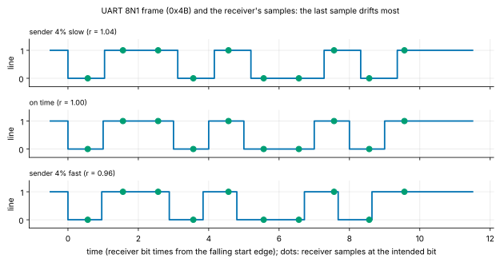

<!-- status: verified -->
# 18-05 · Peripherals and Serial Buses: GPIO, UART, SPI, I²C

| | |
|---|---|
| **Course** | [18 · Embedded Systems and Microcontrollers](../README.md) |
| **University equivalent** | The I/O and serial-interface chapters of a junior embedded-systems course: GPIO electrical characteristics, UART framing and baud-rate tolerance, SPI modes and timing, I²C protocol, electrical design and addressing, and an introduction to I3C (Valvano, *Embedded Systems: Real-Time Interfacing to ARM Cortex-M Microcontrollers*, chapters on serial interfacing; Horowitz & Hill, *The Art of Electronics*, 3rd ed., chapter 14 on digital interfacing; UT Austin EE445L; Berkeley EECS149) |
| **Prerequisites** | [18-04](18-04-dma-and-data-movement.md) (DMA for serial streams), [18-03](18-03-interrupts-exceptions-timers.md) (interrupts, timers), [18-02](18-02-bare-metal-c-and-toolchain.md) (register access), [08-02](../../08-digital-logic-design/chapters/08-02-boolean-algebra-and-gates.md) (CMOS logic levels), [07-02](../../07-circuit-analysis-2-transient-and-ac/chapters/07-02-first-order-rc-rl-transients.md) (RC charging) |
| **Estimated study hours** | 8 |
| **Last verified** | 2026-11-21 |

**Learning objectives.** After this chapter you can:

1. Use a GPIO pin within its electrical limits: input thresholds, output levels under load, current limits, pull resistors, open-drain outputs and interfacing to other voltages.
2. Configure a UART: framing, throughput, baud-rate divisors and their error, and derive how much clock mismatch a receiver tolerates.
3. Configure SPI: the four modes, full-duplex transfers, chip selects, and the timing loop that limits the clock rate.
4. Design an I²C bus: the open-drain protocol (start, address, acknowledge, stop, clock stretching), pull-up sizing from rise time and sink current, addressing and transaction timing.
5. Explain what I3C adds to I²C, and choose between UART, SPI, I²C and I3C for a connection.
6. Write a register-level driver for a serial peripheral and verify a serial receiver's timing in simulation.

## 1. Big picture

A microcontroller talks to the rest of a product through its pins. **GPIO** (general-purpose input/output) pins switch LEDs and enable lines and read buttons; three serial buses carry almost everything else between chips on a board: **UART** to modems, GPS receivers and debug consoles, **SPI** to flash memory, displays and fast ADCs, and **I²C** (with its successor **I3C**) to the many slow sensors and power-management chips of a phone or wearable. Each makes a different trade between wire count, speed, distance and the number of devices it can reach.

- **Every wearable and IoT product is a small bus system:** an accelerometer and a PMIC on I²C, a display and flash on SPI, a radio on UART or SPI.
- **Most board bring-up failures are electrical or timing errors on these buses:** a missing pull-up, a wrong SPI mode, a baud rate 3% off, an overloaded pin.
- **Bus choice shapes component choice and cost:** an I²C sensor costs two shared pins, an SPI one at least four.
- **I3C is the industry's attempt to replace I²C** in sensor-rich products, keeping two wires but adding speed and in-band interrupts.

## 2. Intuition first

**Three conversations.** A UART is two people talking on a phone line without a shared clock: each has agreed in advance how fast to speak (the **baud rate**), the listener synchronizes on the first sound of each word (the **start bit**), and if one speaks a few percent too fast or slow, by the end of the word the listener is sampling the wrong syllable. SPI is a teacher dictating to one student at a time, setting the pace with a metronome (the **clock**) and pointing at the student who should write (the **chip select**); fast and simple, but every student needs a pointer. I²C is a meeting with a chair: everyone shares one table (two wires), the chair calls a name (the **address**), the named person answers "yes" (the **acknowledge**), and anyone can raise a hand to slow the chair down (**clock stretching**). **Where the analogy breaks down:** the meeting's "shared table" is literally a wire that any device can pull low but none can drive high; a resistor pulls it back up, and the resistor's value sets how fast the meeting can go (§3.5).

**Push-pull and open-drain.** A push-pull output has a transistor to each rail: it drives high and low with low resistance, fast, but two push-pull outputs on one wire would fight. An open-drain output has only the transistor to ground: it can pull the line low or let go. With a pull-up resistor, any of many open-drain outputs can pull a shared line low, and the line is high only when all let go: a "wired-AND". That is how I²C shares two wires among many devices.

## 3. Theory

### 3.1 GPIO pins as circuits

A GPIO pin is a CMOS input buffer and an output driver, configurable through registers (direction, push-pull or open-drain, pull-up or pull-down, drive strength and slew rate, alternate function). Its data sheet limits matter as much as its registers ([R-306], for TI's MSPM0G350x as an example) **[Established]**:

- **Input thresholds.** A voltage above $V_{IH}$ reads 1 and below $V_{IL}$ reads 0; for CMOS inputs these scale with the supply, typically $V_{IH} \ge 0.7V_{DD}$ and $V_{IL} \le 0.3V_{DD}$, with a few hundred millivolts of **hysteresis** (a Schmitt-trigger input) so that slow or noisy edges switch once. Between the thresholds the result is undefined, and a floating input wanders there: unused or open inputs need a pull resistor (often a built-in one of about 40 kΩ).
- **Output levels under load.** An output is not an ideal source: at a specified current it guarantees only $V_{OL} \le$ 0.4 V and $V_{OH} \ge V_{DD} - 0.4$ V (at 6 mA for this part's standard pins). Designs must use these worst-case levels, not the supply rails.
- **Current limits.** Each pin has an absolute maximum (6 mA for standard pins, 20 mA for high-drive pins here) and the whole package has a total (80 mA into VDD here). Eleven LEDs at 6 mA each already approach the package limit.
- **Clamp diodes and injection current.** Inputs have protection diodes to the rails. A signal above $V_{DD}$ forward-biases the upper diode and pushes current into the supply rail; data sheets limit this **injection current** (±2 mA here), so a 5 V signal into a 3.3 V pin needs a series resistor or, better, a 5 V-tolerant pin or a level translator.
- **Speed.** Drive strength and slew-rate settings trade edge speed (needed for SPI at tens of MHz) against ringing, electromagnetic emission and ground bounce.

**Open-drain and level shifting.** An open-drain output with a pull-up to a different supply translates levels for free in one direction: a 3.3 V MCU can signal a 1.8 V device if the pull-up goes to 1.8 V (and the MCU pin tolerates it). I²C relies on this.

### 3.2 Serial communication basics

A serial link sends bits one after another over few wires. **Synchronous** links (SPI, I²C, I3C) carry a clock with the data, so the receiver samples exactly when told. **Asynchronous** links (UART) send no clock; each side has its own, and the receiver must recover the timing from the data. Links are **full duplex** (both directions at once: UART with two data lines, SPI) or **half duplex** (one direction at a time: I²C's single data line), and **point-to-point** (UART) or **multi-drop** (SPI with several chip selects, I²C and I3C with addresses).

### 3.3 UART

**Framing.** An idle UART line is high. A character is a **start bit** (low), 5 to 9 data bits sent least significant first, an optional **parity** bit, and one or two **stop bits** (high). The common "8N1" frame is $1 + 8 + 1 = 10$ bits, so the byte rate is $\text{baud}/10$ and the efficiency 80%: 115 200 baud carries 11 520 bytes per second.

**Baud-rate generation.** A UART derives its timing from its clock $f_{clk}$ through a divisor. With $S$-times oversampling the receiver's sample clock is $S \times \text{baud}$, so

$$
\text{divisor} = \frac{f_{clk}}{S \cdot \text{baud}},\qquad \text{error} = \frac{f_{clk}}{S \cdot \text{divisor}_{actual} \cdot \text{baud}} - 1 .
$$

An integer divisor can be several percent off (Example 18-05.2); a **fractional** divisor (with, say, 4 fraction bits) cuts the error to a fraction of a percent. Lowering $S$ to 8 doubles the highest baud rate for a given clock but reduces the tolerance derived next.

**How much mismatch a receiver tolerates.** Consider a receiver that samples its line every $1/S$ of a bit, detects the start bit at the first low sample, waits half a bit to reach the start bit's centre, and then samples each following bit once, one bit apart, through the stop bit (bit number $k = 9$ in an 8N1 frame). Measure time in the receiver's bit times, from the sender's falling start edge. Let the sender's bit last $r$ receiver bit times ($r > 1$: the sender is slow) and let the detection delay be $\delta$, between 0 and $1/S$. The receiver samples bit $k$ at

$$
t_k = \delta + \tfrac12 + k ,
$$

while the sender holds bit $k$ during $[kr, (k + 1)r)$. Every sample must fall inside its bit:

- **Slow sender** ($r > 1$): the danger is sampling too early, before bit $k$ has begun: $\delta + \frac12 + k \ge kr$. The worst case is $\delta = 0$ and the last bit, $k = 9$: $r \le 9.5/9 = 1.0556$.
- **Fast sender** ($r < 1$): the danger is sampling too late, after bit $k$ has ended (in a continuous stream the next start bit follows at once): $\delta + \frac12 + k < (k + 1)r$. The worst case is $\delta = 1/S$ and $k = 9$: $r \ge (9.5 + 1/16)/10 = 0.95625$ for $S = 16$.

So this receiver accepts a sender whose baud rate is up to 4.58% fast or 5.26% slow. The asymmetry comes from the detection delay, which always makes the receiver late. With $S = 8$ the fast limit tightens to 3.90%, which is why vendors recommend tighter clock budgets in 8× mode. The tolerance must cover **both** ends' errors combined: the divisor error and the oscillator tolerance at each end. Receivers with three-sample majority voting have slightly different windows; Microchip's ATmega328P data sheet gives 95.36% to 104.58% for its 16× receiver and recommends keeping the total error within ±2% ([R-306]) **[Established]**. The lab's Verilog receiver implements exactly the model above, and its testbench measures the window by simulation: 0.9575 to 1.0550 on a 0.0025 grid, against the derived 0.95625 to 1.05556.

**Electrical layers and flow control.** A UART defines timing, not voltages: at the MCU's pins it uses logic levels, and transceivers convert to RS-232 (single-ended, bipolar, short distances) or RS-485 (differential, multi-drop, long cables). Hardware flow control (RTS/CTS) lets a receiver pause the sender when its buffer is full; with DMA receive (18-04 §3.3) it prevents overruns.

### 3.4 SPI

SPI connects a **controller** to one or more **targets** with four signals: SCK (clock, from the controller), MOSI (controller out, target in; also called COPI or SDO/SDI), MISO (controller in, target out; CIPO) and one active-low chip select (CS) per target. Each SCK cycle shifts one bit out of each side's shift register into the other's: transfers are always **full duplex** (a read is a write of dummy bytes, and vice versa).

**Modes.** Two settings define when data changes and when it is sampled ([R-306]) **[Established]**:

| Mode | CPOL (SCK idle level) | CPHA | Data sampled on |
|---|---|---|---|
| 0 | 0 (low) | 0 | rising edge (first edge) |
| 1 | 0 (low) | 1 | falling edge (second edge) |
| 2 | 1 (high) | 0 | falling edge (first edge) |
| 3 | 1 (high) | 1 | rising edge (second edge) |

Both sides must use the same mode; a wrong mode usually shifts every byte by one bit or reads garbage. There is no formal SPI standard ([R-306]), so word length, bit order, chip-select timing and maximum clock come from each target's data sheet.

**The timing loop that limits the clock.** For a read, the controller launches an SCK edge; the target sees it after the board delay, changes MISO after its clock-to-output delay $t_{CO}$, the new bit travels back, and the controller must capture it with its setup time $t_{SU}$ before its sampling edge, half a period later in modes 0 and 3. So

$$
\frac{1}{2f_{SCK}} \ge t_{SCK,out} + t_{wire} + t_{CO} + t_{wire} + t_{SU} ,
$$

which makes long boards, slow targets and level translators (which add delay) the usual limits rather than the MCU's own maximum (32 MHz on the MSPM0G350x's fast SPI, [R-306]). Example 18-05.4 applies it. Faster parts use **quad SPI** (four data lines, used for flash memories and execute-in-place, 18-01 §3.5) or delay-compensated sampling.

### 3.5 I²C

**Electrical.** I²C uses two open-drain lines, SCL (clock) and SDA (data), each with a pull-up resistor $R_p$ to $V_{DD}$. Any device can pull a line low; it rises only through $R_p$ charging the bus capacitance $C_b$ (pins, traces and cable). The I²C specification bounds the rise time from 30% to 70% of $V_{DD}$ ([R-306]) **[Established]**.

**Rise time.** With the line released at $t = 0$ from 0 V, $v(t) = V_{DD}(1 - e^{-t/R_pC_b})$ (the RC charging of 07-02). It reaches $0.3V_{DD}$ at $t_{30} = R_pC_b\ln(1/0.7)$ and $0.7V_{DD}$ at $t_{70} = R_pC_b\ln(1/0.3)$, so

$$
t_r = t_{70} - t_{30} = R_pC_b\ln\frac{0.7}{0.3} = 0.8473\,R_pC_b .
$$

**Sizing the pull-up.** Two limits bracket $R_p$:

$$
R_p \ge \frac{V_{DD} - V_{OL,max}}{I_{OL}},\qquad R_p \le \frac{t_{r,max}}{0.8473\,C_b} .
$$

The first keeps the low level below $V_{OL,max}$ = 0.4 V when a device sinks its specified current $I_{OL}$ (3 mA in standard and fast mode, 20 mA in fast-mode plus); the second meets the rise time (1000 ns, 300 ns and 120 ns for standard, fast and fast-mode plus, with $C_b$ up to 400, 400 and 550 pF) ([R-306]). If the window is empty, the bus has too much capacitance for that speed: split it, buffer it, or slow down. Example 18-05.5 sizes one.

**Protocol.** While SCL is high, SDA must not change, except to signal:

- **START:** SDA falls while SCL is high; **STOP:** SDA rises while SCL is high; a **repeated START** (Sr) is a START without a preceding STOP, which keeps the bus during a combined write-then-read.
- **Bytes:** after START, the controller sends a 7-bit address and a read/write bit, most significant bit first; every byte is followed by an **acknowledge** clock in which the receiver pulls SDA low (ACK) or leaves it high (NACK: no such device, or "no more data").
- **Clock stretching:** a target that needs time holds SCL low; the controller waits until SCL actually rises.
- **Arbitration:** two controllers that start together compare SDA bit by bit; one sending a 1 that sees a 0 has lost and backs off, without corrupting the winner's message (the wired-AND at work).

A typical register read is: START, address + W, register number, Sr, address + R, data bytes (the controller ACKs each but the last, which it NACKs), STOP. Counting 9 clocks per byte plus one period each for START, Sr and STOP, reading two bytes costs 48 clock periods: 120 µs at 400 kHz, so register-at-a-time polling of one sensor tops out near 8 kHz (Example 18-05.6).

**Addressing and versions.** Addresses are 7-bit (or 10-bit, rarely); several are reserved (0000 000 for the general call, 1111 0XX for 10-bit addressing, and others), so fewer than 128 devices are possible, and parts often offer only a few selectable addresses, which limits how many identical sensors share a bus ([R-306]). The current specification, Rev. 7.0 (2021), renamed master and slave to **controller** and **target** ([R-306]) **[Established]**. Speed modes run from 100 kbit/s (standard) through 400 kbit/s (fast), 1 Mbit/s (fast-mode plus) and 3.4 Mbit/s (high speed), to a write-only 5 Mbit/s ultra-fast mode.

### 3.6 I3C in brief

MIPI's **I3C** keeps I²C's two wires but drives SCL push-pull at up to 12.5 MHz, for about 11 Mbit/s of data in its basic single-data-rate mode and up to about 30 Mbit/s in high-data-rate modes on one lane ([R-306]) **[Established]**. It adds **in-band interrupts** (a target can signal the controller over the bus itself, saving the extra interrupt wire every I²C sensor needs), **dynamic addressing** (addresses are assigned at start-up, ending fixed-address conflicts) and **hot-join**. Most I²C targets can share an I3C bus if they have a 50 ns spike filter and do not stretch the clock. The current version is I3C v1.2 (February 2025), with a freely available I3C Basic subset ([R-306]).

### 3.7 Choosing a bus

| | UART | SPI | I²C | I3C |
|---|---|---|---|---|
| Wires (one device) | 2 (TX, RX) | 4 (SCK, MOSI, MISO, CS) | 2 (SCL, SDA) | 2 |
| Extra per device | a whole port | one chip select | none (an address) | none |
| Clock | none (agreed baud) | from the controller | from the controller, stretchable | from the controller |
| Typical speed | 9.6 kbit/s – a few Mbit/s | 1–50 MHz | 0.1–1 Mbit/s | about 11 Mbit/s (SDR) |
| Duplex | full | full | half | half |
| Strengths | simple, long cables with transceivers, debug consoles | fast, simple, no addressing overhead | few pins, many devices | few pins, faster, interrupts in-band |
| Weaknesses | clock tolerance, point-to-point | pins grow with devices, no standard | slow, pull-up and capacitance limits | newer, fewer parts |

## 4. Worked examples

### Example 18-05.1 · Driving an LED from a GPIO pin (tier A)

**Setup.** A 3.3 V MCU's standard pins guarantee $V_{OH} \ge V_{DD} - 0.4$ V at 6 mA and allow at most 6 mA. A red LED drops 2.0 V. (a) Find the smallest series resistor that keeps the pin current within 6 mA in the worst case, and choose an E12 value. (b) What current flows when the output is at its guaranteed minimum and at the rail? (c) How many such LEDs can be lit at once within an 80 mA package limit?

**Solution.** (a) The worst case for current is the output at the rail, 3.3 V: $R \ge (3.3 - 2.0)/0.006$ = **216.7** Ω; the next E12 value is **220** Ω.

(b) At $V_{OH}$ = 2.9 V: $(2.9 - 2.0)/220$ = **4.09** mA. At 3.3 V: **5.91** mA.

(c) $80/6$ = **13.3**, so 13 at the 6 mA maximum, fewer if other pins also source current.

**Units check.** V/A = Ω; V/Ω = A.

**Sanity check.** A bright indicator needs only a few milliamps with modern LEDs; driving LEDs harder belongs on a high-drive pin or a transistor.

### Example 18-05.2 · Baud-rate divisors (tier A)

**Setup.** A UART with 16× oversampling runs from 16 MHz and must produce 115 200 baud. (a) Find the ideal divisor, the integer divisor, the achieved baud rate and its error. (b) Repeat with a fractional divisor in sixteenths. (c) If the other end's clock may be 1% off, is the integer divisor safe against the 4.58%/5.26% window of §3.3?

**Solution.** (a) $16 \times 10^6/(16 \times 115\,200)$ = **8.681**; rounding gives **9**, so the rate is $16 \times 10^6/(16 \times 9)$ = **111 111** baud, an error of **−3.55** %.

(b) $8.681 \times 16 = 138.9$, rounded to $139/16$ = **8.6875**: **115 108** baud, **−0.080** %.

(c) A sender slow by 3.55%, in the worst case also against a receiver 1% fast, gives about 4.6% of mismatch: inside the slow-sender limit of 5.26% for the ideal receiver, but outside the ±2% recommended for real receivers with sampling uncertainty and noise. Use the fractional divisor, or a clock that divides evenly (for example 14.7456 MHz = 128 × 115 200).

**Units check.** Hz/(baud) is dimensionless; the error is a ratio.

**Sanity check.** "Baud-friendly" crystals such as 14.7456 MHz exist because integer divisors from round-number clocks miss common baud rates by percent-level errors.

### Example 18-05.3 · The receiver's window (tier B)

**Setup.** For the receiver of §3.3 (one sample per bit at the centre, start detected within one tick, 8N1 frames back to back): (a) find the accepted range of $r$ with 16× and with 8× oversampling; (b) express them as the sender's baud-rate error; (c) compare with the lab's Verilog simulation.

**Solution.** (a) 16×: $r_{max} = 9.5/9$ = **1.0556** and $r_{min} = (9.5 + 1/16)/10$ = **0.95625**. 8×: $r_{max}$ is unchanged and $r_{min} = (9.5 + 1/8)/10$ = **0.9625**.

(b) A sender's baud rate is $1/r$ times the receiver's: slow down to $1/1.0556 - 1$ = **−5.26** %, fast up to $1/0.95625 - 1$ = **+4.58** % with 16×, and only **+3.90** % with 8×.

(c) The testbench sends 8 back-to-back frames at 16 start phases for each $r$ from 0.940 to 1.070 in steps of 0.0025. The first passing ratio is **0.9575** and the last **1.0550**: the grid points just inside the derived limits.

**Units check.** Ratios of times.

**Sanity check.** The fast limit of 4.58% equals the "Rfast" of the ATmega328P data sheet (104.58%), whose receiver also samples the stop bit at the same position relative to a start edge detected to one-sixteenth of a bit.

### Example 18-05.4 · How fast can SPI go? (tier B)

**Setup.** A controller samples MISO half an SCK period after the edge that makes the target change it (mode 0). The controller's SCK output delay is 2 ns, the trace delay 1 ns each way, the target's clock-to-output 15 ns and the controller's input setup 5 ns. (a) What is the highest SCK? (b) A 3 ns level translator is added in each direction. Repeat.

**Solution.** (a) Half period ≥ $2 + 1 + 15 + 1 + 5 = 24$ ns: $f \le 1/(48\ \text{ns})$ = **20.8** MHz.

(b) Half period ≥ 30 ns: **16.7** MHz.

**Units check.** 1/s.

**Sanity check.** The MCU's own 32 MHz limit is irrelevant here; the round trip through the target sets the limit, which is why fast SPI flash interfaces add a programmable sampling delay.

### Example 18-05.5 · Sizing I²C pull-ups (tier B)

**Setup.** A 3.3 V I²C bus has 200 pF of capacitance. (a) For fast mode (300 ns rise time, 3 mA sink at 0.4 V), find the allowed pull-up range and the rise time with 1.5 kΩ. (b) For fast-mode plus (120 ns, 20 mA) with 550 pF, find the range.

**Solution.** (a) $R_{p,min} = (3.3 - 0.4)/0.003$ = **967** Ω; $R_{p,max} = 300\ \text{ns}/(0.8473 \times 200\ \text{pF})$ = **1770** Ω. With 1.5 kΩ: $t_r = 0.8473 \times 1500 \times 200 \times 10^{-12}$ = **254** ns.

(b) $R_{p,min} = 2.9/0.020$ = **145** Ω; $R_{p,max} = 120\ \text{ns}/(0.8473 \times 550\ \text{pF})$ = **258** Ω: a narrow window, which is why fast-mode plus needs strong drivers.

**Units check.** V/A = Ω; s/(F) = Ω.

**Sanity check.** The familiar "4.7 kΩ" works only for short, slow buses: at 200 pF it gives $t_r$ = 796 ns, fine for 100 kHz (1000 ns) but too slow for 400 kHz.

### Example 18-05.6 · Reading a sensor over I²C (tier B)

**Setup.** An MCU reads a 16-bit value from a sensor register with START, address + W, register, Sr, address + R, two data bytes and STOP, at 400 kHz. (a) How many clock periods? (b) How long? (c) What fraction carries data, and what is the highest rate at which the value can be polled?

**Solution.** (a) Five bytes of 9 clocks plus START, Sr and STOP: $45 + 3$ = **48** periods.

(b) $48 \times 2.5\ \mu\text{s}$ = **120** µs.

(c) 16 data bits out of 48 periods: **33.3** %. At most $1/120\ \mu\text{s}$ = **8333** reads per second, before any processing.

**Units check.** periods × s/period = s.

**Sanity check.** Sensors with a FIFO let one transaction read many samples, amortizing the address and register overhead; I3C's higher clock cuts the time per bit by a factor of about 30.

<!-- answer-key -->

| ID | Quantity | Value | Unit |
|---|---|---|---|
| Txt 18-05.a | 8N1 byte rate at 115 200 baud | 11520 | bytes/s |
| Txt 18-05.b | 30%–70% rise-time factor ln(0.7/0.3) | 0.8473 | — |
| Ex 18-05.1a | smallest LED resistor | 216.7 | Ω |
| Ex 18-05.1b | E12 choice | 220 | Ω |
| Ex 18-05.1c | current at V_OH min | 4.09 | mA |
| Ex 18-05.1d | current at the rail | 5.91 | mA |
| Ex 18-05.1e | LEDs within 80 mA | 13.3 | — |
| Ex 18-05.2a | ideal divisor | 8.681 | — |
| Ex 18-05.2b | integer divisor | 9 | — |
| Ex 18-05.2c | achieved baud, integer divisor | 111111 | baud |
| Ex 18-05.2d | error, integer divisor | −3.55 | % |
| Ex 18-05.2e | fractional divisor | 8.6875 | — |
| Ex 18-05.2f | achieved baud, fractional divisor | 115108 | baud |
| Ex 18-05.2g | error, fractional divisor | −0.080 | % |
| Ex 18-05.3a | r_max | 1.0556 | — |
| Ex 18-05.3b | r_min, 16× | 0.95625 | — |
| Ex 18-05.3c | r_min, 8× | 0.9625 | — |
| Ex 18-05.3d | slow-sender limit | −5.26 | % |
| Ex 18-05.3e | fast-sender limit, 16× | 4.58 | % |
| Ex 18-05.3f | fast-sender limit, 8× | 3.90 | % |
| Ex 18-05.3g | first passing ratio in simulation | 0.9575 | — |
| Ex 18-05.3h | last passing ratio in simulation | 1.0550 | — |
| Ex 18-05.4a | highest SCK | 20.8 | MHz |
| Ex 18-05.4b | highest SCK with translators | 16.7 | MHz |
| Ex 18-05.5a | R_p min, fast mode | 967 | Ω |
| Ex 18-05.5b | R_p max, fast mode | 1770 | Ω |
| Ex 18-05.5c | rise time with 1.5 kΩ | 254 | ns |
| Ex 18-05.5d | R_p min, fast-mode plus | 145 | Ω |
| Ex 18-05.5e | R_p max, fast-mode plus | 258 | Ω |
| Ex 18-05.5f | rise time with 4.7 kΩ | 796 | ns |
| Ex 18-05.6a | clock periods | 48 | — |
| Ex 18-05.6b | transaction time | 120 | µs |
| Ex 18-05.6c | data fraction | 33.3 | % |
| Ex 18-05.6d | highest polling rate | 8333 | 1/s |

*Every value is recomputed by [verify_18_05.py](../verify/verify_18_05.py): divisors and errors by direct arithmetic, the receiver's window by the derivation and by running the lab's Verilog testbench under Icarus Verilog, rise times from the RC solution, and the UART driver by running the lab firmware on QEMU's Cortex-M4 board.*

## 5. Simulate it

The lab, [labs/18-05-lab](../labs/18-05-lab/README.md), has three parts: `serialbus.py` (UART, SPI, I²C and GPIO arithmetic), a register-level driver for the board's UART running on QEMU's Cortex-M4, and a 16× oversampling UART receiver in Verilog with a testbench that sweeps sender/receiver clock mismatch. **Predict, then run**:

1. **Divisors.** Predict the baud error for 9600, 115 200 and 1 000 000 baud from 16 MHz, 48 MHz and 14.7456 MHz with integer and fractional divisors; tabulate.
2. **The receiver's window.** Predict the passing range of sender/receiver bit-time ratios; run the Verilog testbench; then change the receiver to sample at tick 6 instead of 7 and predict how the window moves.
3. **The UART driver.** Predict the divisor the driver computes for 115 200 baud from 25 MHz; run it on QEMU and read its output.
4. **I²C pull-ups.** Plot the allowed $R_p$ window against bus capacitance for the three speed modes; find where each closes.
5. **SPI timing.** Plot the highest SCK against the target's clock-to-output delay, with and without level translators.

## 6. Engineering tradeoffs

| Knob | Improves | Costs | Typical decision owner |
|---|---|---|---|
| Higher UART baud | throughput | tighter clock tolerance; cable length | firmware lead |
| 8× instead of 16× oversampling | twice the maximum baud | less mismatch tolerance | firmware lead |
| Crystal instead of internal RC | baud accuracy, USB, radio timing | cost, board area, start-up time | hardware lead |
| Faster SPI clock | throughput | signal integrity, emission, timing margin | hardware lead with firmware |
| Smaller I²C pull-ups | faster edges, more capacitance allowed | more current when low; stronger drivers needed | hardware lead |
| More devices per I²C bus | fewer pins | capacitance, address conflicts, one fault hangs all | system architect |
| I3C instead of I²C | speed, in-band interrupts, dynamic addresses | fewer parts, newer software stacks | system architect |
| High-drive or fast-slew GPIO | speed, current | emission, ground bounce, power | hardware lead |

## 7. Numbers to know

| Quantity | Value | Note |
|---|---|---|
| UART 8N1 | 10 bits per byte, 80% efficiency | 115 200 baud = 11 520 bytes/s |
| UART tolerance (ideal 16× receiver) | sender −5.3% to +4.6% | real receivers: keep total within ±2% [R-306] |
| SPI modes | CPOL = idle clock level, CPHA = sample on first (0) or second (1) edge | no formal standard [R-306] |
| I²C speeds | 100 k, 400 k, 1 M, 3.4 Mbit/s (+5 Mbit/s write-only) | Sm, Fm, Fm+, Hs, UFm [R-306] |
| I²C rise time, capacitance | 1000/300/120 ns; 400/400/550 pF | Sm/Fm/Fm+ [R-306] |
| I²C sink | 0.4 V at 3 mA (20 mA Fm+) | sets $R_{p,min}$ |
| Rise time 30–70% | $0.8473R_pC_b$ | from the RC solution |
| I3C | 12.5 MHz SCL, about 11 Mbit/s SDR; about 30 Mbit/s HDR | [R-306] |
| CMOS input thresholds | $V_{IH} \ge 0.7V_{DD}$, $V_{IL} \le 0.3V_{DD}$ | typical |
| GPIO limits (example part) | 6 mA per standard pin, 80 mA total, ±2 mA injection | TI MSPM0G350x [R-306] |

## 8. Common mistakes

- **Designing to the rails.** Use guaranteed $V_{OH}$, $V_{OL}$ and current limits, not 3.3 V and 0 V.
- **Leaving inputs floating.** Enable a pull resistor or drive unused pins; a floating CMOS input draws current and toggles randomly.
- **Feeding 5 V into a 3.3 V pin.** Check 5 V tolerance; otherwise limit the injection current or translate levels.
- **Trusting integer baud divisors.** Compute the error; with round-number clocks it is often several percent.
- **Mismatching SPI modes or bit order.** Read both data sheets; test with a logic analyzer at bring-up.
- **Forgetting the I²C pull-ups, or using one value for every bus.** Size them from capacitance and speed.
- **Ignoring NACKs and clock stretching.** A missing ACK means the device did not respond; a controller that does not honour stretching corrupts transfers with slow targets.
- **Putting a hung I²C bus in the field without recovery.** If a target holds SDA low after a reset mid-transfer, clock SCL up to nine times until it releases, then send STOP.

## 9. Practitioner lens

### State of the art (as of Nov 2026)

- **I²C:** the specification is at Rev. 7.0 (October 2021), which replaced master/slave with controller/target; speed modes reach 1 Mbit/s for ordinary bidirectional use (fast-mode plus), with 3.4 Mbit/s high-speed and a write-only 5 Mbit/s ultra-fast mode ([R-306]) **[Established]**.
- **I3C:** MIPI's I3C v1.2 (February 2025) and I3C Basic v1.2 (April 2025) are current; v1.2 adds no features beyond v1.1.1's but incorporates its errata. Single-data-rate operation runs at 12.5 MHz for about 11 Mbit/s of data, high-data-rate modes reach about 30 Mbit/s on one lane, and most I²C targets remain usable on an I3C bus ([R-306]) **[Established]**.
- **SPI** remains a de facto convention without a governing standard ([R-306]); MCU SPI ports reach tens of MHz (32 MHz on TI's MSPM0G350x, for example), and memory interfaces have moved to quad and octal SPI ([R-306]) **[Established]**.

### Why it matters commercially

- **Pin count is cost.** Two-wire buses let a small-package MCU serve many sensors; a design that needs SPI for every peripheral needs more pins, a bigger package and more board routing.
- **The sensor ecosystem decides the bus.** Wearable and phone sensors are mostly I²C and SPI today, with I3C adopted where its speed and in-band interrupts pay; an MCU vendor's I3C support matters for future sensor platforms.
- **Bring-up time.** Bus problems (signal integrity, timing, address conflicts) are among the most common causes of board re-spins and schedule slips; good vendor examples and diagnostic tools shorten them.

### Marketing vs Reality

- **"Up to 50 MHz SPI."** That is the peripheral's limit at the pins; the achievable clock with a given target and board is set by the timing loop (Example 18-05.4).
- **"I²C compatible."** Check the speed mode, the sink current at your supply voltage, and whether the part stretches the clock (which I3C buses forbid).
- **"Internal oscillator, no crystal needed."** Check the oscillator's tolerance over temperature against the UART's budget, and remember USB and radios need more accuracy than UARTs.
- **"I3C ready."** Ask whether the controller supports in-band interrupts, dynamic addressing and HDR modes, and whether the software stack does.

### Questions for engineering leaders

1. **"Which buses connect which devices, and what is each bus's margin?"** *Strong:* a bus map with speeds, capacitance or timing budgets and measured margins. *Evasive:* "everything is on I²C and it works".
2. **"How do you recover from a stuck I²C bus or a lost UART frame?"** *Strong:* bus-clear routines, timeouts, retries and error counters. *Evasive:* "power-cycle the device".
3. **"What clock accuracy do your serial links assume, and is it guaranteed over temperature?"** *Strong:* a budget per link with oscillator tolerances. *Evasive:* "we use 115 200, it's standard".
4. **"Is I3C on your roadmap, and what would it buy you?"** *Strong:* a specific benefit (pins, interrupt lines, sensor throughput) weighed against part availability. *Evasive:* buzzword answers.

## 10. Concept check

**Q1.** Why does I²C use open-drain outputs and pull-up resistors?

Answer

So that many devices can share a line safely: any device can pull it low, none drives it high, so there are no shorts between devices; the line is high only when all release it (wired-AND). That also makes arbitration and clock stretching possible.

**Q2.** Why is a UART receiver's tolerance to a fast sender smaller than to a slow one?

Answer

The receiver detects the start edge only at its next sample tick, so it is always up to one tick late. Lateness pushes the samples toward the end of each bit, which is where a fast sender's bits end early; it moves them away from the start of each bit, where a slow sender's bits begin late.

**Q3.** What sets the maximum SPI clock on a board, if not the MCU's limit?

Answer

The read timing loop: SCK output delay, trace delay out and back, the target's clock-to-output delay and the controller's setup time must fit in half a clock period.

**Q4.** What two limits bound an I²C pull-up, and what does an empty window mean?

Answer

The minimum comes from the sink current: the pull-up must not draw more than a device can sink at $V_{OL,max}$. The maximum comes from the rise time with the bus capacitance. If the maximum is below the minimum, the bus has too much capacitance for that speed mode.

**Q5.** Why does every SPI read also write, and every write also read?

Answer

Each clock shifts one bit out of each side's shift register into the other's, so data always moves in both directions; the unwanted direction carries dummy bytes.

**Q6.** What does I3C remove that an I²C sensor design needs?

Answer

The separate interrupt line per sensor (I3C has in-band interrupts) and fixed-address conflicts (dynamic addressing), while raising the data rate about tenfold on the same two wires.

**Problems:** [18-05 problem set](../problems/18-05-problems.md) · [Worked solutions](../solutions/18-05-solutions.md)

## 11. Key terms

[Push-pull output](../../../reference/glossary.md#push-pull-output) · [Open-drain output](../../../reference/glossary.md#open-drain-output) · [Pull-up and pull-down networks](../../../reference/glossary.md#pull-up-and-pull-down-networks) · [Schmitt trigger](../../../reference/glossary.md#schmitt-trigger) · [Injection current](../../../reference/glossary.md#injection-current) · [UART](../../../reference/glossary.md#uart) · [Baud rate](../../../reference/glossary.md#baud-rate) · [SPI](../../../reference/glossary.md#spi) · [I²C](../../../reference/glossary.md#i-c) · [Clock stretching](../../../reference/glossary.md#clock-stretching) · [I3C](../../../reference/glossary.md#i3c)

## 12. Connections

- **Builds on:** [18-04](18-04-dma-and-data-movement.md) (DMA for serial streams), [18-03](18-03-interrupts-exceptions-timers.md) (interrupts, timers), [18-02](18-02-bare-metal-c-and-toolchain.md) (register drivers), [08-02](../../08-digital-logic-design/chapters/08-02-boolean-algebra-and-gates.md) (CMOS levels), [07-02](../../07-circuit-analysis-2-transient-and-ac/chapters/07-02-first-order-rc-rl-transients.md) (RC rise times).
- **Next:** [18-06](18-06-adc-dac-pwm.md) (analog interfaces).
- **Used later:** [18-10](18-10-sensors.md) (sensor hubs on I²C, SPI and I3C), [13-07](../../13-electromagnetics/chapters/13-07-transmission-lines-time-domain.md) (reflections on fast bus lines), [17-13](../../17-communication-systems/chapters/17-13-computer-networks-fundamentals.md) (framing and error detection in networks).

## 13. Further study

- NXP, *UM10204 I²C-bus specification and user manual*, Rev. 7.0: the protocol, timing and electrical tables.
- MIPI Alliance, *I3C Basic* specification (public) and the I3C FAQ.
- Horowitz & Hill, *The Art of Electronics*, 3rd ed., chapter 14 (digital interfacing, level translation).
- Any MCU reference manual's GPIO, USART, SPI and I²C chapters, together with the data sheet's electrical tables.

## 14. Sources

1. Horowitz, P. and Hill, W., *The Art of Electronics*, 3rd ed., Cambridge University Press, 2015.
2. Valvano, J. W., *Embedded Systems: Real-Time Interfacing to ARM Cortex-M Microcontrollers*, 2014.
3. [R-306] NXP UM10204 Rev. 7.0 (via the Linux kernel documentation and TI application notes SBAA565 and SLVA689A); Microchip TB2020 and the ATmega328P data sheet; MIPI I3C v1.2 and its FAQ; TI MSPM0G350x data sheet SLASEX6C and technical reference manual SLAU846F.
4. Arm, *CMSDK APB UART* (the UART of the lab's board, as modelled by QEMU).
