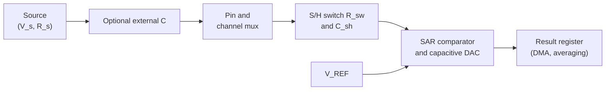
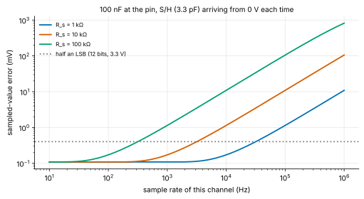
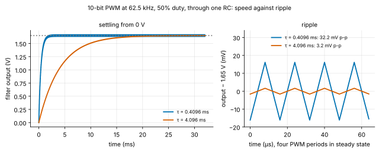

<!-- status: verified -->
# 18-06 · Analog Interfaces: ADC, DAC and PWM

| | |
|---|---|
| **Course** | [18 · Embedded Systems and Microcontrollers](../README.md) |
| **University equivalent** | The analog-interfacing chapters of a junior embedded-systems course: on-chip ADCs and their specifications, sampling circuits and source impedance, references, averaging, DACs and PWM outputs (Valvano, *Embedded Systems*, data-acquisition chapters; Horowitz & Hill ch. 13) |
| **Prerequisites** | [18-05](18-05-gpio-uart-spi-i2c.md) (GPIO electrical limits), [18-03](18-03-interrupts-exceptions-timers.md) (timers and PWM), [16-10](../../16-digital-signal-processing/chapters/16-10-quantization-and-fixed-point.md) (quantization noise), [11-10](../../11-signals-and-systems/chapters/11-10-sampling-aliasing-reconstruction.md) (sampling and reconstruction), [07-02](../../07-circuit-analysis-2-transient-and-ac/chapters/07-02-first-order-rc-rl-transients.md) (RC transients) |
| **Estimated study hours** | 6 |
| **Last verified** | 2026-11-21 |

**Learning objectives.** After this chapter you can:

1. Read an MCU ADC's specifications (resolution, LSB, offset and gain error, INL, DNL, ENOB, total unadjusted error) and convert between SINAD and ENOB.
2. Derive the sampling time a sample-and-hold input needs from a given source, and the largest source resistance for a given sampling time.
3. Predict the error that an external capacitor and a multiplexed input produce at a given sample rate, and choose between a capacitor, a slower rate and a buffer.
4. Use the reference correctly: ratiometric measurements, supply monitoring with an internal reference, and the effect of reference tolerance.
5. Compute the resolution gained by averaging, state when averaging fails, and implement the decimation in integer arithmetic.
6. Design a DAC output and a PWM-plus-RC DAC: zero-order-hold droop, ripple, settling and the resolution–bandwidth tradeoff.

## 1. Big picture

Almost every microcontroller in a wearable, a thermostat or a motor drive measures the analog world and acts on it. A battery voltage, a thermistor, a microphone bias or a motor current comes in through an on-chip **analog-to-digital converter (ADC)**, usually a 12-bit successive-approximation design sampling at up to a few million samples per second. Signals go out through an on-chip **digital-to-analog converter (DAC)** or, more often, through a **pulse-width-modulated (PWM)** timer output, filtered by an RC network or by the load itself. These peripherals are cheap because they share the MCU's die, but they are not instruments: their accuracy depends on how the board drives them.

- **The source drives a capacitor.** An MCU ADC samples by connecting a few picofarads to the pin; a high-impedance source cannot charge it in the sampling time, and the result is wrong in a way no register setting reveals.
- **The reference is the ruler.** Every code is a fraction of the reference voltage; a 1% reference is a 1% gain error, unless the measurement is ratiometric.
- **The data-sheet resolution is not the accuracy.** A "12-bit" ADC may deliver under 9 effective bits, and averaging can add resolution only when the noise cooperates.
- **PWM trades bandwidth for resolution.** Each extra bit of a filtered PWM output costs a factor of four in bandwidth.
- **Where they show up:** battery and temperature monitoring in every portable product, sensor front ends (18-10), motor and LED drive, audio feedback, and the low-power duty-cycled measurement schemes of 18-09.

## 2. Intuition first

**The ADC as a fast camera with a bucket.** A sampling ADC takes a snapshot: for a short **acquisition time** it connects a small capacitor (the sample-and-hold, S/H) to the input, then disconnects it and measures the charge it holds. Think of filling a bucket from a hose: the bucket must fill to the brim within the time allowed. A thin hose (a high source resistance) fills it slowly, so you either allow more time, use a fatter hose (a buffer amplifier), or keep a big tank next to the bucket (an external capacitor) that fills the bucket instantly and refills itself slowly. The tank works as long as you do not empty it into the bucket faster than the hose can refill it: sample too often and the tank's level sags.

**The reference as a ruler.** The ADC reports $V_{IN}/V_{REF}$ as a fraction of $2^N$. If you measure a voltage divider powered from the same supply that serves as the reference, the supply cancels: the ruler stretches with the object. That is **ratiometric** measurement, and it is why a potentiometer or a thermistor divider read against $V_{DD}$ needs no precise supply.

**PWM as a fast light switch.** Switch a light on and off fast enough and the eye sees the average. A PWM output switches between 0 and $V_{DD}$; an RC filter averages it. A slow filter averages well but responds slowly; a fast filter responds quickly but lets the switching show through as ripple.

**Where the analogies break.** The bucket picture hides the exponential shape of RC charging: the bucket never fills completely, only within an error that shrinks by $e$ every time constant, and the required accuracy (half an LSB) sets how many time constants are needed. The ruler picture hides that the ADC's own errors (offset, nonlinearity, noise) do not cancel ratiometrically.

## 3. Theory

### 3.1 The ADC's transfer function and its errors

An $N$-bit ADC with reference $V_{REF}$ divides the input range $0$ to $V_{REF}$ into $2^N$ steps of one **least significant bit**,

$$
\text{LSB} = \frac{V_{REF}}{2^N} .
$$

An ideal converter rounds: it returns code $k$ for inputs within half an LSB of $k \cdot \text{LSB}$ (code transitions at $(k - \frac12)$ LSB), clipped to $0 \ldots 2^N - 1$. The firmware converts back with $V = \text{code} \times V_{REF}/2^N$. (Some data sheets place the transitions at whole LSBs and truncate; the difference is a fixed half-LSB offset.)

**Quantization noise.** Between transitions the rounding error $e = V_{IN} - \text{code}\cdot\text{LSB}$ ranges over $[-q/2, q/2)$, with $q$ = 1 LSB. For a busy input that crosses many codes, $e$ is well modelled as uniformly distributed on that interval (16-10 §3.2), so its mean is zero and its mean square is

$$
\overline{e^2} = \frac{1}{q}\int_{-q/2}^{q/2} e^2\,de = \frac{q^2}{12}, \qquad e_{rms} = \frac{q}{\sqrt{12}} .
$$

A full-scale sine has amplitude $A = V_{REF}/2 = 2^N q/2$ and power $A^2/2 = 2^{2N}q^2/8$. The signal-to-quantization-noise ratio is therefore

$$
\text{SQNR} = \frac{2^{2N}q^2/8}{q^2/12} = 1.5 \times 2^{2N} \;\Rightarrow\; 10\log_{10}(1.5 \times 2^{2N}) = 6.02N + 1.76\ \text{dB} .
$$

**Real converters** add errors that data sheets list separately ([R-307]) **[Established]**:

- **Offset error:** the shift of the whole transfer function, in LSB at code 0.
- **Gain error:** the slope error after offset is removed, often quoted at full scale; it includes the reference's error if the reference is internal.
- **Differential nonlinearity (DNL):** how much each code's width differs from 1 LSB. A code of zero width, DNL = −1 LSB, is a **missing code**; DNL cannot go below −1, and "no missing codes" means DNL > −1 LSB everywhere.
- **Integral nonlinearity (INL):** the largest deviation of the transfer function from a straight line, after offset and gain are removed.
- **Total unadjusted error (TUE):** the combined worst case of all of these, the honest figure for an uncalibrated measurement.
- **Noise:** thermal and reference noise make repeated conversions of a constant input spread over several codes.

Dynamic performance folds noise and distortion into one number. With a sine input, the **SINAD** (signal to noise and distortion) defines the **effective number of bits** by inverting the SQNR formula:

$$
\text{ENOB} = \frac{\text{SINAD} - 1.76\ \text{dB}}{6.02\ \text{dB}} .
$$

An ADC with 12-bit output codes and ENOB 11.1 performs like an ideal 11.1-bit converter. Offset and gain errors do not enter ENOB at all, so a converter can have an excellent ENOB and a poor TUE.

> **Math refresher: decibels of a power ratio.** $10\log_{10}(P_1/P_2)$. One bit doubles the amplitude ratio, a factor of 4 in power: $10\log_{10}4 = 6.02$ dB per bit. The 1.76 dB is $10\log_{10}1.5$: a full-scale sine of peak $A$ has power $A^2/2$, while a signal spread uniformly over $\pm A$ (a full-scale sawtooth, the same distribution that gives quantization noise its $q^2/12$) has mean square $A^2/3$, and their ratio is 1.5.

**The SAR principle in one paragraph.** A successive-approximation (SAR) ADC holds the sample on a capacitor array that doubles as a DAC. It then decides one bit per clock, most significant first: it tries the bit, compares the DAC's output with the held sample, and keeps or clears the bit. That is a binary search, so an $N$-bit conversion takes $N$ comparator decisions plus overhead, and a conversion cycle is the acquisition time plus about $N$ clocks. The architecture's details, and why it dominates MCU ADCs, are in 20-07.

### 3.2 Sampling: the sample-and-hold as an RC circuit

During acquisition the pin connects through the multiplexer and the sampling switch, with total resistance $R_{sw}$ (hundreds of ohms to a few kilohms), to the sample capacitor $C_{sh}$ (a few picofarads). With a source of voltage $V_s$ and resistance $R_s$, the capacitor voltage obeys the RC charging equation of 07-02:

$$
v_{sh}(t) = V_s + (V_0 - V_s)\,e^{-t/\tau}, \qquad \tau = (R_s + R_{sw})\,C_{sh},
$$

where $V_0$ is the voltage left on $C_{sh}$ by the previous conversion (or by a different channel). The error after an acquisition time $t_s$ is $(V_0 - V_s)e^{-t_s/\tau}$. In the worst case $|V_0 - V_s|$ is the full range $V_{REF}$, and we want the error below half an LSB:

$$
V_{REF}\,e^{-t_s/\tau} \le \frac{V_{REF}}{2^{N+1}} \;\Rightarrow\; t_s \ge \tau \ln 2^{N+1} = (N + 1)\,\tau \ln 2 .
$$

For 12 bits, $\ln 2^{13} = 9.01$: the input must settle for **nine time constants**. Turned around, for a sampling time $t_s$ the source may be at most

$$
R_{s,max} = \frac{t_s}{C_{sh}\ln 2^{N+1}} - R_{sw} .
$$

Data sheets publish $C_{sh}$, $R_{sw}$ and a minimum sampling time; TI's MSPM0G350x, for example, lists 3.3 pF, 0.5 kΩ and 62.5 ns (12-bit mode) ([R-307]) **[Established]**. Example 18-06.2 shows that this part's 62.5 ns accommodates only about 1.6 kΩ of source resistance. A thermistor divider of tens of kilohms needs either a longer sampling time, which most ADCs let firmware program, or one of the two fixes below.

**Fix 1: an external capacitor.** A capacitor $C_{ext}$ from the pin to ground acts as the tank of §2. When the S/H connects, charge is shared almost instantly through $R_{sw}$ alone. Charge conservation, $C_{ext}V + C_{sh}V_0 = (C_{ext} + C_{sh})V'$, gives a step of

$$
V - V' = (V - V_0)\,\frac{C_{sh}}{C_{ext} + C_{sh}} .
$$

Keeping the worst-case step (with $|V - V_0| = V_{REF}$) under half an LSB needs $C_{ext} \ge C_{sh}(2^{N+1} - 1)$: about 27 nF for 3.3 pF at 12 bits.

**But the tank must refill.** Each sample removes the charge $C_{sh}(V - V_0)$ from $C_{ext}$, and only $R_s$ replaces it. At a sample rate $f$, the S/H therefore draws an average current $I = fC_{sh}(V_x - V_0)$, where $V_x$ is the pin voltage. This is a resistor

$$
R_{eq} = \frac{1}{f\,C_{sh}}
$$

from the pin to $V_0$, the voltage the S/H arrives with. If the ADC alternates between this channel and another at $V_0$, the source sees a divider $R_s$–$R_{eq}$, and the pin sags by

$$
\Delta V \approx (V_s - V_0)\,\frac{R_s f C_{sh}}{1 + R_s f C_{sh}} .
$$

At 100 kHz, 3.3 pF is $R_{eq}$ = 3.03 MΩ; with $R_s$ = 10 kΩ and a 3.3 V swing, the sag is about 11 mV, over 13 LSB (Example 18-06.3). The external capacitor hides the *instantaneous* error and replaces it with a *DC* error that grows with the sample rate. A data sheet's minimum sampling time cannot reveal it.

*Error of a channel with 100 nF at the pin when the S/H arrives from 0 V each time (exact recursion below). At low rates only the charge-sharing step remains; above about $1/(R_sC_{ext})$ the error grows in proportion to the rate and the source resistance, crossing half an LSB at a rate that falls tenfold for each tenfold rise in $R_s$.*

> **Going deeper: the exact recursion.** Let $x_n$ be the pin voltage just before sample $n$, $a = C_{ext}/(C_{ext} + C_{sh})$ and $b = 1 - a$. Sharing gives the sampled value $s_n = ax_n + bV_0$. Between samples the pin recovers through $R_s$ for $T = 1/f$: $x_{n+1} = V_s + (s_n - V_s)e^{-T/R_sC_{ext}}$. With $\varepsilon = e^{-T/R_sC_{ext}}$, the fixed point is $x = (V_s(1 - \varepsilon) + bV_0\varepsilon)/(1 - a\varepsilon)$. When $T \ll R_sC_{ext}$ it reduces to the average-current result; when $T \gg R_sC_{ext}$ the pin recovers fully and only the sharing step $b(V_s - V_0)$ remains. The lab's model uses the recursion and its ngspice netlist simulates the switches; both agree with the average-current estimate to within 1% at 100 kHz.

**Fix 2: a buffer.** A unity-gain op-amp (10-09) between the source and the pin drives the S/H from a low output impedance. It costs a part and its supply current, adds its own offset and noise, and must itself settle after the S/H's kick, which is why ADC driver amplifiers are specified for it.

**Aliasing.** The ADC samples whatever reaches the pin, including noise and interference above $f/2$, which fold into the band of interest (11-10). The source's own bandwidth, an RC filter at the pin (which is also Fix 1's capacitor) and digital filtering after oversampling are the usual defences in MCU designs.

### 3.3 The reference

Every code is relative to $V_{REF}$: $\text{code} = 2^N V_{IN}/V_{REF}$. MCUs offer three choices: the analog supply $V_{DDA}$, an internal bandgap-derived reference (2.5 V on the MSPM0G350x, for example, [R-307]), or an external reference pin. An internal reference's initial tolerance and drift, from the data sheet, usually dominate an uncalibrated absolute measurement.

**Ratiometric measurement.** If the sensor is a divider powered by the same supply that the ADC uses as reference, say a thermistor $R_T$ below a fixed $R_f$ from $V_{DD}$, then $V_{IN} = V_{DD}R_T/(R_T + R_f)$ and $V_{REF} = V_{DD}$:

$$
\text{code} = 2^N\,\frac{R_T}{R_T + R_f},
$$

independent of the supply. Noise and drift on $V_{DD}$ cancel too, to the extent that they reach the divider and the reference equally. Bridges, potentiometers and resistive sensors are read this way. Reading the same divider against a fixed internal reference turns every supply change into an apparent measurement change (Example 18-06.4).

**Supply monitoring.** To measure an *absolute* voltage with $V_{DD}$ as the reference, measure a known voltage too. MCUs route their internal reference $V_{BG}$ to an ADC channel; converting it against $V_{DD}$ gives $\text{code}_{BG} = 2^NV_{BG}/V_{DD}$, so

$$
V_{DD} = \frac{2^N V_{BG}}{\text{code}_{BG}} .
$$

This is how battery-powered products report their supply without a divider that wastes current. Its precision is one code in $\text{code}_{BG}$, and its accuracy is the bandgap's tolerance, often calibrated in production and stored in a factory register.

**Reference tolerance as gain error.** A reference 1% high makes every absolute reading 1% low: at 12 bits near full scale, about 41 LSB, far larger than the converter's INL. For absolute accuracy, budget the reference first, then calibrate offset and gain at two known inputs if TUE is not good enough.

### 3.4 Oversampling and averaging

Average $M$ conversions of a constant input whose noise is white with standard deviation $\sigma$ (in LSB), and the average's noise is $\sigma/\sqrt{M}$: noise power falls by $10\log_{10}M$ dB. At 6.02 dB per bit the resolution rises by

$$
\Delta N = \frac{10\log_{10}M}{6.02} = \tfrac12\log_2 M \ \text{bits},
$$

one bit per factor of 4. Sixteen samples give 2 bits, 256 give 4. The output rate falls by $M$: averaging trades bandwidth for resolution.

**In integer arithmetic.** Sum $M = 4^p$ samples of $N$ bits (the sum needs $N + 2p$ bits), then shift right by $p$, rounding by adding $2^{p-1}$ first: the result has $N + p$ bits. This is the **decimation** of 16-09 with the crudest filter, a boxcar. MCU ADCs often do it in hardware ("hardware averaging" or an "oversampler"), which saves CPU time and DMA bandwidth ([R-307]).

**When it fails.** Averaging only helps if the samples differ. If the noise is much smaller than an LSB, every conversion of a constant input returns the same code, and the average of $M$ identical codes is that code: the half-LSB error stays (Example 18-06.5). The noise must be roughly half an LSB rms or more, or must be added deliberately as **dither** (16-10). Averaging also leaves every deterministic error in place: offset, gain, INL and DNL spikes, and interference correlated with the sampling. That is why measured gains fall short of $\frac12\log_2 M$. TI's MSPM0G350x improves from ENOB 11.1 to 12.5 with 16-sample averaging ([R-307]), 1.4 bits rather than the ideal 2.

### 3.5 The DAC

An $N$-bit voltage DAC produces $V_{OUT} = \text{code} \times V_{REF}/2^N$, usually from a resistor string or an R-2R ladder (20-09) followed by an output buffer. Its static specifications mirror the ADC's (offset, gain error, INL, DNL); its dynamic ones are the **settling time** and **slew rate** of the buffer. A full-scale step first slews at the buffer's maximum rate, then settles exponentially into its final half-LSB band. TI's MSPM0G350x DAC, for example, is 12-bit at up to 1 Msps with a typical full-scale settling time of 0.8 µs and a 5.5 V/µs slew rate ([R-307]) **[Established]**.

**The zero-order hold.** A DAC updated at rate $f_s$ by a timer (and fed by DMA, 18-04) holds each value for $T = 1/f_s$. Holding is a filter whose impulse response is a rectangle of width $T$, with frequency response

$$
|H(f)| = \left|\frac{\sin(\pi f/f_s)}{\pi f/f_s}\right| = |\operatorname{sinc}(f/f_s)| .
$$

Two consequences (11-10 §3.5). First, **droop**: a tone at $f$ is attenuated by $\operatorname{sinc}(f/f_s)$, 0.9003 (−0.91 dB) at $f_s/4$ and 0.6366 (−3.92 dB) at $f_s/2$. Second, **images**: copies of the tone appear at $kf_s \pm f$, with amplitudes $\operatorname{sinc}((kf_s \pm f)/f_s)$ relative to an unheld impulse train. A reconstruction filter removes them; the further $f$ is below $f_s$, the easier the filter.

### 3.6 PWM as a DAC

A PWM timer output (18-03 §3.6) switches between 0 and $V_H$ with period $T$ and duty $D$. Its average is $DV_H$, and its harmonics sit at multiples of $f_{PWM} = 1/T$. A low-pass filter that keeps the average and removes the harmonics turns the timer into a DAC.

**Resolution and frequency are linked.** An edge-aligned PWM counting a clock $f_{clk}$ with an $N$-bit period has

$$
f_{PWM} = \frac{f_{clk}}{2^N} .
$$

At 64 MHz, 10 bits gives 62.5 kHz and 16 bits only 977 Hz.

**Ripple through an RC filter.** Let $\tau = RC$, $\alpha = e^{-DT/\tau}$ and $\beta = e^{-(1-D)T/\tau}$. In steady state the output rises from $v_L$ to $v_H$ during the high phase and falls back during the low phase:

$$
v_H = V_H + (v_L - V_H)\alpha, \qquad v_L = v_H\beta .
$$

Substituting the second into the first and solving gives $v_H = V_H(1 - \alpha)/(1 - \alpha\beta)$ and $v_L = \beta v_H$, so the peak-to-peak ripple is

$$
\Delta v = v_H - v_L = V_H\,\frac{(1 - \alpha)(1 - \beta)}{1 - e^{-T/\tau}} .
$$

For a filter much slower than the PWM ($T \ll \tau$), expanding each exponential to first order gives

$$
\Delta v \approx V_H\,D(1 - D)\,\frac{T}{\tau},
$$

largest at $D = \frac12$, where it is $V_HT/4\tau$. (The output is then a small triangle wave around $DV_H$: the capacitor current is nearly constant in each phase.)

**The resolution–bandwidth tradeoff.** Require the worst-case ripple to stay below one LSB of the PWM, $V_H/2^N$:

$$
\frac{V_HT}{4\tau} \le \frac{V_H}{2^N} \;\Rightarrow\; \tau \ge \frac{2^NT}{4} = \frac{4^N}{4f_{clk}} .
$$

The filter's bandwidth, $f_c = 1/2\pi\tau$, is then at most $2f_{clk}/(\pi 4^N)$, and settling after a full-scale step to half an LSB takes $\tau\ln 2^{N+1}$. **Each extra bit costs a factor of four in bandwidth and settling time**: one factor of two because the PWM frequency halves, another because the LSB halves. Example 18-06.6 puts numbers to it: 10 bits from 64 MHz gives a 39 Hz output; 8 bits gives 622 Hz.

*The same PWM through filters whose time constants differ tenfold: the faster filter settles ten times sooner and ripples ten times more. Only a higher PWM frequency (fewer bits) or a higher-order filter escapes the tradeoff.*

> **Going deeper: better filters and smarter modulation.** A second-order filter attenuates the PWM fundamental by roughly $(f_c/f_{PWM})^2$ instead of $f_c/f_{PWM}$, so it buys bandwidth at the same ripple. Splitting the period into many shorter pulses with the same total width ("distributed" or sigma-delta-like PWM) moves the energy to higher frequencies, where the same filter removes more of it. Many loads need no filter at all: a motor winding's inductance averages the current, and the eye averages an LED's light above a few hundred hertz.

**When to use which.** An on-chip DAC gives a clean, fast output with no filter design, but many MCUs have none, and few have more than two channels. PWM is available on almost every timer pin, costs only an RC network and is ideal for slow set-points (bias voltages, LED brightness, heater power), but its ripple and slow settling rule it out for audio-band waveforms unless filtered hard.

## 4. Worked examples

### Example 18-06.1 · ADC basics (tier A)

**Setup.** A 12-bit ADC uses a 3.3 V reference. (a) Find the LSB and the code for a 1.000 V input. (b) Find the rms quantization noise and the SQNR. (c) The data sheet gives ENOB 11.1 typical: what SINAD is that?

**Solution.** (a) $3.3/4096$ = **0.806** mV; $1.000/0.000\,806 = 1241.2$, which rounds to code **1241**.

(b) $0.806\ \text{mV}/\sqrt{12}$ = **0.233** mV rms; SQNR $= 6.02 \times 12 + 1.76$ = **74.0** dB.

(c) $6.02 \times 11.1 + 1.76$ = **68.6** dB: about 5.4 dB of noise and distortion beyond quantization.

**Units check.** V/codes = V per LSB; dB are ratios.

**Sanity check.** Each bit is 6 dB, so 0.9 bit short of 12 is 5.4 dB short of 74 dB.

### Example 18-06.2 · Sampling time and source resistance (tier B)

**Setup.** An ADC's input has $R_{sw}$ = 0.5 kΩ and $C_{sh}$ = 3.3 pF, the values of TI's MSPM0G350x ([R-307]). For 12-bit settling to half an LSB: (a) what sampling time does a 50 Ω source need? (b) What is the largest source resistance at the data sheet's minimum sampling time, 62.5 ns? (c) What sampling time does a 10 kΩ source need?

**Solution.** (a) $\tau = 550 \times 3.3\ \text{pF}$ = **1.815** ns; $t_s \ge 9.01\tau$ = **16.4** ns, comfortably inside the 62.5 ns minimum (which also covers pin and board capacitance).

(b) $R_{s,max} = 62.5\ \text{ns}/(3.3\ \text{pF} \times 9.01) - 500$ = **1602** Ω.

(c) $t_s \ge 10\,500 \times 3.3\ \text{pF} \times 9.01$ = **312** ns: five times the minimum, which limits a single channel to well under the converter's maximum rate.

**Units check.** Ω × F = s.

**Sanity check.** Nine time constants for 13 halvings: $e^{9} \approx 8100 \approx 2^{13}$.

### Example 18-06.3 · An external capacitor and a multiplexed input (tier B)

**Setup.** A 3.3 V source with 10 kΩ of output resistance (a sensor's output stage, or a 20 kΩ/20 kΩ divider fed from 6.6 V) has a 100 nF capacitor at the pin. The ADC ($C_{sh}$ = 3.3 pF, 12 bits, 3.3 V reference) samples this channel at 100 kHz, alternating with a channel at 0 V, so the S/H arrives at 0 V each time. (a) What is the charge-sharing step, and what capacitor would keep it below half an LSB? (b) What equivalent resistance does the S/H present, and what DC error results? (c) Repeat (b) at 1 kHz.

**Solution.** (a) $3.3 \times 3.3\ \text{pF}/100.0033\ \text{nF}$ = **0.109** mV, about a quarter of the half-LSB allowance; the half-LSB limit needs $C_{ext} \ge 3.3\ \text{pF} \times 8191$ = **27.0** nF, so 100 nF passes.

(b) $R_{eq} = 1/(10^5 \times 3.3\ \text{pF})$ = **3.03** MΩ. The average-current estimate is $3.3 \times 0.0033/1.0033$ = **10.85** mV, and the exact recursion gives a sampled value **10.91** mV below 3.3 V: **13.5** LSB. The lab's ngspice simulation of the switches confirms it.

(c) At 1 kHz the pin recovers almost fully between samples ($T$ = 1 ms = $R_sC_{ext}$), and the error falls to **0.172** mV, mostly the sharing step.

**Units check.** 1/(Hz · F) = Ω.

**Sanity check.** The S/H moves $3.3\ \text{pF} \times 3.3\ \text{V} \approx 11$ pC per sample, 1.1 µA at 100 kHz; across 10 kΩ that is 11 mV.

### Example 18-06.4 · Ratiometric measurement and supply monitoring (tier B)

**Setup.** A thermistor of 10 kΩ at 25 °C sits below a 10 kΩ resistor from $V_{DD}$, read by a 12-bit ADC. Near 25 °C the thermistor changes by −4.44 %/K (a B-constant of 3950 K). (a) What code does it give at 25 °C with $V_{DD}$ as the reference, at $V_{DD}$ = 3.3 V and 3.0 V? (b) Repeat with a fixed 2.5 V internal reference. (c) How many codes per kelvin does the divider give, and what temperature error does the supply drop cause in (b)? (d) The internal 1.20 V reference reads code 1489 against $V_{DD}$. What is $V_{DD}$, how much does one code change it, and what does a ±1% reference tolerance contribute?

**Solution.** (a) $4096 \times 10/(10 + 10)$ = **2048** at both supplies: ratiometric.

(b) $V_{IN} = V_{DD}/2$: at 3.3 V, $4096 \times 1.65/2.5$ = **2703**; at 3.0 V, **2458**: a shift of **245** codes with no temperature change.

(c) Ratiometrically, $d(\text{code})/d\ln R_T = 4096\,R_TR_f/(R_T + R_f)^2 = 1024$, times 0.0444/K: **45.5** codes/K. Against the 2.5 V reference the same divider swings $V_{DD}/2.5$ times as many codes, $45.5 \times 3.3/2.5$ = **60.0** codes/K at 3.3 V, so the 245-code drop looks like $245/60.0$ = **4.1** K. (Inverting the B-equation exactly for code 2457.6, with firmware that assumes 3.3 V, gives $R_T$ = 8.333 kΩ and +4.17 K.)

(d) $V_{DD} = 4096 \times 1.20/1489$ = **3.301** V. One code changes it by about $3.301/1489$ = **2.2** mV, but the 1% tolerance contributes **33** mV unless the reference is calibrated.

**Units check.** Codes are dimensionless; V × codes/codes = V.

**Sanity check.** A 9% supply change through a half-scale divider is $0.09 \times 2703 \approx 245$ codes.

### Example 18-06.5 · What averaging can and cannot do (tier B)

**Setup.** A 12-bit ADC converts at 4 Msps. (a) With 0.8 LSB rms of white noise, what do 16-sample averages give in noise, bits and output rate? (b) How many samples reach 16-bit resolution, and at what rate? (c) An input sits 0.3 LSB above a code with only 0.1 LSB rms of noise. What is the expected average, whatever $M$? (d) TI's MSPM0G350x reports ENOB 11.1, and 12.5 with 16-sample hardware averaging ([R-307]). How does that compare with the ideal?

**Solution.** (a) $0.8/\sqrt{16}$ = **0.20** LSB rms; $\frac12\log_2 16$ = **2** bits; 4 Msps/16 = **250** ksps.

(b) 4 extra bits need $4^4$ = **256** samples: **15.6** ksps.

(c) A sample rounds up only when the noise exceeds 0.2 LSB, with probability $Q(0.2/0.1) = Q(2)$ = **0.0228**. The average converges to 0.0228 LSB above the code, leaving an error of **0.277** LSB for any $M$: averaging cannot remove an error the samples never show.

(d) $12.5 - 11.1$ = **1.4** bits against the ideal 2. Deterministic errors (INL, correlated noise) do not average away.

**Units check.** LSB in, LSB out; samples/s ÷ samples = samples/s.

**Sanity check.** A factor of 16 in samples is a factor of 4 in noise amplitude: 12 dB, 2 bits.

### Example 18-06.6 · A PWM DAC (tier B)

**Setup.** A 64 MHz timer makes a 0–3.3 V PWM with a 10-bit period, filtered by one RC. (a) What is the PWM frequency? (b) What time constant keeps the worst-case ripple within one LSB, and what bandwidth and settling time (to half an LSB) result? (c) Repeat (a) and (b) for 8 bits.

**Solution.** (a) $64\ \text{MHz}/1024$ = **62.5** kHz, $T$ = 16 µs.

(b) $\tau \ge 1024 \times 16\ \mu\text{s}/4$ = **4.096** ms; $f_c = 1/(2\pi\tau)$ = **38.9** Hz; settling $\tau\ln 2^{11}$ = **31.2** ms. With R = 4.096 kΩ and C = 1 µF, the exact ripple formula gives **3.2227** mV against an LSB of 3.2227 mV, and the lab's ngspice netlist measures the same.

(c) 250 kHz; $\tau \ge 256 \times 4\ \mu\text{s}/4$ = **256** µs, $f_c$ = **622** Hz and settling $\tau\ln 2^9$ = **1.60** ms. Two bits fewer, 16 times the bandwidth.

**Units check.** Counts × s = s; 1/s = Hz.

**Sanity check.** $f_c \le 2f_{clk}/(\pi 4^N) = 2 \times 64\ \text{MHz}/(\pi \times 1\,048\,576) = 38.9$ Hz.

<!-- answer-key -->

| ID | Quantity | Value | Unit |
|---|---|---|---|
| Txt 18-06.a | settling time constants for 12 bits, ln 2^13 | 9.01 | — |
| Txt 18-06.b | external capacitor for 3.3 pF at 12 bits | 27 | nF |
| Txt 18-06.c | R_eq of 3.3 pF at 100 kHz | 3.03 | MΩ |
| Txt 18-06.d | 1% reference error near full scale, 12 bits | 41 | LSB |
| Txt 18-06.e | ZOH gain at f_s/4 | 0.9003 | — |
| Txt 18-06.f | ZOH droop at f_s/4 | −0.91 | dB |
| Txt 18-06.g | ZOH gain at f_s/2 | 0.6366 | — |
| Txt 18-06.h | ZOH droop at f_s/2 | −3.92 | dB |
| Txt 18-06.i | 16-bit PWM frequency from 64 MHz | 977 | Hz |
| Ex 18-06.1a | LSB | 0.806 | mV |
| Ex 18-06.1b | code for 1.000 V | 1241 | — |
| Ex 18-06.1c | rms quantization noise | 0.233 | mV |
| Ex 18-06.1d | SQNR, 12 bits | 74.0 | dB |
| Ex 18-06.1e | SINAD for ENOB 11.1 | 68.6 | dB |
| Ex 18-06.2a | time constant, 50 Ω source | 1.815 | ns |
| Ex 18-06.2b | sampling time, 50 Ω source | 16.4 | ns |
| Ex 18-06.2c | largest source resistance at 62.5 ns | 1602 | Ω |
| Ex 18-06.2d | sampling time, 10 kΩ source | 312 | ns |
| Ex 18-06.3a | charge-sharing step | 0.109 | mV |
| Ex 18-06.3b | external capacitor for half an LSB | 27.0 | nF |
| Ex 18-06.3c | equivalent resistance at 100 kHz | 3.03 | MΩ |
| Ex 18-06.3d | error, average-current estimate | 10.85 | mV |
| Ex 18-06.3e | error, exact recursion | 10.91 | mV |
| Ex 18-06.3f | error in LSB | 13.5 | LSB |
| Ex 18-06.3g | error at 1 kHz | 0.172 | mV |
| Ex 18-06.4a | ratiometric code | 2048 | — |
| Ex 18-06.4b | code with 2.5 V reference, V_DD 3.3 V | 2703 | — |
| Ex 18-06.4c | code with 2.5 V reference, V_DD 3.0 V | 2458 | — |
| Ex 18-06.4d | shift | 245 | codes |
| Ex 18-06.4e | sensitivity | 45.5 | codes/K |
| Ex 18-06.4f | apparent temperature error | 4.1 | K |
| Ex 18-06.4j | sensitivity against 2.5 V at 3.3 V | 60.0 | codes/K |
| Ex 18-06.4g | V_DD from the internal reference | 3.301 | V |
| Ex 18-06.4h | change per code | 2.2 | mV |
| Ex 18-06.4i | change from 1% reference tolerance | 33 | mV |
| Ex 18-06.5a | noise after 16 samples | 0.20 | LSB |
| Ex 18-06.5b | bits gained | 2 | — |
| Ex 18-06.5c | output rate | 250 | ksps |
| Ex 18-06.5d | samples for 16 bits | 256 | — |
| Ex 18-06.5e | output rate for 16 bits | 15.6 | ksps |
| Ex 18-06.5f | probability of rounding up | 0.0228 | — |
| Ex 18-06.5g | residual error | 0.277 | LSB |
| Ex 18-06.5h | measured gain | 1.4 | bits |
| Ex 18-06.6a | PWM frequency, 10 bits | 62.5 | kHz |
| Ex 18-06.6b | time constant, 10 bits | 4.096 | ms |
| Ex 18-06.6c | bandwidth, 10 bits | 38.9 | Hz |
| Ex 18-06.6d | settling, 10 bits | 31.2 | ms |
| Ex 18-06.6e | exact ripple | 3.2227 | mV |
| Ex 18-06.6f | LSB of the PWM | 3.2227 | mV |
| Ex 18-06.6g | time constant, 8 bits | 256 | µs |
| Ex 18-06.6h | bandwidth, 8 bits | 622 | Hz |
| Ex 18-06.6i | settling, 8 bits | 1.60 | ms |

*Every value is recomputed by [verify_18_06.py](../verify/verify_18_06.py): transfer functions and noise by direct arithmetic and integration, settling by solving the RC equation, the multiplexed input by both the exact recursion and the average-current model, averaging by the normal distribution and by a Monte Carlo through the quantizer, PWM ripple by the exact formula and by simulating the RC filter period by period. The lab's ngspice netlists confirm Examples 18-06.3 and 18-06.6.*

## 5. Simulate it

The lab, [labs/18-06-lab](../labs/18-06-lab/README.md), has four parts: `mcuanalog.py` (quantizer, sampling, averaging, DAC and PWM models), two ngspice netlists (the multiplexed input with an external capacitor, and the PWM filter), and a host C test of the integer arithmetic firmware uses (code to millivolts, supply from the internal reference, decimation with rounding, PWM compare values). **Predict, then run**:

1. **Settling.** Predict the code error for a 10 kΩ source at 62.5 ns and at 312 ns of sampling time; simulate the S/H charging and check.
2. **The external capacitor.** Predict the error of Example 18-06.3 at 1, 10 and 100 kHz; run the netlist at 100 kHz and sweep the model.
3. **Averaging.** Predict the rms error of $M$-sample averages for noise of 0.1, 0.3 and 0.8 LSB; run the Monte Carlo for $M$ = 1 to 256.
4. **PWM.** Predict the ripple and the settling of Example 18-06.6; run the netlist and the model, then try $D$ = 0.1 and a two-stage RC.
5. **Integer arithmetic.** Predict the 14-bit result of averaging sixteen 12-bit codes of 2047 and 2048 in equal numbers; run the C test.

## 6. Engineering tradeoffs

| Knob | Improves | Costs | Typical decision owner |
|---|---|---|---|
| Longer sampling time | accuracy with high-impedance sources | conversion rate | firmware lead |
| External pin capacitor | instantaneous accuracy, filtering | DC error at high sample rates; slower response | hardware lead |
| Buffer amplifier | accuracy at any rate | cost, power, its own offset and noise | hardware lead |
| Internal vs external reference | absolute accuracy (external), cost and pins (internal) | BOM, board area | hardware lead |
| Ratiometric design | supply independence | only for sensors excited from the reference | hardware lead with firmware |
| Hardware averaging | resolution, CPU and DMA load | output rate; no help with INL or offset | firmware lead |
| PWM resolution | output precision | bandwidth and settling (factor 4 per bit) | firmware lead |
| On-chip DAC instead of PWM | bandwidth, no ripple | channel count, part choice | system architect |

## 7. Numbers to know

| Quantity | Value | Note |
|---|---|---|
| SQNR of an ideal ADC | $6.02N + 1.76$ dB | full-scale sine; 74.0 dB at 12 bits |
| 12-bit LSB at 3.3 V | 0.806 mV | |
| Settling for 12 bits | 9.01 time constants | $\ln 2^{13}$ |
| Typical MCU S/H | a few pF, 0.5–several kΩ switch | 3.3 pF and 0.5 kΩ on MSPM0G350x [R-307] |
| S/H as a resistor | $1/(fC_{sh})$ | 3.03 MΩ for 3.3 pF at 100 kHz |
| Averaging gain | ½ bit per doubling, 1 bit per ×4 | needs ≳ 0.5 LSB rms noise |
| ZOH droop | −0.91 dB at $f_s/4$, −3.92 dB at $f_s/2$ | $\operatorname{sinc}(f/f_s)$ |
| PWM ripple (RC, $T \ll \tau$) | $V_HD(1 - D)T/\tau$ | worst at $D = \frac12$ |
| PWM frequency | $f_{clk}/2^N$ | 62.5 kHz at 10 bits from 64 MHz |
| MCU ADC example | 12-bit, 4 Msps, ENOB 11.1 (12.5 with 16× averaging) | TI MSPM0G350x [R-307] |
| MCU ADC example | "12-bit with 8.7 ENOB", 500 ksps | Raspberry Pi RP2040 [R-307] |

## 8. Common mistakes

- **Treating resolution as accuracy.** Budget TUE, the reference and noise, not the number of bits.
- **Reading a high-impedance source at the default sampling time.** Compute $R_{s,max}$; lengthen the sampling time, add a capacitor or buffer.
- **Adding a pin capacitor and raising the sample rate.** The capacitor's DC error grows with $R_sfC_{sh}$; check it at the actual rate.
- **Using $V_{DD}$ as the reference for an absolute measurement.** Either measure ratiometrically or measure the internal reference too.
- **Expecting averaging to fix everything.** It needs noise, and it leaves offset, gain and INL untouched.
- **Ignoring the first conversion after switching channels.** The S/H still holds the previous channel's voltage; allow settling or discard the result.
- **Choosing PWM resolution without the filter.** Ten bits of PWM through a single RC is a 39 Hz DAC at 64 MHz.
- **Putting PWM edges next to analog inputs.** Fast edges couple into high-impedance analog lines; route and time conversions away from them.

## 9. Practitioner lens

### State of the art (as of Nov 2026)

- **Mainstream MCU ADCs are 12-bit SAR converters at hundreds of ksps to a few Msps,** with hardware averaging and DMA. TI's MSPM0G350x, for example, has a 12-bit 4 Msps ADC with ENOB 11.1 typical (external reference, 10 kHz input), 12.5 with 16-sample averaging and 10.8 with its internal 2.5 V reference; INL ±2 LSB and DNL ±1 LSB with no missing codes; hardware averaging of up to 128 samples ([R-307]) **[Established]**.
- **Nominal and effective bits diverge widely.** Raspberry Pi's RP2040 data sheet describes its ADC as "12-bit with 8.7 ENOB" at 500 ksps; erratum RP2040-E11 attributes the shortfall from the simulated 9 bits to DNL spikes at four codes. The RP2350's data sheet gives 9.2 ENOB in its feature list but 9.5 typical in its table, an inconsistency within the document ([R-307]) **[Established]**.
- **On-chip DACs are common but not universal:** the MSPM0G350x has one 12-bit, 1 Msps DAC with ENOB 11.5 typical and 0.8 µs typical full-scale settling ([R-307]) **[Established]**. Not every MCU has one; those without rely on PWM.

### Why it matters commercially

- **Integration removes parts.** A good on-chip ADC and reference replace an external converter, its reference and its SPI link: cents to dollars of BOM and board area in high-volume wearables and IoT nodes **[Industry estimate]**.
- **Analog quality differentiates MCUs.** Behind the same "12-bit" label, parts differ by more than two effective bits (11.1 against 8.7 in the examples above); for battery gauging, sensor readout and motor control that can decide the design win **[Industry estimate]**.
- **Precision still goes outside.** Medical, metering and instrumentation front ends that need 16 or more effective bits use dedicated sigma-delta converters (20-08) or MCUs built around them.

### Marketing vs Reality

- **"12-bit ADC."** That is the output word. Ask for ENOB at your input frequency and reference, and for TUE over temperature.
- **"14-bit effective resolution with hardware averaging."** Averaging 16 samples of a 12-bit ADC yields 14-bit output words; the same part's measured ENOB with that averaging is 12.5 ([R-307]). Ask for the measured ENOB, not the word length.
- **"Up to 4 Msps."** At the minimum sampling time, with a low-impedance source. With a 10 kΩ sensor the sampling time alone can cut it to about half (Problem 18-06.4).
- **"Internal reference, no external parts."** Check its initial tolerance and drift; a 1% reference is a 41-LSB gain error at 12 bits.

### Questions for engineering leaders

1. **"What is the error budget for your key analog measurement, and what dominates it?"** *Strong:* a budget with reference, TUE, source-impedance and noise terms, and a calibration plan. *Evasive:* "the ADC is 12-bit".
2. **"How do your sensors drive the ADC, and at what sampling time?"** *Strong:* source impedances, sampling-time settings and whether pin capacitors are used, checked at the real sample rates. *Evasive:* "we use the vendor's default configuration".
3. **"Where does your averaging gain come from, and what did you measure?"** *Strong:* measured ENOB before and after, with the noise level and the remaining INL. *Evasive:* "oversampling gives us 16 bits".
4. **"How do you measure battery voltage, and what does it cost in standby current?"** *Strong:* the internal-reference method or a switched divider, with the standby current quantified. *Evasive:* "a resistor divider" with no current figure.
5. **"Why PWM rather than a DAC for this output (or vice versa)?"** *Strong:* the bandwidth, ripple and resolution required, and the filter that meets them. *Evasive:* "it was available".

## 10. Concept check

**Q1.** Why can an ADC with a 62.5 ns minimum sampling time not read a 10 kΩ divider accurately at that setting?

Answer

The sample capacitor charges through the source and switch resistance with $\tau = (R_s + R_{sw})C_{sh}$; 12-bit accuracy needs about nine time constants. With 10.5 kΩ and 3.3 pF that is 312 ns, five times the minimum, so the sample is taken before the capacitor has settled.

**Q2.** An external pin capacitor fixes the settling problem. Why can it create a new error?

Answer

Each sample removes charge from it, which only the source resistance replaces; at a sample rate $f$ the S/H behaves like a resistor $1/(fC_{sh})$ to the voltage it arrives with, forming a divider with $R_s$. At high rates and high source resistance the pin sags by a DC error that no settling time removes.

**Q3.** Why does a thermistor divider read against $V_{DD}$ not need a precise supply?

Answer

Both the input ($V_{DD}R_T/(R_T + R_f)$) and the reference ($V_{DD}$) scale with the supply, so the code $2^NR_T/(R_T + R_f)$ depends only on the resistances.

**Q4.** Averaging 16 samples should add 2 bits. Give two reasons it might add less, or nothing.

Answer

If the noise is far below an LSB, all samples return the same code and the average equals it. And averaging only reduces random, uncorrelated noise; offset, gain error, INL, DNL spikes and interference correlated with sampling remain.

**Q5.** Why does each extra bit of PWM resolution cost a factor of four in filter bandwidth?

Answer

At a fixed timer clock, one more bit halves the PWM frequency (doubling the ripple for a given filter) and halves the LSB the ripple must stay under. Both effects require a filter twice as slow, together four times.

**Q6.** What does a DAC's zero-order hold do to a 250 kHz tone updated at 1 Msps?

Answer

It attenuates it by $\operatorname{sinc}(0.25) = 0.9003$ (−0.91 dB) and creates images at 750 kHz, 1.25 MHz and so on, which a reconstruction filter must remove.

**Q7.** What is the difference between ENOB and TUE?

Answer

ENOB measures dynamic noise and distortion with a sine input and ignores offset and gain errors; TUE is the worst-case static error of an uncalibrated reading, including offset, gain, nonlinearity and often the reference. A converter can have a good ENOB and a poor TUE.

**Problems:** [18-06 problem set](../problems/18-06-problems.md) · [Worked solutions](../solutions/18-06-solutions.md)

## 11. Key terms

[Least significant bit (LSB)](../../../reference/glossary.md#least-significant-bit-lsb) · [Quantization noise](../../../reference/glossary.md#quantization-noise) · [Effective number of bits (ENOB)](../../../reference/glossary.md#effective-number-of-bits-enob) · [SINAD](../../../reference/glossary.md#sinad) · [Differential nonlinearity (DNL)](../../../reference/glossary.md#differential-nonlinearity-dnl) · [Integral nonlinearity (INL)](../../../reference/glossary.md#integral-nonlinearity-inl) · [Total unadjusted error (TUE)](../../../reference/glossary.md#total-unadjusted-error-tue) · [Successive-approximation (SAR) ADC](../../../reference/glossary.md#successive-approximation-sar-adc) · [Sample-and-hold](../../../reference/glossary.md#sample-and-hold) · [Acquisition time](../../../reference/glossary.md#acquisition-time) · [Charge sharing](../../../reference/glossary.md#charge-sharing) · [Ratiometric measurement](../../../reference/glossary.md#ratiometric-measurement) · [Bandgap reference](../../../reference/glossary.md#bandgap-reference) · [Oversampling](../../../reference/glossary.md#oversampling) · [Dither](../../../reference/glossary.md#dither) · [Zero-order hold](../../../reference/glossary.md#zero-order-hold) · [PWM DAC](../../../reference/glossary.md#pwm-dac)

## 12. Connections

- **Builds on:** [18-05](18-05-gpio-uart-spi-i2c.md) (pin electrical limits), [18-03](18-03-interrupts-exceptions-timers.md) (timers and PWM), [18-04](18-04-dma-and-data-movement.md) (DMA streams), [16-10](../../16-digital-signal-processing/chapters/16-10-quantization-and-fixed-point.md) (quantization noise, dither), [11-10](../../11-signals-and-systems/chapters/11-10-sampling-aliasing-reconstruction.md) (aliasing, zero-order hold), [07-02](../../07-circuit-analysis-2-transient-and-ac/chapters/07-02-first-order-rc-rl-transients.md) (RC charging), [10-09](../../10-electronics-1/chapters/10-09-real-op-amps-nonidealities.md) (buffer amplifiers).
- **Next:** [18-07](18-07-rtos-concepts.md) (RTOS concepts).
- **Used later:** [18-09](18-09-ultra-low-power-design.md) (duty-cycled measurement), [18-10](18-10-sensors.md) (sensor front ends), [20-06](../../20-analog-and-mixed-signal-ic-design/chapters/20-06-data-converter-fundamentals.md), [20-07](../../20-analog-and-mixed-signal-ic-design/chapters/20-07-nyquist-adcs.md), [20-08](../../20-analog-and-mixed-signal-ic-design/chapters/20-08-sigma-delta-converters.md) and [20-09](../../20-analog-and-mixed-signal-ic-design/chapters/20-09-dacs.md) (how converters are designed inside the chip).

## 13. Further study

- Horowitz & Hill, *The Art of Electronics*, 3rd ed., chapter 13 (digital meets analog: converters, sampling, references).
- Kester, W. (ed.), *The Data Conversion Handbook*, Analog Devices / Newnes, 2005: chapters on ADC specifications and driving ADC inputs.
- Any MCU's ADC chapter and electrical tables, read together with its vendor's application note on input impedance and sampling time.
- Valvano, *Embedded Systems: Real-Time Interfacing to ARM Cortex-M Microcontrollers*, data-acquisition chapters.

## 14. Sources

1. Horowitz, P. and Hill, W., *The Art of Electronics*, 3rd ed., Cambridge University Press, 2015.
2. Kester, W. (ed.), *The Data Conversion Handbook*, Newnes, 2005.
3. [R-307] TI MSPM0G350x data sheet SLASEX6C (ADC §7.12 and DAC §7.17) and technical reference manual SLAU846F §18.1; Raspberry Pi RP2040 data sheet (ADC section and erratum RP2040-E11) and RP2350 data sheet.
4. Valvano, J. W., *Embedded Systems: Real-Time Interfacing to ARM Cortex-M Microcontrollers*, 2014.
