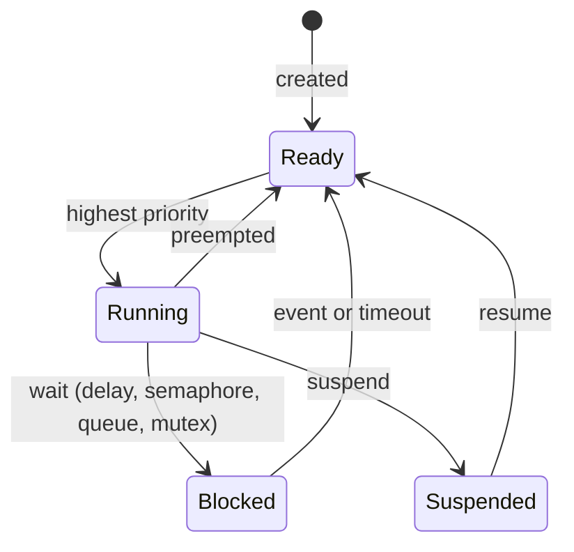
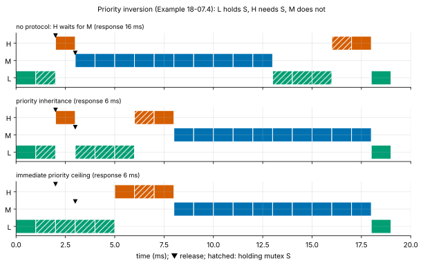

<!-- status: verified -->
# 18-07 · RTOS Concepts

| | |
|---|---|
| **Course** | [18 · Embedded Systems and Microcontrollers](../README.md) |
| **University equivalent** | The real-time operating systems unit of a senior embedded-systems course: tasks and context switching, fixed-priority and EDF scheduling with schedulability analysis, synchronization and priority inversion (Buttazzo, *Hard Real-Time Computing Systems*, chs. 4 and 7; Valvano, RTOS chapters) |
| **Prerequisites** | [18-03](18-03-interrupts-exceptions-timers.md) (exception model, response-time recurrence), [18-04](18-04-dma-and-data-movement.md) (ring buffers, races), [18-02](18-02-bare-metal-c-and-toolchain.md) (stacks and exception frames), [14-10](../../14-computer-organization-and-architecture/chapters/14-10-virtual-memory.md) (processes, the OS and protection) |
| **Estimated study hours** | 8 |
| **Last verified** | 2026-11-21 |

**Learning objectives.** After this chapter you can:

1. Explain what an RTOS kernel adds to a superloop: tasks, context switches, blocking services, and estimate their time and memory overhead.
2. Assign rate-monotonic priorities, apply the Liu & Layland and hyperbolic bounds, and derive the two-task bound.
3. Compute exact worst-case response times with interference and blocking, and decide schedulability.
4. Compare fixed-priority and earliest-deadline-first scheduling, including their behaviour near and beyond full load.
5. Choose between critical sections, semaphores, mutexes and queues, and explain priority inversion and how inheritance and ceiling protocols bound it.
6. Size queues and task stacks, and avoid deadlock.

## 1. Big picture

A microcontroller with more than a handful of concurrent jobs (sample a sensor every 10 ms, run a radio stack with its own deadlines, update a display, log to flash, watch the battery) can be programmed as one big loop plus interrupts, but every added job lengthens the loop, and every job's latency becomes the loop's worst iteration. A **real-time operating system (RTOS)** kernel instead runs each job as a **task** with its own stack and priority, switches between them in microseconds, and lets tasks sleep until an event, a message or a time arrives. It also brings the vocabulary and the mathematics to *prove* that every deadline is met, which is what "real-time" means: not fast, but predictably on time.

- **Where it shows up:** almost every connected MCU product. Bluetooth and Wi-Fi stacks, wearables, IoT nodes, motor drives with communication, and the sensor hubs of phones run an RTOS (FreeRTOS, Zephyr and many vendor or commercial kernels).
- **Why the analysis matters:** a schedule that "works on the bench" may fail at the rare moment when all tasks release together; response-time analysis finds that moment on paper.
- **Why synchronization matters:** sharing a bus or a buffer between tasks invites races, deadlock and **priority inversion**, the bug that famously disrupted the Mars Pathfinder lander in 1997 ([R-308]).
- **What it costs:** RAM for one stack per task, a few percent of CPU for ticks and switches, and a dependency on a kernel's correctness and licence.

## 2. Intuition first

**A kitchen with one cook.** A single cook (the CPU) prepares many dishes (tasks). In a superloop, the cook works through a fixed list in order: a dish that needs attention must wait until the cook comes round, however urgent. An RTOS gives the cook a rule: always work on the most urgent dish that is ready; put a dish down the moment something more urgent is ready (preemption), and never stand waiting for water to boil (blocking): start something else and come back when the timer rings. Each dish keeps its own workspace (a stack) so the cook can switch instantly.

**Priority inversion.** The cook is using the only frying pan for a low-priority dish when a high-priority order arrives that needs the pan. The high-priority order must wait for the pan: fair enough, briefly. But now a medium-priority dish that does not need the pan arrives, and the cook, following the rule, works on it, while the pan sits half-used and the urgent order waits behind a dish of lower importance. **Priority inheritance** says: whoever holds the pan inherits the priority of the most urgent order waiting for it, so the cook finishes with the pan first.

**Where the analogy breaks.** A cook can see everything at once; an RTOS knows only what the code tells it (which task holds which mutex, what each task waits for). And real kitchens have more cooks; this chapter's analysis is for one core.

## 3. Theory

### 3.1 From superloop to kernel

**Superloop.** `main` calls each job in turn forever; interrupts capture urgent events and set flags (18-03 §3.5). Its worst-case latency for any job is roughly one full loop iteration plus interrupts, and every added feature lengthens it. It is the right design for small, simple products: no kernel, one stack, easy to reason about.

**What a kernel adds.**

- **Tasks:** functions that run as if each had the CPU to itself, each with its own stack and a **task control block (TCB)** holding its saved stack pointer, priority and state.
- **A scheduler** that decides, at every event, which ready task runs.
- **Blocking services:** delays, semaphores, mutexes, queues and event flags, on which a task can wait without consuming CPU.
- **A time base:** a periodic **tick** interrupt (often 1 kHz) that advances the kernel's clock and wakes delayed tasks. **Tickless idle** stops the tick while nothing is due, so the MCU can sleep longer (18-09).

**The context switch on Cortex-M.** A switch saves the running task's registers on its own stack, stores its stack pointer in its TCB, loads the next task's stack pointer and restores its registers. Cortex-M was designed for this. Tasks run on the process stack pointer (PSP) and handlers on the main stack pointer (MSP). An exception already stacks R0–R3, R12, LR, PC and xPSR in hardware (18-02 §3.7), so the kernel's switch, usually in the **PendSV** handler at the lowest priority (18-03 §3.5), only saves and restores R4–R11 (and S16–S31 if the task used the FPU). Running the switch at the lowest priority means it never delays an interrupt: other handlers finish first, and the switch happens once on the way out.

**Overhead.** If the tick handler takes $c_{tick}$ at rate $f_{tick}$, and the system makes $n_{sw}$ switches per second at $c_{sw}$ each, the CPU fraction lost is

$$
u_{os} = f_{tick}\,c_{tick} + n_{sw}\,c_{sw} ,
$$

typically well under a percent at 1 kHz with microsecond-scale handlers (Example 18-07.1). Ticks at 10 kHz or very frequent switching make it noticeable.

### 3.2 Scheduling and rate-monotonic priorities

Model each task $i$ as periodic: a job is released every $T_i$, needs at most $C_i$ of CPU time (its **worst-case execution time**, WCET), and must finish within its relative deadline $D_i$, here equal to $T_i$ (implicit deadlines). Its **utilization** is $C_i/T_i$, and the task set's is $U = \sum_i C_i/T_i$. No single-core schedule can work if $U > 1$.

**Preemptive fixed priority.** Each task has a fixed priority; the scheduler always runs the highest-priority ready task, preempting lower ones at once. Tasks of equal priority may share the CPU in time slices (round robin), an option in most kernels.

**Rate-monotonic (RM) assignment:** the shorter the period, the higher the priority. Liu and Layland proved in 1973 that for independent periodic tasks with implicit deadlines on one core, RM is **optimal among fixed-priority assignments**: if any fixed assignment meets all deadlines, RM does. They also proved a sufficient utilization test:

$$
U \le n\left(2^{1/n} - 1\right),
$$

which is 1 for one task, 0.828 for two, 0.780 for three, and falls towards $\ln 2 = 0.693$ as $n \to \infty$. A task set under the bound is schedulable; one above it may or may not be (the test is sufficient, not necessary).

**Deriving the two-task bound.** Let $T_1 < T_2$ (task 1 has the higher priority) and, for the case that matters, $T_2 = T_1(1 + f)$ with $0 < f < 1$. Consider the **critical instant**, both tasks released together at $t = 0$, which is the worst case for task 2 (18-03 §3.4). We want the smallest $U$ at which the set is *just* schedulable, meaning task 2 fills exactly the time left to it before $T_2$.

*Case 1:* $C_1 \le T_2 - T_1$. Task 1's second job, released at $T_1$, finishes before $T_2$, so in $[0, T_2)$ task 1 uses $2C_1$ and task 2 can have $C_2 = T_2 - 2C_1$:

$$
U = \frac{C_1}{T_1} + \frac{T_2 - 2C_1}{T_2} = 1 + C_1\left(\frac{1}{T_1} - \frac{2}{T_2}\right).
$$

Because $T_2 < 2T_1$, the bracket is negative, so $U$ falls as $C_1$ grows, down to its smallest value at $C_1 = T_2 - T_1$.

*Case 2:* $C_1 \ge T_2 - T_1$. Task 1's second job runs past $T_2$, so task 2 must finish in the gap before $T_1$: $C_2 = T_1 - C_1$, and

$$
U = \frac{C_1}{T_1} + \frac{T_1 - C_1}{T_2} = \frac{T_1}{T_2} + C_1\left(\frac{1}{T_1} - \frac{1}{T_2}\right),
$$

which rises with $C_1$, so its smallest value is again at $C_1 = T_2 - T_1$. Substituting $C_1 = T_2 - T_1 = fT_1$ into either form:

$$
U(f) = 1 + f - \frac{2f}{1 + f} = \frac{1 + f^2}{1 + f} .
$$

Setting $dU/df = (f^2 + 2f - 1)/(1 + f)^2 = 0$ gives $f = \sqrt2 - 1$, and

$$
U_{min} = \frac{1 + (\sqrt2 - 1)^2}{\sqrt2} = \frac{4 - 2\sqrt2}{\sqrt2} = 2(\sqrt2 - 1) = 0.828 .
$$

Two steps complete the argument. First, why $T_2 < 2T_1$ is the case that matters: Liu and Layland show that any just-schedulable pair with $T_2 \ge 2T_1$ can be transformed into one with $T_2 < 2T_1$ that is still just schedulable and has no higher utilization, so the minimum lies in the case $1 < T_2/T_1 < 2$. Second, from "the smallest $U$ of a just-schedulable set" to "every set below it is schedulable": take any set that misses a deadline and reduce $C_2$ until it just fits; that lowers $U$, so every unschedulable set has $U$ above the minimum of a just-schedulable one. Any two-task set with $U \le 0.828$ is therefore schedulable. The $n$-task bound follows the same idea with more bookkeeping (Liu & Layland's paper). Two sharper tests are worth knowing. The **hyperbolic bound** $\prod_i (U_i + 1) \le 2$ (Bini, Buttazzo and Buttazzo, 2003) is also sufficient and accepts more task sets. And **harmonic** task sets, where every period divides the longer ones, are RM-schedulable up to $U = 1$.

### 3.3 Exact response-time analysis

The utilization bounds are quick but pessimistic. The exact test for fixed priorities is the response-time recurrence already used for interrupts in 18-03 §3.4, now applied to tasks:

$$
R_i = C_i + B_i + \sum_{j \in hp(i)} \left\lceil \frac{R_i}{T_j} \right\rceil C_j ,
$$

where $hp(i)$ are the higher-priority tasks and $B_i$ is the longest **blocking**: the longest time task $i$ can be kept from running by a lower-priority task. That includes a critical section on a mutex task $i$ needs, an interval with interrupts or preemption disabled, and, under the mutex protocols of §3.4, a critical section on a mutex task $i$ does *not* use but whose ceiling is at or above $i$'s priority (ceiling blocking), or that a lower task holds at an inherited priority above $i$'s (push-through blocking). Iterate from $R_i = C_i + B_i$ until it converges (the task meets its deadline if $R_i \le D_i$) or exceeds $D_i$. Interrupt handlers count as the highest-priority "tasks", and kernel overhead can be folded into each $C_i$. Two generalizations come up constantly. **Sporadic** tasks, released by events rather than a clock, are analysed with their *minimum* inter-arrival time in place of $T_j$, which is exactly what 18-03 did for interrupts. And when deadlines are shorter than periods ($D_i < T_i$), **deadline-monotonic** priorities (shorter deadline, higher priority) are the optimal fixed assignment; RM is its special case for $D_i = T_i$. Release **jitter** from tick-driven releases (a task released up to one tick late) adds to $R_i$ and to the interference it causes. The test is exact for independent periodic tasks under the critical-instant assumption, and it is what certification-minded teams compute (Example 18-07.2).

**Earliest deadline first (EDF)** schedules the ready job with the nearest absolute deadline, so priorities change from job to job. On one core with implicit deadlines EDF is optimal: it meets all deadlines whenever $U \le 1$ (Liu & Layland), so it uses the CPU fully where RM may fail (Example 18-07.3). The costs are a more complex scheduler, harder reasoning about which task suffers, and poor behaviour under **overload**. When $U > 1$, EDF can miss deadlines in a cascade across many tasks, while fixed priority sacrifices the lowest-priority tasks first and protects the most important ones. Most MCU RTOSes are therefore fixed-priority; EDF appears in some kernels and in research.

### 3.4 Sharing resources: critical sections, semaphores and mutexes

Tasks that share data or a peripheral (an I²C bus, a buffer, a file) need mutual exclusion, or they corrupt it (the read-modify-write race of 18-02 §3.6, applied to tasks). The tools, from bluntest to finest:

- **Disabling interrupts** (or raising BASEPRI, 18-03 §3.3) for a few instructions. It is fast and works with interrupt handlers too, but it delays every interrupt: it is a blocking term for everything, so it must stay short and bounded.
- **Locking the scheduler** (no task switches, interrupts still run), for slightly longer sections touched only by tasks.
- **Semaphores:** a counter with *take* (wait while zero, then decrement) and *give* (increment, waking a waiter). A **binary semaphore** is the classic way for an interrupt handler to wake a task ("data ready"); a **counting semaphore** counts events or free resources.
- **Mutexes:** binary locks with an **owner**. Only the task that took a mutex may give it back, which lets the kernel apply priority inheritance. Use mutexes for mutual exclusion and semaphores for signalling.
- **Queues:** copy messages between tasks or from handlers to tasks, so that data has one owner at a time. Often they remove the need for a lock altogether (§3.5).

**Priority inversion.** Let task L (low) hold a mutex that task H (high) needs. H must wait for L's critical section; that is unavoidable and bounded by its length. The danger is a medium task M, which needs no mutex: it preempts L, so H now waits for M too, and for any number of medium tasks. The inversion is **unbounded** (Example 18-07.4).

*Example 18-07.4 in the lab's simulator. Without a protocol, M runs while L holds the mutex and H waits behind both; with inheritance L finishes its critical section at H's priority; with a ceiling L runs at H's priority from the moment it locks, so H is delayed before it starts instead of in the middle.*

The two standard cures bound H's blocking to one critical section of a lower-priority task:

- **Priority inheritance:** while L holds a mutex that H waits for, L runs at H's priority, so M cannot preempt it. In FreeRTOS's words, "the priority of the task holding the token is temporarily raised to that of the blocking task", but "Priority inheritance does not cure priority inversion! It just minimises its effect in some situations" ([R-308]) **[Established]**. With several mutexes a task can be blocked several times: under inheritance, at most once for each lower-priority task and at most once for each mutex that can block it, so at most min($n$, $m$) critical sections for $n$ lower tasks and $m$ such mutexes (Sha, Rajkumar and Lehoczky's bound), and a medium task can suffer **push-through** blocking from a low task running at a high task's inherited priority, on a mutex the medium task never uses. Chains of inheritance are possible.
- **Priority ceiling** (in its simplest, "immediate" form): each mutex has a ceiling, the highest priority of any task that uses it, and a task that locks it runs at the ceiling at once. A task can then be blocked at most once, by one critical section, before it starts, and deadlock between mutexes is impossible. The cost is that the ceilings must be known in advance and some tasks are delayed unnecessarily.

With either protocol, $B_i$ in the recurrence is the longest critical section of a lower-priority task on a mutex whose ceiling is at least task $i$'s priority (for the ceiling protocol; inheritance can add one such section per mutex).

**Mars Pathfinder, 1997.** After the lander reached Mars on 4 July 1997, its software began to misbehave. In the account of JPL's flight-software lead, "the higher priority bc_dist task was blocked by the much lower priority ASI/MET task that was holding a shared resource", while medium-priority tasks ran. The fix, uploaded from Earth, was to "change the creation flags for the semaphore so as to enable the priority inheritance" ([R-308]) **[Established]**. The lesson is that inversion is a property of the design, best found by analysis rather than by hoping a test hits the rare timing.

**Deadlock.** If task A takes mutex 1 then mutex 2 while task B takes mutex 2 then mutex 1, each can end up waiting forever for the other. The standard prevention is a global **lock order**: every task acquires mutexes in the same order. Timeouts on every take turn a deadlock into a detectable error, and the ceiling protocol prevents it by construction.

### 3.5 Communication and interrupt deferral

**Queues** carry fixed-size messages, copied in and out, with blocking on full (sender) and empty (receiver). A queue between a producer and a consumer must hold everything produced while the consumer cannot run. If the producer makes at most one item every $P$ and the consumer can be held off for up to $S$, the queue needs at least

$$
N \ge \left\lfloor \frac{S}{P} \right\rfloor + 1
$$

slots, the same reasoning as the DMA buffers of 18-04 §3.3 (Example 18-07.5).

**Deferring interrupt work.** Interrupt handlers stay short (18-03 §3.5) and hand work to tasks: the handler gives a semaphore, sends to a queue or sets an event flag using the kernel's interrupt-safe variants (FreeRTOS's `...FromISR` functions), and the woken task does the processing at its own priority. Handlers must never block. An interrupt-safe call does not switch tasks itself: in FreeRTOS the `...FromISR` call reports, through a flag, whether it woke a higher-priority task, and the handler then calls `portYIELD_FROM_ISR` with that flag, which pends PendSV so that the switch happens on the way out of the interrupt.

**Event flags and notifications** let a task wait for any or all of several events. Direct-to-task notifications (FreeRTOS) are a lightweight one-to-one form, cheaper than a semaphore.

### 3.6 Memory and determinism

- **One stack per task.** Each task's stack must hold its deepest call chain plus one exception frame (32 bytes, or 104 with FPU state, 18-02 §3.7) and the kernel's saved registers. Interrupts use the main stack, so only the frame lands on the task's stack. RAM for an RTOS design is dominated by stacks (Example 18-07.6).
- **Measure, then add margin.** Kernels fill stacks with a pattern and report the "high-water mark" left untouched. Stack-overflow checks and an MPU guard region catch overflows during development.
- **Allocate statically.** Creating tasks and queues from static memory, and avoiding the heap after start-up, makes memory use fixed and analyzable; dynamic allocation risks fragmentation and run-time failure.
- **Bound everything.** Every loop, every critical section and every wait needs a known upper bound; otherwise $C_i$ and $B_i$ are unknown, and so is the schedule.

### 3.7 FreeRTOS and Zephyr

Two open-source kernels are widely used for MCUs and are the ones this chapter's examples draw on. As of Nov 2026 ([R-308]) **[Established]**:

- **FreeRTOS** is a small kernel (tasks, queues, semaphores, mutexes with priority inheritance, timers, notifications), ported to most MCU architectures. The current kernel release is V11.3.3 (29 Oct 2026), and the long-term-support line is 202604 LTS (kernel 11.3.0), maintained "for at least two years following their release".
- **Zephyr** is a larger RTOS with a device model, drivers, networking and Bluetooth stacks and a Kconfig/devicetree build system. The current release is 4.5.0 (28 Oct 2026); the long-term-support release is 3.7 (supported until July 2029), and 4.6, planned for April 2027, is to be the next LTS.

The choice between them is less about scheduling, which both do with preemptive fixed priorities, than about ecosystem. FreeRTOS fits small parts and teams that bring their own drivers; Zephyr brings drivers, connectivity and security features in exchange for size and a steeper learning curve. Commercial kernels add safety certification and support.

## 4. Worked examples

### Example 18-07.1 · What the kernel costs (tier A)

**Setup.** A kernel ticks at 1 kHz with a 3 µs tick handler and performs 400 context switches a second at 2.5 µs each. (a) What fraction of the CPU does it use? (b) Repeat with a 10 kHz tick.

**Solution.** (a) $1000 \times 3\ \mu\text{s} + 400 \times 2.5\ \mu\text{s} = 4$ ms per second = **0.4** %.

(b) $10\,000 \times 3\ \mu\text{s} + 1$ ms = 31 ms per second = **3.1** %. The tick rate dominates; tickless idle removes it while idle.

**Units check.** (1/s) × s = dimensionless.

**Sanity check.** A microsecond-scale handler at a kilohertz is a few parts in a thousand.

### Example 18-07.2 · Beyond the bound (tier B)

**Setup.** Three tasks have $(C, T)$ = (1, 4), (2, 6) and (3, 12) ms. (a) Assign RM priorities and compute $U$ and the Liu & Layland bound. (b) Apply the hyperbolic bound. (c) Compute the exact response times.

**Solution.** (a) Priorities by period: A (4 ms) highest, then B, then C. $U = 1/4 + 2/6 + 3/12$ = **0.833**, above the bound $3(2^{1/3} - 1)$ = **0.780**: the bound is inconclusive.

(b) $(1.25)(1.333)(1.25)$ = **2.083** > 2: also inconclusive.

(c) $R_A$ = **1** ms. $R_B = 2 + \lceil R/4\rceil \cdot 1$: from 2, $2 + 1 = 3$, then $\lceil 3/4 \rceil = 1$ gives 3: $R_B$ = **3** ms. For C, start at 3: $3 + \lceil 3/4\rceil + 2\lceil 3/6\rceil = 6$; then $3 + 2 + 2\cdot1 = 7$; then $3 + 2 + 2\cdot2 = 9$; then $3 + 3 + 4 = 10$; then $3 + \lceil 10/4\rceil + 2\lceil 10/6\rceil = 3 + 3 + 4 = 10$: $R_C$ = **10** ms ≤ 12 ms. All deadlines are met, and the lab's simulator, run over 20 hyperperiods, observes the same worst cases.

**Units check.** All in ms.

**Sanity check.** At the critical instant, C must wait for A's first three jobs (3 ms) and B's first two (4 ms) as well as run its own 3 ms: 10 ms.

### Example 18-07.3 · Where RM fails and EDF succeeds (tier B)

**Setup.** Two tasks have $(C, T)$ = (2, 5) and (4, 7) ms. (a) Compute $U$. (b) Is the set RM-schedulable? (c) Under EDF? (d) What does the simulator report?

**Solution.** (a) $2/5 + 4/7$ = **0.971**, above the two-task bound of 0.828.

(b) $R_B$: from 4, $4 + \lceil 4/5\rceil \cdot 2 = 6$; then $4 + \lceil 6/5\rceil \cdot 2 = 8$ > 7: B misses its deadline. **No.**

(c) $U \le 1$, so EDF meets every deadline.

(d) Over 10 hyperperiods (350 ms) the RM schedule misses **10** of B's 50 deadlines, the first when B's first job finishes at 8 ms; EDF misses none, with worst response times of **4** ms (A) and **6** ms (B). EDF met B's deadlines by sometimes delaying A, whose worst response doubles from 2 to 4 ms.

**Units check.** ms throughout.

**Sanity check.** In $[0, 7)$, RM gives A 4 ms (jobs at 0 and 5) and B only 3 of its 4 ms.

### Example 18-07.4 · Priority inversion, three ways (tier B)

**Setup.** One-shot jobs (times in ms): L (low priority) starts at 0, runs 1, then holds mutex S for 4, then runs 1. H (high) arrives at 2, runs 1, needs S for 1, then runs 1. M (medium) arrives at 3 and computes for 10 without S. Find H's response time (a) with no protocol, (b) with priority inheritance, (c) with an immediate priority ceiling. (d) What blocking bound does the analysis give?

**Solution.** (a) H runs 2–3, then waits for S. M arrives at 3 and preempts L, running 3–13; L finishes its critical section 13–16; H runs 16–18. Response **16** ms: H waited for a task that does not even use the mutex.

(b) At 3, L inherits H's priority, so M cannot preempt it: L finishes S at 6, H runs 6–8. Response **6** ms.

(c) L runs at the ceiling (H's priority) from the moment it locks S at 1, so H cannot even start until S is free at 5; H runs 5–8. Response **6** ms, the same, with the blocking moved to H's start.

(d) H's blocking is at most L's critical section, $B_H$ = **4** ms, so $R_H \le C_H + B_H$ = **7** ms, consistent with the 6 ms observed (L had already done 1 ms of its section when H arrived). The lab's simulator reproduces all three timelines.

**Units check.** ms.

**Sanity check.** Without a protocol, H's delay grows with M's length: make M 100 ms and H waits over 100 ms.

### Example 18-07.5 · Sizing a queue (tier B)

**Setup.** A sensor task sends a 24-byte record every 10 ms to a logger task, which can be held off for up to 45 ms by flash writes. (a) How many queue slots are needed? (b) How much RAM does the queue's storage take? (c) What happens if the stall can reach 50 ms?

**Solution.** (a) $\lfloor 45/10\rfloor + 1$ = **5** slots.

(b) $5 \times 24$ = **120** bytes (plus the kernel's queue control block).

(c) $\lfloor 50/10\rfloor + 1$ = **6**: a record released at the very start of the stall and one at its end are both waiting. Off-by-one errors at the boundaries are exactly where queues overflow.

**Units check.** ms/ms is a count.

**Sanity check.** Five records span 40 ms between first and last, within a 45 ms stall.

### Example 18-07.6 · The RAM bill (tier B)

**Setup.** Six tasks have stacks of 512, 512, 1024, 1024, 2048 and 768 bytes; the kernel adds an idle task with 256 bytes. Each task's control block takes 92 bytes. The part has 32 KiB of SRAM. (a) What do the tasks take? (b) What fraction of SRAM is that? (c) A superloop version would need one 2 KiB stack. How much RAM does the RTOS design cost in addition?

**Solution.** (a) Stacks $512 + 512 + 1024 + 1024 + 2048 + 768 + 256 = 6144$ bytes; control blocks $7 \times 92 = 644$; total **6788** bytes.

(b) $6788/32\,768$ = **20.7** %.

(c) $6788 - 2048$ = **4740** bytes, the price of independent stacks. Shrinking stacks to their measured high-water marks plus margin usually recovers much of it.

**Units check.** Bytes.

**Sanity check.** Seven tasks averaging about 1 KiB each is about 7 KiB.

<!-- answer-key -->

| ID | Quantity | Value | Unit |
|---|---|---|---|
| Txt 18-07.a | Liu & Layland bound, n = 2 | 0.828 | — |
| Txt 18-07.b | Liu & Layland bound, n = 3 | 0.780 | — |
| Txt 18-07.c | limit as n grows, ln 2 | 0.693 | — |
| Ex 18-07.1a | kernel overhead at 1 kHz | 0.4 | % |
| Ex 18-07.1b | kernel overhead at 10 kHz | 3.1 | % |
| Ex 18-07.2a | utilization | 0.833 | — |
| Ex 18-07.2b | Liu & Layland bound, n = 3 | 0.780 | — |
| Ex 18-07.2c | hyperbolic product | 2.083 | — |
| Ex 18-07.2d | R_A | 1 | ms |
| Ex 18-07.2e | R_B | 3 | ms |
| Ex 18-07.2f | R_C | 10 | ms |
| Ex 18-07.3a | utilization | 0.971 | — |
| Ex 18-07.3b | RM deadline misses in 10 hyperperiods | 10 | — |
| Ex 18-07.3c | EDF worst response, A | 4 | ms |
| Ex 18-07.3d | EDF worst response, B | 6 | ms |
| Ex 18-07.4a | H's response, no protocol | 16 | ms |
| Ex 18-07.4b | H's response, inheritance | 6 | ms |
| Ex 18-07.4c | H's response, ceiling | 6 | ms |
| Ex 18-07.4d | blocking bound | 4 | ms |
| Ex 18-07.4e | response-time bound | 7 | ms |
| Ex 18-07.5a | queue slots for 45 ms | 5 | — |
| Ex 18-07.5b | queue storage | 120 | bytes |
| Ex 18-07.5c | queue slots for 50 ms | 6 | — |
| Ex 18-07.6a | RAM for tasks | 6788 | bytes |
| Ex 18-07.6b | fraction of SRAM | 20.7 | % |
| Ex 18-07.6c | cost over a superloop | 4740 | bytes |

*Every value is recomputed by [verify_18_07.py](../verify/verify_18_07.py): bounds by direct arithmetic and the two-task bound by numerical minimization, response times by an independent implementation of the recurrence, and every schedule (RM, EDF, the three inversion timelines) by the lab's discrete-time kernel simulator.*

## 5. Simulate it

The lab, [labs/18-07-lab](../labs/18-07-lab/README.md), provides `rtsched.py`, a discrete-time simulator of a single-core kernel (fixed priority or EDF; mutexes with no protocol, inheritance or ceiling), with the classical tests. **Predict, then run**:

1. **The two-task bound.** Predict the least utilization at which a two-task set can just fail; sweep $T_2/T_1$ and $C_1$ and find the minimum numerically.
2. **Bounds against exactness.** Generate random three-task sets; predict which fraction the Liu & Layland bound, the hyperbolic bound and exact analysis each accept at $U$ = 0.8 and 0.9; run.
3. **RM against EDF.** Predict the first deadline miss of Example 18-07.3 under RM; simulate both; then raise B's WCET until EDF fails and watch which tasks miss.
4. **Priority inversion.** Predict H's response in Example 18-07.4 as M grows from 0 to 20 ms with each protocol; plot.
5. **Queues.** Simulate a producer every 10 ms and a consumer with random stalls up to 45 ms; find the deepest queue occupancy.

## 6. Engineering tradeoffs

| Knob | Improves | Costs | Typical decision owner |
|---|---|---|---|
| RTOS instead of superloop | latency of urgent work, modularity | RAM (stacks), CPU overhead, kernel dependency | firmware architect |
| Higher tick rate | timing resolution | CPU overhead, sleep time | firmware lead |
| Tickless idle | battery life | timer complexity, wake-up latency | firmware lead |
| EDF instead of fixed priority | full CPU utilization | overload behaviour, analysis effort | firmware architect |
| Priority ceiling instead of inheritance | one blocking at most, no deadlock | ceilings must be configured | firmware lead |
| More tasks | separation of concerns | stacks, switches, synchronization bugs | firmware architect |
| Static allocation | determinism, analyzability | flexibility | firmware lead |
| Zephyr instead of FreeRTOS | drivers, networking, security features | footprint, learning curve | system architect |

## 7. Numbers to know

| Quantity | Value | Note |
|---|---|---|
| Liu & Layland bound | 1, 0.828, 0.780, … → 0.693 | $n(2^{1/n} - 1)$ for $n$ = 1, 2, 3, ∞ |
| Hyperbolic bound | $\prod (U_i + 1) \le 2$ | sufficient, sharper |
| EDF (one core, implicit deadlines) | $U \le 1$ | necessary and sufficient |
| Kernel overhead | $f_{tick}c_{tick} + n_{sw}c_{sw}$ | 0.4% in Example 18-07.1 |
| Cortex-M switch | saves R4–R11 (+ S16–S31) in PendSV | hardware stacks the rest |
| Exception frame on a task stack | 32 bytes (104 with FPU) | 18-02 §3.7 |
| Queue slots | $\lfloor S/P \rfloor + 1$ | stall $S$, period $P$ |
| FreeRTOS | V11.3.3 (Oct 2026); 202604 LTS | [R-308] |
| Zephyr | 4.5.0 (Oct 2026); LTS 3.7, next LTS 4.6 (Apr 2027) | [R-308] |

## 8. Common mistakes

- **Treating "it works on the bench" as schedulability.** The critical instant is rare; compute response times.
- **Using a binary semaphore as a mutex.** It has no owner, so no inheritance: unbounded inversion.
- **Blocking in an interrupt handler,** or calling a non-interrupt-safe kernel function from one.
- **Long critical sections with interrupts disabled.** They are blocking for everything, including the most urgent handler.
- **Inconsistent lock order** between tasks: deadlock under the right interleaving.
- **Guessing stack sizes.** Measure high-water marks under worst-case paths, including interrupt frames, and keep overflow detection on.
- **Assigning priorities by importance rather than by rate or deadline.** Importance matters under overload; schedulability depends on periods and deadlines.
- **Polling inside a task.** A task that spins burns the CPU that lower-priority tasks need; block on an event instead.

## 9. Practitioner lens

### State of the art (as of Nov 2026)

- **FreeRTOS** V11.3.3 (29 Oct 2026) is current, with a 202604 LTS line (kernel 11.3.0) supported for at least two years; its mutexes implement priority inheritance, which its documentation describes as minimising, not curing, inversion ([R-308]) **[Established]**.
- **Zephyr** 4.5.0 (28 Oct 2026) is current; 3.7 is the long-term-support release until July 2029, and 4.6 (April 2027) is to be the next LTS ([R-308]) **[Established]**.
- **Analysis practice:** fixed-priority scheduling with response-time analysis, static allocation and measured stack margins is the norm in safety-related firmware; EDF remains rare in commercial MCU kernels **[Industry estimate]**.

### Why it matters commercially

- **The RTOS is a platform decision.** It fixes driver models, connectivity stacks, security features and the skills a team needs; switching later is expensive.
- **Certification.** Medical, automotive and industrial products need kernels with safety evidence (or certified commercial kernels), which affects licensing and supplier choice.
- **Silicon vendors compete on software.** An MCU's value in a design win increasingly includes its RTOS support, drivers and examples, not only its datasheet.

### Marketing vs Reality

- **"Hard real-time OS."** A kernel cannot make an application real-time; deadlines are met by the task design, WCETs and analysis. Ask for worst-case interrupt latency and switch times on a stated part and clock.
- **"Zero-latency interrupts."** Usually means interrupts above a configured priority are never masked by the kernel, so they cannot use kernel services; the latency of the hardware remains.
- **"Supports priority inheritance."** Good, but it bounds blocking per mutex, not overall; nested locks and inheritance chains still need analysis.
- **"Certified."** Ask which standard, which version, which configuration, and whether the certificate covers your compiler and part.

### Questions for engineering leaders

1. **"Which tasks have hard deadlines, and how did you show they are met?"** *Strong:* WCETs measured or analyzed, a response-time analysis including interrupts and blocking, and margin. *Evasive:* "the CPU is only at 60%".
2. **"How do tasks share the I²C bus (or flash, or radio)?"** *Strong:* mutexes with inheritance or a single owner task with a queue, bounded critical sections. *Evasive:* "we disable interrupts around it".
3. **"How much RAM do stacks take, and what margin do they have?"** *Strong:* high-water marks from worst-case tests and an overflow guard. *Evasive:* "we gave each task 4 KiB".
4. **"Why this RTOS?"** *Strong:* ecosystem, licence, certification and team skills weighed against footprint. *Evasive:* "it's what the vendor example used".
5. **"What happens under overload?"** *Strong:* which tasks degrade first and how it is detected (deadline-miss counters, watchdogs). *Evasive:* "it doesn't overload".

## 10. Concept check

**Q1.** Why can a superloop's worst-case latency be much worse than an RTOS's for the same work?

Answer

In a superloop, an event handled in the loop waits for the rest of the current iteration, so its latency is the longest path through every job. In a preemptive RTOS, the task handling it preempts lower-priority work at once; its latency depends only on higher-priority work and blocking.

**Q2.** A task set has $U$ = 0.85 with three tasks. What can you conclude from the Liu & Layland bound?

Answer

Nothing: 0.85 exceeds the three-task bound of 0.780, but the bound is only sufficient. Run response-time analysis (or the hyperbolic test) to decide.

**Q3.** Why does the kernel switch contexts in PendSV at the lowest priority?

Answer

So that a switch never delays an interrupt handler: all other handlers finish first, and several requests for a switch during nested interrupts collapse into one switch on the way out. The hardware has already stacked half the registers on exception entry.

**Q4.** What is the difference between a mutex and a binary semaphore?

Answer

A mutex has an owner, the task that took it, and only that task may give it back; that lets the kernel raise the owner's priority (inheritance). A binary semaphore has no owner and is used for signalling, for example from an interrupt to a task.

**Q5.** How does priority inheritance bound priority inversion, and what does it not prevent?

Answer

The low-priority holder runs at the blocked task's priority, so medium tasks cannot preempt it, and the high task waits at most for the rest of that critical section. It does not prevent deadlock, multiple blocking (once per mutex) or chains of inheritance with nested locks.

**Q6.** Why might a team prefer fixed priority to EDF even though EDF schedules more task sets?

Answer

Fixed priority is simpler, supported by every MCU kernel, and degrades predictably under overload (the lowest-priority tasks miss first). EDF can cascade misses across many tasks when overloaded, and its analysis is less familiar.

**Q7.** Two tasks each lock mutexes A and B. How do you make deadlock impossible?

Answer

Make every task acquire them in the same global order (A before B). Alternatively, use the priority ceiling protocol, or take both under one lock, and put timeouts on takes to detect violations.

**Problems:** [18-07 problem set](../problems/18-07-problems.md) · [Worked solutions](../solutions/18-07-solutions.md)

## 11. Key terms

[Real-time operating system (RTOS)](../../../reference/glossary.md#real-time-operating-system-rtos) · [Task control block (TCB)](../../../reference/glossary.md#task-control-block-tcb) · [Context switch](../../../reference/glossary.md#context-switch) · [Worst-case execution time (WCET)](../../../reference/glossary.md#worst-case-execution-time-wcet) · [Rate-monotonic scheduling](../../../reference/glossary.md#rate-monotonic-scheduling) · [Earliest deadline first (EDF)](../../../reference/glossary.md#earliest-deadline-first-edf) · [Response-time analysis](../../../reference/glossary.md#response-time-analysis) · [Semaphore](../../../reference/glossary.md#semaphore) · [Mutex](../../../reference/glossary.md#mutex) · [Priority inversion](../../../reference/glossary.md#priority-inversion) · [Priority inheritance](../../../reference/glossary.md#priority-inheritance) · [Priority ceiling protocol](../../../reference/glossary.md#priority-ceiling-protocol) · [Deadlock](../../../reference/glossary.md#deadlock) · [Tickless idle](../../../reference/glossary.md#tickless-idle)

## 12. Connections

- **Builds on:** [18-03](18-03-interrupts-exceptions-timers.md) (exceptions, PendSV, the response-time recurrence), [18-04](18-04-dma-and-data-movement.md) (buffers and races), [18-02](18-02-bare-metal-c-and-toolchain.md) (stacks and frames), [14-10](../../14-computer-organization-and-architecture/chapters/14-10-virtual-memory.md) (processes and protection in a full OS).
- **Next:** [18-08](18-08-boot-and-firmware-update.md) (boot and firmware update).
- **Used later:** [18-09](18-09-ultra-low-power-design.md) (tickless idle and duty cycling), [18-10](18-10-sensors.md) (sensor tasks and queues), [18-11](18-11-hardware-security.md) (isolating tasks with the MPU and TrustZone).

## 13. Further study

- Buttazzo, G., *Hard Real-Time Computing Systems*, 3rd ed., Springer, 2011: chapters 4 (periodic scheduling, RM and EDF) and 7 (resource-access protocols).
- Liu, C. L. and Layland, J. W., "Scheduling algorithms for multiprogramming in a hard-real-time environment", *Journal of the ACM* 20(1), 1973.
- Barry, R., *Mastering the FreeRTOS Real Time Kernel* (free tutorial book, freertos.org).
- The Zephyr Project documentation: kernel services and scheduling.

## 14. Sources

1. Liu, C. L. and Layland, J. W., "Scheduling algorithms for multiprogramming in a hard-real-time environment", *J. ACM* 20(1):46–61, 1973.
2. Sha, L., Rajkumar, R. and Lehoczky, J. P., "Priority inheritance protocols: an approach to real-time synchronization", *IEEE Trans. Computers* 39(9), 1990.
3. Bini, E., Buttazzo, G. C. and Buttazzo, G. M., "Rate monotonic analysis: the hyperbolic bound", *IEEE Trans. Computers* 52(7), 2003.
4. Buttazzo, G., *Hard Real-Time Computing Systems*, 3rd ed., Springer, 2011.
5. [R-308] FreeRTOS kernel history and LTS pages; FreeRTOS mutex documentation; Zephyr release index; G. Reeves's Mars Pathfinder account (RISKS 19.54) and RISKS 19.49.
