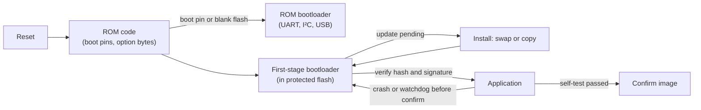
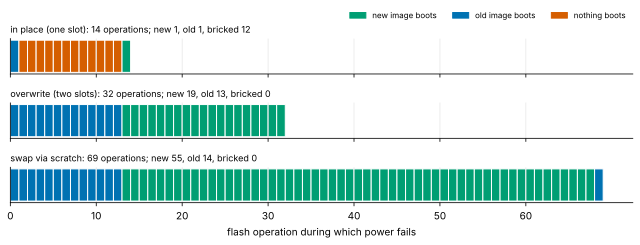

<!-- status: verified -->
# 18-08 · Boot, Bootloaders and Firmware Update

| | |
|---|---|
| **Course** | [18 · Embedded Systems and Microcontrollers](../README.md) |
| **University equivalent** | The boot, bootloader and field-update unit of a senior embedded or IoT systems course (secure boot and over-the-air update chapters of IoT security courses; IETF RFC 9019 as reading) |
| **Prerequisites** | [18-02](18-02-bare-metal-c-and-toolchain.md) (vector table, linker scripts, startup code), [18-01](18-01-microcontroller-architecture.md) (flash and memory map), [18-07](18-07-rtos-concepts.md) (tasks in an application), [18-03](18-03-interrupts-exceptions-timers.md) (watchdogs), [17-08](../../17-communication-systems/chapters/17-08-channel-coding.md) (error detection) |
| **Estimated study hours** | 5 |
| **Last verified** | 2026-11-21 |

**Learning objectives.** After this chapter you can:

1. Trace an MCU's boot from reset through a ROM bootloader and a first-stage bootloader to the application, and explain what each stage checks.
2. Lay out flash for single-slot, overwrite, swap and direct-execute (A/B) update schemes, and compute the largest image each allows.
3. Estimate installation time, flash wear and boot-time verification cost.
4. Explain why an update must survive power loss at any instant, and how progress records and test-then-confirm make it do so.
5. Describe image authentication (hashes, signatures, anti-rollback counters) and the IETF and Arm update standards at BSEE depth.
6. Quantify the business risk of an unsafe update design.

## 1. Big picture

A product's firmware is never finished: it ships with bugs, gains features, and must be patched when vulnerabilities appear. A **firmware update** replaces the code in a device's flash while the device is in a customer's hands, often over a radio, often on battery, and with nobody to press a button if it goes wrong. The code that makes this safe is the **bootloader**: the first software to run after reset, which decides which image to start, checks that it is genuine and intact, installs a newly downloaded image, and falls back to the old one if the new one fails. Getting it wrong turns one bad update into a fleet of "bricked" devices.

- **Where it shows up:** every connected product (wearables, phones' sensor hubs, smart-home devices, cars' electronic control units, industrial sensors), and every MCU through its built-in ROM bootloader used for factory programming.
- **What drives the design:** flash size (two images need about twice the space), power-loss safety, update time, flash endurance, security (only the vendor's images may run, and old vulnerable images must not be reinstalled), and the update requirements of customers, certification schemes and regulators.
- **What this chapter adds:** the mechanics (layouts, state machines, recovery) and the arithmetic (space, time, wear, risk); 18-11 covers the cryptography and the hardware roots of trust in more depth.

## 2. Intuition first

**Renovating the only bridge.** A town has one bridge (the firmware). Rebuilding it in place closes the town until it is done, and if the builders stop halfway (a power cut) the town is cut off for good: that is an in-place update. Build a second bridge beside the first, open it when finished and keep the old one until traffic flows well, and nothing is ever cut off: that is a two-slot update with rollback. The price is the land for two bridges (twice the flash) and the time to build.

**A notary at the gate.** The bootloader is a notary who checks the seal on every image before letting it run: an intact hash proves the image was not corrupted, and a valid signature proves it came from the vendor. The notary's own rules (the public key, the minimum allowed version) must be unforgeable, so they live in memory the image cannot rewrite: ROM, one-time-programmable fuses or protected flash.

**Where the analogies break.** Flash does not change all at once: it is erased and written sector by sector, and power can fail between any two operations, or in the middle of one. Safety therefore comes from ordering operations and recording progress so that every interrupted state can be finished or undone, not from building fast.

## 3. Theory

### 3.1 The boot sequence

On reset a Cortex-M core loads its initial stack pointer and reset vector from the vector table at the address set by the boot configuration (18-02 §3.5). In practice several stages run before the application's `main`:

1. **ROM code.** Many MCUs execute vendor code in mask ROM first. It reads boot pins or option bytes, may enable protections, and either jumps to flash or enters a **ROM bootloader**. For example, TI's MSPM0G350x bootstrap loader "enables configuration of the device as well as programming of the device memory through a UART or I2C serial interface"; it is entered by an invoke pin, automatically on a blank device, or by a software command, and it is password-protected. Raspberry Pi's RP2040 boot ROM provides a "USB MSC class-compliant bootloader with UF2 support" ([R-309]) **[Established]**. ROM bootloaders cannot be erased, which makes them the last-resort recovery path and the factory programming path.
2. **First-stage bootloader** in a protected region at the start of flash (for example MCUboot, which describes itself as "a secure bootloader for 32-bits microcontrollers" [R-309]). It checks for a pending update and installs it, verifies the image it is about to run, and jumps to it.
3. **Jump to the application.** The bootloader sets the vector-table offset register (VTOR) to the application's vector table, loads the application's initial stack pointer into MSP, and branches to its reset handler. From there the application's own startup code runs as in 18-02. Peripherals and interrupts the bootloader used must be returned to their reset state first.

### 3.2 Image format and flash layout

A firmware **image** is the application binary with a **header** (a magic number, the version, sizes, a security counter) and **trailer** metadata: a hash (for example SHA-256) and a signature over header and code, plus status fields the bootloader updates during installation. Flash is divided into **slots**:

- **Single slot.** One copy of the application. Updates are written over it, either by the application itself (dangerous: see §3.4) or by the bootloader from an external flash or a ROM bootloader.
- **Two slots (primary and secondary).** The application runs from the primary slot; a new image is downloaded into the secondary while the old one keeps running. Installation copies or swaps it into the primary.
- **Two executable slots (A/B, "direct execute").** Each slot can run in place, with code linked for its own address (or position independent). The bootloader simply starts the newest valid one, so no copy is needed.
- **Scratch area.** Some swap algorithms need a spare sector to hold data in transit.

With a bootloader of size $B$ in a flash of size $F$, two equal slots leave $(F - B)/2$ for the largest image, and a scratch area $S$ reduces it to $(F - B - S)/2$ (Example 18-08.1). This factor of two is the main cost of safe updates. It is why parts for connected products carry more flash than their application needs, and why some designs download into an external SPI flash instead.

### 3.3 Update schemes

MCUboot's documentation lists the main families: **overwrite-only**, **swap-using-scratch**, **swap-using-move**, **swap-using-offset**, **direct-xip** and **ram-load** ([R-309]) **[Established]**:

| Scheme | Installation | Rollback | Flash for two images | Wear |
|---|---|---|---|---|
| Overwrite | copy secondary over primary | no (old image lost) | 2 slots | each primary sector once |
| Swap (scratch) | exchange sector by sector via scratch | yes (swap back) | 2 slots + scratch | scratch erased once per sector |
| Swap (move) | shift the primary up one sector, then exchange; about three erases per sector (two in the primary, one in the secondary) | yes | 2 slots + one sector | spread over the slots |
| Swap (offset) | exchange with the secondary image offset by one sector; one erase per sector in each slot | yes | 2 slots + one sector | spread over the slots |
| Direct execute (A/B) | none: boot the newer slot | optional (MCUboot's direct-xip revert must be enabled) | 2 executable slots | none extra |
| RAM load | copy the chosen image to RAM and run it | yes | 2 slots + RAM | none extra |

MCUboot's documentation notes that "the swap-using-scratch algorithm may be removed in the coming future" and that swap-using-offset "is preferred over swap-using-move except when building for existing products already using the latter" ([R-309]). The wear and speed costs computed in Example 18-08.2 are a plausible reason for that evolution, though the documentation does not give one.

**Installation time.** Copying a sector costs one erase and one program. If an image spans $n$ sectors and each sector is copied $k$ times (once for overwrite, about two for swap-using-offset, about three for swap-using-move, and three for a swap through scratch: primary to scratch, secondary to primary, scratch to secondary), then

$$
t_{install} = n\,k\,(t_{erase} + t_{program}) .
$$

**Wear.** Flash sectors endure a limited number of erase cycles, specified in the data sheet. In a scratch-based swap the single scratch sector is erased once for *every* image sector, $n$ times per update, so it wears out $n$ times faster than the slots.

### 3.4 Surviving power loss

An update must leave the device bootable whatever instant power fails: battery removal, a brown-out, a dropped radio link that leads the user to reset. The analysis is a state machine: list every flash operation in order, and for a cut *during* each one, show that the next boot can either finish the update or keep the old image. Three rules make that possible:

1. **Never destroy the only good copy before another good copy exists.** An in-place update violates this: once the first sector of the running image is erased, a cut leaves no valid image. That is why it bricks in most cut positions (Example 18-08.4 and the lab).
2. **Record progress atomically, and make every step repeatable.** A swap records, after each step, which sector and sub-step is done, in a status record written atomically (for example two alternating copies with a CRC, so a torn write leaves the previous record intact). Each step copies from a source that remains intact until the step's completion is recorded, so after a cut the bootloader simply repeats the interrupted step.
3. **Test, then confirm.** After installation the new image boots as a **test**. The application runs its self-tests (it can reach the network, its sensors respond, the watchdog is being fed) and only then writes the **confirm** flag. If the device resets before confirming (a crash, a watchdog reset or a power cut), the bootloader treats the image as bad and reverts to the old one. In MCUboot's words: "If the device crashes immediately upon booting a new (bad) image, MCUboot will revert to the old (working) image at the next device reset" ([R-309]) **[Established]**.

The lab's simulator does exactly this analysis for three schemes, cutting power during every flash operation (Example 18-08.4 summarizes). The bugs such a campaign finds are typically in recovery from a cut at a boundary between phases, exactly where an informal argument is weakest: power-loss safety must be *tested exhaustively*, not argued informally.

*The lab's power-cut campaign for six-sector images. In place, almost every cut leaves no bootable image. With two slots no cut does: cuts during the download keep the old image, cuts during installation are finished at the next boot, and in the swap a cut before the new image confirms itself returns to the old one.*

### 3.5 Authenticity, integrity and anti-rollback

- **Integrity** (the image was not corrupted in transit or in flash) comes from a cryptographic hash such as SHA-256 over the image, compared with the value in the trailer. A CRC catches random errors but not deliberate changes.
- **Authenticity** (the image comes from the vendor) comes from a digital **signature**: the vendor signs the hash with a private key that never leaves its signing server, and the bootloader verifies it with the matching public key stored in the device. Asymmetric signatures are used rather than a shared secret because extracting a symmetric key from one device would let an attacker sign images for the whole fleet; a public key is harmless to reveal. Verification takes time at every boot (Example 18-08.3), which hardware crypto accelerators reduce.
- **Anti-rollback.** An attacker could reinstall an *old, genuinely signed* image with a known vulnerability. The image header carries a **security counter**, and the device stores the minimum acceptable value in monotonic storage (one-time-programmable fuses or a protected counter), raising it after a security fix is confirmed. Fuse counters are finite (Example 18-08.5), so the counter is raised only for security-relevant releases, not for every version.
- **Encryption** of images protects the vendor's code in transit and in external flash; it is separate from authenticity.
- **Root of trust.** The checks are only as trustworthy as the code doing them and the key they use, so the first-stage bootloader and its key live in immutable or write-protected memory (18-11).

### 3.6 Transport: DFU and over-the-air updates

The image reaches the device by **device firmware update (DFU)** over a wire (UART, USB, often through the ROM bootloader) or **over the air (OTA)** through the application's radio stack (Bluetooth LE, Wi-Fi, cellular, LoRa). The application downloads into the secondary slot while it keeps working, verifies the download, and requests installation at the next reset. Practical concerns are throughput and energy over low-power radios (Example 18-08.6), resuming interrupted downloads, and **delta updates**, which send only the difference from the installed image and rebuild the new image on the device.

**Standards.** The IETF's SUIT working group published an update architecture for IoT devices, RFC 9019 (April 2021), and an information model for update manifests, RFC 9124 (January 2022). As of 21 Nov 2026 the SUIT manifest format itself is not yet an RFC: draft-ietf-suit-manifest-38 is in the RFC Editor's queue. Arm's PSA Certified Firmware Update API is at version 1.0.1 (September 2025) ([R-309]) **[Established]**. They matter commercially because customers and certification schemes increasingly ask for a documented, authenticated update path (18-11).

## 4. Worked examples

### Example 18-08.1 · Flash budgets (tier A)

**Setup.** An MCU has 1024 KiB of flash; the bootloader takes 64 KiB. Find the largest application image for (a) a single slot, (b) two slots (overwrite, swap-using-move or A/B, ignoring per-slot trailers), (c) swap through a 32 KiB scratch area.

**Solution.** (a) $1024 - 64$ = **960** KiB. (b) $960/2$ = **480** KiB. (c) $(960 - 32)/2$ = **464** KiB.

**Units check.** KiB throughout.

**Sanity check.** Safe updates cost about half the flash: the price of always having a good copy.

### Example 18-08.2 · Installation time and scratch wear (tier B)

**Setup.** A 384 KiB image in 4 KiB sectors; erasing a sector takes 20 ms, and programming takes 40 µs per 8-byte word. (a) How many sectors, and how long does one sector copy take? (b) How long does an overwrite installation take, and a swap through scratch? (c) If the flash endures 10 000 erase cycles, after how many updates is a one-sector scratch area worn out?

**Solution.** (a) $384/4$ = **96** sectors. Programming a sector takes $512 \times 40\ \mu\text{s} = 20.48$ ms, so one copy takes $20 + 20.48$ = **40.48** ms.

(b) Overwrite: $96 \times 40.48\ \text{ms}$ = **3.89** s. Swap through scratch, three copies per sector: **11.66** s. That is the dead time at reset during which the device does nothing else.

(c) The scratch sector is erased 96 times per update: $10\,000/96$ = **104** updates. That is plenty for a device updated monthly for a few years, but a real limit for one updated daily, and one reason to prefer swap-using-move or swap-using-offset.

**Units check.** sectors × s = s.

**Sanity check.** A third of the swap time is each of the three copies.

### Example 18-08.3 · The cost of secure boot (tier B)

**Setup.** At every boot the bootloader hashes a 384 KiB image and verifies one signature, on a 64 MHz core. Assume software SHA-256 costs 25 cycles per byte and the signature check 4 million cycles. (a) How long does the boot check take? (b) With a hardware hash engine at one byte per cycle?

**Solution.** (a) Hash: $393\,216 \times 25/(64 \times 10^6)$ = **153.6** ms; signature: $4 \times 10^6/(64 \times 10^6)$ = **62.5** ms; total **216.1** ms.

(b) Hash $393\,216/(64 \times 10^6)$ = 6.1 ms, total **68.6** ms. The signature now dominates, and hardware public-key acceleration is the next step if boot time matters.

**Units check.** cycles/(cycles/s) = s.

**Sanity check.** A fifth of a second at every boot is acceptable for a wearable that rarely reboots, not for a device that duty-cycles by resetting.

### Example 18-08.4 · The business case for two slots (tier B)

**Setup.** A fleet of one million devices downloads a 384 KiB update over Bluetooth at 50 kB/s. The baseline is a single slot *with no recovery path*: the download is written over the image (from code running in RAM), and nothing on the device can receive a new image if the download is cut, so the device is unbootable until the download completes. (a) How long is that vulnerable window? (b) If each device suffers on average two power interruptions a month, as a Poisson process, what fraction of devices is hit during the window, and how many devices is that? (c) Far more often, the radio link drops mid-download; if 1% of downloads are interrupted, how many devices brick, and at $50 per field return what does one update cost? (d) What do the lab's power-cut campaigns show for in-place, overwrite and swap installation?

**Solution.** (a) $393\,216/50\,000$ = **7.86** s.

(b) $1 - e^{-(2/2\,592\,000\ \text{s}) \times 7.86\ \text{s}}$ = **6.07** × 10⁻⁶, about **6.1** devices per million per update.

(c) **10 000** devices, **$500 000** per update, before counting reputation. A two-slot design loses nothing: an interrupted download leaves the running image untouched, and the download simply restarts. The figure is for the no-recovery baseline; the common single-slot design puts the radio transport in a protected first-stage bootloader (a DFU bootloader, as in Nordic's single-bank DFU), and then an interrupted download leaves the device in the bootloader, recoverable over the air, so link drops brick nothing either. Its costs are different: the product does nothing during the update, a bad image has no old one to fall back to and needs a fresh download, and the bootloader grows to carry the radio stack. The honest comparison is three designs, not two.

(d) In the lab's model, with six-sector images, in-place installation is bricked by **12** of its 14 possible cut positions, overwrite by **0** of 32, and swap by **0** of 69. In the swap, cuts during download and the final confirmation leave the old image (the latter by design, since an unconfirmed image is reverted) and every other cut completes the new one.

**Units check.** bytes/(bytes/s) = s; (1/s) × s is dimensionless.

**Sanity check.** Power loss in a few-second window is rare; link loss over a minutes-long radio session is not. Design for the common failure first.

### Example 18-08.5 · Anti-rollback fuses (tier A)

**Setup.** A device stores its minimum security counter in 32 one-time-programmable fuse bits, burning one bit per increment. (a) How long do they last if the counter is raised with every monthly release? (b) If only security-relevant releases (four a year) raise it?

**Solution.** (a) $32/12$ = **2.67** years: too short for most products. (b) $32/4$ = **8** years. The security counter is a separate field from the version number for exactly this reason.

**Units check.** bits/(bits/year) = years.

**Sanity check.** Thirty-two increments is not many; spend them only when an old image must be locked out.

### Example 18-08.6 · Delta updates (tier B)

**Setup.** Downloading the 384 KiB image of Example 18-08.4 at 50 kB/s keeps the radio on at 8 mA from 3 V. (a) What energy does the download take? (b) A delta update is 15% of the image size. How long is its download, and what does that change?

**Solution.** (a) $7.86\ \text{s} \times 8\ \text{mA} \times 3\ \text{V}$ = **0.189** J.

(b) $0.15 \times 7.86$ = **1.18** s, with about a seventh of the energy and of the exposure to link drops (15%). In exchange, the device must rebuild the image from the old one and the patch, which needs working space and code, and the server must hold a patch for every installed version.

**Units check.** s × A × V = J.

**Sanity check.** 0.19 J is a tiny fraction of a coin cell's energy; delta updates matter more for airtime, cost on cellular links and fleet-wide download time than for one device's battery.

<!-- answer-key -->

| ID | Quantity | Value | Unit |
|---|---|---|---|
| Ex 18-08.1a | single-slot image | 960 | KiB |
| Ex 18-08.1b | two-slot image | 480 | KiB |
| Ex 18-08.1c | two slots plus scratch | 464 | KiB |
| Ex 18-08.2a | sectors | 96 | — |
| Ex 18-08.2b | one sector copy | 40.48 | ms |
| Ex 18-08.2c | overwrite installation | 3.89 | s |
| Ex 18-08.2d | swap installation | 11.66 | s |
| Ex 18-08.2e | updates before the scratch wears out | 104 | — |
| Ex 18-08.3a | software hash time | 153.6 | ms |
| Ex 18-08.3b | signature time | 62.5 | ms |
| Ex 18-08.3c | boot check, software | 216.1 | ms |
| Ex 18-08.3d | boot check, hardware hash | 68.6 | ms |
| Ex 18-08.4a | vulnerable window | 7.86 | s |
| Ex 18-08.4b | fraction hit by power loss | 6.07e-6 | — |
| Ex 18-08.4c | devices per million | 6.1 | — |
| Ex 18-08.4d | devices bricked by link drops | 10000 | — |
| Ex 18-08.4e | cost of one update | 500000 | \$ |
| Ex 18-08.4f | in-place cuts that brick | 12 | — |
| Ex 18-08.4g | overwrite cuts that brick | 0 | — |
| Ex 18-08.4h | swap cuts that brick | 0 | — |
| Ex 18-08.5a | fuse life, monthly | 2.67 | years |
| Ex 18-08.5b | fuse life, security releases only | 8 | years |
| Ex 18-08.6a | download energy | 0.189 | J |
| Ex 18-08.6b | delta download time | 1.18 | s |

*Every value is recomputed by [verify_18_08.py](../verify/verify_18_08.py): budgets, times and risks by direct arithmetic, and the power-cut outcomes by running the lab's flash and bootloader model with a cut during every operation, checking each image with SHA-256.*

## 5. Simulate it

The lab, [labs/18-08-lab](../labs/18-08-lab/README.md), provides `bootsim.py`: a sector-level flash model with power cuts, a bootloader that verifies SHA-256 digests, and three installation schemes with their recovery rules. **Predict, then run**:

1. **Count the operations.** Predict the number of flash operations (erases, writes, status records) for each scheme with a six-sector image.
2. **Cut everywhere.** Predict how many cut positions brick each scheme; run `campaign`.
3. **Break the bootloader.** Remove the rule that resumes a swap when the progress record is nonzero but the secondary slot no longer validates, and rerun; find the cut that bricks it.
4. **Revert.** Boot the new image without confirming it; predict what the next boot does; cut power during every step of the revert.
5. **Budgets.** Tabulate installation time and scratch wear against image size and scheme.

## 6. Engineering tradeoffs

| Knob | Improves | Costs | Typical decision owner |
|---|---|---|---|
| Two slots instead of one | power-loss safety, rollback | half the flash for code | system architect |
| Download to external flash | internal flash for the application | external part, security of its contents | hardware lead |
| Swap instead of overwrite | rollback after a bad image | installation time, wear | firmware lead |
| Direct execute (A/B) | no copy, fast install | two link addresses or position-independent code | firmware architect |
| Signature verification at every boot | detects tampering in flash | boot time, crypto code or hardware | security lead |
| Anti-rollback counter | blocks old vulnerable images | fuse budget; recovery from a bad security release | security lead |
| Delta updates | airtime, energy, cost per update | device complexity, server-side patch management | product owner |
| Test-then-confirm | automatic recovery from bad images | the application must define "healthy" | firmware lead |

## 7. Numbers to know

| Quantity | Value | Note |
|---|---|---|
| Largest image, two slots | $(F - B)/2$ | minus scratch and trailers |
| Installation time | $n\,k\,(t_{erase} + t_{program})$ | $k$ = 1 overwrite, 3 swap via scratch |
| Scratch erases per update | one per image sector | wear |
| In-place update | unbootable for the whole write | never without a recovery path |
| MCUboot | v2.5.0 (Oct 2026); overwrite, swap (scratch, move, offset), direct-xip, ram-load | [R-309] |
| IETF SUIT | RFC 9019 (2021), RFC 9124 (2022), manifest draft -38 in RFC Editor queue (Nov 2026) | [R-309] |
| Arm PSA Firmware Update API | 1.0.1 (Sep 2025) | [R-309] |

## 8. Common mistakes

- **Updating in place without a recovery path.** One interrupted download bricks the device.
- **Marking an image good before it has proved itself.** Confirm only after self-tests pass, and let the watchdog trigger a revert.
- **Non-atomic status records.** A torn status write can be worse than none; use alternating records with CRCs.
- **Checking only a CRC.** It detects accidents, not attackers; verify a signature.
- **Storing the verification key where the application can rewrite it.** Then the application can authorize anything.
- **Forgetting anti-rollback,** or burning a fuse for every release.
- **Leaving peripherals running when jumping to the application,** or forgetting to set VTOR and the stack pointer.
- **Testing power loss by hand.** The dangerous cuts are at boundaries between phases; inject cuts systematically, in simulation and on hardware.

## 9. Practitioner lens

### State of the art (as of Nov 2026)

- **MCUboot** v2.5.0 (git tag dated 22 Oct 2026; v2.4.0 was April 2026) supports overwrite-only, swap-using-scratch, swap-using-move, swap-using-offset, direct-xip and ram-load. Its documentation signals that swap-using-scratch may be removed and prefers swap-using-offset for new products ([R-309]) **[Established]**.
- **Standards:** RFC 9019 (update architecture) and RFC 9124 (manifest information model) are published; the SUIT manifest format (draft -38, November 2026) is in the RFC Editor queue, not yet an RFC. Arm's PSA Certified Firmware Update API is at 1.0.1 and maintained by GlobalPlatform ([R-309]) **[Established]**.
- **ROM bootloaders** remain standard for factory programming and recovery (examples: TI MSPM0's UART/I²C bootstrap loader, RP2040's USB UF2 boot ROM) ([R-309]) **[Established]**.

### Why it matters commercially

- **Updates are a liability and an asset.** A safe update path lets a company ship sooner and fix later; one with no recovery path turns an interrupted download into a field return (Example 18-08.4). Between the extremes, a single slot with a DFU-capable bootloader avoids bricks at the cost of downtime and rollback, and two slots buy both at the cost of flash.
- **Flash is the bill.** Two-slot updates roughly double the code flash a product needs, which moves it up an MCU family's price ladder or adds an external flash.
- **Regulation and certification** increasingly expect secure, authenticated updates and vulnerability handling over a product's support life **[Industry estimate]**; the update design and its key management are diligence items.

### Marketing vs Reality

- **"OTA-ready."** Ask whether the bootloader is power-safe, verifies signatures, supports rollback and anti-rollback, and how that was tested.
- **"Secure boot."** Ask where the key lives, whether the first stage is immutable, and what happens when verification fails (recovery, or a brick).
- **"Fail-safe updates."** Ask for the power-cut test campaign: how many cut points, on what hardware.
- **"Supports delta updates."** Ask about the RAM and flash the patching needs on the device, and the server-side version matrix.

### Questions for engineering leaders

1. **"What happens if power fails at any instant of an update?"** *Strong:* a two-slot or A/B design with atomic progress records and an automated cut-injection test. *Evasive:* "users don't unplug during updates".
2. **"How does a bad image get rolled back?"** *Strong:* test-then-confirm with a watchdog, defined health checks, and field data on reverts. *Evasive:* "we test before release".
3. **"Where is the signing key, and who can sign?"** *Strong:* an HSM-backed signing service with access control and key-rotation plans; public keys in immutable device storage. *Evasive:* "on the build server".
4. **"How do you stop downgrades to vulnerable versions?"** *Strong:* a security counter in OTP or protected storage, raised for security releases. *Evasive:* "we only publish the latest version".
5. **"How long does an update take in the field, and what does it cost?"** *Strong:* download and installation times, failure rates and support costs per campaign. *Evasive:* "it's quick".

## 10. Concept check

**Q1.** Why can an MCU's ROM bootloader recover a device (unless the product's security settings have disabled or locked it), and why is it not enough for field updates?

Answer

It is in mask ROM, so no software bug or interrupted write can erase it, and it can reprogram flash over a wire. But it typically needs physical access (a boot pin or a cable), so it serves factory programming and lab recovery, not a fleet in the field.

**Q2.** Why does a two-slot design need about twice the flash, and what does it buy?

Answer

The running image and the new one coexist until the new one is installed and confirmed. That guarantees there is always a complete, valid image to boot (power-loss safety) and, with swaps or A/B, a way back (rollback).

**Q3.** What makes a swap installation resumable after a power cut?

Answer

Each step copies from a source that stays intact until the step's completion is recorded in an atomic status record; after a cut the bootloader reads the record and repeats the interrupted step.

**Q4.** Why does the new image boot in "test" mode, and who confirms it?

Answer

Because an image can pass signature checks and still be broken. The application confirms it after its own health checks; if the device resets before that, the bootloader reverts to the previous image.

**Q5.** Why use a signature rather than a shared-secret MAC for firmware authenticity?

Answer

A MAC key must be on every device, so extracting it from one device would let an attacker authenticate images for all of them. With a signature, devices hold only the public key, which reveals nothing that lets anyone sign.

**Q6.** What does an anti-rollback counter protect against that a signature does not?

Answer

Reinstallation of an old image that is genuinely signed but has a known vulnerability. The signature is valid; only a minimum security counter in monotonic storage rejects it.

**Problems:** [18-08 problem set](../problems/18-08-problems.md) · [Worked solutions](../solutions/18-08-solutions.md)

## 11. Key terms

[Bootloader](../../../reference/glossary.md#bootloader) · [ROM bootloader](../../../reference/glossary.md#rom-bootloader) · [Firmware image](../../../reference/glossary.md#firmware-image) · [A/B update](../../../reference/glossary.md#a-b-update) · [Image swap](../../../reference/glossary.md#image-swap) · [Rollback](../../../reference/glossary.md#rollback) · [Anti-rollback counter](../../../reference/glossary.md#anti-rollback-counter) · [Secure boot](../../../reference/glossary.md#secure-boot) · [Over-the-air (OTA) update](../../../reference/glossary.md#over-the-air-ota-update) · [Device firmware update (DFU)](../../../reference/glossary.md#device-firmware-update-dfu) · [Delta update](../../../reference/glossary.md#delta-update)

## 12. Connections

- **Builds on:** [18-02](18-02-bare-metal-c-and-toolchain.md) (vector tables, linker scripts, startup), [18-01](18-01-microcontroller-architecture.md) (flash), [18-07](18-07-rtos-concepts.md) (application structure and health), [18-03](18-03-interrupts-exceptions-timers.md) (watchdogs), [17-08](../../17-communication-systems/chapters/17-08-channel-coding.md) (CRCs and error detection).
- **Next:** [18-09](18-09-ultra-low-power-design.md) (ultra-low-power design).
- **Used later:** [18-11](18-11-hardware-security.md) (roots of trust, key storage, secure boot in depth).

## 13. Further study

- IETF RFC 9019, *A Firmware Update Architecture for Internet of Things* (2021), and RFC 9124, *A Manifest Information Model for Firmware Updates in IoT Devices* (2022).
- The MCUboot design document (docs.mcuboot.com/design.html): image format, swap algorithms and their recovery logic.
- Arm, *PSA Certified Firmware Update API* 1.0.
- Any MCU's reference manual chapter on its ROM bootloader and boot configuration.

## 14. Sources

1. [R-309] MCUboot documentation and repository tags; IETF RFC 9019, RFC 9124 and the SUIT manifest datatracker page; Arm PSA Firmware Update API pages; TI MSPM0G350x data sheet SLASEX6C §8.33; Raspberry Pi RP2040 data sheet §2.8.
2. Arm, *Armv7-M Architecture Reference Manual* (DDI 0403): vector table, VTOR and reset behaviour.
