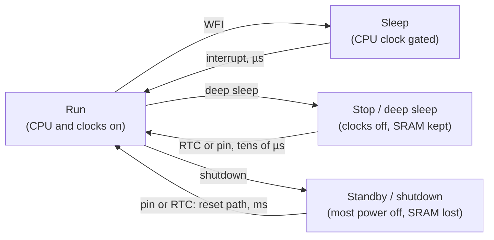
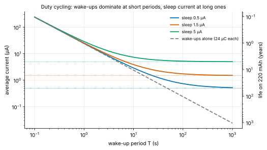

<!-- status: reviewed -->
# 18-09 · Ultra-Low-Power Design

| | |
|---|---|
| **Course** | [18 · Embedded Systems and Microcontrollers](../README.md) |
| **University equivalent** | The low-power design unit of a senior embedded-systems or IoT course: CMOS power, MCU power modes, duty cycling and battery-life budgets, regulators, batteries and energy harvesting |
| **Prerequisites** | [14-01](../../14-computer-organization-and-architecture/chapters/14-01-performance-power-iron-law.md) (CMOS dynamic and static power, race to idle), [18-01](18-01-microcontroller-architecture.md) (clocks and resets), [18-03](18-03-interrupts-exceptions-timers.md) (interrupts and timers), [18-06](18-06-adc-dac-pwm.md) (dividers and references), [07-02](../../07-circuit-analysis-2-transient-and-ac/chapters/07-02-first-order-rc-rl-transients.md) (RC transients) |
| **Estimated study hours** | 9 |
| **Last verified** | 2026-11-21 |

**Learning objectives.** After this chapter you can:

1. Explain where an MCU's current goes (dynamic, leakage, analog, I/O) and how each scales with clock, voltage and temperature.
2. Use an MCU's power modes correctly, including the break-even time for entering a deeper mode.
3. Build a duty-cycled current budget and compute average current and battery life, including self-discharge and usable capacity.
4. Decide between running fast and sleeping and running slowly, with and without voltage scaling.
5. Choose between an LDO and a buck converter for active and sleep loads, and size a reservoir capacitor for a battery's pulse loads.
6. Find the board-level currents (dividers, pull-ups, references, leakage) that dominate a sleeping product.

## 1. Big picture

A wearable that lasts a week, a sensor tag that lasts five years on a coin cell, a smart lock that wakes when touched: their batteries are tiny, so their average current must be measured in microamps. Yet their radios draw milliamps when they transmit, and their processors milliamps when they compute. The design problem is to make the expensive states rare and short and the cheap state very cheap. **Ultra-low-power (ULP) design** is mostly arithmetic about time: a device that draws 6 mA for 3 ms every second and 1.5 µA otherwise averages about 20 µA, and almost all the battery goes to the 0.3% of the time it is awake. The same arithmetic shows when the sleep current dominates instead, and why a forgotten pull-up resistor can shorten battery life tenfold.

- **Where it shows up:** wearables, hearables, medical patches, asset trackers, smart meters, remote sensors, and the always-on sensor hubs inside phones (18-10).
- **The levers:** fewer and shorter wake-ups, deeper sleep, faster work while awake, lower voltage, efficient regulation, peripherals that work without the CPU, and a board with no stray current paths.
- **What it buys commercially:** battery life is a headline specification, and every halving of average current either doubles it or halves the battery's size, cost and weight.

## 2. Intuition first

**A shop's electricity bill.** A shop is open one hour a day and shut the rest. Its bill is the lights and tills during the open hour, plus whatever stays on overnight: the fridge, the alarm, the sign someone forgot to switch off. Make the open hour shorter (faster work), the overnight load smaller (deeper sleep), and check for forgotten signs (stray currents). If the open hour is very short, the overnight load dominates the bill; if the shop is busy, the open hour does.

**Race to the door.** Doing the day's work quickly and then switching everything off usually beats working slowly all day with the lights on, because the lights (static and leakage current, regulators, oscillators) cost the same per hour whatever the pace. The exception is when working slower lets you lower the *voltage*, which makes every task genuinely cheaper.

**Where the analogy breaks.** Shutting a shop is free; putting an MCU into a deep sleep mode and waking it costs energy (restarting oscillators and regulators, restoring state). So a short pause is better spent in a light sleep, and only long pauses justify the deepest one: there is a **break-even time**.

## 3. Theory

### 3.1 Where the current goes

A CMOS circuit draws **dynamic** current when its nodes switch and **static** current when they do not. Switching a node of capacitance $C$ through a full swing $V$ takes charge $CV$ from the supply, so a circuit with switched capacitance $C_{sw}$ per cycle (activity included) at clock $f$ draws

$$
I_{dyn} = C_{sw}\,V\,f, \qquad P_{dyn} = C_{sw}\,V^2 f
$$

(07-02, 14-01). The energy per cycle, $C_{sw}V^2$, depends on voltage but not on frequency. That is why data sheets quote active current in **µA/MHz**: at a fixed voltage the CPU's current is proportional to its clock.

Static current has several parts:

- **Transistor leakage**, which grows roughly exponentially with temperature and with lower threshold voltages; it scales with the amount of powered logic and retained SRAM.
- **Analog blocks**: regulators, oscillators, brown-out detectors, references and comparators, each drawing a bias current while enabled.
- **I/O and board currents**: pull-ups held low, dividers, LEDs, leakage into pins, peripherals of other chips.

So an MCU's run current is roughly $I_{run} = k f + I_{0}$: a part per MHz plus a fixed part. Its sleep current is whatever leakage and always-on analog remains. Leakage can rise tenfold or more between room temperature and the hot end of the range, so budgets need the data sheet's maximum at the hottest operating temperature, not the typical figure at 25 °C.

### 3.2 Power modes

MCUs offer a ladder of modes; names differ by vendor, but the steps are similar:

| Mode | What stops | What keeps running | Wake-up | Typical role |
|---|---|---|---|---|
| Run | nothing | everything enabled | — | computing |
| Sleep | CPU clock (WFI) | peripherals, clocks, SRAM | interrupt, about a microsecond | waiting briefly, DMA transfers |
| Stop / deep sleep | high-speed clocks, most peripherals; regulator to low-power mode | SRAM and registers, RTC, low-power peripherals, wake-up logic | RTC, pin or peripheral, microseconds to tens of µs | sleeping between samples |
| Standby / shutdown | almost everything, SRAM lost (or a few backup registers kept) | an always-on domain: RTC, wake-up pins, backup registers | pin or RTC, through a reset; milliseconds with re-initialization | long idle periods |

Vendors' names do not follow the rows: TI's MSPM0 "STANDBY", for example, keeps SRAM and wakes in microseconds, so it belongs in the stop row of this table. Read each mode's retention and wake-up time in the data sheet, not its name.

The **always-on domain** is the small island that never powers down: a 32.768 kHz oscillator and real-time clock, wake-up pin logic and a few backup registers. Low-power peripherals that can run from it (an LPUART receiving characters, a comparator, a low-power timer) let the device wait for an event without waking the CPU. Event systems or peripheral-to-peripheral triggers (for example a timer starting an ADC conversion whose result DMA stores) let whole measurement chains run while the CPU sleeps.

**The break-even time.** Entering a deeper mode and leaving it costs extra charge $Q_{tr}$, for restarting oscillators and regulators and restoring lost state, compared with staying in the shallower mode. The deeper mode saves $\Delta I = I_{shallow} - I_{deep}$ every second it lasts. It pays only if the sleep lasts longer than

$$
t_{be} = \frac{Q_{tr}}{I_{shallow} - I_{deep}} .
$$

For a short gap between interrupts, light sleep wins; for a long one, the deepest mode does (Example 18-09.2). Wake-up time matters separately when the device must react quickly: a millisecond to restart from shutdown may be too slow for a radio protocol's timing.

### 3.3 Duty cycling and battery life

A duty-cycled device repeats a period $T$ that contains active phases $k$ (current $I_k$, duration $t_k$) and sleeps at $I_{sleep}$ for the rest. Its average current is the charge per period divided by the period:

$$
\bar I = \frac{\sum_k I_k t_k + I_{sleep}\left(T - \sum_k t_k\right)}{T} \approx I_{sleep} + \frac{\sum_k I_k t_k}{T} .
$$

The two terms say where the effort should go. If the wake-up charge per period, $\sum I_k t_k$, divided by $T$ is much larger than $I_{sleep}$, shorten or thin out the wake-ups. If $I_{sleep}$ dominates, attack the sleep current. A battery of capacity $Q$ (in mAh) then lasts

$$
t_{life} = \frac{\eta\,Q}{\bar I + I_{sd}},
$$

where $\eta$ is the usable fraction (capacity is lost to the cutoff voltage, to high pulse currents and to cold) and $I_{sd}$ is the battery's **self-discharge** expressed as an equivalent current. A cell that loses a fraction $s$ of its capacity per month has $I_{sd} = sQ/(30\ \text{days})$. For multi-year products with very small $\bar I$, self-discharge and the regulator's quiescent current can be as large as the electronics' own draw.

*Average current of a node spending 24 µC per wake-up (Example 18-09.1) as the wake-up period grows. Below a few seconds the wake-ups dominate and the line falls as $1/T$; beyond the crossover, where the wake-up term equals the sleep current, the sleep current sets a floor and longer periods gain nothing.*

> **Math refresher: mAh.** A capacity of 220 mAh is $0.220\ \text{A} \times 3600\ \text{s} = 792$ C of charge. At an average of 25 µA it lasts $0.220/(25 \times 10^{-6}) = 8800$ hours. Energy is capacity times voltage: 220 mAh at 3 V is 0.66 Wh, or 2376 J.

### 3.4 Race to idle, or slow and steady?

A task needs $N$ cycles once per period $T$. At clock $f$ and fixed voltage the active current is $kf + I_0$, the task takes $N/f$, and the device sleeps at $I_{sleep}$ for the rest. The charge per period is

$$
Q(f) = (kf + I_0)\frac{N}{f} + I_{sleep}\left(T - \frac{N}{f}\right) = kN + (I_0 - I_{sleep})\frac{N}{f} + I_{sleep}T .
$$

The first term, the dynamic charge, does not depend on $f$; the second falls as $f$ rises because $I_0 > I_{sleep}$. So at a fixed voltage, **running as fast as possible and then sleeping minimizes charge** ("race to idle", Example 18-09.3). The fixed costs of being awake are paid for less time.

Voltage changes the answer. Dynamic energy per cycle is $C_{sw}V^2$, so if running slower allows a lower supply (**voltage scaling**, the DVFS of application processors, 14-01), every cycle becomes cheaper by $(V_{low}/V_{high})^2$ at the core: 44% of the energy at 1.2 V compared with 1.8 V. What the battery sees depends on the regulator (§3.5). Each cycle draws a charge $C_{sw}V_{core}$ from the core rail; an internal LDO passes that charge straight through from the battery, so the battery's charge per cycle falls only as $V_{low}/V_{high}$ (67% at 1.2 V against 1.8 V), and the $V^2$ saving reaches the battery only through a buck converter, which turns the lower core voltage into a lower battery current. Then the comparison is between the saved dynamic energy and the extra static energy of staying awake longer. MCUs usually offer a few fixed voltage ranges, each with a maximum clock, so the practical rule is: pick the lowest voltage range whose maximum clock finishes the work in time, run at that range's top speed, and sleep.

### 3.5 Regulators: LDO or buck

The battery's voltage is rarely the core's: a Li-ion cell runs from about 4.2 V down to 3.0 V or so, while MCU cores run near 1–1.8 V from an internal or external regulator.

- A **linear regulator (LDO)** passes the load current straight through: $I_{bat} = I_{load} + I_q$, an efficiency of $V_{out}/V_{in}$ at most. From 3.7 V to 1.8 V that is under half.
- A **switching (buck) converter** conserves power, less its losses: $I_{bat} = V_{out}I_{load}/(\eta V_{in}) + I_q$. At 85% efficiency the battery current is about half the load current here (Example 18-09.4).

At sleep currents of a few microamps the comparison flips: a buck's switching losses and quiescent current make its light-load efficiency poor, while an LDO's quiescent current can be tiny. Many MCUs and PMICs therefore run a buck when active and an LDO, or the buck in a pulse-skipping mode, when asleep.

### 3.6 Batteries, pulses and reservoir capacitors

A battery is not an ideal source: it has an **internal resistance** $R_{int}$ that grows as it discharges and as it gets cold, and small cells (coin cells especially) are rated for small continuous currents. A radio burst of $I$ drops the supply by $IR_{int}$; if that crosses the MCU's brown-out threshold, the device resets in the middle of transmitting.

A **reservoir capacitor** $C$ at the load supplies the burst. With the capacitor charged to the battery's open-circuit voltage $E$ before a burst of constant current $I$ and duration $t_p$, the node equation at the load is $C\,dv/dt = (E - v)/R_{int} - I$. Its solution from $v(0) = E$ is $v(t) = E - IR_{int}(1 - e^{-t/R_{int}C})$, the RC response of 07-02, so the droop at the end of the burst is

$$
\Delta V(t_p) = IR_{int}\left(1 - e^{-t_p/R_{int}C}\right).
$$

For a short burst ($t_p \ll R_{int}C$) this is about $It_p/C$: the capacitor alone supplies the charge. Solving for $C$ at a given allowed droop gives the capacitor to fit (Example 18-09.5). The capacitor's own leakage then adds to the sleep current, which matters for electrolytic types, and its series resistance (ESR) adds an immediate step $I \times \text{ESR}$ at the start of the burst. The formula also assumes the capacitor has recharged before each burst, which takes about $3R_{int}C$ (30 ms for 100 Ω and 100 µF). Bursts that repeat faster, such as Bluetooth connection events every 7.5 ms, do not recover fully, and the droop builds up toward the DC value $\bar I R_{int}$ of the average burst current.

Battery capacity also depends on how it is drawn. Data sheets specify capacity at a light test load to a cutoff voltage, and pulses, cold and age reduce the usable fraction $\eta$.

### 3.7 The board, not the chip

In a product that sleeps at a microamp, the MCU is often not the largest current on the board. Typical culprits:

- **Dividers** left connected for battery measurement: $V/(R_1 + R_2)$ forever (switch them, or use the internal-reference method of 18-06 §3.3).
- **Pull-ups held low** (a pressed button, a sensor's open-drain interrupt line asserted, an I²C line stuck low): $V/R$ each.
- **Analog blocks left on:** references, comparators, ADCs, op-amps.
- **Floating inputs** on the MCU or on other chips, which can sit mid-rail and draw shoot-through current in their input buffers (18-05 §3.1).
- **Other chips' standby currents**: sensors, radios, flash, PMIC, level translators.
- **Leakage** through capacitors, ESD diodes and contamination on the board.

A budget therefore lists *every* current path in every mode, and the product's real consumption is checked with an instrument that covers nanoamps to hundreds of milliamps (a shunt with a high-dynamic-range amplifier, a source-measure unit or a dedicated power analyzer), because a sleeping device's current spans six orders of magnitude within milliseconds.

### 3.8 Energy harvesting in one paragraph

A device with a harvester (a small solar cell, a thermoelectric generator, a vibration or RF harvester) is **energy-neutral** if its average power consumption does not exceed the average harvested power, over the worst period it must survive (a dark week, for a solar device). Storage (a rechargeable cell or supercapacitor) bridges the gap between harvest and use, and the electronics must be able to start from an empty store, which a dedicated harvesting PMIC handles. The same duty-cycle arithmetic applies, with the harvest as a negative current.

## 4. Worked examples

### Example 18-09.1 · A sensor node's budget (tier A)

**Setup.** A node sleeps at 1.5 µA and wakes once a second to measure (3 mA for 2 ms) and advertise over Bluetooth LE (6 mA for 3 ms). (a) What is its average current? (b) How long does a 220 mAh coin cell last, ignoring self-discharge? (c) Which term dominates, and what would you attack first?

**Solution.** (a) Charge per second: $3\ \text{mA} \times 2\ \text{ms} + 6\ \text{mA} \times 3\ \text{ms} = 24\ \mu\text{C}$, plus sleep $1.5\ \mu\text{A} \times 0.995\ \text{s}$. So $\bar I$ = **25.5** µA.

(b) $220\ \text{mAh}/25.5\ \mu\text{A}$ = 8630 h = **360** days.

(c) The radio's 18 µC per second is 71% of the total. Advertising half as often, or for less time, gains more than any sleep-current improvement.

**Units check.** A × s/s = A; mAh/A = h.

**Sanity check.** 0.5% duty cycle at a few mA is a few tens of µA.

### Example 18-09.2 · Which sleep mode? (tier B)

**Setup.** An MCU's sleep mode (CPU stopped, peripherals running) draws 0.8 mA; its stop mode 3 µA; its shutdown mode 0.1 µA. Leaving stop costs an extra 100 nC (oscillator restart); leaving shutdown costs 4 µC more than leaving stop (reset, re-initialization, reloading state). (a) Above what idle time is stop better than sleep? (b) Shutdown better than stop? (c) A device idles 50 ms between samples. Which mode?

**Solution.** (a) $100\ \text{nC}/(0.8\ \text{mA} - 3\ \mu\text{A})$ = **0.125** ms.

(b) $4\ \mu\text{C}/(3 - 0.1)\ \mu\text{A}$ = **1.38** s.

(c) Stop: 50 ms is far above 0.125 ms but well below 1.38 s.

**Units check.** C/A = s.

**Sanity check.** The deeper the mode, the longer it must last to repay its wake-up cost.

### Example 18-09.3 · Race to idle (tier B)

**Setup.** A task of one million cycles runs once a second on an MCU drawing $60\ \mu\text{A/MHz} \times f + 400\ \mu\text{A}$ when active and 2 µA asleep, at a fixed voltage. (a) Compare the charge per second at 8 MHz and 48 MHz. (b) If running at 8 MHz allowed the core voltage to drop from 1.8 V to 1.2 V, by what factor would the dynamic energy per cycle fall?

**Solution.** (a) At 8 MHz: active 125 ms at 880 µA = 110 µC, plus sleep $2\ \mu\text{A} \times 0.875$ s: **111.75** µC. At 48 MHz: active 20.8 ms at 3280 µA = 68.3 µC, plus sleep: **70.29** µC. Racing saves 37%, all of it in the fixed 400 µA, which runs six times longer at 8 MHz.

(b) $(1.2/1.8)^2$ = **0.444** for the energy at the core. The battery sees that saving only through a buck converter; through the internal LDO most MCUs use, the battery's charge per cycle falls as $1.2/1.8$ = **0.667** (§3.4). With voltage scaling the slower clock cuts the dynamic charge too, and whether that beats racing depends on how large the fixed current is; at a fixed voltage, racing always wins.

**Units check.** A × s = C.

**Sanity check.** The dynamic part, 60 µC, is the same at both clocks: $60\ \mu\text{A/MHz} \times 10^6$ cycles.

### Example 18-09.4 · LDO or buck? (tier B)

**Setup.** A Li-ion cell at 3.7 V supplies a 1.8 V core. (a) Active load 5 mA: what battery current with an LDO, and with an 85%-efficient buck? What is the LDO's efficiency? (b) Sleep load 2 µA: LDO quiescent current 0.1 µA; buck at 50% efficiency at this load, plus 0.5 µA quiescent current not included in that efficiency. Which is better asleep?

**Solution.** (a) LDO: 5 mA, efficiency $1.8/3.7$ = **48.6** %. Buck: $1.8 \times 5/(0.85 \times 3.7)$ = **2.86** mA, 43% less.

(b) LDO: **2.10** µA. Buck: $1.8 \times 2/(0.5 \times 3.7) + 0.5$ = **2.45** µA. The LDO wins in sleep, the buck when active, so many PMICs switch between them.

**Units check.** V × A/(V) = A.

**Sanity check.** A perfect buck would draw $5 \times 1.8/3.7$ = 2.43 mA; 85% efficiency adds about 18% ($1/0.85 = 1.176$).

### Example 18-09.5 · A coin cell and a radio burst (tier B)

**Setup.** A coin cell with 3.0 V open-circuit voltage has 100 Ω internal resistance when cold and half discharged. The radio draws 8 mA for 2 ms; the MCU's brown-out threshold is 2.4 V. (a) What is the droop without a capacitor, and what happens? (b) With 100 µF at the load? (c) What capacitance keeps the droop at 0.2 V?

**Solution.** (a) $8\ \text{mA} \times 100\ \Omega$ = **0.80** V: the supply falls to 2.2 V, below the brown-out threshold, and the device resets mid-burst.

(b) $\tau = 100\ \Omega \times 100\ \mu\text{F} = 10$ ms; $\Delta V = 0.8 \times (1 - e^{-0.2})$ = **145** mV. The lab's ngspice netlist gives the same.

(c) $0.8(1 - e^{-2\ \text{ms}/\tau}) = 0.2$ gives $\tau = 2\ \text{ms}/\ln(4/3) = 6.95$ ms, so $C$ = **69.5** µF; choose 100 µF with margin for tolerance and ageing.

**Units check.** A × Ω = V; Ω × F = s.

**Sanity check.** Short-pulse estimate: $It/C = 8\ \text{mA} \times 2\ \text{ms}/100\ \mu\text{F} = 0.16$ V, slightly above the exact 0.145 V because the battery also helps.

### Example 18-09.6 · Hunting stray currents (tier A)

**Setup.** A product's MCU sleeps at 1.5 µA, but the board also has a 100 kΩ + 100 kΩ divider permanently across a 3.7 V cell and an ADC reference (50 µA) left enabled. (a) What is the total sleep current? (b) By what factor does fixing both improve sleep current?

**Solution.** (a) Divider $3.7/200\ \text{kΩ}$ = **18.5** µA; total $1.5 + 18.5 + 50$ = **70.0** µA.

(b) $70.0/1.5$ = **46.7**: the board, not the chip, set the battery life.

**Units check.** V/Ω = A.

**Sanity check.** Any always-on path above a microamp matters when the chip sleeps at one.

<!-- answer-key -->

| ID | Quantity | Value | Unit |
|---|---|---|---|
| Txt 18-09.a | charge in 220 mAh | 792 | C |
| Txt 18-09.b | hours at 25 µA | 8800 | h |
| Txt 18-09.c | energy of 220 mAh at 3 V | 2376 | J |
| Ex 18-09.1a | average current | 25.5 | µA |
| Ex 18-09.1b | battery life | 360 | days |
| Ex 18-09.1c | radio's share of the charge | 71 | % |
| Ex 18-09.2a | break-even, sleep to stop | 0.125 | ms |
| Ex 18-09.2b | break-even, stop to shutdown | 1.38 | s |
| Ex 18-09.3a | charge per second at 8 MHz | 111.75 | µC |
| Ex 18-09.3b | charge per second at 48 MHz | 70.29 | µC |
| Ex 18-09.3c | saving from racing | 37 | % |
| Ex 18-09.3d | dynamic energy ratio, 1.2 V against 1.8 V | 0.444 | — |
| Ex 18-09.3e | battery charge per cycle through an LDO, 1.2 V against 1.8 V | 0.667 | — |
| Ex 18-09.4a | LDO efficiency | 48.6 | % |
| Ex 18-09.4b | buck battery current, active | 2.86 | mA |
| Ex 18-09.4c | LDO battery current, sleep | 2.10 | µA |
| Ex 18-09.4d | buck battery current, sleep | 2.45 | µA |
| Ex 18-09.5a | droop without a capacitor | 0.80 | V |
| Ex 18-09.5b | droop with 100 µF | 145 | mV |
| Ex 18-09.5c | capacitance for 0.2 V droop | 69.5 | µF |
| Ex 18-09.6a | divider current | 18.5 | µA |
| Ex 18-09.6b | total sleep current | 70.0 | µA |
| Ex 18-09.6c | improvement factor | 46.7 | — |

*Every value is recomputed by [verify_18_09.py](../verify/verify_18_09.py): budgets by direct arithmetic and by a per-phase charge sum over a day, break-even times and race-to-idle charges by formula and by numerical comparison of the modes, and the coin-cell droop by solving the RC circuit; the lab's ngspice netlist confirms Example 18-09.5.*

## 5. Simulate it

The lab, [labs/18-09-lab](../labs/18-09-lab/README.md), provides `ulp.py` (budgets, break-even, race to idle, regulators, battery pulses, an event simulation of a day) and an ngspice netlist of a coin cell supplying a radio burst. **Predict, then run**:

1. **Budget.** Predict the average current and life of Example 18-09.1 if advertising drops to every 2 s; check with `average_current` and `simulate_day`.
2. **Modes.** Plot charge per idle period against idle time for sleep, stop and shutdown; find the crossovers.
3. **Race.** Plot charge per period against clock frequency for Example 18-09.3; then add a voltage step at 24 MHz and find the optimum.
4. **The burst.** Predict the droop with 47, 100 and 220 µF; run the netlist and the formula.
5. **Self-discharge.** Add 1% per month of self-discharge to Example 18-09.1 and to a node averaging 2 µA; compare the lives.

## 6. Engineering tradeoffs

| Knob | Improves | Costs | Typical decision owner |
|---|---|---|---|
| Deeper sleep mode | sleep current | wake-up time and charge, lost state | firmware lead |
| Fewer, shorter wake-ups | average current | latency, data rate | product owner with firmware |
| Faster clock while awake | charge per task (race to idle) | peak current, battery droop | firmware lead |
| Lower voltage range | dynamic energy per cycle | maximum clock | firmware architect |
| Buck instead of LDO | active battery current | light-load efficiency, noise, inductor | hardware lead |
| Reservoir capacitor | survives pulses on weak cells | board area, leakage, inrush | hardware lead |
| Autonomous peripherals / sensor hub | CPU wake-ups | silicon area, complexity | system architect |
| Bigger battery | life | size, weight, cost | product owner |

## 7. Numbers to know

| Quantity | Value | Note |
|---|---|---|
| Dynamic power | $C_{sw}V^2f$ | energy per cycle $\propto V^2$ |
| Average current | $I_{sleep} + \sum I_kt_k/T$ | |
| Battery life | $\eta Q/(\bar I + I_{sd})$ | |
| Break-even | $Q_{tr}/(I_{shallow} - I_{deep})$ | |
| 1 mAh | 3.6 C | |
| LDO efficiency | at most $V_{out}/V_{in}$ | 48.6% from 3.7 to 1.8 V |
| Pulse droop | $IR_{int}(1 - e^{-t/R_{int}C})$ | |
| ULP MCU standby (RTC, SRAM kept) | about 0.5–1.5 µA typical at 25 °C | rises steeply with temperature [R-310] |
| BLE radio (0 dBm) | about 5 mA RX or TX with DC/DC | TI CC2340R5 [R-310] |
| CR2032 | 225 mAh at 0.2 mA | Panasonic [R-310] |

## 8. Common mistakes

- **Budgeting with typical currents at 25 °C.** Leakage at the hot end can be many times larger; use maximum values at the worst temperature.
- **Forgetting the wake-up cost** of deep modes, or the time to restore state after shutdown.
- **Ignoring the board:** dividers, pull-ups, references and other chips' standby currents.
- **Leaving inputs floating** in sleep; configure every pin.
- **Slowing the clock to "save power"** at a fixed voltage; it usually wastes charge.
- **Sizing a coin cell by capacity alone,** without its pulse capability and internal resistance at cold and end of life.
- **Measuring with a meter that cannot follow microsecond bursts** or that drops the supply across its own shunt.

## 9. Practitioner lens

### State of the art (as of Nov 2026)

- **ULP MCUs reach microamp standby with RTC and SRAM retained, and tens of nanoamps in shutdown, at room temperature.** TI's MSPM0G3507 specifies 101 µA/MHz running CoreMark from flash at 3.3 V, 1.5 µA typical in standby with a 32 kHz crystal, RTC and SRAM retained, and 80 nA in shutdown, with wake-ups of 15.2 µs from standby and 240 µs from shutdown. The same data sheet's standby maximum is 4 µA at 25 °C but 40 µA at 85 °C, and its shutdown current rises from 80 nA to 4.8 µA between 25 °C and 125 °C ([R-310]) **[Established]**.
- **Active current depends on what the code does.** TI's MSP430FR2433 quotes 126 µA/MHz at a 75% cache-hit rate; at 8 MHz its active current ranges from 625 µA (100% hits) to 2772 µA (0% hits). Microchip's SAM L10 headline "< 25 µA/MHz" is met by a while(1) loop (22.8 µA/MHz); CoreMark draws 29.9 µA/MHz typical on the same regulator ([R-310]) **[Established]**.
- **Bluetooth LE radios draw a few milliamps.** TI's CC2340R5 specifies 5.3 mA receiving and 5.1 mA transmitting at 0 dBm with its DC/DC converter (about 9 mA without it), and 0.71 µA in standby with RTC and full RAM retention ([R-310]) **[Established]**.
- **Coin cells.** Panasonic rates its CR2032 at 225 mAh at a 0.2 mA continuous drain and states no pulse limit. A TI test report found pulse peaks of 30 mA rather than 15 mA cost about 9% of effective capacity on average, that some vendors' cells delivered only about half their rated capacity under pulsed loads, and that a reservoir capacitor improved the worst cells by over 40% ([R-310]) **[Established; the pulse results are a 2010 vendor test]**.
- **Li-ion self-discharge** is commonly quoted as 1–2% per month after an initial drop, plus about 3% per month for a protection circuit; that figure comes from a secondary source whose own table disagrees, and no manufacturer figure was found ([R-310]) **[Contested]**.
- **Benchmarks.** EEMBC's ULPMark-CoreProfile runs a one-second duty cycle with about 3% active time and scores 1000 divided by the average power in µW; published scores include 277 for a Microchip SAM L10 (certified, 2019) and 1090 for an onsemi RSL10 (certified, 2018) at 3.0 V ([R-310]) **[Established]**.

### Why it matters commercially

- **Battery life sells, and battery size costs.** Halving average current halves the battery for the same life, which shrinks wearables and cuts cost per unit in high-volume IoT.
- **Lifetime defines the business model.** A tracker that lasts the length of a shipment, or a meter that lasts its ten-year service life without a site visit, has a different total cost of ownership from one that needs battery changes.
- **The MCU's sleep current is a selling point, but the system's is what matters.** Diligence on a low-power product should look at measured system currents in each mode, not the MCU's data-sheet headline.

### Marketing vs Reality

- **"Sleep current of 0.X µA."** In which mode, with what retained (SRAM, RTC), at what temperature and voltage, typical or maximum? The MSPM0G3507's 1.5 µA standby is a 25 °C typical; its 85 °C maximum is 40 µA ([R-310]).
- **"µA/MHz" figures.** Measured with peripherals off, at a stated voltage, and sometimes running only a `while(1)` loop: the SAM L10's headline is met by the loop but not by CoreMark ([R-310]). Real code with peripherals and cache misses draws more.
- **"Ten-year battery life."** Under which duty cycle, temperature and self-discharge assumptions? Ask for the budget.
- **Benchmark scores** (such as EEMBC's ULPMark) compare cores and modes under defined conditions; they are a useful sanity check, not a product's battery life.

### Questions for engineering leaders

1. **"What is the current budget in each mode, and which term dominates?"** *Strong:* a table of phases with measured currents and durations, and the dominant term named. *Evasive:* "the MCU sleeps at under a microamp".
2. **"What did you measure at the hot end of the temperature range, and at end of battery life?"** *Strong:* measurements or data-sheet maxima, with derating. *Evasive:* room-temperature typicals.
3. **"What wakes the CPU, and could a peripheral handle it instead?"** *Strong:* a list of wake sources and their rates, with autonomous peripherals used where possible. *Evasive:* "the RTOS tick".
4. **"How does the supply cope with radio bursts on a cold, old battery?"** *Strong:* the droop budget with internal resistance and a reservoir capacitor, tested cold. *Evasive:* "the battery is rated for it".
5. **"How do you know there are no stray currents?"** *Strong:* per-rail measurement in each mode against the budget. *Evasive:* "we checked the total once".

## 10. Concept check

**Q1.** Why do data sheets quote active current in µA/MHz?

Answer

Because dynamic current is $C_{sw}Vf$: at a fixed voltage it is proportional to the clock. The fixed part (regulators, oscillators, leakage) is quoted separately or folded in at a stated frequency.

**Q2.** When is stop mode better than shutdown, even though shutdown draws less?

Answer

When the idle time is shorter than the break-even time: leaving shutdown costs a reset, oscillator start and state restoration, whose charge is repaid only after enough time at the lower current. Stop also keeps SRAM and wakes faster.

**Q3.** Why does running faster usually save charge at a fixed voltage?

Answer

The dynamic charge per task is the same at any clock, but the fixed active current (regulators, oscillators, leakage of powered logic) is paid for the whole time the device is awake; finishing sooner and sleeping cuts that time.

**Q4.** Why might an LDO beat a buck converter in a sleeping device?

Answer

At microamp loads a buck's switching losses and quiescent current dominate, so its efficiency collapses, while a low-quiescent LDO wastes only the voltage headroom on a tiny current.

**Q5.** What does a reservoir capacitor do for a coin cell, and what does it cost?

Answer

It supplies the charge of short current bursts so the cell's internal resistance does not pull the supply below brown-out; it costs board area, its own leakage current, and an inrush when first connected.

**Q6.** A device averages 2 µA. Why might its battery last much less than capacity divided by 2 µA?

Answer

Self-discharge, unusable capacity (cutoff voltage, pulse loads, cold) and the regulator's quiescent current can be comparable to 2 µA, and the data sheet's typical currents may be exceeded at temperature.

**Problems:** [18-09 problem set](../problems/18-09-problems.md) · [Worked solutions](../solutions/18-09-solutions.md)

## 11. Key terms

[Dynamic power](../../../reference/glossary.md#dynamic-power) · [Leakage current](../../../reference/glossary.md#leakage-current) · [Power mode](../../../reference/glossary.md#power-mode) · [Always-on domain](../../../reference/glossary.md#always-on-domain) · [Break-even time](../../../reference/glossary.md#break-even-time) · [Duty cycling](../../../reference/glossary.md#duty-cycling) · [Race to idle](../../../reference/glossary.md#race-to-idle) · [Dynamic voltage and frequency scaling (DVFS)](../../../reference/glossary.md#dynamic-voltage-and-frequency-scaling-dvfs) · [Low-dropout regulator (LDO)](../../../reference/glossary.md#low-dropout-regulator-ldo) · [Quiescent current](../../../reference/glossary.md#quiescent-current) · [Self-discharge](../../../reference/glossary.md#self-discharge) · [Energy harvesting](../../../reference/glossary.md#energy-harvesting)

## 12. Connections

- **Builds on:** [14-01](../../14-computer-organization-and-architecture/chapters/14-01-performance-power-iron-law.md) (CMOS power), [18-01](18-01-microcontroller-architecture.md) (clocks), [18-03](18-03-interrupts-exceptions-timers.md) (timers and wake-up interrupts), [18-06](18-06-adc-dac-pwm.md) (dividers, references), [18-07](18-07-rtos-concepts.md) (tickless idle).
- **Next:** [18-10](18-10-sensors.md) (sensors and sensor hubs).
- **Used later:** [Course 22](../../22-power-electronics-and-energy-conversion/README.md) (converters and PMICs) and the wearable sensor-node capstone (C3).

## 13. Further study

- Any ULP MCU's data-sheet tables of mode currents and wake-up times, read together with its reference manual's power-control chapter.
- Vendor application notes on battery-life estimation and on measuring low currents.
- EEMBC's ULPMark documentation for how standardized low-power benchmarks are defined.

## 14. Sources

1. Weste, N. and Harris, D., *CMOS VLSI Design*, 4th ed., Addison-Wesley, 2010: dynamic and static power.
2. Erickson, R. W. and Maksimović, D., *Fundamentals of Power Electronics*, 3rd ed., Springer, 2020: linear and switching regulators.
3. [R-310] TI MSPM0G3507 (SLASEX6C), MSP430FR2433 (SLASE59F) and CC2340R5 (SWRS272F) data sheets; Microchip SAM L10/L11 data sheet (DS60001513F); Panasonic CR2032 data sheet; TI white paper SWRA349; Battery University BU-802b; EEMBC ULPMark pages and score table.
