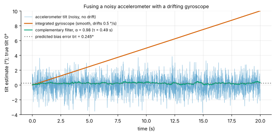

<!-- status: verified -->
# 18-10 · Sensors: IMU, PPG, MEMS and Audio

| | |
|---|---|
| **Course** | [18 · Embedded Systems and Microcontrollers](../README.md) |
| **University equivalent** | The sensors and instrumentation unit of a senior embedded or biomedical-instrumentation course: MEMS inertial sensors, optical heart-rate sensing, MEMS microphones, environmental sensors and sensor fusion (Fraden, *Handbook of Modern Sensors*; Kaajakari, *Practical MEMS*) |
| **Prerequisites** | [04-01](../../04-physics-for-ee/chapters/04-01-mechanics-essentials.md) (spring-mass systems), [04-04](../../04-physics-for-ee/chapters/04-04-potential-capacitance-and-dielectrics.md) (capacitance), [17-02](../../17-communication-systems/chapters/17-02-noise-and-snr.md) (noise and SNR), [16-09](../../16-digital-signal-processing/chapters/16-09-multirate-dsp.md) (decimation), [18-05](18-05-gpio-uart-spi-i2c.md) (sensor buses), [18-09](18-09-ultra-low-power-design.md) (power budgets) |
| **Estimated study hours** | 7 |
| **Last verified** | 2026-11-21 |

**Learning objectives.** After this chapter you can:

1. Derive how a MEMS accelerometer converts acceleration to capacitance, and estimate its thermomechanical noise floor.
2. Convert noise densities to rms noise over a bandwidth, and to tilt and angle errors.
3. Explain how a MEMS gyroscope senses rotation (Coriolis force) and how bias and noise accumulate when its output is integrated.
4. Fuse an accelerometer and a gyroscope with a complementary filter and predict its steady-state error.
5. Explain photoplethysmography (PPG): the signal's size, its noise limits and its power cost.
6. Work with microphone and barometer specifications (dB SPL, dBFS, SNR, pascals per metre).

## 1. Big picture

A smartwatch counts steps and detects falls with an accelerometer, tracks orientation with a gyroscope, measures heart rate by shining an LED into the wrist, listens for a wake word through a MEMS microphone, and counts floors climbed with a barometer, all on a battery that must last days. Each sensor is a small piece of physics (a moving proof mass, a light path through blood, a vibrating membrane, a pressure-sensitive diaphragm) turned into a voltage, digitized, and handed to firmware over I²C, SPI or I3C (18-05). Choosing and using sensors well means understanding three things about each: what it physically measures, what limits its accuracy (noise, bias, drift, motion artefacts), and what it costs in power and bandwidth.

- **Where it shows up:** wearables and hearables, phones (whose always-on sensor hubs run step counting and gesture detection on milliwatts), automotive airbag and stability systems, drones and robots, medical patches, smart-home devices.
- **The recurring theme:** a sensor's output is the truth plus noise plus error; firmware filters, fuses and calibrates to recover the truth within a power budget.
- **Why it matters commercially:** sensors are a large, high-volume semiconductor market in their own right, and sensor quality (noise, power, size) often decides which device wins a wearable socket.

## 2. Intuition first

**A weight on a spring in a box.** Shake the box and the weight lags behind; the spring's stretch tells you the acceleration. A MEMS accelerometer is exactly that, etched in silicon: a proof mass of micrograms on flexures, with comb-like electrodes whose capacitance changes as the mass moves. Gravity also stretches the spring, so a stationary accelerometer measures 1 g "up". That is how it knows its tilt.

**A spinning merry-go-round.** Walk straight across a turning merry-go-round and you feel pushed sideways: the Coriolis effect. A MEMS gyroscope keeps a mass vibrating back and forth and measures the sideways force that appears when the chip rotates.

**A torch through your finger.** Shine a torch through your fingertip and it glows red; the glow brightens and dims slightly with each heartbeat as the arteries swell with blood. A PPG sensor measures that flicker, which is about 1% of the light, in the presence of ambient light and motion.

**Where the analogies break.** The weight on a spring in a MEMS device is so small that the random bombardment of gas molecules moves it measurably: thermal noise sets a floor no electronics can remove. And the PPG's "flicker" is easily swamped by motion, which changes the light path far more than a heartbeat does.

## 3. Theory

### 3.1 The MEMS accelerometer

**Mechanics.** A proof mass $m$ on a spring of stiffness $k$ inside a frame that accelerates at $a$ obeys, in the frame's coordinates, $m\ddot x + b\dot x + kx = -ma$. Below its resonance $\omega_0 = \sqrt{k/m}$, the mass's displacement is quasi-static:

$$
x = \frac{ma}{k} = \frac{a}{\omega_0^2}.
$$

A stiff, light structure (high $\omega_0$) has wide bandwidth but small displacement: sensitivity and bandwidth trade off through $\omega_0^2$. A 4 kHz structure deflects only about 16 nm per g (Example 18-10.1).

**Capacitive readout.** The mass carries electrodes between fixed electrodes with gap $d$. Moving by $x$ narrows one gap and widens the other; for small $x$ the two parallel-plate capacitances $C_0 d/(d \mp x)$ differ by

$$
\Delta C = C_1 - C_2 \approx C_0\left(1 + \frac{x}{d}\right) - C_0\left(1 - \frac{x}{d}\right) = \frac{2C_0x}{d} ,
$$

a differential signal that cancels common-mode effects such as temperature. With femtofarad-scale capacitances changing by a few percent, the readout ASIC must resolve attofarads, which it does by switched-capacitor charge amplifiers integrated in the same package.

**The thermomechanical noise floor.** The damping $b$ that dissipates the mass's energy also, by the fluctuation–dissipation theorem, drives it with a random force of density $\sqrt{4k_BTb}$ (the mechanical analogue of a resistor's Johnson noise, 17-02). Divided by $m$, with $b = m\omega_0/Q$, this is an equivalent acceleration noise density

$$
a_n = \sqrt{\frac{4k_BT\omega_0}{mQ}}\ \ \text{(m/s}^2\text{)}/\sqrt{\text{Hz}} .
$$

Heavier masses and less damping (higher $Q$) are quieter; gas damping, needed to avoid ringing, raises the floor. For a 2 µg mass at 4 kHz with $Q$ = 2 it is about 33 µg/√Hz (Example 18-10.1). Commercial parts add electronic noise and quote a total **noise density**.

**From density to rms.** White noise of density $n$ over a bandwidth $B$ has rms value $n\sqrt{B}$ (for a first-order filter, use the noise bandwidth $1.57f_c$). So a sensor's noise depends on its output data rate and filter, and averaging $N$ samples of white noise reduces it by $\sqrt N$ (as in 18-06 §3.4). For tilt, a small error $\delta a$ (in g) perpendicular to gravity is an angle error of $\delta a$ radians.

**Other errors.** Offset (zero-g bias), sensitivity error, cross-axis sensitivity, nonlinearity, and their temperature drifts; offsets are often calibrated at assembly or estimated in the field.

### 3.2 The MEMS gyroscope

A gyroscope drives its proof mass into oscillation along one axis, $x(t) = x_0\sin\omega_d t$, with velocity amplitude $v = \omega_dx_0$. When the chip rotates at $\Omega$ about the perpendicular axis, the mass feels a Coriolis acceleration

$$
a_c = 2\Omega v ,
$$

along the third axis, at the drive frequency. The sense electronics demodulate the sense-axis motion with the drive signal (the synchronous detection of 17-03) to obtain $\Omega$. Because $a_c$ is small (a few m/s² at 100 °/s for typical drive amplitudes, Example 18-10.3) and must be separated from the huge drive motion, gyroscopes draw much more current than accelerometers; the drive must run continuously.

**Integrating a rate.** Orientation is the integral of rate, so the gyroscope's errors accumulate:

- A constant **bias** $b$ (°/s) gives an angle error growing linearly, $bt$: 0.5 °/s becomes 30° in a minute.
- White rate noise of density $N$ (°/s/√Hz) gives a random walk in angle with standard deviation $N\sqrt t$. Quoted as **angle random walk** it is $60N$ in °/√h, because $\sqrt{3600}$ = 60.

So a gyroscope is excellent over seconds and useless over minutes unless something corrects its drift.

### 3.3 Sensor fusion: the complementary filter

An accelerometer gives tilt with noise but no drift (gravity is always there, though motion accelerations corrupt it); a gyroscope gives smooth, accurate *changes* of tilt but drifts. A **complementary filter** combines them each sample:

$$
\hat\theta_n = \alpha\left(\hat\theta_{n-1} + \omega_n\,\Delta t\right) + (1 - \alpha)\,\theta_{acc,n} ,
$$

which low-pass filters the accelerometer's tilt and high-pass filters the gyroscope's integrated rate, with the same time constant

$$
\tau = \frac{\alpha\,\Delta t}{1 - \alpha}.
$$

(For $\alpha$ close to 1 the recursion $\hat\theta_n - \alpha\hat\theta_{n-1} = (1 - \alpha)\theta_{acc}$ is a first-order low-pass with pole $\alpha = e^{-\Delta t/\tau'}$, so $\tau' = -\Delta t/\ln\alpha \approx \alpha\Delta t/(1 - \alpha)$.)

Two consequences follow. A constant gyroscope bias $b$ no longer grows without limit: in steady state the estimate settles at $\theta_{ss} = \alpha(\theta_{ss} + b\Delta t) + (1 - \alpha)\theta$, so the error is $\alpha b\Delta t/(1 - \alpha) = b\tau$. And the accelerometer's white noise passes through the low-pass with variance reduced by $(1 - \alpha)/(1 + \alpha)$. A larger $\tau$ suppresses accelerometer noise and motion artefacts more, but lets gyroscope bias produce a larger error and makes the filter slower to correct. That is the classic tradeoff (Example 18-10.4).

*Example 18-10.4's sensors over 20 s: the accelerometer alone is noisy but centred on the truth, the integrated gyroscope is smooth but drifts away, and the complementary filter keeps the gyroscope's smoothness with the accelerometer's anchoring, settling near the predicted bias error.* Kalman filters choose the blend optimally from noise models and estimate the bias too. Magnetometers add a heading reference (yaw), which gravity cannot provide.

### 3.4 Photoplethysmography (PPG)

**The signal.** Light entering tissue is absorbed and scattered. Along a path, intensity falls as in the **Beer–Lambert law**, $I = I_0e^{-\varepsilon cl}$, where $\varepsilon c$ is the absorber's absorption coefficient (absorptivity times concentration) and $l$ the path length. Most absorption is constant (skin, bone, venous blood). The arterial blood volume pulses with each heartbeat, adding a small varying part, so the detected photocurrent is a large DC level with a small AC ripple. The ratio AC/DC is the **perfusion index**, typically around 1% at the wrist, and can fall well below that in cold conditions.

**The front end.** An **analog front end (AFE)** pulses LEDs (green for heart rate at the wrist; red and infrared for blood-oxygen saturation), converts the photodiode current with a transimpedance amplifier, samples just after each pulse, subtracts ambient light measured with the LED off, and digitizes. Pulsing the LED for microseconds at tens to hundreds of hertz saves power, because the LED, not the electronics, dominates the budget (Example 18-10.5).

**The noise limit.** Even with perfect electronics the photocurrent carries **shot noise** of density $\sqrt{2qI}$ (17-02). For a DC photocurrent $I$ with an AC part of relative size $m$ (the perfusion index), the best possible SNR of the pulse in a bandwidth $B$ is

$$
\text{SNR} = \frac{(mI)^2/2}{2qIB} = \frac{m^2I}{4qB},
$$

which grows with photocurrent: more LED current, more SNR, more power. In practice motion artefacts (the sensor shifting on the skin, blood sloshing) are much larger than shot noise, and algorithms use the accelerometer to reject them.

**Heart rate** is the frequency of the AC component (0.5–4 Hz, 30–240 beats per minute), found by peak detection or spectral analysis (16-05); **SpO₂** comes from the ratio of red and infrared AC/DC ratios through an empirical calibration curve, which is why accuracy claims depend on calibration populations.

### 3.5 MEMS microphones

A MEMS microphone is a capacitor whose movable plate is a thin membrane; sound pressure moves it and changes the capacitance, read by an ASIC in the same package. Specifications use acoustic decibels:

- **Sound pressure level:** $L = 20\log_{10}(p_{rms}/20\ \mu\text{Pa})$ dB SPL; 1 Pa rms is 94 dB SPL, the standard test level.
- **Sensitivity:** the output at 94 dB SPL, in dBV for analog parts or **dBFS** for digital ones. A digital microphone with −26 dBFS sensitivity reaches full scale at $94 + 26 = 120$ dB SPL.
- **SNR:** the ratio of the 94 dB SPL signal to the self-noise, A-weighted. An SNR of 65 dB(A) means a noise floor of $94 - 65 = 29$ dB(A) SPL.
- **Acoustic overload point (AOP):** the SPL at which distortion reaches a stated level (often 10% THD).

Digital microphones commonly output a 1-bit **PDM** (pulse-density modulation) stream at a few MHz from a sigma–delta modulator; the MCU's decimation filter (16-09) turns it into PCM. Low-power modes and on-chip voice-activity detection let a system listen for a wake word at very low power.

### 3.6 Barometers and environmental sensors

A MEMS barometer measures absolute pressure with a piezoresistive or capacitive diaphragm. Near sea level the atmosphere's pressure falls with height as $dp/dh = -\rho g$, about $-12$ Pa per metre, so a barometer resolving 1 Pa resolves about 8 cm of altitude change (Example 18-10.6). Weather moves pressure by hundreds of pascals over hours, so barometric altitude is good for *changes* over minutes (floors climbed, falls, drone altitude hold) and needs a reference for absolute height. Temperature, humidity and gas sensors complete the environmental set; their power is often dominated by heaters (gas sensors) or by how often they are sampled.

### 3.7 Sensors in the system

- **FIFOs and batching.** Sensors buffer samples (often kilobytes) and interrupt the MCU only when a watermark is reached, so the MCU wakes once per batch instead of once per sample. This is the single biggest power lever for continuous sensing (18-09).
- **Embedded functions.** Many IMUs detect steps, taps, motion or orientation changes in hardware and raise an interrupt, so the MCU can sleep until something happens.
- **Sensor hubs.** Phones and watches run fusion and activity recognition on a low-power core (or a dedicated hub) separate from the application processor, which stays asleep.
- **Time stamps and synchronization.** Fusion needs samples aligned in time; sensors offer time stamps or synchronized sampling, and firmware must account for each sensor's filter delay.
- **Calibration.** Offsets and gains vary by part and with temperature; factory calibration, field calibration (for example rotating a device to find accelerometer offsets) and temperature compensation all matter.

## 4. Worked examples

### Example 18-10.1 · Inside an accelerometer (tier A)

**Setup.** A proof mass of 2 µg resonates at 4 kHz; its electrodes have 1.5 µm gaps and 100 fF per side. (a) What is the spring constant? (b) How far does 1 g deflect it? (c) What is the differential capacitance change, relative and absolute? (d) What is the thermomechanical noise floor at 300 K with $Q$ = 2?

**Solution.** (a) $k = m\omega_0^2 = 2 \times 10^{-9} \times (2\pi \times 4000)^2$ = **1.263** N/m.

(b) $x = 9.80665/(2\pi \times 4000)^2$ = **15.5** nm.

(c) $2x/d$ = **2.07** %, so $\Delta C$ = **2.07** fF on 100 fF.

(d) $\sqrt{4k_BT\omega_0/(mQ)}$ = 3.23 × 10⁻⁴ (m/s²)/√Hz = **32.9** µg/√Hz.

**Units check.** kg × s⁻² = N/m; (m/s²)/(s⁻²) = m; J × s⁻¹/kg = m²/s³, whose root is (m/s²)/√Hz.

**Sanity check.** A spring of about 1 N/m holding a microgram: the gravitational force, 20 nN, stretches it by about 16 nm.

### Example 18-10.2 · Noise density to tilt (tier A)

**Setup.** An accelerometer has 120 µg/√Hz noise density and a 50 Hz bandwidth (treat as brick-wall). (a) What is its rms noise? (b) What tilt noise is that near level? (c) And after averaging 100 samples (1 s at 100 Hz, assumed independent)?

**Solution.** (a) $120\ \mu\text{g} \times \sqrt{50}$ = **0.849** mg.

(b) $0.849 \times 10^{-3}$ rad = **0.0486** °.

(c) $0.0486/\sqrt{100}$ = **0.00486** °.

**Units check.** g/√Hz × √Hz = g; g/g = rad.

**Sanity check.** Spirit levels resolve about 0.05°; a good MEMS accelerometer is comparable sample by sample and better when averaged.

### Example 18-10.3 · Coriolis and drift (tier B)

**Setup.** A gyroscope's mass vibrates with 5 µm amplitude at 20 kHz. (a) What is its velocity amplitude, and the Coriolis acceleration at 100 °/s? (b) Its rate noise density is 0.007 °/s/√Hz: what is its angle random walk, and the angle noise after 60 s of integration? (c) An uncalibrated bias of 0.5 °/s: what angle error after 60 s?

**Solution.** (a) $v = 2\pi \times 20\,000 \times 5 \times 10^{-6}$ = **0.628** m/s; $a_c = 2 \times 1.745 \times 0.628$ = **2.19** m/s².

(b) ARW $= 60 \times 0.007$ = **0.42** °/√h; after 60 s, $0.007\sqrt{60}$ = **0.054** °.

(c) $0.5 \times 60$ = **30** °: bias, not noise, is the gyroscope's problem over a minute.

**Units check.** m × s⁻¹ = m/s; rad/s × m/s = m/s²; (°/s)/√Hz × √s = °.

**Sanity check.** 2 m/s² is a fifth of g, measured on a mass already swinging at 0.6 m/s: the sense electronics must reject the drive motion very precisely.

### Example 18-10.4 · A complementary filter (tier B)

**Setup.** Tilt is estimated at 100 Hz with $\alpha$ = 0.98 from an accelerometer whose tilt noise is 0.02 g per sample and a gyroscope with 0.5 °/s bias. (a) What is the filter's time constant? (b) What steady-state error does the bias cause? (c) By what factor does the filter reduce the accelerometer's white noise? (d) Compare with the lab's 60 s simulation.

**Solution.** (a) $\tau = 0.98 \times 0.01/0.02$ = **0.49** s.

(b) $b\tau = 0.5 \times 0.49$ = **0.245** °.

(c) The accelerometer alone has $\arctan(0.02)$ = **1.146** ° rms of tilt noise; the low-pass passes $\sqrt{(1 - \alpha)/(1 + \alpha)}$ = **0.1005** of it, about 0.115°.

(d) The simulation gives **1.145** ° rms for the accelerometer alone, **29.9** ° of drift for the gyroscope alone after 60 s, and **0.288** ° rms for the fused estimate, consistent with $\sqrt{0.245^2 + 0.115^2 + \ldots}$ (the gyroscope's own noise adds a little).

**Units check.** s; °/s × s = °.

**Sanity check.** Doubling $\tau$ halves the accelerometer noise's variance but doubles the bias error: the optimum depends on which error dominates.

### Example 18-10.5 · A PPG budget (tier B)

**Setup.** A wrist PPG gives 1 µA of DC photocurrent with a 1% perfusion index, measured in a 10 Hz bandwidth. (a) What is the shot-noise-limited SNR of the pulse? (b) The LED is pulsed at 20 mA for 100 µs, 100 times a second. What average current does it draw? (c) And at 25 pulses a second of 50 µs?

**Solution.** (a) $m^2I/(4qB) = 10^{-4} \times 10^{-6}/(4 \times 1.602 \times 10^{-19} \times 10)$, so **71.9** dB. Shot noise is far below the motion artefacts that limit real wrists.

(b) $20\ \text{mA} \times 100\ \mu\text{s} \times 100$ = **200** µA, much more than a whole sleeping MCU.

(c) **25** µA: eight times less, at the cost of sampling time and SNR per pulse.

**Units check.** A/(C × Hz) = dimensionless; A × s × s⁻¹ = A.

**Sanity check.** Heart rate below 4 Hz needs only tens of samples a second; LED duty cycle is the power lever.

### Example 18-10.6 · Decibels and pascals (tier A)

**Setup.** (a) A digital microphone has −26 dBFS sensitivity and 65 dB(A) SNR. What SPL reaches full scale, what is the noise floor, and what dynamic range lies between them? (b) What SPL is 1 Pa rms? (c) Near sea level, by how much does pressure change per metre of height, what altitude does 1 Pa correspond to, and how much is one 3 m floor?

**Solution.** (a) Full scale **120** dB SPL; noise floor **29** dB(A) SPL; dynamic range **91** dB.

(b) $20\log_{10}(1/20 \times 10^{-6})$ = **93.98** dB SPL, the "94 dB" reference.

(c) $dp/dh = -\rho g = -pMg/(RT)$ = **−12.0** Pa/m at 101 325 Pa and 15 °C; 1 Pa is **8.3** cm; one floor is **36** Pa.

**Units check.** Pa/Pa in the logarithm; kg/m³ × m/s² = Pa/m.

**Sanity check.** Ears hurt above about 120 dB SPL; a quiet room is around 30 dB(A): one microphone covers both ends.

<!-- answer-key -->

| ID | Quantity | Value | Unit |
|---|---|---|---|
| Ex 18-10.1a | spring constant | 1.263 | N/m |
| Ex 18-10.1b | deflection at 1 g | 15.5 | nm |
| Ex 18-10.1c | relative capacitance change | 2.07 | % |
| Ex 18-10.1d | capacitance change | 2.07 | fF |
| Ex 18-10.1e | thermomechanical noise density | 32.9 | µg/√Hz |
| Ex 18-10.2a | rms noise | 0.849 | mg |
| Ex 18-10.2b | tilt noise | 0.0486 | ° |
| Ex 18-10.2c | tilt noise averaged | 0.00486 | ° |
| Ex 18-10.3a | drive velocity | 0.628 | m/s |
| Ex 18-10.3b | Coriolis acceleration | 2.19 | m/s² |
| Ex 18-10.3c | angle random walk | 0.42 | °/√h |
| Ex 18-10.3d | angle noise after 60 s | 0.054 | ° |
| Ex 18-10.3e | drift from bias after 60 s | 30 | ° |
| Ex 18-10.4a | time constant | 0.49 | s |
| Ex 18-10.4b | steady-state bias error | 0.245 | ° |
| Ex 18-10.4c | accelerometer tilt noise | 1.146 | ° |
| Ex 18-10.4d | noise reduction factor | 0.1005 | — |
| Ex 18-10.4e | simulated accelerometer-only error | 1.145 | ° |
| Ex 18-10.4f | simulated gyro-only drift | 29.9 | ° |
| Ex 18-10.4g | simulated fused error | 0.288 | ° |
| Ex 18-10.5a | shot-noise-limited SNR | 71.9 | dB |
| Ex 18-10.5b | LED average current | 200 | µA |
| Ex 18-10.5c | LED average current, reduced | 25 | µA |
| Ex 18-10.6a | full-scale SPL | 120 | dB SPL |
| Ex 18-10.6b | noise floor | 29 | dB(A) SPL |
| Ex 18-10.6c | dynamic range | 91 | dB |
| Ex 18-10.6d | SPL of 1 Pa | 93.98 | dB SPL |
| Ex 18-10.6e | pressure gradient | −12.0 | Pa/m |
| Ex 18-10.6f | altitude per pascal | 8.3 | cm |
| Ex 18-10.6g | pressure per floor | 36 | Pa |

*Every value is recomputed by [verify_18_10.py](../verify/verify_18_10.py): mechanics and noise by direct physics, the noise reduction of the complementary filter by its exact transfer function and by simulation, the PPG SNR from the shot-noise formula and a simulated photocurrent, and the barometric gradient by differentiating the standard-atmosphere formula numerically.*

## 5. Simulate it

The lab, [labs/18-10-lab](../labs/18-10-lab/README.md), provides `sensors.py`. **Predict, then run**:

1. **Noise floor.** Predict how the thermomechanical noise changes when the proof mass doubles and when $Q$ rises from 2 to 200; compute.
2. **Fusion.** Predict the fused error for $\alpha$ = 0.9, 0.98 and 0.998; simulate and find the best $\alpha$ for the given noise and bias.
3. **Heart rate.** Generate a synthetic PPG (1% pulse at 72 beats per minute on a DC level, with shot noise and a motion artefact); predict when the spectral peak picks the wrong frequency; run `heart_rate_from_signal`.
4. **Altitude.** Convert a pressure trace with 1 Pa noise to altitude; average it and see how well a 3 m floor change shows up.

## 6. Engineering tradeoffs

| Knob | Improves | Costs | Typical decision owner |
|---|---|---|---|
| Higher output data rate | bandwidth, latency | noise (wider bandwidth), power, bus traffic | firmware lead |
| Larger proof mass / lower resonance | noise, sensitivity | bandwidth, die size, shock robustness | sensor designer |
| FIFO batching | MCU wake-ups, power | latency, buffer size | firmware architect |
| Complementary-filter time constant | rejects accelerometer noise | larger bias error, slower correction | algorithm lead |
| LED current and duty cycle (PPG) | SNR | power | system architect |
| Gyroscope always on | orientation tracking | milliamps of drive current | product owner |
| On-sensor features (step, tap, VAD) | MCU sleep | flexibility of algorithms | system architect |

## 7. Numbers to know

| Quantity | Value | Note |
|---|---|---|
| Static deflection | $a/\omega_0^2$ | 15.5 nm per g at 4 kHz |
| Differential capacitance | $2C_0x/d$ | |
| Thermomechanical noise | $\sqrt{4k_BT\omega_0/(mQ)}$ | |
| rms from density | $n\sqrt{B}$ | |
| Coriolis acceleration | $2\Omega v$ | |
| Angle random walk | $60N$ °/√h for $N$ in °/s/√Hz | |
| Complementary filter | $\tau = \alpha\Delta t/(1 - \alpha)$; bias error $b\tau$ | |
| PPG perfusion index | around 1% at the wrist | lower when cold |
| 94 dB SPL | 1 Pa rms | microphone reference |
| Barometric gradient | about −12 Pa/m near sea level | 1 Pa ≈ 8 cm |
| MEMS accelerometer noise | about 150–200 µg/√Hz | BMI270, BMI323 [R-311] |
| MEMS gyroscope noise | about 0.007 °/s/√Hz | BMI270, BMI323 [R-311] |
| IMU current | about 10 µA (accelerometer, low power) to about 1 mA (with gyroscope) | [R-311] |
| Digital microphone | −26 dBFS, about 65 dBA SNR, a few hundred µA | ICS-43434 [R-311] |

## 8. Common mistakes

- **Quoting noise density without bandwidth,** or bandwidth without the filter's noise-bandwidth factor.
- **Integrating a gyroscope without bias correction;** drift grows linearly.
- **Treating accelerometer tilt as valid during motion;** linear accelerations corrupt it.
- **Polling sensors sample by sample** instead of using FIFOs and watermarks.
- **Ignoring filter delays** when fusing sensors sampled at different rates.
- **Trusting PPG during motion** without artefact rejection.
- **Confusing dBFS, dBV and dB SPL,** or A-weighted and unweighted SNR.

## 9. Practitioner lens

### State of the art (as of Nov 2026)

- **IMUs.** Bosch's BMI270 (data sheet revision of March 2026) specifies accelerometer noise of 160 µg/√Hz and gyroscope noise of 0.007 °/s/√Hz in its performance mode. Its current ranges from 10 µA for the accelerometer alone in low-power mode at 25 Hz to 970 µA with the gyroscope in performance mode, and 3.5 µA suspended, with a 2 KB FIFO. The BMI323 is similar (180 µg/√Hz, 0.007 °/s/√Hz, 45–790 µA) ([R-311]) **[Established]**. The gyroscope, not the accelerometer, dominates an IMU's power.
- **MEMS microphones.** TDK's ICS-43434 digital microphone specifies −26 dBFS sensitivity, 65 dBA SNR at 490 µA (64 dBA at 230 µA in low-power mode) and a 120 dB SPL acoustic overload point, and its product page now marks it end-of-life. A 2021 TDK announcement for the T5838 claims 68 dB SNR, a 133 dB SPL overload point and wake-on-sound detection at 20 µA ([R-311]) **[Established; the T5838 figures are manufacturer claims]**.
- **PPG front ends.** TI's AFE4404 drives LEDs at up to 50 mA (100 mA extended) with transimpedance gains of 10 kΩ to 2 MΩ and per-phase ambient subtraction; its receiver draws 300 µA typical in its dynamic power-down mode, while its feature list claims an average below 200 µA without stating the conditions. The newer AFE4950 extends LED current to 250 mA and adds a 256-sample FIFO ([R-311]) **[Established]**.
- **Environmental sensors.** Bosch's BME280 measures pressure and temperature at 2.8 µA at 1 Hz, with 1.3 Pa (11 cm) of pressure noise at full bandwidth and 0.2 Pa filtered; its gas-sensing sibling, the BME688, averages 0.09 mA in its ultra-low-power mode (one reading per 300 s) because its heater draws 12 mA when on ([R-311]) **[Established]**.

### Why it matters commercially

- **Sensors are the wearable's differentiator.** Heart-rate accuracy during exercise, step counts and battery life are what reviewers and buyers compare; they depend on sensor noise, power and the algorithms that use them.
- **Integration and power drive design wins.** Sensors that batch data, detect events on chip and run at microamps let the system sleep; a sensor that needs the MCU awake costs battery life no algorithm can recover.
- **Medical claims carry regulatory weight.** SpO₂ and arrhythmia features require clinical validation; accuracy across skin tones and conditions is an active scrutiny topic.

### Marketing vs Reality

- **"Low-noise IMU."** Ask for noise density, bias stability and their temperature dependence, at the data rate and power mode you will use.
- **"Medical-grade heart rate."** Ask under which conditions (rest, exercise, motion), on what population, against what reference.
- **"Always-on at microamps."** Ask which functions run in that mode (an accelerometer's step counter, not the gyroscope or PPG).
- **Microphone "SNR 70 dB."** Check it is A-weighted at 94 dB SPL, and what the acoustic overload point is.

### Questions for engineering leaders

1. **"What noise, bias and drift does your orientation estimate tolerate, and which sensor sets it?"** *Strong:* an error budget per sensor and a fusion design matched to it. *Evasive:* "we use a 9-axis fusion library".
2. **"How do you handle motion in PPG?"** *Strong:* accelerometer-referenced artefact rejection, validation data during exercise. *Evasive:* "our algorithm is proprietary".
3. **"How often does the MCU wake for sensor data?"** *Strong:* FIFO watermarks and on-sensor features, with the resulting current. *Evasive:* "on every sample".
4. **"How are sensors calibrated, at the factory and in the field?"** *Strong:* specific procedures, temperature compensation, field updates. *Evasive:* "they come calibrated".

## 10. Concept check

**Q1.** Why does a stationary accelerometer read 1 g, and how does that give tilt?

Answer

The spring must hold the proof mass against gravity, exactly as if the frame were accelerating upward at 1 g. The split of that 1 g among the axes gives the direction of gravity, and hence the tilt.

**Q2.** Why does a heavier proof mass reduce thermomechanical noise?

Answer

The random thermal force depends on the damping, not the mass; dividing it by a larger mass gives a smaller equivalent acceleration: $a_n \propto 1/\sqrt{mQ}$ at fixed $\omega_0$.

**Q3.** Why must a gyroscope's output be fused with something else for long-term orientation?

Answer

Integrating its rate turns a constant bias into a linearly growing angle error and its noise into a random walk; an absolute reference (gravity from an accelerometer, the magnetic field, a camera) is needed to bound the error.

**Q4.** In a complementary filter, what does increasing $\alpha$ do?

Answer

It lengthens the time constant: more smoothing of accelerometer noise and motion, but a larger steady-state error from gyroscope bias ($b\tau$) and slower correction of drift.

**Q5.** Why is PPG's LED usually pulsed?

Answer

The LED draws milliamps, which would dominate a wearable's budget if continuous; heart rate needs only tens of samples per second, so short pulses capture the signal at a small duty cycle, and the off periods allow ambient light to be measured and subtracted.

**Q6.** A barometer resolves 1 Pa. Can it give absolute altitude to 10 cm?

Answer

No: 1 Pa is about 8 cm of height change, but weather changes sea-level pressure by hundreds of pascals, so absolute altitude needs a reference; the barometer is excellent for short-term changes.

**Problems:** [18-10 problem set](../problems/18-10-problems.md) · [Worked solutions](../solutions/18-10-solutions.md)

## 11. Key terms

[MEMS](../../../reference/glossary.md#mems) · [Proof mass](../../../reference/glossary.md#proof-mass) · [Noise density](../../../reference/glossary.md#noise-density) · [Coriolis effect](../../../reference/glossary.md#coriolis-effect) · [Angle random walk](../../../reference/glossary.md#angle-random-walk) · [Gyroscope bias](../../../reference/glossary.md#gyroscope-bias) · [Complementary filter](../../../reference/glossary.md#complementary-filter) · [Photoplethysmography (PPG)](../../../reference/glossary.md#photoplethysmography-ppg) · [Perfusion index](../../../reference/glossary.md#perfusion-index) · [Sound pressure level (SPL)](../../../reference/glossary.md#sound-pressure-level-spl) · [Pulse-density modulation (PDM)](../../../reference/glossary.md#pulse-density-modulation-pdm) · [Sensor hub](../../../reference/glossary.md#sensor-hub)

## 12. Connections

- **Builds on:** [04-01](../../04-physics-for-ee/chapters/04-01-mechanics-essentials.md) (spring-mass systems), [04-04](../../04-physics-for-ee/chapters/04-04-potential-capacitance-and-dielectrics.md) (capacitors), [17-02](../../17-communication-systems/chapters/17-02-noise-and-snr.md) (thermal and shot noise), [16-09](../../16-digital-signal-processing/chapters/16-09-multirate-dsp.md) (decimation of PDM streams), [18-05](18-05-gpio-uart-spi-i2c.md) (buses), [18-09](18-09-ultra-low-power-design.md) (power).
- **Next:** [18-11](18-11-hardware-security.md) (hardware security).
- **Used later:** the wearable sensor-node capstone (C3), and the analog front ends of Course 20.

## 13. Further study

- Kaajakari, V., *Practical MEMS*, Small Gear Publishing, 2009: accelerometers, gyroscopes, noise.
- Fraden, J., *Handbook of Modern Sensors*, 5th ed., Springer, 2016.
- Allen, J., "Photoplethysmography and its application in clinical physiological measurement", *Physiological Measurement* 28(3), 2007.
- Any IMU, PPG AFE and MEMS microphone data sheet, read alongside its application notes on FIFOs and low-power modes.

## 14. Sources

1. Kaajakari, V., *Practical MEMS*, 2009.
2. Fraden, J., *Handbook of Modern Sensors*, 5th ed., 2016.
3. Gabrielson, T. B., "Mechanical-thermal noise in micromachined acoustic and vibration sensors", *IEEE Trans. Electron Devices* 40(5), 1993.
4. [R-311] Bosch BMI270, BMI323, BME280 and BME688 data sheets; TDK InvenSense ICS-43434 data sheet and T5838 announcement; TI AFE4404 and AFE4950 data sheets.
