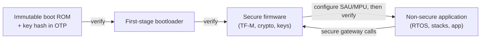
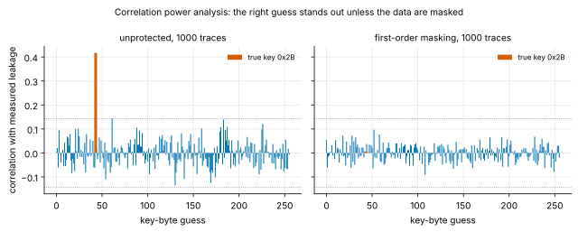

<!-- status: verified -->
# 18-11 · Hardware Security

| | |
|---|---|
| **Course** | [18 · Embedded Systems and Microcontrollers](../README.md) |
| **University equivalent** | The hardware-security unit of a senior embedded or computer-security course: threat models, roots of trust and secure boot, isolation (MPU, TrustZone-M), key storage and PUFs, side-channel and fault attacks, and security certification (Mangard, Oswald and Popp, *Power Analysis Attacks*; Tehranipoor and Wang, *Introduction to Hardware Security and Trust*) |
| **Prerequisites** | [18-08](18-08-boot-and-firmware-update.md) (secure boot, signatures, anti-rollback), [18-07](18-07-rtos-concepts.md) (tasks and isolation), [18-03](18-03-interrupts-exceptions-timers.md) (exceptions and faults), [03-04](../../03-probability-statistics-and-random-variables/chapters/03-04-joint-distributions-and-clt.md) (correlation), [17-08](../../17-communication-systems/chapters/17-08-channel-coding.md) (error-correcting codes) |
| **Estimated study hours** | 7 |
| **Last verified** | 2026-11-21 |

**Learning objectives.** After this chapter you can:

1. Write a threat model for an embedded product: assets, attackers, attack surfaces, and the difference between scalable remote attacks and physical attacks on one device.
2. Explain a chain of trust from an immutable root, and the roles of lifecycle states, debug locking and read-out protection.
3. Explain how an MPU and TrustZone-M isolate code, and where keys should live (OTP, key slots, secure elements, PUFs).
4. Quantify side channels: a timing leak's query count, and the number of traces a correlation power attack needs, and how constant-time code and masking defeat them.
5. Size error correction for a PUF-derived key, and estimate a fault-injection attack's effort with and without redundant checks.
6. Place certifications (PSA Certified, SESIP, Common Criteria, FIPS 140-3) and regulation (EU Cyber Resilience Act, Radio Equipment Directive) in context.

## 1. Big picture

A connected microcontroller holds things worth stealing or abusing: the keys that authenticate it to a cloud service, the firmware a company spent years writing, a user's health data, and control of a lock, a car or a medical pump. Its attackers range from a remote adversary scanning the internet for a buffer overflow, who can exploit a million devices at once, to a lab with an oscilloscope and a glitch generator, who needs the device on the bench. **Hardware security** is the set of mechanisms in the silicon and the low-level firmware that keep secrets secret and code authentic: an immutable root of trust, secure boot, isolation between trusted and untrusted code, protected key storage, and resistance to physical attacks that measure or disturb the chip.

- **Where it shows up:** every connected product, and especially payment terminals, wallets and secure elements, automotive ECUs, medical devices, smart locks, and the IoT devices that new regulation now covers.
- **What changed:** security used to be a feature for a few product categories. In the EU it is becoming a legal requirement for products with digital elements, with deadlines in 2026 and 2027 ([R-312]).
- **The engineering stance:** assume the attacker knows the design (Kerckhoffs's principle), make secrets per device, make the root immutable, and price attacks so that breaking one device does not break the fleet.

## 2. Intuition first

**A bank vault inside a busy building.** The building (the application) is full of people (third-party libraries, network stacks) and you cannot vet them all. The vault (the secure world) has thick walls (isolation), a small door with a guard (the secure gateway), and keys that never leave it (key slots). The vault's lock was installed at construction and cannot be changed by anyone inside (the immutable root of trust).

**Listening at the door and shaking the safe.** A thief who cannot open the vault may listen to it: how long the guard takes to check a password (timing), or how much power the lock's motor draws as it tries each digit (power analysis). Or the thief may kick the safe at the right moment so that its lock skips a check (fault injection). These **physical** attacks need the device in hand, so they do not scale like a software exploit. But if every device shares the same key, breaking one opens them all: a **honeypot**.

**Where the analogy breaks.** A vault's walls are physical; a chip's isolation is a set of address checks that firmware configures, and a single misconfigured region is a hole. And a chip leaks through physics that no wall stops: its power draw and electromagnetic emissions follow the data it processes.

## 3. Theory

### 3.1 Threat models

A **threat model** lists the **assets** (keys, firmware, user data, the device's function), the **attackers** (their access, skill, money and time), and the **attack surfaces** (network interfaces, update paths, debug ports, pins, power and clock inputs, the physical package). Two attack classes matter most:

- **Remote, scalable software attacks** exploit bugs (memory corruption, logic flaws, weak protocols) over a network. One exploit can compromise every device running the same code. Defences are software quality, isolation that limits what a compromised component can reach, secure update to fix bugs quickly (18-08), and authentication.
- **Physical attacks** need the device: reading out flash through a debug port, probing a bus, measuring power or electromagnetic emissions (**side channels**), or disturbing the chip with glitches, electromagnetic pulses or light (**fault injection**). They do not scale by themselves, but they can extract a secret that then enables a scalable attack: a fleet-wide key, or firmware to analyse for bugs.

PSA Certified's guidance states the consequence plainly: "Cryptographic keys stored in the PSA-RoT should be unique per device to prevent creation of a honeypot for physical attacks, including side-channel attacks" ([R-312]) **[Established]**. Example 18-11.6 prices it.

Attack effort is the currency. **Brute force** of a uniformly random $n$-bit secret takes $(2^n + 1)/2$ guesses on average, so 128-bit keys are out of reach, while 32-bit passwords and PINs are protected only by **rate limiting** (attempt counters, delays, lockout) (Example 18-11.1).

### 3.2 Roots of trust and the chain of trust

A **root of trust** is what everything else relies on without being able to check it. NIST describes roots of trust as "highly reliable hardware, firmware, and software components that perform specific, critical security functions" that "must be secure by design" ([R-312]). In an MCU it is typically:

- **Immutable boot code** in mask ROM, which cannot be modified after manufacture.
- **Provisioned secrets and hashes** in one-time-programmable (OTP) memory or eFuses: the hash of the vendor's public key (for secure boot, 18-08 §3.5), a device-unique key, and lifecycle state bits.
- **A lifecycle state machine** (for example: manufacturing, provisioned, deployed, returned for analysis), which decides whether debug access is open, locked, or open only after an authenticated unlock, and which erases secrets on the way back to an open state.

Each boot stage **verifies** the next before running it, forming a **chain of trust** from the ROM up to the application. A broken link anywhere breaks everything above it. NIST SP 800-193 frames the same goal for platform firmware as **protect, detect and recover** ([R-312]): protect the code and keys from modification, detect a modification by verification, and recover a known-good image (the two-slot designs of 18-08).

**Debug and read-out protection.** Production devices disable or lock the debug port (SWD/JTAG) and set a flash **read-out protection** level, so that an attacker with a probe cannot simply read the firmware and keys. These protections are only as strong as the hardware that enforces them, and several have been bypassed with physical attacks: the STM32F0's read-out protection by an optical attack published at USENIX WOOT 2017; STM32F205-based hardware wallets by voltage glitching, in an attack Kraken Security Labs said needed "just 15 minutes of physical access" (January 2020); the ESP32's eFuse read protection by a glitch after reset (CVE-2019-17391); and the nRF52840's APPROTECT debug lock by a fault during boot (CVE-2020-27211) ([R-312]) **[Established]**. The lesson is not that these parts are bad. Read-out protection on a general-purpose MCU is a speed bump against a determined lab; secrets that must survive one need a part evaluated against physical attacks (§3.7).

### 3.3 Isolation: MPU and TrustZone-M

**The MPU.** A Cortex-M memory protection unit divides memory into regions with access permissions (read, write, execute, privileged only). An RTOS can run each task unprivileged with access only to its own stack and data, so a bug in one task cannot overwrite the kernel or another task (18-07). Marking RAM non-executable stops injected code from running.

**TrustZone for Armv8-M** adds a second, orthogonal division: every address and every execution state is **Secure** or **Non-secure**. In Arm's description, the division "is memory map based and the transitions takes place automatically without the need of a Secure Monitor exception handler" ([R-312]) **[Established]**:

- The **SAU** (programmed by Secure code) and the chip-specific **IDAU** mark each region Secure, Non-secure, or **Non-Secure Callable** (NSC).
- Non-secure code can enter Secure code only at **SG** (secure gateway) instructions placed in NSC regions; any other entry raises a fault. Secure code returns with **BXNS**, and clears registers so as not to leak secrets.
- Peripherals and interrupts are assigned to either world, so a Secure crypto engine or key store is invisible to Non-secure code.
- TrustZone-M is available on Cortex-M23, M33, M35P, M55 and M85; Trusted Firmware-M is the open-source reference implementation of the Secure side ([R-312]).

The design pattern is a small, carefully written **secure processing environment** (boot, crypto, key storage, attestation, secure update) and a large Non-secure application (RTOS, network stacks, application code). A remote exploit of the application then cannot read keys, only ask the Secure side to use them.

### 3.4 Key storage and PUFs

- **OTP and eFuses** hold keys written at provisioning. They are simple, but a physical attacker may read them, and they cannot be changed.
- **Key slots in a crypto accelerator** hold keys that software can use but never read: the hardware encrypts or signs with a key referenced by number.
- **Secure elements** (separate chips) and **secure enclaves** (isolated blocks on the same die) are evaluated against physical attacks and protect the most valuable keys.
- **Physical unclonable functions (PUFs)** derive a device-unique key from manufacturing variation, so the key is never stored: it exists only while the device is powered. In an **SRAM PUF**, the power-up state of each memory cell depends on tiny mismatches in its transistors. A fingerprint of thousands of cells is recorded once (**enrollment**), and at each later power-up the same cells are read again.

The catch is noise: some cells are nearly balanced and flip between power-ups. Measured SRAM PUFs show about 3–5% of bits differing at the enrollment temperature and up to 20.5% at temperature extremes ([R-312]) **[Established]**, so error correction is essential. At enrollment the device stores **helper data** (which reveals nothing useful about the key if designed correctly) that lets a decoder correct the noisy readout back to the enrolled key.

The simplest scheme protects each key bit with an $n$-fold **repetition code**: $n$ cells encode one bit, and majority vote decodes it. With independent cell errors of probability $p$, a bit fails when more than half its copies flip,

$$
P_{bit} = \sum_{k = (n+1)/2}^{n} \binom{n}{k} p^k (1 - p)^{n - k} ,
$$

and a $K$-bit key fails if any bit fails, $P_{key} = 1 - (1 - P_{bit})^K$. Example 18-11.4 shows that a 128-bit key with a $10^{-6}$ failure target needs $n$ of tens of cells per bit at realistic error rates, thousands of SRAM cells in all. Real designs use stronger codes (BCH, concatenated with repetition, 17-08) to cut that overhead.

### 3.5 Side-channel attacks

**Timing.** Kocher showed in 1996 that the time taken by cryptographic operations can reveal their keys ([R-312]). The simplest leak is a comparison that stops at the first mismatch: checking a guessed password or MAC byte by byte takes longer the more leading bytes are right. An attacker who can time the check recovers the secret one byte at a time, at most 256 guesses per byte, instead of searching all $2^{8K}$ values (Example 18-11.2). Noise only multiplies the number of measurements per guess. The defence is **constant-time code**: compare every byte, accumulate the differences with OR, and decide only at the end; avoid branches and table look-ups indexed by secrets.

**Power analysis.** A CMOS chip's supply current depends on the data it processes: switching a bus or a register from one value to another draws charge in proportion, roughly, to the number of bits that change or are set (the Hamming weight or Hamming distance model). **Differential power analysis** (Kocher, Jaffe and Jun, 1999, [R-312]) exploits this statistically. **Correlation power analysis (CPA)** is the most common form:

1. Record the power at one instant for $N$ encryptions with known, varying inputs $p_i$.
2. For each guess $k$ of one key byte, predict the leakage $h_{i,k} = HW(S(p_i \oplus k))$, the Hamming weight of the first-round S-box output of AES.
3. Compute the correlation coefficient between predictions and measurements for each guess. The right guess correlates; wrong guesses do not, because the S-box scrambles the relation.

How many traces does it take? With a leakage of Hamming weight (variance 2 for a uniform byte) plus Gaussian noise of standard deviation $\sigma$, the true correlation is

$$
\rho = \sqrt{\frac{2}{2 + \sigma^2}} ,
$$

while the sample correlation of unrelated data has a standard deviation of about $1/\sqrt N$ (03-04). The right key stands out by $z$ standard deviations when $\rho\sqrt N \approx z$:

$$
N \approx \left(\frac{z}{\rho}\right)^2 .
$$

Noise therefore costs the attacker quadratically: halving the correlation quadruples the traces (Example 18-11.3).

**Countermeasures.** *Hiding* lowers $\rho$: noise generators, random delays, shuffling the order of operations, balanced logic. *Masking* removes the first-order dependence altogether: every sensitive value $v$ is split into random shares, for example $v \oplus m$ and $m$ with a fresh random mask $m$ each run, so each individual leakage is independent of the key. A first-order CPA then fails whatever $N$ is (the lab shows it). The attacker must combine two leakage points (a second-order attack), which needs many more traces. Cortex-M35P adds physical-attack resilience in the core itself ([R-312]).

*The lab's simulated CPA with 1000 traces at a noise of 3 Hamming-weight units: unprotected, the true key's correlation (about 0.43) towers over the 255 wrong guesses, which stay within the dotted $\pm 4.5/\sqrt N$ band; with a fresh mask per trace, the true key is indistinguishable from the rest.*

### 3.6 Fault injection

Disturbing a chip's supply voltage, clock or local electromagnetic field for nanoseconds can make one instruction misbehave: a skipped branch, a corrupted load. Boneh, DeMillo and Lipton showed in 1997 that a single faulty RSA signature computed with the Chinese remainder theorem reveals the factorization of the modulus ([R-312]); the more common embedded use is to skip a security check, such as the comparison that keeps debug locked or the signature check in a bootloader.

Glitching is a numbers game. If one attempt succeeds with probability $p$ and the attacker can try $r$ times per second, the expected time is $1/(pr)$ (Example 18-11.5). Defences raise the number of faults needed or detect them:

- **Redundant checks:** test the condition twice, ideally with complementary encodings (for example a status that must equal a pattern and its complement rather than 0 or 1), so that one fault is not enough. If two faults with independent probabilities $p$ are needed, success falls to about $p^2$ per attempt.
- **Random delays** around sensitive operations, so the attacker cannot time the glitch.
- **Glitch and clock monitors, voltage detectors and light sensors** that reset the chip.
- **Control-flow integrity checks** and secure defaults (fail closed: an unexpected path ends in lockdown, not in the open state).

### 3.7 Certification and regulation

Security is hard to judge from a data sheet, so evaluation schemes provide independent evidence ([R-312]) **[Established]**:

- **PSA Certified** (governed by GlobalPlatform since September 2025, launched by Arm and partners in 2019). Level 1 is a reviewed questionnaire. Level 2 is "a laboratory evaluation of a PSA Root of Trust ... against scalable software attacks". Level 3 "includes more attack types, more sophisticated side channel and perturbation attacks as well as physical attacks". Level 4 evaluates secure elements and enclaves at a higher attack potential. The site listed 319 certifications from 124 companies in November 2026.
- **SESIP** (GlobalPlatform), adopted as the European standard EN 17927, with five assurance levels derived from Common Criteria; PSA Levels 2 and 3 are based on it.
- **Common Criteria** (ISO/IEC 15408): seven evaluation assurance levels, from EAL1 "functionally tested" to EAL7 "formally verified design and tested", with vulnerability analysis rising from AVA_VAN.1 to AVA_VAN.5. Smart cards and secure elements are typically certified at the high end against high-potential attackers; the EU's EUCC scheme based on it has applied since 27 February 2025.
- **FIPS 140-3** (NIST): validation of cryptographic modules at four levels, effective since September 2019; FIPS 140-2 validations are accepted through 21 September 2026 before moving to the historical list.
- **The EU Cyber Resilience Act** (Regulation (EU) 2024/2847) entered into force on 10 December 2024. Its reporting obligations apply from 11 September 2026: an actively exploited vulnerability needs an early warning within 24 hours and a notification within 72 hours. Its main obligations apply from 11 December 2027. Microcontrollers with security-related functionalities are listed as important products (Class I), and support periods should be at least five years unless the product's lifetime is shorter.
- **The Radio Equipment Directive's** cybersecurity requirements (Delegated Regulation (EU) 2022/30) have applied since 1 August 2025, with the EN 18031 series as harmonised standards (cited with restrictions).

## 4. Worked examples

### Example 18-11.1 · Brute force and rate limits (tier A)

**Setup.** (a) How long does an attacker testing $10^{12}$ keys per second need, on average, for a 128-bit key? (b) A debug port is unlocked by a 32-bit password that can be tried 1000 times per second. How long, on average? (c) A 4-digit PIN locks after 10 wrong tries. What is the chance a random attacker gets in?

**Solution.** (a) $(2^{128} + 1)/2/10^{12}$ s = **5.39e18** years.

(b) $(2^{32} + 1)/2/1000$ s = **24.9** days: weak. Use a challenge–response unlock with a per-device key, and rate-limit it.

(c) $10/10\,000$ = **0.1** %.

**Units check.** guesses/(guesses/s) = s.

**Sanity check.** Each added bit doubles the work; 32 bits is about four billion, fine against a human but not against a script.

### Example 18-11.2 · A timing leak (tier B)

**Setup.** A device checks a 16-byte authentication tag with an early-exit byte comparison. An attacker can measure the check's time, but noise means 200 measurements are averaged per guess. (a) How many queries does a byte-by-byte attack need at most? (b) Compare with brute force. (c) The lab's simulation on a 4-byte secret: how many queries did it use, and what happened against a constant-time comparison?

**Solution.** (a) The first 15 bytes are found from timing, at most 256 guesses × 200 measurements each; the last byte does not change the timing but the accept/reject answer reveals it, in at most 256 tries: $15 \times 256 \times 200 + 256$ = **768 256** queries.

(b) Brute force needs about $2^{127}$ tries on average: the leak turns an impossible search into an afternoon's work.

(c) The simulation recovered the 4-byte secret in **153 839** queries; against a constant-time comparison its guesses were noise, and it failed.

**Units check.** Counts.

**Sanity check.** Each leaked byte removes a factor of 256 from the search, so 16 leaked bytes reduce $256^{16}$ to $16 \times 256$ guesses.

### Example 18-11.3 · How many traces? (tier B)

**Setup.** A device leaks the Hamming weight of the first S-box output plus Gaussian noise. (a) With noise $\sigma$ = 3 (in Hamming-weight units), what correlation does the right key guess have, and how many traces for a 4.5-standard-deviation margin? (b) With $\sigma$ = 6? (c) The lab's CPA with 2000 traces and the masked implementation with 20 000: what happened?

**Solution.** (a) $\rho = \sqrt{2/11}$ = **0.426**; $N \approx (4.5/0.426)^2$ = **111** traces.

(b) $\rho = \sqrt{2/38}$ = **0.229**; **385** traces: doubling the noise multiplied the effort by about 3.5.

(c) Unmasked, the right key ranked first at every noise level; masked, its correlation was **0.006** and it ranked **95th** of 256, no better than chance.

**Units check.** Correlations are dimensionless.

**Sanity check.** A few hundred traces is minutes of measurement for an unprotected device: why unprotected software AES on a general-purpose MCU is considered breakable by a lab.

### Example 18-11.4 · Correcting a PUF (tier B)

**Setup.** A 128-bit key is derived from an SRAM PUF with a repetition code and majority decoding, and must fail less than once per million power-ups. (a) What repetition length is needed if cells flip with probability 0.05 (the enrollment-temperature end of the measured range)? (b) With 0.205 (the measured worst case at temperature extremes)? (c) How many SRAM cells does each need? (d) At $p$ = 0.15 and $n$ = 9, what key-failure probability does the formula give, and the lab's simulation?

**Solution.** (a) The smallest odd $n$ with $P_{key} \le 10^{-6}$ is **19**.

(b) **75**.

(c) $128 \times 19$ = **2432** cells and $128 \times 75$ = **9600** cells. Designing for the worst case quadruples the SRAM, which is why practical PUFs use stronger codes.

(d) Formula **0.514**; simulation of 20 000 power-ups **0.511**.

**Units check.** Probabilities and counts.

**Sanity check.** With $p$ = 0.15 even nine copies leave each bit failing about once in 180, and 128 bits make failure likely.

### Example 18-11.5 · Glitching a check (tier B)

**Setup.** A voltage glitch skips a bootloader's single signature check with probability $10^{-4}$ per attempt, and the attacker's rig tries 10 times a second. (a) What is the expected time to success? (b) The check is duplicated so that two independent faults are needed, each with probability $10^{-4}$. Now?

**Solution.** (a) $1/(10^{-4} \times 10)$ = **1000** s, about 17 minutes.

(b) $1/(10^{-8} \times 10) = 10^7$ s = **116** days, and in practice longer, because the second fault must also be timed.

**Units check.** 1/(probability × 1/s) = s.

**Sanity check.** Redundancy multiplies the probabilities of independent events; it is the cheapest firmware defence against single faults.

### Example 18-11.6 · The honeypot (tier A)

**Setup.** Extracting a key from one device by side-channel analysis costs an attacker \$50 000 of lab time. (a) If all one million devices in a fleet share that key, what does compromising them cost per device? (b) With per-device keys? (c) Under the Cyber Resilience Act, if a manufacturer learns at 09:00 on a Monday that the resulting vulnerability is being exploited, by when must it send the early warning and the notification?

**Solution.** (a) $\$50\,000/10^6$ = **\$0.05** per device.

(b) **\$50 000** per device: physical attacks stop scaling.

(c) Early warning by 09:00 Tuesday (**24** hours), notification by 09:00 Thursday (**72** hours).

**Units check.** \$ per device.

**Sanity check.** The economics, not the cryptography, decide whether a physical attack threatens a fleet.

<!-- answer-key -->

| ID | Quantity | Value | Unit |
|---|---|---|---|
| Ex 18-11.1a | average brute-force time, 128 bits | 5.39e18 | years |
| Ex 18-11.1b | average time, 32-bit password | 24.9 | days |
| Ex 18-11.1c | PIN success chance | 0.1 | % |
| Ex 18-11.2a | queries for a 16-byte tag | 768256 | — |
| Ex 18-11.2b | queries in the lab's 4-byte attack | 153839 | — |
| Ex 18-11.3a | correlation at σ = 3 | 0.426 | — |
| Ex 18-11.3b | traces at σ = 3 | 111 | — |
| Ex 18-11.3c | correlation at σ = 6 | 0.229 | — |
| Ex 18-11.3d | traces at σ = 6 | 385 | — |
| Ex 18-11.3e | masked: correlation of the right key | 0.006 | — |
| Ex 18-11.3f | masked: rank of the right key (0 = best) | 95 | — |
| Ex 18-11.4a | repetition length at p = 0.05 | 19 | — |
| Ex 18-11.4b | repetition length at p = 0.205 | 75 | — |
| Ex 18-11.4c | cells at p = 0.05 | 2432 | — |
| Ex 18-11.4d | cells at p = 0.205 | 9600 | — |
| Ex 18-11.4e | key failure, p = 0.15, n = 9 | 0.514 | — |
| Ex 18-11.4f | simulated key failure | 0.511 | — |
| Ex 18-11.5a | expected time, single check | 1000 | s |
| Ex 18-11.5b | expected time, double check | 116 | days |
| Ex 18-11.6a | cost per device, shared key | 0.05 | \$ |
| Ex 18-11.6b | cost per device, per-device keys | 50000 | \$ |
| Ex 18-11.6c | early-warning deadline | 24 | h |
| Ex 18-11.6d | notification deadline | 72 | h |

*Every value is recomputed by [verify_18_11.py](../verify/verify_18_11.py): brute-force and glitch times by arithmetic, the timing attack and CPA by the lab's simulations (with an AES S-box generated from its definition and checked against the standard's values), the correlation and trace counts by formula and by simulation, and PUF failure rates by the binomial formula and Monte Carlo.*

## 5. Simulate it

The lab, [labs/18-11-lab](../labs/18-11-lab/README.md), provides `hwsec.py`. **Predict, then run**:

1. **Timing.** Predict the queries to recover a 4-byte secret through an early-exit comparison with 200 measurements per guess; run the attack, then reduce the measurements until it fails.
2. **CPA.** Predict the number of traces needed at noise 1, 3 and 6; run the attack with increasing trace counts and find where the right key first ranks first; then mask the implementation.
3. **PUF.** Plot key-failure probability against repetition length for $p$ = 0.05, 0.15 and 0.205; check one point by simulation.
4. **Glitches.** Simulate an attacker trying glitches against a single and a duplicated check; compare the time to success with the formula.

## 6. Engineering tradeoffs

| Knob | Improves | Costs | Typical decision owner |
|---|---|---|---|
| Per-device keys | removes the honeypot | provisioning infrastructure, key management | security architect |
| TrustZone-M partitioning | contains software exploits | design effort, secure-gateway overhead, bigger part | firmware architect |
| Secure element | physical-attack resistance for keys | BOM, an extra chip and interface | system architect |
| PUF keys | no stored key | error correction, helper data, enrollment | security architect |
| Masking and constant-time crypto | side-channel resistance | speed, code size, randomness | crypto/firmware lead |
| Redundant checks and glitch detectors | fault resistance | code size, false resets | firmware lead |
| Certification (PSA, SESIP, CC) | evidence for customers and regulators | time, lab fees, frozen configuration | product owner |
| Locked debug | firmware and key protection | harder field-failure analysis | product owner with quality |

## 7. Numbers to know

| Quantity | Value | Note |
|---|---|---|
| Brute force | $(2^n + 1)/2$ guesses on average | 128 bits is out of reach |
| Timing leak | at most 256 guesses per leaked byte | |
| CPA traces | $N \approx (z/\rho)^2$, $\rho = \sqrt{2/(2 + \sigma^2)}$ | Hamming-weight leakage |
| Repetition code | $P_{bit} = \sum_{k > n/2}\binom{n}{k}p^k(1 - p)^{n - k}$ | |
| SRAM PUF bit errors | about 3–5% at enrollment temperature, up to 20.5% at extremes | [R-312] |
| Glitch time to success | $1/(pr)$; redundant checks $\approx p^2$ | |
| PSA Certified | Levels 1–4; 319 certifications (Nov 2026) | [R-312] |
| EU CRA | in force 10 Dec 2024; reporting from 11 Sep 2026; main obligations 11 Dec 2027 | [R-312] |

## 8. Common mistakes

- **One key for the whole fleet.** Physical extraction from one device then breaks all of them.
- **Trusting read-out protection to keep secrets from a lab.** Published attacks have bypassed it on several general-purpose MCUs.
- **Comparing secrets with `memcmp`.** Early exit leaks timing; use a constant-time comparison.
- **Debug left open, or unlocked by a short fixed password.**
- **Secure code that trusts pointers from the Non-secure side** without checking that they point to Non-secure memory.
- **A single, unduplicated security check** at a glitchable moment, with a fail-open default.
- **Treating certification as the goal** rather than evidence: a certificate covers one configuration and one threat model.

## 9. Practitioner lens

### State of the art (as of Nov 2026)

- **Certification scale.** PSA Certified listed 319 certifications from 124 companies in November 2026, after GlobalPlatform took over its governance in September 2025, when over 250 products were certified. The Common Criteria portal lists 1753 certified products, 748 of them ICs and smart-card devices ([R-312]) **[Established]**.
- **Regulation is now dated.** The EU Cyber Resilience Act's reporting duties began on 11 September 2026 and its main obligations follow on 11 December 2027; the Radio Equipment Directive's cybersecurity requirements have applied since 1 August 2025 ([R-312]) **[Established]**. US federal procurement relies on FIPS 140-3, with FIPS 140-2 validations accepted through 21 September 2026 (NIST's own pages differ by a day on the exact date) ([R-312]) **[Established]**.
- **Isolation hardware is mainstream** in new MCUs: TrustZone-M on Cortex-M23/M33/M35P/M55/M85, with Trusted Firmware-M as the reference secure firmware ([R-312]) **[Established]**.
- **Physical attacks on general-purpose MCUs are routinely published** by academic and industry labs (read-out protection and debug-lock bypasses on STM32, ESP32 and nRF52 parts, among others), which is why high-value keys go into evaluated secure elements ([R-312]) **[Established]**.

### Why it matters commercially

- **Security is becoming market access.** For products sold in the EU, meeting the CRA (and RED for radios) is a condition of sale; certification evidence shortens customers' and regulators' reviews.
- **Silicon vendors compete on security features and certificates:** TrustZone, crypto accelerators with key slots, PUFs, secure elements, and PSA or SESIP certificates for their reference firmware.
- **Breaches are expensive and public.** A fleet-wide key or an unpatchable bootloader bug can mean recalls, liability and a lasting reputational cost; diligence should ask how keys are provisioned and how vulnerabilities are handled over the support period.

### Marketing vs Reality

- **"Secure MCU."** Secure against what? Ask for the threat model and the evaluation level (software-only attacks, or physical side-channel and fault attacks).
- **"Hardware root of trust."** Ask whether the boot code is truly immutable, where the key hash lives, and how debug is locked across the lifecycle.
- **"PSA Certified."** Ask which level, for which component (the chip's root of trust, or a whole device), and which firmware version.
- **"Unclonable keys."** A PUF's key is only as good as its error correction and helper-data design; ask for the reliability across temperature and ageing.

### Questions for engineering leaders

1. **"What is your threat model, and which attacks are out of scope?"** *Strong:* named assets, attackers and surfaces, with explicit exclusions justified by cost. *Evasive:* "we use encryption".
2. **"Are device keys unique, and how are they provisioned?"** *Strong:* per-device keys injected in a secured factory step or derived on chip (PUF), with records. *Evasive:* "the key is in the firmware".
3. **"How is debug access controlled in the field and for returns?"** *Strong:* locked, with authenticated unlock and secret erasure. *Evasive:* "we disable it in production builds".
4. **"How would you detect and respond to an exploited vulnerability within 24 hours?"** *Strong:* a vulnerability-handling process, monitoring, signed updates and a support period. *Evasive:* "we haven't had one".
5. **"What evidence do you have against physical attacks, if they matter?"** *Strong:* a certificate at an appropriate level or a lab report. *Evasive:* "the read-out protection is set".

## 10. Concept check

**Q1.** Why does a per-device key matter even if the key is strong?

Answer

Because physical attacks extract keys from devices, not by guessing. If all devices share a key, extracting it once (at any cost) compromises the fleet; with unique keys, each device must be attacked separately.

**Q2.** What makes a root of trust a "root"?

Answer

It cannot be verified by anything earlier, so it must be trustworthy by construction: immutable boot code and provisioned values that software cannot modify, from which every later stage is verified.

**Q3.** How does TrustZone-M stop Non-secure code from jumping into the middle of a Secure function?

Answer

Non-secure code may only enter Secure memory at SG (secure gateway) instructions located in Non-Secure Callable regions; any other transfer into Secure memory faults.

**Q4.** Why does an early-exit comparison leak, and how does constant-time code fix it?

Answer

Its run time grows with the number of leading bytes that match, so an attacker can find each byte separately. Constant-time code compares every byte regardless and combines the differences, so the time does not depend on the data.

**Q5.** Why does masking defeat first-order power analysis?

Answer

Each processed value is the sensitive value combined with a fresh random mask, so any single leakage point is statistically independent of the key; correlating it with key hypotheses gives nothing. An attacker must combine several leakage points (higher-order attack), which costs far more traces.

**Q6.** Why does a PUF need helper data and error correction?

Answer

Its readout is noisy: a few percent of cells (more at temperature extremes) flip between power-ups, but a key must be reproduced exactly. Helper data recorded at enrollment lets the decoder correct the errors without revealing the key.

**Problems:** [18-11 problem set](../problems/18-11-problems.md) · [Worked solutions](../solutions/18-11-solutions.md)

## 11. Key terms

[Threat model](../../../reference/glossary.md#threat-model) · [Root of trust](../../../reference/glossary.md#root-of-trust) · [Chain of trust](../../../reference/glossary.md#chain-of-trust) · [Secure boot](../../../reference/glossary.md#secure-boot) · [TrustZone-M](../../../reference/glossary.md#trustzone-m) · [Physical unclonable function (PUF)](../../../reference/glossary.md#physical-unclonable-function-puf) · [Side-channel attack](../../../reference/glossary.md#side-channel-attack) · [Correlation power analysis (CPA)](../../../reference/glossary.md#correlation-power-analysis-cpa) · [Masking](../../../reference/glossary.md#masking) · [Constant-time code](../../../reference/glossary.md#constant-time-code) · [Fault injection](../../../reference/glossary.md#fault-injection) · [Secure element](../../../reference/glossary.md#secure-element)

## 12. Connections

- **Builds on:** [18-08](18-08-boot-and-firmware-update.md) (secure boot and update), [18-07](18-07-rtos-concepts.md) (isolation of tasks), [18-03](18-03-interrupts-exceptions-timers.md) (faults), [03-04](../../03-probability-statistics-and-random-variables/chapters/03-04-joint-distributions-and-clt.md) (correlation), [17-08](../../17-communication-systems/chapters/17-08-channel-coding.md) (codes).
- **Next:** the [Course 18 overview](../README.md) and its exam.
- **Used later:** the wearable sensor-node capstone (C3) and the diligence-memo capstone (C4), where security claims are assessed.

## 13. Further study

- Mangard, S., Oswald, E. and Popp, T., *Power Analysis Attacks: Revealing the Secrets of Smart Cards*, Springer, 2007.
- Tehranipoor, M. and Wang, C. (eds.), *Introduction to Hardware Security and Trust*, Springer, 2012.
- Arm's TrustZone for Armv8-M documentation and the Trusted Firmware-M project documentation.
- The PSA Certified and SESIP documents, and the text of the EU Cyber Resilience Act.

## 14. Sources

1. Kocher, P., Jaffe, J. and Jun, B., "Differential Power Analysis", CRYPTO '99, LNCS, pp. 388–397, 1999.
2. Boneh, D., DeMillo, R. A. and Lipton, R. J., "On the Importance of Checking Cryptographic Protocols for Faults", EUROCRYPT '97, LNCS, pp. 37–51, 1997.
3. Guajardo, J., Kumar, S. S., Schrijen, G.-J. and Tuyls, P., "FPGA Intrinsic PUFs and Their Use for IP Protection", CHES 2007, LNCS, pp. 63–80.
4. NIST FIPS 197, *Advanced Encryption Standard* (the S-box the lab generates).
5. [R-312] PSA Certified pages; Arm TrustZone-M white paper and product pages; GlobalPlatform SESIP; Common Criteria CC:2022 and portal; NIST FIPS 140-3 and CMVP pages; EU Cyber Resilience Act and RED delegated acts; Schrijen and van der Leest (DATE 2012); USENIX WOOT 2017; Kraken Security Labs (2020); Espressif advisory and NVD CVE-2019-17391; NVD CVE-2020-27211; NIST roots-of-trust definitions and SP 800-193.
