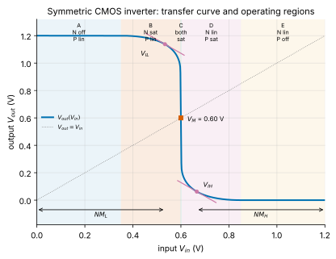
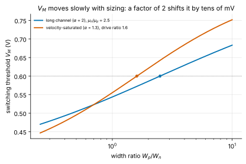

<!-- status: verified -->
# 19-01 · The CMOS Inverter: Static Characteristics

| | |
|---|---|
| **Course** | [19 · Digital VLSI Design](../README.md) |
| **University equivalent** | The static inverter analysis of a senior digital-IC course: the transfer curve region by region, switching threshold, unity-gain points and noise margins, sizing for symmetry, and robustness to supply and variation (Rabaey, Chandrakasan & Nikolić, *Digital Integrated Circuits*, ch. 5; Weste & Harris, *CMOS VLSI Design*, ch. 2) |
| **Prerequisites** | [09-11](../../09-semiconductor-devices/chapters/09-11-cmos-and-scaling.md) (the inverter's first look), [09-09](../../09-semiconductor-devices/chapters/09-09-long-channel-mosfet.md) (square law and subthreshold current), [09-10](../../09-semiconductor-devices/chapters/09-10-short-channel-effects-and-leakage.md) (velocity saturation), [10-04](../../10-electronics-1/chapters/10-04-small-signal-models.md) (small-signal $g_m$ and $r_o$), [08-02](../../08-digital-logic-design/chapters/08-02-boolean-algebra-and-gates.md) (logic levels) |
| **Estimated study hours** | 8 |
| **Last verified** | 2026-11-21 |

**Learning objectives.** After this chapter you can:

1. Divide the inverter's voltage transfer characteristic into its five operating regions and write the current equation that holds in each.
2. Derive the switching threshold for square-law and velocity-saturated transistors, and size the PMOS for a target threshold.
3. Derive the unity-gain points and noise margins in closed form for any sizing ratio, and compute them numerically from a transfer curve.
4. Compute the gain at the switching threshold from the transistors' transconductance and output conductance, and explain why it makes the inverter regenerative.
5. Estimate how threshold variation moves the switching threshold, and derive the minimum supply at which an inverter still has gain.

## 1. Big picture

Every digital chip, from a microcontroller to an AI accelerator, is built from logic gates, and the CMOS inverter is the simplest of them: one NMOS and one PMOS transistor, sharing an input and an output. Understand its static behavior, the output voltage for each input voltage when nothing is moving, and you understand why digital logic works at all: why a gate can take a noisy, degraded input and produce a clean output, why every gate draws almost no current when it is not switching, and what sets the supply voltage of a chip. Course 09 met the inverter briefly ([09-11](../../09-semiconductor-devices/chapters/09-11-cmos-and-scaling.md)); this chapter derives its static properties completely, and 19-02 adds time.

- **Noise immunity.** The transfer curve's steep middle and flat ends make the inverter **regenerative**: small disturbances on its input die out after a stage or two. The **noise margins** say how much disturbance a gate tolerates.
- **Sizing.** The relative widths of the two transistors set where the curve switches. Getting that right is the first sizing decision in every standard-cell library.
- **Supply voltage.** Static analysis shows how low the supply can go before gates stop having gain, which bounds the energy per operation (19-06).
- **Variation.** Threshold mismatch between transistors moves the switching point; on a die with billions of gates, the tails of that distribution, not the average, decide whether the chip works.

## 2. Intuition first

Picture two water valves in series between a full tank ($V_{DD}$) and a drain (ground), with the output being the water level in the pipe between them. One input handle opens the lower valve (the NMOS) as it is raised and closes the upper valve (the PMOS) at the same time. With the handle low, the upper valve is open and the lower one shut: the output sits at the tank level. With the handle high, the reverse: the output drains to ground. Only in a narrow band of handle positions are both valves partly open, and there the output level swings rapidly from one extreme to the other, because a small change of the handle shifts the balance between two strong, opposing flows.

The analogy captures the two things that matter. First, in either steady state one valve is fully shut, so no water flows from tank to drain: a static CMOS gate draws no current except leakage. Second, the output is set by a *balance of currents*, so the switching point depends on how strong each valve is, which is why the PMOS, whose carriers (holes) are less mobile, is made wider. The analogy breaks down in the middle region: real transistors are not linear valves, and their current depends on the output voltage too (the drain voltage), which is exactly what sets the gain of the transition.

*Figure 1. The transfer curve of a symmetric inverter ($V_{DD}$ = 1.2 V, $V_{TN} = \lvert V_{TP}\rvert$ = 0.35 V, $k_n = k_p$, λ = 0.05 V⁻¹). In region A the NMOS is off and the output is exactly $V_{DD}$; in E the PMOS is off and it is exactly 0. The steep middle, where both transistors are saturated, is where the gate switches. The unity-gain points $V_{IL}$ and $V_{IH}$ bound the inputs the gate reads reliably.*

## 3. Theory

### 3.1 The circuit and its operating regions

The NMOS has its source at ground and its drain at the output; the PMOS has its source at $V_{DD}$ and its drain at the output; both gates take $V_{in}$. So

$$
V_{GSn} = V_{in}, \quad V_{DSn} = V_{out}, \qquad V_{SGp} = V_{DD} - V_{in}, \quad V_{SDp} = V_{DD} - V_{out} .
$$

With no load current (the next gate's input is a capacitor, which draws no DC current), the static output is the voltage at which the PMOS sources exactly the current the NMOS sinks: $I_{Dp}(V_{in}, V_{out}) = I_{Dn}(V_{in}, V_{out})$. Every point of the transfer curve is the solution of that one equation.

We use the long-channel square law of 09-09, with $k_n = \mu_nC_{ox}W_n/L_n$ and $k_p = \mu_pC_{ox}W_p/L_p$, thresholds $V_{TN} > 0$ and $\lvert V_{TP}\rvert$, and channel-length modulation λ (as in SPICE's level-1 model, 10-04):

$$
I_D =
\begin{cases}
0, & V_{ov} \le 0 \ \text{(off)}\\[2pt]
k\left(V_{ov}V_{DS} - \tfrac12V_{DS}^2\right)(1 + \lambda V_{DS}), & 0 < V_{DS} < V_{ov} \ \text{(linear)}\\[2pt]
\tfrac12kV_{ov}^2(1 + \lambda V_{DS}), & V_{DS} \ge V_{ov} \ \text{(saturation)}
\end{cases}
$$

where $V_{ov}$ is the overdrive ($V_{in} - V_{TN}$ for the NMOS, $V_{DD} - V_{in} - \lvert V_{TP}\rvert$ for the PMOS) and $V_{DS}$ means $V_{SD}$ for the PMOS. The NMOS is saturated when $V_{out} \ge V_{in} - V_{TN}$, and the PMOS when $V_{out} \le V_{in} + \lvert V_{TP}\rvert$. Sweeping $V_{in}$ from 0 to $V_{DD}$ walks through five regions (Figure 1):

| Region | Input range | NMOS | PMOS | Output |
|---|---|---|---|---|
| A | $V_{in} < V_{TN}$ | off | linear, $V_{SD} = 0$ | exactly $V_{DD}$ |
| B | just above $V_{TN}$ | saturated | linear | high, falling slowly |
| C | around $V_M$ | saturated | saturated | falling steeply |
| D | just below $V_{DD} - \lvert V_{TP}\rvert$ | linear | saturated | low, falling slowly |
| E | $V_{in} > V_{DD} - \lvert V_{TP}\rvert$ | linear, $V_{DS} = 0$ | off | exactly 0 |

Two facts follow at once. The output levels are the rails: $V_{OH} = V_{DD}$ and $V_{OL} = 0$, because in A and E the conducting transistor carries no current and so drops no voltage. This **rail-to-rail** swing is what distinguishes static CMOS from the ratioed logic families of 19-03, whose low output is a voltage divider. And both transistors conduct only for $V_{TN} < V_{in} < V_{DD} - \lvert V_{TP}\rvert$; outside that window the static current is zero (apart from leakage, 19-06).

### 3.2 The switching threshold

The **switching threshold** $V_M$ is the input at which $V_{out} = V_{in}$, the crossing of the transfer curve with the 45° line. There $V_{DS} = V_M$ and $V_{SD} = V_{DD} - V_M$, both larger than the overdrives in a well-designed inverter, so both transistors are saturated (region C). Ignoring λ for the moment, equate the two saturation currents:

$$
\frac{k_n}{2}(V_M - V_{TN})^2 = \frac{k_p}{2}(V_{DD} - V_M - \lvert V_{TP}\rvert)^2 .
$$

Both overdrives are positive, so take square roots and write $r = k_n/k_p$:

$$
\sqrt r\,(V_M - V_{TN}) = V_{DD} - V_M - \lvert V_{TP}\rvert
\quad\Longrightarrow\quad
V_M = \frac{V_{TN}\sqrt r + V_{DD} - \lvert V_{TP}\rvert}{1 + \sqrt r} .
$$

$V_M$ is a weighted average of $V_{TN}$ and $V_{DD} - \lvert V_{TP}\rvert$, the two ends of the window where both transistors conduct, with weights $\sqrt r$ and 1. A stronger NMOS ($r > 1$) pulls $V_M$ toward $V_{TN}$; a stronger PMOS pulls it up. With matched thresholds and $r$ = 1, $V_M = V_{DD}/2$: the **symmetric** inverter.

**Sizing for a target threshold.** Inverting the result, the ratio that places $V_M$ at a chosen value is

$$
r = \frac{k_n}{k_p} = \left(\frac{V_{DD} - \lvert V_{TP}\rvert - V_M}{V_M - V_{TN}}\right)^2 ,
\qquad
\frac{W_p}{W_n} = \frac{\mu_n}{\mu_p}\cdot\frac{1}{r}\quad\text{(equal lengths)} .
$$

For a symmetric inverter with matched thresholds, $r$ = 1 and $W_p/W_n = \mu_n/\mu_p$, typically 2 to 3 in bulk silicon because holes are less mobile than electrons.

**$V_M$ is insensitive to sizing.** Because $V_M$ depends on $\sqrt r$, and that only through a weighted average, doubling or halving $r$ moves $V_M$ by tens of millivolts, not by a fraction of the supply (Figure 2). Two consequences: a small sizing error does not break a gate, and conversely you cannot move $V_M$ far by sizing alone. Designers often choose $W_p/W_n$ below the symmetric value to save area and input capacitance, accepting a $V_M$ slightly below the midpoint; 19-04 shows that the delay of a chain of inverters is smallest near $W_p/W_n = \sqrt{\mu_n/\mu_p}$, about 1.6 for a mobility ratio of 2.5.

*Figure 2. $V_M$ against $W_p/W_n$ ($V_{DD}$ = 1.2 V, $V_{TN} = \lvert V_{TP}\rvert$ = 0.35 V). The symmetric point is where each curve crosses 0.6 V: at the mobility ratio for long-channel transistors, and at the smaller drive-current ratio for velocity-saturated ones.*

**Velocity saturation.** In short-channel transistors the carriers reach their saturation velocity (09-10), and the current grows more slowly than the square of the overdrive. Sakurai and Newton's **alpha-power law** captures this with one exponent: $I_{D,sat} = \tfrac12K\,V_{ov}^\alpha$, with α = 2 for the square law and α → 1 for full velocity saturation. Repeating the derivation with exponent α gives

$$
V_M = \frac{V_{TN}\,r^{1/\alpha} + V_{DD} - \lvert V_{TP}\rvert}{1 + r^{1/\alpha}}, \qquad r = \frac{K_n}{K_p} .
$$

Two changes matter in practice. The symmetric point still needs $r$ = 1 with matched thresholds, but $K_n/K_p$ at equal widths is now the ratio of the *saturated drive currents*, which is smaller than the mobility ratio because electrons, being faster, saturate more: the PMOS needs less widening than $\mu_n/\mu_p$ suggests. And $V_M$ is somewhat more sensitive to $r$ when α is smaller (Figure 2's steeper curve), because $r^{1/\alpha}$ varies faster. Example 19-01.5 puts numbers to both.

### 3.3 Unity-gain points and noise margins

A gate must interpret a range of input voltages as "low" and another as "high". The natural boundaries are the inputs where the transfer curve's slope is −1, the **unity-gain points** $V_{IL}$ (below $V_M$) and $V_{IH}$ (above it). Between them the gate amplifies: any noise on the input appears larger on the output. Outside them it attenuates. The **noise margins** compare these input limits with the output levels the previous gate guarantees:

$$
NM_L = V_{IL} - V_{OL}, \qquad NM_H = V_{OH} - V_{IH} .
$$

For static CMOS, $V_{OL}$ = 0 and $V_{OH} = V_{DD}$, so $NM_L = V_{IL}$ and $NM_H = V_{DD} - V_{IH}$. A noise voltage smaller than the margin, added to a valid output, still lands in the input range the next gate reads correctly.

**Deriving $V_{IL}$.** Just above $V_{TN}$ (region B) the NMOS is saturated and the PMOS linear. With λ = 0 and lengths that make $k_p$ the unit of current, the current balance is

$$
\frac{r}{2}b^2 = a\,u - \frac{u^2}{2},\qquad b = V_{in} - V_{TN},\quad a = V_{DD} - V_{in} - \lvert V_{TP}\rvert,\quad u = V_{DD} - V_{out} ,
$$

where $b$ and $a$ are the two overdrives and $u$ the PMOS's source–drain voltage. Differentiate with respect to $V_{in}$, using $db/dV_{in} = 1$, $da/dV_{in} = -1$ and, at the unity-gain point, $du/dV_{in} = -dV_{out}/dV_{in} = 1$:

$$
r\,b = -u + a - u \quad\Longrightarrow\quad u = \frac{a - r\,b}{2} .
$$

Substitute back: $a u - u^2/2 = u(a - u/2) = \tfrac18(a - rb)(3a + rb)$, so

$$
4r\,b^2 = (a - rb)(3a + rb) \quad\Longrightarrow\quad (r^2 + 4r)\,b^2 + 2r\,ab - 3a^2 = 0 .
$$

This is a quadratic in the ratio $t = b/a$; its positive root is

$$
t = \frac{2\sqrt{r^2 + 3r} - r}{r(r + 4)} .
$$

Because $a + b = V_{DD} - V_{TN} - \lvert V_{TP}\rvert$ is fixed, $b = \tfrac{t}{1 + t}(a + b)$, and

$$
V_{IL} = V_{TN} + \frac{t}{1 + t}\left(V_{DD} - V_{TN} - \lvert V_{TP}\rvert\right) .
$$

**$V_{IH}$ by symmetry.** Replacing $V_{in}$ by $V_{DD} - V_{in}$ and $V_{out}$ by $V_{DD} - V_{out}$ turns the NMOS into the PMOS and vice versa. So $V_{IH} = V_{DD} - V_{IL}'$, where $V_{IL}'$ is the formula above with $V_{TN}$ and $\lvert V_{TP}\rvert$ swapped and $r$ replaced by $1/r$.

For the symmetric inverter ($r$ = 1, $V_{TN} = \lvert V_{TP}\rvert = V_T$), $t = (2 \cdot 2 - 1)/5 = 3/5$ and $t/(1 + t) = 3/8$:

$$
V_{IL} = \frac{3V_{DD} + 2V_T}{8}, \qquad V_{IH} = \frac{5V_{DD} - 2V_T}{8}, \qquad NM_L = NM_H = \frac{3V_{DD} + 2V_T}{8} .
$$

For $V_{DD}$ = 1.2 V and $V_T$ = 0.35 V the margins are 0.5375 V each, 45% of the supply, and the region of gain, $V_{IH} - V_{IL} = (V_{DD} - 2V_T)/4$, is only 0.125 V wide. An asymmetric inverter trades one margin for the other: with $r$ = 2.5, $NM_L$ falls to 0.466 V and $NM_H$ rises to 0.612 V (Example 19-01.3). The *smaller* margin limits the gate, which is one reason symmetric sizing is the reference.

> **Going deeper — other noise-margin definitions.** The unity-gain definition is the textbook standard, but it is not the only one. The largest-square (or maximum-equal-criterion) method fits the biggest square between the transfer curve and its mirror image and is better suited to cross-coupled pairs such as SRAM cells (19-08). Both ignore dynamic noise: a short glitch larger than the static margin may do no harm if it is shorter than the gate's delay, which is why signal-integrity tools use noise-rejection curves rather than a single number.

### 3.4 Gain at the switching threshold and regeneration

With λ = 0, both transistors in saturation are ideal current sources and the curve at $V_M$ is vertical: infinite gain. Channel-length modulation makes it finite. Around $V_M$, apply small-signal analysis (10-04): an input change $v_{in}$ changes the NMOS current by $g_{mn}v_{in}$ and the PMOS current by $-g_{mp}v_{in}$, and an output change $v_{out}$ changes them by $g_{dsn}v_{out}$ and $g_{dsp}v_{out}$ (the PMOS's $V_{SD}$ falls as $V_{out}$ rises). Kirchhoff's current law at the output, $g_{mn}v_{in} + g_{dsn}v_{out} = -g_{mp}v_{in} - g_{dsp}v_{out}$, gives

$$
A_v = \frac{v_{out}}{v_{in}} = -\frac{g_{mn} + g_{mp}}{g_{dsn} + g_{dsp}} .
$$

In saturation $g_m = kV_{ov}(1 + \lambda V_{DS}) = 2I_D/V_{ov}$ and $g_{ds} = \tfrac12kV_{ov}^2\lambda = \lambda I_D/(1 + \lambda V_{DS})$, often approximated by $\lambda I_D$. Both transistors carry the same $I_D$ at $V_M$, so it cancels. For the symmetric inverter ($V_{ov}$ and λ equal, $V_{DS} = V_{DD}/2$):

$$
\lvert A_v\rvert = \frac{2(1 + \lambda V_{DD}/2)}{\lambda V_{ov}} \approx \frac{2}{\lambda V_{ov}} .
$$

With λ = 0.1 V⁻¹ and $V_{ov}$ = 0.25 V, $\lvert A_v\rvert$ = 84.8 (the approximation gives 80): the output swings through most of its range while the input moves by about $V_{DD}/\lvert A_v\rvert$, 14 mV. Example 19-01.4 confirms this in ngspice.

**Why gain makes logic robust.** Feed a degraded level into a chain of inverters. If the input is on the "low" side of $V_M$, the first output lands near $V_{DD}$; because the curve is flat there (slope near zero), the second stage's output is pushed even closer to 0, and so on. Any input that is not exactly at $V_M$ is driven to a rail within a few stages: the chain **regenerates** logic levels. The condition is a gain magnitude above 1 in the transition region, so that the transfer curve and its mirror image cross at three points (two stable, at the rails, and one unstable, at $V_M$), exactly the condition a latch needs (08-06, 19-07).

### 3.5 Robustness: variation and supply

**Threshold variation.** Random dopant fluctuation and line-edge roughness make the thresholds of nominally identical transistors differ (09-10). From the $V_M$ formula,

$$
\frac{\partial V_M}{\partial V_{TN}} = \frac{\sqrt r}{1 + \sqrt r}, \qquad \frac{\partial V_M}{\partial \lvert V_{TP}\rvert} = -\frac{1}{1 + \sqrt r},
$$

so for independent threshold variations of standard deviation $\sigma_{VT}$ on each transistor, $\sigma_{V_M} = \sigma_{VT}\sqrt{r + 1}/(1 + \sqrt r)$, which is $\sigma_{VT}/\sqrt2$ for $r$ = 1. With $\sigma_{VT}$ = 25 mV, $V_M$ varies by 17.7 mV rms, small against margins of half a volt, but on a die with $10^9$ gates the extreme ones sit six standard deviations out. Variation matters far more for circuits that rely on matching (sense amplifiers, SRAM cells, 19-08) than for a lone inverter.

**How low can the supply go?** Lowering $V_{DD}$ saves energy as its square (19-06), so it is tempting to go as low as possible. Below about $V_{TN} + \lvert V_{TP}\rvert$ both transistors can no longer be in strong inversion together, but the inverter still works: in **subthreshold**, the current is exponential in the gate voltage (09-09),

$$
I_D = I_0\,e^{V_{ov}/(nV_T)}\left(1 - e^{-V_{DS}/V_T}\right),
$$

with $V_T = kT/q$ the thermal voltage (25.85 mV at 300 K) and $n$ the subthreshold slope factor (between 1 and about 1.5). For a symmetric inverter, equating the two currents and taking logarithms (in units of $V_T$, with $D = V_{DD}/V_T$, $x = V_{in}/V_T$, $y = V_{out}/V_T$):

$$
\frac{2x - D}{n} = \ln\left(1 - e^{-(D - y)}\right) - \ln\left(1 - e^{-y}\right) .
$$

Differentiate with respect to $x$ at the midpoint $x = y = D/2$, where each logarithm's derivative with respect to $y$ is $-1/(e^{D/2} - 1)$:

$$
\frac2n = -\frac{2}{e^{D/2} - 1}\,\frac{dy}{dx}
\quad\Longrightarrow\quad
\lvert A_v\rvert = \frac{e^{V_{DD}/(2V_T)} - 1}{n} .
$$

The gain grows exponentially with the supply. Setting $\lvert A_v\rvert$ = 1 gives the **minimum supply** for a regenerative inverter,

$$
V_{DD,min} = 2V_T\ln(1 + n),
$$

which is $2\ln 2\,V_T$ = 36 mV for an ideal $n$ = 1, and about 45 mV for $n$ = 1.4. Real subthreshold designs run at a few hundred millivolts, because they need noise margins, not just gain above 1, and because variation in subthreshold is exponential rather than linear. But the result shows that the floor is thermal, $kT/q$, not the threshold voltage. 19-06 returns to the energy-optimal supply, which lies near the threshold voltage.

## 4. Worked examples

### Example 19-01.1 · Regions and levels (tier A)

**Setup.** A symmetric inverter runs from $V_{DD}$ = 1.2 V with $V_{TN} = \lvert V_{TP}\rvert$ = 0.35 V, $k_n = k_p$ and λ = 0. (a) What are $V_{OH}$ and $V_{OL}$? (b) Over what input range do both transistors conduct? (c) Find $V_M$. (d) At $V_{in} = V_M$ the curve is vertical: over what output range are both transistors saturated?

**Solution.** (a) $V_{OH}$ = **1.2** V and $V_{OL}$ = **0** V: rail to rail, because the conducting transistor carries no current in regions A and E.

(b) From $V_{TN}$ = 0.35 V to $V_{DD} - \lvert V_{TP}\rvert$ = **0.85** V.

(c) $r$ = 1 and matched thresholds: $V_M = (0.35 + 1.2 - 0.35)/2$ = **0.6** V.

(d) The NMOS stays saturated while $V_{out} \ge V_{in} - V_{TN}$ = **0.25** V and the PMOS while $V_{out} \le V_{in} + \lvert V_{TP}\rvert$ = **0.95** V. With λ = 0 the currents do not depend on $V_{out}$ there, so every output between 0.25 and 0.95 V satisfies the balance: a vertical segment.

**Units check.** All quantities are voltages.

**Sanity check.** The lab's ngspice netlist gives $V_M$ = 0.6000 V for this inverter.

### Example 19-01.2 · Sizing for a threshold (tier B)

**Setup.** A process has $V_{TN}$ = 0.35 V, $\lvert V_{TP}\rvert$ = 0.40 V and $\mu_n/\mu_p$ = 2.5, with $V_{DD}$ = 1.2 V and equal channel lengths. (a) Find $V_M$ with equal widths. (b) What $W_p/W_n$ puts $V_M$ at $V_{DD}/2$?

**Solution.** (a) Equal widths give $r = \mu_n/\mu_p$ = 2.5, $\sqrt r$ = 1.581:

$$
V_M = \frac{0.35 \times 1.581 + 1.2 - 0.40}{1 + 1.581} = \frac{1.3534}{2.581} = \mathbf{0.524}\ \text{V} .
$$

(b) $r = ((1.2 - 0.40 - 0.6)/(0.6 - 0.35))^2 = (0.2/0.25)^2$ = **0.64**, so $W_p/W_n = 2.5/0.64$ = **3.91**.

**Units check.** $r$ and the width ratio are dimensionless.

**Sanity check.** The PMOS must be wider than the mobility ratio alone (2.5) would suggest, because its threshold is also 50 mV larger. ngspice gives $V_M$ = 0.5244 V for (a).

### Example 19-01.3 · Noise margins and asymmetry (tier B)

**Setup.** With $V_{DD}$ = 1.2 V and $V_{TN} = \lvert V_{TP}\rvert$ = 0.35 V, find $V_{IL}$, $V_{IH}$ and both noise margins (a) for $r$ = 1 and (b) for $r$ = 2.5 (equal widths with a mobility ratio of 2.5).

**Solution.** (a) $V_{IL} = (3 \times 1.2 + 2 \times 0.35)/8$ = **0.5375** V and $V_{IH} = (5 \times 1.2 - 0.7)/8$ = **0.6625** V; $NM_L = NM_H$ = 0.5375 V.

(b) With $r$ = 2.5: $t = (2\sqrt{6.25 + 7.5} - 2.5)/(2.5 \times 6.5) = (7.416 - 2.5)/16.25 = 0.3025$, and $t/(1 + t) = 0.2322$, so $V_{IL} = 0.35 + 0.2322 \times 0.5$ = **0.466** V. For $V_{IH}$, swap the roles with $r' = 0.4$: $t' = (2\sqrt{0.16 + 1.2} - 0.4)/(0.4 \times 4.4) = (2.332 - 0.4)/1.76 = 1.098$, $t'/(1 + t') = 0.5233$, $V_{IL}' = 0.35 + 0.5233 \times 0.5 = 0.6117$, and $V_{IH} = 1.2 - 0.6117$ = **0.588** V. So $NM_L$ = **0.466** V and $NM_H$ = **0.612** V.

**Units check.** $t$ is a ratio of voltages; the margins are voltages.

**Sanity check.** The stronger NMOS pulls the whole transition left ($V_M$ falls from 0.600 to 0.544 V), shrinking $NM_L$ and growing $NM_H$ by similar amounts. The lab's numerical solution of the transfer curve gives the same $V_{IL}$ and $V_{IH}$ to better than a microvolt.

### Example 19-01.4 · Gain at the threshold (tier B)

**Setup.** The symmetric inverter of Example 1 now has λ = 0.1 V⁻¹ on both transistors and $k_n = k_p$ = 200 µA/V². (a) Find its gain at $V_M$. (b) What does the common approximation $g_{ds} \approx \lambda I_D$ give? (c) Over roughly what input range does the output swing?

**Solution.** By symmetry $V_M$ = 0.6 V still, with $V_{ov}$ = 0.25 V and $V_{DS} = V_{SD}$ = 0.6 V for both transistors.

(a) $\lvert A_v\rvert = 2(1 + \lambda V_{DS})/(\lambda V_{ov}) = 2 \times 1.06/(0.1 \times 0.25)$ = **84.8**.

(b) $2/(\lambda V_{ov})$ = **80.0**, 6% low, because the true $g_{ds}$ is $\lambda I_D/(1 + \lambda V_{DS})$.

(c) About $V_{DD}/\lvert A_v\rvert = 1.2/84.8$ = **14.2** mV.

**Units check.** $\lambda V_{ov}$ is dimensionless (V⁻¹ × V); the gain is a ratio.

**Sanity check.** The lab's ngspice netlist, with SPICE's own level-1 model, measures a gain of 84.80 by a central difference around 0.6 V.

### Example 19-01.5 · Velocity saturation and sizing (tier C)

**Setup.** In a short-channel process with $V_{DD}$ = 1.2 V and $V_{TN} = \lvert V_{TP}\rvert$ = 0.35 V, an NMOS delivers 1.6 times the saturated current of an equal-width PMOS at the same overdrive. (a) Find $V_M$ for equal widths if the alpha-power exponent is α = 1.3, and compare with a square-law process having the same drive ratio. (b) What $W_p/W_n$ makes the inverter symmetric? (c) Why is that smaller than the mobility ratio?

**Solution.** (a) $r^{1/\alpha} = 1.6^{1/1.3} = 1.436$, so $V_M = (0.35 \times 1.436 + 0.85)/2.436$ = **0.555** V. With α = 2, $r^{1/2} = 1.265$ and $V_M$ = **0.571** V: for the same drive ratio, the velocity-saturated inverter's threshold moves further from the midpoint.

(b) Matched thresholds need $r$ = 1 whatever α is, so $W_p/W_n$ = **1.6**, the drive ratio.

(c) Electrons travel faster and saturate their velocity more than holes, so velocity saturation reduces the NMOS's current more than the PMOS's. The ratio of saturated drive currents, which is what sizing must equalize, is therefore smaller than the low-field mobility ratio.

**Units check.** $r^{1/\alpha}$ is dimensionless.

**Sanity check.** Figure 2 shows both curves crossing 0.6 V at their own symmetric ratio, 2.5 and 1.6, and the α = 1.3 curve steeper.

### Example 19-01.6 · The thermal floor on the supply (tier C)

**Setup.** A symmetric inverter operates in subthreshold with $n$ = 1.4 at 300 K ($V_T$ = 25.85 mV). (a) What is the minimum supply for gain? (b) What is the gain at $V_{DD}$ = 200 mV, and (c) at 100 mV?

**Solution.** (a) $V_{DD,min} = 2 \times 25.85\ \text{mV} \times \ln 2.4$ = **45.3** mV.

(b) $\lvert A_v\rvert = (e^{0.2/(2 \times 0.02585)} - 1)/1.4 = (e^{3.868} - 1)/1.4$ = **33.5**.

(c) $(e^{1.934} - 1)/1.4$ = **4.23**.

**Units check.** $V_{DD}/V_T$ is dimensionless.

**Sanity check.** The lab solves the subthreshold transfer curve numerically: at 45.3 mV its slope at the midpoint is −1.000, and at 200 mV it is −33.47. Halving the supply from 200 to 100 mV cuts the gain eightfold, because the gain is exponential in $V_{DD}$.

<!-- answer-key -->

| ID | Quantity | Value | Unit |
|---|---|---|---|
| Ex 19-01.1a | V_OH | 1.2 | V |
| Ex 19-01.1b | V_OL | 0 | V |
| Ex 19-01.1c | switching threshold | 0.6 | V |
| Ex 19-01.1d | upper end of the conducting window | 0.85 | V |
| Ex 19-01.1e | lower end of the vertical segment | 0.25 | V |
| Ex 19-01.1f | upper end of the vertical segment | 0.95 | V |
| Ex 19-01.2a | V_M with equal widths | 0.524 | V |
| Ex 19-01.2b | required kn/kp | 0.64 | — |
| Ex 19-01.2c | required Wp/Wn | 3.91 | — |
| Ex 19-01.3a | V_IL, r = 1 | 0.5375 | V |
| Ex 19-01.3b | V_IH, r = 1 | 0.6625 | V |
| Ex 19-01.3c | V_IL, r = 2.5 | 0.466 | V |
| Ex 19-01.3d | V_IH, r = 2.5 | 0.588 | V |
| Ex 19-01.3e | NM_L, r = 2.5 | 0.466 | V |
| Ex 19-01.3f | NM_H, r = 2.5 | 0.612 | V |
| Ex 19-01.4a | gain magnitude at V_M | 84.8 | — |
| Ex 19-01.4b | approximate gain magnitude | 80.0 | — |
| Ex 19-01.4c | transition width | 14.2 | mV |
| Ex 19-01.5a | V_M, alpha = 1.3 | 0.555 | V |
| Ex 19-01.5b | V_M, alpha = 2 | 0.571 | V |
| Ex 19-01.5c | symmetric Wp/Wn | 1.6 | — |
| Ex 19-01.6a | minimum supply for gain | 45.3 | mV |
| Ex 19-01.6b | gain at 200 mV | 33.5 | — |
| Ex 19-01.6c | gain at 100 mV | 4.23 | — |
| Txt 19-01.a | symmetric noise margin, 1.2 V and 0.35 V | 0.5375 | V |
| Txt 19-01.b | width of the gain region | 0.125 | V |
| Txt 19-01.c | sigma of V_M for 25 mV threshold sigma, r = 1 | 17.7 | mV |
| Txt 19-01.d | ideal minimum supply, n = 1 | 36 | mV |
| Txt 19-01.e | thermal voltage at 300 K | 25.85 | mV |
| Txt 19-01.f | SKY130 NMOS to PMOS e-test drive ratio | 2.6 | — |
| Txt 19-01.g | slope factor n for 70 mV per decade at 300 K | 1.18 | — |
| Txt 19-01.h | ideal subthreshold slope at 300 K | 59.5 | mV/decade |

## 5. Simulate it

The lab ([labs/19-01-lab](../labs/19-01-lab/README.md)) has two parts:

- **ngspice** ([vtc.cir](../labs/19-01-lab/vtc.cir)): DC sweeps of three inverters with SPICE's level-1 model, measuring $V_M$ and the gain at $V_M$.
- **Python** (`inverter.py` and the notebook): the transfer curve by root finding for square-law and alpha-power transistors, the unity-gain points found numerically, noise margins against sizing, a Monte Carlo of threshold variation, a chain of inverters regenerating a degraded level, and the subthreshold inverter near its minimum supply.

**Predict, then run.**

1. Predict $V_M$ for Examples 1 and 2; run `ngspice -b vtc.cir` and compare.
2. Predict how the gain at $V_M$ changes if λ doubles; change `LAMBDA` and rerun.
3. Predict the noise margins for $r$ from 0.25 to 4; compute them with `unity_gain_points` and plot $NM_L$ and $NM_H$ against $r$.
4. Feed 0.55 V into a chain of four symmetric inverters; predict how many stages bring the level to a rail.
5. Predict the standard deviation of $V_M$ for $\sigma_{VT}$ = 25 mV; check with 10 000 Monte Carlo samples.
6. Plot the subthreshold transfer curve at 45, 100 and 200 mV; predict the slope at the midpoint first.

## 6. Engineering tradeoffs

| Knob | Improves | Costs | Typical decision owner |
|---|---|---|---|
| $W_p/W_n$ toward the symmetric ratio | Balanced noise margins, symmetric rise and fall | PMOS area and input capacitance (slower driving gates) | Standard-cell library designer |
| $W_p/W_n$ below symmetric | Area, input capacitance, often delay in a chain (19-04) | Lower $V_M$, smaller $NM_L$ | Library designer |
| Longer channel length | Higher gain (smaller λ), less variation | Area, capacitance, speed | Analog and special cells, not standard logic |
| Lower $V_{DD}$ | Dynamic energy (∝ $V_{DD}^2$) | Gain, noise margins and speed; more sensitivity to variation | Product and power architect |
| Lower thresholds | Overdrive and speed at a given supply | Leakage grows exponentially (19-06) | Process and library team (multi-$V_T$ libraries) |

## 7. Numbers to know

| Quantity | Value | Notes |
|---|---|---|
| Static CMOS output levels | $V_{OH} = V_{DD}$, $V_{OL}$ = 0 | No static current except leakage |
| Symmetric switching threshold | $V_{DD}/2$ | Needs $k_n = k_p$ and matched thresholds |
| Symmetric noise margins | $(3V_{DD} + 2V_T)/8$ each | Square law, λ = 0; about 40–45% of $V_{DD}$ |
| Long-channel symmetric sizing | $W_p/W_n = \mu_n/\mu_p$, about 2–3 | Less with velocity saturation |
| Gain at $V_M$ | $\approx 2/(\lambda V_{ov})$, tens to a few hundred | Symmetric, square law |
| $\sigma_{V_M}$ | $\sigma_{VT}/\sqrt2$ | Symmetric, independent thresholds |
| Thermal voltage $kT/q$ | 25.85 mV at 300 K | |
| Minimum supply for gain | $2V_T\ln(1 + n)$, 36–50 mV | Subthreshold; practical designs need a few hundred mV |

## 8. Common mistakes

- **Assuming $V_M = V_{DD}/2$ by default.** Only a symmetric inverter has that; with equal widths, $V_M$ sits below the midpoint.
- **Sizing by the mobility ratio in a short-channel process.** The ratio to equalize is the saturated drive-current ratio, which is smaller.
- **Expecting $V_M$ to move a lot with sizing.** It depends on $\sqrt r$ through a weighted average; a factor of two in width moves it by tens of millivolts.
- **Defining noise margins from $V_M$.** The margins are measured from the unity-gain points, not from the switching threshold.
- **Forgetting the $(1 + \lambda V_{DS})$ factor.** SPICE's level-1 model includes it in $g_m$ and $g_{ds}$; the textbook approximation $g_{ds} \approx \lambda I_D$ is a few percent off.
- **Taking the threshold voltage as the supply floor.** Gain survives well below $V_{TN} + \lvert V_{TP}\rvert$ in subthreshold; the floor is a few $kT/q$.

## 9. Practitioner lens

### State of the art (as of Nov 2026)

- **An open process you can simulate [Established].** SkyWater's SKY130 open PDK, which its maintainers describe as "a mature 180nm-130nm hybrid technology", runs its core logic at 1.8 V with 5.0 V I/O. Its 1.8 V transistors (`nfet_01v8` and `pfet_01v8`, with low- and high-threshold variants) have typical-corner thresholds of 0.645 V and −0.781 V at the minimum 0.15 µm length, and 0.538 V and −1.050 V at 8 µm: thresholds depend on length, so a single $V_{TN}$ is a simplification. The PDK's e-test saturation currents for 7 µm/0.15 µm devices are 3.512 mA and 1.347 mA, a drive ratio of **2.6** that a symmetric inverter's widths must undo ([R-314]). The documentation also cautions that the open PDK "is not intended to be used for production settings at this current time".
- **Supplies have stopped falling [Industry estimate].** The IEEE IRDS 2024 More Moore roadmap, the latest edition, lists logic supplies of 0.70 V in 2024, 0.65 V in 2025 and 0.60 V from 2027 through 2039, and names the reason in §3.5's terms: "no solutions left to reduce the supply voltage because of lack of steep-subthreshold devices". Its subthreshold-slope row reaches 70 mV/decade, which is $n$ = **1.18** at 300 K against the ideal 59.5 mV/decade. The 2024 Executive Summary adds that supplies were raised to 0.75 V in 2021 because of "higher than anticipated leakage of FinFET transistors" ([R-314]).
- **The thermal floor, measured early [Established].** Swanson and Meindl, in 1972, put the smallest supply at which their CMOS circuits functioned at "approximately 8kT/q", about 0.2 V at 27 °C, from requiring enough gain for digital use rather than gain of exactly 1 ([R-314]). §3.5's unity-gain floor, $2V_T\ln(1 + n)$, is the weaker bound.
- **Near-threshold processors [Established].** Intel's "Claremont" IA-32 research processor (ISSCC 2012, 32 nm) "Operates from 280mV @3MHz to 1.2V @915MHz", with "4.7x better energy efficiency" in its near-threshold mode ([R-314]): the energy gain is real, and so is the factor of 300 in clock frequency.
- **Subthreshold microcontrollers [Established / Industry estimate].** Ambiq's SPOT platform, introduced in 2015, "operates transistors at sub-threshold voltages (less than 0.5V)". In March 2026 Ambiq announced a 12 nm SPOT platform on TSMC N12e whose ultra-low-power mode is "engineered to operate as low as 300mV", for an upcoming part; treat that as a company claim until the part ships ([R-314]).

### Why it matters commercially

- **Supply voltage is the biggest energy lever.** Dynamic energy scales as $V_{DD}^2$, so the lowest supply at which the logic still meets its timing and noise targets sets a product's energy per operation. Near-threshold and adaptive-voltage designs exist because of the static analysis in §3.5.
- **Standard-cell libraries encode these choices.** A foundry's or IP vendor's library fixes $W_p/W_n$, threshold flavors and characterized noise margins for every cell; a chip team's power, performance and area depend on that library as much as on the process.
- **Variation sets the guard bands.** The margin a design keeps for threshold variation, supply droop and temperature is paid for in voltage, and therefore in power.

### Marketing vs Reality

- **"Operates down to X mV."** A ring oscillator or an inverter chain working at a very low supply in a lab is not a product. Ask at what temperature and process corner, with what yield, at what speed, and whether memories and I/O run at the same supply.
- **"Symmetric" or "balanced" cells.** Rise and fall delays can be balanced at one corner; across temperature and process they drift apart, because the NMOS and PMOS respond differently.
- **Noise-margin claims.** A static margin from a unity-gain point says little about dynamic noise (supply bounce, crosstalk, 19-05). Ask how the design was signed off for noise.

### Questions for engineering leaders

1. *"What is your lowest functional supply, and what sets it: logic, SRAM or timing?"* Strong: SRAM usually limits first (19-08), with data across corners and a plan (assist circuits, separate rails). Evasive: a single lab number without corners.
2. *"How do your libraries choose PMOS sizing?"* Strong: optimized for delay and area per cell, with the noise-margin consequences characterized. Evasive: "we use the foundry defaults" without knowing their tradeoffs.
3. *"How much voltage margin do you carry for variation, and how do you measure it on silicon?"* Strong: a budget split into process, voltage, temperature and aging, verified with on-chip monitors and adaptive voltage scaling. Evasive: "a standard 10%".
4. *"What happens to your design at the slow-cold corner at minimum supply?"* Strong: specific timing and noise numbers, and the yield impact. Evasive: "it's covered by signoff".

## 10. Concept check

**Q1.** Why are a static CMOS inverter's output levels exactly 0 and $V_{DD}$?

Answer

In each steady state one transistor is off, so the other carries no current and drops no voltage: the output connects to a rail through a conducting transistor with zero current.

**Q2.** A designer doubles $W_p$ in a symmetric inverter. Does $V_M$ move a lot or a little, and which way?

Answer

Up, but only a little: $r$ halves and $\sqrt r$ falls from 1 to 0.707, which moves the weighted average by tens of millivolts (43 mV for Example 1's inverter, from 0.600 to 0.643 V).

**Q3.** Why are noise margins defined at the unity-gain points rather than at $V_M$?

Answer

Between the unity-gain points the gate amplifies input noise; outside them it attenuates it. An input inside the high-gain region is ambiguous, so the reliable input ranges end at the unity-gain points.

**Q4.** What makes the gain at $V_M$ finite, and what would make it larger?

Answer

Channel-length modulation, through the output conductances $g_{ds}$. Smaller λ (longer channels) or a smaller overdrive at $V_M$ increases the gain, since $\lvert A_v\rvert \approx 2/(\lambda V_{ov})$.

**Q5.** Explain regeneration in a chain of inverters in one or two sentences.

Answer

Each stage's flat outer regions map a range of inputs to outputs closer to the rails, and its high gain in the middle pushes anything off $V_M$ away from it, so a degraded level reaches a rail within a few stages.

**Q6.** Why does a short-channel process need a smaller $W_p/W_n$ for symmetry than its mobility ratio?

Answer

Velocity saturation cuts the NMOS's drive more than the PMOS's, so their saturated currents differ by less than their mobilities; sizing must equalize currents, not mobilities.

**Q7.** What sets the theoretical minimum supply of an inverter?

Answer

The thermal voltage: in subthreshold the gain is $(e^{V_{DD}/2V_T} - 1)/n$, which reaches 1 at $V_{DD} = 2V_T\ln(1 + n)$, a few tens of millivolts at room temperature.

Problems: [19-01 problem set](../problems/19-01-problems.md).

## 11. Key terms

[Voltage transfer characteristic](../../../reference/glossary.md#voltage-transfer-characteristic) · [Switching threshold](../../../reference/glossary.md#switching-threshold) · [Noise margin](../../../reference/glossary.md#noise-margin) · [Unity-gain point](../../../reference/glossary.md#unity-gain-point) · [Regeneration](../../../reference/glossary.md#regeneration) · [Alpha-power law](../../../reference/glossary.md#alpha-power-law) · [Subthreshold logic](../../../reference/glossary.md#subthreshold-logic)

## 12. Connections

- **Builds on:** [09-11](../../09-semiconductor-devices/chapters/09-11-cmos-and-scaling.md) (the inverter's first look), [09-09](../../09-semiconductor-devices/chapters/09-09-long-channel-mosfet.md) and [09-10](../../09-semiconductor-devices/chapters/09-10-short-channel-effects-and-leakage.md) (transistor models), [10-04](../../10-electronics-1/chapters/10-04-small-signal-models.md) (small-signal analysis).
- **Next:** [19-02](19-02-cmos-inverter-dynamic.md) adds capacitance and time: propagation delay and the FO4 metric.
- **Used later:** [19-03](19-03-logic-families.md) (static CMOS gates and ratioed logic), [19-04](19-04-sizing-and-logical-effort.md) (sizing for delay), [19-06](19-06-power-and-low-power-design.md) (supply scaling and leakage), [19-08](19-08-sram-design.md) (cross-coupled inverters and read stability).

## 13. Further study

- Rabaey, Chandrakasan & Nikolić, *Digital Integrated Circuits: A Design Perspective*, 2nd ed., ch. 5 (the CMOS inverter, static behavior).
- Weste & Harris, *CMOS VLSI Design*, 4th ed., §2.5 (DC transfer characteristics) and §2.6 (switch-level and noise margins).
- Sedra & Smith, *Microelectronic Circuits*, the CMOS inverter chapter (voltage transfer characteristic and noise margins).
- MIT OCW 6.374, *Analysis and Design of Digital Integrated Circuits*, the CMOS inverter lectures.

## 14. Sources

1. Rabaey, Chandrakasan & Nikolić, *Digital Integrated Circuits*, 2nd ed., Prentice Hall, 2003, ch. 5.
2. Weste & Harris, *CMOS VLSI Design*, 4th ed., Addison-Wesley, 2011, ch. 2.
3. T. Sakurai and A. R. Newton, "Alpha-power law MOSFET model and its applications to CMOS inverter delay and other formulas", *IEEE J. Solid-State Circuits*, vol. 25, no. 2, 1990.
4. R. M. Swanson and J. D. Meindl, "Ion-implanted complementary MOS transistors in low-voltage circuits", *IEEE J. Solid-State Circuits*, vol. 7, no. 2, pp. 146–153, 1972.
5. [R-314] SkyWater SKY130 PDK documentation and README; IEEE IRDS 2024 More Moore tables, report and Executive Summary; Swanson and Meindl (1972); Intel Labs ISSCC 2012 press overview (Claremont); Ambiq news releases of 19 Jan 2015 and 5 Mar 2026.
