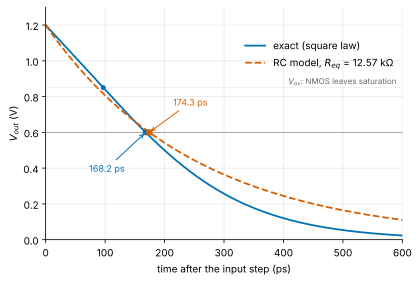

<!-- status: verified -->
# 19-02 · The CMOS Inverter: Dynamic Behavior and Delay

| | |
|---|---|
| **Course** | [19 · Digital VLSI Design](../README.md) |
| **University equivalent** | The dynamic inverter analysis of a senior digital-IC course: load capacitance, propagation delay from the device equations and from an equivalent resistance, sizing and self-loading, the FO4 metric, ring oscillators and supply scaling (Rabaey, Chandrakasan & Nikolić, *Digital Integrated Circuits*, ch. 5; Weste & Harris, *CMOS VLSI Design*, ch. 4) |
| **Prerequisites** | [19-01](19-01-cmos-inverter-static.md) (the static transfer curve), [07-02](../../07-circuit-analysis-2-transient-and-ac/chapters/07-02-first-order-rc-rl-transients.md) (RC transients), [09-08](../../09-semiconductor-devices/chapters/09-08-mos-capacitor.md) (gate capacitance), [09-06](../../09-semiconductor-devices/chapters/09-06-pn-junction-iv-and-capacitance.md) (junction capacitance), [12-03](../../12-electronics-2/chapters/12-03-frequency-response-miller-poles-zeros.md) (the Miller effect) |
| **Estimated study hours** | 8 |
| **Last verified** | 2026-11-21 |

**Learning objectives.** After this chapter you can:

1. Identify the capacitances that load an inverter (gate, diffusion, wire and Miller) and add them into a load for a given fan-out.
2. Derive an inverter's propagation delay for a step input from the square-law device equations, and from the equivalent-resistance model $t_p = \ln 2\,R_{eq}C_L$.
3. Explain intrinsic delay and self-loading, and use them to predict how sizing and fan-out change delay, including the FO4 metric.
4. Compute a ring oscillator's frequency, and explain why a ring's stage delay exceeds the step-input delay.
5. Predict how delay and energy scale with supply voltage, and find the supply that minimizes the energy–delay product.

## 1. Big picture

19-01 asked what an inverter outputs; this chapter asks how fast. Every clock period in a processor is a sum of gate delays along the slowest path, so the speed of a chip, at a given supply and power, is set by how quickly a transistor can charge or discharge the capacitance it drives. The physics reduces to one idea: a gate is a current source of limited strength charging a capacitor. Everything else, sizing, fan-out, the FO4 delay that designers quote, the supply-voltage tradeoff, follows from computing that current and that capacitance.

- **Clock speed.** The slowest path of tens of gates, plus the flip-flops' overhead, sets the clock period, and designers count it in FO4 delays (§3.5, 19-07).
- **Sizing.** Wider transistors carry more current but present more capacitance to whatever drives them; the balance is the subject of 19-04's logical effort.
- **Voltage scaling.** Delay rises steeply as the supply approaches the threshold, while energy falls as its square; dynamic voltage and frequency scaling (19-06) trades one for the other.
- **Measurement.** Ring oscillators, chains of inverters closed into a loop, are on almost every test chip, because their frequency reports the process's speed directly.

## 2. Intuition first

Think of the output node as a bucket (the load capacitance) and the transistors as taps. Switching the inverter opens one tap fully and closes the other: the bucket fills from $V_{DD}$ through the PMOS or drains to ground through the NMOS. The time to reach the halfway level, the **propagation delay**, is the charge to be moved, about $C_LV_{DD}/2$, divided by the average current the tap delivers. Halve the bucket or double the tap and the delay halves.

Two complications make the analogy imperfect, and they are the interesting part. First, the tap's flow is not constant: the transistor delivers its saturation current only while the output is far from the rail, and less as it approaches. Second, making the tap bigger also makes the bucket bigger, because a wider transistor brings its own drain capacitance to the output and presents more gate capacitance to whatever drives it. A gate's delay therefore never falls below a floor, its **intrinsic delay**, set by its own capacitance, however wide it is made.

*Figure 1. A step-driven inverter discharging 20 fF ($k_n$ = 200 µA/V², $V_{DD}$ = 1.2 V, $V_{TN}$ = 0.35 V). The exact output falls linearly while the NMOS is saturated, then slows in the linear region. The RC model with the equivalent resistance reaches the 50% point 3.6% later.*

## 3. Theory

### 3.1 Where the load capacitance comes from

The output node of an inverter carries three kinds of capacitance:

- **The gates it drives.** Each fan-out gate presents its input capacitance, mostly gate oxide: $C_g \approx C_{ox}WL$ plus overlap terms, for both its NMOS and PMOS. Designers work with a capacitance per unit width, $C_g'$ (fF/µm), so $C_g = C_g'(W_n + W_p)$ for an inverter input.
- **Its own drains.** The drain junctions of its NMOS and PMOS (09-06) add the **diffusion capacitance** $C_d = C_d'(W_n + W_p)$. This is the gate's **self-loading**, or intrinsic capacitance $C_{int}$.
- **The wire.** Interconnect between the gates adds $C_w$, proportional to wire length (19-05).

The gate-to-drain capacitance of the switching inverter itself needs care: while the input rises by $V_{DD}$ the output falls by $V_{DD}$, so the voltage across $C_{gd}$ changes by $2V_{DD}$, and seen from the output it counts twice, the Miller effect of 12-03 for a gain of −1. Folding it into $C_{int}$ gives the load

$$
C_L = C_{int} + C_{ext}, \qquad C_{int} = C_{dn} + C_{dp} + 2(C_{gdn} + C_{gdp}), \qquad C_{ext} = \sum_{\text{fan-out}} C_g + C_w .
$$

The ratio $\gamma = C_{int}/C_g$ of a gate's self-loading to its input capacitance depends only on the process and the layout, not on the size, because both scale with width. Textbooks take γ ≈ 1 for convenience; values between about 0.5 and 1 are typical (§3.5 shows how to infer γ from published delays).

### 3.2 Delay definitions

Delays are measured between the 50% points of the input and output waveforms: $t_{pHL}$ for the output falling (high to low) and $t_{pLH}$ for it rising, with the **propagation delay** their average, $t_p = (t_{pHL} + t_{pLH})/2$. The **rise and fall times** $t_r$ and $t_f$ are measured from 10% to 90% of the swing (or 20–80% in some libraries). The 50% point is natural because it is where the next gate, if symmetric, switches (19-01's $V_M$).

### 3.3 The step response, exactly

Apply an instantaneous step from 0 to $V_{DD}$ at the input with the output initially at $V_{DD}$. The PMOS turns off at once and the NMOS, with $V_{GS} = V_{DD}$, discharges $C_L$:

$$
C_L\frac{dV_{out}}{dt} = -I_{Dn}(V_{out}) .
$$

With $V_{ov} = V_{DD} - V_{TN}$, the NMOS stays saturated while $V_{out} \ge V_{ov}$, and the current is the constant $I_{sat} = \tfrac12k_nV_{ov}^2$ (λ = 0). The output falls linearly by $V_{TN}$, taking

$$
t_1 = \frac{C_LV_{TN}}{I_{sat}} = \frac{2C_LV_{TN}}{k_nV_{ov}^2} .
$$

Below $V_{ov}$ the NMOS is linear: $C_L\,dV/dt = -k_n(V_{ov}V - V^2/2)$. Separate variables and use partial fractions, $\dfrac{1}{V(V_{ov} - V/2)} = \dfrac{1}{V_{ov}}\left(\dfrac1V + \dfrac{1}{2V_{ov} - V}\right)$:

$$
t_2 = \frac{C_L}{k_nV_{ov}}\int_{V_{DD}/2}^{V_{ov}}\left(\frac1V + \frac{1}{2V_{ov} - V}\right)dV
= \frac{C_L}{k_nV_{ov}}\ln\frac{2V_{ov} - V_{DD}/2}{V_{DD}/2}
= \frac{C_L}{k_nV_{ov}}\ln\left(\frac{4V_{ov}}{V_{DD}} - 1\right) .
$$

So, for $V_{TN} < V_{DD}/2$,

$$
t_{pHL} = t_1 + t_2 = \frac{C_L}{k_nV_{ov}}\left[\frac{2V_{TN}}{V_{ov}} + \ln\left(\frac{4V_{ov}}{V_{DD}} - 1\right)\right] .
$$

$t_{pLH}$ is the same expression with $k_p$ and $\lvert V_{TP}\rvert$. The structure is the bucket picture made exact: delay is proportional to $C_L$ and inversely proportional to the transistor's strength $k$, with a bracket that depends only on the ratio $V_{TN}/V_{DD}$. For the example of Figure 1 ($C_L$ = 20 fF, $k_n$ = 200 µA/V², $V_{DD}$ = 1.2 V, $V_{TN}$ = 0.35 V) it gives 168.2 ps, 96.9 ps of it in saturation. A numerical integration of the same equation, in the lab, agrees to within 0.01 ps.

### 3.4 The equivalent-resistance model

The exact formula is unwieldy for whole paths. Designers replace each conducting transistor by a resistor $R_{eq}$ that gives the same delay to first order, and then treat a gate as an RC circuit, whose step response reaches its 50% point after

$$
t_p = \ln 2\,R_{eq}C_L \approx 0.69\,R_{eq}C_L .
$$

A natural choice is the transistor's average large-signal resistance over the transition,

$$
R_{eq} = \frac{1}{V_{DD}/2}\int_{V_{DD}/2}^{V_{DD}}\frac{V}{I_D(V)}\,dV ,
$$

which for the example is 12.57 kΩ. If the transistor stayed saturated throughout, $V/I$ would run from $V_{DD}/I_{sat}$ to $V_{DD}/(2I_{sat})$, averaging about $\tfrac34V_{DD}/I_{sat}$; this is the widely used approximation

$$
R_{eq} \approx \frac{3V_{DD}}{4I_{sat}} ,
$$

12.46 kΩ here. With $R_{eq}$ = 12.57 kΩ the RC model gives $0.69 \times 12.57\ \text{kΩ} \times 20\ \text{fF}$ = 174.3 ps, 3.6% above the exact 168.2 ps: the model is approximate, but it is linear, so it composes along paths and through sizing. That is why every timing model, from logical effort (19-04) to Elmore delay (19-05), starts from it.

Two scalings follow. $R_{eq} \propto 1/W$: doubling a transistor's width halves its resistance. And $R_{eq}$ grows as the supply approaches the threshold (§3.7).

### 3.5 Intrinsic delay, sizing and FO4

Write a reference inverter's resistance as $R_{ref}$ and its intrinsic capacitance as $C_{int,ref}$. Scaling both transistors by a factor $S$ divides the resistance by $S$ and multiplies the intrinsic capacitance by $S$:

$$
t_p = 0.69\,\frac{R_{ref}}{S}\left(S\,C_{int,ref} + C_{ext}\right) = t_{p0}\left(1 + \frac{C_{ext}}{S\,C_{int,ref}}\right), \qquad t_{p0} = 0.69\,R_{ref}C_{int,ref} .
$$

$t_{p0}$, the **intrinsic delay**, does not depend on the size: an unloaded inverter is no faster when made wider. Widening helps only to the extent that it shrinks the external load's share, $C_{ext}/(SC_{int,ref})$, and the return diminishes once that share is small, while the input capacitance, $S\,C_{g,ref}$, keeps growing and slows the gate that drives this one. That tension is the subject of 19-04.

**The FO4 delay.** An inverter driving four copies of itself has $C_{ext} = 4C_g = 4C_{int}/\gamma$, so

$$
t_{FO4} = t_{p0}\left(1 + \frac4\gamma\right),
$$

five intrinsic delays for γ = 1. The ratio of the FO4 delay to the fan-out-of-1 delay, $t_{p0}(1 + 1/\gamma)$, reveals γ: Ho, Mai and Horowitz's rule that "a FO1 is one-third a FO4" for typical diffusion capacitances ([R-314]) means $(1 + 4/\gamma) = 3(1 + 1/\gamma)$, so γ = **0.5**, and the FO4 delay is then nine intrinsic delays. Because both $t_{p0}$ and $t_{FO4}$ scale with the process, the **FO4 delay** is the standard technology-independent unit of speed: a design's clock period quoted in FO4 delays says how much logic fits in a cycle, whatever the node. Fan-out 4 is chosen because it is close to the fan-out per stage that minimizes the delay of a long buffer chain (19-04).

### 3.6 Ring oscillators

Close an odd number $N$ of inverters into a loop and no stable state exists: each transition races around the loop and inverts every node in turn. A full period needs two trips (one rising, one falling transition at each node), so

$$
f = \frac{1}{2Nt_p}, \qquad t_p = \frac{1}{2Nf} .
$$

Test chips use ring oscillators to measure $t_p$, because a frequency is easy to measure precisely. But the $t_p$ a ring reports is not the step-input delay of §3.3: each stage is driven by the previous stage's slowly changing output, so while the input ramps, the pull-down transistor is only partly on and the pull-up has not yet turned off. In the lab's five-stage ring (10 fF per node) the stage delay is 160.5 ps, 1.91 times the 84.1 ps step-input delay of the same stage. Delay depends on input slope, which is why cell libraries characterize every gate as a table of delay against both load and input transition time.

### 3.7 Supply voltage, threshold and the energy–delay product

The delay is the charge $C_LV_{DD}$ divided by a current. With the alpha-power law of 19-01, $I_{sat} \propto (V_{DD} - V_{TH})^\alpha$, so

$$
t_p \propto \frac{C_LV_{DD}}{(V_{DD} - V_{TH})^\alpha} .
$$

Far above threshold the delay falls slowly as the supply rises (for α near 1 it is almost flat), and near threshold it rises steeply. Meanwhile the energy per transition is $C_LV_{DD}^2$ (19-06). Their product, the **energy–delay product**,

$$
\text{EDP} \propto \frac{V_{DD}^3}{(V_{DD} - V_{TH})^\alpha},
$$

has a minimum: setting $d\ln(\text{EDP})/dV_{DD} = 3/V_{DD} - \alpha/(V_{DD} - V_{TH}) = 0$ gives

$$
V_{DD,EDP} = \frac{3V_{TH}}{3 - \alpha},
$$

which is $1.5V_{TH}$ for α = 1, $1.76V_{TH}$ for α = 1.3 and $3V_{TH}$ for the square law.

*Figure 2. Delay ($V_{DD}/(V_{DD} - V_{TH})^\alpha$), energy ($V_{DD}^2$) and their product, relative to 1.2 V, with $V_{TH}$ = 0.35 V. The EDP minimum is shallow: for α = 1.3 it stays within 10% of its minimum from 0.51 to 0.79 V.* The EDP is one figure of merit among several (energy alone favors even lower supplies; delay alone, higher ones), but it explains why supplies have settled at a small multiple of the threshold voltage. Halving the supply from 1.2 to 0.6 V with $V_{TH}$ = 0.35 V cuts the energy per transition by 4 but multiplies the delay by 2.45 for α = 1.3, and by 5.78 for the square law.

> **Going deeper — what the simple model leaves out.** Real inverters see input ramps rather than steps (§3.6), channel-length modulation (which speeds the early part of the transition), velocity saturation (which makes $R_{eq}$ less sensitive to supply than the square law), and the PMOS and NMOS both conducting briefly during a transition, which costs short-circuit current (19-06). Cell libraries capture all of this by simulation, in tables of delay and output transition time against input transition and load (the nonlinear delay model) or in current-source models; the RC model remains the designer's mental arithmetic.

## 4. Worked examples

### Example 19-02.1 · Adding up the load (tier A)

**Setup.** An inverter has $W_n$ = 0.4 µm and $W_p$ = 0.8 µm. The process gives $C_g'$ = 1.0 fF/µm of input capacitance and $C_d'$ = 0.8 fF/µm of drain capacitance (including Miller-doubled $C_{gd}$). The inverter drives four identical inverters through 2 fF of wire. Find its input capacitance, intrinsic capacitance, external load, total load and γ.

**Solution.** $C_g = 1.0 \times (0.4 + 0.8)$ = **1.2** fF. $C_{int} = 0.8 \times 1.2$ = **0.96** fF. $C_{ext} = 4 \times 1.2 + 2$ = **6.8** fF. $C_L = 0.96 + 6.8$ = **7.76** fF. $\gamma = 0.96/1.2$ = **0.8**.

**Units check.** fF/µm × µm = fF.

**Sanity check.** The fan-out dominates: the gate's own drains are an eighth of the load.

### Example 19-02.2 · Exact step delays (tier B)

**Setup.** An inverter drives 20 fF from $V_{DD}$ = 1.2 V; $V_{TN} = \lvert V_{TP}\rvert$ = 0.35 V, $k_n$ = 200 µA/V² and $k_p$ = 100 µA/V² (equal widths). Find (a) $t_{pHL}$ and how much of it is spent in saturation, (b) $t_{pLH}$, (c) $t_p$.

**Solution.** (a) $V_{ov}$ = 0.85 V. In saturation, $t_1 = 2 \times 20\ \text{fF} \times 0.35/(200\ \mu\text{A/V}^2 \times 0.7225)$ = **96.9** ps. In the linear region, $t_2 = 20\ \text{fF}/(200\ \mu \times 0.85) \times \ln(4 \times 0.85/1.2 - 1) = 117.6\ \text{ps} \times \ln 1.833$ = 71.3 ps, so $t_{pHL}$ = **168.2** ps.

(b) The PMOS is half as strong, so $t_{pLH}$ = **336.4** ps.

(c) $t_p = (168.2 + 336.4)/2$ = **252.3** ps.

**Units check.** F/(A/V² × V) = F·V/A = s.

**Sanity check.** Doubling $W_p$ would equalize the two delays and bring $t_p$ to 168 ps, at the cost of more input and self-loading capacitance.

### Example 19-02.3 · The RC model (tier B)

**Setup.** For the NMOS of Example 2: (a) compute $R_{eq}$ as the average of $V/I$ from $V_{DD}$ to $V_{DD}/2$, and compare with $3V_{DD}/(4I_{sat})$. (b) What $t_{pHL}$ does the RC model give for 20 fF, and how far is it from the exact value?

**Solution.** (a) Integrating $V/I_D(V)$ numerically over 0.6–1.2 V (saturated above 0.85 V, linear below) and dividing by 0.6 V gives $R_{eq}$ = **12.57** kΩ. The approximation gives $3 \times 1.2/(4 \times 72.25\ \mu\text{A})$ = **12.46** kΩ.

(b) $0.693 \times 12.57\ \text{kΩ} \times 20\ \text{fF}$ = **174.3** ps, **3.6** % above the exact 168.2 ps.

**Units check.** V/A = Ω; Ω × F = s.

**Sanity check.** The RC curve starts with the steepest slope ($V_{DD}/R_{eq}C$, 1.2 V per 251 ps), while the real transistor starts more slowly at its saturation current: the two curves cross before the 50% point (Figure 1).

### Example 19-02.4 · Intrinsic delay and fan-out (tier B)

**Setup.** A symmetric unit inverter has $R_{eq}$ = 12.57 kΩ for both pull-up and pull-down, $C_{int}$ = 2 fF and $C_g$ = 2 fF. Find (a) its intrinsic delay, (b) its FO4 delay, (c) its delay driving 50 fF, and (d) the delay driving 50 fF if it is made four times larger.

**Solution.** (a) $t_{p0} = 0.693 \times 12.57\ \text{kΩ} \times 2\ \text{fF}$ = **17.4** ps.

(b) γ = 1: $t_{FO4} = 5t_{p0}$ = **87.1** ps.

(c) $t_p = 17.43 \times (1 + 50/2)$ = **453.1** ps.

(d) $17.43 \times (1 + 50/8)$ = **126.3** ps, 3.6 times faster, but the inverter's input capacitance has grown from 2 to 8 fF, which slows whatever drives it.

**Units check.** Every term is ps × a ratio of capacitances.

**Sanity check.** Making it 25 times larger would bring the delay to $2t_{p0}$, the asymptote of $t_{p0}(1 + C_{ext}/SC_{int})$: size buys little once the load's share is small.

### Example 19-02.5 · A ring oscillator (tier B)

**Setup.** Five symmetric inverters ($k_n = k_p$ = 200 µA/V², $V_{TN} = \lvert V_{TP}\rvert$ = 0.35 V, $V_{DD}$ = 1.2 V) form a ring, each output loaded with 10 fF. (a) Using the step-input delay, estimate the frequency. (b) The lab's simulation gives a period of 1.605 ns. What stage delay does that imply, and why does it differ?

**Solution.** (a) The step-input delay is $t_{pHL}$ for 10 fF, **84.1** ps (half of Example 2's, for half the load), so $f \approx 1/(2 \times 5 \times 84.1\ \text{ps})$ = **1.19** GHz.

(b) $t_p = 1.605\ \text{ns}/10$ = **160.5** ps, **1.91** times the step estimate; the frequency is **623** MHz. In the ring each input is the previous stage's output, a ramp as slow as the output it drives, so the pull-down transistor turns on gradually while the pull-up is still conducting. Both effects reduce the net current during the transition.

**Units check.** 1/(stages × s) = Hz.

**Sanity check.** ngspice, simulating the same five inverters with SPICE's level-1 model, measures a period of 1.605 ns, matching the lab's ODE simulation to five figures.

### Example 19-02.6 · Lowering the supply (tier C)

**Setup.** A design runs at 1.2 V with $V_{TH}$ = 0.35 V. (a) Halving the supply cuts the energy per transition by how much? (b) By what factor does the delay grow if α = 1.3, and if α = 2? (c) At what supply is the energy–delay product smallest, for each α?

**Solution.** (a) $(0.6/1.2)^2$ = **0.25**: four times less energy.

(b) The delay ratio is $[0.6/(0.25)^\alpha]/[1.2/(0.85)^\alpha]$: **2.45** for α = 1.3 and **5.78** for α = 2.

(c) $V_{DD,EDP} = 3V_{TH}/(3 - \alpha)$: **0.618** V for α = 1.3 and **1.05** V for α = 2.

**Units check.** Ratios of voltages; the optimum is a voltage.

**Sanity check.** For the velocity-saturated device the EDP optimum is close to the halved supply of (b), and the energy saving outweighs the delay cost; for the square-law device the optimum stays near the original supply.

<!-- answer-key -->

| ID | Quantity | Value | Unit |
|---|---|---|---|
| Ex 19-02.1a | input capacitance | 1.2 | fF |
| Ex 19-02.1b | intrinsic capacitance | 0.96 | fF |
| Ex 19-02.1c | external load | 6.8 | fF |
| Ex 19-02.1d | total load | 7.76 | fF |
| Ex 19-02.1e | gamma | 0.8 | — |
| Ex 19-02.2a | time in saturation | 96.9 | ps |
| Ex 19-02.2b | t_pHL | 168.2 | ps |
| Ex 19-02.2c | t_pLH | 336.4 | ps |
| Ex 19-02.2d | t_p | 252.3 | ps |
| Ex 19-02.3a | R_eq by averaging | 12.57 | kΩ |
| Ex 19-02.3b | R_eq approximation | 12.46 | kΩ |
| Ex 19-02.3c | RC-model delay | 174.3 | ps |
| Ex 19-02.3d | RC-model error | 3.6 | % |
| Ex 19-02.4a | intrinsic delay | 17.4 | ps |
| Ex 19-02.4b | FO4 delay | 87.1 | ps |
| Ex 19-02.4c | delay driving 50 fF | 453.1 | ps |
| Ex 19-02.4d | delay driving 50 fF at four times the size | 126.3 | ps |
| Ex 19-02.5a | step-input delay, 10 fF | 84.1 | ps |
| Ex 19-02.5b | estimated ring frequency | 1.19 | GHz |
| Ex 19-02.5c | stage delay from the simulated period | 160.5 | ps |
| Ex 19-02.5d | ratio to the step-input delay | 1.91 | — |
| Ex 19-02.5e | simulated ring frequency | 623 | MHz |
| Ex 19-02.6a | energy ratio at half supply | 0.25 | — |
| Ex 19-02.6b | delay ratio, alpha = 1.3 | 2.45 | — |
| Ex 19-02.6c | delay ratio, alpha = 2 | 5.78 | — |
| Ex 19-02.6d | EDP-optimal supply, alpha = 1.3 | 0.618 | V |
| Ex 19-02.6e | EDP-optimal supply, alpha = 2 | 1.05 | V |
| Txt 19-02.a | linear-region part of t_pHL | 71.3 | ps |
| Txt 19-02.b | EDP-optimal supply over V_{TH}, alpha = 1 | 1.5 | — |
| Txt 19-02.c | EDP-optimal supply over V_{TH}, alpha = 1.3 | 1.76 | — |
| Txt 19-02.d | gamma implied by FO1 = FO4/3 | 0.5 | — |
| Txt 19-02.e | stage delay of an 11-stage ring at 1 GHz | 45.5 | ps |
| Txt 19-02.f | RC time constant, 12.57 kOhm and 20 fF | 251 | ps |
| Txt 19-02.g | FO4 delay in intrinsic delays, gamma = 0.5 | 9 | — |
| Txt 19-02.h | FO4 rule at 0.18 um, typical | 64.8 | ps |
| Txt 19-02.i | simulated FO4 ratio, 180 nm to 7 nm | 31.3 | — |
| Txt 19-02.j | supply ratio, 1.8 V to 0.8 V | 2.25 | — |
| Txt 19-02.k | SKY130 FO1 delay spread, max over min | 1.79 | — |
| Txt 19-02.l | IRDS intrinsic delay ratio, 2024 to 2039 | 1.71 | — |
| Txt 19-02.m | simulated FO4 ratio, 180 nm to 130 nm | 2.22 | — |
| Txt 19-02.n | lower supply with EDP within 10% of minimum, alpha = 1.3 | 0.51 | V |
| Txt 19-02.o | upper supply with EDP within 10% of minimum, alpha = 1.3 | 0.79 | V |

## 5. Simulate it

The lab ([labs/19-02-lab](../labs/19-02-lab/README.md)) has two parts:

- **ngspice** ([delay.cir](../labs/19-02-lab/delay.cir) and [ring.cir](../labs/19-02-lab/ring.cir)): a step-driven inverter discharging 20 fF, measuring $t_{pHL}$ and $t_{pLH}$, and the five-stage ring oscillator of Example 5.
- **Python** (`delay.py` and the notebook): the exact delay against a numerical integration and the RC model, $R_{eq}$ against supply, fan-out and sizing curves, the ring oscillator as coupled ODEs, and delay and EDP against supply for two values of α.

**Predict, then run.**

1. Predict $t_{pHL}$ and $t_{pLH}$ for Example 2; run `ngspice -b delay.cir` and compare.
2. Predict how $t_{pHL}$ changes if the load doubles, and if $k_n$ doubles; check with `tp_step_exact`.
3. Predict the ratio of the RC model to the exact delay as $V_{TN}/V_{DD}$ goes from 0.2 to 0.45.
4. Predict the ring's period with 7 stages instead of 5; simulate with `simulate_ring` and `ring.cir`.
5. Plot delay, energy and EDP against supply from 0.5 to 1.5 V for α = 1.3 and 2; find each minimum.

## 6. Engineering tradeoffs

| Knob | Improves | Costs | Typical decision owner |
|---|---|---|---|
| Wider transistors (larger $S$) | Delay driving a large external load | Input capacitance (slows the previous stage), area, power | Logic designer, synthesis and sizing tools |
| Higher supply | Delay (steeply near threshold) | Energy ∝ $V_{DD}^2$, reliability | Power architect (DVFS tables) |
| Lower threshold | Delay at a given supply | Leakage, exponentially (19-06) | Process and library team |
| Shorter wires, fewer fan-outs | Load and delay | Placement and logic restructuring effort | Physical design |
| Larger $W_p/W_n$ | Balanced $t_{pLH}$ and $t_{pHL}$ | Input and self-loading capacitance | Library designer |

## 7. Numbers to know

| Quantity | Value | Notes |
|---|---|---|
| RC step to 50% | $\ln 2\,RC$ = 0.69 $RC$ | |
| $R_{eq}$ | $\approx 3V_{DD}/(4I_{sat})$ | Average of $V/I$ over the transition |
| Intrinsic delay | $t_{p0} = 0.69R_{eq}C_{int}$, independent of size | |
| FO4 delay | $t_{p0}(1 + 4/\gamma)$, about $5t_{p0}$ | γ = $C_{int}/C_g$ ≈ 1 |
| Ring oscillator | $f = 1/(2Nt_p)$ | $t_p$ here includes input-slope effects |
| EDP-optimal supply | $3V_{TH}/(3 - \alpha)$: 1.5–3 $V_{TH}$ | α from 1 to 2 |

## 8. Common mistakes

- **Using the saturation current for the whole transition.** The transistor leaves saturation before the 50% point; the constant-current estimate underestimates delay.
- **Forgetting self-loading.** A gate's own drain capacitance does not shrink when it is widened; the intrinsic delay is a floor.
- **Upsizing a gate without accounting for its input.** A wider gate is faster but loads its driver more; the path, not the gate, is what to optimize (19-04).
- **Equating a ring oscillator's stage delay with the step-input delay.** Ring stages see ramps; their delay is longer.
- **Treating delay as linear in supply.** Near threshold it rises steeply; far above it barely moves for velocity-saturated devices.

## 9. Practitioner lens

### State of the art (as of Nov 2026)

- **The FO4 rule of thumb [Established].** Ho, Mai and Horowitz (2001) gave the FO4 delay as about 360 ps per micrometre of drawn gate length at typical conditions and 500 ps per micrometre under worst-case conditions, adding that "in a 0.18-µm technology, an FO4 is about 90 pS under worst case environmental conditions" ([R-314]). At typical conditions the rule gives **64.8** ps for 0.18 µm. Harris, Ho, Wei and Horowitz proposed the FO4 delay precisely "to normalize process and operating condition variations".
- **FO4 across nodes, simulated [Industry estimate].** Stillmaker and Baas (2017), using predictive device models rather than silicon, list FO4 delays of 77.2 ps at 180 nm and 1.8 V, 34.7 ps at 130 nm and 1.2 V, 10.9 ps at 45 nm and 1.1 V, 4.02 ps at 14 nm and 0.86 V, and 2.47 ps at 7 nm and 0.8 V ([R-314]): **31.3** times faster across the range while the supply fell by **2.25** times. These are intrinsic-dominated numbers without real wiring, and no foundry publishes a measured FO4 for its leading nodes that we could find.
- **An open process's measured delay [Established].** SkyWater's SKY130 PDK lists a fan-out-of-1 inverter delay of 31.8 ps nominal, from 24.7 to 44.1 ps across its e-test limits, from a 143-stage structure; the page does not state the supply, temperature or method ([R-314]). The spread between the limits is a factor of **1.79**, which is why timing is signed off at corners rather than at nominal.
- **The roadmap's intrinsic delay [Industry estimate].** The IEEE IRDS 2024 More Moore tables define an intrinsic transistor delay $\tau = C_{g,total}V_{dd}/I_{d,sat}$, this chapter's $CV/I$, and project it falling from about 1.06 ps in 2024 to 0.62 ps by 2039 ([R-314]): a factor of **1.71** in fifteen years, with the supply held near 0.6 V (19-01).
- **Leading-node claims [Industry estimate].** TSMC's IEDM 2024 paper on N2 reports "a 15% speed gain (or 30% power reduction) at >1.15x chip density" against its N3 process; Intel says its 18A node delivers "up to 15% better performance per watt and 30% improved chip density compared to Intel 3", based on its internal analysis as of February 2024 ([R-314]). For scale, the simulated FO4 above improved **2.22** times from 180 nm to 130 nm.

### Why it matters commercially

- **Frequency, power and area are traded per path.** Timing closure decides how much area and leakage a design spends on upsized gates and low-threshold cells to meet a target clock; the RC arithmetic of this chapter is how engineers reason about that budget.
- **Voltage–frequency curves are product specifications.** Every processor ships with a table of supply against frequency (19-06); its shape near the bottom is §3.7's steep rise in delay.
- **Ring oscillators are process monitors.** Foundries and chip teams track ring-oscillator frequencies on test structures and on product dies to bin parts and to detect process shifts.

### Marketing vs Reality

- **"X% faster" at a new node.** Ask at what supply, threshold flavor and load: an inverter-only ring oscillator, an FO4 chain and a real critical path with wires and memories improve by different amounts.
- **"Up to N GHz."** A clock frequency claim is meaningful only with its voltage and temperature; ask for the voltage–frequency curve.
- **"15% faster or 30% less power".** The two are alternatives, not a sum: §3.7's delay–supply curve lets a faster transistor be spent as speed at the same supply or as a lower supply at the same speed. Ask which one the product uses, and at what point on the curve.
- **Ring-oscillator speed-ups.** A ring has almost no wire load, so it flatters a process whose transistors improved more than its interconnect (19-05).

### Questions for engineering leaders

1. *"How many FO4 delays fit in your clock period, and how does that compare with your competitors?"* Strong: a number (and how much of it is flip-flop and clock overhead, 19-07), with the reasoning behind the pipeline depth. Evasive: only GHz figures.
2. *"Where does your critical path's delay go: gates, wires or memories?"* Strong: a breakdown from timing reports, with the plan for each part. Evasive: "we'll fix it with a faster process".
3. *"What is your voltage–frequency curve at the low end, and what limits it?"* Strong: measured data across corners and what sets the minimum (often SRAM, 19-08). Evasive: one operating point.
4. *"How do your library cells' delays depend on input slope, and how do you keep slopes in check?"* Strong: maximum-transition constraints and buffering, with characterized tables. Evasive: "the tools handle it".

## 10. Concept check

**Q1.** Why does widening an inverter not reduce its intrinsic delay?

Answer

Its resistance falls as $1/S$ but its own drain capacitance grows as $S$, so their product, $t_{p0} = 0.69R_{eq}C_{int}$, is unchanged. Only the external load's share of the delay falls.

**Q2.** What is the FO4 delay, and why is it useful?

Answer

The delay of an inverter driving four copies of itself, $t_{p0}(1 + 4/\gamma)$. It scales with the process like other gate delays, so expressing a clock period in FO4 delays measures how much logic fits in a cycle independently of the node.

**Q3.** Why does the RC model with $R_{eq}$ give a slightly longer delay than the exact square-law result?

Answer

The RC model's current, $V/R_{eq}$, starts above the transistor's saturation current but falls in proportion to the voltage, while the real transistor holds its saturation current down to $V_{ov}$. Over the middle of the transition the transistor delivers more current, so the exact output reaches the 50% point a little sooner. Averaging $V/I$ is not the same as averaging the current, so the match cannot be exact.

**Q4.** A ring of 11 inverters oscillates at 1 GHz. What is its stage delay, and is it the delay a step input would give?

Answer

$t_p = 1/(2 \times 11 \times 1\ \text{GHz})$ = 45.5 ps. It is longer than the step-input delay, because each stage is driven by a ramp.

**Q5.** Why does delay rise so steeply as the supply approaches the threshold voltage?

Answer

The charge to move falls only as $V_{DD}$, but the current falls as $(V_{DD} - V_{TH})^\alpha$, which goes to zero at threshold.

**Q6.** Why do supplies settle at a small multiple of the threshold voltage?

Answer

The energy–delay product, $V_{DD}^3/(V_{DD} - V_{TH})^\alpha$, is smallest at $3V_{TH}/(3 - \alpha)$, between 1.5 and 3 times the threshold.

Problems: [19-02 problem set](../problems/19-02-problems.md).

## 11. Key terms

[Propagation delay](../../../reference/glossary.md#propagation-delay) · [Intrinsic delay](../../../reference/glossary.md#intrinsic-delay) · [Self-loading](../../../reference/glossary.md#self-loading) · [Equivalent resistance of a transistor](../../../reference/glossary.md#equivalent-resistance-of-a-transistor) · [FO4 delay](../../../reference/glossary.md#fo4-delay) · [Ring oscillator](../../../reference/glossary.md#ring-oscillator) · [Energy-delay product](../../../reference/glossary.md#energy-delay-product) · [Alpha-power law](../../../reference/glossary.md#alpha-power-law)

## 12. Connections

- **Builds on:** [19-01](19-01-cmos-inverter-static.md) (the static transfer curve), [07-02](../../07-circuit-analysis-2-transient-and-ac/chapters/07-02-first-order-rc-rl-transients.md) (RC transients), [12-03](../../12-electronics-2/chapters/12-03-frequency-response-miller-poles-zeros.md) (Miller effect).
- **Next:** [19-03](19-03-logic-families.md) extends the analysis to NAND, NOR and other logic families.
- **Used later:** [19-04](19-04-sizing-and-logical-effort.md) (sizing paths for minimum delay), [19-05](19-05-interconnect.md) (wire RC and Elmore delay), [19-06](19-06-power-and-low-power-design.md) (energy and voltage scaling), [19-07](19-07-sequential-timing-and-clocking.md) (clock periods in FO4).

## 13. Further study

- Rabaey, Chandrakasan & Nikolić, *Digital Integrated Circuits*, 2nd ed., §5.4 (dynamic behavior and the propagation delay).
- Weste & Harris, *CMOS VLSI Design*, 4th ed., ch. 4 (delay, RC models and the FO4 metric).
- Kang & Leblebici, *CMOS Digital Integrated Circuits*, the inverter switching chapter (exact delay by integration).
- Harris, Ho, Wei & Horowitz, "The fanout-of-4 inverter delay metric": why the FO4 delay normalizes process and operating conditions.
- MIT OCW 6.374, the inverter-delay lectures.

## 14. Sources

1. Rabaey, Chandrakasan & Nikolić, *Digital Integrated Circuits*, 2nd ed., Prentice Hall, 2003, ch. 5.
2. Weste & Harris, *CMOS VLSI Design*, 4th ed., Addison-Wesley, 2011, ch. 4.
3. S.-M. Kang and Y. Leblebici, *CMOS Digital Integrated Circuits: Analysis and Design*, 3rd ed., McGraw-Hill, 2003.
4. T. Sakurai and A. R. Newton, "Alpha-power law MOSFET model and its applications to CMOS inverter delay and other formulas", *IEEE J. Solid-State Circuits*, vol. 25, no. 2, 1990.
5. R. Ho, K. W. Mai and M. A. Horowitz, "The future of wires", *Proc. IEEE*, vol. 89, no. 4, pp. 490–504, 2001.
6. D. Harris, R. Ho, G.-Y. Wei and M. Horowitz, "The fanout-of-4 inverter delay metric", Stanford University manuscript (undated).
7. [R-314] Ho, Mai and Horowitz (2001) and Horowitz's DAC 2000 slides; Harris, Ho, Wei and Horowitz; Stillmaker and Baas (2017); SkyWater SKY130 PDK documentation; IEEE IRDS 2024 More Moore tables; TSMC N2 at IEDM 2024 (IEEE EDS newsletter, Apr 2025); Intel release of 9 Oct 2025.
