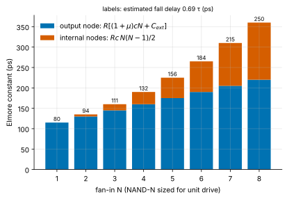

<!-- status: reviewed -->
# 19-03 · Combinational Logic Families

| | |
|---|---|
| **Course** | [19 · Digital VLSI Design](../README.md) |
| **University equivalent** | The combinational-logic chapter of a senior digital-IC course: static CMOS gates and their sizing, the delay of transistor stacks, ratioed (pseudo-NMOS) logic, pass-transistor and transmission-gate logic, and dynamic and domino logic (Rabaey, Chandrakasan & Nikolić, *Digital Integrated Circuits*, ch. 6; Weste & Harris, *CMOS VLSI Design*, ch. 9) |
| **Prerequisites** | [19-01](19-01-cmos-inverter-static.md) and [19-02](19-02-cmos-inverter-dynamic.md) (the inverter, static and dynamic), [08-02](../../08-digital-logic-design/chapters/08-02-boolean-algebra-and-gates.md) (gates as switch networks), [09-09](../../09-semiconductor-devices/chapters/09-09-long-channel-mosfet.md) (the body effect), [01-06](../../01-calculus-for-engineers/chapters/01-06-techniques-of-integration.md) (the Elmore delay as a centroid) |
| **Estimated study hours** | 8 |
| **Last verified** | 2026-11-24 |

**Learning objectives.** After this chapter you can:

1. Build static CMOS gates from dual pull-up and pull-down networks and size them to match a reference inverter's drive, computing their input capacitance.
2. Derive the Elmore constant of an RC network and use it to show why the delay of a series stack grows faster than linearly with fan-in.
3. Compute the output low level and static power of a ratioed (pseudo-NMOS) gate, and the sizing ratio it requires.
4. Compute the threshold drop of an NMOS pass transistor with body effect, explain why transmission gates avoid it, and estimate the delay of a transmission-gate chain with and without buffers.
5. Explain precharge and evaluation in dynamic logic, compute charge-sharing and leakage limits, and explain why domino logic is needed to cascade dynamic gates.

## 1. Big picture

An inverter computes only NOT. Every other function needs gates with several inputs, and there is more than one way to build them. **Static CMOS**, with a pull-up network to the supply and a dual pull-down network to ground, is the default: it is robust, draws no static current and is what almost every standard-cell library is made of. The other families trade some of that robustness for something else: fewer transistors, less input capacitance, or more speed. A designer who knows only static CMOS cannot read a flip-flop, a multiplexer or an SRAM column, all of which use the other styles.

- **Standard-cell libraries** are mostly static CMOS (NAND, NOR, AOI, OAI), with transmission gates inside multiplexers, latches and flip-flops (19-07, 19-09).
- **Fan-in is expensive.** A four-input NAND is slower than two two-input gates in many paths, because the charge on a stack's internal nodes adds a delay term quadratic in fan-in, while the output diffusion and the input capacitance grow linearly; this chapter derives why.
- **Dynamic and domino logic** buy speed by removing the slow PMOS network from the inputs, at the cost of a clock, power and noise sensitivity; they appear in high-performance datapaths, register files and memory read paths.
- **Ratioed logic** survives where a very wide NOR is needed cheaply, such as in programmable logic arrays and address decoders, and as the conceptual ancestor of the SRAM sense path.

## 2. Intuition first

Picture the output node as a tank and the transistors as valves. A **static CMOS** gate has two sets of valves, one to a full reservoir (the supply) and one to a drain (ground), arranged so that for every combination of inputs exactly one set is open. The tank is always connected to one side, never both, so it always settles to a full or empty level and nothing flows once it has.

A **ratioed** gate keeps a small valve to the reservoir permanently open and fights it with the drain valves. When the drain opens, water flows continuously and the level settles not at empty but at a level set by the ratio of the valve sizes: hence "ratioed".

A **pass transistor** is a valve in the pipe that carries the signal itself, not a valve to a reservoir. The water passing through it comes from the previous stage, and an NMOS valve closes itself before the level reaches full (it turns off when its gate is no longer a threshold above its source).

A **dynamic** gate fills its tank during one half of each clock cycle and then, in the other half, opens only the drain valves. If the inputs say "drain", the tank empties; otherwise it stays full, held only by the absence of a path, so it slowly leaks and can be disturbed. The analogy breaks down in one important way: a real dynamic node shares its charge with every small "pocket" of capacitance inside the pull-down network that opens up to it, and that redistribution is not a leak but an instantaneous drop (§3.7).

```text
 Static CMOS NAND2           Pseudo-NMOS NOR2            Dynamic (footed) NAND2
                                                         
   VDD     VDD                    VDD                        VDD
    |       |                      |                          |
  A-|P    B-|P               GND--|P  (always on)      CLK--|P   precharge
    |       |                      |                          |
    +---+---+---- out              +---------- out            +---------- out
        |                          |       |                  |
      A-|N                       A-|N    B-|N               A-|N
        |                          |       |                  |
      B-|N                        GND     GND               B-|N
        |                                                     |
       GND                                                CLK-|N   foot (evaluate)
                                                              |
                                                             GND
```

*Figure 1. Three ways to build a gate. Static CMOS: parallel PMOS to the supply, series NMOS to ground. Pseudo-NMOS: one always-on PMOS fighting the NMOS network. Dynamic: a clocked PMOS precharges the output while CLK = 0; while CLK = 1 the foot transistor lets the NMOS network discharge it.*

## 3. Theory

### 3.1 Static CMOS gates

A static CMOS gate has a **pull-down network** (PDN) of NMOS transistors between the output and ground and a **pull-up network** (PUN) of PMOS transistors between the output and the supply. The PDN conducts exactly when the output should be 0, and the PUN exactly when it should be 1. Transistors in series implement AND of their conduction conditions; in parallel, OR. Because an NMOS conducts when its gate is high and a PMOS when its gate is low, the PUN is the **dual** of the PDN: series becomes parallel and vice versa, with the same inputs (08-02).

- **NAND2:** two NMOS in series (the output is pulled low only if both $A$ and $B$ are 1) and two PMOS in parallel.
- **NOR2:** two NMOS in parallel and two PMOS in series.
- **Complex gates:** an AND-OR-INVERT gate such as $\overline{AB + CD}$ (AOI22) uses series pairs in parallel in the PDN, with the dual in the PUN, in 8 transistors.

Three properties follow from the structure. First, a gate with $N$ inputs needs $2N$ transistors. Second, a single static CMOS stage is always **inverting**: a rising input can only turn on NMOS (pulling down) and turn off PMOS, so to compute AND you need NAND followed by an inverter. The reason is physical: an NMOS passes a strong 0 but only a degraded 1 (§3.6), and a PMOS the reverse, so NMOS belong next to ground and PMOS next to the supply. Third, in steady state one network is off, so the output sits at a rail and the static current is only leakage, the same rail-to-rail behavior and noise margins as the inverter of 19-01.

### 3.2 Sizing for the drive of a unit inverter

Take as reference a **unit inverter**: an NMOS of width 1 and a PMOS of width $\mu$, where $\mu = \mu_n/\mu_p$ makes their resistances equal. This chapter and 19-04 take μ = 2, the Weste–Harris arithmetic convention; real ratios are 2 to 3 (19-01), and less under velocity saturation. Call that resistance $R$. A gate is sized so that its **worst-case** pull-down and pull-up resistances equal $R$, so that it drives a load as well as the unit inverter does.

- **NAND-$N$:** the $N$ series NMOS each contribute resistance; widening each to $N$ makes each $R/N$ and the stack $R$. The worst case for the pull-up is a single PMOS conducting, so each PMOS stays at width $\mu$.
- **NOR-$N$:** the $N$ series PMOS each need width $N\mu$; a single NMOS conducting is the worst case for the pull-down, so each NMOS stays at width 1.

Each input drives one NMOS and one PMOS, so its capacitance is proportional to $W_n + W_p$. Relative to the unit inverter's $1 + \mu$:

$$
\frac{C_{in,\text{NAND}N}}{C_{in,\text{inv}}} = \frac{N + \mu}{1 + \mu}, \qquad \frac{C_{in,\text{NOR}N}}{C_{in,\text{inv}}} = \frac{1 + N\mu}{1 + \mu} .
$$

With $\mu$ = 2, a NAND2 input presents 4/3 of an inverter's capacitance and a NOR2 input 5/3. Both gates deliver the same current as the inverter, but each input costs more capacitance to drive. That ratio is the gate's **logical effort**, the central quantity of 19-04. Because the PMOS is the weaker device, NAND gates are cheaper than NOR gates with the same number of inputs, and libraries and synthesis tools prefer them.

### 3.3 The delay of a stack: the Elmore delay

A series stack is not a single resistor: between its transistors sit internal nodes with their own diffusion capacitance, which must also be discharged. To estimate the delay of such an **RC network**, model each conducting transistor as its equivalent resistance (19-02) and use the **Elmore delay**.

Consider a network of resistors forming a tree (no loops) from a source node to each capacitor, with every capacitor initially charged to $V_{DD}$ and the source switched to ground at $t$ = 0. For an output node $k$, the voltage at time $t$ is the sum of the voltage drops along the path from the source to $k$:

$$
v_k(t) = \sum_{j \in \text{path}(k)} R_j\,i_j(t),
$$

where $i_j$ is the current in resistor $j$ toward the source. Integrate over all time. The integral of $i_j$ is the total charge that flows through resistor $j$, which is the initial charge on every capacitor **downstream** of $j$ (on the far side of $j$ from the source): $\int_0^\infty i_j\,dt = V_{DD}\sum_{m \in \text{down}(j)} C_m$. So

$$
\int_0^\infty \frac{v_k(t)}{V_{DD}}\,dt = \sum_{j \in \text{path}(k)} R_j \sum_{m \in \text{down}(j)} C_m = \sum_m C_m R_{km},
$$

where $R_{km}$ is the resistance shared by the paths from the source to $k$ and to $m$. This sum is the **Elmore constant** $\tau_E$. For a single RC it is exactly $RC$, the area under the normalized exponential; in general it is the centroid of the response's derivative, the "first moment" met in 01-06. The standard delay estimate is

$$
t_p \approx \ln 2\;\tau_E = 0.69\,\tau_E ,
$$

exact for one RC and a good estimate for an RC tree (Example 5 measures its error for a long ladder). Keep the two quantities apart. The unscaled Elmore constant $\tau_E$ is a proven upper bound on the 50 % step delay of any RC tree (Gupta, Tutuianu and Pileggi, 1997), so used directly as a delay it is pessimistic; the **Elmore estimate** $0.69\tau_E$ is exact for one RC and runs up to about 9 % low for long ladders and distributed lines (Example 5, Problem 19-03.10). The glossary's "Elmore delay" is the first of these, the unscaled first moment. The rule for computing $\tau_E$ is mechanical: for each capacitor, multiply it by the resistance it shares with the path to the output, and add.

**The NAND-$N$ pull-down.** Size the stack as in §3.2: $N$ transistors of resistance $R/N$. Let each internal node have diffusion capacitance $cN$ ($c$ per unit width, one shared diffusion of width $N$), and let the output carry the top NMOS's drain ($cN$), the $N$ parallel PMOS drains ($c\mu N$) and the external load $C_{ext}$. Number the internal nodes $i$ = 1 to $N - 1$ from ground; node $i$ sees $i$ transistors to ground. In the worst case all internal nodes start charged, and

$$
\tau_E = \sum_{i=1}^{N-1}\frac{iR}{N}\,cN + R\left[(1 + \mu)cN + C_{ext}\right] = Rc\,\frac{N(N-1)}{2} + R\left[(1 + \mu)cN + C_{ext}\right] .
$$

The first term grows as $N^2$: each extra input adds a node whose charge must flow through more resistance. The second grows linearly, as the output's own diffusion grows with $N$. At practical fan-ins the internal-node term is the smaller one (Example 2); what keeps static gates to about four inputs is both terms together with the growing input capacitance, the logical effort $(N + 2)/3$ of a NAND (19-04). Beyond that, a tree of smaller gates is faster, a choice 19-04 quantifies.



*Figure 2. The Elmore constant of a NAND-$N$ pull-down sized for unit drive, with Example 2's values. The output term (blue) grows linearly; the internal-node term (orange) grows quadratically. The labels are the estimated fall delays.*

Two refinements matter in practice:

- **Input ordering.** The worst case assumes the internal nodes start charged. That happens when the input nearest ground arrives last: the transistors above it are already on and have charged the internal nodes to the output's level, so all of that charge must flow out through the stack. If instead the latest input drives the transistor nearest the output, the transistors below it have already discharged the internal nodes to ground, and only the output's charge remains. Hence the rule: put the **latest-arriving input on the transistor closest to the output**.
- **Body effect.** The source of every NMOS in the stack except the bottom one sits above ground while the output falls, so its threshold is raised (09-09) and its current reduced: the upper transistors are weaker than the simple model assumes.

### 3.4 Ratioed logic: pseudo-NMOS

Replace the PUN with a single PMOS whose gate is grounded: it is always on, a **load** that pulls the output up whenever the PDN is off. When the PDN conducts, both conduct at once, and the output settles where their currents balance. That level is not 0, and the circuit draws static current.

For a pseudo-NMOS inverter (or a gate with one PDN path on, of strength $k_n$), the output low level $V_{OL}$ is small, so the PMOS ($V_{SG} = V_{DD}$, $V_{SD} = V_{DD} - V_{OL}$ large) is saturated and the NMOS ($V_{GS} = V_{DD}$, small $V_{DS}$) is linear:

$$
\tfrac12k_p\left(V_{DD} - \lvert V_{TP}\rvert\right)^2 = k_n\left[(V_{DD} - V_{TN})V_{OL} - \tfrac12V_{OL}^2\right] .
$$

Solving the quadratic for the smaller root, with $a = V_{DD} - V_{TN}$ and $I_{load} = \tfrac12k_p(V_{DD} - \lvert V_{TP}\rvert)^2$,

$$
V_{OL} = a - \sqrt{a^2 - \frac{2I_{load}}{k_n}} \approx \frac{I_{load}}{k_na} = \frac{k_p}{k_n}\,\frac{(V_{DD} - \lvert V_{TP}\rvert)^2}{2(V_{DD} - V_{TN})} .
$$

The output level is set by the **ratio** $k_n/k_p$, which must be large (typically 4 or more) to keep $V_{OL}$ low. Three consequences follow:

- **Static power** $V_{DD}I_{load}$ flows whenever the output is low, which rules the style out for most logic.
- **Asymmetric speed.** The weak PMOS makes the rising edge slow; the falling edge is fast but must also overcome the load's current.
- **Reduced noise margin.** $V_{OL} > 0$ eats into $NM_L$.

What it buys is the PUN: an $N$-input pseudo-NMOS NOR needs $N + 1$ transistors and each input drives only one NMOS, so a very wide NOR (an address decoder or a programmable logic array) is compact and fast to load. Its descendants include the **differential cascode voltage switch logic** (DCVSL) family, in which cross-coupled PMOS loads replace the always-on one and remove the static current.

### 3.5 The cost of static power, in numbers

A pseudo-NMOS gate's static current is a few to tens of microamperes. That sounds small until it is multiplied by the number of gates: $10^5$ gates, half of them with low outputs, each at 20 µA from 1.2 V, burn about a watt doing nothing (Example 3). Static CMOS, whose only standing current is leakage, won for this reason. That leakage is as low as about 1 nA per thousand gates in a mature 130 nm library at 25 °C (SKY130, [R-314]) **[Established]** for that library, and far higher in leading-edge, low-threshold logic at high temperature (19-06).

### 3.6 Pass-transistor logic and transmission gates

A **pass transistor** routes a signal rather than connecting the output to a rail: its source and drain sit in the signal path, and its gate decides whether the signal gets through. A multiplexer is the natural example: two pass transistors, one controlled by $S$ and one by $\overline S$, connect either $A$ or $B$ to the output.

**The threshold drop.** An NMOS with its gate at $V_{DD}$ passes a 0 perfectly: its source is the low side, $V_{GS} = V_{DD}$, and it stays on until the output reaches 0. Passing a 1 is different. The output is now the source, and as it rises $V_{GS} = V_{DD} - V_{out}$ falls; the transistor turns off when $V_{GS}$ reaches the threshold. With the body at ground the source-to-body voltage is $V_{out}$, so the threshold rises as the output does (09-09). The final level satisfies

$$
V_{out} = V_{DD} - V_{TN}(V_{out}), \qquad V_{TN}(V_{SB}) = V_{TN0} + \gamma_B\left(\sqrt{2\phi_B + V_{SB}} - \sqrt{2\phi_B}\right),
$$

an implicit equation solved numerically (Example 4), where $\gamma_B$ is the body-effect coefficient (written γ in 09-09; the subscript avoids a clash with 19-02's self-loading ratio). The approach to that level is slow, because the current falls to zero as $V_{GS}$ approaches threshold.

The degraded 1 causes two problems downstream. The next inverter's PMOS sees $V_{SG} = V_{DD} - V_{out}$, which may exceed $\lvert V_{TP}\rvert$, so that PMOS conducts and the inverter draws **static current**; and the reduced level eats into the noise margin. A **level restorer**, a weak PMOS from the supply to the pass-transistor output gated by the inverter's output, pulls the level up to $V_{DD}$ once the inverter has switched.

**Transmission gates.** Put an NMOS and a PMOS in parallel, with complementary gate signals. The NMOS passes the strong 0 and the PMOS the strong 1, so the **transmission gate** (TG) passes both rails without a threshold drop. Its resistance is roughly constant over the transition, because as the output rises the NMOS weakens while the PMOS strengthens; a TG is therefore well modelled as a constant resistor $R_{TG}$. TGs make compact multiplexers and XORs: a 2:1 TG multiplexer needs two TGs and an inverter for the select, six transistors, against twelve for a static version built from an AOI22 and two inverters. They are also the switches inside most CMOS latches and flip-flops (08-06, 19-07).

**Chains of TGs.** A chain of $n$ TGs, each $R$ followed by a node capacitance $C$, is an RC ladder. Its Elmore constant at the far end is

$$
\tau_E = \sum_{i=1}^{n} C \cdot iR = RC\,\frac{n(n+1)}{2},
$$

quadratic in $n$, like the stack of §3.3. A long chain must be broken with **buffers** (inverters, which also restore the level). Splitting $n$ sections into $n/m$ segments of $m$ with a buffer of delay $t_{buf}$ between them gives

$$
t_p \approx \frac nm\cdot 0.69RC\,\frac{m(m+1)}{2} + \left(\frac nm - 1\right)t_{buf} = 0.69RC\,\frac{n(m+1)}{2} + \left(\frac nm - 1\right)t_{buf} .
$$

Setting $dt_p/dm = 0.69RCn/2 - nt_{buf}/m^2 = 0$ gives

$$
m_{opt} = \sqrt{\frac{2t_{buf}}{0.69RC}} \approx 1.7\sqrt{\frac{t_{buf}}{RC}} .
$$

The same quadratic-to-linear trade, with the same square root, reappears for long wires and repeaters in 19-05.

### 3.7 Dynamic logic

A **dynamic** gate replaces the PUN by a single clocked PMOS and adds a clocked NMOS **foot** below the PDN (Figure 1). It works in two phases:

- **Precharge** (CLK = 0): the PMOS charges the output to $V_{DD}$; the foot is off, so no path to ground exists whatever the inputs.
- **Evaluate** (CLK = 1): the PMOS turns off and the foot turns on. If the PDN conducts, the output discharges; if not, it stays high, held only by its capacitance.

The gate needs $N + 2$ transistors, each input drives only an NMOS (less input capacitance than static CMOS), and there is no fight between networks and no short-circuit current. A footed dynamic NAND2 sized for unit pull-down drive has three NMOS in series, each of width 3, so each input presents three units (two if unfooted) against four for the static NAND2 of §3.2. The price is a set of failure modes that static logic does not have.

**Leakage.** During evaluation a high output is held by nothing. Subthreshold and junction leakage discharge it at a rate $I_{leak}/C_L$, so the output droops by $\Delta V$ in a time

$$
t_{hold} = \frac{C_L\,\Delta V}{I_{leak}} .
$$

Dynamic gates therefore have a **minimum clock frequency**, and in leaky processes they carry a **keeper**: a weak PMOS from the supply to the output, gated by the output's inverter, which replaces the leaked charge while the output is high. The keeper fights the PDN when it does discharge the output, a small ratioed contest of the kind in §3.4, so it is sized weakly.

**Charge sharing.** Suppose the output $C_L$ is precharged to $V_{DD}$ and an internal node of the PDN, capacitance $C_a$, sits at 0 V (discharged in an earlier cycle). In evaluation, input $A$ (the upper transistor) is 1 and $B$ (the lower) is 0: the output should stay high, but the transistor $A$ connects $C_L$ to $C_a$. Charge is conserved, and two cases arise:

- If the shared level $V_{DD}C_L/(C_L + C_a)$ is below $V_{DD} - V_{TN}$, transistor $A$ stays on and the two nodes equalize at that level.
- Otherwise transistor $A$ turns off when the internal node reaches $V_{DD} - V_{TN}$ (its gate is at $V_{DD}$), having taken the charge $C_a(V_{DD} - V_{TN})$ from the output, which falls by $\Delta V = (C_a/C_L)(V_{DD} - V_{TN})$.

Ignoring the body effect, the boundary is $C_a/C_L = V_{TN}/(V_{DD} - V_{TN})$. If the output falls below the next stage's switching threshold, the gate computes a wrong answer.


*Figure 3. Charge sharing in Example 6's gate. While the internal node cuts the transistor off, the output falls linearly with $C_a$; beyond the boundary the nodes equalize. The dots are Example 6's two cases; the dashed curve includes the body effect (Problem 19-03.11).* The remedies are to keep internal capacitances small relative to the output, to precharge critical internal nodes as well, and to rely on the keeper.

**Cascading: the monotonicity problem.** During evaluation a dynamic output can only fall. Now feed one dynamic gate's output into another. At the start of evaluation the first output is still high (it has not yet discharged), so the second gate's PDN sees a 1 and begins to discharge its output. If the first output then falls, the second gate's output cannot recover, because nothing recharges it until the next precharge. The second output is wrong. The inputs of a dynamic gate must therefore be **monotonically rising** during evaluation: they may rise from 0 to 1, but never fall.

**Domino logic** guarantees this by putting a static inverter after each dynamic gate. During precharge every dynamic output is high, so every inverter output, and every input to the next dynamic stage, is low; during evaluation a dynamic output can only fall, so its inverter output can only rise. A chain of domino gates evaluates like a row of falling dominoes, each stage triggering the next. Two limitations follow. Each domino stage is **non-inverting** (dynamic NAND then inverter gives AND), so functions that need inversion use **dual-rail** domino, computing both a signal and its complement; and the precharge phase is time in which the logic does no work, unless the design overlaps phases between successive blocks. Later stages whose inputs are guaranteed low during precharge can omit the foot transistor (**unfooted** domino), saving a series device and speeding evaluation.

> **Going deeper — other noise mechanisms in dynamic logic.** Besides leakage and charge sharing, dynamic nodes suffer **clock feedthrough** (the precharge PMOS's gate–drain capacitance couples the clock edge into the output, briefly pushing it above $V_{DD}$), **crosstalk** from neighboring wires (19-05), and supply and ground noise that the floating node cannot reject. Each is a coupling of capacitance into a node with no restoring path, and each is why dynamic design needs careful layout, noise analysis and characterization that standard static-cell flows do not provide.

### 3.8 Comparing the families

| Family | Transistors for $N$ inputs | Static power | Output levels | Speed | Main use |
|---|---|---|---|---|---|
| Static CMOS | $2N$ | Leakage only | Rails | Moderate; slows quadratically with fan-in | Almost all logic |
| Pseudo-NMOS | $N + 1$ | $V_{DD}I_{load}$ when low | $V_{OL} > 0$ | Fast fall, slow rise | Wide NOR, decoders, PLAs |
| Pass transistor (NMOS) | Fewer, function-dependent | Downstream, from the degraded 1 | $V_{DD} - V_{TN}$ for a 1 | Good for short chains | Muxes, with level restoring |
| Transmission gate | 2 per switch | Leakage only | Rails | Quadratic in chain length | Muxes, XOR, latches, flip-flops |
| Dynamic / domino | $N + 2$ (+ inverter) | Leakage, plus the keeper's fight (switching power is high: precharge and clock every cycle) | Rails, when correct | Fastest | High-performance datapaths, register files |

## 4. Worked examples

### Example 19-03.1 · Sizing gates for unit drive (tier A)

**Setup.** With a unit inverter of $W_n$ = 1 and $W_p$ = 2, size a NAND2, a NAND3, a NOR2 and a NOR3 for the same worst-case drive, and give each input's capacitance relative to the inverter's.

**Solution.** NAND2: NMOS 2, PMOS 2, input $2 + 2$ = **4** units, ratio 4/3 = **1.33**. NAND3: NMOS 3, PMOS 2, **5** units, **1.67**. NOR2: NMOS 1, PMOS 4, **5** units, **1.67**. NOR3: NMOS 1, PMOS 6, **7** units, **2.33**.

**Units check.** Widths are in units of the unit NMOS width; capacitance scales with width.

**Sanity check.** A NOR3 costs more than twice an inverter's input capacitance for the same output current, which is why synthesis avoids wide NORs.

### Example 19-03.2 · Fan-in and the Elmore delay (tier B)

**Setup.** Unit NMOS resistance $R$ = 10 kΩ, diffusion capacitance $c$ = 0.5 fF per unit width, $\mu$ = 2 and an external load of 10 fF. Compute the Elmore constant and the estimated fall delay of an inverter ($N$ = 1) and NAND2, NAND3 and NAND4, each sized as in Example 1, with all internal nodes initially charged.

**Solution.** From §3.3, $\tau_E = Rc\,N(N-1)/2 + R[3cN + C_{ext}]$:

- $N$ = 1: $10\ \text{kΩ} \times (1.5 + 10)\ \text{fF}$ = **115** ps, $t_p = \ln 2 \times 115$ = **79.7** ps.
- $N$ = 2: 5 + 130 = **135** ps, **93.6** ps.
- $N$ = 3: 15 + 145 = **160** ps, **110.9** ps.
- $N$ = 4: 30 + 160 = **190** ps, **131.7** ps.

The NAND4 is **1.65** times slower than the inverter while driving the same load with nominally the same strength; its internal nodes alone contribute 30 ps of Elmore constant.

**Units check.** Ω × F = s.

**Sanity check.** The quadratic term doubles from $N$ = 3 to 4 (15 to 30 ps), while the linear term grows by 15 ps per input; the internal-node term would overtake the output's only beyond $N$ = 10, so at practical fan-ins the growing output diffusion matters as much as the internal nodes.

### Example 19-03.3 · A pseudo-NMOS gate (tier B)

**Setup.** A pseudo-NMOS inverter has $k_n$ = 200 µA/V², a load PMOS with $k_p$ = 50 µA/V², $V_{DD}$ = 1.2 V and $V_{TN} = \lvert V_{TP}\rvert$ = 0.35 V. Find (a) $V_{OL}$, (b) the static current and power when the output is low, (c) the ratio $k_n/k_p$ for $V_{OL}$ = 0.1 V, and (d) the static power of $10^5$ such gates with half of their outputs low.

**Solution.** (a) $I_{load} = \tfrac12 \times 50\ \mu \times 0.85^2$ = 18.06 µA. With $a$ = 0.85 V: $V_{OL} = 0.85 - \sqrt{0.7225 - 2 \times 18.06\ \mu/200\ \mu} = 0.85 - \sqrt{0.5419}$ = **0.114** V. The PMOS has $V_{SD}$ = 1.086 V > 0.85 V, so it is saturated, as assumed.

(b) $I$ = **18.1** µA and $P = 1.2 \times 18.06\ \mu$ = **21.7** µW.

(c) $k_n/k_p = \tfrac12(0.85)^2/(0.85 \times 0.1 - 0.005) = 0.3613/0.08$ = **4.52**.

(d) $5 \times 10^4 \times 21.7\ \mu\text{W}$ = **1.08** W.

**Units check.** (A/V²)·V² = A; V·A = W.

**Sanity check.** The linear approximation, $I_{load}/(k_na)$ = 0.106 V, is close to the exact 0.114 V, as it should be when $V_{OL} \ll a$.

### Example 19-03.4 · Passing a 1 through an NMOS (tier B)

**Setup.** An NMOS pass transistor with its gate at $V_{DD}$ = 1.2 V passes a 1 to a node that starts at 0 V. $V_{TN0}$ = 0.35 V, $\gamma_B$ = 0.4 V$^{1/2}$ and $2\phi_B$ = 0.8 V. (a) What level does the node reach? (b) What is the threshold there? (c) The node drives a symmetric inverter ($k_n = k_p$ = 200 µA/V², $\lvert V_{TP}\rvert$ = 0.35 V). What are its output and static current?

**Solution.** (a) Solve $V = 1.2 - [0.35 + 0.4(\sqrt{0.8 + V} - \sqrt{0.8})]$ numerically: **0.715** V, against 0.85 V without the body effect.

(b) $V_{TN} = 1.2 - 0.715$ = **0.485** V.

(c) The inverter's PMOS has $V_{SG}$ = 1.2 − 0.715 = 0.485 V, above its 0.35 V threshold, so it conducts. Balancing the saturated PMOS against the linear NMOS gives an output of **25.7** mV (a valid 0) and a static current of **1.81** µA, **2.18** µW from 1.2 V, for as long as the input stays high.

**Units check.** $\gamma_B\sqrt{V}$ is in volts.

**Sanity check.** A level restorer or a transmission gate would bring the node to 1.2 V and remove the current; so would a receiving PMOS whose threshold exceeds 0.485 V (for example a high-threshold PMOS in the following inverter). Raising every threshold does not help, because it also lowers the passed level, which costs noise margin and speed: pass-transistor logic degrades as $V_{DD}/V_{TH}$ falls.

### Example 19-03.5 · A transmission-gate chain (tier B)

**Setup.** Twelve TGs in series, each $R_{TG}$ = 5 kΩ with 2 fF at the following node, are driven by a step. (a) Estimate the delay with the Elmore formula. (b) An exact simulation of the RC ladder gives 590.5 ps; how good is the estimate? (c) Inverting buffers with $t_{buf}$ = 30 ps may be inserted. Find $m_{opt}$, and the delays for segments of 2, 3 and 4.

**Solution.** (a) $\tau_E = 5\ \text{kΩ} \times 2\ \text{fF} \times 12 \times 13/2$ = 780 ps, and $t_p \approx \ln 2 \times 780$ = **540.7** ps.

(b) The estimate is **8.4** % low. The factor 0.69 is exact for one RC but the far end of a long ladder has a slower, more delayed response: its 50% delay tends to $0.38RC_{total}$ for a continuous line, against $0.69 \times 0.5RC_{total}$ = $0.35RC_{total}$ (19-05).

(c) $m_{opt} = \sqrt{2 \times 30/(0.693 \times 10)}$ = **2.94**, so segments of 3. With $m$ = 3: $4 \times 0.693 \times 10\ \text{ps} \times 6 + 3 \times 30$ = **256.4** ps. With $m$ = 2: **274.8** ps; $m$ = 4: **267.9** ps. Buffering every third TG makes the chain **2.11** times faster.

**Units check.** Ω × F = s throughout.

**Sanity check.** The optimum is flat: segments of 2 or 4 cost under 8% more. Inverting buffers also restore the signal and isolate each segment's capacitance from the earlier ones.

### Example 19-03.6 · A dynamic gate's hazards (tier C)

**Setup.** A footed dynamic NAND2 has $C_L$ = 10 fF at its output, precharged to $V_{DD}$ = 1.2 V; the node between the two NMOS is at 0 V. $V_{TN}$ = 0.35 V (ignore body effect); the next stage switches at 0.6 V. In evaluation $A$ = 1 and $B$ = 0. (a) Find the output if the internal node has $C_a$ = 3 fF. (b) Repeat for $C_a$ = 12 fF. (c) At what $C_a/C_L$ does the behavior change? (d) If 1 nA of leakage flows from the output, how long can it hold a high level within 0.1 V?

**Solution.** (a) The shared level would be $1.2 \times 10/13$ = **0.923** V, above $V_{DD} - V_{TN}$ = 0.85 V, so transistor $A$ cuts off with the internal node at 0.85 V. The output falls by $0.3 \times 0.85$ to **0.945** V: still a valid 1.

(b) $1.2 \times 10/22$ = **0.545** V, below 0.85 V, so the nodes equalize at 0.545 V, below the next stage's 0.6 V threshold: a **wrong** output.

(c) $C_a/C_L = 0.35/0.85$ = **0.412**.

(d) $t_{hold} = 10\ \text{fF} \times 0.1\ \text{V}/1\ \text{nA}$ = **1** µs: below about a megahertz of clock, the gate needs a keeper.

**Units check.** C = F·V; F·V/A = s.

**Sanity check.** Charge is conserved in both cases: in (a) the output loses $10\ \text{fF} \times$ **0.255** V = 2.55 fC, exactly the $3\ \text{fF} \times 0.85\ \text{V}$ the internal node gains.

<!-- answer-key -->

| ID | Quantity | Value | Unit |
|---|---|---|---|
| Ex 19-03.1a | NAND2 input capacitance | 4 | units |
| Ex 19-03.1b | NAND2 ratio to the inverter | 1.33 | — |
| Ex 19-03.1c | NAND3 input capacitance | 5 | units |
| Ex 19-03.1d | NAND3 ratio | 1.67 | — |
| Ex 19-03.1e | NOR2 input capacitance | 5 | units |
| Ex 19-03.1f | NOR2 ratio | 1.67 | — |
| Ex 19-03.1g | NOR3 input capacitance | 7 | units |
| Ex 19-03.1h | NOR3 ratio | 2.33 | — |
| Ex 19-03.2a | Elmore constant, N = 1 | 115 | ps |
| Ex 19-03.2b | delay, N = 1 | 79.7 | ps |
| Ex 19-03.2c | Elmore constant, N = 2 | 135 | ps |
| Ex 19-03.2d | delay, N = 2 | 93.6 | ps |
| Ex 19-03.2e | Elmore constant, N = 3 | 160 | ps |
| Ex 19-03.2f | delay, N = 3 | 110.9 | ps |
| Ex 19-03.2g | Elmore constant, N = 4 | 190 | ps |
| Ex 19-03.2h | delay, N = 4 | 131.7 | ps |
| Ex 19-03.2i | NAND4 over inverter | 1.65 | — |
| Ex 19-03.3a | V_OL | 0.114 | V |
| Ex 19-03.3b | static current | 18.1 | µA |
| Ex 19-03.3c | static power | 21.7 | µW |
| Ex 19-03.3d | kn/kp for 0.1 V | 4.52 | — |
| Ex 19-03.3e | power of 10^5 gates, half low | 1.08 | W |
| Ex 19-03.3f | linear approximation of V_OL | 0.106 | V |
| Ex 19-03.4a | passed high level | 0.715 | V |
| Ex 19-03.4b | threshold at that level | 0.485 | V |
| Ex 19-03.4c | next inverter output | 25.7 | mV |
| Ex 19-03.4d | its static current | 1.81 | µA |
| Ex 19-03.4e | its static power | 2.18 | µW |
| Ex 19-03.5a | Elmore estimate of the chain delay | 540.7 | ps |
| Ex 19-03.5b | exact ladder delay | 590.5 | ps |
| Ex 19-03.5c | estimate error | 8.4 | % |
| Ex 19-03.5d | optimal segment length | 2.94 | — |
| Ex 19-03.5e | buffered delay, m = 3 | 256.4 | ps |
| Ex 19-03.5f | buffered delay, m = 2 | 274.8 | ps |
| Ex 19-03.5g | buffered delay, m = 4 | 267.9 | ps |
| Ex 19-03.5h | speed-up from buffering | 2.11 | — |
| Ex 19-03.6a | equalized level, 3 fF | 0.923 | V |
| Ex 19-03.6b | output after charge sharing, 3 fF | 0.945 | V |
| Ex 19-03.6c | output after charge sharing, 12 fF | 0.545 | V |
| Ex 19-03.6d | boundary ratio Ca/CL | 0.412 | — |
| Ex 19-03.6e | hold time | 1 | µs |
| Ex 19-03.6f | charge moved, 3 fF case | 2.55 | fC |
| Ex 19-03.6g | output drop, 3 fF case | 0.255 | V |
| Txt 19-03.a | SKY130 inv_1 PMOS to NMOS width ratio | 1.54 | — |

## 5. Simulate it

The lab ([labs/19-03-lab](../labs/19-03-lab/README.md)) has two parts:

- **ngspice** with SPICE's level-1 model: [pseudo_nmos.cir](../labs/19-03-lab/pseudo_nmos.cir) (Example 3's $V_{OL}$ and current), [pass_gate.cir](../labs/19-03-lab/pass_gate.cir) (Example 4's degraded 1, with body effect, and the next inverter's current), [dynamic.cir](../labs/19-03-lab/dynamic.cir) (both charge-sharing cases of Example 6) and [tg_ladder.cir](../labs/19-03-lab/tg_ladder.cir) (Example 5's RC ladder).
- **Python** (`logic.py` and the notebook): gate sizing tables, the Elmore delay against exact ladder responses, NAND fan-in sweeps, pseudo-NMOS levels against ratio, the pass-transistor level against body effect, buffered TG chains, and charge-sharing maps.

**Predict, then run.**

1. Predict $V_{OL}$ of Example 3 if $k_p$ doubles; run `pseudo_nmos.cir` with the change.
2. Predict the passed level with $\gamma_B$ = 0 and with 0.6 V$^{1/2}$; check with `nmos_pass_high` and `pass_gate.cir`.
3. Predict how the ratio of the exact ladder delay to the Elmore estimate changes from 1 to 50 sections; plot it.
4. Predict the fan-in at which the quadratic term of the NAND Elmore constant equals the linear one for Example 2's values.
5. Predict the output after charge sharing for $C_a$ from 0 to 20 fF; plot it with the 0.6 V threshold.

## 6. Engineering tradeoffs

| Knob | Improves | Costs | Typical decision owner |
|---|---|---|---|
| Higher fan-in per gate | Fewer stages, less area | Quadratic stack delay, input capacitance | Synthesis and logic designer |
| NAND rather than NOR | Input capacitance per unit drive | Logic restructuring | Synthesis tool, library designer |
| Pseudo-NMOS or ratioed styles | Transistor count, input load of wide NORs | Static power, $V_{OL}$, noise margin | Circuit designer (decoders, PLAs) |
| Pass transistors and TGs | Area for muxes and XORs | Threshold drop or chain delay, need for buffers | Library designer |
| Dynamic or domino logic | Speed, input capacitance | Clock power, noise sensitivity, keeper, design effort and tool support | High-performance datapath team |
| Keeper strength | Robustness against leakage and noise | Evaluation speed (keeper fights the PDN) | Circuit designer |

## 7. Numbers to know

| Quantity | Value | Notes |
|---|---|---|
| Static gate transistor count | $2N$ | $N$ inputs |
| Input capacitance relative to inverter, $\mu$ = 2 | NAND2 4/3, NAND3 5/3, NOR2 5/3, NOR3 7/3 | Logical effort (19-04) |
| Elmore estimate | $0.69\sum_m C_mR_{km}$ | Exact for one RC; up to about 9% low for long ladders |
| NAND-$N$ stack Elmore constant | $RcN(N - 1)/2 + R[(1 + \mu)cN + C_{ext}]$ | Quadratic internal term plus linear output term |
| Chain of $n$ equal RC sections | $RC\,n(n + 1)/2$ | Quadratic in length |
| Pseudo-NMOS ratio | $k_n/k_p \gtrsim 4$ | For $V_{OL}$ near 0.1 V |
| Optimal buffer spacing | $m_{opt} \approx 1.7\sqrt{t_{buf}/RC}$ | TG chains and wires |
| Charge-sharing boundary | $C_a/C_L = V_{TN}/(V_{DD} - V_{TN})$ | No body effect |
| Dynamic hold time | $C_L\Delta V/I_{leak}$ | Sets a minimum clock |

## 8. Common mistakes

- **Sizing a NAND's PMOS for the series case.** The PMOS of a NAND are in parallel; the worst case is one of them on, so each is sized like the inverter's.
- **Treating a stack as one resistor.** Internal-node capacitance adds a term quadratic in fan-in; ignoring it underestimates the delay of wide gates.
- **Forgetting the body effect on passed levels.** The degraded 1 is $V_{DD} - V_{TN}(V_{out})$, noticeably lower than $V_{DD} - V_{TN0}$.
- **Applying the charge-sharing formula $V_{DD}C_L/(C_L + C_a)$ without checking the cut-off.** If that level exceeds $V_{DD} - V_{TN}$, the transistor turns off first and the loss is smaller.
- **Cascading dynamic gates directly.** Their outputs fall during evaluation; the next dynamic gate needs monotonically rising inputs, which is what the domino inverter provides.
- **Assuming dynamic logic saves power.** It has no static fight, but its precharge and clock switch every cycle whatever the data, so its activity factor is near 1 (19-06).

## 9. Practitioner lens

### State of the art (as of Nov 2026)

- **Domino's heyday [Established].** IBM's 1 GHz PowerPC integer processor (*JSSC*, 1998) used "a delayed reset dynamic circuit style enabling complex functions to be implemented in a few levels of logic", and its companion paper describes "noise-characterized delayed-reset domino circuits" in the datapath. Intel's Pentium 4 ALUs (ISSCC 2001) used a family "internally called 'Globally-Reset Self-timed Pre-charged Domino'", clocked at twice the 2 GHz core clock, with "3 domino and 3 static" logic stages in the first phase ([R-315]).
- **The retreat [Established].** IBM's POWER6 paper (*JSSC*, 2008) describes a "13 FO4 design … without the use of power-hungry dynamic circuits outside of register files and arrays", keeping dynamic circuits only for register files "with more than 32 entries". Harris's textbook slides (2010) summarize domino as "1.3 – 2x faster than static CMOS" but "Largely displaced by static CMOS now that power is the limiter. Still used in memories for area efficiency." These are the most recent primary statements we found; none after 2015 ([R-315]).
- **Keepers are a live tradeoff [Established].** An Intel register-file patent (granted 2008) states §3.7's dilemma directly: low-threshold devices leak, keepers add robustness, but "an upsized keeper may prevent the timely discharge of current to ground when a data line has been selected" ([R-315]).
- **What an open library contains [Established].** SkyWater's high-density SKY130 library (`sky130_fd_sc_hd`, 2020 release) has 163 cell functions in 437 variants. Its `inv_1` uses a 0.65 µm NMOS and a 1.0 µm high-threshold PMOS, a width ratio of **1.54**, well below a long-channel mobility ratio. Its `nand2_1` and `nor2_1` reuse the same 0.65 and 1.0 µm devices rather than widening the series stack as §3.2 does, trading drive for density, and larger drive strengths are parallel copies. Its flip-flop `dfxtp_1` and the second level of `mux4_1` use transmission gates, while `mux2_1` and the latch `dlxtp_1` use static and clocked-inverter structures ([R-315], read from the library's netlists).

### Why it matters commercially

- **Libraries are a product.** Foundries and IP vendors sell standard-cell libraries whose cell mix, drive strengths and threshold flavors shape every customer's power, performance and area; the families in this chapter are the raw material.
- **Custom circuits are where speed records come from.** Register files, caches and the fastest datapaths in processors have used dynamic techniques, at a cost in design effort that only high-volume products can amortize.
- **Robustness is a business decision.** Every family other than static CMOS adds a failure mode (static power, degraded levels, charge sharing, leakage), and the verification effort to rule them out across process, voltage and temperature is part of a project's cost and schedule.

### Marketing vs Reality

- **"Custom-designed for speed."** Ask which blocks are custom (dynamic or hand-sized) and which are synthesized; custom blocks are fast but harder to port to the next node, which matters for a roadmap.
- **"Fewer transistors."** Pass-transistor and dynamic styles save transistors per gate, but buffers, keepers, level restorers and clock loads can give back much of the saving; compare whole blocks, not gates.
- **Gate counts.** A "gate" in marketing material usually means a NAND2-equivalent area unit, not a logic gate; ask for the unit before comparing.

### Questions for engineering leaders

1. *"Which parts of your design use anything other than static CMOS standard cells, and why?"* Strong: a short list (register files, specific datapaths) with the speed or area gain measured. Evasive: "we use whatever is fastest".
2. *"How do you verify dynamic nodes for charge sharing, leakage and noise across corners?"* Strong: dedicated noise-analysis tools and margins, with silicon correlation. Evasive: "timing signoff covers it".
3. *"What limits the fan-in of your library's gates, and how does synthesis choose between a wide gate and a tree?"* Strong: characterized delay tables and logical-effort reasoning. Evasive: no answer beyond "the tools decide".
4. *"How portable are your custom circuits to the next node?"* Strong: a plan and an estimate of the redesign effort. Evasive: an assumption that they port automatically.

## 10. Concept check

**Q1.** Why is a single static CMOS stage always inverting?

<details><summary>Answer</summary>

A rising input can only turn NMOS on (pulling the output down) and PMOS off. Placing NMOS next to ground and PMOS next to the supply, where each passes a strong level, makes the output fall when inputs rise. A non-inverting function needs a second stage.

</details>

**Q2.** A NAND3 and a NOR3 are both sized for unit-inverter drive. Which presents more input capacitance, and why?

<details><summary>Answer</summary>

The NOR3: its series PMOS must each be three times the inverter's PMOS width (5/3 against 7/3 of the inverter's capacitance), because PMOS are the weaker devices and the NOR puts them in series.

</details>

**Q3.** What does the Elmore delay add up, and why does it grow quadratically along a chain?

<details><summary>Answer</summary>

For each capacitor, its capacitance times the resistance it shares with the path to the output. Along a chain, the $i$th capacitor shares $i$ resistors, so the sum is $RC(1 + 2 + \dots + n) = RCn(n+1)/2$.

</details>

**Q4.** Why does an NMOS pass a 0 well but a 1 poorly?

<details><summary>Answer</summary>

Passing a 1, the output is the source; as it rises the gate–source voltage falls and the transistor turns off at $V_{DD} - V_{TN}$, with $V_{TN}$ raised further by the body effect. Passing a 0, the source stays at 0 and the gate drive stays at $V_{DD}$.

</details>

**Q5.** Why can't the output of one dynamic gate drive the input of another directly?

<details><summary>Answer</summary>

During evaluation the first output starts high and may fall. The second gate sees the initial high and may discharge its output, which cannot be restored until the next precharge. Domino logic inserts an inverter so that all dynamic-gate inputs start low and can only rise.

</details>

**Q6.** What sets a dynamic gate's minimum clock frequency?

<details><summary>Answer</summary>

Leakage: a high output held without a restoring path droops by $I_{leak}t/C_L$; it must be precharged again before the droop reaches the noise margin, unless a keeper replaces the charge.

</details>

Problems: [19-03 problem set](../problems/19-03-problems.md).

## 11. Key terms

[Static CMOS](../../../reference/glossary.md#static-cmos) · [Elmore delay](../../../reference/glossary.md#elmore-delay) · [Pseudo-NMOS logic](../../../reference/glossary.md#pseudo-nmos-logic) · [Pass-transistor logic](../../../reference/glossary.md#pass-transistor-logic) · [Transmission gate](../../../reference/glossary.md#transmission-gate) · [Dynamic logic](../../../reference/glossary.md#dynamic-logic) · [Domino logic](../../../reference/glossary.md#domino-logic) · [Charge sharing](../../../reference/glossary.md#charge-sharing) · [Keeper](../../../reference/glossary.md#keeper) · [Body effect](../../../reference/glossary.md#body-effect)

## 12. Connections

- **Builds on:** [19-01](19-01-cmos-inverter-static.md) and [19-02](19-02-cmos-inverter-dynamic.md) (the inverter), [08-02](../../08-digital-logic-design/chapters/08-02-boolean-algebra-and-gates.md) (switch networks), [09-09](../../09-semiconductor-devices/chapters/09-09-long-channel-mosfet.md) (body effect), [01-06](../../01-calculus-for-engineers/chapters/01-06-techniques-of-integration.md) (Elmore delay as a centroid).
- **Next:** [19-04](19-04-sizing-and-logical-effort.md) turns the input-capacitance ratios of §3.2 into logical effort and sizes whole paths.
- **Used later:** [19-05](19-05-interconnect.md) (Elmore delay and repeaters for wires), [19-06](19-06-power-and-low-power-design.md) (dynamic-logic and static power), [19-07](19-07-sequential-timing-and-clocking.md) (transmission-gate latches and flip-flops), [19-08](19-08-sram-design.md) (precharged bitlines and sense paths).

## 13. Further study

- Rabaey, Chandrakasan & Nikolić, *Digital Integrated Circuits*, 2nd ed., ch. 6 (static CMOS, ratioed, pass-transistor and dynamic logic).
- Weste & Harris, *CMOS VLSI Design*, 4th ed., ch. 9 (combinational circuit families) and §4.3 (the Elmore delay).
- W. C. Elmore, "The transient response of damped linear networks with particular regard to wideband amplifiers", *J. Applied Physics*, 1948: the original definition.
- MIT OCW 6.374, the lectures on combinational logic and dynamic circuits.

## 14. Sources

1. Rabaey, Chandrakasan & Nikolić, *Digital Integrated Circuits*, 2nd ed., Prentice Hall, 2003, ch. 6.
2. Weste & Harris, *CMOS VLSI Design*, 4th ed., Addison-Wesley, 2011, ch. 4 and 9.
3. W. C. Elmore, "The transient response of damped linear networks with particular regard to wideband amplifiers", *Journal of Applied Physics*, vol. 19, no. 1, 1948.
4. R. Gupta, B. Tutuianu and L. T. Pileggi, "The Elmore delay as a bound for RC trees with generalized input signals," *IEEE Trans. Computer-Aided Design* 16(1), 1997.
5. [R-314] SkyWater SKY130 library leakage figures (§3.5).
6. [R-315] Silberman et al. (*JSSC*, 1998) and Nowka and Galambos (ICCD 1998); Sager, Hinton et al. (ISSCC 2001); Stolt et al., POWER6 (*JSSC*, 2008); Harris, *CMOS VLSI Design* lecture slides (2010); Intel patent US 7,362,621; the `sky130_fd_sc_hd` library repository.
