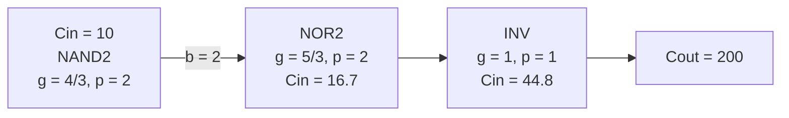
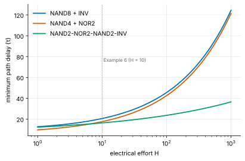

<!-- status: verified -->
# 19-04 · Transistor Sizing and Logical Effort

| | |
|---|---|
| **Course** | [19 · Digital VLSI Design](../README.md) |
| **University equivalent** | The path-sizing part of a senior digital-IC course: the method of logical effort, optimal buffer chains and the best number of stages, and choosing gate topologies for speed (Sutherland, Sproull & Harris, *Logical Effort*, ch. 1–4; Weste & Harris, *CMOS VLSI Design*, §4.5; Rabaey, Chandrakasan & Nikolić, §5.4.3 and §6.2.1) |
| **Prerequisites** | [19-02](19-02-cmos-inverter-dynamic.md) (intrinsic delay, self-loading and FO4), [19-03](19-03-logic-families.md) (static gates, their sizing and input capacitance), [01-04](../../01-calculus-for-engineers/chapters/01-04-applications-of-derivatives.md) (optimization with derivatives), [01-09](../../01-calculus-for-engineers/chapters/01-09-multivariable-calculus-1.md) (Lagrange multipliers) |
| **Estimated study hours** | 9 |
| **Last verified** | 2026-11-21 |

**Learning objectives.** After this chapter you can:

1. Derive the delay of a gate in the form $d = gh + p$ from the RC model, and give the logical effort and parasitic delay of inverters, NANDs and NORs.
2. Compute a path's logical, branching, electrical and total effort, prove that equal stage efforts minimize its delay, and find that minimum delay.
3. Size every gate on a path for minimum delay by working backward from the load.
4. Derive the best stage effort and the best number of stages, and design a buffer chain for a large load.
5. Compare gate topologies for a function using logical effort, and state the method's limits and how to calibrate it.

## 1. Big picture

19-02 showed that making a gate wider speeds it up but slows the gate that drives it. On a real path, every gate faces that tension at once, and sizing each one by intuition or by trial in a simulator is slow and usually far from optimal. **Logical effort**, introduced by Sutherland and Sproull and developed into a book with Harris, turns the problem into arithmetic: each gate is described by two numbers, how much harder it is to drive than an inverter and how much self-loading it carries, and the fastest sizing of a whole path follows in closed form. It is the mental model behind synthesis tools' gate sizing and buffering, and the fastest way to answer "how many stages, how big?" on the back of an envelope.

- **Buffering large loads.** Clock trees, bus drivers, word lines and I/O pads drive loads hundreds or thousands of times a gate's input capacitance; the best buffer chain uses stages that each step up by about four.
- **Topology choices.** Whether an 8-input AND should be one wide gate or a tree of small ones is decided by effort, not by gate count (Example 6).
- **Fan-out budgets.** The rule that a stage should drive about four times its input capacitance (FO4 again) comes from this chapter's optimization.
- **Speaking the language.** Circuit designers describe delays in FO4 and stage effort; the vocabulary is the method's.

## 2. Intuition first

Think of a path as a relay race in which each runner must carry the baton and also hand it to a heavier runner. A gate's delay has two parts: a fixed part, the time to move its own weight (its parasitic delay), and a part proportional to how much heavier the next runner is than itself (its effort). If one runner is asked to hand off to someone far heavier while the others have easy hand-offs, the slow hand-off dominates. The total is smallest when every hand-off is equally hard: when each stage multiplies the "weight" by the same factor. That is the whole of logical effort in one sentence; the rest is bookkeeping.

The analogy breaks down in two places. Gates are not all equally good runners: a NAND or NOR must present more input capacitance than an inverter to deliver the same current, and that handicap (its logical effort) must be counted. And adding runners is not free, because each has its own fixed time, which is why there is a best number of stages and not "as many as possible".

*Figure 1. The path of Example 3: a NAND2 whose output drives two NOR2s (branching effort 2), one of which drives an inverter and a 200-unit load. Logical effort sizes each gate so that every stage bears the same effort, 4.46.*

## 3. Theory

### 3.1 The delay of one gate, $d = gh + p$

Start from the RC model of 19-02. Let a **unit inverter** have input capacitance $C_{inv}$ and output resistance $R$ (both edges), and let its own output diffusion equal its input capacitance ($\gamma$ = 1). Define the time unit

$$
\tau = 0.69\,R\,C_{inv},
$$

the delay of an inverter driving an identical copy of itself with no self-loading. In 19-02's example ($R$ = 12.57 kΩ, $C_{inv}$ = 2 fF) $\tau$ = 17.4 ps, the intrinsic delay $t_{p0}$.

Now take any gate, sized by a factor $s$ relative to its unit-drive version (19-03 §3.2), so that its resistance is $R/s$ on both edges. Its input capacitance per input is $gC_{inv}s$, where $g$ is its **logical effort**; its output diffusion is $pC_{inv}s$, where $p$ is its **parasitic delay** in units of $\tau$. Driving a load $C_{out}$,

$$
t = 0.69\,\frac Rs\left(pC_{inv}s + C_{out}\right) = 0.69\,RC_{inv}\left(p + \frac{C_{out}}{sC_{inv}}\right) = \tau\left(p + g\,\frac{C_{out}}{gC_{inv}s}\right) .
$$

With the **electrical effort** $h = C_{out}/C_{in}$, the ratio of the load to the gate's own input capacitance, the delay in units of $\tau$ is

$$
d = \frac t\tau = gh + p = f + p,
$$

where $f = gh$ is the **stage effort**. Three numbers capture a gate: $g$ (how hard it is to drive, a property of its topology), $h$ (how big its load is relative to itself, a property of its sizing) and $p$ (its self-loading, independent of size, as 19-02 showed). For the inverter, $g$ = 1 and $p = p_{inv}$ = 1, so the FO4 delay is $d = 1 \times 4 + 1$ = 5, the same $t_{p0}(1 + 4/\gamma)$ as 19-02.

**What value for $p_{inv}$?** An inverter's parasitic delay is its own diffusion charged through its own resistance, so $p_{inv}$ in units of τ is exactly 19-02's self-loading ratio γ. This chapter follows the Weste–Harris teaching convention $p_{inv}$ = 1, which makes an FO4 5τ. Ho, Mai and Horowitz's rule that a fan-out-of-1 delay is a third of an FO4 (19-02 §3.5) implies $p_{inv} \approx$ 0.5 instead, and an FO4 of **4.5**τ. The conclusions below barely move: the best stage effort is 3.59 for $p_{inv}$ = 1 and 3.18 for 0.5 (Problem 19-04.10), both "about 4" within a flat optimum. What changes is a τ calibrated from a measured FO4: FO4/5 and FO4/4.5 differ by **11** %, so say which convention a number assumes.

### 3.2 Logical effort and parasitic delay of common gates

The logical effort of a gate sized for unit drive is its input capacitance divided by the inverter's, which 19-03 §3.2 computed with $\mu$ = 2. That value is the Weste–Harris arithmetic convention; real mobility ratios are 2 to 3 (19-01) and the effective ratio is lower under velocity saturation, so the efforts below are teaching values (Problem 19-04.13 redoes two gates with μ = 2.5):

| Gate | Logical effort $g$ | Parasitic delay $p$ |
|---|---|---|
| Inverter | 1 | $p_{inv}$ |
| NAND-$n$ | $(n + 2)/3$ | $np_{inv}$ |
| NOR-$n$ | $(2n + 1)/3$ | $np_{inv}$ |

The parasitic delays follow from counting output diffusion. A unit-drive NAND-$n$ has $n$ parallel PMOS of width 2 and one series NMOS of width $n$ at its output: $2n + n = 3n$ units of drain width, $n$ times the inverter's 3. A NOR-$n$ has one PMOS of width $2n$ and $n$ NMOS of width 1: again $3n$. This ignores the internal nodes of the stack (19-03 §3.3), which make wide gates somewhat worse than the table says.

Two observations follow. Logical effort grows with the number of inputs, so a single wide gate is a heavy load on its driver. And NOR is worse than NAND because its series devices are the weaker PMOS; with $\mu$ = 2, a NOR2 costs 5/3 against a NAND2's 4/3.

**Complex gates.** The same counting gives any gate's efforts, input by input. An AOI21, $F = \overline{AB + C}$, sized for unit drive with μ = 2, has series NMOS A and B of width 2 and a single NMOS C of width 1. Its pull-up puts the parallel pair A, B in series with C, so every PMOS has width 4. Inputs A and B each present 2 + 4 = 6 units, so $g_A = g_B$ = 6/3 = **2**; input C presents 1 + 4 = 5 units, $g_C$ = 5/3 = **1.67**. With PMOS C placed next to the output, the output node carries NMOS A (2), NMOS C (1) and PMOS C (4): 7 units, $p$ = 7/3 = **2.33** $p_{inv}$. Because the inputs differ, a late-arriving critical signal should use the input with the smallest effort, here C.

**Skewed gates.** A gate can be sized to favor one output edge. A HI-skew inverter keeps the unit PMOS (width 2) but halves the NMOS to width 0.5, so its input capacitance is 2.5 units. Its rising output has the pull-up of a unit inverter (3 units of input), so its rising logical effort is $g_u$ = 2.5/3 = **0.833**; its falling output has the pull-down of a half-size inverter (1.5 units), so $g_d$ = 2.5/1.5 = **1.67**. The average, **1.25**, is worse than an ordinary inverter's 1: skewing speeds the edge that matters at the expense of the other, which is what the inverter after a domino gate (19-03), whose output only ever needs to rise quickly during evaluation, wants. Problem 19-04.14 treats LO-skew gates and a skewed NAND2.

**The best P/N ratio.** The tables size each PMOS μ times wider than the NMOS it complements (β = μ, where β = $W_p/W_n$), which equalizes rising and falling delays. That is not the fastest choice for a chain. For an inverter driving copies of itself, the average of the two delays is proportional to $(1 + \beta)(1 + \mu/\beta)$: a wider PMOS speeds the rising edge but adds input capacitance that slows both. Setting the derivative to zero gives $\beta_{opt} = \sqrt\mu$ (Problem 19-02.11). For μ = 2, β = **1.41** is **2.9** % faster than β = 2; for μ = 2.5, β = **1.58** is **4.8** % faster than β = 2.5. The optimum is flat, which is why logical effort keeps β = μ by convention; real libraries often sit near the square root, as SkyWater's `inv_1` does with $W_p/W_n$ = 1.54 (19-03 §9).

### 3.3 Paths: total effort and the minimum delay

A path of $N$ stages has delay $D = \sum(g_ih_i + p_i)$. Define three path quantities:

- the **path logical effort** $G = \prod g_i$;
- the **path electrical effort** $H = C_{out}/C_{in}$, the load at the end over the input capacitance of the first gate;
- the **path branching effort** $B = \prod b_i$, where at each stage $b_i = (C_{on} + C_{off})/C_{on}$ accounts for capacitance that a gate drives off the path (other gates its output also feeds).

Their product is the **path effort** $F = GBH$. The point of the definitions is that $F$ is fixed by the path's topology and its two end capacitances, whatever the internal sizes: the stage efforts satisfy $\prod f_i = \prod g_ih_i = G \cdot \prod h_i$, and the internal capacitances cancel in $\prod h_i$ except for the ends and the branching, so $\prod f_i = F$.

**Minimizing the delay.** With $P = \sum p_i$ fixed (it does not depend on sizes), minimize $\sum f_i$ subject to $\prod f_i = F$. Take logarithms, $x_i = \ln f_i$ with $\sum x_i = \ln F$, and minimize $\sum e^{x_i}$. A Lagrange multiplier Λ gives $e^{x_i} = \Lambda$ for every $i$: **all stage efforts are equal**,

$$
\hat f = F^{1/N}, \qquad \hat D = N F^{1/N} + P .
$$

(Equivalently, by the inequality of arithmetic and geometric means, $\tfrac1N\sum f_i \ge (\prod f_i)^{1/N}$, with equality when all are equal.) This is the relay-race intuition made exact.

> **Math refresher — Lagrange multipliers and the AM–GM inequality.** To minimize $\phi(x_1, \ldots, x_N)$ subject to a constraint $c(x_1, \ldots, x_N) = 0$, look for points where the gradient of φ is parallel to the gradient of $c$: $\nabla\phi = \Lambda\nabla c$ for some number Λ, the multiplier (01-09). Here $\phi = \sum e^{x_i}$ and $c = \sum x_i - \ln F$, so $\partial\phi/\partial x_i = e^{x_i}$ must equal Λ for every $i$, and all the $f_i$ are equal. The arithmetic–geometric mean inequality reaches the same answer without calculus: for positive numbers, the average is at least the geometric mean, with equality only when all are equal. With the product fixed at $F$, the sum is smallest when every factor is $F^{1/N}$. In portfolio language, it is the same reason that, for a fixed product of growth factors, the arithmetic average is smallest when the factors are all equal.

### 3.4 Sizing the gates

Once $\hat f$ is known, each gate's size follows from $\hat f = g_iC_{out,i}/C_{in,i}$. Work backward from the load:

$$
C_{in,i} = \frac{g_i\,C_{out,i}}{\hat f},
$$

where $C_{out,i}$ is everything stage $i$ drives: the next stage's input on the path plus any off-path loads. The first stage's computed input capacitance must come out equal to the given $C_{in}$; if it does not, there is an arithmetic error, a useful built-in check.

### 3.5 The best number of stages

For a fixed function, the number of logic gates is fixed, but inverters can be added (in pairs, to keep the polarity, or one at a time if the polarity can be absorbed elsewhere). An inverter adds $g$ = 1, so it leaves $F$ unchanged but adds $p_{inv}$ and splits the effort further. With $N$ stages, of which the added ones are inverters,

$$
D(N) = NF^{1/N} + P_0 + (N - n_0)p_{inv},
$$

where $n_0$ and $P_0$ are the logic gates' count and parasitic delay. Treat $N$ as continuous and differentiate:

$$
\frac{dD}{dN} = F^{1/N} - F^{1/N}\frac{\ln F}{N} + p_{inv} = 0 .
$$

Writing $\rho = F^{1/N}$ for the stage effort at the optimum, $\ln F/N = \ln\rho$, so

$$
\rho\,(\ln\rho - 1) = p_{inv} .
$$

For $p_{inv}$ = 0 the solution is $\rho = e$ = 2.72, the classic result for a chain with no self-loading. For $p_{inv}$ = 1, $\rho$ = **3.59**; for $p_{inv}$ = 2, 4.32. The best number of stages is $\hat N = \ln F/\ln\rho = \log_\rho F$. Two practical facts make the result robust:

- **The optimum is flat.** The delay per unit of $\ln F$, $(\rho + p_{inv})/\ln\rho$, is within about 9% of its minimum for stage efforts anywhere from 2.4 to 6 (Example 5). Designers therefore use a stage effort of **4** as a rule, and round $\hat N$ to the nearest integer with the right polarity.
- **It explains FO4.** A stage effort of 4 is a gate driving four copies of itself: the FO4 delay of 19-02 is the delay of one optimally loaded stage, which is why clock periods are quoted in it.

*Figure 2. Chain delay against the number of stages for path efforts of 64 and 5000. The minimum is broad on the many-stages side. The transistor-level points (left, from the lab) are longer than the model for chains, because of input slopes, but are also lowest at three stages.*

### 3.6 What logical effort leaves out

Logical effort inherits the RC model's simplifications, and adds a few of its own.

- **Input slopes.** The model assumes each gate's delay depends only on its load. In a chain each gate is driven by a ramp, and its delay is longer (19-02 §3.6). In the lab's transistor-level simulation the three-stage buffer of Example 2 takes 23.2τ rather than 15τ, while the single inverter, driven by a sharp edge, takes 62.9τ, close to its predicted 65τ. The optimum number of stages is still three, but absolute delays need calibration.
- **Calibration.** Practitioners measure $\tau$ and $p_{inv}$ from a simulated FO4 chain in their own process and library, so that slope effects are averaged in, and characterize $g$ and $p$ of each cell by simulation rather than from the idealized table.
- **Fixed wire capacitance.** A long wire's capacitance does not scale with the gate that drives it, so branching on wires is not a clean ratio; 19-05 treats wires and repeaters.
- **Rise and fall asymmetry, and data dependence.** The method averages edges and uses the worst input; real cells have different efforts per input and per edge.
- **Area and power.** Minimum delay is rarely the goal by itself. Off the critical path, gates are made as small as timing allows, and even on it, a design near the minimum delay pays a great deal of area and energy for the last few percent (Problem 19-04.11).

> **Going deeper — logical effort in synthesis.** Commercial synthesis and placement tools size gates and insert buffers using characterized delay tables and numerical optimization rather than the closed form, but their behavior matches the method's predictions: they balance stage efforts on critical paths, insert buffer trees with fan-outs near four, and restructure wide gates into trees. The method remains the designer's way to predict what the tool should do, and to recognize when it has not.

*Figure 3. The 8-input AND topologies of Example 6 against the path's electrical effort. Fewer stages win only for small loads; above $H$ = 6.7 the four-stage tree is fastest (Problem 19-04.12).*

## 4. Worked examples

Take $p_{inv}$ = 1, $\mu$ = 2 and $\tau$ = 17.4 ps (19-02's inverter) throughout.

### Example 19-04.1 · Fan-out-of-4 delays (tier A)

**Setup.** Find the delay, in $\tau$ and in picoseconds, of an inverter, a NAND2 and a NOR2, each driving four identical copies of itself.

**Solution.** $h$ = 4 in each case. Inverter: $d = 1 \times 4 + 1$ = **5** τ = **87.1** ps. NAND2: $d = \tfrac43 \times 4 + 2$ = **7.33** τ = **127.8** ps. NOR2: $d = \tfrac53 \times 4 + 2$ = **8.67** τ = **151.0** ps.

**Units check.** $g$ and $h$ are ratios; $d$ is in units of τ.

**Sanity check.** The NOR2 is 1.73 times slower than the inverter with the same fan-out: its larger logical effort and parasitic delay both count.

### Example 19-04.2 · A buffer chain (tier B)

**Setup.** A unit inverter must drive a load 64 times its own input capacitance. Compare one inverter with chains of two, three and four inverters sized for minimum delay, and find the best number of stages.

**Solution.** $F = H$ = 64. One stage: $d = 64 + 1$ = **65** τ. Two stages: $f$ = 8, $D = 2 \times 8 + 2$ = **18** τ. Three stages: $f$ = 4, $D = 3 \times 4 + 3$ = **15** τ, with input capacitances 1, 4 and 16. Four stages: $f = 64^{1/4}$ = 2.83, $D$ = **15.31** τ. The continuous optimum is $\hat N = \ln 64/\ln 3.59$ = **3.25**, so three stages, **4.33** times faster than one inverter (15τ = 261 ps against 1.13 ns).

**Units check.** Stage efforts are dimensionless; delays are in τ.

**Sanity check.** Each stage of the three-stage chain is an FO4 inverter (5τ). The four-stage chain is barely slower, illustrating how flat the optimum is.

### Example 19-04.3 · Sizing a path with branching (tier B)

**Setup.** A NAND2 with input capacitance 10 (in units of the unit inverter's) drives two identical NOR2s; one of them drives an inverter, which drives a load of 200 (Figure 1). Find $G$, $B$, $H$, $F$, the best stage effort, the minimum delay and every gate's input capacitance.

**Solution.** $G = \tfrac43 \times \tfrac53 \times 1$ = **2.22**. The NAND2 output drives two equal NOR2 inputs, one on the path: $B$ = **2**. $H$ = 200/10 = **20**. $F = GBH$ = **88.9**, so $\hat f = 88.9^{1/3}$ = **4.46**. $P$ = 2 + 2 + 1 = 5, and $\hat D = 3 \times 4.46 + 5$ = **18.39** τ = **320.4** ps.

Backward: the inverter has $C_{in} = 1 \times 200/4.46$ = **44.8**; each NOR2 has $C_{in} = \tfrac53 \times 44.8/4.46$ = **16.7**; the NAND2 drives $2 \times 16.7$ = 33.5 and has $C_{in} = \tfrac43 \times 33.5/4.46$ = **10.0**, the given value: the check closes.

**Units check.** Capacitances in units of $C_{inv}$; efforts dimensionless.

**Sanity check.** The NAND2 must also drive the off-path NOR2, so half its load is off the path; removing the branch would halve $F$ to 44.4 and cut the delay by **2.76** τ.

### Example 19-04.4 · Driving a pad (tier B)

**Setup.** A unit inverter with 2 fF of input capacitance must drive a 10 pF off-chip load. How many inverting stages are best, and what is the delay? What would a single unit inverter take?

**Solution.** $H$ = 10 pF/2 fF = 5000. $\hat N = \ln 5000/\ln 3.59$ = **6.66**. Six stages: $D = 6 \times 5000^{1/6} + 6$ = **30.81** τ. Seven: **30.63** τ. Eight: **31.20** τ. Seven stages are best, **533.8** ps; if the signal must not be inverted, six stages cost 0.6% more and eight 1.9% more. A single unit inverter would take $5000 + 1$ τ = **87.1** ns.

**Units check.** τ × 17.43 ps.

**Sanity check.** The stage effort for seven stages is $5000^{1/7}$ = 3.38, close to $\rho$ = 3.59.

### Example 19-04.5 · How flat is the optimum? (tier B)

**Setup.** (a) Find the best stage effort ρ for $p_{inv}$ = 0, 1 and 2. (b) For $p_{inv}$ = 1, by what percentage does a chain with stage effort 2.4 or 6 exceed the minimum delay for the same $F$?

**Solution.** (a) Solving $\rho(\ln\rho - 1) = p_{inv}$: **2.72** ($e$), **3.59** and **4.32**.

(b) The delay per unit of $\ln F$ is $(f + 1)/\ln f$: **3.88** at $f$ = 2.4, **3.59** at the optimum, and **3.91** at $f$ = 6. Stage efforts of 2.4 and 6 are only **8.1** % and **8.8** % slower.

**Units check.** Delays per natural-log unit of path effort, in τ.

**Sanity check.** At the optimum the value per unit of $\ln F$ equals ρ itself, since $(\rho + p_{inv})/\ln\rho = \rho$ when $\rho\ln\rho - \rho = p_{inv}$.

### Example 19-04.6 · Choosing a topology for an 8-input AND (tier C)

**Setup.** An 8-input AND must drive a load 10 times its input capacitance ($H$ = 10). Compare (a) a NAND8 followed by an inverter, (b) NAND4s followed by a NOR2, and (c) NAND2s, then NOR2s, then a NAND2, then an inverter. Assume each topology is sized optimally.

**Solution.** In each case $B$ = 1 (each gate output feeds exactly one gate) and $F = GH$.

- (a) $G = \tfrac{10}{3} \times 1$ = 3.33, $F$ = 33.3, $P$ = 8 + 1 = 9: $\hat D = 2\sqrt{33.3} + 9$ = **20.55** τ.
- (b) $G = 2 \times \tfrac53$ = 3.33, $F$ = 33.3, $P$ = 4 + 2 = 6: $\hat D$ = **17.55** τ.
- (c) $G = \tfrac43 \times \tfrac53 \times \tfrac43 \times 1$ = **2.96**, $F$ = 29.6, $P$ = 2 + 2 + 2 + 1 = 7: $\hat D = 4 \times 29.6^{1/4} + 7$ = **16.33** τ.

The four-stage tree of small gates is fastest, though it has the most gates. The NAND8's parasitic delay alone, 8τ, is more than half its total; and since 19-03 showed that wide stacks are worse than the linear model says, the real gap is larger still.

**Units check.** Delays in τ.

**Sanity check.** Options (a) and (b) have the same path effort; (b) wins only through its smaller parasitic delay.

<!-- answer-key -->

| ID | Quantity | Value | Unit |
|---|---|---|---|
| Ex 19-04.1a | inverter FO4 delay | 5 | τ |
| Ex 19-04.1b | inverter FO4 delay | 87.1 | ps |
| Ex 19-04.1c | NAND2 FO4 delay | 7.33 | τ |
| Ex 19-04.1d | NAND2 FO4 delay | 127.8 | ps |
| Ex 19-04.1e | NOR2 FO4 delay | 8.67 | τ |
| Ex 19-04.1f | NOR2 FO4 delay | 151.0 | ps |
| Ex 19-04.1g | NOR2 over inverter | 1.73 | — |
| Ex 19-04.2a | one inverter, H = 64 | 65 | τ |
| Ex 19-04.2b | two stages | 18 | τ |
| Ex 19-04.2c | three stages | 15 | τ |
| Ex 19-04.2d | four stages | 15.31 | τ |
| Ex 19-04.2e | continuous best stage count | 3.25 | — |
| Ex 19-04.2f | speed-up of three stages | 4.33 | — |
| Ex 19-04.2g | three-stage delay | 261 | ps |
| Ex 19-04.2h | one-inverter delay | 1.13 | ns |
| Ex 19-04.3a | path logical effort G | 2.22 | — |
| Ex 19-04.3b | branching effort B | 2 | — |
| Ex 19-04.3c | electrical effort H | 20 | — |
| Ex 19-04.3d | path effort F | 88.9 | — |
| Ex 19-04.3e | best stage effort | 4.46 | — |
| Ex 19-04.3f | minimum delay | 18.39 | τ |
| Ex 19-04.3g | minimum delay | 320.4 | ps |
| Ex 19-04.3h | inverter input capacitance | 44.8 | units |
| Ex 19-04.3i | NOR2 input capacitance | 16.7 | units |
| Ex 19-04.3j | NAND2 load | 33.5 | units |
| Ex 19-04.3k | NAND2 input capacitance (check) | 10.0 | units |
| Ex 19-04.3l | path effort without the branch | 44.4 | — |
| Ex 19-04.3m | delay saved without the branch | 2.76 | τ |
| Ex 19-04.4a | electrical effort | 5000 | — |
| Ex 19-04.4b | continuous best stage count | 6.66 | — |
| Ex 19-04.4c | six stages | 30.81 | τ |
| Ex 19-04.4d | seven stages | 30.63 | τ |
| Ex 19-04.4e | eight stages | 31.20 | τ |
| Ex 19-04.4f | seven-stage delay | 533.8 | ps |
| Ex 19-04.4g | single inverter delay | 87.1 | ns |
| Ex 19-04.4h | stage effort with seven stages | 3.38 | — |
| Ex 19-04.4i | penalty for six stages | 0.6 | % |
| Ex 19-04.5a | best stage effort, p_inv = 0 | 2.72 | — |
| Ex 19-04.5b | best stage effort, p_inv = 1 | 3.59 | — |
| Ex 19-04.5c | best stage effort, p_inv = 2 | 4.32 | — |
| Ex 19-04.5d | delay per ln F at f = 2.4 | 3.88 | τ |
| Ex 19-04.5e | delay per ln F at f = 6 | 3.91 | τ |
| Ex 19-04.5f | penalty at f = 2.4 | 8.1 | % |
| Ex 19-04.5g | penalty at f = 6 | 8.8 | % |
| Ex 19-04.6a | NAND8 + INV delay | 20.55 | τ |
| Ex 19-04.6b | NAND4 + NOR2 delay | 17.55 | τ |
| Ex 19-04.6c | tree logical effort | 2.96 | — |
| Ex 19-04.6d | tree delay | 16.33 | τ |
| Txt 19-04.a | tau for 19-02's inverter | 17.4 | ps |
| Txt 19-04.b | three-stage chain, transistor level | 23.2 | τ |
| Txt 19-04.c | single inverter, transistor level | 62.9 | τ |
| Txt 19-04.d | 13 FO4 in units of tau | 65 | τ |
| Txt 19-04.e | Example 3 paths in 13 FO4 | 3.5 | — |
| Txt 19-04.f | falling-edge logical effort of an equal-width NAND2 | 2 | — |
| Txt 19-04.g | FO4 in tau for p_inv = 0.5 | 4.5 | τ |
| Txt 19-04.h | tau calibrations FO4/4.5 against FO4/5 | 11 | % |
| Txt 19-04.i | AOI21 logical effort, inputs A and B | 2 | — |
| Txt 19-04.j | AOI21 logical effort, input C | 1.67 | — |
| Txt 19-04.k | AOI21 parasitic delay | 2.33 | p_inv |
| Txt 19-04.l | HI-skew inverter rising effort | 0.833 | — |
| Txt 19-04.m | HI-skew inverter falling effort | 1.67 | — |
| Txt 19-04.n | HI-skew inverter average effort | 1.25 | — |
| Txt 19-04.o | best P/N ratio, mu = 2 | 1.41 | — |
| Txt 19-04.p | speed gain over beta = 2 | 2.9 | % |
| Txt 19-04.q | best P/N ratio, mu = 2.5 | 1.58 | — |
| Txt 19-04.r | speed gain over beta = 2.5 | 4.8 | % |

## 5. Simulate it

The lab ([labs/19-04-lab](../labs/19-04-lab/README.md)) has two parts:

- **ngspice** ([chain.cir](../labs/19-04-lab/chain.cir)): a single unit inverter and a three-stage tapered chain (sizes 1, 4, 16) driving 128 fF, with SPICE's level-1 model and explicit gate and self-loading capacitances.
- **Python** (`effort.py` and the notebook): gate efforts, path effort and sizing, best stage effort against $p_{inv}$, chain delay against the number of stages, the topology comparison of Example 6, a brute-force numerical sizing that confirms the equal-effort rule, and a transistor-level simulation of chains.

**Predict, then run.**

1. Predict the delays of the single inverter and of the three-stage chain in τ; run `ngspice -b chain.cir` and compare with 65τ and 15τ.
2. Predict the best number of stages for $H$ = 64 at transistor level; simulate two, three and four stages with `simulate_chain`.
3. Predict how ρ changes from $p_{inv}$ = 0 to 3; plot it.
4. Size Example 3's path numerically by minimizing the total delay over all three sizes; compare with the backward rule.
5. Predict which topology of Example 6 wins for $H$ = 1 and for $H$ = 100.

## 6. Engineering tradeoffs

| Knob | Improves | Costs | Typical decision owner |
|---|---|---|---|
| Stage effort near 4 | Delay of the path | Area and power of the larger stages | Logic designer, synthesis |
| Fewer, wider gates | Gate count | Logical effort and parasitic delay | Logic designer |
| Adding buffer stages | Delay for large $F$ | Area, power, polarity changes | Physical design |
| Removing off-path branches | Branching effort | Logic restructuring, duplication | Logic designer |
| Sizing off-critical paths down | Area and power | Timing slack | Synthesis and power optimization |

## 7. Numbers to know

| Quantity | Value | Notes |
|---|---|---|
| Stage delay | $d = gh + p$ | In units of $\tau = 0.69RC_{inv}$ |
| $g$ of NAND2, NOR2, NAND3, NOR3 | 4/3, 5/3, 5/3, 7/3 | $\mu$ = 2 |
| Parasitic delay of $n$-input NAND/NOR | $np_{inv}$, $p_{inv} \approx 1$ | Ignores internal nodes |
| Minimum path delay | $NF^{1/N} + P$, $F = GBH$ | Equal stage efforts |
| Best stage effort | ρ = 3.59 ($p_{inv}$ = 1); rule of thumb 4 | Within 9% for 2.4–6 |
| Best number of stages | $\log_\rho F \approx \log_4 F$ | Round to polarity |
| FO4 delay | 5τ | One optimally loaded stage |

## 8. Common mistakes

- **Forgetting branching.** Off-path loads multiply the path effort; leaving them out makes the design look faster than it is and undersizes the driving gate.
- **Treating $H$ as the load alone.** $H$ is the load divided by the path's input capacitance; making the first gate larger reduces $H$ but loads whatever drives the path.
- **Using too many stages.** Beyond $\log_4 F$ each extra stage adds more parasitic delay than it saves.
- **Sizing for delay everywhere.** Only critical paths need minimum delay; elsewhere the same method run in reverse saves area and power.
- **Trusting absolute delays without calibration.** Input slopes and wires make real delays longer; calibrate τ and $p_{inv}$ from an FO4 chain in the target process.

## 9. Practitioner lens

### State of the art (as of Nov 2026)

- **The method's own numbers [Established].** Harris's lecture slides for *CMOS VLSI Design* give the values this chapter derives: logical efforts $(n+2)/3$ and $(2n+1)/3$, a parasitic delay "In multiples of pinv (≈1)", and ρ = 3.59 for $p_{inv}$ = 1. They add that "2.4 < ρ < 6 gives delay within 15% of optimal" (Example 5's calculation gives 9% for this model) and that "Delay of path is about log4F FO4 inverter delays" ([R-315]).
- **Cycle times in FO4 [Established].** IBM described POWER6 as a "13 FO4 design" (*JSSC*, 2008), one of the few published cycle times stated in FO4 for a commercial processor ([R-315]). At 5τ per FO4 delay, 13 FO4 is 65τ, about **3.5** Example 3 paths, before any flip-flop overhead (19-07).
- **Drive strengths in a real library [Established].** SkyWater's open high-density library offers inverters in drive strengths 1, 2, 4, 6, 8, 12 and 16 and NAND2 and NOR2 in 1, 2, 4 and 8, built as parallel copies of the same devices ([R-315]). Synthesis approximates the continuous optimum of §3.4 by picking the nearest available drive, which is one reason real paths land a few percent above the logical-effort minimum.
- **Libraries do not always follow the textbook sizing [Established].** The same library's `nand2_1` and `nor2_1` use the inverter's own device widths rather than widening the series stack ([R-315]). With equal widths, a NAND2 has the inverter's input capacitance but twice its pull-down resistance, which is equivalent to a logical effort of about 2 on the falling edge rather than 4/3: a density choice that the cell's characterized delay tables, not the idealized formula, capture.

### Why it matters commercially

- **Timing closure is sizing.** The last weeks of a chip project are often spent resizing and rebuffering critical paths; a team that reasons in effort and FO4 converges faster.
- **Area and power follow sizing.** Upsizing for speed raises area, leakage and switching energy, so the frequency target set in a product plan has a direct cost in silicon area and power.
- **Library drive strengths are a design choice.** A library offers each cell in several drive strengths so that synthesis can approximate the continuous optimum; the granularity affects how close real designs get to it.

### Marketing vs Reality

- **"Our design runs at N GHz."** Ask how many FO4 delays fit in the cycle and how much of it is sequencing overhead (19-07). A higher frequency can come from a faster process, from deeper pipelining, or from aggressive sizing, with very different costs.
- **"Optimized for speed."** Minimum-delay sizing costs disproportionate area and power for the last few percent; ask where on the delay–area curve the design sits.
- **Gate-delay claims from simple chains.** Inverter chains are the best case; real paths have branching, wide gates and wires.

### Questions for engineering leaders

1. *"How many FO4 delays are in your critical path, and how much margin do you keep?"* Strong: a number with a breakdown into logic, wire and sequencing overhead. Evasive: only a frequency.
2. *"How do you decide between deeper pipelining and faster logic?"* Strong: a quantified tradeoff of FO4 per stage, flip-flop overhead and power. Evasive: "we follow the previous generation".
3. *"Where does your design spend area on upsizing, and what would relaxing the clock by 10% save?"* Strong: data from synthesis sweeps. Evasive: no data.
4. *"How are high-fan-out nets (clocks, resets, enables) buffered?"* Strong: dedicated trees with controlled stage effort and slopes. Evasive: "the tools handle it".

## 10. Concept check

**Q1.** What do $g$, $h$ and $p$ each depend on?

Answer

$g$ depends only on the gate's topology (how much input capacitance it needs per unit of drive); $h$ on its sizing relative to its load; $p$ on its self-loading, which is independent of size.

**Q2.** Why does the path effort $F$ not depend on the sizes of the internal gates?

Answer

The product of electrical efforts telescopes: each internal capacitance appears once as a load and once as an input, and cancels, leaving the path's output over its input (times branching).

**Q3.** Why does minimum delay require equal stage efforts?

Answer

For a fixed product $\prod f_i = F$, the sum $\sum f_i$ is smallest when all $f_i$ are equal, by the inequality of arithmetic and geometric means; the parasitic delays do not depend on sizes.

**Q4.** Why is the best stage effort about 4 rather than $e$?

Answer

Each added stage costs its own parasitic delay $p_{inv}$, so the optimum shifts to fewer, more heavily loaded stages: $\rho(\ln\rho - 1) = p_{inv}$ gives 3.59 for $p_{inv}$ = 1.

**Q5.** A NAND8 and a tree of NAND2s, NOR2s, a NAND2 and an inverter compute the same AND8. Why can the tree be faster although it has more stages?

Answer

The NAND8 has a large logical effort and a parasitic delay of 8 units; the tree spreads a smaller total effort over four stages, each near the best stage effort, and its parasitic delays add up to less.

**Q6.** Why might a simulated buffer chain be slower than logical effort predicts?

Answer

Logical effort assumes each gate's delay depends only on its load; in a chain each gate is driven by a ramp from the previous one, which lengthens its delay (19-02 §3.6). Calibrating τ from an FO4 chain absorbs much of it for stages driven by a previous stage, but not for a stage driven by a sharp edge, which such a τ over-predicts.

Problems: [19-04 problem set](../problems/19-04-problems.md).

## 11. Key terms

[Logical effort](../../../reference/glossary.md#logical-effort) · [Electrical effort](../../../reference/glossary.md#electrical-effort) · [Parasitic delay](../../../reference/glossary.md#parasitic-delay) · [Branching effort](../../../reference/glossary.md#branching-effort) · [Path effort](../../../reference/glossary.md#path-effort) · [Stage effort](../../../reference/glossary.md#stage-effort) · [FO4 delay](../../../reference/glossary.md#fo4-delay)

## 12. Connections

- **Builds on:** [19-02](19-02-cmos-inverter-dynamic.md) (RC delay, intrinsic delay, FO4), [19-03](19-03-logic-families.md) (gate sizing and input capacitance), [01-04](../../01-calculus-for-engineers/chapters/01-04-applications-of-derivatives.md) (optimization).
- **Next:** [19-05](19-05-interconnect.md) adds wires, whose fixed capacitance and distributed resistance call for repeaters sized by a similar argument.
- **Used later:** [19-06](19-06-power-and-low-power-design.md) (the energy cost of sizing), [19-07](19-07-sequential-timing-and-clocking.md) (clock buffering and cycle time in FO4), [19-08](19-08-sram-design.md) (word-line and decoder drivers), [19-10](19-10-synthesis-and-sta.md) (gate sizing in synthesis).

## 13. Further study

- Sutherland, Sproull & Harris, *Logical Effort: Designing Fast CMOS Circuits*, Morgan Kaufmann, 1999, ch. 1–4 (the method, with many worked designs).
- Weste & Harris, *CMOS VLSI Design*, 4th ed., §4.5 (logical effort and transistor sizing).
- Rabaey, Chandrakasan & Nikolić, *Digital Integrated Circuits*, 2nd ed., §5.4.3 (sizing a chain of inverters) and §6.2.1 (logical effort).
- MIT OCW 6.374, the lectures on logical effort.

## 14. Sources

1. I. Sutherland, B. Sproull and D. Harris, *Logical Effort: Designing Fast CMOS Circuits*, Morgan Kaufmann, 1999.
2. Weste & Harris, *CMOS VLSI Design*, 4th ed., Addison-Wesley, 2011, §4.5.
3. Rabaey, Chandrakasan & Nikolić, *Digital Integrated Circuits*, 2nd ed., Prentice Hall, 2003, ch. 5–6.
4. I. Sutherland and R. Sproull, "Logical effort: designing for speed on the back of an envelope", *Advanced Research in VLSI*, 1991.
5. [R-315] Harris, *CMOS VLSI Design* lecture slides on logical effort; Stolt et al., POWER6 (*JSSC*, 2008); the `sky130_fd_sc_hd` library repository.
