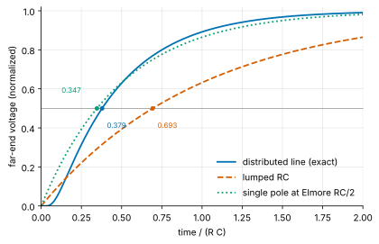
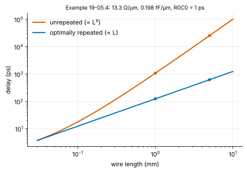

<!-- status: verified -->
# 19-05 · Interconnect

| | |
|---|---|
| **Course** | [19 · Digital VLSI Design](../README.md) |
| **University equivalent** | The interconnect chapter of a senior digital-IC course: wire resistance and capacitance, the distributed RC line, Elmore estimates of driver–wire–load delay, repeater insertion, capacitive crosstalk, and how wires scale (Rabaey, Chandrakasan & Nikolić, *Digital Integrated Circuits*, ch. 4 and 9; Weste & Harris, *CMOS VLSI Design*, ch. 6; Ho, Mai & Horowitz, "The Future of Wires") |
| **Prerequisites** | [19-02](19-02-cmos-inverter-dynamic.md) (RC delay), [19-03](19-03-logic-families.md) (the Elmore delay), [19-04](19-04-sizing-and-logical-effort.md) (sizing for minimum delay), [04-05](../../04-physics-for-ee/chapters/04-05-current-resistance-and-conduction.md) (resistivity), [04-04](../../04-physics-for-ee/chapters/04-04-potential-capacitance-and-dielectrics.md) (capacitance), [02-09](../../02-complex-numbers-des-and-linear-algebra/chapters/02-09-systems-of-odes-and-matrix-exponential.md) (systems of ODEs) |
| **Estimated study hours** | 8 |
| **Last verified** | 2026-11-21 |

**Learning objectives.** After this chapter you can:

1. Compute a wire's resistance and capacitance from its geometry, and explain why narrow copper lines are more resistive than bulk resistivity predicts.
2. Derive the step response of a distributed RC line and its 50% delay, 0.38$RC$, and compare it with lumped and Elmore estimates.
3. Estimate the delay of a driver–wire–load path, and decide when a wire's resistance matters.
4. Derive the optimal number and size of repeaters for a long wire, and show that repeated delay grows linearly with length.
5. Estimate capacitive crosstalk on floating and driven victims, and explain how wire scaling makes global wires relatively slower.

## 1. Big picture

Transistors get faster with every process node; wires do not. A wire on a chip is a thin strip of copper surrounded by insulator, with a resistance proportional to its length and inversely proportional to its cross-section, and a capacitance proportional to its length. Shrink its width and thickness and its resistance per unit length rises; keep its length (because it still has to cross the same block) and its delay rises with it. By the time a design reaches advanced nodes, the wires, not the gates, set the delay of many paths, consume much of the switching energy, and couple noise between signals. This chapter builds the models designers use to reason about them.

- **Delay.** Long wires are distributed RC lines whose delay grows as the square of their length; repeaters make it linear (§3.5).
- **Energy.** Every wire's capacitance is charged and discharged as its signal switches; on many chips wires carry a large share of the dynamic power (19-06).
- **Noise.** Neighboring wires are coupled by sidewall capacitance; an aggressor's transition can disturb or delay a victim (§3.6).
- **Scaling.** Local wires shrink with the gates and keep pace; global wires do not, which is why on-chip networks, repeaters and backside power delivery exist (§3.7).

## 2. Intuition first

A short wire is just a capacitor: its resistance is negligible next to the transistor driving it, so it adds to the load like any other capacitance. A long wire is different. Think of it as a long, leaky garden hose being filled from one end: water must flow through the hose's own resistance to reach the far end, and it fills the near part of the hose (its capacitance) on the way. Doubling the hose's length doubles both its resistance and the volume to fill, so the time to fill it grows four times: the delay of an unbuffered wire is proportional to the **square** of its length.

Repeaters are pumps placed along the hose. Each pump refills only its own short section, so the total time grows with the number of sections, linearly with length, at the cost of the pumps' own delay and power. Crosstalk is the hose's wall being shared with a neighbor: when the neighbor's pressure changes suddenly, the wall flexes and pushes some water into yours.

The analogy fails in one important respect. Electrical signals on a chip are not limited by the speed of light at these lengths; they are limited by diffusion through the RC network, which is why the delay grows quadratically rather than linearly with length.

```text
 Driver   R_d       r dx      r dx      r dx              far end
 ---|>o---/\/\/--+--/\/\/--+--/\/\/--+--/\/\/-- ... --+------ C_L
                 |         |         |                |
                c dx      c dx      c dx             c dx
                 |         |         |                |
                GND       GND       GND              GND
```

*Figure 1. A driver, a distributed RC wire (resistance $r$ and capacitance $c$ per unit length) and a load. Every element of the wire is charged through the resistance of everything between it and the driver.*

## 3. Theory

### 3.1 Resistance

A wire of resistivity ρ, length $L$, width $W$ and thickness $t$ has

$$
R = \frac{\rho L}{Wt} = R_\square\,\frac LW, \qquad R_\square = \frac\rho t,
$$

where the **sheet resistance** $R_\square$ (ohms per square) depends only on the layer, and $L/W$ counts the squares. Bulk copper has ρ = 1.7 µΩ·cm at room temperature. Two effects make real narrow lines worse:

- **The size effect.** When a line's width approaches the electrons' mean free path in copper (about 40 nm), scattering at its surfaces and grain boundaries raises the resistivity. Gall's 2020 review states that this makes "10-nm-wide Cu interconnect lines … approximately an order of magnitude larger [in resistivity] than … bulk Cu" ([R-315]).
- **Barriers and liners.** Copper must be wrapped in a diffusion barrier that conducts poorly and takes a fixed thickness, so it consumes a growing fraction of a shrinking cross-section.

These are why the roadmap's tightest wires have resistances of hundreds of ohms per micrometre (§9), and why alternative metals such as ruthenium are being developed for the narrowest layers.

### 3.2 Capacitance

A wire's capacitance per unit length has three parts:

- **Area (parallel-plate) capacitance** to the layers above and below: $\epsilon W/h$ for each, where $h$ is the dielectric thickness;
- **Fringing** from the wire's edges to those layers, comparable to the area term for narrow wires;
- **Coupling** to its neighbors on the same layer: $\epsilon t/s$ to each, for spacing $s$.

Here $\epsilon = \epsilon_r\epsilon_0$ with $\epsilon_r$ between about 2.5 and 4 for the low-$k$ dielectrics used between wires. Because scaling shrinks $W$, $t$, $h$ and $s$ together, the ratios $W/h$ and $t/s$, and hence the capacitance **per unit length**, stay roughly constant across nodes, at about 0.2 fF/µm. As wires become taller than they are wide, the coupling term dominates (Example 2), which is what makes crosstalk important.

### 3.3 The distributed RC line

A wire long enough for its resistance to matter is a **distributed RC line**: resistance $r$ and capacitance $c$ per unit length, with no inductance. Apply Kirchhoff's laws to a slice of length $dx$: the current $i$ flowing along the wire drops voltage $r\,dx\,i$, and the slice's capacitance absorbs current $c\,dx\,\partial v/\partial t$:

$$
\frac{\partial v}{\partial x} = -ri, \qquad \frac{\partial i}{\partial x} = -c\frac{\partial v}{\partial t}
\quad\Longrightarrow\quad
rc\,\frac{\partial v}{\partial t} = \frac{\partial^2v}{\partial x^2} .
$$

This is the **diffusion equation**, the same one that governs heat flow and minority carriers (09-04): signals diffuse along an RC wire, they do not propagate as waves.

> **Math refresher — separation of variables.** A linear PDE with boundary conditions at both ends is often solved by writing the solution as a sum of products $X(x)T(t)$. Substituting one product gives $X''/X = rc\,T'/T$, a function of $x$ equal to a function of $t$, so both equal a constant $-\lambda^2$: $X$ is a sine or cosine fixed by the boundary conditions, and $T$ decays as $e^{-\lambda^2t/(rc)}$. The initial condition then picks the coefficients, as in a Fourier series (11-05).

**The step response.** Let a wire of length $L$ (total $R = rL$, $C = cL$) start at 0 V, and at $t$ = 0 drive its near end ($x$ = 0) to 1 V; its far end is open (no current, $\partial v/\partial x$ = 0). Write $v = 1 - u$, so that $u$ satisfies the same equation with $u(0, t)$ = 0, $\partial u/\partial x(L, t)$ = 0 and $u(x, 0)$ = 1. Separation of variables gives modes $\sin(\lambda_nx)$ with $\cos(\lambda_nL)$ = 0, that is $\lambda_n = (2n+1)\pi/(2L)$, and expanding the initial value 1 in these sines gives coefficients $4/[(2n+1)\pi]$. At the far end, $\sin(\lambda_nL) = (-1)^n$, so

$$
v(L, t) = 1 - \frac4\pi\sum_{n=0}^{\infty}\frac{(-1)^n}{2n+1}\exp\left[-\frac{(2n+1)^2\pi^2}{4}\,\frac{t}{RC}\right] .
$$

Setting $v(L, t)$ = 0.5 and solving numerically gives

$$
t_{50} = 0.379\,RC ,
$$

against $0.69RC$ if the wire's whole resistance and capacitance were lumped into one RC, and $0.69 \times RC/2 = 0.35RC$ from the Elmore constant of 19-03, which for a uniform line is $RC/2$. The lumped model overestimates the delay by 83%; the Elmore estimate is 8.5% low, the same gap that 19-03's long ladders showed. Because $R$ and $C$ both grow with $L$, an unbuffered wire's delay grows as $L^2$.



*Figure 2. The far end of a distributed line starts late (the signal must diffuse along the wire) and then rises quickly, crossing 50% at 0.379$RC$. A lumped RC is far too slow; a single pole with the Elmore constant is close but slightly early.*

### 3.4 Driver, wire and load

A real wire is driven by a gate of resistance $R_d$ and loaded by a gate capacitance $C_L$. The Elmore constant at the far end is $R_d(C_w + C_L) + R_w(C_w/2 + C_L)$: the driver's resistance is shared by every capacitance, and the wire's resistance is shared fully by the load and on average halfway by its own capacitance. Replacing each term's coefficient by its 50% value, 0.69 for the lumped products and 0.379 for the distributed one, gives the standard estimate

$$
t_p \approx 0.69\,R_d(C_w + C_L) + R_w\left(0.38\,C_w + 0.69\,C_L\right) .
$$

**Convention for the coefficients.** In formulas this chapter writes 0.69 for $\ln 2 = 0.6931$ and 0.38 for the distributed line's 0.379; every calculation keeps them at those values, so the worked numbers show $\ln 2$ and 0.379, and answers computed with the rounded 0.69 and 0.38 can differ in the third significant figure.

It is a good approximation, not an exact result: for Example 3's 1 mm wire it is 1.5% below the exact value. The formula says when a wire's resistance matters: when $R_w$ becomes comparable to $R_d$. For short wires $R_w \ll R_d$ and the wire is simply a capacitance; for long ones the $R_wC_w$ term dominates and no driver, however large, can remove it, because it is the wire's own diffusion time.

### 3.5 Repeaters

Break a wire of total $R_w$ and $C_w$ into $k$ equal segments, each driven by a **repeater** (an inverter) of size $h$ relative to a unit inverter of output resistance $R_0$ and input capacitance $C_0$. Each segment is a driver–wire–load path: driver $R_0/h$, wire $R_w/k$ and $C_w/k$, and load $hC_0$ (the next repeater). Ignoring the repeaters' self-loading,

$$
T(k, h) = k\left[0.69\frac{R_0}{h}\left(\frac{C_w}k + hC_0\right) + \frac{R_w}k\left(0.38\frac{C_w}{k} + 0.69\,hC_0\right)\right]
= 0.69\frac{R_0C_w}{h} + 0.69\,kR_0C_0 + 0.38\frac{R_wC_w}{k} + 0.69\,R_whC_0 .
$$

Each variable appears in one decreasing and one increasing term. Setting $\partial T/\partial k = 0.69R_0C_0 - 0.38R_wC_w/k^2 = 0$ and $\partial T/\partial h = -0.69R_0C_w/h^2 + 0.69R_wC_0 = 0$:

$$
k_{opt} = \sqrt{\frac{0.38\,R_wC_w}{0.69\,R_0C_0}}, \qquad h_{opt} = \sqrt{\frac{R_0C_w}{R_wC_0}},
$$

and substituting,

$$
T_{min} = \left(2\sqrt{\ln 2 \times 0.379} + 2\ln 2\right)\sqrt{R_0C_0R_wC_w} = 2.41\sqrt{R_0C_0\,rc}\;L .
$$

The minimum delay is **linear in length**: $R_wC_w = rcL^2$, so its square root is proportional to $L$. The constant depends on the product of the repeater's intrinsic speed ($R_0C_0$) and the wire's ($rc$). Two consequences:

- Faster transistors help repeated wires only as the square root of their improvement.
- At the optimum, each segment's wire delay ($0.38R_wC_w/k^2$ per segment) equals each repeater's intrinsic delay ($0.69R_0C_0$), the same balance as logical effort's equal stage efforts.



*Figure 3. Unrepeated delay grows as $L^2$, optimally repeated delay as $L$ (Example 4's values marked).*

Bakoglu and Meindl derived this optimization in 1985 using 0–90% delay coefficients (1.0 for the distributed line and 2.3 for the lumped one), which give the same $h_{opt}$ and a $k_{opt}$ with those coefficients in place of 0.38 and 0.69 ([R-315]). The optimum is shallow: Ho, Mai and Horowitz note that optimizing for delay times power instead of delay alone lengthens the segments 1.7 times and costs about 13% in latency for 30% less capacitance ([R-315]), so practical designs use fewer, smaller repeaters than $k_{opt}$ and $h_{opt}$.

### 3.6 Crosstalk

Two neighboring wires coupled by capacitance $C_c$ interact whenever one switches.

**A floating victim** (a dynamic node, or a precharged bitline, held by no driver) sees a step on the aggressor $\Delta V_{agg}$ divide across $C_c$ and its own capacitance to ground $C_g$:

$$
\Delta V_{victim} = \Delta V_{agg}\,\frac{C_c}{C_c + C_g} .
$$

This disturbance does not recover until the node is driven again, which is why dynamic logic (19-03) and memories need careful shielding.

**A driven victim** recovers: its driver pulls it back, so the glitch is a transient whose height depends on how fast the driver is relative to the aggressor's edge. Static logic tolerates it unless the glitch is large enough to propagate.

**Delay variation.** When the victim itself switches, the charge its driver must move through $C_c$ depends on what the neighbor does. If the neighbor switches in the same direction at the same time, the voltage across $C_c$ does not change and $C_c$ effectively vanishes; if the neighbor is quiet, $C_c$ counts once; if it switches in the opposite direction, the voltage across $C_c$ changes by twice the swing and $C_c$ counts twice. This **Miller coupling factor** of 0, 1 or 2 makes a wire's delay depend on its neighbors' activity, which timing analysis must bound (19-10). Shielding (placing ground wires between signals), spacing, and routing critical wires on different layers reduce it.

### 3.7 How wires scale

Scale a process by $S < 1$ in every dimension (about 0.7 per node), including the wire's width, thickness and spacing. Per unit length, resistance rises as $1/S^2$ (twice per node) and capacitance stays about constant.

- **Local wires** connect nearby gates and shrink in length with them, by $S$. Their resistance scales as $L/(Wt) \propto S/S^2 = 1/S$ and their capacitance as $S$, so their RC product stays about the same, while gate delay falls by $S$: local wires get slightly worse relative to gates, but they remain mostly capacitive loads.
- **Global wires** cross a block or the die and do not shrink. Unrepeated, their RC grows as $1/S^2$, doubling every node. Repeated, their delay per length grows as $\sqrt{R_0C_0\,rc} \propto \sqrt{S \cdot S^{-2}} = S^{-1/2}$, about 1.2 times per node, while gates speed up by 1/S; relative to gates, they slow by about 1.7 times per node (Example 6).

Ho, Mai and Horowitz summarized the outcome: local wires "have delays that either track gate delays or grow slowly relative to gate delays", while for global wires, "relative to gate delays, their delays scale upwards" ([R-315]). The size effect makes the resistance grow faster than the ideal $1/S^2$. Designers respond by giving global signals wide, thick upper-layer wires, by pipelining long wires with flip-flops, by partitioning chips into blocks that communicate over on-chip networks, and, most recently, by moving power delivery to the back of the wafer to free front-side routing (§9).

> **Going deeper — when inductance matters.** The RC model ignores inductance. For wide, low-resistance upper-layer wires driven by fast edges, the inductive impedance $\omega L$ can exceed the resistance, and the line behaves as a lossy transmission line, with propagation near the speed of light in the dielectric and possible ringing. Clock networks and power grids are where on-chip inductance matters most; it is the domain of 20-series and signal-integrity courses, and of the companion material on chip-to-chip links.

## 4. Worked examples

### Example 19-05.1 · Wire resistance (tier A)

**Setup.** A copper wire is 50 nm wide, 100 nm thick and 100 µm long. (a) Using bulk resistivity 1.7 µΩ·cm, find its sheet resistance, number of squares and resistance. (b) If the size effect doubles its effective resistivity, what is its resistance? (c) The IRDS 2024 roadmap lists a tight-pitch wire at 475 Ω/µm and 270 aF/µm; what are $R$, $C$ and $0.38RC$ for 100 µm of it?

**Solution.** (a) $R_\square = 1.7 \times 10^{-8}\ \Omega\text{m}/100\ \text{nm}$ = **0.17** Ω/□; $L/W$ = **2000** squares; $R$ = **340** Ω.

(b) **680** Ω.

(c) $R$ = **47.5** kΩ, $C$ = **27.0** fF, and $0.379RC$ = **486** ps: a 100 µm tight-pitch wire, unrepeated, is slower than a hundred gate delays at the 2.5–4 ps FO4 of 7–14 nm predictive models (19-02), which is why tight-pitch layers carry only very short local connections.

**Units check.** Ω·m/m = Ω per square; (Ω/µm)(µm) = Ω.

**Sanity check.** The roadmap wire is **140** times more resistive than (a) for the same length: its cross-section is much smaller and its effective resistivity far above bulk.

### Example 19-05.2 · Where the capacitance comes from (tier A)

**Setup.** A wire 24 nm wide and 48 nm thick runs 48 nm above a ground plane, with neighbors 24 nm away on each side, in a dielectric with $\epsilon_r$ = 2.5. Ignoring fringing, estimate its capacitance per unit length to the plane and to its neighbors, and the coupling fraction.

**Solution.** Plate: $2.5 \times 8.854 \times 10^{-12} \times 24/48$ F/m = **11.1** aF/µm. Each neighbor: $2.5 \times 8.854 \times 10^{-12} \times 48/24$ = **44.3** aF/µm. Total **99.6** aF/µm, of which coupling is **89** %.

**Units check.** F/m × 10⁻⁶ m/µm = F/µm; 1 aF = 10⁻¹⁸ F.

**Sanity check.** Fringing, the plane above and further neighbors would add to this; the roadmap's 270 aF/µm is the same order. Tall, closely spaced wires are coupled mostly to each other.

### Example 19-05.3 · A 1 mm wire (tier B)

**Setup.** A 1 mm wire has $r$ = 13.3 Ω/µm and $c$ = 0.198 fF/µm (the roadmap's 80 nm-pitch reference wire). (a) Find $R_w$, $C_w$ and $R_wC_w$, and compare the 50% delay of the distributed line with the lumped and Elmore estimates. (b) A 1 kΩ driver drives it into a 10 fF load: estimate the delay with §3.4's formula and compare with the exact value for a continuous wire (1253.2 ps, from ladder simulations extrapolated to infinitely many sections).

**Solution.** (a) $R_w$ = **13.3** kΩ, $C_w$ = **198** fF, $R_wC_w$ = **2.633** ns. Distributed: $0.379 \times 2.633$ = **998** ps. Lumped: $\ln 2 \times 2.633$ = **1825** ps. Elmore: $\ln 2 \times 2.633/2$ = **913** ps.

(b) $\ln 2 \times 1\ \text{kΩ} \times 208\ \text{fF} + 13.3\ \text{kΩ} \times (0.379 \times 198 + 0.69 \times 10)\ \text{fF}$ = 144.2 + 1090.2 = **1234.4** ps, **1.5** % below the exact value.

**Units check.** Ω × F = s.

**Sanity check.** The wire's own term is 88% of the total: the driver's strength hardly matters, the signature of a resistive wire that needs repeaters.

### Example 19-05.4 · Repeating the wire (tier B)

**Setup.** Repeat Example 3's wire with inverters whose unit size has $R_0$ = 10 kΩ and $C_0$ = 0.1 fF ($R_0C_0$ = 1 ps). (a) Find $k_{opt}$, $h_{opt}$ and $T_{min}$. (b) Compare with the wire driven once by a single repeater of size $h_{opt}$ into a load of the same size. (c) Repeat (a) and (b) for a 5 mm wire.

**Solution.** (a) $k_{opt} = \sqrt{0.379 \times 13.3\ \text{kΩ} \times 198\ \text{fF}/(\ln 2 \times 1\ \text{ps})}$ = **37.9** segments, about every **26** µm; $h_{opt} = \sqrt{10\ \text{kΩ} \times 198\ \text{fF}/(13.3\ \text{kΩ} \times 0.1\ \text{fF})}$ = **38.6**; $T_{min}$ = **123.7** ps.

(b) Unrepeated: $\ln 2 \times (10\ \text{kΩ}/38.6)(198 + 3.9)\ \text{fF} + 13.3\ \text{kΩ}(0.379 \times 198 + 0.69 \times 3.9)\ \text{fF}$ = **1069.9** ps, **8.6** times slower.

(c) For 5 mm, $k_{opt}$ = **189.7**, $h_{opt}$ is unchanged, and $T_{min}$ = **618.7** ps, five times the 1 mm value; unrepeated, **25.3** ns, **40.9** times slower.

**Units check.** $\sqrt{\Omega\text{F}/\text{s}}$ is dimensionless for $k$; $\sqrt{\Omega\text{F}/(\Omega\text{F})}$ for $h$.

**Sanity check.** $T_{min}/L$ = 123.7 ps/mm for both lengths: repeated delay is linear in length, unrepeated delay quadratic.

### Example 19-05.5 · Crosstalk (tier B)

**Setup.** (a) A floating dynamic node with 20 fF to ground is coupled by 5 fF to a wire that switches by 1.0 V. How far does the node move? (b) A signal wire has 100 fF to ground and 50 fF to each of two neighbors. What capacitance does its driver see if both neighbors switch with it, are quiet, or switch against it?

**Solution.** (a) $1.0 \times 5/25$ = **0.20** V, which does not recover until the node is driven again.

(b) Miller factors 0, 1 and 2: **100**, **200** and **300** fF. The wire's delay can vary by a factor of **3** depending on its neighbors.

**Units check.** A capacitance ratio times volts gives volts.

**Sanity check.** Shielding the wire with grounded neighbors fixes the factor at 1 (200 fF): a predictable delay, bought with routing area.

### Example 19-05.6 · Scaling wires (tier C)

**Setup.** A process scales every dimension by $S$ = 0.7. Ignoring the size effect, by what factor do (a) the resistance per unit length, (b) a local wire's RC (its length also scales by 0.7) and (c) an unrepeated global wire's RC change? (d) By what factor does the delay per unit length of an optimally repeated global wire change, given that $R_0C_0$ scales by 0.7, and how does that compare with gate delay?

**Solution.** (a) $1/S^2$ = **2.04**.

(b) $R \propto L/(Wt)$: 0.7/0.49 = 1.43; $C \propto L$: 0.7; $RC$ changes by **1.0**, while gate delay falls by 0.7.

(c) Length fixed: **2.04**.

(d) $\sqrt{R_0C_0\,rc}$ changes by $\sqrt{0.7 \times 2.04}$ = **1.20**; relative to gates, $1.20/0.7$ = **1.71** times slower per node.

**Units check.** All are ratios.

**Sanity check.** Even repeated global wires lose ground to gates every node; a design that crossed a die in one clock cycle at one node needs more cycles, or more pipelining, at the next.

<!-- answer-key -->

| ID | Quantity | Value | Unit |
|---|---|---|---|
| Ex 19-05.1a | sheet resistance | 0.17 | Ω/□ |
| Ex 19-05.1b | number of squares | 2000 | — |
| Ex 19-05.1c | resistance, bulk resistivity | 340 | Ω |
| Ex 19-05.1d | resistance, doubled resistivity | 680 | Ω |
| Ex 19-05.1e | roadmap wire resistance, 100 µm | 47.5 | kΩ |
| Ex 19-05.1f | roadmap wire capacitance, 100 µm | 27.0 | fF |
| Ex 19-05.1g | roadmap wire 0.38 RC | 486 | ps |
| Ex 19-05.1h | resistance ratio, roadmap over bulk wire | 140 | — |
| Ex 19-05.2a | plate capacitance | 11.1 | aF/µm |
| Ex 19-05.2b | coupling to each neighbor | 44.3 | aF/µm |
| Ex 19-05.2c | total | 99.6 | aF/µm |
| Ex 19-05.2d | coupling fraction | 89 | % |
| Ex 19-05.3a | wire resistance | 13.3 | kΩ |
| Ex 19-05.3b | wire capacitance | 198 | fF |
| Ex 19-05.3c | RC product | 2.633 | ns |
| Ex 19-05.3d | distributed 50% delay | 998 | ps |
| Ex 19-05.3e | lumped estimate | 1825 | ps |
| Ex 19-05.3f | Elmore estimate | 913 | ps |
| Ex 19-05.3g | driver-wire-load estimate | 1234.4 | ps |
| Ex 19-05.3h | exact value | 1253.2 | ps |
| Ex 19-05.3i | estimate error | 1.5 | % |
| Ex 19-05.3j | wire term share | 88 | % |
| Ex 19-05.4a | optimal segments, 1 mm | 37.9 | — |
| Ex 19-05.4b | segment length | 26 | µm |
| Ex 19-05.4c | optimal repeater size | 38.6 | — |
| Ex 19-05.4d | repeated delay, 1 mm | 123.7 | ps |
| Ex 19-05.4e | unrepeated delay, 1 mm | 1069.9 | ps |
| Ex 19-05.4f | ratio, 1 mm | 8.6 | — |
| Ex 19-05.4g | optimal segments, 5 mm | 189.7 | — |
| Ex 19-05.4h | repeated delay, 5 mm | 618.7 | ps |
| Ex 19-05.4i | unrepeated delay, 5 mm | 25.3 | ns |
| Ex 19-05.4j | ratio, 5 mm | 40.9 | — |
| Ex 19-05.5a | floating-victim disturbance | 0.20 | V |
| Ex 19-05.5b | capacitance, neighbors switching with it | 100 | fF |
| Ex 19-05.5c | capacitance, neighbors quiet | 200 | fF |
| Ex 19-05.5d | capacitance, neighbors switching against it | 300 | fF |
| Ex 19-05.5e | delay variation factor | 3 | — |
| Ex 19-05.6a | resistance per length | 2.04 | — |
| Ex 19-05.6b | local wire RC | 1.0 | — |
| Ex 19-05.6c | global wire RC, unrepeated | 2.04 | — |
| Ex 19-05.6d | repeated global delay per length | 1.20 | — |
| Ex 19-05.6e | relative to gates | 1.71 | — |
| Txt 19-05.a | distributed line 50% delay | 0.379 | RC |
| Txt 19-05.b | Elmore estimate of the line | 0.35 | RC |
| Txt 19-05.c | lumped overestimate | 83 | % |
| Txt 19-05.d | Elmore underestimate | 8.5 | % |
| Txt 19-05.e | repeated-delay coefficient | 2.41 | — |
| Txt 19-05.f | single pole at the Elmore constant, 50% | 0.347 | RC |

## 5. Simulate it

The lab ([labs/19-05-lab](../labs/19-05-lab/README.md)) has two parts:

- **ngspice** ([rcline.cir](../labs/19-05-lab/rcline.cir)): Example 3's wire as a 100-section RC ladder, alone and with its driver and load, measuring the 50% delays.
- **Python** (`wires.py` and the notebook): the Fourier-series step response of the distributed line against ladders of increasing length, the driver–wire–load estimate against exact simulation, repeater optimization and its flatness, crosstalk, and scaling.

**Predict, then run.**

1. Predict the 50% delay of the bare 100-section ladder in units of $RC$; run `ngspice -b rcline.cir` and compare with 0.379.
2. Predict how many ladder sections are needed for the delay to be within 1% of the distributed value; check with `ladder_t50`.
3. Predict the delay of Example 4's wire with half and with twice the optimal number of repeaters; plot $T$ against $k$ and $h$.
4. Predict how the repeated delay per millimetre changes if $R_0C_0$ halves; check.
5. Predict the floating-victim disturbance as $C_c/C_g$ goes from 0 to 1.

## 6. Engineering tradeoffs

| Knob | Improves | Costs | Typical decision owner |
|---|---|---|---|
| Wider, thicker (upper-layer) wires | Resistance and delay of long wires | Routing density, capacitance per length | Physical design, process (metal stack) |
| Repeaters | Delay of long wires (quadratic to linear) | Area, power, placement constraints | Physical design |
| Wider spacing or shielding | Crosstalk and delay variation | Routing density | Physical design |
| Low-$k$ dielectrics | Capacitance, delay and energy | Mechanical strength, reliability, cost | Process technology |
| Alternative metals (Ru, Mo) for narrow lines | Resistance at the smallest pitches | Integration cost and maturity | Process technology |
| Pipelining long wires | Cycle time | Latency in cycles, flip-flop power | Microarchitect |

## 7. Numbers to know

| Quantity | Value | Notes |
|---|---|---|
| Bulk Cu resistivity | 1.7 µΩ·cm | Narrow lines up to about 10× higher at 10 nm ([R-315]) |
| Wire capacitance per length | about 0.2 fF/µm | Roughly constant across nodes |
| Distributed line 50% delay | 0.38 $RC$ | Lumped 0.69 $RC$, Elmore 0.35 $RC$ |
| Driver–wire–load delay | $0.69R_d(C_w + C_L) + R_w(0.38C_w + 0.69C_L)$ | |
| Optimal repeaters | $k = \sqrt{0.38R_wC_w/(0.69R_0C_0)}$, $h = \sqrt{R_0C_w/(R_wC_0)}$ | |
| Repeated delay | $2.41\sqrt{R_0C_0\,rc}\,L$ | Linear in $L$ |
| Floating victim | $\Delta V_{agg}C_c/(C_c + C_g)$ | |
| Miller coupling factor | 0, 1 or 2 | Same, quiet, opposite |

## 8. Common mistakes

- **Lumping a long wire.** $0.69RC$ overestimates a distributed line's delay by 83%; use 0.38$RC$ for the wire's own term.
- **Upsizing the driver of a resistive wire.** The wire's own $R_wC_w$ term does not depend on the driver; only repeaters reduce it.
- **Using bulk resistivity for narrow lines.** The size effect and barriers can multiply resistance several times.
- **Ignoring coupling capacitance.** For tall, narrow wires it is most of the capacitance, and its effective value depends on the neighbors.
- **Assuming repeaters at the delay optimum.** The optimum is flat; real designs use fewer, smaller repeaters to save power, at a small cost in delay.

## 9. Practitioner lens

### State of the art (as of Nov 2026)

- **Roadmap wire dimensions [Industry estimate].** The IEEE IRDS 2024 More Moore tables list the tightest metal (M0) pitch shrinking from 24 nm in 2024 to 14 nm from 2035, and tight-pitch Mx wires at 300 Ω/µm in 2024 and 475 Ω/µm from 2025, with 270 aF/µm; an 80 nm-pitch reference wire stays at 13.3 Ω/µm and 198 aF/µm ([R-315]). The report warns that "Interconnect resistance has now entered an exponential increase regime because of non-ideal scaling of the barrier for Cu and increased scattering at the surface and grain-boundary interfaces."
- **Beyond copper [Industry estimate].** The same roadmap expects copper to remain the main interconnect metal "at least until 2029 while non-Cu solutions (e.g. Co and Ru) are expected to be used for the local interconnect (M0)". In June 2025 imec reported "Ru lines at 16nm pitch with average resistance as low as 656 Ω /µm" in a semi-damascene process ([R-315]).
- **Backside power delivery [Established / Industry estimate].** Intel's PowerVia test chip (VLSI Symposium 2023) moved power wiring to the back of the wafer, reporting "standard cell utilization exceeding 90%" and "more than 5% frequency benefit in silicon due to reduced IR drop"; PowerVia is part of Intel 18A ([R-315]). TSMC's A16 node with its "Super Power Rail" is reported by the press (not read on TSMC's site) at 8–10% speed or 15–20% lower power against N2P, with volume production moved to 2027 ([R-315]).
- **Repeated wires in practice [Established].** Harris's textbook slides quote an optimally repeated wire at about "40 ps/mm in 65 nm process", with an energy premium of about 87% over an unrepeated wire; Ho, Mai and Horowitz show that trading 13% of latency saves 30% of the capacitance ([R-315]).

### Why it matters commercially

- **Wires set the floorplan.** How far a signal can travel in one cycle decides how big a core can be, how caches are banked and how many pipeline stages a long path needs; these are architecture and product decisions.
- **Wires set much of the power.** Data movement over long wires costs more energy than computation on it, a theme of 19-06 and of AI accelerators' memory hierarchies.
- **The metal stack is a cost and IP lever.** The number of metal layers, their pitches and new options such as backside power are major parts of a wafer's cost and of a foundry's differentiation.

### Marketing vs Reality

- **"X% faster transistors."** Paths dominated by wires improve much less; ask for the improvement on a representative critical path with its wiring, not on a ring oscillator.
- **"Backside power gives Y% more performance."** The gain comes mainly from lower IR drop and freed routing, and depends heavily on the design; ask what design it was measured on and at what utilization.
- **Density claims.** A smaller cell is only usable if the wires can route it; ask about achieved utilization, not just cell area.

### Questions for engineering leaders

1. *"How far can a signal travel in one clock cycle in your design, and how did that shape your floorplan?"* Strong: a number in millimetres with the repeater strategy. Evasive: "we close timing".
2. *"What share of your dynamic power is in wires and clock?"* Strong: a measured or estimated split, and the actions taken. Evasive: only a total.
3. *"How do you handle crosstalk in signoff?"* Strong: coupling-aware timing, noise analysis and shielding rules for critical nets. Evasive: "we add margin".
4. *"What does backside power delivery buy you on your design, and at what cost?"* Strong: specific IR-drop and utilization results and the cost and thermal implications. Evasive: the foundry's headline number.

## 10. Concept check

**Q1.** Why does the delay of an unbuffered wire grow as the square of its length?

<details><summary>Answer</summary>

Its resistance and its capacitance both grow linearly with length, and the delay is proportional to their product (0.38$RC$ for a distributed line).

</details>

**Q2.** Why is the 50% delay of a distributed line (0.38$RC$) smaller than that of a lumped RC (0.69$RC$)?

<details><summary>Answer</summary>

In the distributed line, most of the capacitance is charged through only part of the resistance: the capacitance near the driver sees little resistance. Lumping puts all the capacitance behind all the resistance.

</details>

**Q3.** Why does a bigger driver not help a long resistive wire much?

<details><summary>Answer</summary>

The driver reduces only the $0.69R_d(C_w + C_L)$ term; the wire's own diffusion term $R_w(0.38C_w + 0.69C_L)$ does not depend on the driver.

</details>

**Q4.** Why does optimal repeater insertion make delay linear in length?

<details><summary>Answer</summary>

The number of segments grows in proportion to length, keeping each segment's length fixed, so each segment's delay is fixed and the total is proportional to the number of segments: $T_{min} = 2.41\sqrt{R_0C_0\,rc}\,L$.

</details>

**Q5.** A wire's neighbors switch in the opposite direction at the same time. What happens to its effective coupling capacitance, and why?

<details><summary>Answer</summary>

It doubles: the voltage across the coupling capacitance changes by twice the swing, so the driver must move twice the charge through it.

</details>

**Q6.** Why do global wires get slower relative to gates even with repeaters?

<details><summary>Answer</summary>

Their resistance per length rises as $1/S^2$ per node while their length stays fixed; repeated delay per length grows as $\sqrt{R_0C_0\,rc}$, which rises about 1.2 times per node, while gate delay falls by 0.7.

</details>

Problems: [19-05 problem set](../problems/19-05-problems.md).

## 11. Key terms

[Sheet resistance](../../../reference/glossary.md#sheet-resistance) · [Distributed RC line](../../../reference/glossary.md#distributed-rc-line) · [Elmore delay](../../../reference/glossary.md#elmore-delay) · [Repeater](../../../reference/glossary.md#repeater) · [Crosstalk](../../../reference/glossary.md#crosstalk) · [Miller coupling factor](../../../reference/glossary.md#miller-coupling-factor) · [Backside power delivery](../../../reference/glossary.md#backside-power-delivery)

## 12. Connections

- **Builds on:** [19-02](19-02-cmos-inverter-dynamic.md) (RC delay), [19-03](19-03-logic-families.md) (Elmore delay, buffered TG chains), [19-04](19-04-sizing-and-logical-effort.md) (equal-effort optimization), [04-05](../../04-physics-for-ee/chapters/04-05-current-resistance-and-conduction.md) and [04-04](../../04-physics-for-ee/chapters/04-04-potential-capacitance-and-dielectrics.md) (resistance and capacitance).
- **Next:** [19-06](19-06-power-and-low-power-design.md) turns capacitance into switching power and adds leakage.
- **Used later:** [19-07](19-07-sequential-timing-and-clocking.md) (clock distribution and skew), [19-08](19-08-sram-design.md) (bitlines and wordlines), [19-11](19-11-place-route-signoff.md) (routing, extraction and signoff).

## 13. Further study

- Rabaey, Chandrakasan & Nikolić, *Digital Integrated Circuits*, 2nd ed., ch. 4 (the wire) and ch. 9 (coping with interconnect).
- Weste & Harris, *CMOS VLSI Design*, 4th ed., ch. 6 (interconnect).
- R. Ho, K. Mai and M. Horowitz, "The future of wires", *Proc. IEEE*, 2001.
- H. B. Bakoglu, *Circuits, Interconnections, and Packaging for VLSI*, Addison-Wesley, 1990.

## 14. Sources

1. Rabaey, Chandrakasan & Nikolić, *Digital Integrated Circuits*, 2nd ed., Prentice Hall, 2003, ch. 4 and 9.
2. Weste & Harris, *CMOS VLSI Design*, 4th ed., Addison-Wesley, 2011, ch. 6.
3. R. Ho, K. W. Mai and M. A. Horowitz, "The future of wires", *Proc. IEEE*, vol. 89, no. 4, pp. 490–504, 2001.
4. H. B. Bakoglu and J. D. Meindl, "Optimal interconnection circuits for VLSI", *IEEE Trans. Electron Devices*, vol. ED-32, no. 5, pp. 903–909, 1985.
5. D. Gall, "The search for the most conductive metal for narrow interconnect lines", *J. Appl. Phys.*, vol. 127, 050901, 2020.
6. [R-315] IEEE IRDS 2024 More Moore tables and report; Gall (2020); imec (June 2025); Intel PowerVia (2023) and 18A (2025); TSMC A16 press reports (2024, 2026); Ho, Mai and Horowitz (2001); Bakoglu and Meindl (1985); Harris, *CMOS VLSI Design* lecture slides on wires.
