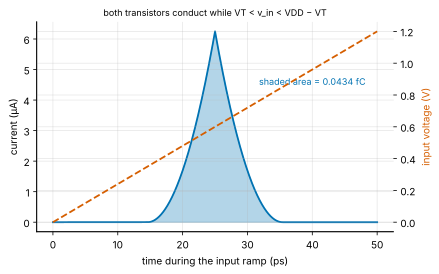
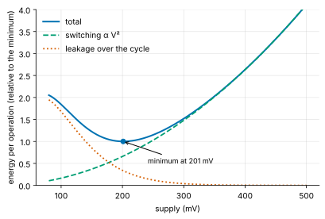

<!-- status: verified -->
# 19-06 · Power and Low-Power Design

| | |
|---|---|
| **Course** | [19 · Digital VLSI Design](../README.md) |
| **University equivalent** | The power chapter of a senior digital-IC course: switching, short-circuit and leakage power, voltage and frequency scaling, parallelism, clock and power gating, multiple thresholds and the minimum-energy point (Rabaey, Chandrakasan & Nikolić, *Digital Integrated Circuits*, §5.5 and ch. 11; Weste & Harris, *CMOS VLSI Design*, ch. 5) |
| **Prerequisites** | [19-01](19-01-cmos-inverter-static.md) (subthreshold operation and the supply floor), [19-02](19-02-cmos-inverter-dynamic.md) (delay against supply and the energy–delay product), [09-09](../../09-semiconductor-devices/chapters/09-09-long-channel-mosfet.md) (subthreshold current), [18-09](../../18-embedded-systems-and-microcontrollers/chapters/18-09-ultra-low-power-design.md) (power modes at the system level) |
| **Estimated study hours** | 9 |
| **Last verified** | 2026-11-21 |

**Learning objectives.** After this chapter you can:

1. Derive the switching energy $CV_{DD}^2$ per cycle and the dynamic power $\alpha CV_{DD}^2f$, and explain where the energy goes.
2. Derive the short-circuit power of a ramp-driven inverter and judge when it matters.
3. Compute subthreshold leakage and its sensitivity to threshold, and derive the stack effect with drain-induced barrier lowering.
4. Use voltage scaling, parallelism, clock gating, power gating and multiple thresholds to cut power, and compute their savings and costs.
5. Derive the minimum-energy supply of subthreshold logic and explain why it lies a few hundred millivolts above zero.

## 1. Big picture

For decades, every new process node made transistors smaller, faster and lower in energy all at once, because supply voltages fell with dimensions. That free lunch ended when supplies stopped falling: the subthreshold slope cannot beat its thermal limit (19-01), so lower thresholds bring exponentially more leakage, and the roadmap now holds logic supplies near 0.6–0.7 V (§9). Since then, power, not transistor count or speed, has been the binding constraint on most chips: a phone processor is limited by battery and skin temperature, a server processor or AI accelerator by its package's heat removal and the data center's power budget. Every design decision is now also a power decision.

- **Dynamic power**, $\alpha CV_{DD}^2f$, dominates active operation; it is attacked through $V_{DD}$ (quadratically), $\alpha$ (clock gating), $C$ (smaller wires and gates) and $f$.
- **Leakage** flows whether or not anything switches; it dominates standby and grows exponentially as thresholds fall or temperature rises.
- **Voltage–frequency scaling** trades speed for energy dynamically; every modern processor ships with a table of operating points.
- **Power gating and multiple thresholds** cut leakage by switching off idle blocks and by spending low-threshold (leaky, fast) transistors only where timing needs them.

## 2. Intuition first

Each time a gate's output rises, it fills its load capacitance from the supply like a bucket from a tap; each time the output falls, it pours the bucket onto the floor. The water poured away per fill-and-empty is the bucket's volume times its height: energy $CV_{DD}^2$. That energy is spent regardless of how fast or slowly the bucket fills; only the number of fills per second (the activity times the clock) and the bucket's size and height matter. Lowering the height (the supply) is the most powerful lever, because it reduces both the charge and the voltage it falls through.

Leakage is a dripping tap: even with nothing happening, every transistor that should be off lets a little current through, and a billion of them add up. The drip is exponentially sensitive to how tightly the tap is closed (the threshold voltage) and to temperature.

The analogy misleads on one point: in the water picture, filling slowly wastes nothing extra. In a circuit, the energy dissipated while charging a capacitor through a resistor is $\tfrac12CV^2$ whatever the resistance, so slow charging does not help either; only lowering $V$ does (or charging in small steps, adiabatic charging, which is rarely practical).

## 3. Theory

### 3.1 Dynamic (switching) power

Consider an inverter driving a load $C_L$ from 0 to $V_{DD}$. The supply delivers current $i(t) = C_L\,dv_{out}/dt$ through the PMOS, so the energy it supplies is

$$
E_{supply} = \int_0^\infty V_{DD}\,i(t)\,dt = V_{DD}C_L\int_0^{V_{DD}}dv_{out} = C_LV_{DD}^2 .
$$

The capacitor ends up storing $\tfrac12C_LV_{DD}^2$, so the other half was dissipated in the PMOS. When the output falls, the NMOS dissipates the stored half; the supply delivers nothing. Each full cycle (one rise, one fall) therefore costs $C_LV_{DD}^2$, independent of the transistors' resistance or the transition speed. If a node makes a 0→1 transition with probability α each clock cycle (the **activity factor**), its average power is

$$
P_{dyn} = \alpha\,C\,V_{DD}^2\,f .
$$

For a whole chip, $C$ is the total switched capacitance (gates, diffusion and wires, which 19-05 showed can dominate) and α an average. A clock node has α = 1 (it rises every cycle); typical logic has α of a few percent to about 0.1–0.2, and data-dependent nodes can glitch, making several transitions per cycle.

### 3.2 Short-circuit power

While an input ramps between $V_{TN}$ and $V_{DD} - \lvert V_{TP}\rvert$, both transistors conduct and current flows straight from the supply to ground. For an **unloaded** symmetric inverter ($k_n = k_p = \beta$, $V_{TN} = \lvert V_{TP}\rvert = V_T$) driven by a linear ramp from 0 to $V_{DD}$ in time $\tau$, the output follows the static transfer curve. Below the switching threshold $V_{DD}/2$ the NMOS is saturated and limits the current, $\tfrac12\beta(v_{in} - V_T)^2$; above it the PMOS does, symmetrically. With $v_{in} = V_{DD}t/\tau$, the charge drawn during the first half is

$$
Q_{1/2} = \int \tfrac12\beta(v_{in} - V_T)^2\,dt = \frac{\beta\tau}{2V_{DD}}\int_{V_T}^{V_{DD}/2}(v - V_T)^2\,dv = \frac{\beta\tau}{6V_{DD}}\left(\frac{V_{DD}}2 - V_T\right)^3,
$$

and the second half contributes the same. So each transition draws $Q_{sc} = \beta\tau(V_{DD} - 2V_T)^3/(24V_{DD})$. With two transitions per period $T$, the average power is

$$
P_{sc} = \frac{2V_{DD}Q_{sc}}{T} = \frac{\beta}{12}\left(V_{DD} - 2V_T\right)^3\frac{\tau}{T},
$$

**Veendrick's formula** (1984). It is an upper bound: a loaded output moves more slowly, so the transistor that is turning off sees a smaller drain-source voltage and the overlap current is smaller. Two consequences: short-circuit power is small when input edges are fast relative to output edges (designers keep them comparable, which limits it to a few percent of dynamic power), and it vanishes when $V_{DD} < 2V_T$, because then the two transistors are never on together. The lab's ngspice simulation reproduces the formula exactly for the unloaded case.

*Figure 1. Short-circuit current during one input ramp (Example 2's inverter). The current is the saturation current of whichever transistor is turning off, peaking at the switching threshold.*

### 3.3 Leakage

An "off" transistor still conducts. The main components are:

- **Subthreshold current** (09-09): $I = I_0\,e^{(V_{GS} - V_T + \eta V_{DS})/(nV_{th})}\left(1 - e^{-V_{DS}/V_{th}}\right)$, where $V_{th} = kT/q$, $n$ is the slope factor and η the **drain-induced barrier lowering** (DIBL) coefficient: a high drain voltage lowers the source barrier in a short channel, reducing the effective threshold. The **subthreshold slope** $S = nV_{th}\ln 10$ is the gate-voltage change per decade of current, about 60 mV/decade × $n$ at room temperature.
- **Gate leakage** through thin gate dielectrics, controlled since the 45 nm generation by high-$k$ dielectrics.
- **Junction and gate-induced drain leakage**, smaller in most logic but important in memories and at high temperature.

The exponential is the whole story of leakage scaling. Lowering the threshold by $\Delta V_T$ multiplies subthreshold leakage by $10^{\Delta V_T/S}$; at $S$ = 90 mV/decade, 100 mV costs a factor of 12.9 (Example 3). Temperature raises $V_{th}$ (widening the slope) and lowers $V_T$, so leakage rises steeply with temperature (Problem 19-06.5). Static power is $P_{leak} = V_{DD}I_{leak}$.

**The stack effect.** Two off transistors in series leak far less than one. The node between them floats up to a small voltage $V_x$ at which the two currents balance. The upper transistor then has a negative gate-source voltage ($-V_x$) and a reduced drain-source voltage, both of which cut its current; the lower one has only $V_x$ across it, so DIBL hardly helps it. Solving the balance numerically (Example 4) shows a reduction of about 16 times with typical DIBL, but less than 2 times without DIBL: the stack effect is mostly a DIBL effect. Libraries exploit it with "stacked" low-leakage cells, and designers with input-vector control in standby.

### 3.4 Voltage scaling and parallelism

Because dynamic energy per operation is $CV_{DD}^2$, lowering the supply is the strongest lever, at the price of speed: with the alpha-power law (19-02), delay $\propto V_{DD}/(V_{DD} - V_T)^\alpha$.

- **Dynamic voltage and frequency scaling** (DVFS) runs at the lowest voltage that meets the current workload's frequency. Halving the frequency of Example 5's design allows the supply to fall from 1.0 V to 0.611 V, cutting power to 0.187 of its original value (5.4 times less) for half the throughput, and energy per operation to 0.373 of its value.
- **Parallelism** keeps the throughput: two copies of the logic, each at half the frequency, can run at the same lower voltage. Total power is $(2C)(V^2)(f/2)$, the same $CV^2f$ per copy-pair, so the saving is $(V/V_0)^2$ less any overhead (multiplexers and wiring). With 15% capacitance overhead, Example 5's design uses 0.43 of the power at the same throughput, at roughly twice the area. Pipelining achieves the same effect with less area by shortening each stage's logic.

These are the arguments that made multicore processors and wide, slower AI accelerators energy-efficient: more silicon running slower beats less silicon running faster, as long as the workload parallelizes.

### 3.5 Clock gating, power gating and multiple thresholds

- **Clock gating** stops the clock to registers whose values will not change, setting α = 0 for the clock and for the logic behind them. Since the clock network alone switches every cycle, gating it is often the single largest dynamic-power saving, and synthesis tools insert it automatically.
- **Power gating** disconnects an idle block from its supply through a high-threshold **sleep transistor** (header PMOS or footer NMOS), cutting its leakage by orders of magnitude. It costs the sleep transistor's area and on-resistance (a small IR drop in operation), state loss (registers must be saved or use retention flip-flops), wake-up latency and the energy to recharge the block's internal capacitance. It pays only if the block sleeps longer than the **break-even time** $E_{wake}/P_{leak,saved}$ (the same idea as 18-09's power modes).
- **Multiple thresholds** (multi-$V_T$): libraries offer each cell with several thresholds (19-09). Synthesis uses fast, leaky low-$V_T$ cells only on timing-critical paths and slow, frugal high-$V_T$ cells everywhere else, typically leaving most cells high-$V_T$.
- **Body biasing** shifts thresholds after manufacture: reverse bias raises $V_T$ to cut leakage in standby, forward bias lowers it for speed. It is most effective in fully depleted SOI processes.
- **Voltage islands** give each block its own supply, with level shifters at the boundaries.

### 3.6 The minimum-energy point

How low should the supply go if energy per operation is all that matters (sensors, wearables, 19-01's subthreshold logic)? Below threshold, both currents are exponential: on-current $\propto e^{(V_{DD} - V_T)/(nV_{th})}$ and off-current $\propto e^{-V_T/(nV_{th})}$, so their ratio is $I_{off}/I_{on} = e^{-V_{DD}/(nV_{th})}$. A circuit of $N$ gates with switched capacitance $C$ per gate, activity α and logic depth $L_d$ has a cycle time proportional to $L_dCV_{DD}/I_{on}$, during which all $N$ gates leak. Per operation, normalized to $NC$:

$$
\frac{E}{NC} = \underbrace{\alpha V_{DD}^2}_{\text{switching}} + \underbrace{V_{DD}\,I_{off}\,\frac{L_dV_{DD}}{I_{on}}}_{\text{leakage}} = V_{DD}^2\left[\alpha + L_d\,e^{-V_{DD}/(nV_{th})}\right] .
$$

As $V_{DD}$ falls, the switching term shrinks quadratically, but the leakage term's exponential grows, because each operation takes longer and every gate leaks throughout. Setting $dE/dV_{DD} = 0$ with $x = V_{DD}/(nV_{th})$:

$$
2\alpha + L_de^{-x}(2 - x) = 0 \quad\Longrightarrow\quad L_de^{-x}(x - 2) = 2\alpha .
$$

The left side rises from zero at $x$ = 2 to a peak at $x$ = 3 and then decays; the larger root is the **minimum-energy point** (the smaller one is a local maximum below which the model, and robust logic, no longer apply). At the optimum the leakage share of the energy is exactly $2/x$. For α = 0.1, $L_d$ = 20 and $n$ = 1.3, $x$ = 5.99 and $V_{min}$ = **201 mV**, with leakage a third of the energy (Example 6). Lower activity or deeper logic raises $V_{min}$, because leakage then weighs more. Minimum-energy points found this way lie at a few hundred millivolts, which is why the near-threshold and subthreshold designs of 19-01 §9 operate there.

*Figure 2. Energy per operation for Example 6's circuit. Above the minimum, switching energy dominates; below it, leakage over the lengthening cycle takes over.*

> **Going deeper — what the minimum-energy model leaves out.** It assumes the whole circuit operates in subthreshold and that variation is absent. In practice the minimum is set with margins for variation (which acts exponentially in subthreshold), for SRAM (whose minimum operating voltage is usually higher than logic's, 19-08) and for the speed the application needs. Near-threshold operation, a little above the minimum-energy point, gives up a little energy for a large gain in speed and robustness.

## 4. Worked examples

### Example 19-06.1 · Dynamic power (tier A)

**Setup.** A block switches 1 nF of total capacitance with an activity factor of 0.1 at 2 GHz and 0.8 V. (a) Find its dynamic power. (b) How much energy does one full charge–discharge of the whole 1 nF take, and how much of it is dissipated while charging?

**Solution.** (a) $P = 0.1 \times 1\ \text{nF} \times 0.64\ \text{V}^2 \times 2\ \text{GHz}$ = **0.128** W.

(b) $CV^2$ = **0.64** nJ per full cycle, of which **0.32** nJ is dissipated in the pull-up while charging and the rest when discharging.

**Units check.** F·V²·Hz = J/s = W.

**Sanity check.** Lowering the supply to 0.7 V alone would save 23%, with no change in capacitance or activity.

### Example 19-06.2 · Short-circuit power (tier B)

**Setup.** A symmetric inverter ($\beta$ = 200 µA/V², $V_T$ = 0.35 V, $V_{DD}$ = 1.2 V) sees input ramps of 50 ps, twice per 1 ns period. (a) Find its short-circuit power and charge per transition (unloaded). (b) Compare with the dynamic power of the same inverter driving 10 fF with α = 0.5.

**Solution.** (a) $P_{sc} = (200\ \mu/12)(0.5)^3 \times 50/1000$ = **0.104** µW; per transition $Q = \beta\tau(0.5)^3/(24 \times 1.2)$ = **0.0434** fC.

(b) $P_{dyn} = 0.5 \times 10\ \text{fF} \times 1.44 \times 1\ \text{GHz}$ = **7.2** µW. The short-circuit power is **1.4** % of it, and less when loaded.

**Units check.** (A/V²)·V³ = W.

**Sanity check.** At $V_{DD}$ = 0.7 V = $2V_T$, $P_{sc}$ = 0: near-threshold circuits have no short-circuit power.

### Example 19-06.3 · Leakage and threshold (tier B)

**Setup.** A process has a subthreshold slope of 90 mV/decade and off-current of 10 nA per µm of width (assumed for this example). (a) By what factor does leakage grow if the threshold is lowered by 100 mV? (b) A chip has $10^9$ transistors averaging 0.5 µm of width, all leaking at the nominal rate. Find its leakage current and power at 0.8 V.

**Solution.** (a) $10^{100/90}$ = **12.9** times.

(b) $10^9 \times 0.5\ \mu\text{m} \times 10\ \text{nA/µm}$ = **5.0** A, and **4.0** W. Half the transistors are typically off in a direction that leaks, and stacks leak less, so real figures are lower, but the order of magnitude explains why leakage is a design constraint.

**Units check.** µm × nA/µm = nA.

**Sanity check.** With low-threshold cells everywhere (a), the same chip would leak about 52 W: multi-$V_T$ design is not optional.

### Example 19-06.4 · The stack effect (tier B)

**Setup.** NMOS with $n$ = 1.3, DIBL coefficient η = 0.1 and $V_{DD}$ = 1.0 V, at 300 K. Compare the leakage of one off transistor with two in series. Repeat without DIBL.

**Solution.** Balancing the two currents numerically gives an intermediate node at **84.4** mV and a leakage **15.9** times smaller than one transistor's. Without DIBL ($\eta$ = 0), the node sits at **20.4** mV and the reduction is only **1.83** times.

**Units check.** Exponent arguments are voltages over $nV_{th}$, dimensionless.

**Sanity check.** With DIBL, the single transistor benefits from the full 1.0 V of drain bias ($e^{0.1 \times 1.0/(1.3 \times 0.02585)}$ = **19.6** times), while the lower stacked device sees only 84 mV; most of the stack's advantage is the lost DIBL.

### Example 19-06.5 · DVFS and parallelism (tier B)

**Setup.** A design runs at 1.0 V with $V_T$ = 0.35 V and α = 1.3 in the alpha-power law. (a) If the workload needs only half the frequency, how low can the supply go, and what are the new power and energy per operation? (b) Instead, two copies run in parallel at half the frequency each, with 15% extra capacitance for multiplexing; what power is needed for the original throughput?

**Solution.** (a) Solving $V/(V - 0.35)^{1.3} = 2 \times 1/(0.65)^{1.3}$: $V$ = **0.611** V. Power: $(0.611)^2 \times 0.5$ = **0.187** of the original (5.4 times less); energy per operation $(0.611)^2$ = **0.373**.

(b) $2 \times 1.15 \times (0.611)^2 \times 0.5$ = **0.429** of the original power, at the same throughput.

**Units check.** Ratios.

**Sanity check.** Without the overhead, (b) would give 0.373, the same as the energy ratio in (a), as it must: the same operations at the same voltage.

### Example 19-06.6 · The minimum-energy supply (tier C)

**Setup.** A subthreshold circuit has α = 0.1, logic depth $L_d$ = 20 and $n$ = 1.3, at 300 K. (a) Find its minimum-energy supply and the leakage share there. (b) How much more energy per operation does it use at 0.3 V and at 0.4 V? (c) What happens to $V_{min}$ if α halves, or if $L_d$ rises to 50?

**Solution.** (a) Solving $20e^{-x}(x - 2)$ = 0.2: $x$ = **5.99**, so $V_{min} = 5.99 \times 1.3 \times 25.85$ mV = **201** mV, with leakage $2/x$ = **33** % of the energy.

(b) **1.52** times at 0.3 V and **2.63** times at 0.4 V.

(c) α = 0.05: **231** mV; $L_d$ = 50: **241** mV. Leakage weighs more, so the optimum moves up.

**Units check.** $nV_{th}$ in volts.

**Sanity check.** At 0.4 V leakage is negligible, and the switching energy is $(0.4/0.201)^2$ = **3.95** times that at the minimum; but at the minimum, leakage adds half again to the switching energy (a third of the total), so the ratio is $3.95/1.5$ = 2.63.

<!-- answer-key -->

| ID | Quantity | Value | Unit |
|---|---|---|---|
| Ex 19-06.1a | dynamic power | 0.128 | W |
| Ex 19-06.1b | energy per full cycle | 0.64 | nJ |
| Ex 19-06.1c | dissipated while charging | 0.32 | nJ |
| Ex 19-06.1d | saving at 0.7 V | 23 | % |
| Ex 19-06.2a | short-circuit power | 0.104 | µW |
| Ex 19-06.2b | short-circuit charge per transition | 0.0434 | fC |
| Ex 19-06.2c | dynamic power | 7.2 | µW |
| Ex 19-06.2d | short-circuit share | 1.4 | % |
| Ex 19-06.3a | leakage factor for 100 mV | 12.9 | — |
| Ex 19-06.3b | chip leakage current | 5.0 | A |
| Ex 19-06.3c | chip leakage power | 4.0 | W |
| Ex 19-06.3d | with low threshold everywhere | 52 | W |
| Ex 19-06.4a | stack node voltage | 84.4 | mV |
| Ex 19-06.4b | stack leakage reduction | 15.9 | — |
| Ex 19-06.4c | stack node without DIBL | 20.4 | mV |
| Ex 19-06.4d | reduction without DIBL | 1.83 | — |
| Ex 19-06.4e | DIBL boost of the single device | 19.6 | — |
| Ex 19-06.5a | supply for half frequency | 0.611 | V |
| Ex 19-06.5b | power ratio | 0.187 | — |
| Ex 19-06.5c | power reduction factor | 5.4 | — |
| Ex 19-06.5d | energy per operation ratio | 0.373 | — |
| Ex 19-06.5e | parallel power ratio | 0.429 | — |
| Ex 19-06.6a | normalized optimum x | 5.99 | — |
| Ex 19-06.6b | minimum-energy supply | 201 | mV |
| Ex 19-06.6c | leakage share at the optimum | 33 | % |
| Ex 19-06.6d | energy at 0.3 V over minimum | 1.52 | — |
| Ex 19-06.6e | energy at 0.4 V over minimum | 2.63 | — |
| Ex 19-06.6f | minimum with alpha = 0.05 | 231 | mV |
| Ex 19-06.6g | minimum with depth 50 | 241 | mV |
| Ex 19-06.6h | switching-energy ratio, 0.4 V over minimum | 3.95 | — |
| Txt 19-06.a | SKY130 hd over hdll leakage | 10.75 | — |
| Txt 19-06.b | short-circuit current starts | 14.6 | ps |
| Txt 19-06.c | peak short-circuit current | 6.25 | µA |
| Txt 19-06.d | short-circuit current ends | 35.4 | ps |

## 5. Simulate it

The lab ([labs/19-06-lab](../labs/19-06-lab/README.md)) has two parts:

- **ngspice** ([power.cir](../labs/19-06-lab/power.cir)): the charge an inverter draws to charge 10 fF ($CV_{DD}$), and the short-circuit charge of an unloaded inverter driven by 50 ps ramps, against Veendrick's formula.
- **Python** (`power.py` and the notebook): dynamic and short-circuit power, leakage against threshold and temperature, the stack effect with and without DIBL, DVFS and parallelism, the minimum-energy point, and power-gating break-even.

**Predict, then run.**

1. Predict the charge drawn from the supply while the inverter charges 10 fF; run `ngspice -b power.cir`.
2. Predict the short-circuit charge per transition for 50 ps ramps, and for 200 ps; check with `short_circuit_charge_numeric`.
3. Predict the stack-effect reduction for η = 0.05 and 0.2; run Part 3.
4. Predict the supply for one-third of the frequency in Example 5's design; run Part 4.
5. Plot energy per operation against supply for Example 6, and predict where the minimum moves as α changes (Part 5).

## 6. Engineering tradeoffs

| Knob | Improves | Costs | Typical decision owner |
|---|---|---|---|
| Lower $V_{DD}$ (DVFS) | Dynamic energy (quadratically) | Speed; leakage energy per operation at very low $V_{DD}$ | Power architect, OS power manager |
| Parallelism or pipelining | Energy at a given throughput | Area, latency, design complexity | Microarchitect |
| Clock gating | Clock and logic dynamic power | Enable logic, timing on gated clocks | RTL designer, synthesis |
| Power gating | Leakage in idle blocks | Sleep-transistor area and IR drop, wake latency and energy, state retention | SoC power architect |
| High-$V_T$ cells | Leakage (exponentially) | Speed | Synthesis, library |
| Low-$V_T$ cells | Speed on critical paths | Leakage | Synthesis, timing closure |
| Body bias | Leakage or speed after manufacture | Bias generators, process support | Process and power architect |

## 7. Numbers to know

| Quantity | Value | Notes |
|---|---|---|
| Energy per full switching cycle | $CV_{DD}^2$ | Half dissipated charging, half discharging |
| Dynamic power | $\alpha CV_{DD}^2f$ | α = 1 for clocks |
| Short-circuit power | $(\beta/12)(V_{DD} - 2V_T)^3\tau/T$ | Upper bound; zero for $V_{DD} < 2V_T$ |
| Subthreshold slope | $nV_{th}\ln 10$ ≈ 60 $n$ mV/decade at 300 K | |
| Leakage vs threshold | ×10 per $S$ of threshold lowering | |
| Stack effect | ~10× or more, mostly from DIBL | |
| Minimum-energy point | $L_de^{-x}(x-2) = 2\alpha$, $x = V/(nV_{th})$ | Typically 0.2–0.4 V |
| Power-gating break-even | $E_{wake}/P_{leak,saved}$ | |

## 8. Common mistakes

- **Thinking slow charging saves energy.** Charging a capacitor to $V$ through any resistance dissipates $\tfrac12CV^2$; only the voltage matters.
- **Using the full $C$ of a chip with α = 1.** Only clocks switch every cycle; most logic has α of a few percent.
- **Ignoring wires.** Wire capacitance often dominates the switched capacitance (19-05).
- **Treating leakage as constant.** It is exponential in threshold and strongly temperature-dependent, and the worst case is hot and fast.
- **Assuming lower voltage always saves energy.** Below the minimum-energy point, leakage over the longer cycle time dominates.
- **Power-gating short idle periods.** Below the break-even time, the wake-up energy exceeds the leakage saved.

## 9. Practitioner lens

### State of the art (as of Nov 2026)

- **Supplies have stalled [Industry estimate].** The IEEE IRDS 2024 More Moore roadmap holds logic supplies at 0.70 V (2024), 0.65 V (2025) and 0.60 V from 2027 through 2039, giving as the reason "Power scaling — no solutions left to reduce the supply voltage because of lack of steep-subthreshold devices"; it notes that supplies were even raised to 0.75 V in 2021 because of "higher than anticipated leakage of FinFET transistors" ([R-314]). With the quadratic lever of §3.4 mostly spent, power savings now come from architecture, gating and specialization.
- **Leakage is a library choice [Established].** SkyWater's open SKY130 process offers a high-density library (`hd`) with leakage of "0.86 nA / kGate" at 1.8 V and 25 °C and a low-leakage variant (`hdll`) at 0.08 nA/kGate, described as having "5-10X lower leakage power" ([R-314]): a factor of **10.75** between two libraries of the same process, bought with speed.
- **Near-threshold operation in silicon [Established].** Intel's Claremont research processor (ISSCC 2012) ran "from 280mV @3MHz to 1.2V @915MHz" with "4.7x better energy efficiency" in its near-threshold mode, and Ambiq's SPOT microcontrollers operate transistors "at sub-threshold voltages (less than 0.5V)" ([R-314]), consistent with §3.6's minimum-energy range.
- **Power reshaped circuit styles [Established].** IBM's POWER6 (2008) was designed "without the use of power-hungry dynamic circuits outside of register files and arrays", and Harris's textbook slides describe domino as "Largely displaced by static CMOS now that power is the limiter" ([R-315], 19-03).
- **Power delivery is part of the power problem [Established].** Intel's backside power test chip reported more than 5% frequency benefit "due to reduced IR drop" ([R-315], 19-05): supply droop costs voltage margin, and voltage margin costs power.

### Why it matters commercially

- **Power sets performance.** Processors are sold by performance per watt because power, not area, limits how much of the silicon can be active; a design with better energy per operation can be clocked higher inside the same thermal envelope.
- **Leakage sets battery life in standby.** Wearables and IoT devices spend most of their life idle; their leakage (and the library and process choices behind it) is a product specification (18-09).
- **Data-center operating cost is energy.** For AI accelerators and servers, energy per operation drives both the electricity bill and the cooling and power-delivery capital, often a larger lifetime cost than the chips.

### Marketing vs Reality

- **"X% lower power."** Ask: at what frequency, voltage, temperature and workload; dynamic or leakage; and compared with what. Power at a fixed frequency and energy per task can move in opposite directions.
- **"Near-threshold" or "subthreshold" claims.** Ask what runs at that voltage (logic, SRAM, I/O?), at what speed and temperature, and with what yield (19-01, 19-08).
- **TDP.** Thermal design power is a cooling specification, not a measurement of typical or peak electrical power.

### Questions for engineering leaders

1. *"What fraction of your power is dynamic, leakage and clock, in active use and in standby?"* Strong: a breakdown by block from measured silicon. Evasive: one total number.
2. *"How many voltage–frequency operating points do you use, and how fast can you switch between them?"* Strong: specific points, transition times and the governor policy. Evasive: "we support DVFS".
3. *"Which blocks are power-gated, and what are their wake-up times and break-even times?"* Strong: a table. Evasive: "everything is power-gated".
4. *"What is your leakage at the hot, fast corner, and how does it constrain your thermal design?"* Strong: numbers and the guard-band strategy. Evasive: typical-corner numbers only.

## 10. Concept check

**Q1.** Why does charging a capacitor dissipate $\tfrac12CV^2$ regardless of the resistance?

Answer

The supply delivers charge $CV$ at voltage $V$, energy $CV^2$; the capacitor stores $\tfrac12CV^2$; the rest is dissipated in the resistance. A smaller resistance gives a larger current for a shorter time, with the same total.

**Q2.** Why does short-circuit power vanish for $V_{DD} < 2V_T$?

Answer

The NMOS conducts only for $v_{in} > V_T$ and the PMOS only for $v_{in} < V_{DD} - V_T$; these ranges do not overlap when $V_{DD} < 2V_T$.

**Q3.** By what factor does leakage grow if the threshold falls by one subthreshold slope?

Answer

Ten times: the subthreshold slope is the gate-voltage change per decade of current.

**Q4.** Why do two stacked off transistors leak much less than one?

Answer

The middle node rises slightly, giving the upper transistor a negative gate-source voltage and less drain bias, and leaving the lower one almost no drain bias, so DIBL no longer lowers its barrier. With typical DIBL the reduction is an order of magnitude.

**Q5.** Why can two slow copies of a block use less power than one fast one at the same throughput?

Answer

Each copy needs only half the speed, so both can run at a lower supply; power at the same throughput scales as $V^2$, and the voltage saving outweighs the doubled capacitance's cost (which is offset by the halved frequency).

**Q6.** Why does energy per operation rise again below the minimum-energy point?

Answer

On-current falls exponentially, so each operation takes exponentially longer while every gate keeps leaking; leakage energy per operation grows faster than switching energy falls.

Problems: [19-06 problem set](../problems/19-06-problems.md).

## 11. Key terms

[Dynamic power](../../../reference/glossary.md#dynamic-power) · [Activity factor](../../../reference/glossary.md#activity-factor) · [Short-circuit power](../../../reference/glossary.md#short-circuit-power) · [Static power](../../../reference/glossary.md#static-power) · [Drain-induced barrier lowering](../../../reference/glossary.md#drain-induced-barrier-lowering) · [Stack effect](../../../reference/glossary.md#stack-effect) · [Clock gating](../../../reference/glossary.md#clock-gating) · [Power gating](../../../reference/glossary.md#power-gating) · [Minimum-energy point](../../../reference/glossary.md#minimum-energy-point)

## 12. Connections

- **Builds on:** [19-01](19-01-cmos-inverter-static.md) (subthreshold inverters), [19-02](19-02-cmos-inverter-dynamic.md) (EDP and supply scaling), [19-05](19-05-interconnect.md) (wire capacitance), [09-09](../../09-semiconductor-devices/chapters/09-09-long-channel-mosfet.md) (subthreshold current), [18-09](../../18-embedded-systems-and-microcontrollers/chapters/18-09-ultra-low-power-design.md) (system-level power modes).
- **Next:** [19-07](19-07-sequential-timing-and-clocking.md) covers flip-flops and clock distribution, the largest single consumer of dynamic power.
- **Used later:** [19-08](19-08-sram-design.md) (SRAM leakage and minimum voltage), [19-10](19-10-synthesis-and-sta.md) (power analysis in the ASIC flow).

## 13. Further study

- Rabaey, Chandrakasan & Nikolić, *Digital Integrated Circuits*, 2nd ed., §5.5 (power dissipation of the inverter) and ch. 11 (low-power design).
- Weste & Harris, *CMOS VLSI Design*, 4th ed., ch. 5 (power).
- A. Chandrakasan, S. Sheng and R. Brodersen, "Low-power CMOS digital design", *IEEE J. Solid-State Circuits*, 1992: the voltage-scaling and parallelism argument.
- H. J. M. Veendrick, "Short-circuit dissipation of static CMOS circuitry and its impact on the design of buffer circuits", *IEEE J. Solid-State Circuits*, 1984.

## 14. Sources

1. Rabaey, Chandrakasan & Nikolić, *Digital Integrated Circuits*, 2nd ed., Prentice Hall, 2003, §5.5 and ch. 11.
2. Weste & Harris, *CMOS VLSI Design*, 4th ed., Addison-Wesley, 2011, ch. 5.
3. H. J. M. Veendrick, "Short-circuit dissipation of static CMOS circuitry and its impact on the design of buffer circuits", *IEEE J. Solid-State Circuits*, vol. 19, no. 4, 1984.
4. A. P. Chandrakasan, S. Sheng and R. W. Brodersen, "Low-power CMOS digital design", *IEEE J. Solid-State Circuits*, vol. 27, no. 4, 1992.
5. [R-314] IEEE IRDS 2024 More Moore tables, report and Executive Summary; SkyWater SKY130 library documentation; Intel Labs ISSCC 2012 press overview (Claremont); Ambiq news releases.
6. [R-315] Stolt et al., POWER6 (*JSSC*, 2008); Harris, *CMOS VLSI Design* lecture slides; Intel PowerVia (VLSI Symposium 2023).
