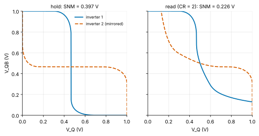

<!-- status: verified -->
# 19-08 · SRAM Design

| | |
|---|---|
| **Course** | [19 · Digital VLSI Design](../README.md) |
| **University equivalent** | The SRAM chapter of a senior digital-IC course: the 6T cell, read and write stability and cell sizing, static noise margin, bitline sensing and sense amplifiers, array organization, variation, yield and redundancy, assist techniques and register files (Weste & Harris, *CMOS VLSI Design*, ch. 12; Rabaey, Chandrakasan & Nikolić, *Digital Integrated Circuits*, ch. 12) |
| **Prerequisites** | [19-01](19-01-cmos-inverter-static.md) (transfer curves and noise margins), [19-03](19-03-logic-families.md) (ratioed logic and precharged nodes), [19-07](19-07-sequential-timing-and-clocking.md) (cross-coupled latches and regeneration), [08-11](../../08-digital-logic-design/chapters/08-11-memories-and-programmable-logic.md) (memory organization), [03-02](../../03-probability-statistics-and-random-variables/chapters/03-02-random-variables-and-distributions.md) (the normal distribution) |
| **Estimated study hours** | 8 |
| **Last verified** | 2026-11-21 |

**Learning objectives.** After this chapter you can:

1. Explain how a 6T cell stores, reads and writes a bit, and derive the read-disturb and write voltages that constrain its transistor ratios.
2. Compute a cell's static noise margin from its butterfly curves, in hold and in read.
3. Estimate bitline development and sense-amplifier times, and explain why small-swing sensing is used.
4. Compute array area and density, and the yield of a large array as a function of the cell failure rate and redundancy.
5. Explain why SRAM limits a chip's minimum supply, and how assist circuits, separate rails and 8T register-file cells respond.

## 1. Big picture

On-chip memory is where most of a processor's transistors live: caches, register files, buffers and the weight and activation memories of AI accelerators are built from static random-access memory, and SRAM often takes a large share of a die's area. Its basic cell, six transistors forming two cross-coupled inverters and two access switches, is the densest structure a logic process can build, drawn with special rules at the edge of manufacturability. Because there are billions of identical cells, the rare one in a billion that misbehaves sets the design, and SRAM is usually what limits how low a chip's supply can go.

- **Density.** A cell's area, multiplied by billions, decides a chip's cost; bitcell area is one of the headline numbers of every new process node (§9).
- **Stability.** The same transistors must hold the bit during a read but let it be overwritten during a write; the sizing ratios that satisfy both are the core of cell design.
- **Speed.** Reads are made fast by sensing a small voltage difference on long, heavily loaded bitlines with a regenerative latch (19-07).
- **Yield and voltage.** Random variation makes a few cells fail first as the supply drops; redundancy, error correction, assist circuits and separate SRAM supplies are the responses.

## 2. Intuition first

Picture two people, each pointing at the other and shouting "you're wrong!": that is two inverters in a loop, and it has two stable states (one says 1, the other 0) that reinforce themselves. To read the state you open two doors (the access transistors) onto long corridors (the bitlines) that have been filled to the same level (precharged high); the side storing 0 slowly drains its corridor, and a sensitive listener at the end (the sense amplifier) notices which corridor is lower long before it is empty.

The difficulty is that opening the door also lets the corridor push back. During a read, the full bitline pushes up on the node storing 0; if the cell's own pull-down is too weak, the node rises far enough to flip the cell, a **read upset**. During a write, the opposite is needed: the bitline driven low must overpower the cell's pull-up and flip it. So the pull-down must be strong relative to the access transistor (for reads), and the pull-up weak relative to it (for writes). The analogy fails in one way that matters: the "voices" are not equal across billions of cells, because every transistor's threshold varies randomly, so the ratios must hold with margin in the worst cell, not the typical one.

```text
            WL                                   WL
            |                                    |
   BL ----[ A ]----+--------+      +--------+----[ A ]---- BLB
                   |        |      |        |
                 Q +--|>o---+------+--o<|---+ QB
                   |  (inverter)  (inverter)|
                   +------------------------+
   6T cell: two cross-coupled inverters (pull-ups P, pull-downs N) and two access transistors A.
```

*Figure 1. The 6T SRAM cell. The wordline WL turns on both access transistors; the bitlines BL and BLB carry the stored value and its complement.*

## 3. Theory

### 3.1 The 6T cell and its three operations

Each inverter has a pull-down NMOS (N) and a pull-up PMOS (P); each storage node connects through an NMOS access transistor (A) to a bitline when the wordline is high.

- **Hold:** the wordline is low, the access transistors are off, and the inverters hold each other; the only current is leakage.
- **Read:** both bitlines are precharged to $V_{DD}$ and the wordline rises. The node storing 0 (say Q) discharges BL through A and N in series, while BLB stays high. A sense amplifier detects the difference.
- **Write:** one bitline is driven low (BL to write a 0 into Q), the other held high, and the wordline rises. The low bitline must pull the node storing 1 down far enough for the loop to flip.

### 3.2 Read stability: the cell ratio

During a read, node Q (storing 0) is pulled up by the access transistor A, whose drain is the bitline at $V_{DD}$ and whose gate is at $V_{DD}$, and pulled down by N, whose gate is the other node QB at $V_{DD}$. The node settles at a small voltage $\Delta V$ where the currents balance. A has $V_{GS} = V_{DD} - \Delta V$ and $V_{DS} = V_{DD} - \Delta V > V_{GS} - V_{TH}$, so it is saturated; N has $V_{GS} = V_{DD}$ and a small $V_{DS} = \Delta V$, so it is linear:

$$
\tfrac12k_A\left(V_{DD} - \Delta V - V_{TH}\right)^2 = k_N\left[(V_{DD} - V_{TH})\Delta V - \tfrac12\Delta V^2\right] .
$$

The disturbance shrinks as the **cell ratio** $CR = k_N/k_A$ (the pull-down's strength over the access transistor's) grows. If $\Delta V$ approaches the switching threshold of the other inverter, the read flips the cell; the conservative design goal is $\Delta V < V_{TN}$, so that the other inverter's NMOS stays off and its output stays at $V_{DD}$. Typical cell ratios are 1.5 to 2.5; the price of a higher ratio is a larger pull-down (area) or a weaker access transistor (slower reads).

### 3.3 Writability: the pull-up ratio

To write a 0 into the node storing 1 (QB), its bitline is driven to 0 V. The access transistor (gate $V_{DD}$, source at 0 V) pulls QB down in its linear region; the pull-up PMOS P (gate at Q, still 0 V, so fully on) holds QB up in saturation while QB is small. This is exactly the pseudo-NMOS circuit of 19-03, with the access transistor as the pull-down and the cell's pull-up as the load:

$$
k_A\left[(V_{DD} - V_{TH})V - \tfrac12V^2\right] = \tfrac12k_P\left(V_{DD} - \lvert V_{TP}\rvert\right)^2 .
$$

This form assumes the pull-up is saturated ($V < \lvert V_{TP}\rvert$) and the access transistor linear ($V < V_{DD} - V_{TN}$), which covers every write that meets the conservative goal below. Higher levels change the regions. For $\lvert V_{TP}\rvert < V < V_{DD} - V_{TN}$ both devices are linear: $k_A[(V_{DD} - V_{TN})V - \tfrac12V^2] = k_P[(V_{DD} - \lvert V_{TP}\rvert)(V_{DD} - V) - \tfrac12(V_{DD} - V)^2]$. Above $V_{DD} - V_{TN}$ the access transistor saturates, with current $\tfrac12k_A(V_{DD} - V_{TN})^2$, against a linear pull-up.

The write succeeds if $V$ falls low enough for the other inverter to switch; the conservative goal is $V < V_{TN}$. The **pull-up ratio** $PR = k_P/k_A$ must therefore be small: for this chapter's cell, setting $V = V_{TN}$ in the equation above gives $PR \le 0.67$ (Problem 19-08.6), and aiming only for the other inverter's switching threshold would allow more. Rules of thumb quoted as ratios of W/L, near 1 to 1.5, say the same thing: the PMOS's hole mobility is two to three times lower than the NMOS's electron mobility, so equal W/L already gives $k_P$ well below $k_A$. Read stability wants a weak access transistor (relative to N), writability a strong one (relative to P): the cell's three transistor strengths satisfy $k_P < k_A < k_N$, with margins on both sides.

### 3.4 Static noise margin

How much noise can a cell tolerate? Plot one inverter's transfer curve and the mirror image of the other's on the same axes: the **butterfly plot**. Its two lobes are the stable states, and the **static noise margin** (SNM) is the side of the largest square that fits inside the smaller lobe: the largest static voltage offset that can be added, with opposite signs, to the two inverters' inputs without destroying bistability (Seevinck's definition). Numerically, rotate the plot by 45° so that both curves become functions of $(x - y)/\sqrt2$; the largest separation between them in the perpendicular direction, divided by $\sqrt2$, is the side of the square.

In **hold**, the inverters are unloaded and the SNM is close to that of the inverter pair alone (19-01's noise margins). In **read**, each inverter's output is loaded by its access transistor pulling toward the bitline, which raises the low output and shrinks the lobes: the **read SNM** is the smaller, and it is what the cell ratio protects (Example 6).



*Figure 2. Butterfly plots of Example 6's cell in hold and in read (cell ratio 2). The access transistors raise the inverters' low outputs during a read, shrinking the lobes and the static noise margin.*

### 3.5 Bitlines and sense amplifiers

A bitline connects hundreds of cells; its capacitance $C_{BL}$ is the sum of every access transistor's drain capacitance plus the wire (19-05). The selected cell discharges it with a small current $I_{cell}$ (two minimum transistors in series). Developing a swing $\Delta V$ takes

$$
t_{BL} = \frac{C_{BL}\,\Delta V}{I_{cell}},
$$

so a full swing would be slow. Instead, a **sense amplifier**, typically a cross-coupled latch like 19-07's metastable pair, is enabled once the bitlines differ by about 100 mV and amplifies the difference regeneratively in $\tau\ln(V_{DD}/\Delta V)$. Small-swing sensing also saves energy, since every column's bitlines are precharged every access. Sense-amplifier offset (from transistor mismatch) sets the minimum $\Delta V$, and therefore the read speed.

### 3.6 Array organization

An array of $2^n$ words is organized into rows (wordlines) and columns (bitline pairs) that are roughly square, because a long wordline is slow (19-05) and a tall bitline is slow and heavily loaded. A row decoder (a logical-effort problem, 19-04) drives one wordline; a column multiplexer selects the word from the row; large memories are divided into banks and sub-arrays with local sense amplifiers. Periphery (decoders, sense amplifiers, write drivers, timing) takes a share of the area, so a macro's density is lower than its bitcells' (Example 1).

### 3.7 Variation, yield and redundancy

Random dopant fluctuation and line-edge roughness give every transistor a random threshold offset (09-10), largest in the minimum-size devices of a bitcell. A cell fails (read upset, write failure, or a read too slow for the sense amplifier) when its margin, a random variable, falls below zero. If a margin has mean μ and standard deviation σ, the failure probability is $Q(\mu/\sigma)$, the normal tail (03-02). A 64 Mib array has 67 million cells, so even a one-in-a-billion failure rate matters:

$$
E[\text{failures}] = N\,Q(\mu/\sigma), \qquad P(\text{array works}) = e^{-N Q(\mu/\sigma)} \text{ (Poisson)} .
$$

Designs therefore target margins of about 6σ, and add **redundancy** (spare rows and columns that replace failing ones after test) and **error-correcting codes** (17-08) that tolerate a failing bit per word.

### 3.8 Minimum voltage, assists and register files

As the supply falls, read SNM and write margin shrink and variation's share grows, so SRAM typically fails at a higher voltage than logic: its **minimum operating voltage** ($V_{min}$) often sets the chip's. Responses include:

- **Separate SRAM rails**, held higher than the logic supply.
- **Read assists** that weaken the access transistor during reads (for example, underdriving the wordline).
- **Write assists** that strengthen the write (for example, driving the bitline slightly negative, or lowering the cell's supply during a write).
- **8T cells** that add a separate two-transistor read port (a read wordline and read bitline), so reads never disturb the storage nodes and read stability no longer constrains the sizing. Register files, which need several read and write ports, use multi-port cells of this kind.

> **Going deeper — dynamic stability.** The static noise margin is a DC measure. Real read upsets depend on how long the wordline is on and on the bitline's capacitance; short wordline pulses can survive conditions that would fail statically. Modern characterization uses dynamic stability metrics and large Monte Carlo simulations with importance sampling to estimate failure rates far below what plain sampling could reach.

## 4. Worked examples

### Example 19-08.1 · Area and density (tier A)

**Setup.** (a) What area do the bitcells of a 1 Mib array (2²⁰ bits) occupy at 0.021 µm² per cell, and what is the raw cell density in Mb/mm²? (b) If the array is 70% efficient (bitcells over total area), what is the macro area? (c) Repeat (a) for SkyWater's 1.896 µm² open cell. How many times larger is it?

**Solution.** (a) $2^{20} \times 0.021$ µm² = **0.0220** mm²; density $1/0.021\ \mu\text{m}^2$ = **47.6** Mb/mm² (cells only).

(b) 0.0220/0.7 = **0.0315** mm².

(c) **1.99** mm², **90.3** times larger: the same memory costs ninety times the silicon in the open 130 nm-class process.

**Units check.** µm² × 10⁻⁶ = mm².

**Sanity check.** Reported macro densities at leading nodes are below raw cell density because of periphery (§9).

### Example 19-08.2 · Read disturb and the cell ratio (tier B)

**Setup.** A cell has $V_{DD}$ = 1.0 V, $V_{TN} = \lvert V_{TP}\rvert$ = 0.3 V and an access transistor with $k_A$ = 100 µA/V². Find the read disturbance of the node storing 0 for cell ratios of 1, 1.5, 2 and 3, and compare with $V_{TN}$.

**Solution.** Solving §3.2's balance: CR = 1: **0.205** V; 1.5: **0.158** V; 2: **0.128** V; 3: **0.094** V. All stay below 0.3 V, so in this ideal cell none flips; the margin to $V_{TN}$ grows from 0.095 to 0.206 V as the ratio rises. With variation, the weakest cells use up this margin.

**Units check.** (A/V²)·V² = A on both sides.

**Sanity check.** At CR = 1 the disturbance equals the write level of Example 3 at PR = 0.5: the same equation with the roles of saturated and linear devices exchanged.

### Example 19-08.3 · Writability and the pull-up ratio (tier B)

**Setup.** For the same cell, find the level to which the access transistor pulls the node storing 1 (with its bitline at 0 V) for pull-up ratios of 0.5, 1 and 2, and judge each against $V_{TN}$.

**Solution.** PR = 0.5: the §3.3 equation (pull-up saturated, access linear) gives $0.7V - \tfrac12V^2 = 0.5 \times \tfrac12(0.7)^2$, so $V$ = **0.205** V, below 0.3 V and inside the equation's range: the write succeeds. PR = 1: the same equation gives $V$ = 0.7 V, outside its range (above $\lvert V_{TP}\rvert$ the pull-up is linear). With both devices linear, $0.7V - \tfrac12V^2 = 0.7(1 - V) - \tfrac12(1 - V)^2$, solved by $V$ = **0.500** V. PR = 2: with both linear the pull-up still wins at 0.7 V, so the node rises further and the access transistor saturates: $\tfrac12(0.7)^2 = 2[0.7u - \tfrac12u^2]$ with $u = 1 - V$ gives $u = 0.205$ and $V$ = **0.795** V. Both fail the conservative criterion; at PR = 2 the node is barely disturbed.

**Units check.** As before.

**Sanity check.** The level for PR = 1 is exactly $V_{DD}/2$: with equal strengths and thresholds both devices are linear there, and their currents are mirror images about $V_{DD}/2$. The PR = 2 result mirrors PR = 0.5 ($0.795 = 1 - 0.205$) for the same reason.

### Example 19-08.4 · Bitline sensing (tier B)

**Setup.** A bitline serves 256 cells with 0.08 fF of drain capacitance each plus 15 fF of wire, and the selected cell sinks 20 µA. (a) How long does a 100 mV swing take? (b) A sense amplifier with τ = 15 ps then amplifies it to 1.0 V; how long does that take? (c) How long would a full 1.0 V swing on the bitline take?

**Solution.** (a) $C_{BL}$ = 256 × 0.08 + 15 = **35.5** fF; $t = 35.5\ \text{fF} \times 0.1\ \text{V}/20\ \mu\text{A}$ = **177.4** ps.

(b) $15 \times \ln 10$ = **34.5** ps.

(c) **1774** ps: ten times (a). Small-swing sensing makes the read about **8.4** times faster.

**Units check.** F·V/A = s.

**Sanity check.** A bitline twice as long, with twice the rows and twice the wire, doubles (a) but not (b): long bitlines are why arrays are divided into sub-arrays. (The lab doubles only the rows and keeps the 15 fF of wire, so its time grows by less.)

### Example 19-08.5 · Yield and redundancy (tier B)

**Setup.** A 64 Mib cache (2²⁶ cells) is designed so that each cell's critical margin is 6σ (failure probability $Q(6)$). (a) What are the expected number of failing cells and the yield without repair? (b) Repeat with 5σ. (c) With 5σ, what is the yield if up to 32 failing cells can be repaired with spares?

**Solution.** (a) $Q(6)$ = **9.87 × 10⁻¹⁰**; expected failures $2^{26} \times 9.87 \times 10^{-10}$ = **0.0662**; yield $e^{-0.0662}$ = **93.6** %.

(b) $Q(5)$ = **2.87 × 10⁻⁷**; expected failures **19.2**; yield **4.4 × 10⁻⁹**: essentially no working chips.

(c) The probability of at most 32 failures with a Poisson mean of 19.2 is **99.7** %.

**Units check.** Probabilities and counts.

**Sanity check.** One σ of margin changes the yield from 94% to zero; redundancy restores it at a small area cost. This is why SRAM is designed to the tails.

### Example 19-08.6 · Static noise margin (tier C)

**Setup.** For a cell with $V_{DD}$ = 1.0 V, $V_{TH}$ = 0.3 V, $k_P$ = 100 µA/V² and $k_A$ = 100 µA/V², compute the hold SNM with $k_N$ = 200 µA/V², and the read SNM for cell ratios of 1, 2 and 3.

**Solution.** From the butterfly curves (lab): hold SNM **0.397** V. Read SNM: CR = 1, **0.184** V; CR = 2, **0.226** V; CR = 3, **0.249** V. Reading costs **43** % of the hold margin at CR = 2, and raising the ratio from 1 to 3 increases the read SNM by **35** %.

**Units check.** Volts.

**Sanity check.** With $k_N = k_P$ the same square-law pair has a hold SNM of **0.40** V of a 1.0 V supply (0.397 V for this cell's $k_N = 2k_P$), below the $V_{DD}/2$ of infinitely high gain, because the transfer curves have a finite transition region.

<!-- answer-key -->

| ID | Quantity | Value | Unit |
|---|---|---|---|
| Ex 19-08.1a | cell area of 1 Mib at 0.021 µm² | 0.0220 | mm² |
| Ex 19-08.1b | raw cell density | 47.6 | Mb/mm² |
| Ex 19-08.1c | macro area at 70% efficiency | 0.0315 | mm² |
| Ex 19-08.1d | cell area of 1 Mib at 1.896 µm² | 1.99 | mm² |
| Ex 19-08.1e | area ratio | 90.3 | — |
| Ex 19-08.2a | read disturbance, CR = 1 | 0.205 | V |
| Ex 19-08.2b | read disturbance, CR = 1.5 | 0.158 | V |
| Ex 19-08.2c | read disturbance, CR = 2 | 0.128 | V |
| Ex 19-08.2d | read disturbance, CR = 3 | 0.094 | V |
| Ex 19-08.2e | margin to VTN, CR = 1 | 0.095 | V |
| Ex 19-08.2f | margin to VTN, CR = 3 | 0.206 | V |
| Ex 19-08.3a | write level, PR = 0.5 | 0.205 | V |
| Ex 19-08.3b | write level, PR = 1 | 0.500 | V |
| Ex 19-08.3c | write level, PR = 2 | 0.795 | V |
| Ex 19-08.4a | bitline capacitance | 35.5 | fF |
| Ex 19-08.4b | time for 100 mV | 177.4 | ps |
| Ex 19-08.4c | sense-amplifier time | 34.5 | ps |
| Ex 19-08.4d | time for a full swing | 1774 | ps |
| Ex 19-08.4e | speed-up from small-swing sensing | 8.4 | — |
| Ex 19-08.5a | Q(6) | 9.87e-10 | — |
| Ex 19-08.5b | expected failures at 6 sigma | 0.0662 | — |
| Ex 19-08.5c | yield at 6 sigma | 93.6 | % |
| Ex 19-08.5d | Q(5) | 2.87e-7 | — |
| Ex 19-08.5e | expected failures at 5 sigma | 19.2 | — |
| Ex 19-08.5f | yield at 5 sigma | 4.4e-9 | — |
| Ex 19-08.5g | yield at 5 sigma with 32 repairs | 99.7 | % |
| Ex 19-08.6a | hold SNM | 0.397 | V |
| Ex 19-08.6b | read SNM, CR = 1 | 0.184 | V |
| Ex 19-08.6c | read SNM, CR = 2 | 0.226 | V |
| Ex 19-08.6d | read SNM, CR = 3 | 0.249 | V |
| Ex 19-08.6e | read SNM loss at CR = 2 | 43 | % |
| Ex 19-08.6f | read SNM recovered, CR 1 to 3 | 35 | % |
| Ex 19-08.6g | symmetric hold SNM | 0.40 | V |
| Txt 19-08.a | raw density of a 0.0175 µm² cell | 57.1 | Mb/mm² |
| Txt 19-08.b | implied bitcell share of the macro | 67 | % |
| Txt 19-08.c | SKY130 bitcell area | 1.896 | µm² |
| Txt 19-08.d | read-mode low output with the input at VDD | 0.13 | V |

## 5. Simulate it

The lab ([labs/19-08-lab](../labs/19-08-lab/README.md)) has two parts:

- **ngspice** ([cell.cir](../labs/19-08-lab/cell.cir)): a full 6T cell's read disturbance at cell ratio 2, and a write half-cell at pull-up ratio 0.5.
- **Python** (`sram.py` and the notebook): read disturbance and write level against the ratios, butterfly curves and SNM in hold and read, bitline and sense timing, array area, and yield with redundancy.

**Predict, then run.**

1. Predict the read disturbance at CR = 2 and the write level at PR = 0.5; run `ngspice -b cell.cir`.
2. Predict how the read SNM changes with the cell ratio and with the supply; plot the butterfly curves (Part 2).
3. Find the largest pull-up ratio that still writes below $V_{TN}$ (Part 3).
4. Predict the read time for 512 rows instead of 256 (Part 4).
5. Plot yield against margin in σ for 1 Mib, 64 Mib and 1 Gib arrays, with and without 32 repairs (Part 5).

## 6. Engineering tradeoffs

| Knob | Improves | Costs | Typical decision owner |
|---|---|---|---|
| Higher cell ratio | Read stability | Area, read current (if the access device shrinks) | Bitcell designer, foundry |
| Lower pull-up ratio | Writability | Hold margin, area | Bitcell designer, foundry |
| Longer bitlines (more rows) | Area efficiency | Read speed, energy | Memory compiler, architect |
| Smaller sensing swing | Speed, energy | Sensitivity to sense-amplifier offset | Circuit designer |
| Redundancy and ECC | Yield, reliability | Area, latency | Memory architect |
| Separate higher SRAM rail | $V_{min}$, stability | Power, a second supply and level shifters | SoC power architect |
| 8T cells | Read stability, multiple ports | Area | Register-file designer |

## 7. Numbers to know

| Quantity | Value | Notes |
|---|---|---|
| Cell transistors | 6 (2 P, 2 N, 2 A) | 8T adds a read port |
| Cell ratio $k_N/k_A$ | ≈ 1.5–2.5 | Read stability |
| Pull-up ratio $k_P/k_A$ | ≲ 0.67 here (conservative); W/L rules near 1–1.5 | Writability; the PMOS's lower mobility explains the difference |
| Bitline swing at sensing | ≈ 100 mV | Set by sense-amplifier offset |
| Bitline time | $C_{BL}\Delta V/I_{cell}$ | |
| Design margin | ≈ 6σ | Billions of cells |
| Array yield | $e^{-NQ(\mu/\sigma)}$ | Before repair |

## 8. Common mistakes

- **Sizing for read or write alone.** The access transistor must be weaker than the pull-down and stronger than the pull-up; both constraints bind.
- **Using the hold SNM for read.** The read SNM is smaller; the access transistor loads the storage nodes during reads.
- **Designing to the typical cell.** In an array of billions, the 6σ cell decides yield.
- **Ignoring bitline capacitance.** Every cell on a column loads it; rows per bitline set the read speed.
- **Assuming logic and SRAM share a minimum voltage.** SRAM usually fails first.

## 9. Practitioner lens

### State of the art (as of Nov 2026)

- **Bitcells have nearly stopped shrinking [Established / Industry estimate].** TSMC's N5 process introduced a 0.021 µm² high-density cell (IEDM 2019). Trade-press reporting of TSMC's later papers puts N3E at the same 0.021 µm² as N5, and N2 at about 0.0175 µm² with 38 Mb/mm² macro density; Intel's 18A SRAM paper at ISSCC 2025 is titled for a 0.021 µm² cell ([R-316]). The IEEE IRDS 2024 roadmap states that "Bitcell scaling is slowing down because of the slow-down of the device pitch and gate pitch" ([R-316]).
- **Cell density is not macro density [Industry estimate].** A 0.0175 µm² cell alone would give **57.1** Mb/mm²; the reported 38 Mb/mm² implies that about **67** % of a macro is bitcells (my arithmetic on press-reported figures), the rest periphery (§3.6).
- **Wide-voltage SRAM [Established].** TSMC's VLSI Symposium 2023 paper describes "A 3-nm 27.6-Mbit/mm2 Self-Timed SRAM Enabling 0.48 - 1.2 V Wide Operating Range with Far-End Pre-Charge and Weak-Bit Tracking" ([R-316]): circuits that track the weakest cells are how SRAM follows DVFS (19-06) down in voltage.
- **Separate SRAM supplies [Established].** IBM's POWER6 gave "voltage sensitive memory cells … a higher voltage supply (nominal at 1.25 V)" than its 1.1 V logic ([R-316]), the separate-rail response of §3.8.
- **An open cell [Established].** SkyWater's SKY130 single-port bitcell measures 1.200 × 1.580 µm (1.896 µm²), drawn with special rules; the PDK restricts it to the provided memory IP ([R-316]). A primary source quantifying the $V_{min}$ gain of specific assist circuits was not found (open issue).

### Why it matters commercially

- **Cache size is cost.** SRAM area is a large share of processor and accelerator dies; a node that shrinks logic but not SRAM delivers less cost benefit than its headline density suggests.
- **SRAM sets the floor on voltage.** A chip's minimum supply, and so its energy efficiency at low load, is often set by its SRAM, not its logic.
- **Memory hierarchy is architecture.** When SRAM scales slowly, architects respond with stacked cache dies, chiplets and new memory technologies (23-08), decisions with large cost and supply-chain consequences.

### Marketing vs Reality

- **"Densest SRAM cell."** Cell area is not macro density; ask for the density of a usable macro with periphery, at what supply and speed.
- **"Operates down to X V."** Ask whether the SRAM runs at that voltage, or on a separate higher rail, and with what assists.
- **"Same cache at lower cost."** If the SRAM cell did not shrink between nodes, a cache-heavy design may not get cheaper.

### Questions for engineering leaders

1. *"What is your SRAM's $V_{min}$, and is it above your logic's?"* Strong: measured distributions across corners, with the assist and rail strategy. Evasive: a single typical number.
2. *"How much redundancy and ECC do your memories carry, and what repair rate do you see in production?"* Strong: numbers and trends. Evasive: "yield is fine".
3. *"How does your cache area scale at the next node?"* Strong: a cell- and macro-level comparison. Evasive: the logic-density headline only.
4. *"Do you use 6T or 8T cells for register files, and why?"* Strong: port counts, stability and area tradeoffs. Evasive: no answer.

## 10. Concept check

**Q1.** Why must the access transistor be weaker than the pull-down but stronger than the pull-up?

<details><summary>Answer</summary>

During a read, the access transistor pulls the node storing 0 toward the precharged bitline; the pull-down must win, or the read flips the cell. During a write, the access transistor pulls the node storing 1 toward a 0 V bitline; it must beat the pull-up, or the write fails.

</details>

**Q2.** Why is the read SNM smaller than the hold SNM?

<details><summary>Answer</summary>

During a read the access transistors load the storage nodes, pulling the low node up toward the bitline; the transfer curves' low outputs rise and the butterfly lobes shrink.

</details>

**Q3.** Why do memories sense a small bitline swing instead of waiting for a full swing?

<details><summary>Answer</summary>

The cell's current is small and the bitline's capacitance large, so a full swing is slow; a regenerative sense amplifier amplifies a ~100 mV difference in a few τ, and the smaller swing also saves precharge energy.

</details>

**Q4.** Why does a 1 σ change in cell margin change the yield of a large array so dramatically?

<details><summary>Answer</summary>

The failure probability is the normal tail $Q(\mu/\sigma)$, which changes by orders of magnitude per σ in the far tail; multiplied by tens of millions of cells, the expected failures move from much less than one to many.

</details>

**Q5.** How does an 8T cell remove the read-stability constraint?

<details><summary>Answer</summary>

It reads through a separate two-transistor port whose gate is the storage node, so the read bitline never connects to the storage nodes and cannot disturb them.

</details>

**Q6.** Why does SRAM usually set a chip's minimum supply?

<details><summary>Answer</summary>

Its minimum-size transistors have the largest random variation, it has billions of instances whose worst case matters, and its read and write margins both shrink with the supply.

</details>

Problems: [19-08 problem set](../problems/19-08-problems.md).

## 11. Key terms

[SRAM](../../../reference/glossary.md#sram) · [Cell ratio](../../../reference/glossary.md#cell-ratio) · [Pull-up ratio](../../../reference/glossary.md#pull-up-ratio) · [Static noise margin](../../../reference/glossary.md#static-noise-margin) · [Sense amplifier](../../../reference/glossary.md#sense-amplifier) · [Read assist](../../../reference/glossary.md#read-assist) · [Redundancy](../../../reference/glossary.md#redundancy)

## 12. Connections

- **Builds on:** [19-01](19-01-cmos-inverter-static.md) (transfer curves), [19-03](19-03-logic-families.md) (ratioed and precharged circuits), [19-07](19-07-sequential-timing-and-clocking.md) (regenerative latches), [08-11](../../08-digital-logic-design/chapters/08-11-memories-and-programmable-logic.md) (memory organization), [03-02](../../03-probability-statistics-and-random-variables/chapters/03-02-random-variables-and-distributions.md) (normal tails).
- **Next:** [19-09](19-09-layout-and-standard-cells.md) turns to layout, design rules and standard cells.
- **Used later:** [19-12](19-12-design-for-test.md) (memory built-in self-test and repair), [23-08](../../23-memory-and-storage-technology/chapters/23-08-emerging-memories.md) (alternatives to SRAM).

## 13. Further study

- Weste & Harris, *CMOS VLSI Design*, 4th ed., ch. 12 (array subsystems).
- Rabaey, Chandrakasan & Nikolić, *Digital Integrated Circuits*, 2nd ed., ch. 12 (memories).
- E. Seevinck, F. List and J. Lohstroh, "Static-noise margin analysis of MOS SRAM cells", *IEEE J. Solid-State Circuits*, 1987: the SNM definition and its computation.

## 14. Sources

1. Weste & Harris, *CMOS VLSI Design*, 4th ed., Addison-Wesley, 2011, ch. 12.
2. Rabaey, Chandrakasan & Nikolić, *Digital Integrated Circuits*, 2nd ed., Prentice Hall, 2003, ch. 12.
3. E. Seevinck, F. J. List and J. Lohstroh, "Static-noise margin analysis of MOS SRAM cells", *IEEE J. Solid-State Circuits*, vol. 22, no. 5, 1987.
4. [R-316] TSMC N5 SRAM (IEDM 2019); trade-press reports of TSMC N3E and N2 SRAM (2024); Intel 18A SRAM (ISSCC 2025 title); IEEE IRDS 2024 More Moore report; TSMC VLSI Symposium 2023 SRAM; IBM POWER6 (*JSSC*, 2008); SkyWater SKY130 SRAM cell library.
