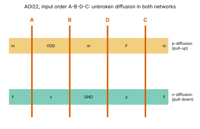

<!-- status: verified -->
# 19-09 · Layout, Design Rules and Standard Cells

| | |
|---|---|
| **Course** | [19 · Digital VLSI Design](../README.md) |
| **University equivalent** | The physical-design fundamentals of a senior digital-IC course: process layers and masks, design rules, stick diagrams and Euler paths, standard-cell architecture, area estimation, and physical verification (DRC, LVS, extraction, antenna rules) (Weste & Harris, *CMOS VLSI Design*, ch. 1 and 3; Rabaey, Chandrakasan & Nikolić, *Digital Integrated Circuits*, ch. 2) |
| **Prerequisites** | [19-03](19-03-logic-families.md) (static CMOS networks), [19-04](19-04-sizing-and-logical-effort.md) (drive strengths), [19-05](19-05-interconnect.md) (metal layers), [09-11](../../09-semiconductor-devices/chapters/09-11-cmos-and-scaling.md) (CMOS structure) and [09-12](../../09-semiconductor-devices/chapters/09-12-finfet-gaa-cfet-backside-power.md) (FinFETs, nanosheets and backside power) |
| **Estimated study hours** | 6 |
| **Last verified** | 2026-11-21 |

**Learning objectives.** After this chapter you can:

1. Relate each layout layer to the device or wire it forms, and read a simple layout of an inverter or gate.
2. Apply a set of width, spacing, enclosure and extension rules, and compute the contacted and uncontacted transistor pitches they imply.
3. Order a static CMOS gate's transistors with a common Euler path so each network is one unbroken diffusion strip.
4. Describe standard-cell architecture (fixed height, rails, sites, drive strengths) and estimate block area from cell counts, gate density and utilization.
5. Explain what DRC, LVS, parasitic extraction and antenna checks verify, and why each is needed before tape-out.

## 1. Big picture

Everything so far has been schematics. A chip is a stack of patterned layers: the layout is the set of polygons, one drawing per mask, that the foundry turns into transistors and wires. Layout is where electrical design meets manufacturing: every polygon must obey the foundry's **design rules** so that it prints reliably, and every connection must match the schematic. Almost no one draws digital logic by hand any more; instead a library team draws a few hundred **standard cells** once, and automated tools place and wire millions of them (19-11). Understanding how a cell is drawn explains why libraries look the way they do, why area estimates work, and what the signoff checks are protecting against.

- **Area is cost.** A cell's width in placement sites and its height in routing tracks set the silicon a design consumes; libraries compete on both.
- **Rules encode manufacturability.** Minimum widths and spacings, enclosures and density rules are the foundry's promise that what is drawn will print and work.
- **Gates share diffusion.** Ordering a gate's transistors well (Euler paths) removes gaps and shrinks cells.
- **Signoff gates tape-out.** DRC, LVS and extraction are the last checks between a design and a mask set costing millions.

## 2. Intuition first

Think of a layout as a set of stencils stacked on top of each other: one stencil defines where the active silicon goes, another where polysilicon gates cross it, others where holes (contacts and vias) connect layers, and several more where metal wires run. A **transistor** appears wherever a polysilicon stripe crosses an active region: the poly is the gate, and the active area on either side becomes source and drain. A **wire** is a stripe of metal; a **contact** is a hole from the first metal to the silicon or poly below; a **via** connects two metal layers.

Design rules are the printing tolerances of these stencils, like a sign painter's rule that letters be at least so thick and so far apart, or the ink will blur together. Rules are written as minimum widths, minimum spacings, how far one layer must overlap (enclose) another, and how far a gate must extend past the active region so that misalignment cannot short source to drain. The analogy holds well; where it fails is that modern rules also depend on the neighborhood (dense or sparse, which direction lines run), because the optical and chemical processes at nanometre scale are context-dependent.

```text
   Inverter layout (top view, simplified)

   VDD rail  ===========================================  metal1
                 |c|                        
          +------+-+------------+           pMOS active (in n-well)
          |  p+  |G|     p+     |
          +------+-+------------+
                 |o|--------+  output (metal1, contacted to both drains)
   A (in) ======|l|         |
                 |y|        |
          +------+-+------------+           nMOS active
          |  n+  | |     n+     |
          +------+-+------------+
                 |c|                        
   GND rail  ===========================================  metal1
```

*Figure 1. A simplified inverter layout. A vertical polysilicon stripe crosses the p-type active region (pMOS, inside an n-well) and the n-type active region (nMOS); contacts (c) tie the sources to the power rails and the drains to the output wire.*

## 3. Theory

### 3.1 Layers and masks

A CMOS process builds, from the bottom up (09-11): **wells** (n-well for pMOS, often a p-well or the substrate for nMOS); **active** (diffusion) regions isolated by trenches; **polysilicon** (or metal) gates; **source/drain implants** (n+ and p+) self-aligned to the gates; **contacts** from the first metal to diffusion and poly; and a stack of **metal layers** connected by **vias**, thin and dense at the bottom, thick and wide at the top (19-05). Each drawn layer corresponds to one or more masks. A transistor's drawn channel length is the poly width where it crosses active, and its width is the active region's width under the gate.

### 3.2 Design rules

Rules come in four kinds:

- **Width:** the minimum width of a shape on a layer (poly, active, metal).
- **Spacing:** the minimum distance between shapes on the same layer (and sometimes between layers).
- **Enclosure:** how far one layer must extend around another, for example active around a contact, so that misalignment cannot expose the contact's edge.
- **Extension:** how far poly must extend beyond active (and active beyond poly), so that a slightly misaligned gate still cuts the channel completely.

Textbooks teach with **scalable (λ) rules**, every dimension a small multiple of a unit λ (about half the minimum feature), so that a layout can be shrunk with the process. This chapter uses its own illustrative set: poly width 2λ, poly spacing 3λ, active width 3λ, contacts 2λ × 2λ, contact-to-gate spacing 2λ, active enclosure of contacts 1λ, poly extension past active 2λ, and metal-1 width and spacing 3λ. Real processes have hundreds of rules in absolute units, many context-dependent. SkyWater's open SKY130 PDK, for instance, sets a minimum poly width of 0.150 µm (rule poly.1a) and a minimum channel width of 0.420 µm, reduced to 0.360 µm inside standard-cell areas ([R-314]).

**Transistor pitch.** The rules set how closely transistors can be packed along a diffusion strip. Two adjacent transistors that share a **contacted** source/drain need room for the poly, a contact and its spacing on both sides:

$$
\text{contacted pitch} = w_{poly} + 2s_{contact\text{-}poly} + w_{contact} = 2 + 4 + 2 = 8\lambda .
$$

Two transistors in series with **no contact** between them (an internal node of a stack, 19-03) need only the poly width plus poly spacing, $2 + 3 = 5\lambda$. This is why series stacks are compact, and why contacts are placed only where a wire must connect.

### 3.3 Stick diagrams and Euler paths

A **stick diagram** sketches a layout's topology without dimensions: colored lines for active, poly and metal, crossings of poly over active marked as transistors. It is how designers plan a cell before drawing polygons.

For a static CMOS gate, the goal is to place each network's transistors in one unbroken strip of diffusion, so that adjacent transistors share source/drain regions and every poly gate runs vertically across both the pMOS and nMOS strips (one input per poly stripe). That requires an ordering of the inputs that is:

- an **Euler path** in the pull-down network's graph (nodes are electrical nodes, edges are transistors labeled by their inputs): a walk that uses every edge exactly once, so consecutive transistors share a node; and
- an Euler path in the pull-up network's graph, **with the same ordering**, since each poly stripe gates one nMOS and one pMOS.

A graph has an Euler path if and only if it is connected and has zero or two nodes of odd degree. Where no common ordering exists, the strip needs a **break** (a gap and a second contact), which widens the cell. Example 2 finds the orderings for an OAI21 gate; Example 3 shows that only 8 of the 24 orderings of an AOI22 work.



*Figure 2. Stick diagram of the AOI22 gate F = NOT(AB + CD) with input order A-B-D-C. Each vertical poly stripe gates one pMOS and one nMOS. Between stripes, the diffusion regions are shared nodes: in the pull-up, m is the node between the two parallel pairs (it appears three times and is joined by metal); in the pull-down, x and y are the internal nodes of the two series stacks. Neither strip has a break.*

### 3.4 Standard cells

A **standard-cell library** is a set of pre-drawn, characterized gates (inverters, NANDs, NORs, AOIs, multiplexers, flip-flops) built to a common template:

- **Fixed height**, measured in routing tracks of the first metal layer, with power and ground rails running along the top and bottom edges so that cells abut in rows and share rails.
- **Width in sites:** every cell is an integer number of placement sites wide, so that rows can be filled without gaps.
- **Pins on a grid,** so that the router can reach them.
- **Several drive strengths** of each function, built as wider or parallel transistors (19-04), and often several threshold flavors (19-06).

SkyWater's high-density SKY130 library uses "a 0.46 x 2.72um site, equivalent to 9 met1 tracks" ([R-314]); its flip-flop `dfxtp_1` is 16 sites wide, 20.02 µm² ([R-317]). Taller cells (more tracks) hold wider transistors and are faster; shorter cells are denser. Libraries are offered in several heights for this reason.

**Area estimation.** A design's area follows from its cell count and the **utilization**, the fraction of the core area that cells occupy (the rest goes to routing, power grid and spacing):

$$
A_{core} = \frac{\sum A_{cells}}{U} .
$$

Utilizations of about 60–80% are common; higher values save area but make routing and timing closure harder. Libraries often quote a **routed gate density** in thousands of NAND2-equivalent gates per mm², which already includes utilization: SKY130's high-density library quotes "120 kGates/mm^2" ([R-317]).

### 3.5 Physical verification

Before a layout becomes masks, it passes several automated checks, collectively part of **signoff** (19-11):

- **Design-rule check (DRC):** every polygon against every rule. A single violation can make a mask set unusable.
- **Layout versus schematic (LVS):** the circuit extracted from the layout (devices and their connectivity) must match the schematic or netlist exactly, catching opens, shorts and wrong devices.
- **Parasitic extraction (PEX):** resistances and capacitances of the drawn wires and devices are computed, so that timing (19-10) and power use the real wiring rather than estimates.
- **Antenna checks:** during manufacturing, long metal lines connected only to a gate collect charge from plasma etching, which can damage the thin gate oxide. Rules limit the ratio of connected metal area to gate area; violations are fixed by routing a jumper to a higher metal layer or adding a protection diode.
- **Density and electrical rules:** minimum and maximum metal densities (for uniform polishing), well and substrate tie spacing (to prevent latch-up, the parasitic thyristor of 09-07), and electrical checks.

> **Going deeper — layout at advanced nodes.** In FinFET and nanosheet processes, transistor widths come in whole numbers of fins or sheets, gates sit on a fixed pitch, and lower metal layers are often unidirectional and patterned with multiple exposures, so cell architecture is tightly constrained. Effects that depend on a transistor's surroundings (stress from neighboring structures, distance to the well edge) shift its characteristics, so libraries are characterized with their real context. These constraints are why standard-cell heights at leading nodes are quoted in a small number of tracks and why new device structures (backside power, stacked transistors) are often motivated by cell area as much as by transistor performance.

## 4. Worked examples

### Example 19-09.1 · Transistor pitch from the rules (tier A)

**Setup.** Using this chapter's illustrative rules, find (a) the contacted transistor pitch, (b) the uncontacted pitch of two series transistors, and (c) how much narrower a three-transistor series stack with contacts only at its ends is than three transistors each separated by contacts. Express (a) and (b) in µm for λ = 0.1 µm.

**Solution.** (a) $2 + 2 \times 2 + 2$ = **8**λ = **0.8** µm. (b) $2 + 3$ = **5**λ = **0.5** µm. (c) The two internal gaps shrink from 8λ to 5λ: **6**λ saved, a **37.5** % smaller pitch per internal gap.

**Units check.** λ × µm/λ = µm.

**Sanity check.** This is why series stacks in NAND pull-downs and NOR pull-ups are drawn without internal contacts.

### Example 19-09.2 · An Euler path for an OAI21 (tier B)

**Setup.** The gate $F = \overline{A(B + C)}$ has a pull-down network of A in series with (B parallel C), and the dual pull-up. Find all input orderings that give unbroken diffusion in both networks.

**Solution.** In the pull-down graph, A joins the output to an internal node, and B and C both join that node to ground. Enumerating the 6 orderings and checking each in both networks leaves **4**: A-B-C, A-C-B, B-C-A and C-B-A. B-A-C and C-A-B fail in the **pull-down**: A is the only transistor touching the output node, so that node has degree 1 and any Euler path must start or end with A. Putting A in the middle leaves the walk at the output after A, where neither B nor C connects. The pull-up (A in parallel with the series pair B–C) accepts all six orderings, because A spans both ends of the B–C stack.

**Units check.** Counts.

**Sanity check.** Every valid ordering has A at an end, as the pull-down's degree-1 output node requires, and therefore B and C adjacent.

### Example 19-09.3 · AOI22 (tier B)

**Setup.** $F = \overline{AB + CD}$, with each pull-down stack drawn as written: A and C nearest the output. (a) How many of the 24 orderings are common Euler paths? (b) How many diffusion breaks does the ordering A-B-C-D need in each network? (c) Give a valid ordering.

**Solution.** (a) **8** of 24. (b) In the pull-down network (A-B in series, parallel to C-D in series), A-B-C-D runs out→A→B→ground, and C does not touch ground: **1** break. The pull-up network, (A ∥ B) in series with (C ∥ D), happens to accept it (m→A→VDD→B→m→C→out→D→m): **0** breaks. One network failing is enough: the cell needs a break. (Drawing the second stack the other way up, D nearest the output, would make A-B-C-D a valid pull-down walk, out→A→B→ground→C→D→out: stack order is a free choice, as Problem 3 explores.) (c) A-C-D-B: in the pull-down, n₁→A→out→C→n₂→D→ground→B→n₁; in the pull-up ((A ∥ B) in series with (C ∥ D)), VDD→A→m→C→out→D→m→B→VDD.

**Units check.** Counts.

**Sanity check.** Every node of both graphs has even degree, so every valid ordering is a closed loop: the 8 orderings are the 4 rotations of the loop A-B-D-C, traversed in either direction.

### Example 19-09.4 · Block area (tier B)

**Setup.** A block in SKY130's high-density library has 10 000 flip-flops (`dfxtp_1`, 16 sites of 0.46 × 2.72 µm) and 200 000 NAND2-equivalent gates of logic. (a) What is one site's area and the flip-flops' total cell area? (b) At 70% utilization, what core area do the flip-flops need? (c) Using the library's routed density of 120 kGates/mm² for the logic, estimate the block's area.

**Solution.** (a) One site: $0.46 \times 2.72$ = **1.2512** µm²; a flip-flop: 16 sites = **20.02** µm²; 10 000 flip-flops: **0.2002** mm².

(b) $0.2002/0.7$ = **0.286** mm².

(c) Logic: $200/120$ = **1.667** mm²; block ≈ **1.95** mm².

**Units check.** µm² × 10⁻⁶ = mm².

**Sanity check.** The flip-flops are **5** % of the items counted (flip-flops plus NAND2-equivalent gates) but **15** % of the area: sequential cells are big.

### Example 19-09.5 · Cell height (tier B)

**Setup.** A 9-track library has a cell height of 2.72 µm. A denser library on the same track pitch uses 7.5 tracks. (a) What is its cell height? (b) By what fraction does the area of a cell with the same width shrink? (c) What do you give up?

**Solution.** (a) $2.72 \times 7.5/9$ = **2.267** µm. (b) **16.7** % smaller. (c) Less room for transistor width per cell (weaker drive, or more fins/fingers needed elsewhere) and fewer tracks for routing over and within cells, which can lower achievable utilization.

**Units check.** µm.

**Sanity check.** Libraries at a node usually come in two or three heights for exactly this tradeoff.

### Example 19-09.6 · An antenna violation (tier C)

**Setup.** A process limits the ratio of metal-1 area connected to a gate (before higher metal connects it to a diffusion) to 400 (an illustrative limit). A gate of 0.5 µm × 2 µm is driven through a 0.2 µm-wide metal-1 line 2.5 mm long. (a) What is the ratio? (b) How short must the metal-1 segment be? (c) Name two fixes.

**Solution.** (a) Metal area $0.2 \times 2500$ = 500 µm²; gate area 1 µm²: ratio **500**, a violation.

(b) $400 \times 1/0.2$ = **2000** µm, so the metal-1 segment must be under **2.0** mm.

(c) Break the line with a jump to a higher metal layer near the gate (so the long metal-1 segment connects to the gate only after the upper layer is made, by which time a diffusion is also connected), or add a reverse-biased **antenna diode** at the gate that drains the charge.

**Units check.** µm²/µm² is a ratio.

**Sanity check.** Antenna rules are why routers insert diodes and layer jumps that do not appear in any schematic.

<!-- answer-key -->

| ID | Quantity | Value | Unit |
|---|---|---|---|
| Ex 19-09.1a | contacted pitch | 8 | λ |
| Ex 19-09.1b | contacted pitch at 0.1 µm | 0.8 | µm |
| Ex 19-09.1c | uncontacted pitch | 5 | λ |
| Ex 19-09.1d | uncontacted pitch at 0.1 µm | 0.5 | µm |
| Ex 19-09.1e | saved in a three-transistor stack | 6 | λ |
| Ex 19-09.1f | pitch reduction per internal gap | 37.5 | % |
| Ex 19-09.2a | valid OAI21 orderings | 4 | — |
| Ex 19-09.3a | valid AOI22 orderings | 8 | — |
| Ex 19-09.3b | breaks for A-B-C-D, pull-down | 1 | — |
| Ex 19-09.3c | breaks for A-B-C-D, pull-up | 0 | — |
| Ex 19-09.3d | rotations of the loop | 4 | — |
| Ex 19-09.4a | site area | 1.2512 | µm² |
| Ex 19-09.4b | flip-flop area | 20.02 | µm² |
| Ex 19-09.4c | flip-flop total | 0.2002 | mm² |
| Ex 19-09.4d | flip-flop core area at 70% | 0.286 | mm² |
| Ex 19-09.4e | logic area | 1.667 | mm² |
| Ex 19-09.4f | block area | 1.95 | mm² |
| Ex 19-09.4g | flip-flops' share of items counted | 5 | % |
| Ex 19-09.4h | flip-flops' share of area | 15 | % |
| Ex 19-09.5a | 7.5-track height | 2.267 | µm |
| Ex 19-09.5b | area reduction | 16.7 | % |
| Ex 19-09.6a | antenna ratio | 500 | — |
| Ex 19-09.6b | maximum metal-1 length | 2000 | µm |
| Ex 19-09.6c | maximum metal-1 length | 2.0 | mm |
| Txt 19-09.a | hs site over hd site area | 28 | % |
| Txt 19-09.b | SKY130 minimum gate length over IRDS 2024 gate pitch | 3.1 | — |

## 5. Simulate it

The lab ([labs/19-09-lab](../labs/19-09-lab/README.md)) is in Python (`layout.py` and the notebook): it converts series-parallel networks into graphs, enumerates the orderings that are common Euler paths for any static gate, counts diffusion breaks for a given ordering, computes transistor pitches from a rule set, and estimates block areas. Layout tools are beyond this course's lab environment; the open-source OpenLane/OpenROAD flow on SKY130 (19-11) is the next step.

**Predict, then run.**

1. Predict which orderings of a NAND3 work; check with `common_euler_orders`.
2. Predict how many orderings of an AOI22 need no break; then try AOI211 and OAI22.
3. Count the common Euler paths of $\overline{AB + C(D + E)}$. Then predict whether $\overline{A(BC + DE)}$ has one for *any* stack order, and how many breaks its best ordering needs; check with `stack_variants` and `fewest_breaks`.
4. Change the illustrative rules (for example, contact-to-poly 3λ) and recompute the pitches.
5. Estimate the area of a 500 kGate block with 30 000 flip-flops at 65% and 80% utilization.

## 6. Engineering tradeoffs

| Knob | Improves | Costs | Typical decision owner |
|---|---|---|---|
| Shorter cells (fewer tracks) | Density | Drive strength, routing resources | Library team, foundry |
| Higher utilization | Area | Routing congestion, timing closure, hold buffers | Physical design |
| More drive strengths and flavors | Achievable timing and power | Library size, characterization effort | Library team |
| Restrictive (regular) layout rules | Manufacturability, variation | Density, design freedom | Foundry |
| Custom layout | Area and speed of critical blocks | Engineering time, portability | Custom circuit team |

## 7. Numbers to know

| Quantity | Value | Notes |
|---|---|---|
| Contacted vs uncontacted pitch | 8λ vs 5λ | This chapter's illustrative rules |
| Euler path exists | 0 or 2 odd-degree nodes | Connected graph |
| SKY130 minimum poly width | 0.150 µm | [R-314] |
| SKY130 `hd` site | 0.46 × 2.72 µm, 9 met1 tracks | [R-314] |
| SKY130 `hd` routed density | 120 kGates/mm² | [R-317] |
| Core area | $\sum A_{cells}/U$ | $U$ ≈ 0.6–0.8 |

## 8. Common mistakes

- **Choosing an ordering that works for one network only.** The same input order must be an Euler path in both pull-up and pull-down.
- **Contacting every node.** Internal stack nodes need no contacts; adding them widens the cell.
- **Using cell area as block area.** Routing, power grids and spacing need room; divide by utilization.
- **Treating DRC-clean as correct.** DRC checks geometry; LVS checks that the geometry is the intended circuit.
- **Ignoring antenna rules until signoff.** Late fixes perturb routing and timing.

## 9. Practitioner lens

### State of the art (as of Nov 2026)

- **An open library in numbers [Established].** SkyWater's high-density SKY130 library has 163 cell functions in 437 variants ([R-315]), on "a 0.46 x 2.72um site, equivalent to 9 met1 tracks" ([R-314]), with a stated "Routed Gate Density is 120 kGates/mm^2" ([R-317]); its higher-speed libraries use a 0.48 × 3.33 µm site, about 11 tracks ([R-314]): the height–speed tradeoff of Example 5 in a real process. One `hs` site is **28** % larger than an `hd` site.
- **Pitches at the leading edge [Industry estimate].** The IEEE IRDS 2024 roadmap lists a 48 nm gate pitch and a 24 nm M0 pitch for its 2024 "3nm" node, shrinking toward a 42 nm gate pitch and 14 nm metal pitch in the mid-2030s ([R-315]): the whole 48 nm gate pitch (gate plus spacing) is about a third of SKY130's minimum gate length alone (0.150 µm, a ratio of **3.1**), a measure of the gap between an open teaching process and the leading edge.
- **Backside power frees the cell's rails [Established].** Intel's PowerVia test chip moved power delivery to the back of the wafer and reported "standard cell utilization exceeding 90%" ([R-315]): when power rails no longer compete with signals for the lowest metal layers, cells can be packed more tightly than the 60–80% utilizations typical of front-side designs.

### Why it matters commercially

- **Libraries are products.** Foundries and IP vendors compete on cell area, drive strengths and threshold flavors; a library's density can matter as much as the transistor itself.
- **Area is cost, cost is margin.** Die area sets the number of dies per wafer and yield; a few percent of cell area translates directly into product cost.
- **Signoff protects the mask budget.** A mask set at an advanced node is very expensive; DRC and LVS escapes are among the costliest mistakes in chip design.

### Marketing vs Reality

- **"X MTr/mm² density."** Peak transistor density comes from the densest cells in ideal conditions; real designs mix cells, SRAM and analog and run below full utilization.
- **"Smaller cell height."** Ask what drive strength and routing the shorter cells keep, and what utilization real designs achieve with them.
- **"DRC-clean layout."** Clean against which rule deck, at which version, and with which waivers?

### Questions for engineering leaders

1. *"What utilization do your blocks achieve, and what limits it?"* Strong: numbers per block, with congestion and timing as the stated limits. Evasive: a single target.
2. *"Which library heights and threshold flavors do you use, and why?"* Strong: a reasoned mix tied to performance and leakage targets. Evasive: "the foundry default".
3. *"How do you manage DRC and LVS closure late in a project?"* Strong: incremental signoff and tracked waivers. Evasive: "we fix them at the end".
4. *"How much of your design is custom layout, and how portable is it?"* Strong: specific blocks with porting plans. Evasive: no inventory.

## 10. Concept check

**Q1.** What forms a transistor in a layout?

<details><summary>Answer</summary>

A polysilicon (gate) stripe crossing an active region: the poly is the gate, and the active area on either side, implanted n+ or p+, forms the source and drain.

</details>

**Q2.** Why must poly extend beyond the active region?

<details><summary>Answer</summary>

If the gate were misaligned and ended inside the active region, the source and drain would connect around its end; the extension guarantees the channel is fully cut.

</details>

**Q3.** Why does the same input ordering have to work in both networks?

<details><summary>Answer</summary>

Each poly stripe runs vertically across both the pMOS and nMOS strips, gating one transistor in each; the order of stripes is therefore shared.

</details>

**Q4.** Why are standard cells all the same height?

<details><summary>Answer</summary>

So that they abut in rows sharing power and ground rails, and so that placement reduces to choosing positions in rows of sites.

</details>

**Q5.** What does LVS catch that DRC does not?

<details><summary>Answer</summary>

Connectivity errors: a layout can obey every geometric rule yet have a short, an open, a missing or wrong device; LVS compares the extracted circuit with the intended netlist.

</details>

**Q6.** Why can a long wire damage a gate during manufacturing?

<details><summary>Answer</summary>

Plasma etching charges exposed metal; if the metal connects only to a thin gate oxide, the collected charge can break it down. Antenna rules limit the ratio of metal to gate area until a diffusion connection exists.

</details>

Problems: [19-09 problem set](../problems/19-09-problems.md).

## 11. Key terms

[Design rules](../../../reference/glossary.md#design-rules) · [Stick diagram](../../../reference/glossary.md#stick-diagram) · [Euler path](../../../reference/glossary.md#euler-path) · [Standard cell](../../../reference/glossary.md#standard-cell) · [Utilization](../../../reference/glossary.md#utilization) (as defined for FPGAs; the same idea for cell area) · [Design-rule check (DRC)](../../../reference/glossary.md#design-rule-check-drc) · [Layout versus schematic (LVS)](../../../reference/glossary.md#layout-versus-schematic-lvs) · [Antenna effect](../../../reference/glossary.md#antenna-effect)

## 12. Connections

- **Builds on:** [19-03](19-03-logic-families.md) (networks), [19-04](19-04-sizing-and-logical-effort.md) (drive strengths), [19-05](19-05-interconnect.md) (metal stack), [09-11](../../09-semiconductor-devices/chapters/09-11-cmos-and-scaling.md) and [09-12](../../09-semiconductor-devices/chapters/09-12-finfet-gaa-cfet-backside-power.md) (devices and structures).
- **Next:** [19-10](19-10-synthesis-and-sta.md) maps RTL onto standard cells and analyzes timing.
- **Used later:** [19-11](19-11-place-route-signoff.md) (placement, routing and signoff on SKY130).

## 13. Further study

- Weste & Harris, *CMOS VLSI Design*, 4th ed., §1.5 (layout and design rules) and ch. 3 (CMOS processing technology).
- Rabaey, Chandrakasan & Nikolić, *Digital Integrated Circuits*, 2nd ed., ch. 2 (the manufacturing process and design rules).
- The SkyWater SKY130 PDK documentation: its design-rule pages and standard-cell library descriptions are a rare open view of a real process.

## 14. Sources

1. Weste & Harris, *CMOS VLSI Design*, 4th ed., Addison-Wesley, 2011, ch. 1 and 3.
2. Rabaey, Chandrakasan & Nikolić, *Digital Integrated Circuits*, 2nd ed., Prentice Hall, 2003, ch. 2.
3. [R-314] SkyWater SKY130 PDK rules and library documentation.
4. [R-315] The `sky130_fd_sc_hd` library repository; IEEE IRDS 2024 More Moore tables; Intel PowerVia (VLSI Symposium 2023).
5. [R-317] SkyWater SKY130 `hd` routed gate density and `dfxtp_1` area.
