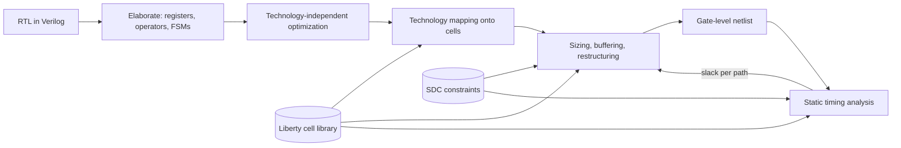
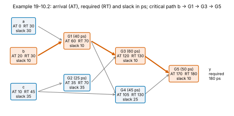

<!-- status: verified -->
# 19-10 · The ASIC Flow I: Synthesis and Static Timing Analysis

| | |
|---|---|
| **Course** | [19 · Digital VLSI Design](../README.md) |
| **University equivalent** | The synthesis and timing-analysis part of a senior digital-IC or VLSI-CAD course: the RTL-to-gates flow, technology mapping by tree covering, Liberty cell models, graph-based static timing analysis with slews, setup and hold checks with clock latency and uncertainty, SDC constraints, timing exceptions, corners and on-chip variation (Weste & Harris, *CMOS VLSI Design*, ch. 14; De Micheli, *Synthesis and Optimization of Digital Circuits*, ch. 10; Bhasker & Chadha, *Static Timing Analysis for Nanometer Designs*) |
| **Prerequisites** | [19-07](19-07-sequential-timing-and-clocking.md) (setup, hold, skew and jitter), [19-04](19-04-sizing-and-logical-effort.md) (delay models and sizing), [19-09](19-09-layout-and-standard-cells.md) (standard cells), [08-10](../../08-digital-logic-design/chapters/08-10-timing-metastability-cdc.md) (STA at the logic level), [08-12](../../08-digital-logic-design/chapters/08-12-fpga-implementation-flow.md) (an implementation flow and its constraints), [03-04](../../03-probability-statistics-and-random-variables/chapters/03-04-joint-distributions-and-clt.md) (sums of random variables) |
| **Estimated study hours** | 9 |
| **Last verified** | 2026-11-24 |

**Learning objectives.** After this chapter you can:

1. Describe the steps that turn RTL into a gate-level netlist and the role of the cell library and the constraints in each.
2. Map a logic function onto a cell library by tree covering, for minimum area or minimum delay, and explain why the result is optimal only for trees.
3. Look up a cell's delay and output slew in a Liberty table by bilinear interpolation and propagate arrival times, slews and required times through a netlist.
4. Compute setup and hold slack for register-to-register and I/O paths with clock latency and uncertainty, and write the SDC constraints that define them.
5. Apply timing corners, on-chip-variation derates and clock reconvergence pessimism removal, and compare flat derating with a statistical model.
6. Recognize false and multicycle paths and constrain them without hiding real failures.

## 1. Big picture

A modern chip has billions of transistors, and nobody draws its logic gates by hand. Designers describe behavior in a hardware description language at the register-transfer level (RTL); a **logic synthesis** tool turns that description into a netlist of standard cells (19-09), and a **static timing analysis** (STA) tool proves that the netlist meets its clock frequency on every path, at every process corner, without running a single test vector. These two tools, and the constraint file that tells them what "fast enough" means, sit at the center of every digital chip project.

- **Synthesis decides the gates.** The same RTL can become a small, slow circuit or a large, fast one, path by path, according to the constraints.
- **STA decides when you are done.** "Timing closure" means non-negative slack on every path at every signoff corner; it often sets a product's schedule.
- **Constraints carry the design intent.** A wrong clock definition or a careless false path gives a chip that passes every check and fails in the field.
- **The models are the foundry's.** Every delay comes from characterized cell libraries (Liberty files); their accuracy bounds the flow's accuracy.
- **Variation is a first-class input.** Margins for on-chip variation can take a sizable fraction of the cycle at advanced nodes.

## 2. Intuition first

Static timing analysis is the **critical path method** of project scheduling, applied to signals. Each gate is a task with a duration; each wire says which tasks must finish before another can start. The earliest time a task can finish is its **arrival time**; working backward from the deadline gives the latest time it may finish, its **required time**; the difference is its **slack** (project managers call it float). The chain of tasks with the least slack is the **critical path**. Every node on it has the same, smallest slack, and shortening anything off it does not move the finish date.

The analogy explains why STA scales: one forward and one backward pass give every node's slack, with no need to list paths. It breaks down in four places:

- **A gate's duration depends on its neighbors.** A cell's delay depends on how sharp its input edge is (the slew of the driving gate) and on how much capacitance it drives (the gates it feeds). Durations are looked up from tables, not fixed.
- **There are two deadlines, not one.** Setup checks that data is not too late; hold checks that it is not too *early*. Hold has no analogue in project scheduling.
- **Every signal has two versions.** A rising and a falling edge travel at different speeds, and an inverting gate turns one into the other.
- **The clock is itself a path.** The deadline at each register moves with the clock's own delay, which varies.

Synthesis is like tiling a floor from a catalog: the logic is broken into tiny standard pieces (two-input NANDs and inverters), each library cell is a tile covering a particular cluster of pieces, and the tool picks the cheapest set of tiles that covers everything. Small tiles fit anywhere but cost more in total; complex tiles cover more but fit only certain shapes.



*Figure 1. The front half of the ASIC flow. The Liberty library and the SDC constraints feed both synthesis and timing analysis; timing results feed back into optimization. Placement and routing (19-11) follow the netlist.*

## 3. Theory

### 3.1 From RTL to a netlist

A synthesis tool works in stages.

1. **Elaboration.** The RTL is parsed and turned into a network of generic parts: registers (from clocked `always` blocks), arithmetic operators, multiplexers (from `if` and `case`), and Boolean logic. State machines are recognized and may be re-encoded (08-08). A combinational block that leaves an output unassigned on some path produces a latch here, usually by mistake (08-05).
2. **Technology-independent optimization.** The Boolean network is simplified without reference to any library: constant propagation, removal of unused logic, sharing of common subexpressions, factoring, and the two- and multi-level minimization of 08-03. Modern tools represent the logic as an **and-inverter graph** (AIG): two-input ANDs with optional inversions on their edges, a form that is uniform and cheap to rewrite.
3. **Technology mapping.** The optimized network is covered with cells from the target library (§3.2).
4. **Timing-driven optimization.** With real cells and delays (§3.3–3.4), the tool resizes gates (19-04), buffers long or heavily loaded nets, moves late-arriving signals to the input nearest the output (19-03), restructures critical logic, and picks arithmetic architectures (ripple-carry where there is slack, parallel-prefix where there is not; 08-09).
5. **Output.** A gate-level netlist (usually structural Verilog), plus reports of area, timing and power. A **formal equivalence check** (19-13) then proves the netlist computes the same function as the RTL.

Two inputs steer every stage: the **Liberty** library (each cell's function, area, pin capacitances and timing tables) and the **SDC** constraints (§3.6: clocks, I/O timing, exceptions). The tool spends area and power only where the constraints demand speed, so the same RTL at two clock targets gives different netlists.

### 3.2 Technology mapping by tree covering

**Subject graph.** Write the optimized logic using only two **base functions**: a two-input NAND and an inverter. Any Boolean function can be written this way (the NAND is functionally complete; 08-02). The result is the **subject graph**. Where no signal feeds more than one gate it is a tree, the **subject tree**.

**Patterns.** Write each library cell in the same base functions. An inverter is `INV(x)`; a NAND2 is `NAND(x, y)`; an AND2 is `INV(NAND(x, y))`; a NOR2 is `INV(NAND(INV x, INV y))` by De Morgan's law; a NAND4 is `NAND(INV(NAND(a, b)), INV(NAND(c, d)))`; an AOI21, $\overline{ab + c}$, is `INV(NAND(NAND(a, b), INV c))`. A cell may have several pattern trees for different decompositions; a pattern **matches** at a node if its structure is identical to the subtree rooted there (with the NAND's two inputs allowed in either order), and its leaves then bind to the subtrees that become the cell's inputs.

**Cover.** A **cover** is a choice of matches such that every non-input node of the subject tree is covered exactly once and each match's inputs are either primary inputs or roots of other matches. Each cover is a netlist that computes the original function.

**Dynamic programming.** Let $\text{cost}(v)$ be the least total area of a cover of the subtree rooted at node $v$. If cell $c$ matches at $v$ with leaves $\ell_1, \dots, \ell_k$, the best cover that uses $c$ at $v$ costs $A_c + \sum_i \text{cost}(\ell_i)$, because the subtrees at the leaves are disjoint (it is a tree) and can be covered independently. Therefore

$$
\text{cost}(v) = \min_{\text{matches } (c,\ \ell_1..\ell_k) \text{ at } v} \Big[ A_c + \sum_{i=1}^{k} \text{cost}(\ell_i) \Big], \qquad \text{cost}(\text{primary input}) = 0 .
$$

Evaluating nodes from the leaves to the root gives the minimum-area cover in time proportional to the number of nodes times the number of patterns. The argument is the **optimal-substructure** property of dynamic programming: any optimal cover of a tree, restricted to the subtree at one of its leaves, must itself be an optimal cover of that subtree, or replacing it would give a cheaper whole. This method is due to Keutzer (1987).

**Delay.** With a load-independent delay $d_c$ per cell, the same recursion with the sum replaced by a maximum gives the minimum arrival time:

$$
t(v) = \min_{\text{matches at } v} \Big[ d_c + \max_i t(\ell_i) \Big], \qquad t(\text{primary input}) = \text{its arrival time}.
$$

The two objectives usually pick different covers; Example 3 shows one where the smallest cover is 9 % slower than the fastest.

**Limits.** The method is exact only for trees and only for a load-independent delay. A real subject graph is a directed acyclic graph (DAG) in which signals fan out; the classic remedy cuts the DAG into trees at every multi-fanout node and maps each tree separately, which forbids patterns from spanning a fanout point and loses optimality. A cell's real delay depends on its load, which depends on the cells chosen downstream, so delay-optimal mapping is followed by sizing and buffering. And the subject graph itself is one of many decompositions of the same function; different decompositions admit different matches. Production tools therefore map many decompositions at once.

> **Going deeper — cut-based mapping.** Modern mappers, including the open-source ABC used by Yosys, enumerate small **cuts** of the AIG (sets of at most $k$ nodes that separate a node from the inputs), compute each cut's Boolean function, and match it against library cells by function rather than by structure. Matching by function removes the dependence on one decomposition and handles DAGs directly, at the cost of heuristics for area recovery when logic is duplicated across fanout.

### 3.3 Cell delay: the Liberty nonlinear delay model

A cell library describes each **timing arc** (an input pin to an output pin) with lookup tables. In the **nonlinear delay model** (NLDM), each arc has four tables, each a function of two variables:

- the **input transition** (slew) $s$: the time the input edge takes between two thresholds (20 % and 80 % of the supply in the SKY130 library, with delays measured between 50 % points [R-318]);
- the **output load** $C_L$: the total capacitance on the output net, wire plus the input pins it drives.

The tables are `cell_rise` and `cell_fall` (the delay from 50% of the input edge to 50% of the output edge, for a rising or falling output) and `rise_transition` and `fall_transition` (the output's own slew). In SKY130 each table is 7 × 7, characterized by circuit simulation at each grid point.

**Unateness.** An arc is **negative unate** if a rising input can only cause a falling output and vice versa (inverters, NANDs, NORs, AOIs); **positive unate** if the edges keep their direction (buffers, ANDs, ORs); **non-unate** if either can cause either (XOR inputs, a flip-flop's clock-to-Q arc). The analysis tracks rising and falling arrivals separately and connects them through arcs according to unateness.

**Bilinear interpolation.** The operating point $(s, C_L)$ usually falls between grid points. Let the neighboring indices be $s_0 \le s \le s_1$ and $C_0 \le C_L \le C_1$, with table values $D_{00} = D(s_0, C_0)$, $D_{01} = D(s_0, C_1)$, $D_{10} = D(s_1, C_0)$ and $D_{11} = D(s_1, C_1)$. Define the fractional positions

$$
t_s = \frac{s - s_0}{s_1 - s_0}, \qquad t_C = \frac{C_L - C_0}{C_1 - C_0} .
$$

Interpolating linearly along the load at each of the two slews gives $D(s_0, C_L) \approx (1 - t_C) D_{00} + t_C D_{01}$ and $D(s_1, C_L) \approx (1 - t_C) D_{10} + t_C D_{11}$; interpolating linearly between those along the slew gives

$$
D(s, C_L) \approx (1 - t_s)(1 - t_C) D_{00} + (1 - t_s)\, t_C\, D_{01} + t_s (1 - t_C) D_{10} + t_s\, t_C\, D_{11} .
$$

The order of the two steps does not matter. The formula is exact for any function of the form $a + bs + cC_L + d\,sC_L$, and its error elsewhere grows with the table's curvature between grid points. Outside the table, tools extrapolate linearly from the end segment, which is less trustworthy; libraries set a `max_capacitance` and a `max_transition` per pin so that legal designs stay inside.

**The linear model inside the table.** Along any row (fixed input slew), delay is nearly a straight line in load once the load is not tiny:

$$
D(s, C_L) \approx D_0(s) + R_{\text{eff}}\, C_L ,
$$

where the slope $R_{\text{eff}}$ is an effective drive resistance (ns per pF is kΩ). This is the RC model of 19-02 and the $d = gh + p$ of 19-04 written in absolute units, with one difference to remember: the table holds 50 % delays, so its slope already contains the factor ln 2 of $t_p = \ln 2\,R_{\text{eq}}C_L$. Thus $R_{\text{eff}} = \ln 2 \times R_{\text{eq}}$; multiply $R_{\text{eff}}$ by a capacitance to get a 50 % delay directly, and divide it by ln 2 to get the resistor for an Elmore constant or a circuit simulation (19-11); the tables add what those models leave out, chiefly the dependence on input slew. Example 1 reads $R_{\text{eff}}$ off SKY130's inverter.


*Figure 2. The `cell_rise` table of SKY130's `inv_1`. Left: delay rises with both load and input slew; Example 1's point (star) lies between grid points. Right: at a fixed slew, delay is nearly linear in load once the load exceeds a few femtofarads; the slope is the effective resistance (5.64 kΩ at the typical corner), and the slow corner's line is steeper.*

**Beyond NLDM.** NLDM drives an ideal ramp into a lumped capacitor. Where wire resistance shields part of the load, **current-source models** store the output waveform (CCS the current, ECSM the voltage, from which current is derived) so the tool can drive a real RC network. **Liberty Variation Format** (LVF) tables add each arc's standard deviation (§3.7).

### 3.4 The timing graph: arrival, required and slack

**The graph.** Make a node for every pin (two nodes, rise and fall, for each), and a directed edge for every timing arc: cell arcs from input pins to output pins, and net arcs from a driver to each of its loads. **Start points** are primary inputs and register clock pins (through clock-to-Q arcs); **endpoints** are primary outputs and register data pins. Every loop in a synchronous design passes through a register, so the combinational graph is acyclic.

**Arrival times.** The **arrival time** $AT(v)$ is the latest time a transition can reach node $v$ (for setup analysis; the earliest, with min in place of max, for hold):

$$
AT(v) = \max_{(u, v)} \big[ AT(u) + d(u, v) \big] .
$$

> **Math refresher — topological order and dynamic programming.** A **directed acyclic graph** (DAG) has directed edges and no cycles, so its nodes can be listed in a **topological order** in which every edge points forward (for edges a→c, b→c, c→d, b→d: a, b, c, d). Processing nodes in that order means every node's predecessors are finished when it is reached. **Dynamic programming** uses this: the answer at a node (the latest arrival) is built from its predecessors' answers, so each edge is used once instead of every path being enumerated. It is option-pricing backward induction run forward; unlike a recombining binomial tree, a timing graph has arbitrary fan-in and fan-out, and its path count can grow exponentially while the work stays linear in the number of edges.

Claim: evaluated in topological order, this equals the length of the longest path from any start point to $v$. Proof by induction: it holds at start points. For any other node, the longest path to $v$ ends with some edge $(u, v)$, and its first part is a path to $u$, of length at most $AT(u)$ by the induction hypothesis; conversely, every $AT(u) + d(u, v)$ is the length of a real path. So the maximum over incoming edges is exactly the longest path. Each edge is examined once, so the cost is proportional to the number of nodes plus edges.

**Why not list the paths?** Because there can be exponentially many. A chain of $n$ "diamonds" (a signal splits into two branches that reconverge, $n$ times in a row) has $2^n$ input-to-output paths but only about $3n$ nodes: 40 diamonds already give more than a trillion paths. Graph-based propagation handles it in one pass.

**Slews.** Delays depend on input slews, so slews propagate too, from the transition tables. Where arcs converge, **graph-based analysis** (GBA) keeps one slew per node and edge, the worst of all incoming ones, even if it comes from an input that does not set the arrival time. This is pessimistic; **path-based analysis** (PBA) re-times a specific path with the slews that actually travel along it, at much higher cost, so tools apply it only to the worst paths.

**Required times and slack.** At each endpoint, the constraint gives a **required time** $RT$ (§3.5). Required times propagate backward:

$$
RT(u) = \min_{(u, v)} \big[ RT(v) - d(u, v) \big], \qquad \text{slack}(v) = RT(v) - AT(v) .
$$

By the same induction run backward, $RT(u)$ is the latest arrival at $u$ that still meets the tightest downstream endpoint. So the slack of a node is the smallest slack of any start-to-endpoint path through it; every node on the most critical path has the same, minimum slack. Negative slack means a violation; **total negative slack** (the sum over failing endpoints) and **worst negative slack** are the two numbers a timing report leads with.

### 3.5 Clocked checks: latency, setup, hold and I/O

Measure time from the clock edge at its source (the clock pin of the chip, or the output of a PLL). The edge reaches a register's clock pin after its **clock latency** $L$: the source latency outside the design plus the network latency through the clock tree. A path from register 1 to register 2 has launch latency $L_1$ and capture latency $L_2$; their difference is the skew $\delta = L_2 - L_1$ of 19-07.

**Setup.** Data launched at time 0 arrives at the capture register's D pin at

$$
AT = L_1 + t_{pcq} + t_{pd},
$$

and must arrive a setup time before the next edge reaches register 2, less the **clock uncertainty** $U$ (jitter plus a margin for anything not modeled):

$$
RT_{\text{setup}} = T_c + L_2 - t_{\text{setup}} - U_{\text{setup}}, \qquad \text{slack}_{\text{setup}} = RT_{\text{setup}} - AT .
$$

Setting the slack to zero recovers 19-07's $T_c \ge t_{pcq} + t_{pd} + t_{\text{setup}} - \delta + U$, with $U$ in place of 19-07's $t_{\text{jitter}}$.

**Hold.** The same edge that captures at register 2 launches new data at register 1. With the shortest path delay and the fastest clock-to-Q,

$$
AT_{\min} = L_1 + t_{ccq} + t_{cd}, \qquad RT_{\text{hold}} = L_2 + t_{\text{hold}} + U_{\text{hold}}, \qquad \text{slack}_{\text{hold}} = AT_{\min} - RT_{\text{hold}} .
$$

The sign convention for hold slack is reversed (arrival minus required) so that, for both checks, negative means failing. The period does not appear in the hold check.

**Edges and table lookups.** A real tool runs these checks separately for rising and falling data, each with its own clock-to-Q, path delay and setup or hold time from the flip-flop's Liberty tables. Setup and hold times are themselves tables, indexed by the clock and data slews.

**Inputs and outputs.** A path that starts at an input port is launched by an external register; `set_input_delay` gives the time after the clock edge at which the input arrives at the port. A path that ends at an output port is captured by an external register; `set_output_delay` gives how much of the cycle the external path needs after the port (its logic plus its setup time), so the required time at the port is

$$
RT_{\text{out}} = T_c - d_{\text{out}} .
$$

The chip's internal budget for a feed-through path from input to output is therefore $T_c - d_{\text{in}} - d_{\text{out}}$ (less uncertainty). Budgets like this are negotiated between the teams that own each side of an interface.

### 3.6 Constraints: SDC

Constraints are written in **SDC** (Synopsys Design Constraints), a set of Tcl commands read by synthesis, timing and place-and-route tools alike. Units come from the library (here ns and pF). A minimal file for a 2 ns clock:

```tcl
create_clock -name clk -period 2.0 [get_ports clk]
set_clock_uncertainty 0.10 [get_clocks clk]
set_input_delay  0.50 -clock clk [get_ports {a b c}]
set_output_delay 0.60 -clock clk [all_outputs]
set_load 0.005 [all_outputs]
set_driving_cell -lib_cell sky130_fd_sc_hd__inv_2 [remove_from_collection [all_inputs] [get_ports clk]]
set_max_transition 1.5 [current_design]
```

- `create_clock` defines a clock's period and waveform (`create_generated_clock` for a divided clock); `set_clock_uncertainty` reserves margin for jitter and unmodeled effects.
- `set_clock_latency` gives the expected clock-tree delay before the tree exists (an **ideal clock** in synthesis); after clock-tree synthesis (19-11) the real, **propagated** latency is used.
- `set_input_delay`, `set_output_delay`, `set_load` and `set_driving_cell` model the outside world (§3.5).
- `set_false_path` and `set_multicycle_path` are **exceptions** (§3.8); `set_clock_groups -asynchronous` declares clocks whose crossings are handled by synchronizers (19-07).
- `set_max_transition` and `set_max_capacitance` keep nets inside the library's characterized range.

An unconstrained path is not checked at all, and STA reports no error for it: a clean report proves only what was constrained. Constraint review is therefore part of signoff.

### 3.7 Corners and on-chip variation

**Global corners.** Transistor speed varies from wafer to wafer and lot to lot; supply voltage varies with the regulator and IR drop; temperature varies with workload. Foundries characterize libraries at **process-voltage-temperature (PVT) corners**, named like SKY130's `tt_025C_1v80` (typical transistors, 25 °C, 1.80 V) or `ss_100C_1v60` (slow NMOS and PMOS, 100 °C, 1.60 V); SKY130's high-density library has 16 such corners [R-318]. Wires have their own **RC corners** (worst capacitance, worst resistance-capacitance product, best of each), because metal width and thickness vary independently of the transistors. Setup is usually limited at slow-transistor, low-voltage corners and hold at fast, high-voltage ones, but both checks run at every corner: a hold path whose clock tree is slowed more than its data path by a slow corner can fail there. At low supply voltages in advanced processes, delay can *decrease* with temperature, because the threshold voltage falls as temperature rises and at low overdrive that effect outweighs the loss of mobility (**temperature inversion**); then the slow corner is the *cold* one. A design with several operating modes (functional, test, low-power) checked at several corners is analyzed in **multi-mode, multi-corner** (MMMC) fashion, and the number of mode-corner combinations grows quickly.

**On-chip variation (OCV).** Within one die at one corner, nominally identical cells still differ: local random variation in dopants and line edges (09-11), plus gradients in voltage and temperature across the die. A global corner cannot capture differences between the launch clock path and the capture clock path of the same check. The simplest model **derates** them: delays on the paths that hurt the check are multiplied by a late factor $k_L > 1$, and those that help it by an early factor $k_E < 1$. For setup, the launch clock path and the data path are late and the capture clock path is early:

$$
\text{slack}_{\text{setup}} = \big[T_c + k_E L_2 - t_{\text{setup}} - U\big] - k_L\big[L_1 + t_{pcq} + t_{pd}\big] .
$$

For hold, the roles swap: launch clock and data early, capture clock late.

**Clock reconvergence pessimism removal (CRPR).** The launch and capture clock paths usually share a first segment of delay $c$ (from the source through the upper levels of the tree) before they branch. The derated check charges that segment $k_L c$ in the launch path and $k_E c$ in the capture path, as if the same buffers were simultaneously slow and fast. They cannot be, at least for a single edge, so the tool adds the difference back:

$$
\text{CRPR credit} = (k_L - k_E)\, c .
$$

For hold, which compares one edge with itself, the credit is exact; for setup, the launch and capture edges are a cycle apart and some tools keep a small part of the pessimism for cycle-to-cycle effects such as supply noise. Without CRPR, deep clock trees accumulate large fictitious penalties.

**Why flat derates are pessimistic.** Let each of $N$ stages have delay mean $\mu$ and standard deviation $\sigma$, varying independently. A flat derate covering each stage to $3\sigma$ adds $3N\sigma$. But the variance of a sum of independent terms is the sum of the variances (03-04), so

$$
\sigma_{\text{path}} = \sqrt{N}\,\sigma ,
$$

and covering the *path* to $3\sigma$ needs only $3\sqrt{N}\sigma$: random variations partly cancel. The flat margin is $\sqrt{N}$ times too large, 4 times for a 16-stage path. Two refinements follow. **Advanced OCV** (AOCV) makes the derate a function of path depth (and distance), shrinking for deep paths. **Parametric** or **statistical OCV** (POCV, SOCV) gives each arc a mean and a standard deviation (from the LVF tables, §3.3), propagates both, and checks the path at mean plus $k\sigma$. Not all variation is independent, though: with a common pairwise correlation $\rho$ between stages,

$$
\sigma_{\text{path}}^2 = N\sigma^2 + N(N - 1)\rho\,\sigma^2 ,
$$

so $\sigma_{\text{path}}$ tends to $N\sigma$ (the flat-derate result) as $\rho \to 1$. Systematic effects (a slow region of the die, a voltage droop) are correlated and do not average away; they stay in the corners and in flat derates.

> **Going deeper — statistical STA.** Full statistical STA represents every arrival time as a random variable (often a linear function of a few global and local variation sources) and propagates distributions through sums and maxima. The sum is easy; the maximum of two correlated Gaussians is not Gaussian, and Clark's 1961 moment-matching approximation is the standard workaround. Production signoff has largely settled on POCV-style propagation of a mean and a sigma per arc as a practical middle ground.

### 3.8 Exceptions: false and multicycle paths

**False paths.** STA assumes every structural path can carry a transition. Some cannot: if a multiplexer selected by $s$ feeds a second one selected by $\bar{s}$, the path through both muxes' 1-inputs can never be exercised. Paths between asynchronous clocks, from static configuration registers, or through test logic in functional mode are similar. `set_false_path` removes such paths; a path wrongly declared false is never checked, so exceptions get their own review.

**Multicycle paths.** Some paths are designed to take more than one cycle: a slow divider whose result is captured only every second cycle, with an enable. `set_multicycle_path 2 -setup` moves the setup check from the next edge ($T_c$) to the one after ($2T_c$). By the tool's convention, the hold check moves with it, to the edge one period *before* the new capture edge, at $T_c$ instead of 0. That would demand a minimum path delay of more than a whole cycle, which the hardware does not need: the capture register's enable already prevents early capture. The hold check is brought back to the launch edge with `set_multicycle_path 1 -hold`, and in general a setup multiplier of $N$ is paired with a hold multiplier of $N - 1$. Forgetting the hold half produces thousands of spurious hold violations, and "fixing" them adds a cycle's worth of delay buffers.

## 4. Worked examples

### Example 19-10.1 · Reading a Liberty table (tier A)

**Setup.** SKY130's minimum inverter, `sky130_fd_sc_hd__inv_1`, at the typical corner (tt, 25 °C, 1.80 V), has these `cell_rise` values (ns) near the operating point:

| Input slew (ns) | Load 0.00356533 pF | Load 0.00952062 pF |
|---|---|---|
| 0.0531329 | 0.0566328 | 0.0903158 |
| 0.122474 | 0.0847049 | 0.1211221 |

(a) Find the rising-output delay for an input slew of 0.080 ns and a load of 0.0050 pF. (b) The same row (slew 0.0531329 ns) continues with 0.4194971 ns at 0.0678883 pF. Estimate the pull-up's effective resistance. (c) The corresponding `cell_fall` row gives a slope that implies 3.332 kΩ. Why do they differ?

**Solution.** (a) Fractional positions:

$$
t_s = \frac{0.080 - 0.0531329}{0.122474 - 0.0531329} = 0.3875, \qquad t_C = \frac{0.0050 - 0.00356533}{0.00952062 - 0.00356533} = 0.2409 .
$$

Along the load at each slew: $0.0566328 + 0.2409 \times 0.0336830$ = **64.75** ps at the lower slew and $0.0847049 + 0.2409 \times 0.0364172$ = **93.48** ps at the higher. Along the slew: $64.75 + 0.3875 \times (93.48 - 64.75)$ = **75.88** ps.

(b) $R_{\text{eff}} = (0.4194971 - 0.0903158)/(0.0678883 - 0.00952062)$ ns/pF = **5.640** kΩ.

(c) The pull-up is a PMOS, whose holes have lower mobility than the NMOS's electrons; a minimum cell does not fully compensate with width, so the rising output is driven through a higher resistance (19-01, 19-02).

**Units check.** ns/pF = 10⁻⁹ s / 10⁻¹² F = 10³ Ω = kΩ.

**Sanity check.** 75.88 ps lies between the four corner values (56.6 to 121.1 ps), closer to the lower-slew, lower-load corner, as $t_s$ and $t_C$ below 0.5 imply. An RC product of 5.64 kΩ × 5 fF = 28 ps, plus an intrinsic delay of a few tens of picoseconds, is consistent with the table.

### Example 19-10.2 · Arrival, required and slack (tier A)

**Setup.** A small block has inputs a, b, c arriving at 0, 20 and 10 ps, and five gates, each with one delay (the worse of its rise and fall, for simplicity): G1 = NAND(a, b), 40 ps; G2 = INV(c), 25 ps; G3 = NOR(G1, G2), 60 ps; G4 = NAND(G1, c), 45 ps; G5 = NAND(G3, G4), 50 ps, driving output y, which is required at 180 ps. Find every arrival time, required time and slack, the critical path, and the number of input-to-output paths.

**Solution.** Forward, in topological order:

| Node | Arrival (ps) | Required (ps) | Slack (ps) |
|---|---|---|---|
| a | 0 | 30 | 30 |
| b | 20 | 30 | 10 |
| c | 10 | 45 | 35 |
| G1 | max(0, 20) + 40 = 60 | min(130 − 60, 130 − 45) = 70 | 10 |
| G2 | 10 + 25 = 35 | 130 − 60 = 70 | 35 |
| G3 | max(60, 35) + 60 = 120 | 180 − 50 = 130 | 10 |
| G4 | max(60, 10) + 45 = 105 | 130 | 25 |
| G5 = y | max(120, 105) + 50 = 170 | 180 | 10 |

Backward: $RT(\text{G5}) = 180$, so G3 and G4 are required at 130. G1 feeds G3 (130 − 60 = 70) and G4 (130 − 45 = 85): it takes the tighter, **70** ps. Input c feeds G2 (70 − 25 = 45) and G4 (130 − 45 = 85): **45** ps. Inputs a and b: 70 − 40 = 30 ps.

The worst slack is **10** ps, shared by b, G1, G3 and G5: the critical path is b → G1 → G3 → G5. There are **6** paths: a and b each through G1 to G3 or G4 (four), c through G2 and G3, and c directly into G4.

**Units check.** Picoseconds throughout.



*Figure 3. Example 2's timing graph. The critical path (bold) has the same 10 ps slack at every node; G2, G4, a and c have more.*

**Sanity check.** Every node on the critical path has the same slack, and every other node has more, as §3.4 predicts. Speeding up G4 by any amount leaves the output at 170 ps.

### Example 19-10.3 · Mapping for area and for delay (tier B)

**Setup.** Map $F = \overline{ABCD + E}$ onto a subset of SKY130's library: `inv_1`, `nand2_1`, `and2_1`, `nand3_1`, `nand4_1`, `a21oi_1` and `o21ai_1` (plus `nor2_1` and `a22oi_1`, which find no match here). The subject tree is

`F = INV( NAND( X, INV(E) ) )` with `X = NAND( INV(NAND(A, B)), INV(NAND(C, D)) )`,

since $X = \overline{AB \cdot CD}$, the NAND of $X$ and $\bar{E}$ is $ABCD + E$, and the final inverter complements it. Areas (µm²) are 3.7536 for `inv_1` and `nand2_1`, 5.0048 for `nand3_1`, `a21oi_1` and `o21ai_1`, and 6.2560 for `and2_1` and `nand4_1`. Use as each cell's delay its worst arc at the typical corner for a 0.05 ns input slew and a 0.005 pF load, read from the Liberty tables: `inv_1` 63.4 ps, `nand2_1` 77.1, `nand3_1` 92.8, `nand4_1` 108.4, `and2_1` 163.0, `o21ai_1` 154.8, `a21oi_1` 168.7. Find (a) the minimum-area cover, (b) the minimum-delay cover, and (c) the tradeoff between them.

**Solution.** Work from the leaves up. The input inverter `INV(E)` can only be an `inv_1` (area 3.7536, delay 63.4). Each `INV(NAND(A, B))` is either `and2_1` (6.2560; 163.0 ps) or `inv_1` over `nand2_1` (7.5072; 140.5 ps).

At $X$ four matches exist: `nand4_1` (6.2560 µm²; 108.4 ps), two `nand3_1` matches over one pair and an AND of the other (at least 11.2608 µm²), and `nand2_1` over two ANDs (at least 16.2656 µm²). The last three are also slower, so `nand4_1` is best at $X$ for both objectives.

At the node $N$ = `NAND(X, INV E)` two matches exist: `nand2_1` with inputs $X$ and `INV(E)`, costing $3.7536 + 6.2560 + 3.7536 = 13.7632$ µm² and $77.1 + \max(108.4, 63.4) = 185.5$ ps; and `o21ai_1`, whose inputs bind to `NAND(A, B)`, `NAND(C, D)` and `INV(E)`, costing $5.0048 + 3 \times 3.7536 = 16.2656$ µm² and $154.8 + 77.1 = 231.9$ ps. `nand2_1` wins on both.

At the root three matches exist:

- `inv_1` over $N$: area $3.7536 + 13.7632 = 17.5168$ µm², delay $63.4 + 185.5 = 248.9$ ps.
- `and2_1` on $X$ and `INV(E)`: area $6.2560 + 6.2560 + 3.7536 = 16.2656$ µm², delay $163.0 + \max(108.4, 63.4) = 271.4$ ps.
- `a21oi_1` on `INV(NAND(A, B))`, `INV(NAND(C, D))` and E: area $5.0048 + 2 \times 6.2560 = 17.5168$ µm² with two `and2_1` cells (delay $168.7 + 163.0 = 331.7$ ps), or $5.0048 + 2 \times 7.5072 = 20.0192$ µm² with `inv_1`–`nand2_1` pairs (delay $168.7 + 140.5 = 309.2$ ps).

(a) The minimum area is **16.2656** µm²: `and2_1` + `nand4_1` + `inv_1`, with a delay of **271.4** ps.

(b) The minimum delay is **248.9** ps: `inv_1` + `nand2_1` + `nand4_1` + `inv_1`, area **17.5168** µm².

(c) The fast cover is **7.7** % larger and the small one **9.0** % slower. Enumerating all **23** covers of this tree confirms both optima; the dynamic program reached them by examining only the matches at the tree's 8 non-input nodes.

**Units check.** Areas add in µm²; delays add along a path and take the maximum at a merge, in ps.

**Sanity check.** The fastest cover avoids `and2_1`, which is two internal stages in one small cell and slow at this load; the smallest cover uses it because it is cheaper than an `inv_1`–`nand2_1` pair. Complex cells such as `a21oi_1` save area only when their structure matches.

### Example 19-10.4 · Register-to-register setup and hold (tier B)

**Setup.** Two SKY130 `dfxtp_1` flip-flops on a 2.0 ns clock (500 MHz). The launch clock latency is 0.30 ns and the capture latency 0.36 ns. The launch flip-flop's Q rises with $t_{pcq} = t_{ccq} = 0.307$ ns (its Liberty clock-to-Q at 0.053 ns clock slew and 3.4 fF load, rounded to the picosecond). The logic inverts, so D falls; the flip-flop's falling-D setup time is 0.103 ns and hold time −0.047 ns (both at 0.01 ns clock and data slews, the table's first entry). The longest logic path is 1.20 ns and the shortest 0.08 ns. Clock uncertainty is 0.10 ns for setup and 0.05 ns for hold. (a) Find the setup slack and the maximum frequency. (b) Find the hold slack. (c) A clock-tree change raises the capture latency to 0.76 ns. Recompute both slacks and fix any violation.

**Solution.** (a) Arrival: $0.30 + 0.307 + 1.20 = 1.807$ ns. Required: $2.0 + 0.36 - 0.103 - 0.10 = 2.157$ ns. Setup slack **0.350** ns. The period can shrink by the slack: $T_{\min} = 1.650$ ns, $f_{\max}$ = **606** MHz.

(b) Earliest arrival: $0.30 + 0.307 + 0.08 = 0.687$ ns. Hold required: $0.36 + (-0.047) + 0.05 = 0.363$ ns. Hold slack **0.324** ns.

(c) Setup required becomes $2.0 + 0.76 - 0.103 - 0.10 = 2.557$ ns: setup slack **0.750** ns. Hold required becomes $0.76 - 0.047 + 0.05 = 0.763$ ns: hold slack $0.687 - 0.763$ = **−0.076** ns, a violation. Fix: add at least 0.076 ns of delay to the short path only (delay cells or buffers on the 0.08 ns branch), which leaves the 1.20 ns path, and its 0.750 ns setup slack, untouched.

**Units check.** All terms in ns.

**Sanity check.** The 0.40 ns of extra capture latency raised setup slack by 0.40 ns and lowered hold slack by 0.40 ns, as the skew analysis of 19-07 requires. The negative hold time means this flip-flop tolerates D changing slightly *before* the edge, which helps hold.

### Example 19-10.5 · On-chip variation and CRPR (tier B)

**Setup.** A setup check at one corner: clock period 2.0 ns; the launch and capture clock paths share a 0.40 ns segment, then branch into 0.20 ns (launch) and 0.22 ns (capture) segments; $t_{pcq} = 0.30$ ns, logic 1.10 ns, $t_{\text{setup}} = 0.10$ ns, no uncertainty. Apply illustrative flat derates of 1.08 (late) and 0.92 (early) to every delay on the launch and data side and the capture side respectively. Find the setup slack (a) without derates, (b) with derates but no CRPR, (c) with CRPR.

**Solution.** (a) Arrival $0.40 + 0.20 + 0.30 + 1.10 = 2.00$ ns; required $2.0 + 0.40 + 0.22 - 0.10 = 2.52$ ns; slack **0.520** ns.

(b) Arrival $1.08 \times 2.00 = 2.16$ ns; required $2.0 + 0.92 \times 0.62 - 0.10 = 2.4704$ ns; slack **0.310** ns (0.3104).

(c) CRPR credit $(1.08 - 0.92) \times 0.40 = 0.064$ ns; slack **0.374** ns (0.3744).

**Units check.** Derates are dimensionless; every term is in ns.

**Sanity check.** Derating cost 0.210 ns, about 10 % of the cycle, of which CRPR returned 0.064 ns: the 0.40 ns common segment had been counted 8 % slow and 8 % fast at once. The deeper the shared clock tree, the larger the credit.

### Example 19-10.6 · Flat derates against a statistical model (tier C)

**Setup.** A path has 16 identical stages, each with mean delay 50 ps and standard deviation 2.5 ps (5 %). (a) A flat derate covers each stage to 3σ. What late path delay does it use? (b) If stage variations are independent, what is the path's 3σ delay? (c) Repeat (b) with a pairwise correlation of 0.3 between stages. (d) How much margin does the flat derate waste in each case?

**Solution.** (a) Each stage at $50 + 3 \times 2.5 = 57.5$ ps (a derate of 1.15): $16 \times 57.5$ = **920** ps.

(b) Mean $16 \times 50 = 800$ ps; $\sigma_{\text{path}} = \sqrt{16} \times 2.5 = 10$ ps; 3σ delay **830** ps.

(c) $\sigma_{\text{path}}^2 = 2.5^2\,[16 + 16 \times 15 \times 0.3] = 6.25 \times 88 = 550$ ps², so $\sigma_{\text{path}}$ = **23.45** ps and the 3σ delay is **870.4** ps.

(d) The flat derate over-margins by **90** ps (11 % of the mean) with independent stages and by **49.6** ps with ρ = 0.3.

**Units check.** Variances in ps², standard deviations in ps.

**Sanity check.** With ρ = 1 the formula gives $\sigma_{\text{path}} = 16 \times 2.5 = 40$ ps and a 3σ delay of 920 ps, exactly the flat derate: flat derating assumes perfect correlation.

<!-- answer-key -->

| ID | Quantity | Value | Unit |
|---|---|---|---|
| Ex 19-10.1a | fractional slew position t_s | 0.3875 | — |
| Ex 19-10.1b | fractional load position t_C | 0.2409 | — |
| Ex 19-10.1c | delay at lower slew row | 64.75 | ps |
| Ex 19-10.1d | delay at upper slew row | 93.48 | ps |
| Ex 19-10.1e | interpolated rise delay | 75.88 | ps |
| Ex 19-10.1f | effective pull-up resistance | 5.640 | kΩ |
| Ex 19-10.1g | effective pull-down resistance | 3.332 | kΩ |
| Ex 19-10.2a | arrival at G5 | 170 | ps |
| Ex 19-10.2b | required time at G1 | 70 | ps |
| Ex 19-10.2c | required time at c | 45 | ps |
| Ex 19-10.2d | worst slack | 10 | ps |
| Ex 19-10.2e | number of input-to-output paths | 6 | — |
| Ex 19-10.3a | minimum area | 16.2656 | µm² |
| Ex 19-10.3b | delay of the minimum-area cover | 271.4 | ps |
| Ex 19-10.3c | minimum delay | 248.9 | ps |
| Ex 19-10.3d | area of the minimum-delay cover | 17.5168 | µm² |
| Ex 19-10.3e | extra area of the fast cover | 7.7 | % |
| Ex 19-10.3f | extra delay of the small cover | 9.0 | % |
| Ex 19-10.3g | number of covers | 23 | — |
| Ex 19-10.3h | delay of the faster a21oi_1 cover | 309.2 | ps |
| Ex 19-10.3i | delay at node N with nand2_1 | 185.5 | ps |
| Ex 19-10.3j | non-input nodes in the subject tree | 8 | — |
| Ex 19-10.4a | setup slack | 0.350 | ns |
| Ex 19-10.4b | maximum frequency | 606 | MHz |
| Ex 19-10.4c | hold slack | 0.324 | ns |
| Ex 19-10.4d | setup slack with 0.76 ns capture latency | 0.750 | ns |
| Ex 19-10.4e | hold slack with 0.76 ns capture latency | -0.076 | ns |
| Ex 19-10.5a | setup slack without derates | 0.520 | ns |
| Ex 19-10.5b | setup slack with derates, no CRPR | 0.3104 | ns |
| Ex 19-10.5c | CRPR credit | 0.064 | ns |
| Ex 19-10.5d | setup slack with CRPR | 0.3744 | ns |
| Ex 19-10.5e | slack lost to derating | 0.210 | ns |
| Ex 19-10.6a | flat-derated path delay | 920 | ps |
| Ex 19-10.6b | 3σ path delay, independent stages | 830 | ps |
| Ex 19-10.6c | path σ with ρ = 0.3 | 23.45 | ps |
| Ex 19-10.6d | 3σ path delay with ρ = 0.3 | 870.4 | ps |
| Ex 19-10.6e | flat-derate excess with ρ = 0.3 | 49.6 | ps |
| Ex 19-10.6f | flat-derate excess, independent stages | 90 | ps |
| Txt 19-10.a | SKY130 inv_1 rise delay, 0.08 ns slew, 5 fF | 75.9 | ps |
| Txt 19-10.b | SKY130 inv_1 fall delay, 0.08 ns slew, 5 fF | 53.4 | ps |
| Txt 19-10.c | ss_100C_1v60 over tt rise delay, same point | 1.33 | — |
| Txt 19-10.d | ss_100C_1v60 over tt fall delay, same point | 1.62 | — |
| Txt 19-10.e | paths through 40 diamonds | 1.0995e12 | — |

## 5. Simulate it

The lab ([labs/19-10-lab](../labs/19-10-lab/README.md)) is a small timing engine and mapper in Python, running on real SKY130 Liberty data (a subset of the `sky130_fd_sc_hd` tables at the typical corner, extracted unchanged into `sky130_hd_subset.json`). `sta.py` interpolates the tables, propagates rise and fall arrivals and slews through a netlist with unateness, computes required times and slack, and implements the setup, hold, OCV and CRPR formulas; `techmap.py` maps subject trees by dynamic programming.

**Predict, then run.**

1. Predict the inverter's delay at a load beyond the table's last point (0.25 pF), then compute it by extrapolation and compare with the trend of the last column.
2. Predict how a chain of four inverters' total delay changes if the first stage's input slew rises from 0.01 ns to 0.5 ns. Which stages feel it?
3. Build a chain of diamonds and predict how the number of paths and the analysis time grow with its length; then compare the graph-based arrival with the longest path found by enumerating every path with its own slews (path-based analysis), and explain why graph-based is never smaller (§3.4).
4. Map the subject tree of Example 3 and of $\overline{AB + CD}$; predict which cells win for area and for delay.
5. Sweep the late/early derate from 1.00/1.00 to 1.10/0.90 in Example 5 and plot slack with and without CRPR.

## 6. Engineering tradeoffs

| Knob | Improves | Costs | Typical decision owner |
|---|---|---|---|
| Tighter clock target in synthesis | Frequency, margin for later stages | Area, power, leakage (larger and low-threshold cells), runtime | Design lead with the physical-design lead |
| Complex cells (AOI/OAI) in mapping | Area, often power | Slower arcs, fewer drive options | Synthesis engineer, library team |
| Clock uncertainty margin | Robustness to jitter and unmodeled effects | Frequency (directly subtracted from every path) | Timing signoff lead |
| More signoff corners and modes | Confidence across conditions | Runtime, engineering time to close every scenario | Signoff methodology team |
| Flat OCV derates vs POCV/LVF | Simplicity (flat) or less pessimism (statistical) | Lost frequency (flat) or library-characterization cost (LVF) | Foundry and library team, signoff team |
| Path-based analysis on critical paths | Removes slew-merging pessimism | Runtime | Timing signoff engineer |
| Timing exceptions (false/multicycle) | Removes impossible violations | Risk of masking a real path | Design owner, with constraint review |

## 7. Numbers to know

| Quantity | Value | Notes |
|---|---|---|
| Bilinear interpolation | $(1 - t_s)(1 - t_C)D_{00} + (1 - t_s)t_CD_{01} + t_s(1 - t_C)D_{10} + t_st_CD_{11}$ | Exact for $a + bs + cC + dsC$ |
| Effective resistance | slope of delay vs load, ns/pF = kΩ | SKY130 `inv_1`, tt: 5.64 kΩ rise, 3.33 kΩ fall |
| SKY130 `inv_1` delay, tt | about 54–76 ps at 0.08 ns slew and 5 fF | Example 1 (rise 75.9, fall 53.4) |
| Slow-corner penalty, SKY130 `inv_1` | 1.33× (rise) and 1.62× (fall), ss_100C_1v60 vs tt | Same slew and load as Example 1; lab Part 1 |
| Setup slack | $T_c + L_2 - t_{\text{setup}} - U - (L_1 + t_{pcq} + t_{pd})$ | |
| Hold slack | $L_1 + t_{ccq} + t_{cd} - (L_2 + t_{\text{hold}} + U)$ | No $T_c$ |
| Output-port required time | $T_c - d_{\text{out}}$ | |
| CRPR credit | $(k_L - k_E) \times$ common clock delay | |
| Path sigma | $\sigma\sqrt{N + N(N-1)\rho}$ | $\sqrt{N}\sigma$ if independent |
| Multicycle pairing | setup $N$, hold $N - 1$ | |
| Paths through $n$ diamonds | $2^n$ | Nodes grow as $n$ |
| SKY130 `sky130_fd_sc_hd` corners | 16 (6 ff, 8 ss, 2 tt) | As of Nov 2026 [R-318] |
| Open-flow SKY130 reference clocks | 1.1–8.0 ns, no uncertainty or derate | OpenROAD-flow-scripts, Nov 2026 [R-318]; not signoff settings |
| Example derates in open tools | ±10 % (OpenSTA example), ±5 % (one SKY130 design) | Examples, not norms [R-318] |
| Signoff scenarios at FinFET nodes | "hundreds" | [Industry estimate], 2015 [R-318] |

## 8. Common mistakes

- **Trusting a clean report on an unconstrained design.** A missing `create_clock` or I/O delay means no check, not a pass.
- **Declaring a real path false.** False-path exceptions are the most dangerous lines in an SDC file; each needs a reason and a reviewer.
- **Setup multicycle without the hold half.** Without `-hold N−1`, the hold check moves a cycle late and produces spurious violations that, if "fixed", waste area and power.
- **Checking hold only at the fast corner.** Hold can fail wherever the clock path slows more than the data path; run both checks at every corner.
- **Extrapolating far beyond the Liberty table.** Values outside the characterized range are guesses; respect `max_transition` and `max_capacitance`.
- **Reading delay without the slew.** The same cell at the same load can be twice as slow with a slow input edge; slews must propagate.
- **Fixing hold by slowing the clock.** As in 19-07, hold does not depend on the period; add delay to the short path.
- **Comparing synthesis timing with signoff timing.** Synthesis uses ideal clocks and estimated wires; slack shrinks after placement, clock-tree synthesis and routing (19-11).

## 9. Practitioner lens

### State of the art (as of Nov 2026)

- **Open-source tools are real and current [Established].** Yosys (0.71, Nov 2026) synthesizes Verilog and hands technology mapping to Berkeley's ABC, which maps and-inverter graphs onto a Liberty library (`abc -liberty`, with `abc -D` as the delay target). OpenSTA (3.2.0, Oct 2026) reads Verilog, Liberty, SDC, SDF and SPEF, applies OCV derates and CRPR, analyzes multiple corners and modes, and since March 2026 supports LVF statistical timing ([R-318]).
- **What an open library looks like [Established].** SKY130's `sky130_fd_sc_hd` ships 16 corners, from `ss_n40C_1v28` to `ff_n40C_1v95`, with NLDM timing tables only (no CCS timing or LVF); two corners add CCS noise models. The OpenROAD flow's SKY130 reference designs load only the typical corner and are constrained at 1.1 ns (`gcd`) to 8.0 ns (`ibex`) with no clock uncertainty or derate ([R-318]): regression settings for a research flow, not signoff practice.
- **Variation modeling has moved from flat to statistical [Established].** Kahng's history of timing closure (DAC 2015) reports AOCV tables "mainstream since the 40nm foundry node" and describes POCV as accumulating σ² terms along a path, the √N effect of §3.7. The Liberty Variation Format, ratified in 2014 and extended in 2017, carries AOCV, POCV and SOCV data in one format ([R-318]).
- **Corner counts exploded [Industry estimate].** The same paper speaks of "hundreds of scenarios" in multi-corner, multi-mode clock synthesis at FinFET nodes. A 2014 white paper from a signoff-tool vendor (with an interest in the problem) reported companies using 12 to 126 corners, before multiplying by modes. I found no dated public figure for 5 nm or 3 nm designs ([R-318]).
- **Commercial signoff [Vendor claim].** Synopsys calls PrimeTime "the industry's trusted golden signoff solution"; Cadence sells Tempus (signoff timing) and Genus (synthesis), and at Tempus's 2013 launch put timing closure and signoff at "approaching 40 percent of the overall design implementation flow" ([R-318]).

### Why it matters commercially

- **Timing closure sets schedules.** The last weeks before tape-out are spent closing timing across every mode and corner; teams that start with realistic constraints and margins close faster.
- **Margins are money.** Every picosecond of clock uncertainty or OCV derate is subtracted from every path. Excess margin becomes lower frequency, bigger cells, more leakage or more power; too little becomes field failures. Better variation models (LVF, POCV) are bought to recover margin.
- **Tools and libraries are a moat.** Signoff timing results must be trusted by the foundry, the IP vendors and the customer; the commercial tools and their foundry-certified libraries are deeply embedded in every advanced-node flow.

### Marketing vs Reality

- **"AI improves PPA by 10–25 %."** The vendors' own figures: Synopsys DSO.ai customers saw "more than 3x productivity increases, up to 25% lower total power" (2023) and "a more than 10% boost in performance, power, area (PPA), up to 10X faster turn-around time" against optimization without AI (2024); Cadence Cerebrus offered productivity "up to 10X versus a manual approach" and "up to a 20% better" PPA (2021), with customers reporting 8 % power on critical blocks (Samsung), 5 % area and 6 % power (MediaTek) and a 75 % improvement in total negative slack (Renesas) ([R-318]). **[Vendor claim]** for all of them. Ask for the baseline (an expert team with the same compute, or a default flow?), the block types, and whether the result was signed off at every corner; a 75 % TNS improvement does not say the design closed. These tools search flow settings (synthesis and placement options, constraints, effort levels) automatically. I found no independent benchmark of either vendor's numbers.
- **"Golden signoff."** It means the foundry, the IP vendors and customers accept the tool's results, which is commercially decisive; it does not mean the results are physical truth. Every number still comes from characterized Liberty tables and extracted parasitics, and silicon correlation is a separate claim to ask for.
- **"Timing is closed."** Ask at which corners and modes, with what uncertainty and derates, with how many exceptions, and after which stage (synthesis, placement or post-route). A design "closed" at the typical corner with zero uncertainty, like the open flow's defaults, has not been signed off.
- **"Runs at X GHz on node Y."** Frequency depends on the corner and the margins assumed. The open flow's 1.1 ns `gcd` on SKY130 is a regression target on a tiny design, not a statement about the process.

### Questions for engineering leaders

1. *"What is your worst negative slack and total negative slack at each signoff corner today, and how has it trended over the last month?"* Strong: numbers per scenario and a trend. Evasive: "timing is basically closed".
2. *"How many timing exceptions are in your constraints, and who reviews them?"* Strong: a count, a reason for each, and a review process. Evasive: no count.
3. *"What clock uncertainty and OCV model do you use at signoff, and where do the numbers come from?"* Strong: foundry-recommended LVF/POCV with stated sigma, uncertainty broken into jitter and margin. Evasive: "the default".
4. *"How much did slack change between synthesis and post-route signoff?"* Strong: a measured correlation and the margin they reserve for it. Evasive: surprise at the question.
5. *"How many mode-corner scenarios do you sign off, and which ones limit setup and hold?"* Strong: a scenario matrix with the dominant corners named. Evasive: one corner.

## 10. Concept check

1. Why does STA need only one forward and one backward pass, when the number of paths can be exponential?

   <details><summary>Answer</summary>

   The longest path to a node is the longest path to one of its predecessors plus one edge, so the maximum over incoming edges, in topological order, gives every node's arrival time; required times follow backward. Each edge is visited once per pass. Paths need listing only for path-specific slews (path-based analysis).

   </details>

2. A cell's delay at the same load differs by a factor of two between two instances. What else must differ?

   <details><summary>Answer</summary>

   The input slew, or the edge direction. Liberty delay tables are indexed by input transition and output load, and rising and falling outputs have separate tables. A slowly rising input keeps both transistors partly on for longer and delays the output.

   </details>

3. Why is the tree-covering result optimal for a tree but not for a general logic network?

   <details><summary>Answer</summary>

   In a tree, the subtrees below a match's leaves are disjoint, so covering each optimally and independently gives the optimal whole. In a DAG, a node with fanout belongs to several subtrees; cutting at fanout points forbids patterns that span them, and covering shared logic separately from each side can duplicate it. Load-dependent delays also couple the choices.

   </details>

4. Why is hold slack computed as arrival minus required, and why is the clock period absent?

   <details><summary>Answer</summary>

   Hold fails when data arrives too early, so the margin is how much later than the requirement it arrives; writing it as arrival minus required keeps "negative means failing". Hold compares the launch and capture of the same clock edge at two registers, so the period never enters.

   </details>

5. What does CRPR remove, and why is the removal exact for hold but not always for setup?

   <details><summary>Answer</summary>

   It removes the pessimism of derating the shared part of the launch and capture clock paths late on one side and early on the other, which physically cannot happen to the same buffers at the same instant. For hold, both sides use the same clock edge, so the shared segment truly has one delay. For setup, the edges are one period apart, and dynamic effects such as supply noise can make the shared segment's delay differ between them, so some tools keep a small part.

   </details>

6. A 25-stage path has independent stage variations. By what factor does a flat per-stage 3σ derate overestimate its 3σ variation?

   <details><summary>Answer</summary>

   By $N/\sqrt{N} = \sqrt{N} = 5$. The flat derate adds $3N\sigma$; the path's 3σ variation is $3\sqrt{N}\sigma$. Correlation between stages reduces the factor toward 1.

   </details>

7. Why must a two-cycle multicycle path also carry `set_multicycle_path 1 -hold`?

   <details><summary>Answer</summary>

   Moving the setup capture to the second edge also moves the default hold check to the edge before it, one full period after launch. That would require the path's minimum delay to exceed a cycle, which the design does not need because the capture register only loads every second cycle. The hold multiplier of 1 moves the hold check back to the launch edge.

   </details>

8. Synthesis reports 150 ps of positive slack on the critical path. Why is the design not yet safe?

   <details><summary>Answer</summary>

   Synthesis uses ideal clocks, estimated wires and few corners. Real wire delays, clock skew and the full set of signoff corners and derates, added after placement, clock-tree synthesis and routing, usually consume much of that slack (19-11).

   </details>

Problems: [19-10 problem set](../problems/19-10-problems.md) · Solutions: [19-10 solutions](../solutions/19-10-solutions.md)

## 11. Key terms

[Logic synthesis](../../../reference/glossary.md#logic-synthesis) · [Technology mapping](../../../reference/glossary.md#technology-mapping) · [Tree covering](../../../reference/glossary.md#tree-covering) · [Liberty](../../../reference/glossary.md#liberty) · [Nonlinear delay model (NLDM)](../../../reference/glossary.md#nonlinear-delay-model-nldm) · [Timing arc](../../../reference/glossary.md#timing-arc) · [Static timing analysis (STA)](../../../reference/glossary.md#static-timing-analysis-sta) · [Slack](../../../reference/glossary.md#slack) · [Required time](../../../reference/glossary.md#required-time) · [Synopsys Design Constraints (SDC)](../../../reference/glossary.md#synopsys-design-constraints-sdc) · [Clock latency](../../../reference/glossary.md#clock-latency) · [Clock uncertainty](../../../reference/glossary.md#clock-uncertainty) · [PVT corner](../../../reference/glossary.md#pvt-corner) · [On-chip variation (OCV)](../../../reference/glossary.md#on-chip-variation-ocv) · [Clock reconvergence pessimism removal (CRPR)](../../../reference/glossary.md#clock-reconvergence-pessimism-removal-crpr) · [False path](../../../reference/glossary.md#false-path) · [Multicycle path](../../../reference/glossary.md#multicycle-path)

## 12. Connections

- **Builds on:** [19-07](19-07-sequential-timing-and-clocking.md) (setup, hold, skew, jitter), [19-04](19-04-sizing-and-logical-effort.md) (delay models and sizing, which synthesis automates), [19-09](19-09-layout-and-standard-cells.md) (the cells being mapped), [08-03](../../08-digital-logic-design/chapters/08-03-logic-minimization.md) (Boolean minimization), [08-10](../../08-digital-logic-design/chapters/08-10-timing-metastability-cdc.md) (STA at the logic level), [03-04](../../03-probability-statistics-and-random-variables/chapters/03-04-joint-distributions-and-clt.md) (variances of sums).
- **Next:** [19-11](19-11-place-route-signoff.md) places and routes the netlist, builds the clock tree, extracts parasitics and closes timing at signoff.
- **Used later:** [19-12](19-12-design-for-test.md) (scan insertion changes the netlist and adds test modes to the timing analysis), [19-13](19-13-verification-methods.md) (equivalence checking between RTL and netlist).

## 13. Further study

- Weste & Harris, *CMOS VLSI Design*, 4th ed., ch. 14 (design methodology and tools) and §10.2 (sequencing static circuits, for the timing constraints).
- J. Bhasker and R. Chadha, *Static Timing Analysis for Nanometer Designs* (Springer, 2009): the practitioner's reference for Liberty, SDC, OCV and CRPR.
- G. De Micheli, *Synthesis and Optimization of Digital Circuits* (McGraw-Hill, 1994), ch. 10 (library binding by tree covering).
- K. Keutzer, "DAGON: technology binding and local optimization by DAG matching", *Proc. 24th Design Automation Conference*, 1987: the tree-covering method of §3.2.
- The OpenSTA and Yosys documentation, for open-source tools that implement the methods of this chapter.
- R. Rutenbar, *VLSI CAD Part I: Logic* (University of Illinois, Coursera), the lectures on technology mapping, and *VLSI CAD Part II: Layout*, the lectures on static timing analysis.

## 14. Sources

1. N. H. E. Weste and D. M. Harris, *CMOS VLSI Design: A Circuits and Systems Perspective*, 4th ed., Addison-Wesley, 2011, ch. 10 and 14.
2. G. De Micheli, *Synthesis and Optimization of Digital Circuits*, McGraw-Hill, 1994, ch. 10.
3. J. Bhasker and R. Chadha, *Static Timing Analysis for Nanometer Designs: A Practical Approach*, Springer, 2009.
4. K. Keutzer, "DAGON: technology binding and local optimization by DAG matching," *Proc. 24th ACM/IEEE Design Automation Conference*, 1987.
5. C. E. Clark, "The greatest of a finite set of random variables," *Operations Research* 9(2), 1961 (the moment-matching maximum used in statistical STA).
6. SkyWater SKY130 `sky130_fd_sc_hd` library: per-cell Liberty JSON tables, corner list and the open flow's assembled typical-corner Liberty (thresholds, delay model) — [R-318]; flip-flop timing — [R-316].
7. Yosys, ABC and OpenSTA documentation and release history — [R-318].
8. A. B. Kahng, "New Game, New Goal Posts: A Recent History of Timing Closure," *Proc. DAC*, 2015 — [R-318].
9. Synopsys releases on the Liberty Technical Advisory Board and the Liberty Variation Format (2014, 2017); Si2 ECSM specification listing — [R-318].
10. OpenROAD-flow-scripts SKY130 platform and reference-design constraints, commit `b02bf4ae` (Nov 2026) — [R-318].
11. A. Tetelbaum, "Corner-based Timing Signoff and What Is Next," Abelite Design Automation white paper, 2014 — [R-318].
12. Synopsys DSO.ai releases (2023, 2024) and Cadence Cerebrus releases (2021, 2022, via reprints) — [R-318].
13. Synopsys PrimeTime product page and datasheet (2026); Cadence Tempus launch release (2013, via reprint); Siemens Aprisa product page — [R-318].
14. EE Journal, "Less Pessimism, Please," 1 Aug 2011 — [R-318].
