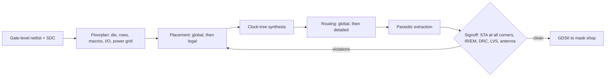
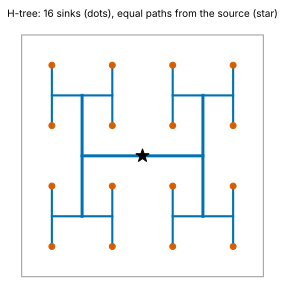
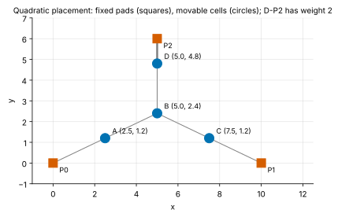
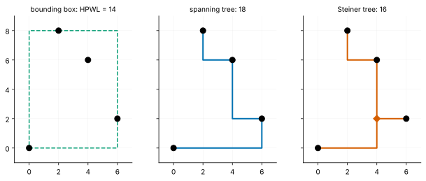

<!-- status: verified -->
# 19-11 · The ASIC Flow II: Floorplan, Place and Route, Signoff

| | |
|---|---|
| **Course** | [19 · Digital VLSI Design](../README.md) |
| **University equivalent** | The physical-design part of a senior VLSI or VLSI-CAD course: floorplanning and power planning, analytical placement, clock-tree synthesis with zero-skew merging, global and detailed routing with maze routers and Steiner trees, parasitic extraction, and signoff (Weste & Harris, *CMOS VLSI Design*, ch. 13–14; Kahng, Lienig, Markov & Hu, *VLSI Physical Design: From Graph Partitioning to Timing Closure*) |
| **Prerequisites** | [19-10](19-10-synthesis-and-sta.md) (netlists, Liberty and STA), [19-09](19-09-layout-and-standard-cells.md) (standard cells, rows and utilization), [19-05](19-05-interconnect.md) (wire resistance, capacitance and the Elmore delay), [19-07](19-07-sequential-timing-and-clocking.md) (clock skew and distribution), [02-06](../../02-complex-numbers-des-and-linear-algebra/chapters/02-06-vectors-matrices-and-linear-systems.md) (linear systems) |
| **Estimated study hours** | 10 |
| **Last verified** | 2026-11-24 |

**Learning objectives.** After this chapter you can:

1. Size a floorplan from cell area and utilization, and derive the IR drop on a power strap to set strap spacing.
2. Formulate placement as wirelength minimization, solve quadratic placement as a linear system, and estimate wirelength with the half-perimeter bound.
3. Derive the zero-skew merging point of two clock subtrees from the Elmore delay and compute the geometry of an H-tree.
4. Route a net with Lee's maze algorithm and compare spanning-tree and Steiner-tree wirelengths.
5. Estimate a routed net's resistance, capacitance and delay from layer data, and explain why timing changes after routing.
6. List the signoff checks a design must pass before tape-out and what each one protects against.

## 1. Big picture

Synthesis (19-10) produces a list of cells and their connections, with no positions. Physical design turns that list into geometry: it decides the chip's outline and power network (**floorplanning**), the location of every cell (**placement**), the clock network (**clock-tree synthesis**, CTS) and the metal path of every wire (**routing**). It then measures the real wires' resistance and capacitance (**extraction**) and proves that the result is manufacturable, matches the netlist, and meets timing and power at every corner (**signoff**). The output is a GDSII or OASIS file of polygons that goes to the mask shop.

- **Wires now dominate.** At advanced nodes most of a path's delay and much of its power can be in the interconnect (19-05), so where cells sit decides whether timing closes.
- **The clock is the biggest net.** It reaches every flip-flop, switches every cycle and sets every timing check's skew.
- **Power delivery is a design.** A weak power grid lowers the supply the cells see, slows them, and can wear out wires by electromigration.
- **Signoff is a gate, not a report.** Masks are expensive and slow to remake; every check exists because skipping it has cost someone a re-spin.
- **Open tools now span the flow.** The OpenROAD project runs RTL to GDSII on open processes such as SKY130, which lets anyone see every step.

## 2. Intuition first

Think of laying out a factory floor for a production line. The machines (cells) must go where the conveyor belts (wires) between them are short; the busiest belts matter most. Power and plumbing (the supply grid) must reach every machine with enough pressure (voltage) everywhere, not just near the main. A public-address system (the clock) must reach every station at the same moment, so it is laid out symmetrically from the center. Corridors (routing tracks) have limited width, so a layout that puts too many belts through one corridor (congestion) cannot be built even if every machine is close to its partners. Finally, the building inspector (signoff) checks the plans against the code before anything is built.

The analogy holds for the structure of the problem: placement trades wirelength against congestion, and the clock and power networks are planned before the signal wiring. It breaks down in two ways. A wire's "cost" is not just its length: its delay grows with the square of its length (19-05) and depends on which metal layer it uses. And the rules are much stricter than a building code: millions of geometric rules (19-09) must hold exactly, and every timing path must meet its deadline at every corner.

*Figure 1. The back half of the ASIC flow. Each step after floorplanning re-runs timing analysis with better wire information; signoff failures send the design back to an earlier step.*

## 3. Theory

### 3.1 Floorplanning and power planning

**Outline and rows.** The core must hold the cells plus room for routing and later buffers. With total cell area $A_{\text{cells}}$ and target **utilization** $u$ (19-09), the core area is $A_{\text{core}} = A_{\text{cells}}/u$. For an aspect ratio $\alpha$ (height over width), the core width is $W = \sqrt{A_{\text{core}}/\alpha}$, and the height is rounded up to a whole number of standard-cell **rows** of height $h_{\text{row}}$. The die adds a margin for the I/O pads or the block's pins. Large blocks such as SRAM macros (19-08) are placed first, usually near the edges, with halos kept free of cells.

**The power grid.** Supply current flows from the pads down a hierarchy: thick top-metal rings and **straps**, then vias, then the thin **rails** that run along every row in metal 1 and touch every cell's power pins. Each piece has resistance, so the cells see a supply lower than the pad voltage, the **IR drop**. Lower supply means slower cells (19-02), so IR drop is a timing problem as well as a reliability one.

**IR drop on a strap.** Take a strap (or rail) of length $L$ and resistance per unit length $r$, drawing a current $i$ per unit length uniformly along it, so the total current is $I = iL$ and the total resistance $R = rL$. Fed from one end at $x = 0$, the current flowing past position $x$ is everything drawn beyond it, $i(L - x)$. Ohm's law for a slice $dx$ gives the voltage drop

$$
\frac{d\,\Delta V}{dx} = r\,i\,(L - x) \quad\Rightarrow\quad \Delta V(x) = r\,i\left(Lx - \frac{x^2}{2}\right),
$$

which is largest at the far end: $\Delta V(L) = r i L^2/2 = IR/2$. Fed from both ends, by symmetry no current crosses the middle, so each half is a one-end-fed strap of length $L/2$:

$$
\Delta V_{\max} = \frac{r\,i\,(L/2)^2}{2} = \frac{r\,i\,L^2}{8} = \frac{I R}{8} .
$$

Feeding from both ends cuts the worst drop by a factor of four. Because the drop grows as $L^2$, halving the spacing between feeds cuts it by four again; solving $r i L^2/8 = \Delta V_{\max}$ gives the largest allowed spacing,

$$
L_{\max} = \sqrt{\frac{8\,\Delta V_{\max}}{r\,i}} .
$$

A real grid is a two-dimensional mesh of such straps on several layers, solved numerically as a large resistor network (nodal analysis, 06-04), with time-varying currents for **dynamic IR drop**.

**Electromigration (EM).** A sustained current density pushes metal atoms along a wire as electrons transfer momentum to them (04-05); over years, voids open and wires fail (25-09). Foundries give a maximum average current density per layer and width, which sets a minimum width for each power strap independently of IR drop.

### 3.2 Placement

**What placement minimizes.** The objective is mainly total wirelength, because wirelength drives capacitance (hence delay and power) and routing demand; timing-driven placers weight the nets on critical paths more heavily. The standard estimate of a net's routed length is its **half-perimeter wirelength** (HPWL), half the perimeter of the smallest box around its pins:

$$
\text{HPWL} = (x_{\max} - x_{\min}) + (y_{\max} - y_{\min}) .
$$

Any rectilinear tree connecting the pins must span the box in both directions, so HPWL is a lower bound on the routed length; for two- and three-pin nets it is exact.

**Quadratic placement.** Replace each two-pin connection between cells $i$ and $j$ by a spring of stiffness $w_{ij}$ and minimize the total spring energy

$$
\Phi = \sum_{(i,j)} w_{ij}\left[(x_i - x_j)^2 + (y_i - y_j)^2\right],
$$

with some pins fixed (I/O pads, macros). The $x$ and $y$ problems separate. Setting $\partial\Phi/\partial x_i = 0$ for every movable cell gives

$$
\Big(\sum_j w_{ij}\Big) x_i - \sum_{j \text{ movable}} w_{ij} x_j = \sum_{k \text{ fixed}} w_{ik}\, x_k ,
$$

a linear system $Q\mathbf{x} = \mathbf{b}$: each cell sits at the weighted average of its neighbors. $Q$ is the connection graph's Laplacian with the fixed pins' weights added to the diagonal. It is symmetric, and positive definite as long as every group of connected cells reaches at least one fixed pin (otherwise the group could slide freely and the energy would have a flat direction), so the minimum is unique. Multi-pin nets are converted to springs by a model such as a clique (every pair connected, with the weights scaled down, for example by $1/(k-1)$ for $k$ pins) or a star with an extra node.

**Why quadratic placement is not enough.** The quadratic optimum piles cells into the middle: it ignores the fact that cells have area. Practical placers alternate wirelength minimization with **spreading**: recursive partitioning of the region (as in early analytical placers), added forces that push cells out of dense areas, or, in the electrostatics analogy of modern placers, cells as positive charges whose mutual repulsion spreads them evenly, solved with a fast Poisson solver. The squared-distance objective also over-penalizes long wires compared with true length, so modern placers minimize smooth approximations of HPWL instead. Global placement is followed by **legalization** (snapping cells into rows and sites without overlap) and **detailed placement** (local swaps and shifts).

### 3.3 Clock-tree synthesis

The clock must reach thousands to millions of flip-flops with small skew, a sharp edge (good slew), modest insertion delay and as little power as possible. CTS builds a buffered tree; the clock is constrained as ideal until then (19-10) and as propagated afterwards.

**H-trees.** In a square of side $D$, a first H centered on the source has a horizontal bar of length $D/2$ and two vertical bars of length $D/2$, total $1.5D$, ending at four points at the centers of the four quadrants. Repeating in each quadrant at half the scale gives level 2, and so on: level $j$ has $4^{j-1}$ H's of size $D/2^j$, total length $1.5D \cdot 2^{j-1}$. After $k$ levels there are $4^k$ endpoints, every one at the same path length from the source,

$$
\ell_{\text{path}} = \sum_{j=1}^{k} \frac{D}{2^{j}} = D\left(1 - 2^{-k}\right), \qquad \ell_{\text{total}} = 1.5D\left(2^{k} - 1\right).
$$

Equal geometry gives nominally zero skew, but sinks are not uniformly spread, and loads differ.

*Figure 2. A two-level H-tree reaching 16 sinks; every source-to-sink path has the same length, $D(1 - 2^{-2}) = 0.75D$.*

**Zero-skew merging.** For arbitrary sink positions and loads, CTS builds the tree bottom-up, merging subtrees in pairs so that each merge has equal Elmore delay (19-05) to every sink below it. Two subtrees have delays $t_1$ and $t_2$ from their roots to their sinks and total capacitances $C_1$ and $C_2$. Join their roots with a wire of length $L$, resistance $r$ and capacitance $c$ per unit length, and drive it at a tapping point a distance $x$ from subtree 1. The Elmore delay from the tap through a wire segment of length $\ell$ to a subtree of capacitance $C$ is $r\ell(c\ell/2 + C)$, so equal delays require

$$
t_1 + r x\left(\frac{c x}{2} + C_1\right) = t_2 + r (L - x)\left(\frac{c (L - x)}{2} + C_2\right).
$$

The $x^2$ terms are $rcx^2/2$ on both sides and cancel, leaving a linear equation:

$$
x = \frac{t_2 - t_1 + r L\left(C_2 + cL/2\right)}{r\left(C_1 + C_2 + cL\right)} .
$$

If $0 \le x \le L$, the merged subtree has delay $t_1 + rx(cx/2 + C_1)$ and capacitance $C_1 + C_2 + cL$, and merging continues upward. If $x$ falls outside the wire, the faster subtree must be slowed by extra wire (**snaking**) or a delay buffer. This exact zero-skew merge is due to Tsay (1991); the deferred-merge embedding (DME) algorithm extends it by choosing where each merge happens so as to also minimize total wire. Production CTS builds on these ideas, inserting buffers to control slew and balancing across several corners.

**Clock power.** The clock net switches twice per cycle, so its power is $P_{\text{clk}} = C_{\text{clk}}V_{DD}^2 f$ with activity 1 (19-06), where $C_{\text{clk}}$ includes every flip-flop's clock pin, the wires and the buffers. That is why clock gating (19-06) and careful tree construction matter.

### 3.4 Routing

**Global and detailed routing.** The routing region is divided into a coarse grid of tiles (global cells, or gcells), each with a capacity of tracks per layer. **Global routing** assigns each net a path through tiles, keeping the demand on every tile edge within capacity; a tile where demand exceeds capacity is **congested**, and **overflow** (excess demand summed over tiles) is the global router's figure of merit. **Detailed routing** then assigns exact tracks and vias within the tiles, obeying every design rule (spacing, minimum area, via enclosure). Layers alternate preferred directions (horizontal, vertical); lower layers are thin and dense for local wiring, upper layers thick for long and power wires.

**Maze routing.** Lee's algorithm (1961) finds a shortest path between two points on a grid with obstacles. Starting from the source, it labels every free neighbor with distance 1, their free neighbors with distance 2, and so on, a breadth-first **wavefront**; when the wave reaches the target, following decreasing labels back gives a shortest path. It always finds a path if one exists, and a shortest one, because breadth-first search visits cells in order of distance. Its cost is proportional to the area searched, which modern routers cut with A* search (prioritizing cells closer to the target) and by routing globally first.

**Steiner trees.** A multi-pin net needs a tree, not a path. A **rectilinear minimum spanning tree** (RMST) connects the pins with horizontal and vertical segments using only pin-to-pin connections; a **rectilinear Steiner minimum tree** (RSMT) may add extra junctions (**Steiner points**) and is never longer. Hanan (1966) showed that some RSMT uses only Steiner points on the grid formed by horizontal and vertical lines through the pins, which makes small cases exactly solvable by search. Hwang (1976) proved that the RMST is never more than 3/2 times the RSMT. With HPWL as a lower bound,

$$
\text{HPWL} \le \text{RSMT} \le \text{RMST} \le \tfrac{3}{2}\,\text{RSMT} .
$$

Finding the RSMT in general is NP-hard, so routers use fast heuristics that come within a few percent.

### 3.5 Extraction and post-route timing

Once routed, every net's geometry is known, and **parasitic extraction** computes its resistance and capacitance (and the coupling capacitance to its neighbors) from the layer data: a segment of length $\ell$ and width $W$ on a layer of sheet resistance $R_\square$ has $R = R_\square \ell/W$ (19-05), and its capacitance follows from per-length tables or field solvers. Vias add resistance at each layer change. The result is written as a SPEF file and read by the timing tool, which now computes each net's delay as an RC tree instead of a lumped load. For a driver of effective resistance $R_d$ (read from the Liberty tables, 19-10) driving a wire of resistance $R_w$ and capacitance $C_w$ into a load $C_L$, the Elmore estimate is

$$
t_{\text{Elmore}} = R_d\,(C_w + C_L) + R_w\left(\frac{C_w}{2} + C_L\right).
$$

The first term is the driver charging all the capacitance; the second is the wire's own distributed RC. On a thin lower metal the second term grows quickly with length, which is why long nets are promoted to thicker upper layers and buffered (19-05's repeaters).

**Why slack moves after routing.** Synthesis estimated wires from statistics (wire-load models) or ignored them; placement estimated them from HPWL; only after routing are detours, layer choices, vias and coupling known. Clock skew also changes from ideal to propagated. Slack typically shrinks, and some paths that passed now fail. Closing them means resizing, buffering, re-routing or moving cells, then re-extracting: the **timing-closure** loop.

**Crosstalk.** A switching neighbor couples charge into a victim through the coupling capacitance (19-05): it can slow or speed the victim's transition (a **delta delay**), or create a glitch on a quiet net. Signoff timing includes these signal-integrity effects.

### 3.6 Signoff

Before tape-out, the layout must pass a set of independent checks, each run by a tool that is trusted for that purpose:

- **Static timing** with extracted parasitics, at every mode and corner, including signal-integrity delays, OCV and CRPR (19-10), for setup, hold, slew, capacitance and pulse-width limits.
- **Power integrity:** static and dynamic IR drop against the voltage budget assumed in timing, and electromigration limits on every power and signal wire.
- **Physical verification** (19-09): design-rule checking (DRC), layout versus schematic (LVS), antenna rules, metal density (fill) and electrical rule checks (ERC).
- **Logical equivalence** between the RTL, the synthesized netlist and the final netlist (19-13), because every step after synthesis edits the netlist (buffers, resizing, scan).

Signoff tools are often different from the implementation tools that built the layout, so that errors in one are caught by the other.

### 3.7 An open flow: OpenROAD on SKY130

OpenROAD (BSD 3-clause license) began in June 2018 under DARPA's IDEA program with the goal of "24-hour, no human in the loop" layout generation [R-319]. Its modules map one to one onto this chapter:

| Step | OpenROAD module | Method (from its documentation) |
|---|---|---|
| Global placement | `gpl`, based on RePlAce | Electrostatic analogy: cells as charges, density from a Poisson equation, solved with Nesterov's method |
| Legalization | `dpl`, from OpenDP | Moves cells to legal row sites with minimum displacement |
| Clock-tree synthesis | `cts`, TritonCTS 2.0 | Clusters sinks, then builds an H-tree over the cluster buffers |
| Global routing | `grt`, FastRoute-based (with an optional CUGR engine) | Routes nets through gcells, producing guides for the detailed router |
| Detailed routing | `drt`, TritonRoute | Pin access, track assignment, routing, then search and repair against its own DRC engine |
| Extraction | `rcx`, OpenRCX | Resistance and capacitance from wire geometry and neighbors, written as SPEF |

The OpenROAD-flow-scripts (ORFS) platform for SKY130's high-density library runs these with the typical-corner Liberty file, routes signals on metal 1 to metal 5 and clocks on metal 3 and above, and targets core utilizations of 35 % to 50 % with a placement density of 0.60 in its reference designs [R-319]. Its current SKY130 configuration selects the CUGR global router, which OpenROAD's own documentation still marks as not ready for production: open flows move quickly, so always read the configuration you actually run. The LibreLane flow (successor to OpenLane) wraps the same tools with Yosys synthesis and adds signoff steps: Magic and KLayout DRC, an XOR of the two tools' GDSII output, Netgen LVS, antenna repair and equivalence checking [R-319].

## 4. Worked examples

### Example 19-11.1 · Sizing a floorplan (tier A)

**Setup.** A SKY130 block has 300 000 µm² of standard cells (about 0.3 mm²). Plan a square core at 60 % utilization with 2.72 µm rows and 0.46 µm sites, and a 40 µm margin on every side for pins and the power ring. Find the core width, the number of rows and the core height, the sites per row, the achieved utilization and the block area.

**Solution.** Core area $300\,000/0.60$ = **500 000** µm²; width $\sqrt{500\,000}$ = **707.11** µm. Rows: $707.11/2.72 = 259.97$, rounded up to **260**, height $260 \times 2.72$ = **707.20** µm. Sites per row: $\lfloor 707.11/0.46 \rfloor$ = **1537**. Achieved utilization $300\,000/(707.11 \times 707.20)$ = **59.99** %. Block $(707.11 + 80)(707.20 + 80)$ µm² = **0.6196** mm².

**Units check.** µm × µm = µm²; 10⁶ µm² = 1 mm².

**Sanity check.** A 60 % utilization leaves 40 % of the row area empty, which is room for routing, buffers added later, and spreading; the margin adds 24 % to the area of this small block, less for large ones.

### Example 19-11.2 · IR drop on a metal-1 rail (tier B)

**Setup.** SKY130's metal 1 has a sheet resistance of 0.125 Ω/□ and an electromigration limit of 2.8 mA per µm of width (average current, at a 90 °C junction temperature) [R-319]. Take a standard-cell row's metal-1 supply rail as 0.48 µm wide (an assumption for this example), fed by vertical straps at both ends of each span, with the cells along it drawing 2 µA per µm of rail on average. (a) Find the rail's resistance per micrometre and the worst IR drop for straps 200 µm apart. (b) What would it be with a feed at one end only? (c) What strap spacing keeps the drop within 1 % of 1.8 V? (d) Check electromigration at a feed for the 200 µm spacing.

**Solution.** (a) $r = R_\square/W = 0.125/0.48$ = **0.2604** Ω/µm. The drop fed at both ends is $riL^2/8 = 0.2604 \times 2 \times 10^{-6} \times 200^2/8$ V = **2.60** mV.

(b) One end: $riL^2/2$ = **10.4** mV, four times as much.

(c) $L_{\max} = \sqrt{8 \times 0.018/(0.2604 \times 2 \times 10^{-6})}$ = **526** µm.

(d) Each feed supplies half the span's current, $iL/2 = 2\ \mu\text{A/µm} \times 100\ \mu\text{m}$ = **0.20** mA. The rail can carry $2.8 \times 0.48$ = **1.34** mA, a margin of **6.7** times.

**Units check.** (Ω/µm)(A/µm)(µm²) = V; (mA/µm)(µm) = mA.

**Sanity check.** A few millivolts on a 1.8 V supply is under 0.2 %; IR drop in practice is dominated by the upper grid and by local bursts of switching current (dynamic IR drop), which this average-current model does not capture.

### Example 19-11.3 · Quadratic placement (tier B)

**Setup.** Three pads are fixed: P0 at (0, 0), P1 at (10, 0) and P2 at (5, 6). Four cells are movable: a chain P0–A–B–C–P1, and a cell D connected to B and to P2. Every connection has weight 1 except D–P2, which has weight 2. Find the quadratic-placement positions and the total Manhattan length of the connections.

**Solution.** In $x$, setting each partial derivative of the energy to zero:

- A (neighbors P0, B): $2x_A - x_B = 0$.
- B (neighbors A, C, D): $3x_B - x_A - x_C - x_D = 0$.
- C (neighbors B, P1): $2x_C - x_B = 10$.
- D (neighbors B and P2 with weight 2): $3x_D - x_B = 2 \times 5 = 10$.

From the first, third and fourth, $x_A = x_B/2$, $x_C = (10 + x_B)/2$ and $x_D = (10 + x_B)/3$; substituting into the second, $3x_B - x_B/2 - (10 + x_B)/2 - (10 + x_B)/3 = 0$, so $\tfrac{5}{3}x_B = \tfrac{25}{3}$ and $x_B = 5$. Then $x_A = 2.5$, $x_C = 7.5$, $x_D = 5$.

In $y$ the same matrix appears with right-hand sides 0, 0, 0 and $2 \times 6 = 12$: $y_A = y_B/2$, $y_C = y_B/2$, $y_D = (12 + y_B)/3$, and $3y_B - y_B - (12 + y_B)/3 = 0$ gives $\tfrac{5}{3}y_B = 4$, $y_B = 2.4$; then $y_A = y_C = 1.2$ and $y_D = 4.8$.

Positions: A (**2.5**, **1.2**), B (**5.0**, **2.4**), C (**7.5**, **1.2**), D (**5.0**, **4.8**). Manhattan lengths: P0–A 3.7, A–B 3.7, B–C 3.7, C–P1 3.7, B–D 2.4, D–P2 1.2, total **18.4**.

*Figure 3. Example 3's quadratic placement. Each cell is the weighted average of its neighbors; the double-weight spring pulls D most of the way to P2.*

**Units check.** Positions in the pads' units; the energy is in weight × length².

**Sanity check.** Each cell is the weighted average of its neighbors: B is the average of A, C and D, $((2.5 + 7.5 + 5)/3, (1.2 + 1.2 + 4.8)/3) = (5, 2.4)$. The left-right symmetry of the pads gives $x_B = x_D = 5$.

### Example 19-11.4 · A zero-skew merge (tier B)

**Setup.** Two clock subtrees each have an Elmore delay of 15 ps to their sinks; subtree 1 has 30 fF of capacitance and subtree 2 has 50 fF. Their roots are 400 µm apart on a wire with r = 0.2 Ω/µm and c = 0.2 fF/µm. (a) Where should the wire be driven? (b) What are the merged delay and capacitance? (c) Where would the tap be if both subtrees had 30 fF?

**Solution.** (a) With $t_1 = t_2$, the formula reduces to $x = L(C_2 + cL/2)/(C_1 + C_2 + cL)$. Here $cL = 80$ fF: $x = 400 \times (50 + 40)/(30 + 50 + 80)$ = **225** µm from subtree 1, past the midpoint toward the heavier load.

(b) Delay $15 + 0.2 \times 225 \times (0.2 \times 112.5 + 30) \times 10^{-3}$ ps $= 15 + 45 \times 52.5 \times 10^{-3}$ = **17.36** ps (17.3625; from the other side, $15 + 0.2 \times 175 \times (17.5 + 50) \times 10^{-3} = 17.3625$ ps). Capacitance $30 + 50 + 80$ = **160** fF.

(c) Equal loads and equal delays: the midpoint, **200** µm.

**Units check.** Ω × fF = 10⁻¹⁵ s; with r in Ω/µm and lengths in µm, $rx$ is in Ω.

**Sanity check.** The heavier subtree gets the shorter wire, so its larger capacitance sees less resistance. The lab confirms both sinks' Elmore delays in ngspice for Problem 7's merge.

### Example 19-11.5 · Spanning and Steiner trees (tier B)

**Setup.** A four-pin net has pins at (0, 0), (4, 6), (6, 2) and (2, 8) (units of routing pitch). Find its HPWL, RMST and RSMT lengths.

**Solution.** HPWL: $x$ spans 0 to 6 and $y$ spans 0 to 8: **14**. RMST by Prim's algorithm from (0, 0): the nearest pin is (6, 2) at 8; then (4, 6) at 6 from (6, 2); then (2, 8) at 4 from (4, 6): total **18**. RSMT: searching the Hanan grid, one Steiner point at (4, 2) gives edges (0, 0)–(4, 2) of 6, (4, 2)–(6, 2) of 2, (4, 2)–(4, 6) of 4 and (4, 6)–(2, 8) of 4: total **16**. The RMST is **1.125** times the RSMT.

*Figure 4. The bounding box gives a lower bound (14); the spanning tree connects pins only to pins (18); a Steiner point at (4, 2) on the Hanan grid lets two branches share wire (16).*

**Units check.** Lengths in routing pitches.

**Sanity check.** $14 \le 16 \le 18 \le 1.5 \times 16$, as §3.4's chain of inequalities requires.

### Example 19-11.6 · Post-route delay on two layers (tier C)

**Setup.** An inverter `inv_1` drives a 1 mm net to another `inv_1` input (2.302 fF, 19-10). Use the driver's effective pull-up resistance from 19-10's Liberty table, 5.64 kΩ, and the open flow's per-layer wire estimates for SKY130: metal 1, 1.20565 Ω/µm and 0.172375 fF/µm; metal 3, 0.166281 Ω/µm and 0.214962 fF/µm [R-319]. With the Elmore estimate of §3.5, find the delay (a) on metal 1 and (b) on metal 3. (c) Repeat both with a driver eight times stronger (705 Ω). (d) Repeat (c) for a 3 mm net.

**Solution.** (a) Metal 1: $C_w = 172.375$ fF, $R_w = 1205.65$ Ω. Driver term $5640 \times (172.375 + 2.302)$ fF = 985.18 ps; wire term $1205.65 \times (86.19 + 2.302)$ fF = 106.69 ps; total **1091.87** ps.

(b) Metal 3: $C_w = 214.962$ fF, $R_w = 166.281$ Ω: $5640 \times 217.264$ fF + $166.281 \times 109.783$ fF = **1243.62** ps. Metal 3 is *slower*: with a weak driver the delay is almost all driver resistance times total capacitance, and the flow's estimate gives metal 3 more capacitance per micrometre.

(c) With 705 Ω: metal 1 **229.83** ps, metal 3 **171.43** ps. Now the wire's own RC matters, and the thicker layer wins by 25 %.

(d) At 3 mm with the strong driver: metal 1 **1309.73** ps, metal 3 **618.26** ps. The wire term grows as the square of the length (on metal 1 it is 944 ps of the total), so the lower-resistance layer is more than twice as fast. The lab finds the lengths at which metal 3 starts to win: about 2.8 mm with the weak driver and 0.32 mm with the strong one.

**Units check.** Ω × fF = fs.

**Sanity check.** The lab's ngspice model of case (a), a 40-section π ladder, gives the same Elmore delay, and a 50 % delay of 767.66 ps, 0.70 times the Elmore value: the Elmore delay is an upper bound, and for a driver-dominated net the 50 % delay is close to ln 2 times it. Layer choice only helps once the wire, not the driver, dominates; that is why long nets get both upper metal and repeaters (19-05).

<!-- answer-key -->

| ID | Quantity | Value | Unit |
|---|---|---|---|
| Ex 19-11.1a | core area | 500000 | µm² |
| Ex 19-11.1b | core width | 707.11 | µm |
| Ex 19-11.1c | rows | 260 | — |
| Ex 19-11.1d | core height | 707.20 | µm |
| Ex 19-11.1e | sites per row | 1537 | — |
| Ex 19-11.1f | achieved utilization | 59.99 | % |
| Ex 19-11.1g | block area | 0.6196 | mm² |
| Ex 19-11.1h | area added by the margin | 24 | % |
| Ex 19-11.2a | metal-1 rail resistance per length | 0.2604 | Ω/µm |
| Ex 19-11.2b | worst drop, both ends fed | 2.60 | mV |
| Ex 19-11.2c | worst drop, one end fed | 10.4 | mV |
| Ex 19-11.2d | largest spacing for 18 mV | 526 | µm |
| Ex 19-11.2e | current at a feed | 0.20 | mA |
| Ex 19-11.2f | rail electromigration limit | 1.34 | mA |
| Ex 19-11.2g | electromigration margin | 6.7 | — |
| Ex 19-11.3a | x of A | 2.5 | — |
| Ex 19-11.3b | y of A | 1.2 | — |
| Ex 19-11.3c | x of B | 5.0 | — |
| Ex 19-11.3d | y of B | 2.4 | — |
| Ex 19-11.3e | x of C | 7.5 | — |
| Ex 19-11.3f | y of C | 1.2 | — |
| Ex 19-11.3g | x of D | 5.0 | — |
| Ex 19-11.3h | y of D | 4.8 | — |
| Ex 19-11.3i | total Manhattan length | 18.4 | — |
| Ex 19-11.4a | tapping point from subtree 1 | 225 | µm |
| Ex 19-11.4b | merged delay | 17.36 | ps |
| Ex 19-11.4c | merged capacitance | 160 | fF |
| Ex 19-11.4d | tap with equal loads | 200 | µm |
| Ex 19-11.5a | HPWL | 14 | — |
| Ex 19-11.5b | RMST length | 18 | — |
| Ex 19-11.5c | RSMT length | 16 | — |
| Ex 19-11.5d | RMST over RSMT | 1.125 | — |
| Ex 19-11.6a | delay on metal 1, weak driver | 1091.87 | ps |
| Ex 19-11.6b | delay on metal 3, weak driver | 1243.62 | ps |
| Ex 19-11.6c | delay on metal 1, strong driver | 229.83 | ps |
| Ex 19-11.6d | delay on metal 3, strong driver | 171.43 | ps |
| Ex 19-11.6e | delay on metal 1, 3 mm, strong driver | 1309.73 | ps |
| Ex 19-11.6f | delay on metal 3, 3 mm, strong driver | 618.26 | ps |
| Ex 19-11.6g | wire term on metal 1, 3 mm | 944 | ps |
| Ex 19-11.6h | metal 3 advantage, 1 mm, strong driver | 25 | % |
| Ex 19-11.6i | driver term on metal 1, weak driver | 985.18 | ps |
| Ex 19-11.6j | wire term on metal 1, weak driver | 106.69 | ps |
| Txt 19-11.a | core area saved closing at 70 % instead of 50 % | 29 | % |

## 5. Simulate it

The lab ([labs/19-11-lab](../labs/19-11-lab/README.md)) implements this chapter's models in `pnr.py` and checks two of them in ngspice: `strap.cir` (a 200-segment power strap with a hot spot) and `merge.cir` (a zero-skew clock merge, with each sink's Elmore delay measured as the area above its step response).

**Predict, then run.**

1. Predict the drop at the middle of Problem 12's strap, then run `strap.cir`.
2. Predict where 40 randomly connected cells land under quadratic placement with pads on the boundary; plot them.
3. Predict the average and worst RMST/RSMT ratio for random five-pin nets, then compute them for 200 nets.
4. Predict the direction the zero-skew tap moves as one subtree's load grows; run `merge.cir` and sweep the load.
5. Predict the length at which a routed net's own RC delay equals its driver's RC delay on metal 1 and on metal 4.

## 6. Engineering tradeoffs

| Knob | Improves | Costs | Typical decision owner |
|---|---|---|---|
| Lower utilization | Routability, timing (room for buffers and sizing) | Area, hence die cost | Physical-design lead with product management |
| Denser power grid (more or wider straps) | IR drop, electromigration margin | Routing tracks taken from signals | Power-integrity engineer |
| Timing-driven placement weights | Critical-path delay | Total wirelength, congestion elsewhere | Physical-design engineer |
| Tighter clock-skew target | Setup and hold margins | Clock power, buffers, wire | Clock (CTS) engineer |
| Promoting nets to upper metal | Delay of long nets | Scarce upper-layer tracks, vias | Routing and timing engineers |
| More signoff corners and checks | Confidence before tape-out | Runtime, schedule | Signoff methodology team |

## 7. Numbers to know

| Quantity | Value | Notes |
|---|---|---|
| Core area | $A_{\text{cells}}/u$ | Rows rounded up |
| Strap IR drop | $IR/8$ (both ends), $IR/2$ (one end) | Uniform load; $\propto L^2$ |
| Largest feed spacing | $\sqrt{8\Delta V_{\max}/(ri)}$ | |
| HPWL | $\Delta x + \Delta y$ | Exact for 2–3 pins, a lower bound otherwise |
| Tree lengths | HPWL ≤ RSMT ≤ RMST ≤ 1.5 RSMT | Hanan; Hwang |
| Zero-skew tap | $x = \dfrac{t_2 - t_1 + rL(C_2 + cL/2)}{r(C_1 + C_2 + cL)}$ | Elmore |
| H-tree, $k$ levels | $4^k$ sinks; path $D(1 - 2^{-k})$; total $1.5D(2^k - 1)$ | Square of side $D$ |
| Routed-net delay | $R_d(C_w + C_L) + R_w(C_w/2 + C_L)$ | Elmore |
| Clock power | $C_{\text{clk}}V_{DD}^2f$ | Activity 1 |

| SKY130 metal stack | li1 plus 5 metals; 0.125 Ω/□ (met1, met2), 0.047 (met3, met4), about 0.029 (met5) | As of Nov 2026 [R-319] |
| SKY130 minimum width / pitch | 0.14/0.34 µm (met1); 0.30/0.68 (met3); 1.6/3.4 (met5) | Tech LEF and DRC manual [R-319] |
| SKY130 EM limit (average) | 2.8 mA/µm (met1, met2), 6.8 (met3, met4), 10.17 (met5) at 90 °C | Tech LEF comments only [R-319] |
| SKY130 antenna limit, metal 1 | ratio 400 without a diode | DRC manual [R-319]; 19-09's illustrative value |
| Open-flow SKY130 targets | core utilization 35–50 %, placement density 0.60 | ORFS reference designs, Nov 2026 [R-319] |

## 8. Common mistakes

- **Filling the core to 95 % at floorplan.** Cells grow and buffers are added during optimization, CTS and hold fixing; a block that starts too full will not route.
- **Feeding straps from one end.** The drop is four times larger than with feeds at both ends, and grows with the square of the length.
- **Trusting HPWL for large nets.** It is a lower bound; nets with many pins, and clock nets, are much longer.
- **Treating the Elmore delay as the 50 % delay.** The Elmore delay (the first moment of the response) bounds the 50 % delay from above for RC trees; scaled by ln 2, as in 19-05, it can fall below. Use it to compare and balance paths, and signoff timing for absolute values.
- **Judging timing before routing.** Placement-stage timing uses estimated wires and ideal clocks; slack moves after CTS and routing.
- **Waiving signoff checks to make a date.** Every check exists because a chip failed without it; a waiver needs an analysis, not a schedule.

## 9. Practitioner lens

### State of the art (as of Nov 2026)

- **Open tools have taped out real chips [Established].** OpenROAD's documentation reports use "for full physical implementation in over 600 tapeouts in SKY130 and GF180 through the Google-sponsored, Efabless MPW shuttle and ChipIgnite programs" (a project claim). Google's open shuttle program launched in November 2020; by November 2023 it had run eight SKY130 shuttles and a GF180 test run with 40 slots each, manufacturing 360 designs from more than 600 submissions, and it wound down after the GF180 MPW-1 run of 2023–24 [R-319].
- **The shuttle landscape changed [Established].** Efabless, which ran the shuttles, shut down in early 2025 (reported by Tiny Tapeout on 1 March 2025); UmbraLogic, trading as ChipFoundry, acquired its assets and as of November 2026 lists SKY130 tape-outs at $14,950 for up to 15 mm². wafer.space offers GF180MCU shuttles (an early-bird 3.93 × 5.12 mm slot at $7,000, next deadline 16 December 2026). The Caravel harness used by the original shuttles gives a 2.92 × 3.52 mm (about 10 mm²) user area with 38 I/Os [R-319]. Prices and schedules change; check before planning.
- **Open flows are maintained but evolving [Established].** OpenLane 1 is in maintenance mode and not recommended for new designs; OpenLane 2 development moved to LibreLane (FOSSi Foundation), whose latest stable release is 3.0.17. ORFS removed its in-repository quality-of-results thresholds in September 2026 in favor of an external dashboard; the last in-repository bounds accepted negative setup slack on several SKY130 reference designs (for example −1.52 ns on `gcd`), so they were regression guards, not timing-clean results [R-319].
- **Leading-edge interconnect is deep [Industry estimate].** The IRDS 2024 roadmap refers in passing to "10−15 metal layers for logic IC's", and TechInsights' analysis of Intel 4 shows an 18-layer metal stack, against SKY130's five metals plus local interconnect. I could not read a foundry's primary figure for N3, N2 or 18A [R-319].
- **Commercial implementation [Vendor claim].** Synopsys sells Fusion Compiler (RTL to GDSII) and IC Compiler II; Cadence launched Innovus in 2015 claiming "typically 10 to 20 percent better PPA and up to 10X full-flow speedup" [R-319].

### Why it matters commercially

- **Utilization is die cost.** The core area is cell area divided by utilization; a block closed at 70 % instead of 50 % is 29 % smaller, with matching gains in die cost and yield. Physical design teams are measured on the utilization at which they can close timing and routing.
- **Power integrity limits frequency and lifetime.** IR drop costs speed at every corner, and electromigration sets the product's lifetime at temperature; both decide how much metal the power grid takes from signal routing.
- **Open flows lower the barrier, not the bar.** A small team can now tape out a SKY130 design for under $15 000 (ChipFoundry's listed price), but signoff quality, IP and the foundry relationship still separate a demonstrator from a product.

### Marketing vs Reality

- **"10 to 20 percent better PPA" from a new tool.** Ask: compared with which tool and version, on which designs, with what effort from expert users of each? A flow tuned by its vendor on chosen blocks is not a controlled experiment, and gains rarely add up across successive releases.
- **"Taped out with open-source tools."** True for hundreds of SKY130 and GF180 designs; ask which signoff checks were run (DRC, LVS, timing at which corners), whether the chip worked, and what was hand-fixed. Open-flow regression targets have tolerated negative slack.
- **"Our design closed at X GHz."** At which corner, with what utilization and with what clock uncertainty and derates (19-10)? A block closed at 35 % utilization with optimistic margins is a different product from one closed at 70 % with signoff margins.

### Questions for engineering leaders

1. *"What utilization did your blocks close at, and how much area went to buffers inserted after placement?"* Strong: per-block numbers and trend across tape-outs. Evasive: "it routes".
2. *"What is your worst static and dynamic IR drop, and what voltage does timing signoff assume?"* Strong: drop maps and a stated budget used consistently. Evasive: IR drop treated only as a reliability check.
3. *"How did slack change from placement to post-route signoff, and how many timing-closure iterations did the last tape-out take?"* Strong: measured correlation and a planned margin. Evasive: surprises close to tape-out.
4. *"Which signoff tools do you trust, and are any of them the same code as your implementation tools?"* Strong: independent, foundry-qualified signoff. Evasive: the implementation tool's own reports.
5. *"For an open-source flow: which checks ran at signoff and what did silicon show?"* Strong: DRC/LVS clean, multi-corner timing, measured results. Evasive: "it passed the flow".

## 10. Concept check

1. Why does feeding a strap from both ends reduce its worst IR drop by a factor of four rather than two?

   

Answer

   Two effects multiply. Each half is a one-end-fed strap of half the length, and the drop of a one-end-fed strap is $riL^2/2$: halving the length quarters it. Feeding from one end puts the worst point at the far end ($IR/2$); feeding from both puts it at the middle with $IR/8$.

   

2. In quadratic placement, why does each cell end up at the weighted average of its neighbors?

   

Answer

   The partial derivative of $\sum w_{ij}(x_i - x_j)^2$ with respect to $x_i$ is $2\sum_j w_{ij}(x_i - x_j)$; setting it to zero gives $x_i = \sum_j w_{ij}x_j/\sum_j w_{ij}$. Fixed pins enter the same average.

   

3. Why is HPWL exact for a three-pin net but only a lower bound for a ten-pin net?

   

Answer

   Any tree must span the bounding box in $x$ and in $y$, so HPWL is a lower bound. With three pins, a trunk through the middle pin spanning one direction plus two branches spanning the other achieves it. With many pins, branches to interior pins add length the box does not count.

   

4. In the zero-skew formula, why do the $x^2$ terms cancel, and what does that make possible?

   

Answer

   A wire segment's own Elmore delay is $rc\ell^2/2$; the two segments contribute $rcx^2/2$ and $rc(L - x)^2/2$, whose $x^2$ parts are equal. The balance condition is therefore linear in $x$, giving a closed-form tap for every merge, which makes bottom-up tree construction fast.

   

5. What does a maze router guarantee, and why is it not used alone for whole chips?

   

Answer

   Breadth-first expansion visits cells in order of distance, so it finds a shortest path whenever one exists. Its cost grows with the area searched, and it routes one net at a time, so the order of nets and congestion are not handled; full-chip routers do global routing over a coarse grid first and use faster searches (A*) within it.

   

6. A net on metal 1 is too slow. Why might moving it to metal 4 help, and what does it cost?

   

Answer

   Upper layers are thicker and usually wider, so their resistance per length is much lower and the wire's own RC term shrinks. The costs are vias (resistance and area), tracks on scarce upper layers, and sometimes detours to reach them.

   

7. Why are signoff tools often from a different vendor or code base than the implementation tools?

   

Answer

   An independent tool is unlikely to share the implementation tool's modeling errors or bugs, so a result both agree on is more trustworthy. Signoff tools are also qualified against silicon by foundries, which implementation tools optimizing for speed may not be.

   

Problems: [19-11 problem set](../problems/19-11-problems.md) · Solutions: [19-11 solutions](../solutions/19-11-solutions.md)

## 11. Key terms

[Floorplan](../../../reference/glossary.md#floorplan) · [Utilization](../../../reference/glossary.md#utilization) · [IR drop](../../../reference/glossary.md#ir-drop) · [Electromigration](../../../reference/glossary.md#electromigration) · [Half-perimeter wirelength (HPWL)](../../../reference/glossary.md#half-perimeter-wirelength-hpwl) · [Quadratic placement](../../../reference/glossary.md#quadratic-placement) · [Legalization](../../../reference/glossary.md#legalization) · [Clock-tree synthesis (CTS)](../../../reference/glossary.md#clock-tree-synthesis-cts) · [H-tree](../../../reference/glossary.md#h-tree) · [Zero-skew merge](../../../reference/glossary.md#zero-skew-merge) · [Maze routing](../../../reference/glossary.md#maze-routing) · [Steiner tree](../../../reference/glossary.md#steiner-tree) · [Routing congestion](../../../reference/glossary.md#routing-congestion) · [Parasitic extraction](../../../reference/glossary.md#parasitic-extraction) · [Signoff](../../../reference/glossary.md#signoff) · [Tape-out](../../../reference/glossary.md#tape-out)

## 12. Connections

- **Builds on:** [19-10](19-10-synthesis-and-sta.md) (the netlist and STA), [19-09](19-09-layout-and-standard-cells.md) (cells, rows and physical verification), [19-05](19-05-interconnect.md) (wire RC, Elmore delay, repeaters), [19-07](19-07-sequential-timing-and-clocking.md) (skew and clock distribution), [19-06](19-06-power-and-low-power-design.md) (clock gating and power), [06-04](../../06-circuit-analysis-1-dc/chapters/06-04-nodal-analysis.md) (nodal analysis for power grids).
- **Next:** [19-12](19-12-design-for-test.md) adds scan chains and test logic, which placement and routing must accommodate.
- **Used later:** [19-13](19-13-verification-methods.md) (equivalence checking of the final netlist), [25-09](../../25-fabrication-packaging-test-and-reliability/chapters/25-09-reliability-physics.md) (electromigration and reliability).

## 13. Further study

- A. B. Kahng, J. Lienig, I. L. Markov and J. Hu, *VLSI Physical Design: From Graph Partitioning to Timing Closure*, 2nd ed. (Springer, 2022): partitioning, floorplanning, placement, routing and clock trees with algorithms.
- Weste & Harris, *CMOS VLSI Design*, 4th ed., §13.4 (clock distribution), §13.3 (power distribution) and ch. 14.
- The OpenROAD and OpenROAD-flow-scripts documentation, for an open flow whose every step can be inspected.

## 14. Sources

1. N. H. E. Weste and D. M. Harris, *CMOS VLSI Design: A Circuits and Systems Perspective*, 4th ed., Addison-Wesley, 2011, ch. 13–14.
2. A. B. Kahng, J. Lienig, I. L. Markov and J. Hu, *VLSI Physical Design: From Graph Partitioning to Timing Closure*, 2nd ed., Springer, 2022.
3. C. Y. Lee, "An algorithm for path connections and its applications," *IRE Trans. Electronic Computers* EC-10(3), 1961.
4. M. Hanan, "On Steiner's problem with rectilinear distance," *SIAM J. Applied Mathematics* 14(2), 1966; F. K. Hwang, "On Steiner minimal trees with rectilinear distance," *SIAM J. Applied Mathematics* 30(1), 1976.
5. J. M. Kleinhans, G. Sigl, F. M. Johannes and K. J. Antreich, "GORDIAN: VLSI placement by quadratic programming and slicing optimization," *IEEE TCAD* 10(3), 1991; J. Lu et al., "ePlace: electrostatics-based placement using fast Fourier transform and Nesterov's method," *ACM TODAES* 20(2), 2015; C.-K. Cheng, A. B. Kahng, I. Kang and L. Wang, "RePlAce," *IEEE TCAD* 38(9), 2019.
6. R.-S. Tsay, "Exact zero skew," *Proc. ICCAD*, 1991 (journal version *IEEE TCAD* 12(2), 1993); T.-H. Chao, Y.-C. Hsu, J.-M. Ho, K. D. Boese and A. B. Kahng, "Zero skew clock routing with minimum wirelength," *IEEE Trans. Circuits and Systems II* 39(11), 1992.
7. SkyWater SKY130 PDK documentation and the `sky130_fd_sc_hd` tech LEF: metal stack, sheet resistances, widths, pitches, electromigration, antenna and density rules — [R-319].
8. OpenROAD, OpenROAD-flow-scripts, LibreLane and OpenLane documentation, and the OpenROAD papers (DAC 2019 and the "self-driving" overview) — [R-319].
9. Google Open Source Blog (8 Nov 2023), Tiny Tapeout (1 Mar 2025 and Sep 2025 FAQ), ChipFoundry, wafer.space and the Caravel documentation — [R-319].
10. IRDS 2024 More Moore; TechInsights analysis of Intel 4 in Semiconductor Digest (Oct 2022) — [R-319].
11. Synopsys Fusion Compiler and IC Compiler II pages; Cadence Innovus launch release (10 Mar 2015, via reprint) — [R-319].
12. 19-10's SKY130 Liberty data (effective drive resistance and pin capacitance) — [R-318].
