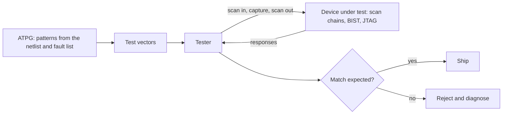
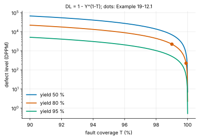

<!-- status: verified -->
# 19-12 · Design for Test: Scan, BIST and ATPG

| | |
|---|---|
| **Course** | [19 · Digital VLSI Design](../README.md) |
| **University equivalent** | The testing chapter of a senior VLSI course, or the first half of a graduate VLSI-testing course: defects, yield and defect level; stuck-at and delay fault models; fault simulation and test generation; scan design; logic and memory built-in self-test; test compression; boundary scan (Weste & Harris, *CMOS VLSI Design*, ch. 15; Bushnell & Agrawal, *Essentials of Electronic Testing*; Wang, Wu & Wen, *VLSI Test Principles and Architectures*) |
| **Prerequisites** | [19-11](19-11-place-route-signoff.md) (the physical flow), [19-07](19-07-sequential-timing-and-clocking.md) (flip-flops and timing), [19-08](19-08-sram-design.md) (SRAM arrays), [08-07](../../08-digital-logic-design/chapters/08-07-registers-counters-shift-registers.md) (shift registers and LFSRs), [08-05](../../08-digital-logic-design/chapters/08-05-verilog-and-testbenches.md) (Verilog testbenches), [03-02](../../03-probability-statistics-and-random-variables/chapters/03-02-random-variables-and-distributions.md) (probability) |
| **Estimated study hours** | 6 |
| **Last verified** | 2026-11-24 |

**Learning objectives.** After this chapter you can:

1. Relate yield, fault coverage and the defect level of shipped parts, and derive the Williams–Brown model.
2. Enumerate and collapse single stuck-at faults, and explain what delay-fault and other models add.
3. Generate a test for a stuck-at fault by sensitizing, propagating and justifying it, and recognize a redundant fault.
4. Compute scan test time and data volume, and explain how test compression reduces them.
5. Design logic and memory BIST from LFSRs, MISRs and March algorithms, and quantify signature aliasing.
6. Describe JTAG boundary scan and the role of in-field test in safety-critical and datacenter products.

## 1. Big picture

Manufacturing is imperfect: a particle, a missing via or a thin oxide turns a correct design into a defective die. **Testing** separates good dies from bad ones after fabrication, and **design for test** (DFT) is the set of structures added to a chip so that this can be done quickly and thoroughly: scan chains that make every flip-flop controllable and observable, built-in self-test engines for memories and logic, compression logic that shrinks test data, and boundary scan for boards. Test costs tester time and silicon area, but shipping a bad part costs far more, especially in cars and datacenters.

- **Yield is never 100 %.** Some fraction of every wafer is defective; test decides which dies are shipped.
- **Coverage sets quality.** The fraction of modeled faults a test detects determines how many bad parts escape, measured in defective parts per million (DPPM).
- **Scan makes sequential logic testable.** Without it, setting and observing internal state through the pins is practically impossible for large designs.
- **Test is a recurring cost.** Every die spends seconds on an expensive tester; test time and data volume are engineered like any other resource.
- **Test continues in the field.** Safety standards and large server fleets now require self-test during operation, not just at the factory.

## 2. Intuition first

Testing a chip is like inspecting a sealed office building by sending letters through its mail slot and reading the replies. You cannot look inside; you can only choose inputs and observe outputs. If every room's mail must pass through dozens of other rooms first, a broken desk deep inside is nearly impossible to detect. **Scan** is like installing a pneumatic tube that connects every room's in-tray and out-tray in a chain: you can load any contents into every room directly, let the building work for one step, and read back what every room produced. **BIST** is a self-inspection routine built into the building, run by pressing one button.

The analogy captures the core problems, controllability (can you set a node?) and observability (can you see it?), and the solution of turning sequential depth into direct access. It breaks down in two places. A defect is a physical event, not a "broken desk" of a known kind: tests target **fault models**, abstractions of how defects behave, and their value depends on how well the models track real defects. And the tube itself costs space and time: scan multiplexers add area and delay to every flip-flop, and shifting data through long chains dominates test time.

*Figure 1. Production test. Patterns generated from the netlist are applied through scan chains and test access ports; any mismatch with the fault-free response rejects the die.*

## 3. Theory

### 3.1 Defects, yield and defect level

Let a fraction $Y$ of manufactured dies be free of defects (the **yield**). A test detects a fraction $T$ of the modeled faults (the **fault coverage**). The **defect level** DL is the fraction of dies that pass the test but are defective: the escapes that customers receive.

**The Williams–Brown model.** Suppose a die has $N$ possible fault sites, each faulty independently with probability $p$. A die is good with probability $Y = (1 - p)^N$. The test examines $TN$ of the sites, so a die passes with probability $(1 - p)^{TN} = Y^T$ (all examined sites fault-free). Every good die passes, so

$$
\text{DL} = P(\text{defective} \mid \text{passes}) = 1 - \frac{P(\text{good})}{P(\text{passes})} = 1 - \frac{Y}{Y^{T}} = 1 - Y^{\,1 - T} .
$$

For coverage near 1, $Y^{1-T} = e^{(1-T)\ln Y} \approx 1 + (1 - T)\ln Y$, so $\text{DL} \approx (1 - T)(-\ln Y)$: every missing percent of coverage lets through escapes in proportion to the logarithm of the yield loss. With $Y = 0.8$, 99 % coverage ships about 2200 defective parts per million (DPPM) and 99.9 % about 220 (Example 1). Real defects cluster and do not map one-to-one onto modeled faults, so the model is a guide, not a guarantee; it explains why quality-critical markets demand coverage far above 99 %.

### 3.2 Fault models

A **fault model** describes the logical effect of a class of defects so that tests can be generated and counted.

- **Single stuck-at faults.** One line is permanently 0 (stuck-at-0, s-a-0) or 1 (s-a-1); exactly one fault at a time. A circuit with $\ell$ lines has $2\ell$ such faults, where a **line** is every gate output and primary input (a **stem**) plus every **branch** of a stem with fanout greater than one, because a defect on one branch need not affect the others. Despite its simplicity, a test set with high stuck-at coverage also detects many real defects.
- **Fault collapsing.** Two faults are **equivalent** if every test for one detects the other (they produce identical faulty functions). For an $n$-input NAND gate, any input s-a-0 forces the output to 1, exactly like the output s-a-1, so those $n + 1$ faults form one class; similar rules hold for each gate type. Testing one fault per class suffices, which typically cuts the list substantially. A fault **dominates** another if every test for the second also detects the first, which allows further reduction.
- **Delay faults.** A transition fault makes a node slow to rise or fall; a path-delay fault makes a whole path slower than the clock. They need *two* patterns: one to set the initial value and one to launch the transition, then capture at speed. Scan supports this by launching from the last shift (launch-on-shift) or from a first functional capture (launch-on-capture).
- **Other models.** Bridging faults (two nets shorted), cell-aware faults (defects inside a standard cell, characterized from its layout and transistor netlist), and IDDQ testing (abnormal quiescent supply current) target defects that stuck-at tests can miss.

**Redundancy.** A fault is **undetectable** if no input produces a different output, which happens only when the logic is redundant. For example, in $F = AB + \bar{A}C + BC$, the consensus term $BC$ is implied by the other two (08-03), so a stuck-at-0 on it changes nothing. Undetectable faults are usually reported separately; a fault coverage of "100 %" normally means 100 % of detectable faults.

### 3.3 Test generation and fault simulation

To detect a stuck-at-$v$ fault on line $\ell$, a test must:

1. **Activate** it: drive $\ell$ to $\bar{v}$ in the good circuit, so the good and faulty values differ. Write the pair as $D$ (good 1, faulty 0) or $\bar{D}$ (good 0, faulty 1).
2. **Propagate** it: make every gate on some path from $\ell$ to an output pass the difference, by setting the gate's other inputs to non-controlling values (1 for AND and NAND, 0 for OR and NOR).
3. **Justify** every value chosen: find primary-input values that produce them, backtracking if a choice conflicts.

The D-algorithm (Roth, 1966) formalized this with the five-valued algebra $\{0, 1, X, D, \bar{D}\}$; PODEM (Goel, 1981) searches over primary-input assignments only, which bounds the search; FAN and later algorithms add heuristics. Test generation for combinational circuits is NP-complete in general but fast in practice, and scan (§3.4) reduces a sequential design to a combinational test problem.

**Fault simulation** runs a set of patterns against the fault list and records which faults each pattern detects; the cumulative fraction is the fault coverage. Production flows combine them: random or pseudo-random patterns detect the easy faults cheaply, fault simulation drops them from the list, and deterministic ATPG targets what remains.

**Random-pattern-resistant faults.** If a fault is detected only when $k$ specific inputs take specific values, a random pattern detects it with probability $p = 2^{-k}$, and $N$ independent patterns detect it with probability $1 - (1 - p)^N$. Reaching confidence $P$ needs

$$
N = \frac{\ln(1 - P)}{\ln(1 - p)} \approx \frac{-\ln(1 - P)}{p} .
$$

A 16-input AND gate's output stuck-at-0 needs all 16 inputs at 1: $p = 2^{-16}$, and 95 % confidence takes about 196 000 random patterns, against 17 deterministic ones for all its faults (Example 4). Designers add **test points** (extra control or observation logic) to make such nodes easier.

*Figure 2. Random-pattern coverage stalls on hard faults. In this circuit 21 of 30 faults need a specific setting of 11 inputs ($p = 2^{-11}$); the shaded band is the spread over 20 random seeds.*

### 3.4 Scan design

A **mux-D scan flip-flop** adds a 2:1 multiplexer in front of each flip-flop's D input: when the **scan enable** (SE) is 0 it captures the functional input; when SE is 1 it takes the previous flip-flop's output. Connected in series, the flip-flops form **scan chains** with a scan-in and a scan-out pin each. A scan test repeats three phases:

1. **Shift in** a pattern (SE = 1) through each chain, $L$ cycles for chains of length $L$.
2. **Capture** (SE = 0) for one functional clock: the combinational logic's response is loaded into the flip-flops.
3. **Shift out** the response while the next pattern shifts in.

Every flip-flop becomes a pseudo-primary input and output, so ATPG treats the logic between flip-flops as combinational.

**Test time.** With $F$ scan flip-flops in $C$ balanced chains, $L = \lceil F/C \rceil$. Because each shift-out overlaps the next shift-in, $P$ patterns take

$$
\text{cycles} = P\,(L + 1) + L ,
$$

one capture per pattern plus a final unload. **Test data volume** is about $2FP$ bits: stimulus and expected response for every scan cell and pattern. Shift clocks are usually slower than functional clocks (shifting every flip-flop at once draws large switching current), so shift time dominates. Test time is limited by how many scan pins the tester can drive, which is why chains are balanced and kept short.

**Compression.** The tester drives a few scan-in pins; on chip, a **decompressor** (a linear network of XORs, often an LFSR-based ring generator) expands them into many short internal chains, and a **compactor** (an XOR tree or MISR) folds the many chain outputs into a few. This works because a pattern generated for a few target faults specifies only a small fraction of the scan cells (its "care bits"); the decompressor can fill the rest with whatever its linear expansion produces. With $C_{\text{int}}$ internal chains fed from $C_{\text{ext}}$ pins, shift time and data volume shrink by about $C_{\text{int}}/C_{\text{ext}}$ for the same pattern count, minus some extra patterns for faults the compressed stream cannot target. The X-values (unknowns from uninitialized memories, bus contention or analog blocks) must be blocked from the compactor, since one X corrupts the compacted response.

**Costs.** Scan adds a multiplexer to every flip-flop (area and a little setup-time delay), routing for the chains, and test-mode logic that must itself be timed (19-10, a test mode in the MMMC analysis). A classic textbook estimate counts a scan flip-flop as 14 gate equivalents against 10 for a plain one, so the gate overhead is $4n_{\text{sff}}/(n_g + 10n_{\text{sff}})$ for $n_g$ combinational gates and $n_{\text{sff}}$ scan flip-flops: 6.7 % for 100 000 gates and 2000 flip-flops (teaching data from 2001; wiring adds more) [R-320]. Hold timing during shift is a classic problem because adjacent scan flip-flops have no logic between them (19-07).

### 3.5 Built-in self-test

**LFSRs.** A **linear-feedback shift register** of $n$ bits shifts each cycle and feeds back the XOR of some bits (its **taps**). Its state sequence is periodic; when the feedback polynomial is **primitive**, it visits all $2^n - 1$ nonzero states before repeating, a maximal-length or **m-sequence** that looks random (08-07). LFSRs generate pseudo-random patterns for **logic BIST** with a few gates.

**MISRs and aliasing.** A **multiple-input signature register** is an LFSR that also XORs a response word into its state every cycle, compressing millions of response bits into an $n$-bit **signature** compared with the fault-free value at the end. A faulty circuit escapes only if its error stream happens to produce the same signature (**aliasing**). Because the MISR is linear, the final signature depends only on the XOR of the good and faulty response streams (the error stream); if that error stream is effectively random and nonzero, each of the $2^n$ signatures is about equally likely, so the aliasing probability is about $2^{-n}$: $1.5 \times 10^{-5}$ for 16 bits, negligible for 32.

**Logic BIST** combines an LFSR source, scan chains as the path to the logic, and a MISR, controlled by a small state machine. It needs no tester data, so it can run at speed and in the field; its weakness is random-pattern-resistant faults, treated with test points or with deterministic patterns stored on chip.

**Memory BIST.** Memories are tested with **March algorithms**: sequences of read and write operations applied to every address in ascending (⇑) or descending (⇓) order. March C−,

$$
\{\Updownarrow(w0);\ \Uparrow(r0, w1);\ \Uparrow(r1, w0);\ \Downarrow(r0, w1);\ \Downarrow(r1, w0);\ \Updownarrow(r0)\},
$$

performs 10 operations per cell, so its time is linear in memory size. Reading the expected value after the opposite write detects stuck-at and transition faults; the two address orders expose coupling faults in which a transition in one cell disturbs another, whichever cell comes first. The lab injects every single stuck-at, transition and idempotent coupling fault into a small memory and confirms that March C− detects all of them, while a 5-operation test (MATS+) misses many. Failing rows and columns found by MBIST are replaced by the redundancy of 19-08 (built-in repair, often with fuses).

### 3.6 Boundary scan and test access

IEEE 1149.1 (**JTAG**; last revised in 2013, now under revision [R-320]) defines a four- or five-pin **test access port**: TCK (clock), TMS (mode select), TDI (data in), TDO (data out) and optional TRST. A 16-state TAP controller, steered by TMS on each TCK edge, selects between an **instruction register** and **data registers**. The **boundary-scan register** places a cell next to every I/O pin, so a board tester can drive and read the pins of every chip on a board through one serial chain (EXTEST) to find shorts and opens in solder joints, without probing them. Standard instructions include BYPASS (a one-bit path through a chip), SAMPLE/PRELOAD and IDCODE (a 32-bit identification register). The same port gives access to on-chip debug logic (the SWD interface of 18-02 is a related two-wire debug port for microcontrollers, and 18-11 discusses locking such ports). Later standards extend the idea inside the chip: IEEE 1500 wraps embedded cores for test, and IEEE 1687 (IJTAG) gives access to on-chip instruments such as BIST engines and sensors.

### 3.7 Test economics and in-field test

Test cost is roughly tester time × tester cost rate, plus the silicon area of DFT and the yield lost to over-testing. Compression, multi-site testing (several dies tested at once) and shorter, more effective pattern sets reduce it. The other side of the ledger is escapes: an automotive or medical part that fails in the field costs vastly more than a test second.

Two trends have moved test into the field. Functional-safety standards for vehicles (ISO 26262) set targets for how many faults on-chip safety mechanisms must detect during operation, including latent faults, which is done with logic and memory BIST at start-up or in the background. And hyperscale operators have reported that a small fraction of server CPUs produce silent data corruption — wrong results without any error — because of defects that escaped manufacturing test or developed with age, which has led them to screen their fleets continuously [R-320].

## 4. Worked examples

### Example 19-12.1 · Coverage and shipped quality (tier A)

**Setup.** A product's yield is 80 %. (a) What defect level does a test with 99 % stuck-at coverage give, in DPPM? (b) With 99.9 %? (c) What coverage would 100 DPPM require? (d) Compare (a) with the first-order approximation.

**Solution.** (a) $\text{DL} = 1 - 0.8^{0.01} = 1 - e^{0.01\ln 0.8} = 0.002229$, or **2229** DPPM.

(b) $1 - 0.8^{0.001}$ = **223** DPPM: ten times better coverage of the remainder, ten times fewer escapes.

(c) Solve $1 - Y^{1-T} = 10^{-4}$: $1 - T = \ln(1 - 10^{-4})/\ln 0.8 = 4.481 \times 10^{-4}$, so $T$ = **99.955** %.

(d) $(1 - T)(-\ln Y) = 0.01 \times 0.2231$ = **2231** DPPM, within 0.1 % of the exact value.

*Figure 3. The Williams–Brown defect level. Each extra "nine" of coverage cuts escapes about tenfold; a low-yield process needs more coverage for the same shipped quality.*

**Units check.** DL is a fraction; ×10⁶ gives DPPM.

**Sanity check.** At 100 % coverage the defect level is zero, and at 0 % it is $1 - Y$ (every defective die ships), as the formula requires.

### Example 19-12.2 · Faults, collapsing and a minimal test set (tier A)

**Setup.** $F = AB + CD$ is built as $x = \overline{AB}$, $y = \overline{CD}$, $F = \overline{xy}$ (three NAND2 gates). (a) How many single stuck-at faults are there, and how many after equivalence collapsing? (b) Find a minimal test set.

**Solution.** (a) No signal fans out, so the lines are A, B, C, D, x, y and F: 7 lines, **14** faults. At each NAND, an input stuck-at-0 is equivalent to the output stuck-at-1, giving the classes {A/0, B/0, x/1}, {C/0, D/0, y/1} and {x/0, y/0, F/1}; the five faults A/1, B/1, C/1, D/1 and F/0 are each in a class of their own. That is **8** classes.

(b) Detecting A/1 needs A = 0, B = 1 (so that x changes from 1 to 0) and y = 1 so the last NAND passes the change, which means C·D = 0. Detecting B/1 needs A = 1, B = 0; the class {A/0, B/0, x/1} needs A = B = 1 with y = 1; and the class {C/0, D/0, y/1} needs C = D = 1 with x = 1, that is A·B = 0. These four faults conflict pairwise, so at least **4** tests are needed, and four suffice: ABCD = 0101 (detects A/1 and C/1, and the class containing F/1), 1010 (B/1, D/1), 1100 (the A–B class and F/0) and 0011 (the C–D class and F/0). Exhaustive search confirms that no three vectors detect all 14 faults.

**Units check.** Counts.

**Sanity check.** Collapsing kept 8 of 14 faults (57 %); a test set never needs more vectors than the collapsed list has classes.

### Example 19-12.3 · Generating a test, and a fault that cannot be tested (tier B)

**Setup.** $F = AB + \bar{A}C + BC$ is built from an inverter ($\bar{A}$), three AND gates g1 = AB, g2 = $\bar{A}$C, g3 = BC, and a three-input OR. (a) Find a test for g1 stuck-at-0. (b) Show that g3 stuck-at-0 cannot be detected. (c) How many single stuck-at faults does the circuit have, and how many are undetectable?

**Solution.** (a) Activate: g1 must be 1 in the good circuit, so A = B = 1; the fault turns it into $D$. Propagate through the OR: its other inputs must be 0 (non-controlling). g2 = $\bar{A}$C = 0 already, because A = 1; g3 = BC = 0 needs C = 0. Test ABC = **110**: the good output is 1, the faulty one 0.

(b) Activate: g3 = 1 needs B = C = 1. Propagate: g1 = 0 needs A = 0 (since B = 1), but then g2 = $\bar{A}$C = 1, which masks the difference at the OR. A = 1 instead makes g1 = 1, which also masks it. No assignment works: the fault is **undetectable**, because BC is the consensus term of AB and $\bar{A}$C (08-03) and removing it leaves the function unchanged.

(c) The stems are the three inputs, the inverter output and the four gate outputs (g1, g2, g3 and F): 8 stems. A fans out to the inverter and g1, B to g1 and g3, and C to g2 and g3: 6 branches. That makes 14 lines and **28** faults. Exhaustive simulation finds **3** undetectable ones: g3 stuck-at-0 and the stuck-at-0 faults on the B and C branches into g3. The best possible coverage of the full list is $25/28$ = **89.3** %, and 100 % of the detectable faults.

**Units check.** Counts and a fraction.

**Sanity check.** Redundant logic is the only source of undetectable stuck-at faults in a combinational circuit; synthesis normally removes it, unless it was added deliberately (for example to remove a hazard, 08-04).

### Example 19-12.4 · Random patterns and a wide AND gate (tier B)

**Setup.** (a) How many random patterns give 95 % confidence of detecting the output stuck-at-0 of a 16-input AND gate? (b) Of a 4-input AND? (c) How many deterministic patterns test all single stuck-at faults of a 16-input AND?

**Solution.** (a) The fault is detected only by the all-ones input: $p = 2^{-16}$. $N = \ln 0.05/\ln(1 - 2^{-16})$ = **196 327** patterns (the approximation $3/p$ gives 196 608).

(b) $p = 1/16$: $N = \ln 0.05/\ln(15/16) = 46.4$, so **47** patterns.

(c) **17**: all ones (detects every input stuck-at-0 and the output stuck-at-0) plus, for each input, the pattern with that input 0 and the others 1 (detects that input's stuck-at-1 and the output stuck-at-1). In general an $n$-input AND needs $n + 1$ tests.

**Units check.** Counts.

**Sanity check.** $p$ shrinks by half for every extra input that must be set, so random testing time grows as $2^k$ while deterministic tests grow as $k$: the case for ATPG and for test points.

### Example 19-12.5 · Scan test time and compression (tier B)

**Setup.** A design has 2 000 000 scan flip-flops and needs 20 000 patterns. The tester provides 8 scan-in and 8 scan-out pins and shifts at 50 MHz. (a) With 8 chains, what are the chain length and the test time? (b) With a compressor feeding 800 internal chains from the same 8 pins (same pattern count), what are they? (c) What are the uncompressed test data volume and the data the tester stores with compression?

**Solution.** (a) $L = 2\,000\,000/8 = 250\,000$. Cycles $= 20\,000 \times 250\,001 + 250\,000 = 5.0003 \times 10^9$; at 50 MHz, **100.0** s.

(b) $L = 2\,000\,000/800 = 2500$. Cycles $= 20\,000 \times 2501 + 2500 = 50\,022\,500$, or **1.0005** s: about **100** times faster.

(c) Uncompressed, $2FP = 2 \times 2 \times 10^6 \times 2 \times 10^4 = 8 \times 10^{10}$ bits = **10** GB. With compression the tester drives 8 bits in and reads 8 compacted bits out per shift cycle: $16 \times 50\,022\,500$ bits = **100.0** MB.

**Units check.** Cycles ÷ (cycles/s) = s; bits ÷ 8 = bytes.

**Sanity check.** The compression ratio equals the chain-count ratio, 800/8 = 100, for both time and data, because shift cycles dominate and every cycle moves the same number of tester bits. Real compressed flows need somewhat more patterns, so the realized ratio is lower.

### Example 19-12.6 · LFSRs, signatures and memory test time (tier B)

**Setup.** (a) A 4-bit LFSR with feedback polynomial $x^4 + x^3 + 1$ starts at 0001. How many states does it visit before repeating? What about $x^4 + x^2 + 1$? (b) What is the aliasing probability of a 16-bit MISR? (c) How long does March C− take on a 32 KiB SRAM organized as 8192 words of 32 bits, at one operation per cycle and 200 MHz?

**Solution.** (a) $x^4 + x^3 + 1$ is primitive: **15** states, every nonzero 4-bit value. $x^4 + x^2 + 1 = (x^2 + x + 1)^2$ is not primitive: from 0001 the register returns after **6** states.

(b) About $2^{-16}$ = **1.53 × 10⁻⁵**.

(c) $10 \times 8192$ = **81 920** operations, **409.6** µs. (Word-oriented memories repeat March tests with several data backgrounds to catch coupling between bits of the same word, multiplying the time by a small factor.)

**Units check.** Operations ÷ (operations/s) = s.

**Sanity check.** A maximal-length $n$-bit LFSR has period $2^n - 1$: 15 for $n = 4$. Memory test time is linear in size, so a 1 MiB array would take 32 times longer, still well under a second.

<!-- answer-key -->

| ID | Quantity | Value | Unit |
|---|---|---|---|
| Ex 19-12.1a | defect level at 99 % coverage | 2229 | DPPM |
| Ex 19-12.1b | defect level at 99.9 % coverage | 223 | DPPM |
| Ex 19-12.1c | coverage for 100 DPPM | 99.955 | % |
| Ex 19-12.1d | first-order defect level at 99 % | 2231 | DPPM |
| Ex 19-12.2a | single stuck-at faults | 14 | — |
| Ex 19-12.2b | equivalence classes | 8 | — |
| Ex 19-12.2c | minimal test set | 4 | — |
| Ex 19-12.2d | share of faults kept by collapsing | 57 | % |
| Ex 19-12.3a | faults in the consensus circuit | 28 | — |
| Ex 19-12.3b | undetectable faults | 3 | — |
| Ex 19-12.3c | best coverage of the full fault list | 89.3 | % |
| Ex 19-12.3d | lines in the consensus circuit | 14 | — |
| Ex 19-12.4a | random patterns, 16-input AND | 196327 | — |
| Ex 19-12.4b | approximation 3/p | 196608 | — |
| Ex 19-12.4c | random patterns, 4-input AND | 47 | — |
| Ex 19-12.4d | deterministic tests, 16-input AND | 17 | — |
| Ex 19-12.5a | chain length, 8 chains | 250000 | — |
| Ex 19-12.5b | test time, 8 chains | 100.0 | s |
| Ex 19-12.5c | chain length, 800 chains | 2500 | — |
| Ex 19-12.5d | test time, 800 chains | 1.0005 | s |
| Ex 19-12.5e | speed-up | 100 | — |
| Ex 19-12.5f | uncompressed test data | 10 | GB |
| Ex 19-12.5g | compressed tester data | 100.0 | MB |
| Ex 19-12.6a | states of x^4 + x^3 + 1 | 15 | — |
| Ex 19-12.6b | states of x^4 + x^2 + 1 from 0001 | 6 | — |
| Ex 19-12.6c | 16-bit MISR aliasing probability | 1.53e-5 | — |
| Ex 19-12.6d | March C- operations | 81920 | — |
| Ex 19-12.6e | March C- time | 409.6 | µs |
| Txt 19-12.a | scan gate overhead, 100k gates and 2k flip-flops | 6.7 | % |

## 5. Simulate it

The lab ([labs/19-12-lab](../labs/19-12-lab/README.md)) has a Python fault simulator and BIST toolkit (`dft.py`) and a Verilog scan register with a self-checking testbench (`scan_reg.v`, `scan_reg_tb.v`, run with Icarus Verilog). The testbench shifts four patterns through a mux-D scan chain, captures one functional cycle each, unloads the responses while loading the next pattern, and checks that a copy with an injected stuck-at fault is caught.

**Predict, then run.**

1. Predict the number of faults, equivalence classes and minimal tests for c17, then compute them.
2. Predict the shape of the fault-coverage curve under random patterns for a circuit containing a 12-input AND; plot it.
3. Predict how many clock cycles the Verilog testbench needs for 4 patterns on an 8-bit chain, then run it.
4. Predict which of March C− and MATS+ misses coupling faults in a small memory, and how many; inject them all.
5. Predict the fraction of error streams a 4-bit MISR fails to catch over three words; enumerate them.

## 6. Engineering tradeoffs

| Knob | Improves | Costs | Typical decision owner |
|---|---|---|---|
| Higher fault coverage (more patterns, more fault models) | Shipped quality (DPPM) | Test time, ATPG effort | Product test engineering with quality |
| More scan chains / higher compression | Test time, tester memory | Area of compression logic, X-handling, diagnosis difficulty | DFT architect |
| Logic BIST | Field and at-speed testing without a tester | Area, test points, lower coverage per pattern | DFT architect with the safety team |
| Memory BIST with repair | Yield of large SRAMs, in-field test | Area, fuse and repair logic | Memory and DFT teams |
| At-speed (transition) testing | Detection of delay defects | Power during test, timing of scan enable, more patterns | DFT and timing teams |
| In-field periodic self-test | Latent-fault detection (safety, fleets) | Availability, power, software integration | System architect |

## 7. Numbers to know

| Quantity | Value | Notes |
|---|---|---|
| Defect level | $1 - Y^{1-T} \approx (1 - T)(-\ln Y)$ | Williams–Brown |
| Stuck-at faults | $2 \times$ lines (stems + fanout branches) | Collapsing removes equivalents |
| Tests for an $n$-input AND or NAND | $n + 1$ | |
| Random patterns to detect with confidence $P$ | $\ln(1 - P)/\ln(1 - p)$ | $p = 2^{-k}$ for $k$ required inputs |
| Scan test cycles | $P(L + 1) + L$ | $L = \lceil F/C \rceil$ |
| Scan test data | $\approx 2FP$ bits | Before compression |
| Compression | ≈ internal chains / scan pins | Same pattern count |
| Maximal LFSR period | $2^n - 1$ | Primitive polynomial |
| MISR aliasing | $\approx 2^{-n}$ | Exactly $(2^{n(m-1)} - 1)/(2^{nm} - 1)$ |
| March C− | $10n$ operations | |
| Scan gate overhead (classic estimate) | $4n_{\text{sff}}/(n_g + 10n_{\text{sff}})$; 6.7 % for 100k gates, 2k flip-flops | 2001 teaching data [R-320] |
| Cost of test | under 2–3 % of IC revenue | ITRS 2015 [R-320] |
| Compression in production | "often 100X or more" | Vendor claim, Nov 2026 [R-320] |
| ISO 26262 hardware metrics (ASIL B/C/D) | single-point ≥90/97/99 %; latent ≥60/80/90 % | In-field diagnostic coverage, not test coverage [R-320] |
| Silent data corruption | "a few mercurial cores per several thousand machines" (Google 2021) | [R-320] |

## 8. Common mistakes

- **Quoting coverage without saying of what.** Stuck-at coverage of detectable faults is not defect coverage; ask for transition, cell-aware and memory coverage too.
- **Treating 99 % coverage as "almost perfect".** At 80 % yield it ships about 2200 DPPM; high-reliability markets need several more nines.
- **Ignoring X-values with compression.** One unknown value reaching a compactor corrupts the signature; X-sources must be blocked or masked.
- **Forgetting test-mode timing.** Scan shift, scan enable and test clocks are timing modes of their own; hold violations in shift are common.
- **Running memory BIST without repair.** Large SRAMs rarely yield without redundancy; MBIST that only reports failures wastes good dies.
- **Assuming manufacturing test is the end.** Latent and aging defects appear in the field; safety and datacenter products test periodically during life.

## 9. Practitioner lens

### State of the art (as of Nov 2026)

- **Test standards [Established].** IEEE 1149.1-2013 (boundary scan) became "inactive-reserved" in March 2024 under IEEE's ten-year rule and is being revised (P1149.1, authorized 2022); IEEE 1500-2022 (embedded core test) is active; IEEE 1687-2014 (IJTAG) became inactive-reserved in March 2025 with a revision under way; IEEE 1149.10-2017 (high-speed test access) is active. Inactive does not mean unused: JTAG remains on essentially every complex chip [R-320].
- **Compression is standard [Vendor claim].** Siemens describes its TestKompress (Embedded Deterministic Test, published by Rajski et al. in 2004) as compressing scan patterns "often 100X or more"; Cadence launched Modus in 2016 with "compression ratios beyond 400X" and "up to 3X reduction in test time"; Synopsys sells DFTMAX and TestMAX. The ITRS 2015 test chapter agreed that "more than 100X compression are often achieved" [R-320].
- **Test is a small, closely watched cost [Industry estimate].** ITRS 2015 put the cost of test at "less than 2-3%" of IC revenue, with most SoCs tested 2 to 16 at a time and memories over 1000 at once, and argued that improving test quality pays more than cutting test cost. I found no later IRDS figure [R-320].
- **Automotive pushes quality and in-field test [Established / Industry estimate].** ISO 26262-5's hardware metrics, as reproduced by Texas Instruments, require single-point-fault metrics of at least 90, 97 and 99 % and latent-fault metrics of at least 60, 80 and 90 % for ASIL B, C and D; these measure on-chip safety mechanisms in the field, not production fault coverage. Vendors meet the latent-fault part with start-up memory and logic BIST (TI's C2000 tests its SRAMs with a March algorithm at power-up). On shipped quality, a 2007 TI paper cited automotive goals "in single digits; even 'zero'" DPPM, and trade press in 2022 described the bar moving to 10 defective parts per *billion* [R-320].
- **Silent data corruption is a fleet problem [Established].** Google reported "on the order of a few mercurial cores per several thousand machines" that compute wrong results, often getting worse with age; Meta found "hundreds of CPUs" with silent errors across "hundreds of thousands of machines", reproducible rather than transient, and later described a rate of about one in a thousand devices. Both conclude that testing must continue through a CPU's life [R-320].
- **Open-source DFT is basic [Established].** Fault (Apache 2.0, version 0.9.4) offers pseudo-random pattern generation with stuck-at fault simulation, scan stitching, compaction and JTAG insertion; OpenROAD's `dft` module replaces flip-flops with scan flip-flops and stitches chains, with no ATPG or compression; LibreLane's default flow has no scan step. Production DFT remains a commercial-tool domain [R-320].

### Why it matters commercially

- **Quality is a contract term.** Automotive and industrial customers specify DPPM in supply agreements; a supplier's test coverage, burn-in and in-field self-test strategy are part of winning the socket.
- **Test time is capital.** Testers are expensive, and test time per die multiplies across millions of units; compression and multi-site testing are among the few levers that scale.
- **Escapes cost reputations.** A silent-data-corruption episode in a hyperscaler's fleet, or a recall in a car, costs far more than the test that would have caught it; buyers now ask CPU vendors about in-field test support.

### Marketing vs Reality

- **"400X compression."** Ask what the baseline is (uncompressed scan or the vendor's previous compression), how many extra patterns the compressed flow needs, and what the test-time reduction is. The same 2016 release that claimed compression "beyond 400X" claimed "up to 3X" less test time, and ITRS cautioned that pattern compression "does little to help reduce test times" once other overheads dominate.
- **"99 % fault coverage."** Of which fault model, and of detectable faults only? At 80 % yield, 99 % stuck-at coverage still implies about 2200 DPPM by Williams–Brown; real quality depends on transition, cell-aware and memory coverage too.
- **"Zero defects."** A target, not a measurement. Ask for field-return data in DPPM over a stated volume and period.
- **"Fully tested at the factory."** The hyperscaler studies show that some defects escape or appear later; ask what in-field self-test and screening the product supports.

### Questions for engineering leaders

1. *"Which fault models do you test in production (stuck-at, transition, cell-aware, memory), with what coverage, and what DPPM do you see in the field?"* Strong: per-model numbers and field data. Evasive: "over 99 % coverage".
2. *"What is your test time per die, how many sites in parallel, and what compression ratio and pattern inflation do you get?"* Strong: measured numbers and a cost model. Evasive: the vendor's datasheet ratio.
3. *"For automotive parts: what are your single-point and latent-fault metrics, and how are latent faults detected in the field?"* Strong: metrics per ASIL with BIST coverage figures. Evasive: "we are ISO 26262 certified".
4. *"For datacenter parts: what in-field test hooks do you expose for fleet screening, and how do you handle a mercurial core?"* Strong: documented self-test, telemetry and core isolation. Evasive: "our manufacturing test is thorough".
5. *"How do test failures feed back into yield learning?"* Strong: volume diagnosis tied to layout and process data. Evasive: failing dies are just discarded.

## 10. Concept check

1. Why does each additional "nine" of fault coverage cut the defect level roughly tenfold?

   

Answer

   For coverage near 1, $\text{DL} \approx (1 - T)(-\ln Y)$, which is proportional to the untested fraction $1 - T$. Going from 99 % to 99.9 % divides $1 - T$ by ten.

   

2. Why are fanout branches separate fault sites, and why can collapsing merge an input stuck-at-0 of a NAND with its output stuck-at-1?

   

Answer

   A defect on one branch (an open via to one gate, for example) affects only that branch, so a test must reach it through that gate. For a NAND, any input at 0 forces the output to 1; with the input stuck at 0 the gate always outputs 1, which is exactly the effect of the output stuck at 1, so every test for one detects the other.

   

3. What makes a fault undetectable, and what does that say about the circuit?

   

Answer

   No input can both activate it and propagate the difference to an output; the faulty circuit computes the same function. That happens only when the logic is redundant, for example a consensus term; the redundant gate could be removed without changing the function (unless it was added deliberately, for instance against a hazard).

   

4. Why does scan turn sequential test generation into combinational test generation?

   

Answer

   Shifting lets the tester set every flip-flop directly (controllability) and read every flip-flop directly (observability). Each pattern then tests only the combinational logic between flip-flops for one clock, so ATPG treats the flip-flops as extra primary inputs and outputs.

   

5. Why does test compression work at all, given that every scan cell must receive some value?

   

Answer

   A pattern needs specific values only in the few scan cells that activate and propagate its target faults (the care bits); the rest can take any value. A linear decompressor can satisfy the care bits of a pattern from far fewer tester bits, and fill the rest with whatever its expansion produces.

   

6. Why is MISR aliasing about $2^{-n}$, and why can a single-bit error never alias?

   

Answer

   The signature is a linear function of the error stream onto $n$ bits; a random nonzero error stream lands on each signature about equally often, so it hits zero with probability about $2^{-n}$. A single-bit error maps through an invertible matrix to a nonzero signature, so it is always caught.

   

7. Why are LFSRs preferred over counters as pattern generators in logic BIST?

   

Answer

   A maximal-length LFSR visits almost every state with a few XOR gates and no carry chain, and successive states look random, so nearby flip-flops get varied, uncorrelated values. A counter changes its high bits rarely, which leaves much of the logic exercised with near-constant inputs.

   

8. What does boundary scan test that internal scan cannot?

   

Answer

   The board: solder joints and traces between chips. Boundary cells drive and sample the pins themselves, so a board tester can check every connection through one serial chain without physical probes.

   

Problems: [19-12 problem set](../problems/19-12-problems.md) · Solutions: [19-12 solutions](../solutions/19-12-solutions.md)

## 11. Key terms

[Yield](../../../reference/glossary.md#yield) · [Fault coverage](../../../reference/glossary.md#fault-coverage) · [Defect level (DPPM)](../../../reference/glossary.md#defect-level-dppm) · [Stuck-at fault](../../../reference/glossary.md#stuck-at-fault) · [Fault collapsing](../../../reference/glossary.md#fault-collapsing) · [Transition fault](../../../reference/glossary.md#transition-fault) · [Automatic test pattern generation (ATPG)](../../../reference/glossary.md#automatic-test-pattern-generation-atpg) · [Scan chain](../../../reference/glossary.md#scan-chain) · [Test compression](../../../reference/glossary.md#test-compression) · [Built-in self-test (BIST)](../../../reference/glossary.md#built-in-self-test-bist) · [Linear-feedback shift register (LFSR)](../../../reference/glossary.md#linear-feedback-shift-register-lfsr) · [Multiple-input signature register (MISR)](../../../reference/glossary.md#multiple-input-signature-register-misr) · [March test](../../../reference/glossary.md#march-test) · [Boundary scan (JTAG)](../../../reference/glossary.md#boundary-scan-jtag) · [Silent data corruption](../../../reference/glossary.md#silent-data-corruption)

## 12. Connections

- **Builds on:** [19-11](19-11-place-route-signoff.md) (scan chains are stitched and timed during physical design), [19-10](19-10-synthesis-and-sta.md) (test modes in timing analysis), [19-08](19-08-sram-design.md) (SRAM arrays and redundancy), [19-07](19-07-sequential-timing-and-clocking.md) (hold timing in shift), [08-07](../../08-digital-logic-design/chapters/08-07-registers-counters-shift-registers.md) (shift registers and LFSRs), [08-03](../../08-digital-logic-design/chapters/08-03-logic-minimization.md) (consensus and redundancy), [03-02](../../03-probability-statistics-and-random-variables/chapters/03-02-random-variables-and-distributions.md) (probability).
- **Next:** [19-13](19-13-verification-methods.md) verifies the design before fabrication, the counterpart of testing each die after it.
- **Used later:** [25-09](../../25-fabrication-packaging-test-and-reliability/chapters/25-09-reliability-physics.md) (reliability physics and field failures).

## 13. Further study

- Weste & Harris, *CMOS VLSI Design*, 4th ed., ch. 15 (testing, debugging and verification).
- M. L. Bushnell and V. D. Agrawal, *Essentials of Electronic Testing for Digital, Memory and Mixed-Signal VLSI Circuits* (Springer, 2000): fault models, ATPG, BIST and memory test in depth.
- L.-T. Wang, C.-W. Wu and X. Wen (eds.), *VLSI Test Principles and Architectures: Design for Testability* (Morgan Kaufmann, 2006): scan, compression and BIST architectures.

## 14. Sources

1. N. H. E. Weste and D. M. Harris, *CMOS VLSI Design*, 4th ed., Addison-Wesley, 2011, ch. 15.
2. M. L. Bushnell and V. D. Agrawal, *Essentials of Electronic Testing for Digital, Memory and Mixed-Signal VLSI Circuits*, Springer, 2000.
3. T. W. Williams and N. C. Brown, "Defect level as a function of fault coverage," *IEEE Trans. Computers* C-30(12), 1981 — [R-320].
4. J. P. Roth, "Diagnosis of automata failures: a calculus and a method," *IBM J. Research and Development* 10(4), 1966; P. Goel, "An implicit enumeration algorithm to generate tests for combinational logic circuits," *IEEE Trans. Computers* C-30(3), 1981; H. Fujiwara and T. Shimono, "On the acceleration of test generation algorithms," *IEEE Trans. Computers* C-32(12), 1983 — [R-320].
5. E. B. Eichelberger and T. W. Williams, "A logic design structure for LSI testability," DAC 1977 (reprinted in *Papers on Twenty-five Years of Electronic Design Automation*, ACM, 1988) — [R-320].
6. A. J. van de Goor, "Using march tests to test SRAMs," *IEEE Design & Test of Computers* 10(1), 1993 — [R-320].
7. J. Rajski, J. Tyszer, M. Kassab and N. Mukherjee, "Embedded deterministic test," *IEEE Trans. CAD* 23(5), 2004 — [R-320].
8. IEEE Standards Association pages for IEEE 1149.1, 1500, 1687 and 1149.10 — [R-320].
9. ITRS 2.0 (2015) Test and ITRS 2011 Test and Test Equipment chapters — [R-320].
10. H. D. Dixit et al., "Silent data corruptions at scale," arXiv 2102.11245, 2021, and "Detecting silent data corruptions in the wild," arXiv 2203.08989, 2022; P. H. Hochschild et al., "Cores that don't count," HotOS 2021 — [R-320].
11. Texas Instruments application reports SLOA294A (ISO 26262-5 hardware metrics) and SPRACI7A (memory power-on self-test); TI, WDSN 2007 automotive test paper; SemiEngineering, "Auto chipmakers dig down to 10ppb," 2022 — [R-320].
12. Siemens Tessent TestKompress, Synopsys TestMAX/DFTMAX and Cadence Modus product materials; Fault, OpenROAD `dft` and LibreLane repositories; Microchip March test documentation; Agrawal and Bushnell lecture notes on scan overhead and memory test — [R-320].
