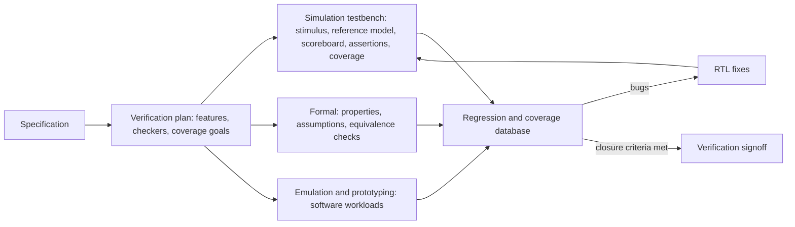
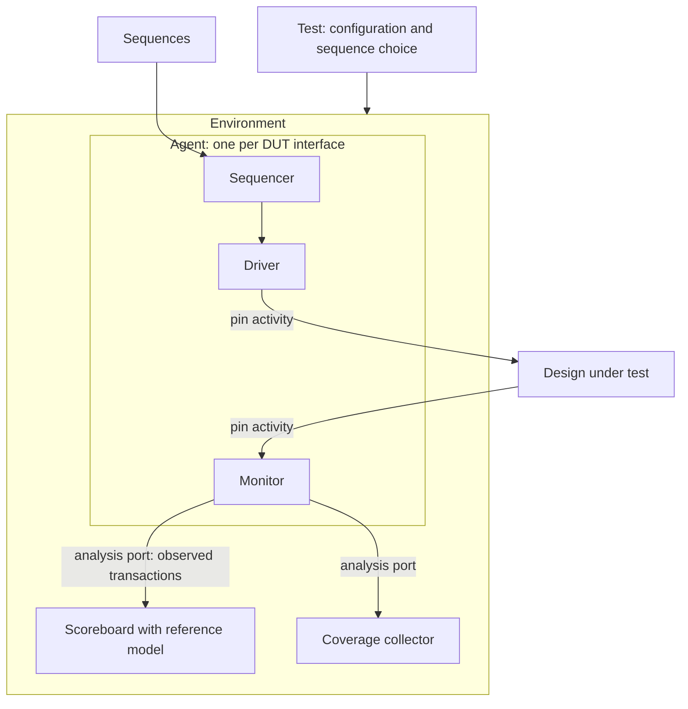

<!-- status: verified -->
# 19-13 · Verification: Simulation, UVM, Formal and Emulation

| | |
|---|---|
| **Course** | [19 · Digital VLSI Design](../README.md) |
| **University equivalent** | The verification chapter of a senior VLSI course and the core of a graduate functional-verification course: verification planning, self-checking and constrained-random testbenches, coverage, assertions, UVM, equivalence checking with BDDs and SAT, model checking, and emulation (Weste & Harris, *CMOS VLSI Design*, ch. 15; Spear & Tumbush, *SystemVerilog for Verification*; Seligman, Schubert & Kumar, *Formal Verification*; Clarke et al., *Model Checking*) |
| **Prerequisites** | [19-12](19-12-design-for-test.md) (manufacturing test, its counterpart), [19-10](19-10-synthesis-and-sta.md) (synthesis, whose output equivalence checking compares), [08-05](../../08-digital-logic-design/chapters/08-05-verilog-and-testbenches.md) (Verilog testbenches and random coverage), [08-08](../../08-digital-logic-design/chapters/08-08-finite-state-machines.md) (state machines), [08-02](../../08-digital-logic-design/chapters/08-02-boolean-algebra-and-gates.md) (Boolean algebra), [03-02](../../03-probability-statistics-and-random-variables/chapters/03-02-random-variables-and-distributions.md) (probability) |
| **Estimated study hours** | 8 |
| **Last verified** | 2026-11-24 |

**Learning objectives.** After this chapter you can:

1. Distinguish verification from validation and manufacturing test, and turn a specification into a verification plan of checkers and coverage goals.
2. Build a self-checking, constrained-random testbench and map its parts onto the components of the Universal Verification Methodology (UVM).
3. Predict the stimulus needed to close a coverage model, including bins of unequal probability, and explain why rare bins need directed or biased stimulus.
4. Write and read SystemVerilog assertions for safety and bounded-liveness properties, and prove the wait bound of a round-robin arbiter.
5. Build reduced ordered binary decision diagrams, derive how variable order sets their size, and check combinational equivalence with a miter.
6. Prove or refute an invariant by reachability, bounded model checking and k-induction, and choose among simulation, formal, emulation and FPGA prototyping for a given question.

## 1. Big picture

A chip is fabricated from a description nobody can fully inspect, and once the masks are made a logic bug costs a new mask set and months of schedule, or a recall. **Functional verification** shows, before tape-out, that the design does what its specification says. It is the largest single activity in a chip project: industry surveys put it near half of project time, and logic and functional flaws remain a leading cause of respins [R-018, R-321]. Four families of tools do it: **simulation** runs the RTL on chosen inputs and checks the outputs, **coverage** measures what those runs exercised, **formal verification** proves properties for all inputs, and **emulation** and **FPGA prototyping** run the design in hardware fast enough to boot software.

- **Verification is not test.** Test (19-12) asks whether a manufactured die matches the design; verification asks whether the design is right in the first place.
- **Simulation is the workhorse, and incomplete.** No simulation covers every input sequence of a design with thousands of state bits; coverage shows what was missed.
- **Formal is complete within its scope.** A proof covers every input, but only for the property written and only for blocks small enough for the solver.
- **Equivalence checking runs on every netlist.** Each synthesis run, scan insertion and engineering change is proven equal to the RTL (19-10, 19-11).
- **Software needs hardware speed.** Booting an operating system takes billions of cycles, which only emulators and FPGA prototypes supply before silicon.

## 2. Intuition first

Think of verifying a chip as auditing a company's new accounting system before it goes live. **Simulation** is audit by sampling: feed in transactions and check each ledger entry against what an independent accountant (the **reference model**) says it should be. **Coverage** is the sampling plan: did you test every account type, currency and quarter-end close? **Assertions** are controls built into the system ("debits equal credits after every posting") that fire the moment they are violated. **Formal verification** is proving from the system's rules that no sequence of transactions, however strange, can unbalance the ledger. **Emulation** is a dress rehearsal of the real month-end close at near-real speed.

The analogy captures the trade: sampling scales to the whole system but is never exhaustive, while proof is exhaustive but works only on well-defined questions about pieces. It breaks down in three places. Auditors sample where errors cluster; design bugs hide exactly where engineers did not think to look, which is why randomness helps. A proof is only as good as its property and its assumptions: assume away the strange transaction and the proof says nothing about it. And coverage measures what was exercised, not what was checked: a sampling plan run with a broken checklist finds nothing.



*Figure 1. Verification flow. The plan turns the specification into things that can be checked and measured; regressions run them continuously until the closure criteria are met.*

## 3. Theory

### 3.1 Verification, validation and test

Three questions are easily confused, and chip teams keep them apart:

- **Verification**: does the design implement its specification? It is done before tape-out, on RTL and netlists, by simulation, formal methods and emulation.
- **Validation**: is the specification the right one, and does the real silicon behave as intended in a real system? **Post-silicon validation** runs first silicon in the lab at full speed with real software and peripherals ([25-12](../../25-fabrication-packaging-test-and-reliability/chapters/25-12-post-silicon-validation.md)).
- **Manufacturing test**: is this particular die identical to the verified design, or does it carry a defect? It uses the scan and BIST structures of [19-12](19-12-design-for-test.md).

A verification effort starts from a **verification plan**: every feature of the specification, with *how* it will be checked (a scoreboard comparison, an assertion, a formal proof, a software test on the emulator), *how* we will know it was exercised (coverage items), and its priority. The plan is the yardstick for signoff: verification is done when every item is checked and covered, not when the schedule runs out. The later a bug is found, the more it costs: an hour at a designer's unit test, days of cross-team debug in full-chip regression, a respin (masks plus months) in silicon, reputation and recalls in the field. That curve is why projects spend close to half their effort here [R-018].

### 3.2 Simulation and the self-checking testbench

An RTL **simulator** executes the design's processes (Verilog `always` blocks and continuous assignments) whenever their inputs change, advancing simulated time event by event (08-05). Its speed falls as the design grows, because every simulated cycle touches more events; a full system-on-chip advances only a tiny fraction of real time (§3.8).

A **testbench** surrounds the design under test (DUT) with code that drives inputs and checks outputs. Industrial testbenches split the job: a **stimulus generator** creates abstract transactions (a bus write, a packet); a **driver** turns each into pin activity that follows the interface protocol; a **monitor** watches the pins and reconstructs the transactions that actually occurred; a **reference model** predicts what the DUT should produce; a **scoreboard** compares prediction with observation; **assertions** check rules cycle by cycle (§3.4); and a **coverage collector** records what happened (§3.3). The testbench is **self-checking**, deciding pass or fail by itself, so thousands of runs can execute overnight without anyone reading waveforms.

Stimulus comes in two styles. **Directed tests** are hand-written scenarios for a specific feature or corner: deterministic and easy to debug, but limited to cases someone thought of and costly in engineer time. **Constrained-random** stimulus draws transaction fields at random subject to **constraints** that keep them legal; it explores combinations nobody listed and scales with compute instead of people. In SystemVerilog:

```systemverilog
class bus_txn;
  rand bit [31:0] addr;
  rand bit [3:0]  len;
  constraint c_align { addr[1:0] == 2'b00; }      // word-aligned
  constraint c_len   { len inside {[1:8]}; }      // legal burst lengths
  constraint c_bias  { addr[31:28] dist { 4'hF := 1, [4'h0:4'hE] :/ 3 }; }  // steer a quarter of traffic to the top region
endclass
```

A constraint solver picks values that satisfy every constraint, and `dist` biases them towards regions the plan cares about. Randomness needs two companions: a reference model, since nobody can hand-write expected values for random inputs, and coverage, since random stimulus guarantees nothing about what it hit. Each run uses a **seed**, so a failure can be reproduced exactly. The suite of tests and seeds run every night is the **regression**; its failure count and the rate of new bugs are the project's main health signals. The lab's arbiter testbench (§5) is a miniature: an LFSR (08-07) supplies random requests, each request is held until granted (the driver's protocol), four checkers run every cycle, and counters record coverage.

### 3.3 Coverage and closure

Coverage comes in two kinds:

- **Code coverage** is measured automatically from the RTL: lines executed (**statement**), `if` and `case` branches taken (**branch**), sub-conditions that independently changed an expression (**condition**), signals toggled both ways (**toggle**), and state-machine states and transitions visited (**FSM**). It shows what was never exercised, not that what ran was checked.
- **Functional coverage** is written by engineers from the verification plan: **coverpoints** sample a value of interest, **bins** group the values that matter, and **crosses** record combinations of coverpoints. For the arbiter of the lab:

```systemverilog
covergroup arb_cg @(posedge clk);
  cp_gnt:    coverpoint gnt { bins one[] = {4'b0001, 4'b0010, 4'b0100, 4'b1000}; }
  cp_active: coverpoint $countones(req) { bins n[] = {[0:4]}; }
endgroup
```

This covergroup has 9 bins: a grant to each of the four requesters, and each number of simultaneous requests from 0 to 4. A cross of the two would add combinations such as "a grant to requester 3 while all four request".

**How much random stimulus closes a coverage model?** Model each sampled transaction as landing in bin $i$ with probability $p_i$, independently of other samples, and let $T$ be the number of samples until every one of the $n$ bins has been hit. For equally likely bins, 08-05 §3.8 derived the coupon-collector result $E[T] = nH_n$ with $H_n = \sum_{k=1}^{n} 1/k \approx \ln n + \gamma + 1/(2n)$ and $\gamma = 0.5772$, so

$$
E[T] = nH_n \approx n\ln n + \gamma n + \tfrac12 .
$$

Real coverage models are not uniform: corner-case bins are, by definition, rare. To handle unequal $p_i$, write the event "$T > t$" as "after $t$ samples some bin is still empty". For a set $S$ of bins with total probability $P(S) = \sum_{i \in S} p_i$, the chance that all $t$ samples miss every bin of $S$ is $(1 - P(S))^t$. The **inclusion–exclusion principle** turns the probability of a union of events into alternating sums over intersections:

$$
\Pr(T > t) = \Pr\Big(\bigcup_{i} \{\text{bin } i \text{ empty}\}\Big) = \sum_{\emptyset \ne S \subseteq \{1..n\}} (-1)^{|S|+1} \big(1 - P(S)\big)^{t} .
$$

> **Math refresher — inclusion–exclusion.** For two events, $\Pr(A \cup B) = \Pr(A) + \Pr(B) - \Pr(A \cap B)$: adding the two probabilities counts the overlap twice, so subtract it once. For three, add back the triple overlap, and so on with alternating signs. Here "bins $i$ and $j$ both empty" is the event that every sample misses both, which has probability $(1 - p_i - p_j)^t$.

For a non-negative integer random variable, $E[T] = \sum_{t=0}^{\infty} \Pr(T > t)$ (each sample $t$ contributes 1 to $T$ exactly when $T > t$). Summing the geometric series $\sum_{t \ge 0} (1 - P(S))^t = 1/P(S)$ term by term gives the exact result

$$
E[T] = \sum_{\emptyset \ne S \subseteq \{1..n\}} \frac{(-1)^{|S|+1}}{P(S)} .
$$

With equal $p_i = 1/n$ it reduces to $nH_n$; the sum has $2^n - 1$ terms, so it is practical for coverpoints of up to about twenty bins. Two simpler facts carry most of the engineering insight:

- **The rarest bin sets the floor.** Even waiting for the rarest bin alone takes $1/p_{\min}$ samples on average (a geometric wait), so $E[T] \ge 1/p_{\min}$. A bin hit once per ten thousand transactions needs about ten thousand transactions, however small the coverage model.
- **Confidence takes longer than the mean.** For equal bins, $\Pr(\text{all covered after } t) = \sum_{k=0}^{n} (-1)^k \binom{n}{k}(1 - k/n)^t$, which for large $t$ is close to its first two terms, $1 - n(1 - 1/n)^t$.

The remedy for rare bins is better stimulus, not more seeds: bias the constraints (`dist`), write a directed test, or let a formal tool generate a trace that reaches the corner (a **cover property**, §3.4). Coverage **closure** is this loop of running regressions, finding holes and steering stimulus into them. Two warnings: coverage measures the stimulus, not the checking (a scoreboard comparing the wrong signals passes everything at 100 % coverage), and it is only as complete as the model (a bin nobody wrote is a behaviour nobody measured).

### 3.4 Assertions

An **assertion** states a rule the design must obey and fails loudly the moment it is broken, close to the cause rather than hundreds of cycles later at an output. **Immediate assertions** are procedural checks, like an `if` that reports an error. **Concurrent assertions**, written in **SystemVerilog Assertions (SVA)**, describe behaviour over time and are evaluated on every clock edge:

```systemverilog
// a request is acknowledged within one to three cycles
a_ack: assert property (@(posedge clk) disable iff (rst) req |-> ##[1:3] ack);
```

Read it as: on every rising edge outside reset, *if* `req` is high, *then* `ack` must be high on one of the next one to three edges. `##[m:n]` delays by $m$ to $n$ cycles. The overlapping implication `|->` starts its right side in the cycle where the left side matches; `|=>` starts it one cycle later (`a |=> b` means `a |-> ##1 b`). Functions such as `$onehot0` (at most one bit set), `$rose`, `$stable` and `$past` keep common checks short. Each clock edge where the left side matches starts an **attempt**, so several can be in flight at once; an implication whose left side never matches passes **vacuously**, having checked nothing, which is why tools report vacuous passes.

A **safety** property says that something bad never happens ("at most one grant"); a violation is a finite trace ending at a definite cycle. A **liveness** property says that something good eventually happens ("every request is eventually granted"); no finite trace can violate it. A **bounded** version ("within 3 cycles") is a safety property that simulation can check, at the price of committing to a number. The same property can play three roles: `assert` claims the design satisfies it, `assume` restricts the inputs a formal tool may choose (what the environment promises), and `cover` asks for a trace where it happens, measuring coverage in simulation and proving reachability in formal. Written once, assertions serve simulation, formal and emulation alike.

**Properties of a round-robin arbiter.** An arbiter shares one resource (a bus port, a memory bank) among $N$ requesters. The lab's arbiter has requests `req[3:0]` and one-hot grants `gnt[3:0]`, and searches the requesters cyclically from just after the one it granted last. Its specification becomes:

```systemverilog
a_onehot:  assert property (@(posedge clk) disable iff (rst) $onehot0(gnt));
a_subset:  assert property (@(posedge clk) disable iff (rst) (gnt & ~req) == '0);
a_busy:    assert property (@(posedge clk) disable iff (rst) (req != '0) |-> (gnt != '0));
a_fair0:   assert property (@(posedge clk) disable iff (rst) req[0] |-> ##[0:3] gnt[0]);   // and a_fair1..3
m_hold0:   assume property (@(posedge clk) disable iff (rst) req[0] && !gnt[0] |=> req[0]);
```

The first three are safety rules (mutual exclusion, no grant without a request, no idle cycle while someone waits); the fourth is bounded fairness, which holds only if requesters keep requesting until served, hence the assumption.

**Why the bound is $N - 1$.** Claim: in a round-robin arbiter, a requester that stays pending sees at most $N - 1$ grants to others before its own. Number the requesters $0..N-1$ around a circle, let $\ell$ be the last one granted, and for a pending requester $r$ define its distance $d = (r - \ell) \bmod N$, taking $d = N$ when $r = \ell$. The arbiter examines $\ell + 1, \ell + 2, \ldots$ in order and grants the first pending requester. If that is some $g \ne r$, then $g$ was examined before $r$, so its distance $d_g$ satisfies $1 \le d_g < d$; the pointer moves to $g$, and $r$'s new distance is $d - d_g \le d - 1$. Every grant to another requester therefore cuts $d$ by at least 1, and $d$ cannot fall below 1 (at $d = 1$, $r$ is examined first and wins). Starting from at most $N$, at most $N - 1$ grants to others can occur. ∎ Because the arbiter grants on every cycle that has a pending request (`a_busy`), the wait in cycles is at most $N - 1$ too, which is what `##[0:3]` encodes for $N = 4$. A **fixed-priority** arbiter, which always grants the lowest-numbered requester, has no such bound: a busy requester 0 can starve everyone else forever.

### 3.5 UVM: structuring a testbench

The **Universal Verification Methodology (UVM)** is a SystemVerilog class library and set of conventions for building testbenches from reusable components, standardized by Accellera and as IEEE 1800.2 [R-321]. It names the parts of §3.2. A **sequence item** is one transaction and a **sequence** generates a stream of them; a **sequencer** hands items to the **driver**; a **monitor** publishes observed transactions through an **analysis port**, a broadcast connection any number of subscribers can read; an **agent** bundles sequencer, driver and monitor for one interface (an *active* agent drives, a *passive* one only watches); scoreboards and coverage collectors subscribe to monitors; the **environment** holds agents and scoreboards; and a **test** configures the environment and picks the sequences.



*Figure 2. A UVM environment for one interface. Larger environments repeat the agent per interface and connect monitors to a shared scoreboard.*

Three mechanisms make the components reusable. **Phases** give every component the same life cycle (build, connect, run, report), and the run phase ends when no component still holds an **objection**. The **factory** lets a test substitute a derived class (an error-injecting driver, say) without editing the environment. The **configuration database** passes settings and interface handles down the hierarchy. A **register abstraction layer** (RAL) models the DUT's control and status registers, so tests can write "enable the DMA channel" instead of raw addresses.

The payoff is reuse: an agent written for a bus protocol works in every block that uses it, and commercial **verification IP** (VIP) for standard interfaces such as PCIe, USB or AXI plugs into the same structure. The cost is weight: the learning curve is steep and even a minimal environment is long, so small blocks are often verified with lighter frameworks such as cocotb (Python) or Verilator-based C++ testbenches. The concepts (transactions, stimulus separated from checking, monitors feeding scoreboards) matter more than the library.

### 3.6 Formal equivalence checking

Every step of the implementation flow (synthesis in 19-10, scan insertion in 19-12, clock-tree buffering and optimization in 19-11, hand edits in an **engineering change order**, ECO) could change the function. Rather than re-simulate each netlist, **logic equivalence checking** (LEC) proves that two versions compute the same function. When both have the same state elements (registers matched by name or structure), the problem splits into **combinational** checks: the logic cone feeding each matched register input and primary output, as a function of matched register outputs and primary inputs, must be the same Boolean function in both.

**The miter.** To compare functions $F$ and $G$ with outputs $F_1..F_m$ and $G_1..G_m$, build the **miter**

$$
M = \bigvee_{k=1}^{m} \left(F_k \oplus G_k\right) ,
$$

which is 1 exactly for the inputs on which some output differs. The circuits are equivalent if and only if $M$ is unsatisfiable, i.e. the constant 0; any input that makes $M = 1$ is a counterexample.

**Binary decision diagrams.** The **Shannon expansion** splits any Boolean function on one variable:

$$
f = \bar{x}\, f|_{x=0} + x\, f|_{x=1} ,
$$

where the **cofactors** $f|_{x=0}$ and $f|_{x=1}$ are $f$ with $x$ fixed. Expanding on every variable in turn gives a binary decision tree with $2^n$ leaves. A **reduced ordered BDD** (ROBDD) is that tree with the variables tested in one fixed order along every path, compressed by two rules applied until neither applies:

1. **merge** identical subgraphs (same variable, same low child, same high child) into one node;
2. **remove** any node whose low and high children are the same, since its test does not matter.

Bryant proved in 1986 that, for a fixed variable order, every Boolean function has exactly one ROBDD [R-321]. The diagram is a **canonical form**: two functions are equal exactly when their ROBDDs are the same graph, and a function is unsatisfiable exactly when its ROBDD is the 0 terminal, so equivalence checking becomes building the miter's ROBDD and looking at it. Diagrams are combined by an **apply** operation that recurses by Shannon expansion on the top variable, with a memo table so that each pair of nodes is combined once; its cost is at most the product of the two diagrams' sizes. The lab's `verif.py` implements both in under a hundred lines of Python.

**Variable order decides everything.** The number of nodes testing variable $x_i$ equals the number of distinct subfunctions, obtained by fixing all variables before $x_i$ in the order, that actually depend on $x_i$. Consider $f = x_1y_1 + x_2y_2 + \cdots + x_ny_n$.

- **Interleaved order** $x_1, y_1, x_2, y_2, \ldots$: after fixing $x_1..x_{i-1}$ and $y_1..y_{i-1}$, either some product was already 1 (the function is the constant 1) or the remainder is $x_iy_i + \cdots + x_ny_n$, the same for every such assignment. So each level has one node: $2n$ nodes in all.
- **Separated order** $x_1, \ldots, x_n, y_1, \ldots, y_n$: after fixing $x_1..x_{i-1}$, the remaining function must remember which of those $x$'s were 1, because each one decides whether its $y$ matters later. All $2^{i-1}$ assignments give different subfunctions, each depending on $x_i$, so level $x_i$ has $2^{i-1}$ nodes, $2^n - 1$ in total. At level $y_i$, with no earlier product equal to 1, the remainder is $\sum_{j \in S,\, j \ge i} y_j$ for the set $S$ of indices whose $x$ was 1; it depends on $y_i$ only if $i \in S$, and differs for every choice of $S \cap \{i+1..n\}$, giving $2^{n-i}$ nodes, again $2^n - 1$ in total. The diagram has $2^{n+1} - 2$ nodes.

The same function needs $16$ nodes or $510$ for $n = 8$, depending only on the order. Some functions are hard under every order: Bryant showed in 1991 that the BDDs of the middle output bits of an $n$-bit multiplier grow exponentially in $n$ whatever the order [4], which is why multipliers defeat pure BDD-based checkers.

> **Going deeper — how equivalence checkers scale.** Practical checkers convert both designs to **and-inverter graphs** (networks of two-input ANDs and inverters) and merge structurally identical gates. Random simulation gives each internal node a signature; nodes with equal signatures in the two designs are candidate equivalences, proven one at a time with a **SAT** solver (a program that searches for a satisfying assignment) or a small BDD, and then used as **cut points** that split large cones into small ones. Synthesis restructures logic locally, so most internal nodes have partners. Heavily restructured arithmetic leaves few cut points and needs hints or datapath-specific engines. When register correspondence breaks (retiming, state re-encoding), the problem becomes **sequential equivalence checking**, model checking on the product of the two machines (§3.7). The open-source EQY front end for Yosys does this kind of check [R-321].

### 3.7 Model checking

**Property checking**, or **model checking**, proves temporal properties of sequential designs. Model the design as a **transition system**: the state is the vector of its register values ($n$ bits give up to $2^n$ states), a set $I$ of initial states (after reset), and a transition relation $T(s, s')$ that holds when the design can move from $s$ to $s'$ in one clock for *some* input value. Inputs make the system nondeterministic, which is exactly what we want: the proof covers every possible input sequence. An **invariant** $P$ is a property that must hold in every reachable state.

**Reachability.** Compute the reachable set as a fixed point:

$$
R_0 = I, \qquad R_{k+1} = R_k \cup \operatorname{Post}(R_k), \qquad \operatorname{Post}(R) = \{s' : T(s, s') \text{ for some } s \in R\} ,
$$

stopping when $R_{k+1} = R_k$, which must happen within $2^n$ steps because the sets only grow. $P$ holds if and only if every state in the final $R$ satisfies it. Computed breadth-first, the first bad state found lies at minimum depth, and following parent links back to $I$ gives the **shortest counterexample**, the most useful debug trace there is. Explicit enumeration is hopeless beyond a few dozen state bits; **symbolic model checking** represents the sets $R_k$ and the relation $T$ as BDDs and computes $\operatorname{Post}$ with BDD operations, reaching state spaces far beyond enumeration (Burch, Clarke, McMillan, Dill and Hwang titled their 1990 paper "10²⁰ states and beyond" [5]).

**Bounded model checking (BMC)** gives up on proving and hunts for bugs. Unroll the transition relation $k$ times and ask a SAT solver whether

$$
I(s_0) \wedge \bigwedge_{i=0}^{k-1} T(s_i, s_{i+1}) \wedge \bigvee_{i=0}^{k} \neg P(s_i)
$$

is satisfiable (Biere, Cimatti, Clarke and Zhu, 1999 [R-321]). A satisfying assignment is a counterexample of length at most $k$, with the input values at every step. An unsatisfiable answer means only that no violation exists *within $k$ cycles*. If $k$ is at least the **diameter** of the reachable state graph (the longest shortest path from an initial state to any reachable state), every reachable state has been examined and the answer becomes a proof, but the diameter is rarely known and often enormous (a 32-bit counter's is $2^{32} - 1$).

**k-induction** (Sheeran, Singh and Stålmarck, 2000 [R-321]) turns BMC into a proof method. Ordinary induction proves $P$ from a base case and a one-step inductive step; k-induction lets the step use $k$ previous states:

- **Base case:** no counterexample of length less than $k$ (a BMC run to depth $k - 1$).
- **Inductive step:** for *every* path of states $s_0, \ldots, s_k$ allowed by $T$ (reachable or not), if $P$ holds at $s_0, \ldots, s_{k-1}$, then it holds at $s_k$.

If both hold, $P$ holds in every reachable state: any reachable state at depth $\ge k$ ends a path whose previous $k$ states satisfy $P$ (by induction on depth), so the step applies. The step is checked over *all* states because the solver does not know which are reachable, and that is where induction fails: an **unreachable** state that satisfies $P$ but steps to a violation is a **counterexample to induction** (CTI). It says nothing about the design, only that $P$ is too weak to be inductive. Increasing $k$ removes CTIs that cannot be preceded by long enough runs of $P$-states; **strengthening** adds a lemma $Q$ (often an invariant the designer knows, such as "the one-hot state register has exactly one bit set") so that $P \wedge Q$ is inductive. When an unreachable $P$-state can either stay put or step to a violation, $P$ is not $k$-inductive for any $k$, and only strengthening works.

> **Math refresher — induction.** To show a statement $P(m)$ for all $m \ge 0$: prove $P(0)$, then prove that $P(m)$ implies $P(m+1)$. *Strong* induction assumes $P$ for several previous values. k-induction is the strong version applied to positions along an execution path.

> **Going deeper — IC3/PDR.** **IC3** (Bradley, 2011 [6]), also called property-directed reachability, builds the strengthening lemmas automatically. It keeps over-approximations of the states reachable in $0, 1, 2, \ldots$ steps; each CTI the SAT solver finds is generalized into a clause that blocks it and similar states, and the proof is complete when two consecutive approximations coincide, which yields an inductive invariant. It is one of the standard engines of modern hardware model checkers.

**Formal in practice.** **State explosion** (states grow as $2^n$) confines property checking to blocks: arbiters, FIFOs, cache controllers, protocol bridges, security-critical control. Engineers write **assumptions** that confine the block's inputs to legal behaviour; over-constraining is the classic failure, because a property assumed into vacuity is "proven" trivially, and cover properties catch it by showing that interesting states are still reachable. Tools answer proven, falsified (with a trace), or **bounded** to some depth when they run out of time; the open-source SymbiYosys, for example, offers `bmc` and `prove` modes and reports a proof attempt as unknown when the induction step fails [R-321]. Vendors also package routine checks, such as connectivity between blocks, as push-button **formal apps**.

### 3.8 Emulation, prototyping and the speed ladder

Some questions need billions of cycles: does the operating system boot, does the driver run, does the power manager survive a sleep-wake loop? Three platforms trade speed against visibility and turnaround:

- **RTL simulation** has full visibility (every signal at every time) and compiles in minutes, but a full SoC advances very slowly.
- **Emulators** are purpose-built machines (built from custom chips or from FPGAs) that compile the RTL onto hardware, keep deep signal visibility, hold designs of tens of billions of gates and serve many users at once. Vendors publish capacity and generation-on-generation speed-ups rather than clock rates [R-321].
- **FPGA prototypes** partition the design across commercial FPGAs and run at "up to 10s of MHz" in one vendor's words, fast enough for real software and real interfaces, but with less visibility, longer bring-up and re-partitioning whenever the RTL changes [R-321].

No comparable public figures exist for simulation and emulation speed (an open issue in PROGRESS.md), so take the next numbers as an illustration of orders of magnitude, not as data. Assume $2 \times 10^9$ cycles to boot an operating system, simulation at 100 cycles per second, an emulator at 1 MHz and a prototype at 20 MHz. Simulation then needs $2 \times 10^7$ s, about **231** days; the emulator 2000 s, about **33** minutes; the prototype **100** s. Only the hardware platforms make software bring-up a pre-silicon activity, so chip and software schedules can overlap. **Hybrid** setups run the processor subsystem as a fast instruction-set model on a host computer and only the new RTL in hardware.

After tape-out, **post-silicon validation** runs at full silicon speed with real software, but with the worst visibility of all: internal signals are seen only through on-chip trace buffers, performance counters and scan dumps. Bugs found there become **errata**, firmware or microcode workarounds, or respins ([25-12](../../25-fabrication-packaging-test-and-reliability/chapters/25-12-post-silicon-validation.md)).

### 3.9 Signoff: when is verification done?

Verification is never complete in the mathematical sense, so signoff is a risk decision made against evidence: every plan item checked and covered (each waived bin justified); code coverage at target with unreachable code explained; assertions passing without unexplained vacuity; formal proofs complete or bounded to a justified depth; the new-bug rate flat for weeks while regression volume stays high; no open high-severity bugs; equivalence checking and gate-level simulation clean on the final netlist. Like a credit committee's approval, it is a structured judgment, not a theorem.

## 4. Worked examples

### Example 19-13.1 · Closing a coverage model with random stimulus (tier A)

**Setup.** A coverpoint on a 4-bit opcode field has 16 bins, and unconstrained random stimulus makes every opcode equally likely. (a) How many transactions are expected to fill all 16 bins? (b) Compare with the approximation $n\ln n + \gamma n + \tfrac12$. (c) How many transactions give at least 95 % probability that all bins are filled? A second coverpoint has 8 bins: one corner case ("FIFO full while a push and a pop arrive together") occurs with probability 0.01 per transaction, and the other seven share the remaining 0.99 equally. (d) How many transactions are expected to fill it? (e) If a directed test hits the corner bin, how many random transactions are expected to fill the other seven?

**Solution.** (a) $H_{16} = 1 + \tfrac12 + \cdots + \tfrac1{16} = 3.3807$, so $E[T] = 16 \times 3.3807$ = **54.09** transactions.

(b) $16 \ln 16 + 0.5772 \times 16 + 0.5 = 44.36 + 9.24 + 0.5$ = **54.10**, within 0.01 of the exact value.

(c) We need the smallest $t$ with $\sum_{k=0}^{16} (-1)^k\binom{16}{k}(1 - k/16)^t \ge 0.95$. The first two terms give $1 - 16(15/16)^t \ge 0.95$, so $t \ge \ln(0.05/16)/\ln(15/16) = 89.4$; the full sum confirms $t$ = **90** ($\Pr = 0.9504$). Being 95 % sure takes two-thirds more stimulus than the mean.

(d) Inclusion–exclusion over the 255 nonempty subsets of bins gives $E[T]$ = **101.9** transactions. The floor $1/p_{\min} = 100$ accounts for almost all of it.

(e) Each common bin has probability $0.99/7$ per transaction, so the coupon-collector wait with $7 - k$ bins left is $1/[(7 - k)(0.99/7)]$, and $E = (7/0.99) H_7 = 7.0707 \times 2.5929$ = **18.33** transactions.

**Units check.** All answers count transactions.

**Sanity check.** (a) exceeds 16 because samples repeat bins; (d) is at least $1/p_{\min}$; (e) is a little more than $7H_7 = 18.15$ because 1 % of samples go to the corner bin.


*Figure 3. Coverage closure under random stimulus. Equal bins (left) close in about $n H_n$ samples; one rare bin (right) holds the last step open for about $1/p_{\min}$ samples, which is why rare bins get directed tests.*

### Example 19-13.2 · Variable order and BDD size (tier B)

**Setup.** Let $f = x_1y_1 + x_2y_2 + x_3y_3$. (a) How many nodes (not counting the two terminals) does its ROBDD have with the interleaved order $x_1, y_1, x_2, y_2, x_3, y_3$? (b) With the separated order $x_1, x_2, x_3, y_1, y_2, y_3$? (c) Repeat both for the 8-pair version. (d) How many nodes does the separated order need for 32 pairs?

**Solution.** (a) By §3.6 each level holds one node: test $x_1$; if 0 go to $x_2$; if 1 test $y_1$, which goes to 1 or to the $x_2$ node; and so on. That is $2n$ = **6** nodes.

(b) The $x$ levels hold $1 + 2 + 4 = 7$ nodes, and the $y$ levels $4 + 2 + 1 = 7$ (one $y_i$ node for each set of later indices whose $x$ was 1). Total $2^{n+1} - 2$ = **14** nodes.

(c) For $n = 8$: interleaved **16** nodes, separated $2^9 - 2$ = **510** nodes.

(d) $2^{33} - 2$ = **8.59 × 10⁹** nodes for a function whose interleaved ROBDD has 64 nodes.


*Figure 4. One function, two variable orders. Solid edges are the 1 branch, dashed edges the 0 branch. Placing each $y_i$ next to its $x_i$ means nothing has to be remembered; separating them forces the diagram to remember every subset of the $x$'s.*

**Units check.** Node counts are pure numbers.

**Sanity check.** The lab's BDD package (built by apply) gives the same counts, and the verify script reproduces them independently by counting distinct subfunctions in the truth table.

### Example 19-13.3 · Equivalence checking with a miter (tier B)

**Setup.** A 4-bit ripple-carry adder is the reference; a carry-lookahead version computes each carry as $c_{i} = g_{i-1} + p_{i-1}g_{i-2} + \cdots + p_{i-1}\cdots p_1 g_0$, with generate $g_j = a_jb_j$ and propagate $p_j = a_j \oplus b_j$ (08-09). A designer accidentally drops the last term, $p_2p_1g_0$, from $c_3$. (a) What fraction of the 256 input pairs exposes the bug? (b) The miter's BDD returns the counterexample $a_0 = b_0 = 1$, $a_1 = a_2 = 1$, $b_1 = b_2 = 0$ with $a_3 = b_3 = 0$. What are $A$ and $B$, and what do the two adders output? (c) The same slip in a 32-bit adder drops the $g_0$ term from $c_{31}$. What is the per-vector probability that a uniformly random input exposes it? (d) How many random vectors give 99 % confidence of catching it?

**Solution.** (a) The buggy $c_3$ is wrong only when the dropped term is 1 and the others are 0. $p_2p_1g_0 = 1$ needs $a_0 = b_0 = 1$ (probability 1/4), $a_1 \ne b_1$ (1/2) and $a_2 \ne b_2$ (1/2); then $p_1 = p_2 = 1$ forces $g_1 = g_2 = 0$, so the other terms vanish, and the wrong $c_3$ flips $s_3 = p_3 \oplus c_3$. The fraction is $1/16$: **16** of the 256 input pairs.

(b) $A = 0111_2$ = **7** and $B = 0001_2$ = **1**. The ripple adder gives $7 + 1$ = **8** ($01000_2$ as a 5-bit result). In the buggy adder $c_1 = 1$ and $c_2 = 1$ as usual, but $c_3 = 0$, so $s_3 = 0$; $c_4 = p_3 \cdot (\ldots) = 0$ as well, and the output is $00000_2$ = **0**.

(c) The dropped term $p_{30}\cdots p_1 g_0$ needs $a_0 = b_0 = 1$ and 30 propagate conditions: $p = 2^{-2} \cdot 2^{-30} = 2^{-32}$ = **2.33 × 10⁻¹⁰**.

(d) $N = \ln(0.01)/\ln(1 - 2^{-32})$ = **1.98 × 10¹⁰** vectors, about $4.6 \times 2^{32}$. The miter finds the counterexample directly, and cheaply: in interleaved order, sum bit $i$ of an adder has a BDD of $3i + 3$ nodes, so even the top sum bit of a 32-bit adder needs only 96.

**Units check.** (a) and (c) are probabilities, (b) unsigned integers, (d) a vector count.

**Sanity check.** The verify script evaluates both adders on all 256 inputs and counts 16 mismatches. The lesson generalizes: a bug that needs $m$ specific input bits is exposed by a random vector with probability $2^{-m}$, so random simulation of wide datapaths misses rare-input bugs that a formal tool finds at once.

### Example 19-13.4 · Model checking a FIFO occupancy counter (tier B)

**Setup.** A 4-entry FIFO keeps its occupancy in a 3-bit counter $c$, reset to 0. Each cycle the inputs `push` and `pop` are each 0 or 1. A push is ignored when full ($c = 4$), a pop when empty; otherwise a push adds 1 and a pop subtracts 1. The invariant is $P: c \le 4$. (a) How many states are reachable, and does $P$ hold? (b) A buggy version forgets the full check, so a push at $c = 4$ goes through. How many states are reachable now, and how long is the shortest counterexample? (c) Which BMC bound first finds it? (d) How many Boolean variables does that BMC formula contain (state bits for every time step plus input bits for every transition)? (e) What is the diameter of the correct design's reachable state graph?

**Solution.** (a) Pushes reach 1, 2, 3, 4, and nothing leaves $\{0..4\}$, so **5** of the 8 states are reachable and $P$ holds. (It is even 1-inductive: every successor of a state with $c \le 4$ has $c \le 4$.)

(b) Now a push at 4 gives 5, then 6, 7, and the 3-bit counter wraps to 0: all **8** states are reachable. Breadth-first search reaches 5 first by five consecutive pushes, a counterexample of length **5** (the trace 0, 1, 2, 3, 4, 5).

(c) BMC with $k = 4$ finds nothing; $k$ = **5** finds the trace. The $k = 4$ answer is correct but says nothing about cycle 5.

(d) Six states $s_0..s_5$ of 3 bits each and five transitions with 2 input bits each: $18 + 10$ = **28** variables.

(e) The farthest reachable state, 4, is 4 transitions from reset: diameter **4**, so BMC to depth 4 is a complete proof for the correct design.

**Units check.** States, cycles and variables are counts.

**Sanity check.** The counterexample is what a designer would guess (fill the FIFO, push once more), but the tool needs no guess and returns the shortest trace. In simulation the same bug might surface only thousands of cycles later, as lost data after the counter wraps.

### Example 19-13.5 · k-induction and a strengthening invariant (tier C)

**Setup.** A 3-bit counter starts at 0 and adds 2 every cycle (modulo 8). The property is $P: x \ne 7$. (a) Which states are reachable? (b) Show that $P$ is not 1-inductive, and give the counterexample to induction. (c) What is the smallest $k$ for which $P$ is $k$-inductive? (d) Find a stronger property that is 1-inductive.

**Solution.** (a) $0 \to 2 \to 4 \to 6 \to 0$: the **4** even values. $P$ holds in all of them.

(b) The one-step check asks whether a state satisfying $P$ can step to 7. State 5 can ($5 + 2 = 7$), so the CTI is the unreachable state **5**. The design is fine; the property is too weak to prove itself in one step.

(c) The odd states form the cycle $1 \to 3 \to 5 \to 7 \to 1$, so reading backwards from 7 the path is $7, 5, 3, 1, 7$: at most three $P$-states (1, 3, 5) can precede a 7. For $k = 3$ the path $1, 3, 5, 7$ breaks the step; for $k = 4$ no path of four $P$-states leads to 7. The base case (0, 2, 4, 6 within 3 steps) holds, so $P$ is **4**-inductive.

(d) $Q$: "$x$ is even". Successors of even states are even and $Q$ holds at 0, so $Q$ is 1-inductive, and it implies $P$ because 7 is odd: the designer's insight is the lemma that makes the proof easy.

**Units check.** States and $k$ are counts.

**Sanity check.** The verify script enumerates every path of length $k + 1$ over all 8 states and finds the step violated for $k \le 3$ and satisfied for $k = 4$.

<!-- answer-key -->

| ID | Quantity | Value | Unit |
|---|---|---|---|
| Ex 19-13.1a | expected transactions, 16 equal bins | 54.09 | — |
| Ex 19-13.1b | approximation n ln n + γn + 1/2 | 54.10 | — |
| Ex 19-13.1c | transactions for 95 % probability of closure | 90 | — |
| Ex 19-13.1d | expected transactions with the rare bin | 101.9 | — |
| Ex 19-13.1e | expected transactions for the seven common bins | 18.33 | — |
| Ex 19-13.2a | ROBDD nodes, interleaved, 3 pairs | 6 | — |
| Ex 19-13.2b | ROBDD nodes, separated, 3 pairs | 14 | — |
| Ex 19-13.2c | ROBDD nodes, interleaved, 8 pairs | 16 | — |
| Ex 19-13.2d | ROBDD nodes, separated, 8 pairs | 510 | — |
| Ex 19-13.2e | ROBDD nodes, separated, 32 pairs | 8.59e9 | — |
| Ex 19-13.3a | input pairs exposing the bug | 16 | — |
| Ex 19-13.3b | counterexample A | 7 | — |
| Ex 19-13.3c | counterexample B | 1 | — |
| Ex 19-13.3d | reference adder output | 8 | — |
| Ex 19-13.3e | buggy adder output | 0 | — |
| Ex 19-13.3f | detection probability per random vector, 32 bits | 2.33e-10 | — |
| Ex 19-13.3g | random vectors for 99 % detection | 1.98e10 | — |
| Ex 19-13.4a | reachable states, correct counter | 5 | — |
| Ex 19-13.4b | reachable states, buggy counter | 8 | — |
| Ex 19-13.4c | shortest counterexample length | 5 | cycles |
| Ex 19-13.4d | BMC bound that finds it | 5 | — |
| Ex 19-13.4e | Boolean variables in the BMC formula | 28 | — |
| Ex 19-13.4f | diameter of the correct design | 4 | — |
| Ex 19-13.5a | reachable states | 4 | — |
| Ex 19-13.5b | counterexample to 1-induction | 5 | — |
| Ex 19-13.5c | smallest k for k-induction | 4 | — |
| Txt 19-13.a | coverpoint bins in the arbiter covergroup | 9 | — |
| Txt 19-13.b | boot time in simulation at 100 Hz | 231 | days |
| Txt 19-13.c | boot time on an emulator at 1 MHz | 33 | min |
| Txt 19-13.d | boot time on an FPGA prototype at 20 MHz | 100 | s |
| Txt 19-13.e | ROBDD nodes of sum bit 31, interleaved order | 96 | — |
| Txt 19-13.f | 99 % confidence factor ln(100) | 4.6 | — |

## 5. Simulate it

The lab ([labs/19-13-lab](../labs/19-13-lab/README.md)) has a Verilog round-robin arbiter with a constrained-random, self-checking testbench (`rr_arbiter.v`, `rr_arbiter_tb.v`, run with Icarus Verilog) that must pass the arbiter and catch a fixed-priority copy, and a Python toolkit (`verif.py`) with coverage-closure calculators, a small ROBDD package with adder equivalence checking, and explicit-state reachability, BMC and k-induction.

**Predict, then run.**

1. Predict the worst wait the testbench will see for the round-robin arbiter, and whether the fixed-priority copy breaks the bound; run it and read the coverage report.
2. Predict the mean samples to fill 16 equal bins, and 8 bins with one 1 % bin; simulate 2000 closures of each.
3. Predict the ROBDD sizes of $\sum x_iy_i$ and of an $n$-bit equality comparator under both orders for $n = 3$ to 8; build them.
4. Predict the BMC depth that exposes the FIFO overflow and the smallest $k$ that proves $x \ne 7$ for the add-by-two counter; run both.

## 6. Engineering tradeoffs

| Knob | Improves | Costs | Typical decision owner |
|---|---|---|---|
| More constrained-random seeds and regression volume | Discovery of bugs in combinations nobody listed | Compute farm and licences, triage effort, diminishing returns on rare bins | Verification lead |
| Directed tests and biased constraints for corner bins | Fast closure of rare bins | Engineer time; reaches only the corners someone thought of | Verification engineer |
| A richer coverage model (more bins and crosses) | Visibility of what was really exercised | Writing effort, cross-product explosion, longer closure | Verification lead with the architects |
| Assertions written in the RTL | Bugs caught at their source; reuse in formal and emulation | Designer time, some simulation slowdown | Designer |
| Formal property checking of control blocks | Exhaustive proofs and shortest counterexamples | Specialist effort, state explosion, risk of over-constrained assumptions | Formal verification lead |
| Emulation and FPGA prototyping | Software bring-up and system-level bugs before silicon | Capital and lease cost, compile turnaround, limited visibility on prototypes | Program management with the SoC verification lead |
| UVM versus a lightweight framework | Reuse, verification IP, a common skill set | Learning curve, verbosity, slower start on small blocks | Verification methodology owner |

## 7. Numbers to know

| Quantity | Value | Notes |
|---|---|---|
| Random samples to fill $n$ equal bins | $nH_n \approx n\ln n + 0.577n + \tfrac12$ | 54 for 16 bins (08-05) |
| Unequal bins | $E[T] = \sum_{S \ne \emptyset} (-1)^{\lvert S\rvert+1}/P(S) \ge 1/p_{\min}$ | The rarest bin dominates |
| Random detection of a bug that needs $m$ specific input bits | $p = 2^{-m}$; 99 % confidence needs about $4.6 \times 2^{m}$ vectors | Formal finds it directly |
| Round-robin worst wait | $N - 1$ grants to others | Fixed priority: unbounded |
| ROBDD of $\sum_{i=1}^n x_iy_i$ | $2n$ (interleaved) vs $2^{n+1} - 2$ (separated) | Order decides size |
| ROBDD of an adder's sum bit $i$ (interleaved) | $3i + 3$ nodes | Multipliers: exponential for every order |
| BMC completeness | bound ≥ diameter | Otherwise "no bug within $k$" only |
| k-induction | base: BMC to depth $k - 1$; step over all states | Fails on counterexamples to induction |
| Boot of an OS (illustrative $2 \times 10^9$ cycles) | 231 days at 100 Hz, 33 min at 1 MHz, 100 s at 20 MHz | Simulation, emulation, FPGA prototype |

## 8. Common mistakes

- **Reading coverage as checking.** Coverage says what the stimulus reached; a weak scoreboard can reach 100 % and pass a broken design.
- **Sharing the designer's misreading.** A reference model written from the same misunderstanding of the specification agrees with the RTL and both are wrong; independent authorship guards against this common-mode error.
- **Sampling outputs at the wrong moment.** A testbench that reads a registered output after the clock edge that changes it sees the next cycle's value. The first draft of this chapter's lab testbench did exactly that and reported hundreds of false fairness violations; SystemVerilog clocking blocks exist to prevent such races.
- **Ignoring vacuous passes.** Pair important assertions with cover properties on their antecedents.
- **Over-constraining formal assumptions.** An assumption that rules out real behaviour makes proofs trivially true; check each assumption as an assertion on the neighbouring block.
- **Reporting bounded proofs as proofs.** "No counterexample within 30 cycles" proves nothing unless 30 exceeds the diameter or induction completes it.
- **Trusting RTL simulation with unknowns.** Verilog treats an `if` on an unknown (X) value as false, which can hide reset bugs that appear in gate-level simulation or silicon.
- **Signing off by the calendar.** A schedule-driven signoff converts verification risk into silicon risk.

## 9. Practitioner lens

### State of the art (as of Nov 2026)

- **Verification still dominates, and first-silicon success is falling [Industry estimate].** The 2026 Siemens EDA and Wilson Research Group study (604 participants: 320 IC/ASIC, 284 FPGA) found verification taking 49 % of IC/ASIC and 51 % of FPGA project time, and only 5 % of IC/ASIC respondents reporting first-silicon success, against 14.4 % in 2024, about 24 % in 2022 and about 30 % historically; about three in four projects missed schedule. Logic and functional errors "remain important", alongside rising firmware, safety, security, power and clocking causes. Caveats: the sponsor sells verification tools, recruitment changed in 2024, and 5 % of 320 is about 16 respondents [R-018, R-321].
- **Staffing [Industry estimate].** The 2022 study found about one verification engineer per design engineer on average, up to five per designer in processors, with designers themselves spending 49 % of their time verifying; verification headcount grew at 6.2 % a year against 2.7 % for designers over 2007–2022 [R-321].
- **Standards [Established].** SystemVerilog is IEEE 1800-2023 (published February 2024) and UVM is IEEE 1800.2-2020, both active; Accellera's open-source UVM library is at version 2020.3.1 (September 2024, Apache 2.0) and documents its own deviations from the standard. The 2022 study called UVM the predominant IC/ASIC testbench standard and SVA the predominant assertion language [R-321].
- **Emulation and prototyping [Vendor claim].** Synopsys quotes ZeBu Server 5 at "up to 30 billion gates" and HAPS-200 prototypes at "up to 10s of MHz" (a customer quoted 50 MHz); Cadence's Palladium Z3 and Protium X3 (April 2024) scale "from 16 million gates up to 48 billion gates" with 1.5× the previous generation's performance; Siemens' Veloce CS (February 2024) spans 40 million to "40+ billion gates". All three vendors' new FPGA-based systems use the same AMD Versal Premium VP1902 device; Siemens' emulator uses its own "Crystal" chip. None publishes an emulator clock rate [R-321].
- **Open source [Established].** Verilator 5.054 (November 2026) compiles SystemVerilog into multithreaded C++ and says it may not be "a full-featured replacement" for commercial simulators; cocotb 2.1.0 (August 2026) writes testbenches in Python; SymbiYosys runs BMC, k-induction and cover checks (full SVA needs a commercial front end); EQY checks equivalence [R-321].
- **AI in verification [Industry estimate].** In the 2026 study, 82.8 % of participants used AI beyond pilots, but only 9.0 % described it as broadly integrated into the flow [R-321].

### Why it matters commercially

- **Respins are expensive.** Mask sets cost over \$10 M at 7 nm and push towards \$40 M at 3 nm by one 2022 estimate [Industry estimate], before the months of lost schedule [R-321, R-019].
- **Escapes are worse.** The Pentium division flaw led Intel to a \$475 million pre-tax charge for Q4 1994, announced in January 1995 [R-321]. In 2023, Zenbleed (CVE-2023-20593), a microarchitectural flaw in AMD Zen 2 cores that could expose data from other software on the same core, was fixed by microcode update or a configuration "chicken bit": post-silicon fixability is part of verification strategy [R-321].
- **Verification capacity is a moat.** Emulator fleets, verification-IP libraries and formal teams take years to build; in diligence they are as telling as the design team.

### Marketing vs Reality

- **"100 % coverage."** Of which model, code or functional, with how many waived bins? Coverage measures stimulus, not checking.
- **"Formally verified."** Which properties, under which assumptions, on which blocks, and were the proofs full or bounded? A whole SoC is never formally verified end to end.
- **"First-silicon success."** Functional only, or also performance and yield? Did a metal-layer fix count as a spin?
- **"48 billion gates of capacity."** Capacity is not speed or turnaround: ask for run speed on your design, compile time and debug visibility.

### Questions for engineering leaders

1. *"How many spins did your last three chips need, and what was the root cause of each?"* Strong: per-spin causes and what changed in the flow. Evasive: "we're usually first-pass".
2. *"How is your verification plan tied to coverage, and what closure numbers and waivers did you sign off with?"* Strong: plan-linked functional coverage with reviewed waivers. Evasive: "100 % code coverage".
3. *"Which blocks are formally proven, and are the proofs full or bounded?"* Strong: named blocks, properties and assumptions with their review. Evasive: "we use formal".
4. *"When did software first run on the RTL, on what platform?"* Strong: emulation or prototypes months before tape-out. Evasive: "software starts on silicon".
5. *"What did your bug-discovery curve look like in the last ten weeks before tape-out?"* Strong: a flattening curve at steady regression volume. Evasive: a date-driven signoff.

## 10. Concept check

1. Why does 100 % code coverage not mean that a design is verified?

   <details><summary>Answer</summary>

   Code coverage records which lines, branches and states were executed, not whether their effects were checked. A testbench with a weak scoreboard can execute every line while never comparing the output that carries the bug. It also says nothing about missing functionality: code that should exist but does not cannot be covered.

   </details>

2. A coverpoint has one bin hit with probability $10^{-4}$ per transaction. Why can no amount of clever analysis of the other bins make random closure faster than about $10^4$ transactions, and what are three ways to close it faster?

   <details><summary>Answer</summary>

   Closure needs the rare bin, and waiting for an event of probability $p$ takes $1/p$ samples on average, so $E[T] \ge 1/p_{\min} = 10^4$. Faster: bias the constraints towards the corner (`dist`), write a directed test that drives it, or use a formal cover property to generate a trace that reaches it and replay that trace in simulation.

   </details>

3. What is the difference between `a |-> b` and `a |=> b`, and what is a vacuous pass?

   <details><summary>Answer</summary>

   `|->` checks `b` in the same cycle that `a` matches; `|=>` checks it one cycle later (`a |-> ##1 b`). An implication whose antecedent `a` never matches succeeds vacuously on every cycle: it reports "pass" without ever checking `b`, so it gives false confidence unless the antecedent is also covered.

   </details>

4. Why does variable order matter so much for BDDs, and what rule of thumb does the $\sum x_iy_i$ example suggest?

   <details><summary>Answer</summary>

   The nodes at each level represent the distinct things the function must "remember" about the variables already read. With $x_i$ next to $y_i$, nothing needs remembering beyond "already true or not"; with all $x$'s first, every subset of them must be remembered, which is exponential. Rule of thumb: put variables that interact closely next to each other (for datapaths, interleave the bits of the operands).

   </details>

5. A k-induction run with $k = 1$ returns a counterexample to induction. What does that tell you about the design?

   <details><summary>Answer</summary>

   Nothing definite about the design: the counterexample's starting state may be unreachable. It shows that the property is not inductive as stated. Check whether the state is reachable (BMC or reachability); if not, either increase $k$ or add a lemma, an invariant that rules out the unreachable state, and prove the strengthened property.

   </details>

6. Why does logic equivalence checking scale to billion-gate netlists when model checking does not?

   <details><summary>Answer</summary>

   With registers matched between the two designs, LEC needs only combinational checks of the logic cones between registers, one cone at a time, and synthesis changes logic only locally, so internal equivalent points cut each cone into small pieces. Model checking must reason about sequences of states of the whole block, whose number grows as $2^n$ in the number of state bits.

   </details>

Problems: [19-13 problem set](../problems/19-13-problems.md) · Solutions: [19-13 solutions](../solutions/19-13-solutions.md)

## 11. Key terms

[Design verification](../../../reference/glossary.md#design-verification) · [Verification plan](../../../reference/glossary.md#verification-plan) · [Testbench](../../../reference/glossary.md#testbench) · [Self-checking testbench](../../../reference/glossary.md#self-checking-testbench) · [Scoreboard](../../../reference/glossary.md#scoreboard) · [Constrained-random verification](../../../reference/glossary.md#constrained-random-verification) · [Code coverage](../../../reference/glossary.md#code-coverage) · [Functional coverage](../../../reference/glossary.md#functional-coverage) · [Coverage closure](../../../reference/glossary.md#coverage-closure) · [SystemVerilog Assertions (SVA)](../../../reference/glossary.md#systemverilog-assertions-sva) · [Universal Verification Methodology (UVM)](../../../reference/glossary.md#universal-verification-methodology-uvm) · [Formal verification](../../../reference/glossary.md#formal-verification) · [Logic equivalence checking (LEC)](../../../reference/glossary.md#logic-equivalence-checking-lec) · [Miter](../../../reference/glossary.md#miter) · [Binary decision diagram (BDD)](../../../reference/glossary.md#binary-decision-diagram-bdd) · [Model checking](../../../reference/glossary.md#model-checking) · [Bounded model checking (BMC)](../../../reference/glossary.md#bounded-model-checking-bmc) · [k-induction](../../../reference/glossary.md#k-induction) · [Emulation](../../../reference/glossary.md#emulation) · [FPGA prototyping](../../../reference/glossary.md#fpga-prototyping) · [Post-silicon validation](../../../reference/glossary.md#post-silicon-validation)

## 12. Connections

- **Builds on:** [19-12](19-12-design-for-test.md) (test, the after-fabrication counterpart), [19-10](19-10-synthesis-and-sta.md) and [19-11](19-11-place-route-signoff.md) (the netlists that equivalence checking compares), [08-05](../../08-digital-logic-design/chapters/08-05-verilog-and-testbenches.md) (testbenches and the coupon collector), [08-08](../../08-digital-logic-design/chapters/08-08-finite-state-machines.md) (state machines as transition systems), [08-09](../../08-digital-logic-design/chapters/08-09-arithmetic-circuits.md) (carry-lookahead adders), [08-07](../../08-digital-logic-design/chapters/08-07-registers-counters-shift-registers.md) (LFSRs as stimulus generators), [03-02](../../03-probability-statistics-and-random-variables/chapters/03-02-random-variables-and-distributions.md) (geometric waits).
- **Next:** this chapter closes Course 19; Course 20 begins with [20-01](../../20-analog-and-mixed-signal-ic-design/chapters/20-01-analog-design-fundamentals-gm-id.md), where analog blocks are verified with corner and Monte Carlo simulation instead of coverage and proofs.
- **Used later:** [25-12](../../25-fabrication-packaging-test-and-reliability/chapters/25-12-post-silicon-validation.md) (post-silicon validation), [26-05](../../26-engineering-design-and-professional-practice/chapters/26-05-schedule-and-respin-risk.md) (schedule and respin risk), [28-03](../../28-technical-diligence-and-leadership-fluency/chapters/28-03-silicon-maturity-scales.md) (silicon maturity) and [28-08](../../28-technical-diligence-and-leadership-fluency/chapters/28-08-integration-risk.md) (integration risk); [14-12](../../14-computer-organization-and-architecture/chapters/14-12-multicore-coherence-consistency.md) applies model checking to cache-coherence protocols.

## 13. Further study

- C. Spear and G. Tumbush, *SystemVerilog for Verification*, 3rd ed. (Springer, 2012): classes, constrained randomization, coverage and assertions, the language layer under UVM.
- E. Seligman, T. Schubert and M. V. A. K. Kumar, *Formal Verification: An Essential Toolkit for Modern VLSI Design* (Morgan Kaufmann): practical property checking, equivalence checking and formal apps.
- E. M. Clarke, O. Grumberg, D. Kroening, D. Peled and H. Veith, *Model Checking*, 2nd ed. (MIT Press, 2018): the theory of transition systems, temporal logic and symbolic algorithms.
- R. E. Bryant, "Graph-based algorithms for Boolean function manipulation," *IEEE Trans. Computers*, 1986: the original ROBDD paper, short and readable.
- Weste & Harris, *CMOS VLSI Design*, 4th ed., ch. 15 (testing, debugging and verification).

## 14. Sources

1. N. H. E. Weste and D. M. Harris, *CMOS VLSI Design*, 4th ed., Addison-Wesley, 2011, ch. 15.
2. C. Spear and G. Tumbush, *SystemVerilog for Verification*, 3rd ed., Springer, 2012.
3. R. E. Bryant, "Graph-based algorithms for Boolean function manipulation," *IEEE Trans. Computers* C-35(8):677–691, 1986 — [R-321].
4. R. E. Bryant, "On the complexity of VLSI implementations and graph representations of Boolean functions with application to integer multiplication," *IEEE Trans. Computers* 40(2), 1991.
5. J. R. Burch, E. M. Clarke, K. L. McMillan, D. L. Dill and L. J. Hwang, "Symbolic model checking: 10²⁰ states and beyond," *Proc. IEEE Symp. Logic in Computer Science*, 1990.
6. A. R. Bradley, "SAT-based model checking without unrolling," *Verification, Model Checking and Abstract Interpretation* (VMCAI), 2011.
7. A. Biere, A. Cimatti, E. Clarke and Y. Zhu, "Symbolic model checking without BDDs," TACAS 1999, LNCS, pp. 193–207 — [R-321].
8. M. Sheeran, S. Singh and G. Stålmarck, "Checking safety properties using induction and a SAT-solver," FMCAD 2000, LNCS, pp. 127–144 — [R-321].
9. Siemens EDA and Wilson Research Group functional verification studies, 2020, 2022, 2024 and 2026 (blog posts and public summaries) — [R-018, R-321].
10. IEEE SA pages for IEEE 1800-2023 and IEEE 1800.2-2020; Accellera `uvm-core` repository — [R-321].
11. Synopsys ZeBu and HAPS, Cadence Palladium Z3 and Protium X3, and Siemens Veloce CS product pages and releases — [R-321].
12. Verilator, cocotb, SymbiYosys and EQY repositories and documentation — [R-321].
13. *Microprocessor Report*, 6 March 1995, and contemporary wire and *Wall Street Journal* reports on the Pentium charge; NVD record for CVE-2023-20593 — [R-321].
14. SemiAnalysis, "The dark side of the semiconductor design renaissance," July 2022 (mask-set costs) — [R-321].
15. E. Seligman, T. Schubert and M. V. A. K. Kumar, *Formal Verification: An Essential Toolkit for Modern VLSI Design*, Morgan Kaufmann; E. M. Clarke et al., *Model Checking*, 2nd ed., MIT Press, 2018.
