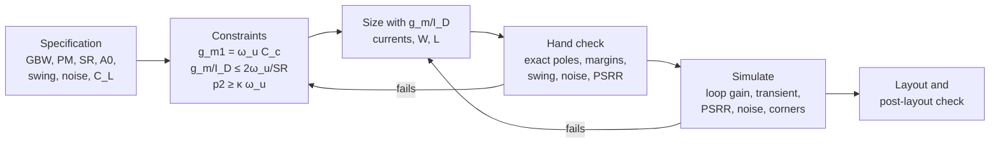
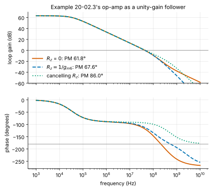

<!-- status: verified -->
# 20-02 · Two-Stage Op-Amp Design

| | |
|---|---|
| **Course** | [20 · Analog and Mixed-Signal IC Design](../README.md) |
| **University equivalent** | The op-amp design core of a first-year graduate analog IC course: specification-driven design of the two-stage CMOS op-amp, exact compensation analysis, indirect and nested Miller compensation, gain boosting, slewing and settling, supply rejection and common-mode feedback (Razavi, *Design of Analog CMOS Integrated Circuits*, 2nd ed., the op-amp and stability chapters; Carusone, Johns & Martin, *Analog Integrated Circuit Design*, 2nd ed., the op-amp chapters; Allen & Holberg, *CMOS Analog Circuit Design*, 3rd ed., the two-stage design procedure) |
| **Prerequisites** | [20-01](20-01-analog-design-fundamentals-gm-id.md) ($g_m/I_D$ sizing), [12-06](../../12-electronics-2/chapters/12-06-stability-and-compensation.md) (Miller compensation, margins), [12-08](../../12-electronics-2/chapters/12-08-op-amp-internals.md) (two-stage op-amp, slew rate, CMFB), [12-02](../../12-electronics-2/chapters/12-02-active-loads-cascodes-multistage.md) (five-transistor OTA), [12-10](../../12-electronics-2/chapters/12-10-noise-in-circuits.md) (amplifier noise), [15-07](../../15-control-systems/chapters/15-07-frequency-domain-design.md) (phase margin and damping) |
| **Estimated study hours** | 12 |
| **Last verified** | 2026-11-24 |

**Learning objectives.** After this chapter you can:

1. Translate an op-amp specification into constraints on transconductances, currents, capacitances and lengths, including the limit that slew rate places on the input pair's $g_m/I_D$.
2. Derive the exact transfer function of a Miller-compensated two-stage amplifier and its pole, zero and margin approximations, and show why the second stage's $f_T$ bounds the non-dominant pole.
3. Size a two-stage op-amp with the $g_m/I_D$ method for minimum current, and design its nulling resistor.
4. Derive indirect compensation, nested Miller compensation and gain boosting, and identify the failure mode each one introduces.
5. Compute slewing and settling time, output swing, input range, noise and supply rejection, and the convergence of a switched-capacitor common-mode feedback circuit.
6. Plan the simulations that verify an op-amp and judge whether reported margins can be trusted.

## 1. Big picture

Course 12 explained how a two-stage op-amp works. This chapter designs one: from the numbers a system architect hands over (gain, bandwidth, phase margin, slew rate, swing, noise, power, load) to every transistor's current, width and length, a compensation network, and the simulations that prove the design. The two-stage CMOS op-amp remains the workhorse wherever an amplifier must drive a capacitor with a large swing: residue amplifiers of pipelined ADCs, switched-capacitor integrators, regulators' error amplifiers, reference buffers. Every trade-off of analog design shows up in it at once.

- **The specification is a set of coupled constraints.** Bandwidth fixes $g_{m1}/C_c$, slew rate caps the input pair's $g_m/I_D$, phase margin sets the second stage's current, and noise puts a floor under $g_{m1}$. Change one and the others move.
- **Compensation is where the power goes.** In this chapter's Miller design the second stage takes 88% of the current, to push the second pole beyond the crossover; better compensation schemes buy that pole more cheaply.
- **Nanometer processes changed the playbook.** Low supplies leave no room for stacked cascodes, so designers cascade three stages or boost cascodes with auxiliary amplifiers, each with its own failure mode.
- **Margins are only as good as the simulation behind them.** How the loop gain was measured, at which corner and load, decides whether a phase margin means anything.



*Figure 1. The design loop of this chapter. Most iterations happen between the constraints and the hand check; simulation confirms, and is not where a design is first found.*

## 2. Intuition first

The physical picture is a small, precise first stage and a large, fast second stage held together by a capacitor.

```text
      VDD ───────────┬──────────────────────────────────┬──────────
                     │                                  │
            Vbp ──┤ M5  PMOS tail, I_SS        Vbp ──┤ M7  PMOS source, I_6
                     │                                  │
              ┌──────┴──────┐                           │
              │             │                           │
   v_in− ──┤ M1           M2 ├── v_in+                  │
              │             │       node 1     R_z  C_c │
              │             ├─────────●───────/\/\──||──●──────── v_out
              ●───┐         │         │                 │            │
              │   │         │         │                 │           ═╪═ C_L
       M3 ├───────●─────┤ M4          └─────────────┤ M6           │
   (diode)    │             │               (gate)      │            │
      VSS ────┴─────────────┴───────────────────────────┴────────────┴──
```

*Figure 2. The two-stage op-amp designed in this chapter: a PMOS input pair M1–M2 with tail M5 and NMOS mirror load M3–M4 (M3 diode-connected), driving the NMOS common-source stage M6, whose load is the PMOS current source M7. The compensation branch $R_z$–$C_c$ joins node 1 (M6's gate) to the output. M5 and M7 share the gate bias $V_{bp}$. It is the mirror image of 12-08's circuit, which used an NMOS pair and a PMOS second stage.*

**Why this arrangement.** The first stage converts the input into a current $g_{m1}v_{in}$; above a low frequency the second stage with $C_c$ around it is an integrator that turns all of that current into output voltage through $C_c$. So the gain is $g_{m1}/(sC_c)$, falling at 20 dB per decade and crossing unity at $\omega_u = g_{m1}/C_c$. The first stage can do this with little current. The second stage's job is different: it must actually move the load capacitance at frequencies up to and beyond $\omega_u$, so that the integrator stays an integrator there. If it is too slow, a second pole $p_2 \approx g_{m6}/C_L$ arrives near the crossover, adds phase lag, and the closed loop rings.

**An analogy, and its limits.** Think of a trading desk: a strategist (the first stage) decides how fast positions should change, cheaply; an execution team (the second stage) carries the orders out against the market's inertia (the load capacitance). The firm responds at the strategist's rate ($g_{m1}/C_c$) only if execution is faster still; slow execution makes it overshoot and correct back and forth. The analogy breaks in two places: the strategist's desk has inertia too ($C_1$, mostly the execution team's input capacitance, which grows with the team), and the feedforward path through $C_c$, which makes the right-half-plane zero, has no counterpart.

**What "design" adds to Course 12.** 12-06's rules $g_{m6} \approx 10g_{m1}$ and $C_c \approx 0.22C_L$ ignore that $C_1$ grows with $g_{m6}$, that the crossover is not at $\omega_u$, and that the best $C_c$ depends on what is being minimized. This chapter replaces them with the equations behind them and sizes transistors with 20-01's $g_m/I_D$ method in T130.

## 3. Theory

> **Conventions.** Small-signal model of Figure 2: node 1 has resistance $R_1 = r_{o2} \parallel r_{o4}$ and capacitance $C_1$ (to ground), the output has $R_2 = r_{o6} \parallel r_{o7}$ and $C_L$ (which absorbs the drain capacitances); $G = 1/R$. $\omega_u = g_{m1}/C_c$ is the **gain–bandwidth product** (GBW, in rad/s; $f_u = \omega_u/2\pi$), $\omega_c$ the actual unity-gain (crossover) frequency of the loop gain. Poles $p_1 < p_2 < p_3$ and zeros are quoted as positive frequencies. Devices use 20-01's charge-based model and the T130 process: NMOS as in 20-01 (μ = 350 cm²/V·s, $C_{ox}$ = 8.6 fF/µm², $n$ = 1.3, $V_{TH}$ = 0.45 V, $v_{sat}$ = 8 × 10⁶ cm/s, $V_A'$ = 8 V/µm), and a **T130 PMOS** with μ = 100 cm²/V·s and $v_{sat}$ = 6 × 10⁶ cm/s, all else the same ($\lvert V_{TH} \rvert$ = 0.45 V). These are teaching values, not a foundry's. The PMOS input pair sits in its own well tied to its sources, so it has no body effect.

### 3.1 From specification to design variables

A specification is a list of inequalities. The first design step is to write each one as a constraint on a design variable:

| Specification | Governing relation | What it constrains |
|---|---|---|
| GBW $f_u$ | $\omega_u = g_{m1}/C_c$ | the ratio $g_{m1}/C_c$ |
| Phase margin (PM) | $p_2 \ge \kappa\,\omega_u$, with $\kappa$ from §3.2 | $g_{m6}$, given $C_c$, $C_L$, $C_1$ |
| Slew rate SR | $\text{SR} = I_{SS}/C_c = 2\omega_u/(g_m/I_D)_1$ (§3.3) | the input pair's $g_m/I_D$ |
| Output slew | $I_6 \ge I_{SS}(1 + C_L/C_c)$ (§3.8) | the second stage's current |
| DC gain $A_0$ | $A_0 = (g_m/I_D)_1V_{A,1} \cdot (g_m/I_D)_6V_{A,2}$, with $V_A = V_A'L$ combined per stage | channel lengths |
| White noise $\bar v_n$ | $\bar v_n^2 = (8kT\gamma/g_{m1})(1 + g_{m3}/g_{m1})$ (12-10) | a floor on $g_{m1}$, hence on $C_c$ |
| Output swing | $V_{DS,sat6} \le v_{out} \le V_{DD} - V_{SD,sat7}$ (§3.9) | the inversion level of M6, M7 |
| Input range | §3.9 | the inversion levels of M1, M3, M5 |
| Power | $V_{DD}(I_{SS} + I_6)$ | the objective to minimize |

Two of these constraints interact in a way the square law hides. Because $g_{m1}$ is tied to $C_c$ by the bandwidth, the slew rate $I_{SS}/C_c$ does not depend on $C_c$ at all once $g_m/I_D$ is chosen (§3.3); and because the noise sets a minimum $g_{m1}$, it sets a minimum $C_c$. The whole procedure is collected in §3.12.

### 3.2 The exact two-stage transfer function

Write Kirchhoff's current law at the two nodes of Figure 2's small-signal model, first with $R_z = 0$. The first stage injects $g_{m1}v_{in}$ (sign chosen so that the overall gain is positive), and $C_c$ carries $sC_c(V_1 - V_o)$:

$$
\begin{aligned}
(G_1 + sC_1)V_1 + sC_c(V_1 - V_o) &= -g_{m1}V_{in},\\
(G_2 + sC_L)V_o + sC_c(V_o - V_1) + g_{m6}V_1 &= 0 .
\end{aligned}
$$

The second equation gives $V_1 = -V_o\,[G_2 + s(C_L + C_c)]/(g_{m6} - sC_c)$. Substituting into the first and multiplying through by $g_{m6} - sC_c$,

$$
V_o\left\{[G_1 + s(C_1 + C_c)][G_2 + s(C_L + C_c)] + sC_c(g_{m6} - sC_c)\right\} = g_{m1}(g_{m6} - sC_c)V_{in} .
$$

The $s^2$ terms combine as $(C_1 + C_c)(C_L + C_c) - C_c^2 = C_1C_L + C_c(C_1 + C_L)$. Dividing by $G_1G_2$:

$$
A(s) = \frac{A_0\,(1 - s/z)}{1 + a_1s + a_2s^2}, \qquad
\begin{aligned}
A_0 &= g_{m1}R_1\,g_{m6}R_2, \qquad z = \frac{g_{m6}}{C_c},\\
a_1 &= g_{m6}R_1R_2C_c + R_1(C_1 + C_c) + R_2(C_L + C_c),\\
a_2 &= R_1R_2\,[C_1C_L + C_c(C_1 + C_L)] .
\end{aligned}
$$

Units check: $a_1$ is $\Omega^2 \cdot \text{S} \cdot \text{F} = \Omega\,\text{F}$ = seconds; $a_2$ is $\Omega^2\,\text{F}^2$ = s². The zero is in the right half plane, as 12-06 explained.

**Pole splitting, exactly.** When the roots are widely separated, $1 + a_1s + a_2s^2 \approx (1 + s/p_1)(1 + s/p_2)$ with $p_1 = 1/a_1$ and $p_2 = a_1/a_2$. The first term of $a_1$ dominates when $g_{m6}R_2 \gg 1$ and $C_c$ is not tiny, so

$$
p_1 \approx \frac{1}{g_{m6}R_1R_2C_c}, \qquad p_2 \approx \frac{g_{m6}C_c}{C_1C_L + C_c(C_1 + C_L)} .
$$

This is 12-06's result, now with $C_1$ kept. Only when $C_1 \ll C_c$ and $C_1 \ll C_L$ does $p_2$ reduce to the familiar $g_{m6}/C_L$. The product $p_1p_2 = 1/a_2$ is exact and fixed by the capacitances: increasing $C_c$ pushes $p_1$ down and $p_2$ up together.

**The crossover is not at the GBW.** Above $p_1$ the gain is $\approx (g_{m1}/sC_c)/(1 + s/p_2)$, ignoring the zero. Call $\kappa = p_2/\omega_u$ and $x = \omega_c/\omega_u$. Setting the magnitude to one, $x^2(1 + x^2/\kappa^2) = 1$, a quadratic in $x^2$:

$$
x^2 = \frac{\kappa^2}{2}\left(\sqrt{1 + \frac{4}{\kappa^2}} - 1\right), \qquad \text{PM} = 90^\circ - \arctan\frac{x}{\kappa} .
$$

Two useful facts follow. The crossover always sits below the GBW ($x < 1$). And for $\kappa$ = 1.5, $x = \sqrt3/2$ and $\arctan(x/\kappa) = \arctan(1/\sqrt3)$ = 30°, so **a non-dominant pole at 1.5 times the GBW gives exactly 60° of phase margin** before the zero and any further poles are counted. With $\kappa$ = 2, PM = **65.5**°, a sensible design target that leaves room for the zero, the third pole of §3.4 and the mirror pole of Problem 20-02.11. (12-06's "$p_2$ = 2.2 $\omega_u$ for 60°" also budgets **5.7**° for the zero.)

### 3.3 What the second stage's own capacitance costs

Node 1's capacitance is mostly M6's gate: $C_1 = C_p + C_{gg6}$, where $C_p$ collects the drain junctions of M2 and M4 and wiring, and $C_{gg6} = g_{m6}/\omega_{T6}$ by the definition of the transit frequency (20-01 §3.5). A bigger $g_{m6}$ means a wider M6 and a bigger $C_1$. Put this into $p_2$:

$$
p_2 = \frac{g_{m6}C_c}{(C_p + g_{m6}/\omega_{T6})(C_L + C_c) + C_cC_L} .
$$

As $g_{m6} \to \infty$ the denominator grows like $g_{m6}(C_L + C_c)/\omega_{T6}$, and

$$
p_2 \;\to\; p_{2,max} = \omega_{T6}\,\frac{C_c}{C_L + C_c} .
$$

**The second pole can never exceed the second-stage transistor's $f_T$ scaled by the capacitive divider $C_c/(C_L + C_c)$**, however much current is spent. This is why M6 is made NMOS here (3.5 times the PMOS mobility in T130, so a higher $f_T$ at the same length and $g_m/I_D$) and kept short. Solving the same expression for the $g_{m6}$ that places $p_2$ at a target value:

$$
g_{m6} = \frac{p_2\,[C_p(C_L + C_c) + C_cC_L]}{C_c - p_2(C_L + C_c)/\omega_{T6}} ,
$$

which exists only below the bound and grows without limit as $p_2$ approaches it. Far below the bound and with $C_p \ll C_c$, it reduces to $g_{m6} \approx p_2C_L$, the naive rule.

**Choosing $C_c$.** With the GBW fixed, $g_{m1} = \omega_uC_c$, so the first stage's current grows with $C_c$, $I_{SS} = 2g_{m1}/(g_m/I_D)_1 = 2\omega_uC_c/(g_m/I_D)_1$. The second stage's falls: a larger $C_c$ shrinks the $C_1C_L/C_c$ part of the effective load. Their sum,

$$
I_{tot}(C_c) = \frac{2\omega_uC_c}{(g_m/I_D)_1} + \frac{g_{m6}(C_c)}{(g_m/I_D)_6} ,
$$

has a minimum. Figure 3 shows it for the design of Example 20-02.3: the optimum is broad, at about **0.67** pF, and anything from **0.52** to **0.87** pF costs at most 1% more current (0.6 pF costs **0.19**% more). The noise floor on $g_{m1}$ sets a lower bound on $C_c$ (Example 20-02.1) that sits just below this range.


*Figure 3. The current split for Example 20-02.3's op-amp (GBW 50 MHz, $C_L$ = 2 pF, $p_2 = 2\omega_u$, $(g_m/I_D)_1$ = 18 S/A, $(g_m/I_D)_6$ = 10 S/A, $C_p$ = 30 fF). Small $C_c$ starves the second stage of pole splitting; large $C_c$ wastes first-stage current. The minimum is flat: the choice of $C_c$ is decided by noise, area and slew, not by power.*

**Slew rate, in $g_m/I_D$ terms.** 12-08 §3.2 derived the internal slew rate $I_{SS}/C_c$. Since $I_{SS} = 2I_{D1} = 2g_{m1}/(g_m/I_D)_1$ and $g_{m1} = \omega_uC_c$,

$$
\text{SR} = \frac{I_{SS}}{C_c} = \frac{2\,\omega_u}{(g_m/I_D)_1} .
$$

Once the bandwidth is fixed, **the slew rate depends only on the input pair's transconductance efficiency**, not on $C_c$ or the current. For a square-law device $g_m/I_D = 2/V_{ov}$ and this is 12-08's $\text{SR}/\omega_u = V_{ov}$; in weak inversion $g_m/I_D \to 1/(nV_T)$ and $\text{SR}/\omega_u \to 2nV_T$. A slew specification therefore caps $(g_m/I_D)_1$ at $2\omega_u/\text{SR}$, while low noise per microampere asks for the highest value: a tension resolved before any transistor is sized.

### 3.4 Taming the zero: the nulling resistor, exactly

12-06 §3.6 showed that a resistor $R_z$ in series with $C_c$ moves the zero to $z = 1/[C_c(1/g_{m6} - R_z)]$. Repeating §3.2's analysis with the extra node between $R_z$ and $C_c$ (three nodal equations, whose determinant Solution 20-02.12 expands term by term) gives

$$
\begin{aligned}
a_1 &= g_{m6}R_1R_2C_c + R_1(C_1 + C_c) + R_2(C_L + C_c) + R_zC_c,\\
a_2 &= R_1R_2\,[C_1C_L + C_c(C_1 + C_L)] + R_zC_c\,(R_1C_1 + R_2C_L),\\
a_3 &= R_1R_2R_z\,C_1C_LC_c ,
\end{aligned}
$$

a third-order denominator. The new pole is $p_3 \approx a_2/a_3$, which simplifies to

$$
p_3 \approx \frac{1}{R_z}\left(\frac{1}{C_1} + \frac{1}{C_c} + \frac{1}{C_L}\right) \approx \frac{1}{R_zC_1} :
$$

$R_z$ in series with the three capacitors. With $R_z = 1/g_{m6}$, which puts the zero at infinity, $p_3 \approx g_{m6}/C_1$, close to M6's own $\omega_T$ when $C_1$ is mostly its gate. Two settings are common.

- **$R_z = 1/g_{m6}$** removes the zero and costs only a pole near $\omega_{T6}$. It is robust: nothing has to match.
- **$R_z = (1 + C_L/C_c)/g_{m6}$** places a left-half-plane zero on $p_2 \approx g_{m6}/C_L$ (12-06 §3.6), so the phase margin jumps, and in Example 20-02.4 it stays ahead of $R_z = 1/g_{m6}$ even at twice the load. Its costs lie elsewhere: $p_3 = 1/(R_zC_1)$ is several times lower, and when the load moves the zero no longer sits on $p_2$, leaving a pole–zero doublet that slows settling to high accuracy (as in §3.7).

**Making $R_z$ track $g_{m6}$.** A polysilicon resistor does not track a transistor's $g_m$ over process and temperature. A MOSFET in triode does. In the charge-based model, the small-signal conductance of a device with $V_{DS} = 0$ (source and drain charges equal, $q_s = q_d = q$) is obtained by differentiating $I_D = I_{spec}[(q_s^2 + q_s) - (q_d^2 + q_d)]$ with respect to the drain voltage, using $-dV_D = V_T(2 + 1/q_d)\,dq_d$:

$$
g_{ds0} = I_{spec}\,\frac{(2q + 1)\,q}{V_T(2q + 1)} = \frac{I_{spec}\,q}{V_T} .
$$

In saturation and without velocity saturation, 20-01 gives $g_m = I_D/[nV_T(1 + q)] = I_{spec}\,q/(nV_T)$. If the triode device $M_z$ is biased so that its channel charge equals M6's ($q_z = q_6$, which a replica bias can arrange), then with $I_{spec} \propto W/L$,

$$
R_z\,g_{m6} = \frac{g_{m6}}{g_{ds0,z}} = \frac{(W/L)_6}{n\,(W/L)_z} .
$$

The product depends only on a geometry ratio and the slope factor, both stable across corners, so the zero stays where it was put. For $R_z = 1/g_{m6}$ the triode device needs $(W/L)_z = (W/L)_6/n$: **43.3** for Example 20-02.3's M6 ($W/L$ = **28.16**/0.5). Its gate must sit $V_{GS6}$ above node 1 if its bulk is tied to its source (a triple-well device), about $2V_{GS6}$ ≈ **1.20** V, already at $V_{DD}$; with a grounded bulk, the body effect raises that to about $(1 + n)V_{GS6}$ ≈ **1.38** V, above the supply. Practical designs therefore bias the replica from a higher rail or a charge pump, or accept a fixed $R_z$, which Problem 20-02.6 shows is robust.

### 3.5 Indirect (cascode) compensation

Miller compensation's right-half-plane zero and its poor supply rejection (§3.10) share one cause: $C_c$ connects node 1's *voltage* directly to the output. **Indirect compensation**, introduced by Ahuja [1], returns the compensation current to a low-impedance node instead: the source $x$ of a cascode device $M_c$ through which the first stage's signal current flows on its way to node 1. Current still reaches node 1 through $M_c$, so the feedback through $C_c$ still splits the poles, but node 1's voltage no longer drives $C_c$.

**The model.** Node $x$ has a resistance $R_x$ and capacitance $C_x$; the cascode $M_c$ (transconductance $g_{mc}$, gate at small-signal ground) passes $g_{mc}v_x$ on to node 1, and the first stage draws $g_{m1}v_{in}$ from node $x$. KCL at the three nodes, with $G = 1/R$:

$$
\begin{aligned}
x:&\quad (G_x + sC_x + g_{mc})V_x + sC_c(V_x - V_o) = -g_{m1}V_{in},\\
1:&\quad (G_1 + sC_1)V_1 = g_{mc}V_x,\\
\text{out}:&\quad g_{m6}V_1 + (G_2 + sC_L)V_o + sC_c(V_o - V_x) = 0 .
\end{aligned}
$$

Set $C_x = 0$ and $G_x \to 0$, take $V_1$ from the second equation and $V_x$ from the first, and substitute into the third: the result has a third-order denominator with

$$
a_1 \approx g_{m6}R_1R_2C_c, \qquad a_2 \approx R_1R_2\,C_1(C_L + C_c), \qquad a_3 = \frac{R_1R_2\,C_1C_LC_c}{g_{mc}} ,
$$

where the omitted terms are smaller by factors of $1/(g_{mc}R)$. The dominant pole is unchanged, $p_1 = 1/(g_{m6}R_1R_2C_c)$, but

$$
p_2 \approx \frac{a_1}{a_2} = \frac{g_{m6}C_c}{C_1(C_L + C_c)}, \qquad p_3 \approx \frac{a_2}{a_3} = \frac{g_{mc}(C_L + C_c)}{C_LC_c} .
$$

Compare $p_2$ with the Miller result $g_{m6}C_c/[C_1C_L + C_c(C_1 + C_L)]$: the term $C_cC_L$, which dominated the Miller denominator, is gone. The ratio of the two is $1 + C_cC_L/[C_1(C_L + C_c)]$: **6.6** for Example 20-02.5's values. The zeros move to about $\pm\sqrt{g_{m6}g_{mc}/(C_1C_c)}$, far above the crossover.

**The catch: a pole pair.** $p_2$ is now so high that it is no longer far from $p_3$, and the two form a complex pair. Physically, there is a fast inner loop (output → $C_c$ → node $x$ → $M_c$ → node 1 → M6 → output) whose crossover is $p_2$ and whose extra pole is $p_3$. Closing it gives the polynomial $s^2 + p_3s + p_2p_3$, with natural frequency $\omega_n = \sqrt{p_2p_3}$ and damping

$$
\zeta = \frac12\sqrt{\frac{p_3}{p_2}} .
$$

For the outer loop this pair has two effects. Well below $\omega_n$ it adds phase lag $\approx 2\zeta\omega/\omega_n = \omega/p_2$, the same as a real pole at $p_2$, so **the phase margin is set by $p_2$** and is excellent. Near $\omega_n$ the pair peaks by about $1/(2\zeta)$, and the loop gain there is about $(\omega_u/\omega_n)/(2\zeta) = \omega_u/p_3$, so **the gain margin is about $p_3/\omega_u$**. A design can show 80° of phase margin and almost no gain margin (Example 20-02.5). The fix is a cascode strong enough to put $p_3$ well above the crossover, $g_{mc} \gtrsim 3\,\omega_u\,C_cC_L/(C_L + C_c)$, usually with its own bias current.

> **Going deeper — where the cascode goes.** In a five-transistor first stage only half the signal current passes any one cascode, which adds a zero pair but not new conclusions; folded-cascode and fully differential stages, and split-length devices, provide the low-impedance node directly. Ahuja's paper also reports the supply-rejection benefit [1].

### 3.6 Three stages: nested Miller compensation

At supplies below about 1 V, a cascode's extra $V_{DS,sat}$ does not fit, and the way to more gain is a third stage. Three poles need two compensation capacitors: in **nested Miller compensation** (NMC), $C_{m1}$ wraps the outer two stages (node 1 to the output) and $C_{m2}$ the output stage (node 2 to the output). The output stage must invert, and the middle stage must not, so that both capacitors give negative feedback.

**Butterworth design.** Neglect the stages' output conductances and node capacitances. KCL at node 1, node 2 and the output gives $g_{m1}V_{in} + sC_{m1}(V_o - V_1) = 0$, $g_{m2}V_1 + sC_{m2}(V_o - V_2) = 0$ and $-g_{m3}V_2 + sC_{m1}(V_1 - V_o) + sC_{m2}(V_2 - V_o) - sC_LV_o = 0$. Solving,

$$
A(s) = \frac{g_{m1}}{sC_{m1}}\cdot\frac{1 - sC_{m2}/g_{m3} - s^2C_{m1}C_{m2}/(g_{m2}g_{m3})}{1 + sC_{m2}(1/g_{m2} - 1/g_{m3}) + s^2C_{m2}C_L/(g_{m2}g_{m3})} .
$$

With $g_{m3} \gg g_{m2}$ and the high-frequency zeros neglected, the amplifier is an integrator $g_{m1}/(sC_{m1})$ followed by $1/(1 + sC_{m2}/g_{m2} + s^2C_{m2}C_L/(g_{m2}g_{m3}))$: the pole-splitting argument nests. In unity-gain feedback the closed-loop denominator is

$$
1 + s\frac{C_{m1}}{g_{m1}} + s^2\frac{C_{m1}C_{m2}}{g_{m1}g_{m2}} + s^3\frac{C_{m1}C_{m2}C_L}{g_{m1}g_{m2}g_{m3}} .
$$

Eschauzier, Kerklaan and Huijsing chose the capacitors to make this a third-order Butterworth polynomial, $1 + 2(s/\omega_0) + 2(s/\omega_0)^2 + (s/\omega_0)^3$ [2]. Matching coefficients: $C_{m1}/g_{m1} = 2/\omega_0$; dividing the second by the first, $C_{m2}/g_{m2} = 1/\omega_0$; dividing the third by the second, $C_L/g_{m3} = 1/(2\omega_0)$. Hence $\omega_0 = g_{m3}/(2C_L)$ and

$$
C_{m1} = \frac{4g_{m1}C_L}{g_{m3}}, \qquad C_{m2} = \frac{2g_{m2}C_L}{g_{m3}}, \qquad \omega_u = \frac{g_{m1}}{C_{m1}} = \frac{g_{m3}}{4C_L} .
$$

(The paper numbers stages from the output, so its indices are reversed; the result is the same.) The loop gain is then $(\omega_0/2s)/(1 + s/\omega_0 + s^2/2\omega_0^2)$, whose crossover is at **0.9925** $\omega_u$ with a phase margin of **60.5**°.

**The cost.** A two-stage amplifier with $p_2 = 2\omega_u$ needs $g_{m6} \approx 2\omega_uC_L$; NMC needs $g_{m3} = 4\omega_uC_L$, twice as much output-stage transconductance for the same GBW. And the recipe assumes the node capacitances are small compared with $C_{m1}$ and $C_{m2}$, which fails at node 2, where the output transistor's large gate sits. Example 20-02.6 shows the margins falling and what it takes to restore them.

> **Going deeper — beyond NMC.** Multipath NMC adds a feedforward input stage [2]; reversed, damping-factor-control and single-Miller schemes trade the inner capacitor for active networks. Leung and Mok's review compares them analytically [3].

### 3.7 Gain boosting

The other route to high gain at low voltage keeps one stage and multiplies its output resistance. In a **gain-boosted** (regulated) cascode, an auxiliary amplifier of gain $A_b$ senses the cascode device's source and drives its gate, so that the source is held still and the cascode looks $(1 + A_b)$ times more resistive: $R_{out} \approx (1 + A_b)\,g_mr_o^2$ (12-02 §3.4 for the unboosted $g_mr_o^2$). Bult and Geelen's 1990 op-amp reached 90 dB of DC gain this way while keeping single-stage speed [4].

**The doublet.** The booster has finite bandwidth: model it as $A_b(s) = A_{b0}/(1 + s/\omega_{pb})$, with unity-gain frequency $\omega_{ub} = A_{b0}\omega_{pb}$. The output resistance becomes frequency dependent, $R_{out}(s) = R_0[1 + A_b(s)]$, where $R_0 = g_mr_o^2$. For $\omega \gg \omega_{pb}$, $1 + A_b(s) \approx (s + \omega_{ub})/s$. The amplifier's gain is $A(s) = g_{m1}\,[R_{out} \parallel 1/(sC_L)]$; working out the parallel combination,

$$
A(s) \approx \frac{g_{m1}}{sC_L}\cdot\frac{s + \omega_{ub}}{s + \omega_{ub} + 1/(R_0C_L)} .
$$

A zero at $\omega_{ub}$ and a pole just above it, separated by the *unboosted* dominant-pole frequency $\delta = 1/(R_0C_L)$: a **pole–zero doublet**, invisible in a Bode plot but slow to settle. With feedback factor β, the closed-loop poles are the roots of $s^2 + s(\omega_{ub} + \delta + \beta\omega_u) + \beta\omega_u\omega_{ub} = 0$. When $\beta\omega_u \gg \omega_{ub}$, one root is fast, $\approx \beta\omega_u$, and the other sits at $\approx \omega_{ub}$; the step response's residue at the slow root is about $\delta/(\beta\omega_u)$. Since $\delta/\omega_u = 1/(g_{m1}R_0) = 1/A_{unb}$, the unboosted gain:

$$
e_{slow}(t) \approx \frac{1}{\beta A_{unb}}\,e^{-\omega_{ub}t} .
$$

Before $1/\omega_{ub}$ the booster has not acted, so the amplifier settles like the unboosted one, to $1/(\beta A_{unb})$; the booster then removes that error at its own pace. Hence Bult and Geelen's condition [4]: **the booster's unity-gain frequency must exceed the closed-loop bandwidth $\beta\omega_u$** (so its tail is faster than the main settling), **and stay below the main amplifier's non-dominant pole** (so the booster's own loop is stable). For an amplifier with $g_{m1}$ = 1 mS, $C_L$ = 1 pF ($f_u$ = **159.2** MHz), $A_{unb}$ = 300, $A_{b0}$ = 100 and β = 0.5, the boosted DC gain is **30,300** and the estimated tail amplitude **0.667**%. The estimate assumes $\omega_{ub} \ll \beta\omega_u$; here the ratio is only 4, and the exact tail starts at **1.16**% and decays with a **7.95** ns time constant (a slow pole at **20.02** MHz, just below the booster's zero). Settling to 0.01% takes **37.8** ns with $f_{ub}$ = 20 MHz but **18.5** ns with $f_{ub}$ = 300 MHz, against **18.4** ns for an ideal single-pole amplifier (Figure 4).


*Figure 4. Step-response error of the gain-boosted example (exact model). With the booster's unity-gain frequency below the closed-loop bandwidth (20 MHz against 79.6 MHz), the error falls at the closed-loop rate only to about 1%, of the order of $1/(\beta A_{unb})$, and then decays with the booster's time constant; above it (300 MHz), settling is indistinguishable from an ideal single-pole amplifier.*

### 3.8 Slewing and settling

**Output-stage slewing.** In Figure 2's circuit, a rising output edge turns M6 off, so only M7's constant $I_6$ can charge the load, and it must also supply the current $I_{SS}$ that the first stage pulls through $C_c$. The output's slew rate is $(I_6 - I_{SS})/C_L$. For the output stage never to be the limit, it must at least match the internal rate $I_{SS}/C_c$:

$$
I_6 \ge I_{SS}\left(1 + \frac{C_L}{C_c}\right) .
$$

(The falling edge is not limited: M6 can sink far more than its bias current. 12-08's circuit, with a PMOS M6, has the same condition on its falling edge.)

**Slewing plus linear settling.** Model a unity-gain follower as single-pole with time constant $\tau = 1/(\beta\omega_u)$. A step of size $V$ asks for an initial slope $V/\tau$; if that exceeds SR, the amplifier slews at SR until the remaining error is small enough to be followed linearly, $\text{SR}\cdot\tau$, and then decays exponentially. To a final error $\varepsilon V$:

$$
t_{slew} = \frac{V - \text{SR}\,\tau}{\text{SR}}, \qquad t_{lin} = \tau\ln\frac{\text{SR}\,\tau}{\varepsilon V} .
$$

For Example 20-02.3's op-amp as a follower ($\tau$ = **3.18** ns, SR = 34.9 V/µs), the largest step that does not slew is **0.111** V; a 0.5 V step to 0.1% takes **11.1** ns of slewing and **17.2** ns of linear settling, **28.3** ns in all, against **22.0** ns if there were no slew limit. Large-signal settling, not small-signal bandwidth, usually sets a switched-capacitor circuit's clock rate.

**Phase margin and settling.** For the two-pole loop of §3.2 the closed loop is $1/(1 + s/\omega_u + s^2/(\kappa\omega_u^2))$, a second-order system with $\zeta = \tfrac12\sqrt \kappa$ (15-03). Its settling time to 0.1% is not monotonic in $\kappa$ (Figure 5): as damping falls, the response first settles *faster* than the single-pole limit $\ln(1000)/\omega_u$ = **6.91**$/\omega_u$, because its first overshoot lands inside the error band, and then slower once it rings outside it. The minimum, **3.44**$/\omega_u$, is at $\kappa$ ≈ **3.31** (PM ≈ **74**°), where the first overshoot just touches the error band; at $\kappa$ = 1.5 (PM 60°) it is **8.35**$/\omega_u$. Hence the habit of asking for 70–75° in amplifiers that must settle precisely.


*Figure 5. Settling time to 0.1% of a two-pole unity-gain loop against its phase margin. The jumps occur where an overshoot or undershoot just touches the error band.*

### 3.9 Swing, input range, offset and noise

**Saturation voltage from the charge model.** 20-01's model writes the drain current as a forward (source) term minus a reverse (drain) term, $I_D = I_{spec}[(q_s^2 + q_s) - (q_d^2 + q_d)]$, with $V_P - V_S = V_T(2q_s + \ln q_s)$ and $V_P - V_D = V_T(2q_d + \ln q_d)$. In saturation $q_d \to 0$. Define $V_{DS,sat}$ as the drain–source voltage at which the reverse term has fallen to 2% of the forward term, so that the current is within 2% of its saturated value. Solving $q_d^2 + q_d = 0.02(q_s^2 + q_s)$ for $q_d$ and subtracting the two voltage relations,

$$
V_{DS,sat} = V_T\left[2(q_s - q_d) + \ln\frac{q_s}{q_d}\right] .
$$

In weak inversion $q_d = 0.02q_s$ and $V_{DS,sat} = V_T\ln 50$ = **3.91** $V_T$, about **101** mV whatever the current. In strong inversion $q_d \to \sqrt{0.02}\,q_s$ = **0.141** $q_s$, and expanding for large $q_s$ gives $V_{DS,sat} \approx$ **0.86** $(2V_Tq_s)$ + **2.8** $V_T$, where $2V_Tq_s \approx V_P$ is the pinch-off voltage: a little below $V_P$, because a 2% reverse current is tolerated.

**Output swing.** The output stays linear while M6 and M7 are both saturated: $V_{DS,sat6} \le v_{out} \le V_{DD} - V_{SD,sat7}$. Weak inversion buys swing; strong inversion buys speed.

**Input common-mode range.** For the PMOS input pair, the tail M5 must stay saturated: $V_{CM} \le V_{DD} - V_{SD,sat5} - V_{SG1}$. M1 must stay saturated with its drain at M3's gate–source voltage: $V_{CM} \ge V_{GS3} + V_{SD,sat1} - V_{SG1}$. A PMOS pair's range reaches close to ground.

**Systematic offset.** With zero input, node 1 must sit at the voltage that makes M6 carry exactly M7's current. In the balanced first stage node 1 equals M3's gate voltage, so M6 must have **the same $V_{GS}$ as M3**, which in the charge model means the same normalized charge $q$ (not the same $IC$: devices of different lengths at the same $q$ differ slightly in $IC$ through $\lambda_c$). Likewise M5 and M7 share the bias $V_{bp}$, so they share $q$. Sizing both pairs this way makes the systematic offset zero by construction (12-08 §3.6 gives the square-law version).

**Noise.** The input-referred white noise of the first stage is 12-10's $\bar v_n^2 = (8kT\gamma/g_{m1})(1 + g_{m3}/g_{m1})$, with γ = 2/3. (In weak inversion the factor is $n/2$ instead, **0.65** for T130, so 2/3 is a fair value across the range used here.) The second stage's noise, referred to the input, is divided by the first stage's gain and is negligible at low frequency. Flicker noise, which favors large PMOS input devices in many processes, is treated in 20-11.

### 3.10 Supply and common-mode rejection

**Power-supply rejection.** The supply-to-output gain $A_{ss}$ is found from the same two-node model with the supply as the input. In Figure 2 the vulnerable rail is VSS: M6's source, the mirror M3–M4 and node 1's capacitance (mostly M6's $C_{gs}$) all return to it. Writing the node equations with VSS moving by $v_{ss}$ (M6's current is $g_{m6}(v_1 - v_{ss})$, $r_{o6}$ runs from the output to VSS, and the mirror makes node 1's resistance return to VSS too), and dividing by the differential gain $A_{dm}$:

$$
\frac{1}{\text{PSRR}^-(s)} = \frac{A_{ss}}{A_{dm}} = \frac{G_1G_{o6} + s\,[C_cg_{m6} + C_1G_{o6} + C_c(G_1 + G_{o6})] + s^2C_1C_c}{g_{m1}(g_{m6} - sC_c)} ,
$$

with $G_{o6} = 1/r_{o6}$. Three regions follow.

- **DC:** $\text{PSRR}^-(0) = g_{m1}R_1 \cdot g_{m6}r_{o6}$, the first stage's gain times M6's intrinsic gain, about $2A_0$ when $r_{o6} = r_{o7}$.
- **Above $\omega_{pp} = 1/(g_{m6}R_1r_{o6}C_c)$** (about half the dominant pole), the $sC_cg_{m6}$ term takes over and $1/\text{PSRR} \approx s\,C_c/g_{m1} = s/\omega_u$: the rejection **falls as $\omega_u/\omega$** and reaches 0 dB at the GBW. Physically, once $C_c$ ties M6's gate to its drain, M6 behaves as a diode from the output to VSS, and the output follows the rail.

For Example 20-02.3's op-amp ($r_{o6}$ = 4 V/$I_6$), $\text{PSRR}^-(0)$ = **2880** (**69.2** dB), the corner $\omega_{pp}/2\pi$ is **17.4** kHz, and at 1 MHz the rejection has fallen to **33.7** dB, close to the asymptote $20\log_{10}(f_u/f)$ = 34.0 dB.

This is the "severe degradation above the open-loop pole frequency" that Ahuja set out to fix [1]: with indirect compensation $C_c$ no longer ties M6's gate to its drain. The positive rail is better protected here, because M7 is a current source whose gate bias can be referred to VDD. In 12-08's mirrored circuit the roles of the rails swap.

**Common-mode rejection.** The first stage's CMRR (12-01 §3.5) is set at DC by the tail's output resistance and the halves' mismatch, and falls at 20 dB per decade once the tail node's capacitance shunts that resistance: it matters most in a follower, whose common mode swings with the signal.

### 3.11 Fully differential amplifiers and switched-capacitor CMFB

12-08 §3.4 explained why a fully differential amplifier needs common-mode feedback (CMFB): the differential loop does not define the output common mode. Continuous-time CMFB senses it with resistors (which load the output) or source followers (which cost headroom); in clocked circuits the **switched-capacitor CMFB** avoids both [5].

**The circuit.** Two equal capacitors $C_s$ connect the outputs $v_{o\pm}$ to the control node $v_{ctrl}$ (which sets, say, the second stage's bias), so $v_{ctrl} = v_{oc} - \Delta V$, where $v_{oc}$ is the output common mode and $\Delta V$ the DC voltage the capacitors hold. On phase φ1 two capacitors $C_r$ are charged to $V_{CM,ref} - V_{bias}$ (the desired common mode minus the nominal control voltage); on φ2 they are connected in parallel with the $C_s$ capacitors. Charge stops moving when $\Delta V = V_{CM,ref} - V_{bias}$; the high-gain CMFB loop holds $v_{ctrl}$ at $V_{bias}$, so $v_{oc} = V_{CM,ref}$.

**Convergence.** Charge sharing on φ2 gives $(C_s + C_r)\Delta V_{j+1} = C_s\Delta V_j + C_r(V_{CM,ref} - V_{bias})$, so the error $e_j$ of $\Delta V$ after $j$ cycles obeys

$$
e_{j+1} = \frac{C_s}{C_s + C_r}\,e_j .
$$

With $C_r = C_s/4$ the error shrinks by 0.8 per cycle, and a factor of 1000 takes **31** cycles; with $C_r = C_s/2$, **18** cycles. A larger $C_r$ converges faster but injects more switch charge and loads the outputs more on φ2, so designs make $C_r$ several times smaller than $C_s$ and accept tens of cycles at start-up. Between updates the sensing is purely capacitive: no resistive load, no swing limit, which is why SC CMFB is standard in switched-capacitor filters and pipelined ADCs.

### 3.12 The design procedure

1. **Topology.** Input-pair type from the common-mode range and noise (PMOS near ground, often lower flicker noise); second stage NMOS for its higher $f_T$.
2. **Slew → $(g_m/I_D)_1$.** $(g_m/I_D)_1 \le 2\omega_u/\text{SR}$; pick a value with margin.
3. **Noise → minimum $g_{m1}$ and $C_c$.** $g_{m1} \ge (8kT\gamma/\bar v_n^2)(1 + g_{m3}/g_{m1})$ and $C_c \ge g_{m1,min}/\omega_u$.
4. **Phase margin → $\kappa$.** Choose $p_2 = \kappa\omega_u$ with $\kappa$ ≈ 2 (65.5° before the zero and further poles), more for precise settling.
5. **Second stage.** Choose $(g_m/I_D)_6$ and $L_6$, read $f_{T6}$, check $\kappa\omega_u < p_{2,max}$, and compute $g_{m6}$ from §3.3's formula.
6. **$C_c$.** Minimize $I_{SS} + I_6$ over $C_c$ (it is flat); respect the noise floor.
7. **Currents and widths.** $I_{SS} = 2\omega_uC_c/(g_m/I_D)_1$, $I_6 = g_{m6}/(g_m/I_D)_6$, then each $W$ from current density (20-01). Check $I_6 \ge I_{SS}(1 + C_L/C_c)$.
8. **Mirror and sources.** Size M3–M4 at M6's $q$ and M5 at M7's $q$ (zero systematic offset); choose lengths for gain.
9. **Gain, swing, input range, noise, power.** Check each; iterate on lengths and inversion levels.
10. **Compensation network.** Choose $R_z$ ($1/g_{m6}$ for robustness), then compute the exact poles and margins at the extreme load and corner.
11. **Simulate** (§3.13), then lay out and repeat at the post-layout netlist.

### 3.13 Verifying a design in simulation

Hand analysis finds the design; simulation tests it against what the model omits (every device capacitance, body effect, short-channel output conductance, the mirror pole). A verification plan covers:

- **Operating point.** Every transistor saturated with margin at every corner, and the output at its intended level (no systematic offset).
- **Loop gain, not open-loop gain.** Stability depends on the loop gain with the real feedback network and load attached. Breaking the loop with a huge inductor and injecting through a huge capacitor keeps the DC point but ignores loading at the break. Middlebrook's method injects a voltage and a current at the same point *without* opening the loop and combines the two, exactly, even at a non-ideal injection point [6]; Tian, Visvanathan, Hantgan and Kundert extended it to bilateral loops [7], and simulators offer stability analyses of this kind (which method each implements is not always documented). Read phase margin **and** gain margin, at every corner and load.
- **Transient.** Small steps (settling to the required accuracy) and large steps (slewing on both edges, which differ, §3.8).
- **Rejection and noise.** PSRR from each supply and CMRR against frequency; the input-referred noise spectrum integrated over the application's band.
- **Variation.** Process corners, supply and temperature, plus Monte Carlo for offset (20-11); bias by current (20-01) so that corners move inversion levels, not currents.

## 4. Worked examples

All examples use the T130 devices of §3 at 300 K ($V_T$ = **25.85** mV, $kT$ = **4.142 × 10⁻²¹** J) and the specification of Example 20-02.3 unless stated: $V_{DD}$ = 1.2 V, $C_L$ = 2 pF, GBW $f_u$ = 50 MHz ($\omega_u$ = **3.142 × 10⁸** rad/s), PM ≥ 60° as a follower, SR ≥ 30 V/µs, $A_0$ ≥ 60 dB, white input noise ≤ 15 nV/√Hz, output swing ≥ 0.7 V p-p.

### Example 20-02.1 · From specification to the first constraints (tier A)

**Setup.** Using the slew, bandwidth and noise specifications, find (a) the largest allowed $(g_m/I_D)_1$, (b) the smallest $g_{m1}$ allowed by the noise, assuming $g_{m3}/g_{m1}$ = 0.56, (c) the smallest $C_c$, and (d) the smallest tail current that meets all three.

**Solution.**

(a) $(g_m/I_D)_1 \le 2\omega_u/\text{SR} = 2(3.1416 \times 10^8)/(30 \times 10^6)$ = **20.94** S/A.

(b) $g_{m1} \ge 8kT\gamma(1.56)/\bar v_n^2 = 8(4.1419 \times 10^{-21})(2/3)(1.56)/(15 \times 10^{-9})^2$ = **153.2** µS.

(c) $C_c \ge g_{m1}/\omega_u$ = 153.2 µS / 3.1416 × 10⁸ s⁻¹ = **0.488** pF.

(d) $I_{SS} = 2g_{m1}/(g_m/I_D)_1$ = 2(153.2 µS)/(20.94 S/A) = **14.63** µA, using both limits at once.

**Units check.** S/(S/A) = A; S·s = F.

**Sanity check.** At this corner of the design space the slew rate is $I_{SS}/C_c$ = 14.63 µA / 0.488 pF = 30.0 V/µs, exactly the specification, as it must be: with the GBW fixed, the slew rate depends only on $(g_m/I_D)_1$, which here sits at its ceiling.

### Example 20-02.2 · The second stage's own capacitance (tier B)

**Setup.** M6 is an NMOS at $L$ = 0.5 µm and $g_m/I_D$ = 10 S/A; $C_c$ = 0.6 pF, $C_L$ = 2 pF, $C_p$ = 30 fF. Find (a) $f_{T6}$ and the upper bound on $p_2$, (b) the $g_{m6}$ that places $p_2$ at $2\omega_u$, compared with the naive $2\omega_uC_L$, (c) $C_{gg6}$ and $C_1$, and (d) the bound and the required $g_{m6}$ if M6 were drawn at $L$ = 1 µm.

**Solution.**

(a) From 20-01, $g_m/I_D$ = 10 S/A at 0.5 µm needs $IC_6$ = **5.29**, where $f_{T6}$ = **3.07** GHz. The bound is $f_{T6}\,C_c/(C_L + C_c)$ = 3.072 GHz × 0.6/2.6 = **708.9** MHz.

(b) The target $p_2/2\pi$ = 100 MHz is well below the bound. §3.3's formula, with $\omega_{T6} = 2\pi f_{T6}$:

$$
g_{m6} = \frac{(6.283 \times 10^8)\,[(30\text{ fF})(2.6\text{ pF}) + (0.6\text{ pF})(2\text{ pF})]}{0.6\text{ pF} - (6.283 \times 10^8)(2.6\text{ pF})/(1.930 \times 10^{10})} = \textbf{1.558}\text{ mS} .
$$

The naive rule gives $2\omega_uC_L$ = **1.257** mS: the required $g_{m6}$ is **24**% above it, because $C_1$ and the $C_c$–$C_L$ interaction both lower $p_2$.

(c) $C_{gg6} = g_{m6}/\omega_{T6}$ = **80.7** fF, so $C_1$ = 30 + 80.7 = **110.7** fF.

(d) At 1 µm the same $g_m/I_D$ gives $f_{T6}$ = **0.808** GHz (roughly a quarter, as $1/L^2$ predicts), the bound drops to **186.5** MHz, and placing $p_2$ at 100 MHz, now more than half the bound, takes $g_{m6}$ = **2.885** mS.

**Units check.** F·F/(F) = F; rad/s × F = S.

**Sanity check.** At 1 µm the required $g_{m6}$ nearly doubles, and its gate capacitance quadruples per unit of $g_m$: close to the bound, current buys almost nothing. A short M6 is not optional.

### Example 20-02.3 · Sizing a two-stage op-amp with gm/ID (tier B)

**Setup.** Design Figure 2's op-amp to meet the specification at the head of this section, with minimum current. Choose $(g_m/I_D)_1$ = 18 S/A (below Example 20-02.1's 20.94 S/A ceiling), $L_1 = L_3 = L_5$ = 1 µm for gain, $L_6 = L_7$ = 0.5 µm for speed, $(g_m/I_D)_6 = (g_m/I_D)_7$ = 10 S/A, $p_2 = 2\omega_u$, $C_p$ = 30 fF, and $C_c$ = 0.6 pF (near the flat optimum of Figure 3, which is at **0.672** pF). Use $R_z = 1/g_{m6}$.

**Solution.**

*First stage.* $g_{m1} = \omega_uC_c$ = **188.5** µS, so $I_{D1} = g_{m1}/18$ = **10.47** µA and $I_{SS}$ = **20.94** µA. Slew: $I_{SS}/C_c$ = **34.9** V/µs ≥ 30 ✓. For the PMOS at 1 µm, 18 S/A means $IC_1$ = **1.07**, moderate inversion, with an overdrive $V_{SG1} - \lvert V_{TH}\rvert$ of only **29.2** mV, and current density gives $W_1$ = **65.6** µm.

*Second stage.* From Example 20-02.2: $IC_6$ = 5.29, $g_{m6}$ = 1.558 mS, so $I_6 = g_{m6}/10$ = **155.8** µA and $W_6$ = **28.2** µm; $C_1$ = 110.7 fF. Output slew check: $I_{SS}(1 + C_L/C_c)$ = **90.8** µA ≤ 155.8 µA ✓.

*Mirror and sources.* M3–M4 at M6's charge ($V_{GS}$ = **0.599** V) and $L$ = 1 µm: $IC_3$ = **5.40**, $(g_m/I_D)_3$ = **10.13** S/A, $W_3$ = **3.71** µm. M7 at 10 S/A and 0.5 µm: $IC_7$ = **5.64**, $W_7$ = **92.5** µm; M5 at M7's charge and 1 µm: $IC_5$ = **5.69**, $W_5$ = **24.7** µm.

*Gain.* $R_1 = r_{o2} \parallel r_{o4} = (8\text{ V} \parallel 8\text{ V})/I_{D1}$ = **382** kΩ and $A_1 = g_{m1}R_1 = (g_m/I_D)_1 \times 4$ V = **72.0**; $R_2 = (4\text{ V} \parallel 4\text{ V})/I_6$ = **12.84** kΩ and $A_2$ = 10 × 2 V = **20.0**. $A_0$ = **1440** = **63.2** dB ✓.

*Swing.* With §3.9's saturation estimate, $V_{DS,sat6}$ = **0.169** V and $V_{SD,sat7}$ = **0.171** V, so the output spans 0.169 to **1.029** V, **0.860** V p-p ✓.

*Input range.* $V_{SG1}$ = **0.479** V, $V_{SD,sat5}$ = **0.171** V, $V_{SD,sat1}$ = **0.121** V: $V_{CM}$ from **0.241** to **0.550** V, which contains the 0.4 V operating point ✓.

*Noise.* $g_{m3}/g_{m1}$ = 10.13/18 = **0.563**, so $\bar v_n = \sqrt{(8kT\gamma/g_{m1})(1.563)}$ = **13.5** nV/√Hz ✓.

*Power.* $I_{SS} + I_6$ = **176.8** µA, **212.1** µW from 1.2 V (bias generation excluded). The figure of merit $f_uC_L/I$ (§9) is **566** MHz·pF/mA.

**Units check.** (S/A)·V = dimensionless gain; V/A = Ω; A/F = V/s.

**Sanity check.** The second stage takes **88**% of the current, as §1 noted. The input pair is wide and in moderate inversion (good for noise and matching), the second stage short and at moderate-to-strong inversion (good for speed), and every specification has margin; the slimmest is slew, with **16**%. It is not the minimum-current design, though: Part 1 of the lab shows that running M6 at about 18 S/A with $C_c$ ≈ 0.92 pF (the continuous optimum, at 17.9 S/A; the lab's 18 S/A grid point gives 0.932 pF) meets the same specification with 136 µA, 23% less, for an M6 3.4 times wider, a larger $C_1$ and a mirror pushed toward weak inversion. Here 10 S/A buys margin, not efficiency.

### Example 20-02.4 · Checking the design exactly and choosing the nulling resistor (tier B)

**Setup.** For Example 20-02.3's op-amp, compute the exact poles, crossover and margins with (a) $R_z$ = 0, (b) $R_z = 1/g_{m6}$, (c) the cancelling $R_z = (1 + C_L/C_c)/g_{m6}$. (d) Repeat (b) and (c) with the load doubled to 4 pF.

**Solution.** The roots of §3.2's and §3.4's denominators, and the crossover and phase of the full loop gain:

(a) $R_z$ = 0: $p_1$ = **32.57** kHz (the estimate $1/(2\pi g_{m6}R_1R_2C_c)$ gives 34.72 kHz), $p_2$ = **106.6** MHz, a right-half-plane zero at $g_{m6}/(2\pi C_c)$ = **413.3** MHz. The crossover is **43.64** MHz, below the 50 MHz GBW, and PM = **61.8**°, gain margin **18.9** dB.

(b) $R_z = 1/g_{m6}$ = **641.8** Ω: the zero goes to infinity; $p_2$ = **110.6** MHz and $p_3$ = **2.676** GHz (§3.4's estimate gives 2.78 GHz). Crossover **43.62** MHz, PM = **67.6**°, gain margin **35.5** dB. The zero had cost about 6°.

(c) $R_z$ = **4.333**/$g_{m6}$ = **2781** Ω: $p_2$ = **131.7** MHz, $p_3$ = **519.1** MHz; crossover **47.03** MHz, PM = **86.0**°.

(d) With $C_L$ = 4 pF and the resistors unchanged: (b) gives PM = **54.7**° (crossover 38.43 MHz); (c) gives **70.0**°, now with the zero no longer on the moved $p_2$ (**59.9** MHz). Without $R_z$ the margin would be **49.7**°.

**Sanity check.** Figure 6 shows the three loop gains. The cancelling resistor's advantage falls from **18**° to **15**° when the load doubles, and only (b) drops below 60°: on phase margin, (c) wins at every load. It pays elsewhere: $p_3$ falls from 2.68 GHz to 519 MHz, only 11 times the crossover; a moved load leaves a doublet that slows precise settling; and $R_z$ must track $g_{m6}$. Choose (c) for a well-defined load with simulated settling, (b) when the load varies.



*Figure 6. Loop gain of Example 20-02.3's op-amp as a follower, for $R_z$ = 0, $1/g_{m6}$ and the cancelling value. The phase margins are 61.8°, 67.6° and 86.0°.*

### Example 20-02.5 · Indirect compensation: what it buys and what it risks (tier C)

**Setup.** Keep Example 20-02.3's first stage ($g_{m1}$, $R_1$, $C_c$ = 0.6 pF), but return $C_c$ to the source of a cascode in the first stage's signal path ($C_x$ = 20 fF, $R_x$ = 1 MΩ). Since indirect compensation no longer needs $g_{m6}$ for pole splitting, size the second stage for slewing only. (a) Find the minimum $I_6$ and choose $I_6$ = 100 µA at 10 S/A; find $C_1$ and compare $p_2$ with Miller compensation at the same $g_{m6}$. (b) Evaluate the exact margins when the cascode carries only the input branch's current at 18 S/A ($g_{mc} = g_{m1}$). (c) Repeat with $g_{mc}$ = 600 µS. (d) Compare the total current with Example 20-02.3.

**Solution.**

(a) $I_6 \ge I_{SS}(1 + C_L/C_c)$ = 20.94 × 4.333 = **90.76** µA. With $I_6$ = 100 µA, $g_{m6}$ = 1.0 mS, $C_1$ = 30 fF + 1.0 mS/$\omega_{T6}$ = **81.8** fF, and $R_2$ = 2 V/100 µA = **20** kΩ. Miller compensation with this $g_{m6}$ would put $p_2$ at **67.6** MHz (PM well below 60°); indirect compensation's estimate is $g_{m6}C_c/[C_1(C_L + C_c)]$ = **448.9** MHz.

(b) With $g_{mc}$ = 188.5 µS, $p_3 \approx g_{mc}(C_L + C_c)/(C_LC_c)$ = **65.0** MHz, close to the crossover. The exact loop gain crosses unity at **56.31** MHz with PM = **80.8**°, but the non-dominant poles form a pair with damping **0.212**, and the phase reaches −180° at **168.6** MHz where the gain is only 1.03 dB below unity: **gain margin 1.03 dB**. In closed loop this amplifier rings badly; the phase margin alone would have hidden it.

(c) With $g_{mc}$ = 600 µS, $p_3 \approx$ **206.9** MHz: crossover **50.59** MHz, PM = **83.2**°, damping **0.345**, gain margin **10.3** dB at 300.7 MHz. Running the cascode at 18 S/A takes $I_c$ = 600 µS / 18 = **33.3** µA of its own.

(d) $I_{SS} + I_c + I_6$ = 20.94 + 33.33 + 100 = **154.3** µA against **176.8** µA, **12.7**% less, with **16**° more phase margin and (by §3.10's argument) better negative-supply rejection. The price is gain margin: **10.3** dB, against **35.5** dB for the Miller design of Example 20-02.4(b).

**Units check.** S·F/(F·F) = S/F = s⁻¹.

**Sanity check.** §3.5 predicted gain margin ≈ $p_3/\omega_u$: 65.0/50 = **1.30** (**2.3** dB) in (b) and 206.9/50 = **4.14** (**12.3** dB) in (c), the right size and trend. Indirect compensation saves power because slew, not pole splitting, now sets the second stage's current; its price is a fast cascode and a gain margin to check.

### Example 20-02.6 · Nested Miller compensation of a three-stage amplifier (tier C)

**Setup.** For a sub-1 V supply, a three-stage amplifier keeps the same $g_{m1}$ (188.5 µS), GBW (50 MHz) and $C_L$ (2 pF), with $g_{m2} = g_{m1}$, stage gains 25, 25 and 20, and the output device at the same $f_T$ as Example 20-02.2's M6. (a) Size it by the Butterworth rule and find the output-stage current at 10 S/A. (b) Find the exact margins without parasitics. (c) Add 30 fF at node 1 and, at node 2, 30 fF plus the output device's gate capacitance. (d) Find a modification that restores PM ≥ 60° and gain margin ≥ 10 dB.

**Solution.**

(a) $g_{m3} = 4\omega_uC_L$ = **2.513** mS, $C_{m1} = 4g_{m1}C_L/g_{m3}$ = **0.6** pF (equal to $g_{m1}/\omega_u$, as it must be), $C_{m2} = 2g_{m2}C_L/g_{m3}$ = **0.3** pF. $I_3$ = **251.3** µA, against the two-stage design's 155.8 µA. $A_0$ = 25 × 25 × 20 = **12,500** (81.9 dB).

(b) Exact, without parasitics: crossover **50.37** MHz, PM = **58.2**°, gain margin **9.20** dB, slightly below the ideal 60.5° because the stage gains are finite.

(c) The output device's gate is $C_{gg3} = g_{m3}/\omega_T$ = **130.2** fF. With it at node 2 (**160.2** fF total) and 30 fF at node 1: PM = **49.3**°, gain margin **5.73** dB, crossover 54.88 MHz.

(d) Doubling $g_{m3}$ (**5.027** mS, **502.7** µA; its gate capacitance doubles too), doubling $g_{m2}$ and setting $C_{m2}$ = 0.4 pF gives PM = **66.6**° and gain margin **10.4** dB at a crossover of **51.0** MHz.

**Sanity check.** NMC bought **19** dB more gain than the two-stage design, at the price of **3.2** times its output-stage current once parasitics are respected. NMC is used where gain at low voltage is worth the current.

### Answer key

<!-- answer-key -->

| ID | Quantity | Value | Unit |
|---|---|---|---|
| Ex 20-02.1a | maximum input-pair g_m/I_D | 20.94 | S/A |
| Ex 20-02.1b | minimum g_m1 for the noise | 153.2 | µS |
| Ex 20-02.1c | minimum C_c | 0.488 | pF |
| Ex 20-02.1d | minimum tail current | 14.63 | µA |
| Ex 20-02.1e | slew rate at that corner | 30.0 | V/µs |
| Ex 20-02.2a | IC of M6 | 5.29 | — |
| Ex 20-02.2b | f_T of M6 | 3.07 | GHz |
| Ex 20-02.2c | p2 upper bound | 708.9 | MHz |
| Ex 20-02.2d | g_m6 for p2 = 2 omega_u | 1.558 | mS |
| Ex 20-02.2e | naive g_m6 | 1.257 | mS |
| Ex 20-02.2f | shortfall of the naive rule | 24 | % |
| Ex 20-02.2g | C_gg6 | 80.7 | fF |
| Ex 20-02.2h | C_1 | 110.7 | fF |
| Ex 20-02.2i | f_T of M6 at 1 um | 0.808 | GHz |
| Ex 20-02.2j | p2 bound at 1 um | 186.5 | MHz |
| Ex 20-02.2k | g_m6 at 1 um | 2.885 | mS |
| Ex 20-02.3a | optimum C_c | 0.672 | pF |
| Ex 20-02.3b | g_m1 | 188.5 | µS |
| Ex 20-02.3c | I_D1 | 10.47 | µA |
| Ex 20-02.3d | I_SS | 20.94 | µA |
| Ex 20-02.3e | slew rate | 34.9 | V/µs |
| Ex 20-02.3f | IC of M1 | 1.07 | — |
| Ex 20-02.3g | overdrive of M1 | 29.2 | mV |
| Ex 20-02.3h | W_1 | 65.6 | µm |
| Ex 20-02.3i | I_6 | 155.8 | µA |
| Ex 20-02.3j | W_6 | 28.2 | µm |
| Ex 20-02.3k | minimum I_6 for output slew | 90.8 | µA |
| Ex 20-02.3l | IC of M3 | 5.40 | — |
| Ex 20-02.3m | g_m/I_D of M3 | 10.13 | S/A |
| Ex 20-02.3n | W_3 | 3.71 | µm |
| Ex 20-02.3o | IC of M7 | 5.64 | — |
| Ex 20-02.3p | W_7 | 92.5 | µm |
| Ex 20-02.3q | IC of M5 | 5.69 | — |
| Ex 20-02.3r | W_5 | 24.7 | µm |
| Ex 20-02.3s | R_1 | 382 | kΩ |
| Ex 20-02.3t | first-stage gain | 72.0 | — |
| Ex 20-02.3u | R_2 | 12.84 | kΩ |
| Ex 20-02.3v | second-stage gain | 20.0 | — |
| Ex 20-02.3w | DC gain | 1440 | — |
| Ex 20-02.3x | DC gain in dB | 63.2 | dB |
| Ex 20-02.3y | V_DS,sat of M6 | 0.169 | V |
| Ex 20-02.3z | V_SD,sat of M7 | 0.171 | V |
| Ex 20-02.3aa | maximum output | 1.029 | V |
| Ex 20-02.3ab | output swing | 0.860 | V |
| Ex 20-02.3ac | minimum input common mode | 0.241 | V |
| Ex 20-02.3ad | maximum input common mode | 0.550 | V |
| Ex 20-02.3ae | input noise density | 13.5 | nV/√Hz |
| Ex 20-02.3af | total current | 176.8 | µA |
| Ex 20-02.3ag | power | 212.1 | µW |
| Ex 20-02.3ah | figure of merit | 566 | MHz·pF/mA |
| Ex 20-02.3ai | V_GS of M3, M4 and M6 | 0.599 | V |
| Ex 20-02.3aj | V_SG of M1 | 0.479 | V |
| Ex 20-02.3ak | V_SD,sat of M5 | 0.171 | V |
| Ex 20-02.3al | V_SD,sat of M1 | 0.121 | V |
| Ex 20-02.3am | g_m3/g_m1 | 0.563 | — |
| Ex 20-02.3an | second-stage share of current | 88 | % |
| Ex 20-02.3ao | slew-rate margin | 16 | % |
| Ex 20-02.4a | p1, R_z = 0 | 32.57 | kHz |
| Ex 20-02.4b | p1 estimate | 34.72 | kHz |
| Ex 20-02.4c | p2, R_z = 0 | 106.6 | MHz |
| Ex 20-02.4d | RHP zero | 413.3 | MHz |
| Ex 20-02.4e | crossover, R_z = 0 | 43.64 | MHz |
| Ex 20-02.4f | PM, R_z = 0 | 61.8 | ° |
| Ex 20-02.4g | gain margin, R_z = 0 | 18.9 | dB |
| Ex 20-02.4h | R_z = 1/g_m6 | 641.8 | Ω |
| Ex 20-02.4i | p2, R_z = 1/g_m6 | 110.6 | MHz |
| Ex 20-02.4j | p3, R_z = 1/g_m6 | 2.676 | GHz |
| Ex 20-02.4k | p3 estimate | 2.78 | GHz |
| Ex 20-02.4l | crossover, R_z = 1/g_m6 | 43.62 | MHz |
| Ex 20-02.4m | PM, R_z = 1/g_m6 | 67.6 | ° |
| Ex 20-02.4n | gain margin, R_z = 1/g_m6 | 35.5 | dB |
| Ex 20-02.4o | cancelling R_z | 2781 | Ω |
| Ex 20-02.4p | p2, cancelling R_z | 131.7 | MHz |
| Ex 20-02.4q | p3, cancelling R_z | 519.1 | MHz |
| Ex 20-02.4r | crossover, cancelling R_z | 47.03 | MHz |
| Ex 20-02.4s | PM, cancelling R_z | 86.0 | ° |
| Ex 20-02.4t | PM at 4 pF, R_z = 1/g_m6 | 54.7 | ° |
| Ex 20-02.4u | crossover at 4 pF, R_z = 1/g_m6 | 38.43 | MHz |
| Ex 20-02.4v | PM at 4 pF, cancelling R_z | 70.0 | ° |
| Ex 20-02.4w | p2 at 4 pF, cancelling R_z | 59.9 | MHz |
| Ex 20-02.4x | PM at 4 pF, R_z = 0 | 49.7 | ° |
| Ex 20-02.4y | PM advantage of cancelling R_z at 2 pF | 18 | ° |
| Ex 20-02.4z | PM advantage of cancelling R_z at 4 pF | 15 | ° |
| Ex 20-02.4aa | 1 + C_L/C_c | 4.333 | — |
| Ex 20-02.5a | minimum I_6 for slew | 90.76 | µA |
| Ex 20-02.5b | C_1 at 100 uA | 81.8 | fF |
| Ex 20-02.5c | R_2 at 100 uA | 20 | kΩ |
| Ex 20-02.5d | p2 with Miller at the same g_m6 | 67.6 | MHz |
| Ex 20-02.5e | p2 estimate, indirect | 448.9 | MHz |
| Ex 20-02.5f | p3 estimate, g_mc = g_m1 | 65.0 | MHz |
| Ex 20-02.5g | crossover, g_mc = g_m1 | 56.31 | MHz |
| Ex 20-02.5h | PM, g_mc = g_m1 | 80.8 | ° |
| Ex 20-02.5i | damping, g_mc = g_m1 | 0.212 | — |
| Ex 20-02.5j | phase-crossover frequency, g_mc = g_m1 | 168.6 | MHz |
| Ex 20-02.5k | gain margin, g_mc = g_m1 | 1.03 | dB |
| Ex 20-02.5l | p3 estimate, g_mc = 600 uS | 206.9 | MHz |
| Ex 20-02.5m | crossover, g_mc = 600 uS | 50.59 | MHz |
| Ex 20-02.5n | PM, g_mc = 600 uS | 83.2 | ° |
| Ex 20-02.5o | damping, g_mc = 600 uS | 0.345 | — |
| Ex 20-02.5p | gain margin, g_mc = 600 uS | 10.3 | dB |
| Ex 20-02.5q | phase-crossover frequency, g_mc = 600 uS | 300.7 | MHz |
| Ex 20-02.5r | cascode current | 33.3 | µA |
| Ex 20-02.5s | total current, indirect | 154.3 | µA |
| Ex 20-02.5t | saving against Miller | 12.7 | % |
| Ex 20-02.5u | p3/omega_u, g_mc = g_m1 | 1.30 | — |
| Ex 20-02.5v | estimated gain margin, g_mc = g_m1 | 2.3 | dB |
| Ex 20-02.5w | p3/omega_u, g_mc = 600 uS | 4.14 | — |
| Ex 20-02.5x | estimated gain margin, g_mc = 600 uS | 12.3 | dB |
| Ex 20-02.5y | PM gain over Example 20-02.4(b) | 16 | ° |
| Ex 20-02.6a | g_m3 | 2.513 | mS |
| Ex 20-02.6b | C_m1 | 0.6 | pF |
| Ex 20-02.6c | C_m2 | 0.3 | pF |
| Ex 20-02.6d | output-stage current | 251.3 | µA |
| Ex 20-02.6e | DC gain | 12500 | — |
| Ex 20-02.6f | DC gain in dB | 81.9 | dB |
| Ex 20-02.6g | crossover, no parasitics | 50.37 | MHz |
| Ex 20-02.6h | PM, no parasitics | 58.2 | ° |
| Ex 20-02.6i | gain margin, no parasitics | 9.20 | dB |
| Ex 20-02.6j | C_gg3 | 130.2 | fF |
| Ex 20-02.6k | PM with parasitics | 49.3 | ° |
| Ex 20-02.6l | gain margin with parasitics | 5.73 | dB |
| Ex 20-02.6m | crossover with parasitics | 54.88 | MHz |
| Ex 20-02.6n | output-stage current, modified | 502.7 | µA |
| Ex 20-02.6o | PM, modified | 66.6 | ° |
| Ex 20-02.6p | gain margin, modified | 10.4 | dB |
| Ex 20-02.6q | crossover, modified | 51.0 | MHz |
| Ex 20-02.6r | node-2 capacitance with parasitics | 160.2 | fF |
| Ex 20-02.6s | g_m3, modified | 5.027 | mS |
| Ex 20-02.6t | gain advantage over the two-stage design | 19 | dB |
| Ex 20-02.6u | output-stage current ratio, modified NMC to two-stage | 3.2 | — |
| Txt 20-02.a | crossover/GBW for kappa = 1.5 (sqrt 3/2) | 0.866 | — |
| Txt 20-02.b | PM for k = 1.5 | 60.0 | ° |
| Txt 20-02.c | PM for k = 2 | 65.5 | ° |
| Txt 20-02.d | W/L of the triode R_z device | 43.3 | — |
| Txt 20-02.e | NMC crossover/GBW, Butterworth | 0.9925 | — |
| Txt 20-02.f | NMC PM, Butterworth | 60.5 | ° |
| Txt 20-02.g | boost example GBW | 159.2 | MHz |
| Txt 20-02.h | boosted DC gain | 30300 | — |
| Txt 20-02.i | slow-tail amplitude | 0.667 | % |
| Txt 20-02.j | settling to 0.01 %, f_ub = 20 MHz | 37.8 | ns |
| Txt 20-02.k | settling to 0.01 %, f_ub = 300 MHz | 18.5 | ns |
| Txt 20-02.l | settling to 0.01 %, ideal single pole | 18.4 | ns |
| Txt 20-02.m | follower time constant | 3.18 | ns |
| Txt 20-02.n | largest step without slewing | 0.111 | V |
| Txt 20-02.o | slewing time, 0.5 V step | 11.1 | ns |
| Txt 20-02.p | linear settling time to 0.1 % | 17.2 | ns |
| Txt 20-02.q | total settling time | 28.3 | ns |
| Txt 20-02.r | settling time without slew limit | 22.0 | ns |
| Txt 20-02.s | single-pole settling to 0.1 %, units of 1/omega_u | 6.91 | — |
| Txt 20-02.t | minimum two-pole settling, units of 1/omega_u | 3.44 | — |
| Txt 20-02.u | kappa at the minimum | 3.31 | — |
| Txt 20-02.v | PM at the minimum | 74 | ° |
| Txt 20-02.w | settling at kappa = 1.5, units of 1/omega_u | 8.35 | — |
| Txt 20-02.x | weak-inversion V_DS,sat in units of V_T | 3.91 | — |
| Txt 20-02.y | SC CMFB cycles, C_r = C_s/4 | 31 | — |
| Txt 20-02.z | SC CMFB cycles, C_r = C_s/2 | 18 | — |
| Txt 20-02.aa | NMOS/PMOS mobility ratio | 3.5 | — |
| Txt 20-02.ab | optimum C_c (rounded) | 0.67 | pF |
| Txt 20-02.ac | lower end of the 1 % current band | 0.52 | pF |
| Txt 20-02.ad | upper end of the 1 % current band | 0.87 | pF |
| Txt 20-02.ae | current penalty at 0.6 pF | 0.19 | % |
| Txt 20-02.af | 2 V_GS6 | 1.20 | V |
| Txt 20-02.bg | (1 + n) V_GS6, grounded bulk | 1.38 | V |
| Txt 20-02.ag | W_6 (unrounded) | 28.16 | µm |
| Txt 20-02.ah | weak-inversion V_DS,sat | 101 | mV |
| Txt 20-02.ai | sqrt(0.02) | 0.141 | — |
| Txt 20-02.aj | strong-inversion V_DS,sat coefficient of V_P | 0.86 | — |
| Txt 20-02.ak | strong-inversion V_DS,sat offset in V_T | 2.8 | — |
| Txt 20-02.al | weak-inversion noise factor n/2 | 0.65 | — |
| Txt 20-02.am | thermal voltage | 25.85 | mV |
| Txt 20-02.an | kT at 300 K | 4.142×10⁻²¹ | J |
| Txt 20-02.ao | omega_u | 3.142×10⁸ | rad/s |
| Txt 20-02.ap | SR/omega_u at 18 S/A | 0.111 | V |
| Txt 20-02.aq | 2 n V_T | 67.2 | mV |
| Txt 20-02.ar | lowest computed multistage FOM | 4.4×10⁴ | MHz·pF/mA |
| Txt 20-02.as | highest computed multistage FOM | 6.8×10⁶ | MHz·pF/mA |
| Txt 20-02.at | phase cost of a zero at 10 omega_u | 5.7 | ° |
| Txt 20-02.au | indirect/Miller p2 ratio | 6.6 | — |
| Txt 20-02.av | PSRR- at 1 MHz | 33.7 | dB |
| Txt 20-02.aw | PSRR- at DC | 2880 | — |
| Txt 20-02.ax | PSRR- at DC in dB | 69.2 | dB |
| Txt 20-02.ay | PSRR- corner | 17.4 | kHz |
| Txt 20-02.az | asymptote 20 log(f_u/f) at 1 MHz | 34.0 | dB |
| Txt 20-02.ba | weak-inversion g_m/I_D limit | 30 | S/A |
| Txt 20-02.bb | SC CMFB error ratio per cycle, C_r = C_s/4 | 0.8 | — |
| Txt 20-02.bc | exact slow-tail amplitude, f_ub = 20 MHz | 1.16 | % |
| Txt 20-02.bd | exact slow-tail time constant | 7.95 | ns |
| Txt 20-02.be | slow closed-loop pole | 20.02 | MHz |
| Txt 20-02.bf | closed-loop bandwidth beta f_u | 79.6 | MHz |

## 5. Simulate it

The lab ([labs/20-02-lab](../labs/20-02-lab/README.md)) implements the design procedure in `opamp.py` (on 20-01's `gmid.py`) and confirms it in ngspice.

**Predict, then run.**

1. Predict how the total current of Figure 3 changes if $(g_m/I_D)_6$ falls from 10 to 6 S/A (faster M6, more current per $g_m$); then sweep it (Part 1).
2. Predict the crossover frequency and phase margin of Example 20-02.3's op-amp with $R_z = 1/g_{m6}$, then run `ngspice -b miller.cir` and compare with Example 20-02.4 (Part 2).
3. Predict the slew rate of the follower's rising edge, then run `slew.cir` and measure it (Part 3).
4. Predict the PSRR⁻ at 1 kHz and 1 MHz from §3.10, then run `psrr.cir` (Part 4).
5. Predict whether the indirect-compensation design of Example 20-02.5 with $g_{mc} = g_{m1}$ rings in a step response, then run `indirect.cir` and look at the step (Part 5).
6. Re-tune the nested Miller design of Example 20-02.6 for the lowest current that meets PM ≥ 60° and gain margin ≥ 10 dB (Part 6).

## 6. Engineering tradeoffs

| Knob | Improves | Costs | Typical decision owner |
|---|---|---|---|
| Higher input-pair $g_m/I_D$ | Noise and offset per µA; first-stage gain | Slew rate (SR = $2\omega_u/(g_m/I_D)_1$); input capacitance and area | Analog block designer |
| Larger $C_c$ | Noise floor allows it; less second-stage current (to the flat optimum) | First-stage current; area; nothing past the optimum | Analog block designer |
| Higher $p_2/\omega_u$ (more phase margin) | Settling accuracy and speed (best near 74°); robustness to load | Second-stage current, steeply near the $f_T$ bound | Block designer with the system architect |
| Shorter, NMOS second stage | Higher $f_T$, so a higher $p_2$ bound and less $C_1$ | Second-stage gain ($V_A \propto L$) | Analog block designer |
| Higher second-stage $g_m/I_D$ | Total current, while $p_2$ is far below the $f_T$ bound (lab Part 1) | Wider M6 and larger $C_1$ (lower $p_3$); the mirror follows M6 toward weak inversion (more noise); less margin for a heavier load | Analog block designer |
| $R_z = 1/g_{m6}$ vs cancelling $R_z$ | Robust zero removal vs maximum nominal phase margin | Little vs sensitivity to load and a lower $p_3$ | Analog block designer |
| Indirect compensation | Second pole several times higher; no RHP zero; supply rejection | A complex pole pair, a fast cascode with its own current, gain-margin risk | Analog lead |
| Three stages (NMC) | Gain at sub-1 V supplies without cascodes | About twice (or more) the output-stage current for the same GBW; parasitic sensitivity | Analog lead with the system architect |
| Gain boosting | $1 + A_b$ times more gain at one-stage speed | Booster area and power; doublet settling unless $\beta\omega_u < \omega_{ub}$ < non-dominant pole | Analog block designer |
| Switched-capacitor CMFB | No resistive load, full swing, low power | Needs a clock; start-up cycles; charge injection | Mixed-signal designer |

## 7. Numbers to know

| Quantity | Typical value | Note |
|---|---|---|
| Two-pole PM at $p_2 = 1.5\,\omega_u$ | 60.0° (exact) | crossover at 0.866 $\omega_u$ |
| PM at $p_2 = 2\,\omega_u$ | 65.5° | a sensible design target |
| Fastest 0.1% settling of a two-pole loop | about 74° PM, 3.44/$\omega_u$ | 6.91/$\omega_u$ for a single pole |
| SR / $\omega_u$ | $2/(g_m/I_D)_1$: **0.111** V at 18 S/A; $2nV_T$ = **67.2** mV in weak inversion | 12-08 for bipolar and square law |
| NMC Butterworth GBW | $g_{m3}/(4C_L)$ | half a two-stage op-amp's at equal output $g_m$ |
| Second-stage share of current (Miller) | 88% in Example 20-02.3 | set by $p_2$ (Miller) or by slew (indirect) |
| Op-amp figure of merit $f_uC_L/I$ | 566 MHz·pF/mA for Example 20-02.3; **4.4 × 10⁴** to **6.8 × 10⁶** for published large-load multistage OTAs | definitions vary (per mA or per mW) [R-324] |
| Commercial precision CMOS op-amps (as of Nov 2026) | 90 kHz at 2.9 µA (OPA379) to 5.5 MHz at 760 µA (OPA376) | typical datasheet values [R-325] |
| Commercial high-speed amplifiers (as of Nov 2026) | 50 MHz at 592 µA (OPA837); 850 MHz, 1500 V/µs at 10.1 mA (THS4541 FDA) | typical datasheet values [R-325] |
| Datasheet DC PSRR (as of Nov 2026) | 100–120 dB (1–10 µV/V) | DC only; it falls with frequency (§3.10) [R-325] |

## 8. Common mistakes

- **Taking the GBW as the crossover.** The loop gain crosses unity below $g_{m1}/C_c$ (43.6 MHz against 50 MHz in Example 20-02.4).
- **Using $p_2 = g_{m6}/C_L$ when $C_1$ is not small.** The gate of a large M6 lowers $p_2$, and the $f_T$ bound makes the last few degrees of phase margin very expensive.
- **Reading phase margin without gain margin.** Complex pole pairs (indirect compensation, NMC, capacitive loads) can leave 80° of PM and 1 dB of gain margin.
- **Cancelling $p_2$ with $R_z$ and checking only the margin.** The cancelling resistor keeps a good phase margin over load in Example 20-02.4, but it lowers $p_3$ and leaves a doublet when the load moves; check settling and the third pole at the extreme loads.
- **Forgetting the output stage's slew limit.** In Figure 2's circuit the rising edge needs $I_6 \ge I_{SS}(1 + C_L/C_c)$.
- **Measuring open-loop gain with the wrong loading.** A loop broken without the feedback network's loading, or at the wrong operating point, gives a margin for a circuit that does not exist.
- **Trusting a Bode plot for settling.** A gain-boosting doublet is invisible in the magnitude plot and dominates settling to high accuracy.
- **Quoting PSRR at DC.** Supply ripple and switching noise sit at kilohertz to megahertz, where a Miller op-amp's PSRR has fallen by tens of decibels.

## 9. Practitioner lens

### State of the art (as of Nov 2026)

- **The two-stage Miller op-amp is still the baseline [Established].** Its supply-rejection weakness was identified, and indirect compensation proposed, by Ahuja in 1983; his abstract reports the Miller op-amp's supply rejection "shows severe degradation above the open-loop pole frequency" and 70 dB of negative-supply rejection at 100 kHz with the new scheme [1], [R-323]. A single-stage OTA's PSRR is "one order of magnitude better" than a Miller OTA's (Steyaert and Sansen) [12], [R-323].
- **Gain boosting is the standard way to high gain at one-stage speed [Established].** Bult and Geelen's 1990 op-amp reported 90 dB of DC gain and 116 MHz into 16 pF, settling to better than 0.03%, for 15% more power than the unboosted design [4], [R-323].
- **Multistage compensation is an active research field [Established].** Recent CMOS work targets nanofarad loads: for published three-stage OTAs from 2015 to 2018, the current-normalized figure of merit $f_uC_L/I$ computed from each paper's reported GBW, load and current runs from **4.4 × 10⁴** to **6.8 × 10⁶** MHz·pF/mA [R-324]; these designs optimize one metric for huge loads and are not comparable with an ADC driver's.
- **In switched-capacitor ADCs, the op-amp is being designed out [Established].** Hershberg and colleagues' ring amplifiers (2012) replaced a pipelined ADC's op-amps with slew-based charging (76.8 dB SNDR at 5.1 mW) [R-323]. Many modern ADCs contain no classical op-amp (20-07).
- **Commercial op-amps span four decades of bandwidth [Established].** From TI's OPA379 (90 kHz at 2.9 µA) to the fully differential THS4541 (850 MHz and 1500 V/µs at 10.1 mA), typical data-sheet values [R-325].

### Why it matters commercially

An op-amp is in nearly every analog block, and its power and area multiply: one per pipeline stage, per sigma-delta integrator, per regulator rail. In wearables and IoT nodes the amplifiers' bias currents can dominate the analog budget; in data converters for SerDes and radar their settling sets the conversion rate. For acquirers, an "op-amp-free" ADC architecture is a design-IP question: it scales with digital processes in a way a classical one does not (20-12).

### Marketing vs Reality

- **"GBW 50 MHz."** Asymptotic $g_{m1}/C_c$ or measured unity-gain frequency, at what load and corner? The crossover is lower, and a decompensated part may not be unity-gain stable.
- **"Phase margin 65°."** Ask for gain margin, load and worst corner: indirect and multistage compensation can show high PM with little gain margin.
- **"PSRR 120 dB."** That is a DC number (1 µV/V). Ask for the curve: at 1 MHz the rejection of Example 20-02.3's op-amp has fallen to **33.7** dB.
- **"Settles in 10 ns."** To what accuracy, step size and feedback factor? Slewing and doublets change it twofold.
- **"Figure of merit 10⁶."** Check the definition (per mA or mW, GBW or unity-gain frequency) and the load.
- **Sanity check.** From GBW, load and current, compute $f_uC_L/I$ and the implied $g_m/I_D$ of the input pair from $\text{SR}/\omega_u = 2/(g_m/I_D)$. A claim requiring $g_m/I_D$ above the weak-inversion limit (about **30** S/A for $n$ = 1.3) is impossible for a MOS input pair with class-A slewing; bipolar inputs reach about 38.7 S/A, and slew-enhanced or class-AB input stages break $\text{SR} = I_{SS}/C_c$.

### Questions for engineering leaders

1. **"How did you measure the loop gain, and at which corner and load?"** Strong: a Middlebrook- or Tian-style analysis with the real feedback network, worst load and slow corner, gain margin included. Evasive: "open-loop AC, typical corner."
2. **"Where does the second-stage current come from: pole splitting or slew?"** Strong: a clear statement of which constraint binds, with numbers. Evasive: "we used the standard ratio."
3. **"What settles slowest, and why?"** Strong: names slewing, a doublet or a mirror pole, with the transient. Evasive: "the phase margin is 60°, so it's fine."
4. **"What is the PSRR at your switching regulator's frequency?"** Strong: a number at that frequency, with the supply that limits it. Evasive: the DC specification.

## 10. Concept check

**Q1.** Why does the slew rate of a Miller op-amp not depend on $C_c$ once the GBW and the input pair's $g_m/I_D$ are fixed?

<details><summary>Answer</summary>

The GBW ties $g_{m1} = \omega_uC_c$, so $I_{SS} = 2g_{m1}/(g_m/I_D)_1$ grows with $C_c$ and $I_{SS}/C_c = 2\omega_u/(g_m/I_D)_1$.

</details>

**Q2.** What limits how high the non-dominant pole can be pushed by spending current in the second stage?

<details><summary>Answer</summary>

The second-stage transistor's own gate capacitance, which sits at node 1 and grows with $g_{m6}$. With $C_1 \approx g_{m6}/\omega_{T6}$, $p_2$ saturates at $\omega_{T6}C_c/(C_L + C_c)$; near that bound current buys almost nothing.

</details>

**Q3.** A two-pole loop has its second pole at 1.5 times the GBW. What is its phase margin, and why is the crossover not at the GBW?

<details><summary>Answer</summary>

Exactly 60°: the crossover is at $(\sqrt3/2)\omega_u$, where the second pole lags 30°; the pole has already pulled the magnitude below $\omega_u/\omega$.

</details>

**Q4.** Why does indirect compensation risk a small gain margin even when its phase margin is large?

<details><summary>Answer</summary>

It raises $p_2$ so far that it meets the cascode pole $p_3$, and the two form a lightly damped complex pair. The pair's low-frequency phase lag behaves like a pole at $p_2$ (so PM is high), but its resonant peak near $\sqrt{p_2p_3}$ lifts the loop gain to about $\omega_u/p_3$ where the phase passes −180°.

</details>

**Q5.** What two conditions does a gain booster's unity-gain frequency have to satisfy, and what goes wrong if the first fails?

<details><summary>Answer</summary>

It must be above the closed-loop bandwidth $\beta\omega_u$, and below the main amplifier's non-dominant pole. If it is too low, the amplifier first settles to the unboosted error $1/(\beta A_{unb})$ and then creeps the rest of the way with the booster's slow time constant.

</details>

Problems: [20-02 problem set](../problems/20-02-problems.md) · Worked solutions: [20-02 solutions](../solutions/20-02-solutions.md)

## 11. Key terms

[Indirect compensation](../../../reference/glossary.md#indirect-compensation) · [Nested Miller compensation](../../../reference/glossary.md#nested-miller-compensation) · [Gain boosting](../../../reference/glossary.md#gain-boosting) · [Switched-capacitor common-mode feedback](../../../reference/glossary.md#switched-capacitor-common-mode-feedback) · [Op-amp figure of merit](../../../reference/glossary.md#op-amp-figure-of-merit) · [Drain saturation voltage](../../../reference/glossary.md#drain-saturation-voltage) · [Miller compensation](../../../reference/glossary.md#miller-compensation) · [Nulling resistor](../../../reference/glossary.md#nulling-resistor) · [Pole splitting](../../../reference/glossary.md#pole-splitting) · [Gain margin](../../../reference/glossary.md#gain-margin) · [Pole–zero doublet](../../../reference/glossary.md#pole-zero-doublet) · [Systematic offset](../../../reference/glossary.md#systematic-offset) · [Power-supply rejection ratio (PSRR)](../../../reference/glossary.md#power-supply-rejection-ratio-psrr) · [Common-mode feedback](../../../reference/glossary.md#common-mode-feedback)

## 12. Connections

- **Previous:** [20-01](20-01-analog-design-fundamentals-gm-id.md) gave the device model and the $g_m/I_D$ sizing step used throughout.
- **Builds on:** [12-06](../../12-electronics-2/chapters/12-06-stability-and-compensation.md) (Miller compensation, nulling resistor), [12-08](../../12-electronics-2/chapters/12-08-op-amp-internals.md) (two-stage op-amp, slew, CMFB), [12-02](../../12-electronics-2/chapters/12-02-active-loads-cascodes-multistage.md) (OTA, cascodes), [12-10](../../12-electronics-2/chapters/12-10-noise-in-circuits.md) (noise), [15-07](../../15-control-systems/chapters/15-07-frequency-domain-design.md) (margins and damping).
- **Next:** [20-03](20-03-bandgap-references.md) uses an op-amp to force two voltages equal; [20-04](20-04-ldo-regulators.md) is a two-stage amplifier with a power transistor as its second stage, where everything in §3.3 and §3.10 returns with a load capacitance that varies by orders of magnitude.
- **Used later:** [20-05](20-05-comparators-and-sample-and-hold.md) (amplifiers in sample-and-holds), [20-07](20-07-nyquist-adcs.md) (residue amplifiers, ring amplifiers), [20-08](20-08-sigma-delta-converters.md) (integrators), [20-11](20-11-layout-matching-pvt.md) (offset and flicker noise), [20-12](20-12-why-analog-does-not-scale.md) (why amplifiers are being designed out).

## 13. Further study

- B. Razavi, *Design of Analog CMOS Integrated Circuits*, 2nd ed., McGraw-Hill, 2017: the chapters on operational amplifiers and on stability and frequency compensation.
- T. C. Carusone, D. A. Johns and K. W. Martin, *Analog Integrated Circuit Design*, 2nd ed., Wiley, 2012: the chapters on basic and advanced op-amp design.
- P. G. A. Jespers and B. Murmann, *Systematic Design of Analog CMOS Circuits*, Cambridge University Press, 2017: the $g_m/I_D$-based two-stage design, with the lookup-table version of §3.3's optimization.
- Lecture videos: Ali Hajimiri's Caltech analog circuit design lectures and Razavi's UCLA lecture series (both on YouTube) cover op-amp compensation; Murmann's Stanford EE 214B materials cover $g_m/I_D$-based amplifier design.

## 14. Sources

1. B. K. Ahuja, "An improved frequency compensation technique for CMOS operational amplifiers," *IEEE J. Solid-State Circuits*, vol. SC-18, no. 6, pp. 629–633, Dec. 1983, DOI 10.1109/JSSC.1983.1052012 [R-323].
2. R. G. H. Eschauzier, L. P. T. Kerklaan and J. H. Huijsing, "A 100-MHz 100-dB operational amplifier with multipath nested Miller compensation structure," *IEEE J. Solid-State Circuits*, vol. 27, no. 12, pp. 1709–1717, Dec. 1992, DOI 10.1109/4.173096 [R-323].
3. K. N. Leung and P. K. T. Mok, "Analysis of multistage amplifier-frequency compensation," *IEEE Trans. Circuits Syst. I*, vol. 48, no. 9, pp. 1041–1056, Sep. 2001, DOI 10.1109/81.948432 [R-323].
4. K. Bult and G. J. G. M. Geelen, "A fast-settling CMOS op amp for SC circuits with 90-dB DC gain," *IEEE J. Solid-State Circuits*, vol. 25, no. 6, pp. 1379–1384, 1990, DOI 10.1109/4.62165 [R-323].
5. Switched-capacitor CMFB: D. Senderowicz et al., "A family of differential NMOS analog circuits for a PCM codec filter chip," *IEEE J. Solid-State Circuits*, vol. SC-17, no. 6, pp. 1014–1023, Dec. 1982, with US Patent 4,574,250 (filed 1981); R. Castello and P. R. Gray, "A high-performance micropower switched-capacitor filter," *IEEE J. Solid-State Circuits*, vol. SC-20, no. 6, pp. 1122–1132, Dec. 1985 [R-323].
6. R. D. Middlebrook, "Measurement of loop gain in feedback systems," *Int. J. Electronics*, vol. 38, no. 4, pp. 485–512, Apr. 1975 [R-323].
7. M. Tian, V. Visvanathan, J. Hantgan and K. Kundert, "Striving for small-signal stability," *IEEE Circuits and Devices Magazine*, vol. 17, no. 1, pp. 31–41, Jan. 2001 [R-323].
8. Ring amplifiers: B. Hershberg et al., "Ring amplifiers for switched capacitor circuits," *IEEE J. Solid-State Circuits*, vol. 47, no. 12, pp. 2928–2942, Dec. 2012 [R-323].
9. Multistage-OTA figures of merit: A. D. Grasso, D. Marano, G. Palumbo and S. Pennisi, "High-performance three-stage single-Miller CMOS OTA with no upper limit of C_L," *IEEE Trans. Circuits Syst. II*, vol. 65, no. 11, pp. 1529–1533, Nov. 2018, comparison table [R-324].
10. Texas Instruments datasheets: OPA379 (SBOS347D), OPA376 (SBOS406G), OPA837 (SBOS673D), THS4541 (SLOS375B) [R-325].
11. Course chapters [20-01](20-01-analog-design-fundamentals-gm-id.md), [12-06](../../12-electronics-2/chapters/12-06-stability-and-compensation.md) and [12-08](../../12-electronics-2/chapters/12-08-op-amp-internals.md) for the device model and the circuit foundations.
12. M. S. J. Steyaert and W. M. C. Sansen, "Power supply rejection ratio in operational transconductance amplifiers," *IEEE Trans. Circuits Syst.*, vol. 37, no. 9, pp. 1077–1084, Sep. 1990 [R-323].
