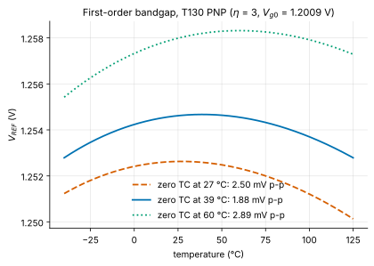

<!-- status: verified -->
# 20-03 · Bandgap and Voltage References

| | |
|---|---|
| **Course** | [20 · Analog and Mixed-Signal IC Design](../README.md) |
| **University equivalent** | The references chapter of a graduate analog IC course: temperature behavior of $V_{BE}$, PTAT and CTAT voltages, the bandgap principle and its curvature, op-amp and current-mode (sub-1 V) bandgaps, trimming, startup and self-biased current references (Razavi, *Design of Analog CMOS Integrated Circuits*, 2nd ed., the bandgap chapter; Gray, Hurst, Lewis & Meyer, *Analysis and Design of Analog Integrated Circuits*, 5th ed., the current-source and reference chapter) |
| **Prerequisites** | [09-06](../../09-semiconductor-devices/chapters/09-06-pn-junction-iv-and-capacitance.md) (diode temperature coefficient, PTAT voltage), [09-07](../../09-semiconductor-devices/chapters/09-07-bipolar-junction-transistor.md) (BJT collector current), [20-01](20-01-analog-design-fundamentals-gm-id.md) (charge-based model), [20-02](20-02-two-stage-op-amp-design.md) (op-amps, offset), [10-08](../../10-electronics-1/chapters/10-08-current-sources-and-mirrors.md) (mirrors and bias references) |
| **Estimated study hours** | 8 |
| **Last verified** | 2026-11-24 |

**Learning objectives.** After this chapter you can:

1. Derive a junction voltage's temperature dependence for a bias current that scales as $T^m$, and the PTAT difference of two junctions, and explain why their weighted sum is flat near the extrapolated bandgap voltage.
2. Design an op-amp bandgap reference (area ratio, currents, resistors) for zero temperature coefficient at a chosen temperature, and predict its output and its curvature-limited temperature coefficient.
3. Analyze a reference's errors (saturation-current spread, op-amp offset, resistor mismatch) and show which ones a single-temperature trim removes and which it makes worse.
4. Design a current-mode (sub-1 V) bandgap, and explain curvature compensation and its sensitivity to device parameters.
5. Explain why self-biased references need startup circuits, and compute the current of a weak-inversion β-multiplier reference.
6. Read a voltage-reference data sheet critically: initial accuracy, box-method temperature coefficient, noise, drift and hysteresis.

## 1. Big picture

Every data converter, regulator, sensor interface and PLL on a chip measures something against a reference voltage or current, and its accuracy can be no better than that reference's. An ADC's full scale, an LDO's output, a temperature sensor's reading and a battery charger's termination voltage are all "the reference times a ratio". A good reference must not move with temperature, supply, process or time, yet everything inside a chip does. The **bandgap reference** solves this with physics rather than calibration: it adds a voltage that falls with temperature (a junction's $V_{BE}$) to one that rises in proportion to absolute temperature (the difference of two junction voltages), in the ratio that cancels the slope. The result sits near silicon's extrapolated bandgap voltage, about 1.2 V, almost independent of process.

- **It is everywhere.** Nearly every mixed-signal chip contains at least one bandgap; power-management ICs and sensor front ends contain several.
- **It sets the accuracy floor.** A 12-bit ADC (1 part in 4096 = 244 ppm) needs a reference stable to well under 244 ppm over temperature; first-order bandgaps reach about 9 ppm/K, some **1.5 × 10³** ppm over 165 K (§3.3). Precision parts use curvature correction and trimming.
- **It is a trust problem.** Untrimmed bandgaps vary by several tenths of a percent to about a percent from chip to chip [R-326]. Trimming at test is cheap only if the error is the right kind (§3.5).
- **Low supplies changed the circuits.** A 1.2 V output does not fit under a 1 V supply, so modern low-voltage references sum currents instead of voltages (§3.6).

## 2. Intuition first

A forward-biased junction is a thermometer with a negative slope: at fixed current its voltage falls by about 2 mV per kelvin (09-06 §3.6). Two identical junctions at different current densities differ by $V_T\ln N$, a voltage that rises *exactly* in proportion to absolute temperature (PTAT), about 0.18 mV/K for $N$ = 8. Neither is a reference. But scale the PTAT voltage by about 11 and add it to one junction voltage, and the two slopes cancel.

```text
  V
  ^
1.25 ┤ ─ ─ ─ ─ ─ ─ ─ V_BE + K·V_T·ln N  (flat: the bandgap reference)
     │
     │                              ╱  K·V_T·ln N  (PTAT, rises ~1.9 mV/K)
     │                          ╱
0.68 ┤ ───────────╲───────╱───────────
     │              ╲  ╱
     │            ╱   ╲  V_BE  (CTAT, falls ~1.9 mV/K)
     │       ╱          ╲
     └─────────────────────────────────> T
        233 K         300 K         398 K
```

*Figure 1. The bandgap principle (sketch): a complementary-to-absolute-temperature (CTAT) junction voltage plus a scaled PTAT voltage gives a sum whose slope is zero at the design temperature.*

**Why the sum lands near 1.2 V.** Extrapolate the junction voltage's straight-line fall back to absolute zero: it meets the axis at the bandgap voltage $V_{g0}$, about 1.2 V for silicon, because at 0 K a junction would need the full gap to conduct. The PTAT term is a straight line through the origin. Adding a straight line through the origin whose slope cancels the junction's slope gives a horizontal line at the junction's intercept: $V_{g0}$. Hence "bandgap" reference. (The output is a little above $V_{g0}$ because the junction's curve is not quite straight, §3.3.)

**An analogy, and its limits.** A currency-hedged foreign bond: the bond's local value falls as the foreign currency weakens (CTAT), and a forward contract gains in proportion (PTAT); in the right hedge ratio the combined position barely moves. The analogy is good on the essential point that the hedge ratio is set once and works only for the exposure it was designed for. It breaks in two places: the junction's "exposure" is slightly curved, so a linear hedge leaves a residual (curvature, §3.3), and the hedge ratio here is a resistor ratio, which is stable to a fraction of a percent, far better than any financial hedge.

## 3. Theory

> **Conventions.** $T$ in kelvin, $T_0$ = 300 K the reference temperature, $V_T = kT/q$ (25.85 mV at $T_0$). A **substrate PNP** (the vertical bipolar transistor every CMOS process provides: p⁺ source-drain diffusion as emitter, n-well as base, p-substrate as collector) is used diode-connected, base and collector grounded, carrying emitter current $I$; its base current is neglected unless stated. The illustrative **T130 PNP** has $I_{S0}$ = 2 × 10⁻¹⁷ A per unit device at $T_0$, $V_{g0}$ = 1.2009 V (09-06's silicon value) and η = 3 (below). Temperature ranges are written in °C for readability, computed in kelvin.

### 3.1 The junction voltage against temperature

From 09-06 §3.6, a junction's saturation current depends on temperature as

$$
I_S(T) = I_{S0}\left(\frac{T}{T_0}\right)^\eta \exp\left[\frac{qV_{g0}}{k}\left(\frac{1}{T_0} - \frac1T\right)\right],
$$

where $V_{g0}$ is the bandgap extrapolated linearly to 0 K and η collects the power-law temperature dependences ($n_i^2 \propto T^3$ gives η = 3; the temperature dependence of mobility in the base modifies it in real transistors). This is exactly the form of the SPICE Gummel–Poon model, with `EG` = $V_{g0}$ and `XTI` = η (ngspice's defaults are 1.11 eV and 3 [R-326]), which lets the lab test this chapter's theory in ngspice without approximation.

> **Going deeper — what real transistors give.** Tsividis's more careful analysis keeps the bandgap's true curvature and fits measured bipolar transistors with η ≈ **2.29** to **2.41** and an extrapolated $V_{G0}$ = **1.20595** V; forcing the linear form used here onto the same data needs a "fictitious" η ≈ **3.43** with $V_{g0}$ ≈ **1.176** V [1], which is why foundry models carry fitted `EG` and `XTI` rather than the physical gap. The T130 values (η = 3, $V_{g0}$ = 1.2009 V) are round teaching values in the same family: the shapes and the design method of this chapter do not depend on them, but the exact voltages do.

Let the bias current itself vary as $I(T) = I_0(T/T_0)^m$: $m$ = 0 for a constant current, $m$ = 1 for a PTAT current. Then $V_{BE} = V_T\ln(I/I_S)$, and substituting,

$$
V_{BE}(T) = V_{g0} + \frac{kT}{q}\left[\ln\frac{I_0}{I_{S0}} - \frac{qV_{g0}}{kT_0} + (m - \eta)\ln\frac{T}{T_0}\right] .
$$

At $T = T_0$ the logarithm vanishes and the bracket equals $(V_{BE0} - V_{g0})/V_{T0}$, where $V_{BE0} = V_{BE}(T_0)$. Eliminating $\ln(I_0/I_{S0})$:

$$
V_{BE}(T) = V_{g0} - \big(V_{g0} - V_{BE0}\big)\frac{T}{T_0} - (\eta - m)\,V_T\ln\frac{T}{T_0} .
$$

This is the linear-bandgap form of Tsividis's expression [1]. Three facts follow.

- **A straight line from $V_{g0}$.** The first two terms are a line falling from $V_{g0}$ at 0 K through $V_{BE0}$ at $T_0$. Its slope, $-(V_{g0} - V_{BE0})/T_0$, depends on $V_{BE0}$, hence on the current density and the process.
- **A curvature term.** The last term, $-(\eta - m)V_T\ln(T/T_0)$, is zero at $T_0$, contributes $-(\eta - m)k/q$ to the slope there (included in the next bullet), and is concave: its second derivative is $-(\eta - m)k/(qT)$. It vanishes only if the bias current rises as $T^\eta$.
- **The slope at $T_0$.** Differentiating, $dV_{BE}/dT|_{T_0} = [V_{BE0} - V_{g0} - (\eta - m)V_{T0}]/T_0$, 09-06's result generalized to a temperature-dependent current.

Units check: every term is a voltage; $V_T\ln(T/T_0)$ is V × dimensionless. ✓

### 3.2 The PTAT voltage

Two junctions carrying the same current, one with $N$ times the area (or one junction at $N$ times the current density), differ by

$$
\Delta V_{BE} = V_T\ln\frac{I/I_S}{I/(NI_S)} = V_T\ln N ,
$$

exactly PTAT whatever $I_S$, its process spread or its temperature dependence, because both devices share them. Its slope is $(k/q)\ln N$: **179.2** µV/K for $N$ = 8. $N$ = 8 is common because eight unit devices surround one in a 3 × 3 array, a common-centroid layout that cancels gradients (20-11).

### 3.3 The bandgap principle and its curvature

Add the PTAT voltage, scaled by a gain $K$ (a resistor ratio in practice), to one junction voltage biased with a PTAT current ($m$ = 1, as in the circuits of §3.4):

$$
V_{REF}(T) = V_{BE}(T) + K\,V_T\ln N .
$$

**Zero slope at a chosen temperature $T_c$.** Differentiating with §3.1's expression and setting the result to zero at $T = T_c$:

$$
-\frac{V_{g0} - V_{BE0}}{T_0} - (\eta - 1)\frac kq\left(\ln\frac{T_c}{T_0} + 1\right) + K\frac kq\ln N = 0 .
$$

This fixes $K$. Substituting that $K$ back into $V_{REF}(T)$, the linear terms collapse (the PTAT term is $T/T_0$ times a constant), and after a line of algebra

$$
\boxed{V_{REF}(T) = V_{g0} + (\eta - 1)\,V_T(T)\left[1 - \ln\frac{T}{T_c}\right]}
$$

(for a general $m$, replace $\eta - 1$ by $\eta - m$). Everything about a first-order bandgap is in this line:

- **The "magic voltage".** At $T_c$ the output is $V_{g0} + (\eta - 1)V_T(T_c)$, independent of $I_{S0}$, the current, $N$ and the resistors: **1.2526** V for T130 at 300 K. Tsividis's fitted values give **1.239** to **1.242** V by the corresponding formula of his analysis, $V_{G0} + (\eta - 1)V_T$ [1]. Bandgap designers trim to this voltage, which is why it matters that it is known (§3.5).
- **Curvature.** $dV_{REF}/dT = -(\eta - 1)(k/q)\ln(T/T_c)$: positive below $T_c$, negative above. The output is a concave arch peaking at $T_c$, whatever the design.
- **The curvature floor.** Over a range $[T_1, T_2]$, the arch's height sets a minimum temperature coefficient. Placing $T_c$ so that the two ends are equal (312.0 K for −40 to 125 °C) minimizes it.

The **box-method temperature coefficient** used in data sheets is

$$
\text{TC}_{box} = \frac{V_{max} - V_{min}}{V_{nom}\,(T_2 - T_1)} \times 10^6\ \text{ppm/K},
$$

the slope of the box that just contains the curve. For T130 with $T_c$ centered, the curvature alone gives **9.10** ppm/K over −40 to 125 °C (1.88 mV of total variation) and **3.91** ppm/K over 0 to 70 °C: a first-order bandgap cannot do better however carefully it is built, and a wider range costs more than proportionally because the arch grows with the square of the range (Example 20-03.2).



*Figure 2. A first-order bandgap's output against temperature for three zero-TC temperatures $T_c$ (T130, η = 3). The arch's shape is fixed by η; the design chooses only where it peaks. Centering the peak in the range minimizes the box.*

### 3.4 Circuits

**The op-amp bandgap.** The topology used in most CMOS designs (Figure 3) has a unit PNP Q1 at node A and an $N$-times PNP Q2 below a resistor $R_1$ at node B. Two equal resistors $R_2$ feed both nodes from the output, and an op-amp drives the output so that $V_A = V_B$.

```text
                     V_REF
           ┌───────────●───────────┐
           │           │           │
          R2         ┌─┴─┐         R2
           │         │op │         │
   node A  ●────────(+)  (−)───────● node B
           │         └───┘         │
         ┌─┴─┐                     R1
    Q1 ─►│1× │                     │
         └─┬─┘                   ┌─┴─┐
           │                Q2 ─►│N× │
          GND                    └─┬─┘
                                  GND
```

*Figure 3. The op-amp bandgap (Q1 and Q2 are diode-connected substrate PNPs; emitter at the node, base and collector to ground). The op-amp's output is $V_{REF}$; equal $R_2$ resistors and equal node voltages force equal currents. The op-amp's input polarity is chosen for negative feedback: raising $V_{REF}$ raises $V_B$ faster than $V_A$ because of $R_1$.*

With $V_A = V_B$, the two $R_2$ resistors carry equal currents $I$, so the junctions carry equal currents and

$$
I R_1 = V_{BE1} - V_{BE2} = V_T\ln N \quad\Rightarrow\quad I = \frac{V_T\ln N}{R_1}, \qquad V_{REF} = V_{BE1} + \frac{R_2}{R_1}\,V_T\ln N .
$$

The bias current is PTAT ($m$ = 1) if $R_1$ has no temperature coefficient, and the gain is $K = R_2/R_1$, a ratio of like resistors that matches to a fraction of a percent and has no temperature coefficient to first order. The gain depends only on that ratio. The junction current $V_T\ln N/R_1$, however, depends on $R_1$'s absolute value and temperature coefficient, and both reach the output through $V_{BE1}$. An absolute error shifts $V_{BE1}$ by $-V_T\ln(R_1/R_{1,nom})$, which is PTAT and trimmed out like an $I_S$ error (−4.7 mV for resistors 20% high). A resistor temperature coefficient makes the current non-PTAT ($m \ne 1$), which changes the slope at $T_c$: in this design, resistors of +2000 ppm/K move the output by **−6.28** mV at 400 K and raise the box TC from 9.10 to **44.3** ppm/K, unless $K$ is re-chosen for the actual $m$ (Problem 20-03.8). The absolute value also sets the current and power.

**Other topologies.** The earliest references used bipolar transistors only. Widlar's 1971 paper introduced the temperature-compensated reference "with numerous advantages over zener diodes" [2]; Kuijk's 1973 source used an op-amp and noted that the output is temperature-independent when the sum "equals the gap voltage of silicon" [3]; Brokaw's 1974 three-terminal 2.5 V cell sensed the two collector currents directly and reported 5 ppm/°C over the military temperature range [4]. CMOS versions use the substrate PNP because it is free in any process, at the price of its grounded collector, which forces the diode connection above.

### 3.5 Errors, and what a trim can fix

A reference's output error has three main sources. The key question is the shape of each one against temperature.

**Saturation-current spread (PTAT error).** If every PNP's $I_S$ is a factor $(1 + \varepsilon)$ off (a process shift), every $V_{BE}$ moves by $-V_T\ln(1 + \varepsilon)$ at fixed current, while $\Delta V_{BE}$ and hence the current are unchanged. The output error $-V_T(T)\ln(1 + \varepsilon)$ is PTAT. The PTAT term $KV_T\ln N$ has exactly the same shape, so adjusting $K$ (trimming $R_2$) to restore the magic voltage at *one* temperature cancels the error at *every* temperature. This is why bandgaps are trimmed to their magic voltage at room temperature during test: one measurement fixes both the value and the slope. Ge, Zhang, Hoogzaad and Makinwa built a reference on exactly this argument: after chopping and higher-order curvature correction, the residual error "is mainly PTAT, and can be removed by a single room temperature trim", and they reported ±0.15% (3σ) from −40 to 125 °C [6].

**Op-amp offset (constant error).** An input offset $V_{os}$ adds to $\Delta V_{BE}$ across $R_1$. Linearize the circuit: each junction carrying $I$ is a resistance $r_e = V_T/I$, node A sits at $V_{out}r_e/(R_2 + r_e)$, node B at $V_{out}(R_1 + r_e)/(R_2 + R_1 + r_e)$, and the op-amp holds them $V_{os}$ apart. Solving,

$$
\left\lvert\frac{\Delta V_{REF}}{V_{os}}\right\rvert = \frac{R_2}{R_1}\left(1 + \frac{r_e}{R_2}\right)^2 + \left(1 + \frac{r_e}{R_2}\right) \approx 1 + \frac{R_2}{R_1} ,
$$

the non-inverting gain of the $R_2$–$R_1$ network (the 1 comes from the $V_{os}/R_2$ imbalance between the two feeds), raised about 9% by the junctions: **12.75** here, against $1 + K$ = 11.72. This error is nearly constant in temperature. Trimming it away by adjusting $K$ converts a constant error into a PTAT one: the trimmed output is exact at the trim temperature and wrong everywhere else (Example 20-03.3). Offset must therefore be made small *before* trimming: large input devices, careful layout and, in precision references, chopping (20-11).


*Figure 4. Example 20-03.3's two errors before and after a one-temperature trim. A PTAT error (left) is removed at every temperature; a constant error (right) is removed only at the trim temperature, and the trim adds a slope.*

**Resistor ratio mismatch.** A ratio error $\delta$ in $R_2/R_1$ multiplies the PTAT term by $(1 + \delta)$: a PTAT error, removed by the same trim.

The practical rule: errors with a PTAT shape trim out with one temperature; errors with any other shape need two-temperature trimming or must be designed away. Base current (finite β of the substrate PNP), the op-amp's finite gain and packaging stress (which shifts $V_{BE}$ through the piezojunction effect) are second-order errors of the second kind.

### 3.6 Sub-1 V references: summing currents

The op-amp bandgap's output is about 1.25 V and its nodes sit at $V_{BE}$ ≈ 0.7 V, so it needs well over 1.3 V of supply. Banba and colleagues showed how to keep the physics and scale the output; their 0.4 µm flash-process reference produced **518** ± 15 mV (3σ) [5]. Put a resistor $R_2$ from each of nodes A and B to ground, feed both nodes from equal PMOS current sources controlled by the op-amp, and mirror the same current into a third resistor $R_3$:

- With $V_A = V_B = V_{BE1}$, both $R_2$ resistors carry $V_{BE1}/R_2$, so the junction currents are again equal and the junction current is $V_T\ln N/R_1$, PTAT.
- Each branch carries $I = V_T\ln N/R_1 + V_{BE1}/R_2$: a PTAT current plus a CTAT current.
- The output is

$$
V_{REF} = IR_3 = \frac{R_3}{R_2}\left(V_{BE1} + \frac{R_2}{R_1}V_T\ln N\right) ,
$$

the ordinary bandgap voltage scaled by $R_3/R_2$, which can be any value. With $R_2/R_1$ = $K$ it has the same zero-TC condition and the same curvature (in ppm) as the op-amp bandgap. The minimum supply is set by a junction voltage plus a current source's saturation voltage, not by the 1.25 V output. The junction voltage is largest at the coldest temperature: for T130 at 5 µA it is **0.805** V at −40 °C, so with about 0.15 V for the current source the circuit needs about **0.955** V (Problem 20-03.9).

### 3.7 Startup and self-biased current references

**Two operating points.** Every reference in this chapter is **self-biased**: its currents are set by its own output. Such loops have a second solution with every current at zero. In Figure 3, $V_{REF}$ = 0 gives zero current in both branches, $V_A = V_B$ = 0, and an op-amp output of zero: perfectly consistent. Which state the circuit settles into after power-up depends on how the supply ramps. A **startup circuit** injects current when it detects the dead state (for example a transistor that pulls the output or a bias node up while $V_{REF}$ is below a threshold) and must then turn off completely, because any current it leaks in normal operation adds an error.

**The β-multiplier.** The simplest self-biased current reference uses two NMOS transistors, M1 and M2, with M2 $M$ times wider and a resistor $R$ in its source, and a 1:1 PMOS mirror forcing equal currents. M1 is diode-connected; both gates are at the same voltage. In weak inversion the drain current is proportional to $\exp[(V_P - V_S)/V_T]$ (20-01, with the bulk at ground, so the source voltage enters with unit coefficient). Equal currents through devices of widths 1 and $K$ require

$$
e^{V_P/V_T} = M\,e^{(V_P - IR)/V_T} \quad\Rightarrow\quad I = \frac{V_T\ln M}{R} .
$$

The current is PTAT and independent of the MOSFET parameters, the MOS analogue of $\Delta V_{BE}$. (If M2 sits in its own well tied to its source, the source voltage enters as $1/n$ of the gate's and the result becomes $nV_T\ln M/R$.) In weak inversion M1's transconductance is $g_m = I/(nV_T) = \ln M/(nR)$, independent of temperature for a zero-TC resistor: this is the **constant-$g_m$ bias** of 20-01. It too has a zero-current state, and needs a startup circuit. Its moderate-inversion correction follows from 20-01's full model (Example 20-03.6).

### 3.8 Curvature compensation

The curvature term $-(\eta - 1)V_T\ln(T/T_0)$ can itself be generated and cancelled. Compare two junctions with the same $V_{BE0}$, one biased with a PTAT current ($m$ = 1) and one with a constant current ($m$ = 0). From §3.1,

$$
V_{BE,m=1}(T) - V_{BE,m=0}(T) = V_T\ln\frac{T}{T_0} ,
$$

a pure "$T\ln T$" term. Adding α times this difference to the reference changes the curvature coefficient from $(\eta - 1)$ to $(\eta - 1 - \alpha)$, and re-solving §3.3's zero-slope condition gives the same arch with the smaller coefficient. With α = η − 1 the curvature vanishes in the model. In practice η is known only approximately, and the residual is proportional to the error in η − 1 − α: if the true η is 3.2 but the design assumed 3, the box TC over −40 to 125 °C falls from **9.97** to **0.946** ppm/K, a factor of **10.5**, not to zero (Example 20-03.5). Precision references combine curvature correction with trimming and sometimes with digital correction against an on-chip temperature sensor.

### 3.9 Noise, supply rejection and long-term stability

- **Noise.** The op-amp's input noise sits in series with $\Delta V_{BE}$ and reaches the output with the same gain as its offset, about $1 + R_2/R_1$ (12.75 here, §3.5); flicker noise dominates the 0.1–10 Hz band that precision data sheets specify. Larger $N$ and larger $\Delta V_{BE}$ (stacked junctions) reduce that gain; chopping removes the op-amp's flicker noise along with its offset.
- **Supply rejection.** The op-amp's loop gain suppresses supply ripple at low frequency; at high frequency an output capacitor (or a pre-regulated supply) takes over, much as in an LDO (20-04).
- **Stability over time.** Mechanical stress from the package and from soldering shifts junction voltages; data sheets specify long-term drift (ppm per 1000 h) and thermal hysteresis (the output's change after a temperature cycle) separately from the TC.

## 4. Worked examples

All examples use the T130 PNP of §3 ($I_{S0}$ = 2 × 10⁻¹⁷ A per unit device at 300 K, $V_{g0}$ = 1.2009 V, η = 3), $N$ = 8, ideal resistors with no temperature coefficient, and $V_T$ = **25.85** mV at 300 K, unless stated.

### Example 20-03.1 · The two slopes (tier A)

**Setup.** A unit PNP carries 5 µA at 300 K. Find (a) $V_{BE0}$; (b) its slope at 300 K with a constant bias current and with a PTAT current; (c) the slope of $\Delta V_{BE}$ for $N$ = 8; (d) the gain $K$ that makes $V_{BE} + KV_T\ln N$ flat at 300 K (PTAT bias), and the resulting output.

**Solution.**

(a) $V_{BE0} = V_T\ln(I/I_{S0}) = 0.02585\ln(5 \times 10^{-6}/2 \times 10^{-17})$ = **0.6785** V.

(b) From §3.1, $dV_{BE}/dT = [V_{BE0} - V_{g0} - (\eta - m)V_T]/T_0$: with $m$ = 0, (0.6785 − 1.2009 − 0.0776)/300 = **−2.000** mV/K; with $m$ = 1, (0.6785 − 1.2009 − 0.0517)/300 = **−1.914** mV/K.

(c) $(k/q)\ln 8$ = **179.2** µV/K.

(d) $K = 1.914/0.1792$ = **10.68**, and the output is the magic voltage $V_{g0} + 2V_T$ = **1.2526** V.

**Units check.** V/K ÷ V/K is dimensionless; $K$ multiplies a voltage.

**Sanity check.** The constant-current slope is a little steeper because a PTAT current partly offsets the junction's fall. The output is within 4% of $V_{g0}$, as §2's picture said.

### Example 20-03.2 · Designing an op-amp bandgap for −40 to 125 °C (tier B)

**Setup.** Design Figure 3's reference with 5 µA per branch at 300 K, zero TC centered for −40 to 125 °C. Find $T_c$, $K$, $R_1$ and $R_2$, the output at 300 K, its maximum, minimum and box TC (using the 300 K value as $V_{nom}$), and the box TC the same design approach gives over 0 to 70 °C.

**Solution.**

*Centering.* Setting §3.3's arch equal at 233.15 K and 398.15 K gives $T_c$ = **312.0** K (**38.9** °C).

*Resistors.* $R_1 = V_T\ln N/I$ = 0.05375 V/5 µA = **10.75** kΩ. From the zero-slope condition at $T_c$, $K$ = **10.72**, so $R_2$ = **115.2** kΩ.

*Output.* Solving the circuit exactly: $V_{REF}$(300 K) = **1.25463** V; the maximum is **1.25467** V at 38.9 °C (= $V_{g0} + 2V_T(T_c)$, as §3.3 predicts), the minimum **1.25279** V at −40 °C. The total variation is **1.884** mV and the box TC **9.10** ppm/K.

*Commercial range.* Over 0 to 70 °C, centered at **34.3** °C, the variation is only **343** µV and the box TC **3.91** ppm/K.

**Units check.** V/A = Ω; ppm/K = (V/V)/K × 10⁶.

**Sanity check.** The arch's height grows roughly with the square of the range: 2.36 times the range gives 5.5 times the variation (1.884 mV against 0.343 mV). Narrow-range parts are not just easier; they are physically better.

### Example 20-03.3 · What a trim fixes and what it breaks (tier B)

**Setup.** For Example 20-03.2's design: (a) every PNP's $I_S$ is 30% high. Find the output error at 300 K, its slope, the untrimmed box TC, and the effect of trimming $R_2$ to restore the 300 K output. (b) Instead, the op-amp has a 1 mV input offset (raising $V_A$ above $V_B$). Find the error, the untrimmed box TC, and the box TC after the same trim.

**Solution.**

(a) Every $V_{BE}$ falls by $V_T\ln 1.3$ while the current is unchanged: the output error is **−6.78** mV at 300 K, a PTAT error with slope **−22.6** µV/K. Untrimmed, the box TC is **20.6** ppm/K (normalized, like every box TC here, to the nominal 1.25463 V). Raising $R_2$ by **1.18**% restores 1.25463 V at 300 K, and because the error was PTAT, the trimmed curve matches the nominal one at every temperature (to within nanovolts): box TC **9.10** ppm/K again.

(b) The offset reduces the voltage across $R_1$: the output becomes **1.24187** V, an error of **−12.76** mV: the 12.75 offset gain of §3.5, that is $1 + R_2/R_1$ = **11.7** plus about 1 from the junctions. Because the error is nearly constant, the untrimmed curve keeps its shape (box TC **9.12** ppm/K). Trimming $R_2$ to **117.8** kΩ restores 1.25463 V at 300 K, but adds a PTAT slope: the output is now **4.26** mV high at 125 °C and **2.90** mV low at −40 °C, and the box TC is **34.6** ppm/K, almost four times worse.

**Sanity check.** A one-temperature trim targets the right *value* only if the error has the shape of the trim knob. Production references therefore minimize offset first (chopping, large devices) and trim second.

### Example 20-03.4 · A 0.6 V current-mode reference (tier B)

**Setup.** Using the current-mode circuit of §3.6 with Example 20-03.2's $R_1$, $R_2$ and $N$, choose $R_3$ for 0.6 V at 300 K. Find the junction and branch currents, $R_3$, the box TC, the total variation over −40 to 125 °C, and the total current of the three branches.

**Solution.** The junction current is $V_T\ln N/R_1$ = **5.00** µA and $V_{BE1}$ = **0.678** V, so each branch carries 5.00 µA + 0.678 V/115.2 kΩ = **10.89** µA. $R_3$ = 0.6 V/10.89 µA = **55.11** kΩ ($R_3/R_2$ = **0.478**). The output is the bandgap voltage scaled by 0.478: **0.6000** V at 300 K, **0.60002** V at its peak and **0.59912** V at −40 °C. Its TC is unchanged, **9.10** ppm/K, and its total variation is **0.901** mV. The three branches take **32.7** µA.

**Sanity check.** Scaling the output scales the variation, not the TC. The current-mode circuit costs current (each branch now also carries the CTAT current) in exchange for running from below 1 V.

### Example 20-03.5 · Curvature compensation with an uncertain η (tier C)

**Setup.** A designer assumes η = 3 and adds α = η − 1 = 2 times the $V_T\ln(T/T_0)$ correction of §3.8, re-centering $T_c$. The real devices have η = 3.2. Find the box TC over −40 to 125 °C (a) of a first-order design with η = 3, (b) of a first-order design with the real η, (c) of the compensated design, and (d) the improvement factor.

**Solution.** By §3.3 and §3.8 the output is $V_{g0} + c\,V_T(T)\,[1 - \ln(T/T_c)]$ with $c = \eta - 1 - \alpha$, re-centered each time.

(a) $c$ = 2: **9.10** ppm/K.

(b) $c$ = 2.2: **9.97** ppm/K.

(c) $c$ = 0.2: **0.946** ppm/K.

(d) A factor of **10.5**.

**Sanity check.** The total variation is exactly proportional to $|c|$, **0.942** mV per unit of $c$ over this range; the box TC is almost proportional (it divides by a $V_{nom}$ that shifts slightly with $c$). Curvature correction is worth only as much as η is known: a 10% error in η − 1 caps the improvement at about ten.

### Example 20-03.6 · A β-multiplier current reference (tier B)

**Setup.** A β-multiplier in T130 has M1 with $W/L$ = 10, M2 with $M$ = 4 times the width, $R$ = 100 kΩ, bulks at ground. Find (a) the weak-inversion estimate of the current, (b) the exact current from 20-01's long-channel charge-based model and M1's inversion coefficient, (c) the current at 125 °C and at −40 °C (with μ held constant), and compare with a PTAT scaling.

**Solution.**

(a) $I = V_T\ln 4/R$ = **0.358** µA.

(b) Solving the two devices' charge equations together (M2's source at $IR$): $I$ = **0.372** µA, 4% above the estimate, at $IC_1$ = **0.0710**. The device is in weak inversion, and the small excess comes from the $2q$ term of the charge equation.

(c) **0.489** µA at 125 °C and **0.292** µA at −40 °C. The ratio 0.489/0.372 = **1.316** is close to the PTAT ratio 398.15/300 = **1.327**.

**Sanity check.** The reference current is set by $V_T$ and a resistor. A real polysilicon resistor's temperature coefficient (positive or negative depending on its doping) modifies the PTAT behavior, which designers sometimes exploit to flatten it.

### Answer key

<!-- answer-key -->

| ID | Quantity | Value | Unit |
|---|---|---|---|
| Ex 20-03.1a | V_BE0 at 5 uA | 0.6785 | V |
| Ex 20-03.1b | slope, constant current | −2.000 | mV/K |
| Ex 20-03.1c | slope, PTAT current | −1.914 | mV/K |
| Ex 20-03.1d | PTAT slope, N = 8 | 179.2 | µV/K |
| Ex 20-03.1e | K for zero TC at 300 K | 10.68 | — |
| Ex 20-03.1f | magic voltage at 300 K | 1.2526 | V |
| Ex 20-03.2a | centered T_c | 312.0 | K |
| Ex 20-03.2b | centered T_c | 38.9 | °C |
| Ex 20-03.2c | K | 10.72 | — |
| Ex 20-03.2d | V_REF at 300 K | 1.25463 | V |
| Ex 20-03.2e | maximum V_REF | 1.25467 | V |
| Ex 20-03.2f | minimum V_REF | 1.25279 | V |
| Ex 20-03.2g | peak temperature | 38.9 | °C |
| Ex 20-03.2h | R_1 | 10.75 | kΩ |
| Ex 20-03.2i | R_2 | 115.2 | kΩ |
| Ex 20-03.2j | total variation | 1.884 | mV |
| Ex 20-03.2k | box TC | 9.10 | ppm/K |
| Ex 20-03.2l | centered T_c, 0 to 70 C | 34.3 | °C |
| Ex 20-03.2m | variation, 0 to 70 C | 343 | µV |
| Ex 20-03.2n | box TC, 0 to 70 C | 3.91 | ppm/K |
| Ex 20-03.2o | ratio of variations | 5.5 | — |
| Ex 20-03.2p | ratio of ranges | 2.36 | — |
| Ex 20-03.3a | error from I_S + 30 % | −6.78 | mV |
| Ex 20-03.3b | its slope | −22.6 | µV/K |
| Ex 20-03.3c | untrimmed box TC | 20.6 | ppm/K |
| Ex 20-03.3d | R_2 trim | 1.18 | % |
| Ex 20-03.3e | output with 1 mV offset | 1.24187 | V |
| Ex 20-03.3f | error from 1 mV offset | −12.76 | mV |
| Ex 20-03.3g | 1 + R_2/R_1 | 11.7 | — |
| Ex 20-03.3h | untrimmed box TC with offset | 9.12 | ppm/K |
| Ex 20-03.3i | trimmed R_2 | 117.8 | kΩ |
| Ex 20-03.3j | error at 125 C after trim | 4.26 | mV |
| Ex 20-03.3k | error at −40 C after trim | −2.90 | mV |
| Ex 20-03.3l | trimmed box TC with offset | 34.6 | ppm/K |
| Ex 20-03.4a | junction current | 5.00 | µA |
| Ex 20-03.4b | V_BE1 | 0.678 | V |
| Ex 20-03.4c | branch current | 10.89 | µA |
| Ex 20-03.4d | R_3 | 55.11 | kΩ |
| Ex 20-03.4e | R_3/R_2 | 0.478 | — |
| Ex 20-03.4f | box TC | 9.10 | ppm/K |
| Ex 20-03.4g | total variation | 0.901 | mV |
| Ex 20-03.4h | total current | 32.7 | µA |
| Ex 20-03.4i | output at 300 K | 0.6000 | V |
| Ex 20-03.4j | maximum output | 0.60002 | V |
| Ex 20-03.4k | minimum output | 0.59912 | V |
| Ex 20-03.5a | first order, eta = 3 | 9.10 | ppm/K |
| Ex 20-03.5b | first order, eta = 3.2 | 9.97 | ppm/K |
| Ex 20-03.5c | compensated, eta = 3.2 | 0.946 | ppm/K |
| Ex 20-03.5d | improvement | 10.5 | — |
| Ex 20-03.5e | variation per unit of c | 0.942 | mV |
| Ex 20-03.6a | weak-inversion estimate | 0.358 | µA |
| Ex 20-03.6b | exact current | 0.372 | µA |
| Ex 20-03.6c | excess over the estimate | 4 | % |
| Ex 20-03.6d | IC of M1 | 0.0710 | — |
| Ex 20-03.6e | current at 125 C | 0.489 | µA |
| Ex 20-03.6f | current at −40 C | 0.292 | µA |
| Ex 20-03.6g | ratio 125 C to 300 K | 1.316 | — |
| Ex 20-03.6h | PTAT ratio | 1.327 | — |
| Txt 20-03.a | thermal voltage at 300 K | 25.85 | mV |
| Txt 20-03.b | PTAT slope, N = 8 | 179.2 | µV/K |
| Txt 20-03.c | magic voltage at 300 K | 1.2526 | V |
| Txt 20-03.d | centered T_c, −40 to 125 C | 312.0 | K |
| Txt 20-03.e | curvature box TC, −40 to 125 C | 9.10 | ppm/K |
| Txt 20-03.f | curvature variation, −40 to 125 C | 1.88 | mV |
| Txt 20-03.g | curvature box TC, 0 to 70 C | 3.91 | ppm/K |
| Txt 20-03.h | compensated box TC, eta 3.2 | 0.946 | ppm/K |
| Txt 20-03.i | uncompensated box TC, eta 3.2 | 9.97 | ppm/K |
| Txt 20-03.j | improvement | 10.5 | — |
| Txt 20-03.k | 12-bit LSB | 244 | ppm |
| Txt 20-03.l | 9.1 ppm/K over 165 K | 1.5×10³ | ppm |
| Txt 20-03.m | offset gain 1 + R_2/R_1 | 12 | — |
| Txt 20-03.n | V_BE at −40 C, 5 uA | 0.805 | V |
| Txt 20-03.o | approximate minimum supply | 0.955 | V |
| Txt 20-03.p | Tsividis fitted eta, low | 2.29 | — |
| Txt 20-03.q | Tsividis fitted eta, high | 2.41 | — |
| Txt 20-03.r | Tsividis V_G0 | 1.20595 | V |
| Txt 20-03.s | fictitious eta of the linear form | 3.43 | — |
| Txt 20-03.t | fictitious V_g0 of the linear form | 1.176 | V |
| Txt 20-03.u | magic voltage from Tsividis' fits, low | 1.239 | V |
| Txt 20-03.v | magic voltage from Tsividis' fits, high | 1.242 | V |
| Txt 20-03.w | Banba measured output | 518 | mV |
| Txt 20-03.x | 3 ppm/K over 165 K | 495 | ppm |
| Txt 20-03.y | output shift at 400 K, +2000 ppm/K resistors | −6.28 | mV |
| Txt 20-03.z | box TC with +2000 ppm/K resistors | 44.3 | ppm/K |
| Txt 20-03.aa | offset gain, exact | 12.75 | — |

## 5. Simulate it

The lab ([labs/20-03-lab](../labs/20-03-lab/README.md)) implements the device model and circuits in `bandgap.py` and confirms them in ngspice, whose PNP model uses exactly §3.1's temperature law.

**Predict, then run.**

1. Predict $V_{BE}$ at −40 °C and 125 °C for 5 µA with constant and PTAT bias, then plot both against temperature (Part 1).
2. Predict the output at 300 K, the peak temperature and the box TC of Example 20-03.2, then run `ngspice -b bandgap.cir` (Part 2).
3. Predict which errors survive a one-temperature trim. Run the seeded Monte Carlo of $I_S$ spread and op-amp offset, before and after trimming (Part 3).
4. Predict the 0.6 V reference's output at −40 °C and 125 °C, then run `ngspice -b banba.cir` (Part 4).
5. Plot the box TC against η for an uncompensated and a compensated design (Part 5).
6. Plot the β-multiplier's two current–voltage curves and find both intersections, including the zero-current one (Part 6).

## 6. Engineering tradeoffs

| Knob | Improves | Costs | Typical decision owner |
|---|---|---|---|
| Larger area ratio $N$ | Larger $\Delta V_{BE}$, so smaller $K$ and less offset and noise gain | Area; a less symmetric layout above 8 (3 × 3) | Analog block designer |
| Higher bias current | Lower noise; less sensitivity to leakage and base current | Power | Block designer with the power architect |
| Centered zero-TC temperature | Minimum box TC over the specified range | Nothing, if the range is known | Analog block designer |
| Curvature compensation | 5–10× lower TC | Extra branches, matching, sensitivity to η | Analog lead |
| One-temperature trim | Removes PTAT errors ($I_S$ spread, ratio errors) exactly | Test time; worsens non-PTAT errors (offset) | Test and product engineering |
| Chopped op-amp | Removes offset and flicker noise | Clock, ripple filtering, area | Analog lead |
| Current-mode (sub-1 V) topology | Any output voltage, supplies below 1 V | More current, more mirror matching errors | Analog lead with the system architect |
| Output filtering / buffer | Noise and supply rejection at high frequency | Area, start-up time | Analog block designer |

## 7. Numbers to know

| Quantity | Typical value | Note |
|---|---|---|
| $V_{BE}$ temperature coefficient | about −1.8 to −2.1 mV/K | depends on current density and bias (Problem 20-03.1) |
| PTAT slope $(k/q)\ln N$ | 179.2 µV/K ($N$ = 8), 273.9 µV/K ($N$ = 24) | exact |
| Bandgap output ("magic voltage") | about 1.24–1.25 V | 1.2526 V for T130; 1.239–1.242 V from Tsividis's fits [1] |
| Curvature-limited box TC, first order | about 9 ppm/K (−40 to 125 °C), 4 ppm/K (0 to 70 °C) | T130, η − 1 = 2 |
| Untrimmed spread | several tenths of a percent to about 1% | ±0.71% over seven samples (Chen et al., 2021); 0.5–1.0% initial error for bandgap products (TI, 1999) [R-326], [R-327] |
| Single-trim CMOS bandgaps (as of Nov 2026) | ±0.15% to +0.02%/−0.12% (3σ), −40 to 125 °C | published JSSC results [R-326] |
| Commercial precision references (as of Nov 2026) | ±0.025–0.05% initial, 2–3 ppm/°C | TI REF7025, REF5025 data sheets [R-327] |
| Commercial low-power references (as of Nov 2026) | ±0.05%, 6–12 ppm/°C at 72 µA to 0.65 µA | TI REF3425, REF35250 [R-327] |
| Long-term drift | about 20–40 ppm in the first 1000 h (REF5025 22 ppm, REF3425 25 ppm, REF35250 40 ppm) | data-sheet values, package dependent [R-327] |

## 8. Common mistakes

- **Treating $V_{BE}$'s temperature coefficient as a constant.** It depends on the current density and on how the bias current varies with temperature (§3.1); −2 mV/K is a rough value, not a law.
- **Forgetting the curvature.** No choice of $K$ makes a first-order bandgap flat; the best it can do is place the arch's peak. Quoting a "zero-TC" design without a range is meaningless.
- **Trimming every error the same way.** A one-temperature trim to the magic voltage removes PTAT errors exactly but turns an offset into a slope (Example 20-03.3).
- **Ignoring the op-amp.** Its offset and flicker noise appear at the output multiplied by about $1 + R_2/R_1$; the op-amp is often the dominant error source, not the bipolar transistors.
- **No startup circuit, or one that never turns off.** Self-biased references have a zero-current state; a startup device that leaks in normal operation shifts the output.
- **Assuming resistors matter only through their ratio.** The gain is a ratio, but $R_1$'s absolute value and temperature coefficient set the junction current: the absolute error is PTAT and trimmable, the temperature coefficient bends the curve and is not.
- **Reading box-method TC as a slope.** It bounds the variation over the stated range only; outside the range, or for a different range, it says nothing.

## 9. Practitioner lens

### State of the art (as of Nov 2026)

- **The principle is fifty years old and still universal [Established].** Widlar (1971), Kuijk (1973) and Brokaw (1974) established the bandgap; Brokaw's three-terminal 2.5 V cell reported 5 ppm/°C over the military range [2]–[4]. Every reference in this chapter is a refinement of their circuits.
- **Precision now comes from trimming and correction, not from untrimmed accuracy [Established].** Published CMOS bandgaps reach ±0.15% (3σ) from −40 to 125 °C with one room-temperature trim, using chopping and curvature correction (Ge et al., 2011) [6], and +0.02%/−0.12% (3σ) over the same range (Boo et al., 2021), at 17 µA from 1.8 V [R-326]. A 7 nm FinFET bandgap reports ±0.2% and 6 ppm/°C from −45 to 125 °C (Kamath et al., 2019) [R-326]: the parasitic bipolar transistor survives in FinFET processes.
- **Ultra-low-power references trade accuracy for picowatts [Established].** A subthreshold MOS reference for IoT systems runs at 35 pW from 1.4 V with ±1.0% (3σ) from 0 to 100 °C after one trim (Lee, Sylvester and Blaauw, 2017); a 192 pW reference reports an untrimmed process variation of 0.53% across 45 chips (Ji et al., 2019) [R-326].
- **Commercial parts span four orders of magnitude in current [Established].** TI's REF7025 specifies ±0.025% and 2 ppm/°C (−40 to 125 °C) and 0.23 ppm p-p noise at 4 mA typical; the REF5025 ±0.05% and 3 ppm/°C at 0.8 mA; the REF3425 ±0.05% and 6 ppm/°C at 72 µA; the nanopower REF35250 ±0.05% and 12 ppm/°C (−40 to 105 °C) at 0.65 µA (typical currents, maximum accuracy and TC; data sheets revised 2023–2026) [R-327].

### Why it matters commercially

A reference is a small block whose errors are multiplied by everything downstream. In a battery-management IC, the reference's accuracy is the state-of-charge accuracy: In an automotive sensor interface, the reference's drift over the vehicle's life is a warranty cost. In an AI accelerator, dozens of on-die references set the regulators, sensors and SerDes biases, and their supply rejection and noise couple into clock jitter and supply margins. A design team's ability to trim once, at room temperature, and still meet the specification over temperature decides test cost per unit, which matters as much as silicon area at high volume.

### Marketing vs Reality

- **"3 ppm/°C."** A box-method maximum over a stated range: it bounds the total excursion (3 × 165 = 495 ppm over −40 to 125 °C) but says nothing about the curve's shape or slope at any temperature, and nothing outside the range (TI SLYT183: the box method "does not specify the exact shape and slope") [R-327].
- **"0.05% initial accuracy."** At 25 °C, at shipment. Solder reflow, board stress and long-term drift (22 ppm in the first 1000 h for a REF5025 in SOIC-8) come on top [R-327].
- **Front-page noise numbers.** Check which variant they apply to: the REF34 family's front-page 3.8 µVp-p/V applies to the 4.096 V and 5 V options, while the REF3425's table value is 5 µVp-p/V; the REF35's 3.3 ppm p-p applies below 2.5 V [R-327].
- **"Trimmed to ±0.1%."** At one temperature, or over the range? A one-temperature trim removes PTAT errors only (§3.5); ask for the 3σ spread over temperature and the number of samples.
- **Sanity check.** Multiply the box TC by the range and add the initial accuracy, long-term drift and hysteresis to get a worst-case band; compare it with the system's LSB.

### Questions for engineering leaders

1. **"What is your reference's 3σ accuracy over temperature after one trim, on how many parts and lots?"** Strong: a measured distribution over the full range with lot counts. Evasive: a typical TC at room temperature.
2. **"What does your trim remove, and what does it leave?"** Strong: identifies PTAT versus offset errors and explains how offset is removed (chopping, large devices) before trimming. Evasive: "we trim to 1.2 V".
3. **"How much does the op-amp contribute to error and noise?"** Strong: quantifies offset and 0.1–10 Hz noise multiplied by $1 + R_2/R_1$. Evasive: "it's a bandgap, it's stable".
4. **"What happens after solder reflow and over the product's life?"** Strong: post-reflow shift and long-term drift data, package-stress mitigation. Evasive: data-sheet initial accuracy only.
5. **"How does your reference start up, and can it fail to?"** Strong: a startup circuit verified across supply ramps and corners, with its leakage error bounded. Evasive: "it always starts in simulation".

## 10. Concept check

**Q1.** Why does the PTAT voltage $V_T\ln N$ not depend on the transistors' saturation current?

<details><summary>Answer</summary>

Because it is the difference of two junction voltages that share the same $I_S$ per unit area and the same temperature dependence: $V_T\ln[(I/I_S)/(I/NI_S)] = V_T\ln N$. Any common factor in $I_S$ cancels in the ratio.

</details>

**Q2.** A first-order bandgap is designed for zero TC at 27 °C. Is its output higher or lower at 80 °C, and why?

<details><summary>Answer</summary>

Lower. $dV_{REF}/dT = -(\eta - 1)(k/q)\ln(T/T_c)$, negative above $T_c$: the output is a concave arch peaking at $T_c$, so it falls on both sides.

</details>

**Q3.** What is the "magic voltage" and why do production tests trim to it?

<details><summary>Answer</summary>

The output at the zero-TC temperature, $V_{g0} + (\eta - 1)V_T(T_c)$, which does not depend on $I_S$, the current or the resistors. Process errors in $I_S$ and in resistor ratios are PTAT, and so is the trim knob ($R_2$); trimming the output to the magic voltage at one temperature cancels those errors at all temperatures.

</details>

**Q4.** Why does trimming away an op-amp offset at room temperature make the temperature coefficient worse?

<details><summary>Answer</summary>

The offset's error is nearly constant in temperature, but the trim adjusts the PTAT term. Cancelling a constant error with a PTAT correction leaves a residual proportional to $(1 - T/T_{trim})$, a slope that was not there before.

</details>

**Q5.** How does a current-mode bandgap produce 0.6 V from a supply below 1 V?

<details><summary>Answer</summary>

It sums a PTAT current ($V_T\ln N/R_1$) and a CTAT current ($V_{BE}/R_2$) in the right ratio, giving a temperature-independent current, and converts it to a voltage with any resistor $R_3$. No node has to reach 1.2 V; the highest is about one $V_{BE}$.

</details>

**Q6.** Why do self-biased references need startup circuits?

<details><summary>Answer</summary>

Their loop equations have a second, zero-current solution: no current means no voltage across the resistors, which is consistent with no current. The circuit can power up into it and stay there, so a startup circuit must kick it out and then turn off.

</details>

**Q7.** Why does curvature compensation improve the TC only about tenfold in practice?

<details><summary>Answer</summary>

The correction cancels a term proportional to η − 1, and the residual is proportional to the error in that cancellation. If η is known only to within about 10% of η − 1, the residual curvature is about a tenth of the original.

</details>

**Q8.** In a β-multiplier with the bulk grounded, why is the weak-inversion current $V_T\ln M/R$ rather than $nV_T\ln M/R$?

<details><summary>Answer</summary>

With the bulk at ground, raising M2's source by $IR$ reduces its channel charge exactly as $(V_P - V_S)/V_T$, with unit coefficient (the body effect). Only the gate's influence is divided by $n$. If M2's bulk were tied to its source, the source voltage would act through the gate-source voltage instead, giving $nV_T\ln M/R$.

</details>

Problems: [20-03 problem set](../problems/20-03-problems.md) · Worked solutions: [20-03 solutions](../solutions/20-03-solutions.md)

## 11. Key terms

[Bandgap reference](../../../reference/glossary.md#bandgap-reference) · [PTAT voltage](../../../reference/glossary.md#ptat-voltage) · [CTAT voltage](../../../reference/glossary.md#ctat-voltage) · [Magic voltage](../../../reference/glossary.md#magic-voltage) · [Box-method temperature coefficient](../../../reference/glossary.md#box-method-temperature-coefficient) · [Curvature compensation](../../../reference/glossary.md#curvature-compensation) · [Startup circuit](../../../reference/glossary.md#startup-circuit) · [Beta multiplier](../../../reference/glossary.md#beta-multiplier) · [Substrate PNP](../../../reference/glossary.md#substrate-pnp)

## 12. Connections

- **Previous:** [20-02](20-02-two-stage-op-amp-design.md) designed the op-amp that a bandgap's accuracy depends on; its offset and noise reappear here multiplied by $1 + R_2/R_1$.
- **Builds on:** [09-06](../../09-semiconductor-devices/chapters/09-06-pn-junction-iv-and-capacitance.md) (the junction's temperature coefficient and the PTAT voltage), [09-07](../../09-semiconductor-devices/chapters/09-07-bipolar-junction-transistor.md) (the collector current), [20-01](20-01-analog-design-fundamentals-gm-id.md) (weak inversion for the β-multiplier), [10-08](../../10-electronics-1/chapters/10-08-current-sources-and-mirrors.md) (mirrors and bias generation).
- **Next:** [20-04](20-04-ldo-regulators.md) uses the reference as the set point of a regulator, where its noise and supply rejection set the regulator's.
- **Used later:** [20-06](20-06-data-converter-fundamentals.md) and [20-07](20-07-nyquist-adcs.md) (the reference sets a converter's full scale), [20-11](20-11-layout-matching-pvt.md) (common-centroid layout, mismatch, chopping), [20-12](20-12-why-analog-does-not-scale.md) (references at low supply).

## 13. Further study

- B. Razavi, *Design of Analog CMOS Integrated Circuits*, 2nd ed., McGraw-Hill, 2017: the bandgap references chapter (PTAT generation, curvature, startup, sub-1 V references).
- P. R. Gray, P. J. Hurst, S. H. Lewis and R. G. Meyer, *Analysis and Design of Analog Integrated Circuits*, 5th ed., Wiley, 2009: the current-source and reference chapter (Widlar, Brokaw, curvature analysis).
- G. A. Rincón-Mora, *Voltage References: From Diodes to Precision High-Order Bandgap Circuits*, Wiley–IEEE Press, 2002: a book-length treatment of curvature correction and trimming.
- Lecture videos: Razavi's UCLA analog lectures on bandgap references (YouTube) and the bandgap lectures in Ali Hajimiri's Caltech analog series.

## 14. Sources

1. Y. P. Tsividis, "Accurate analysis of temperature effects in I_C–V_BE characteristics with application to bandgap reference sources," *IEEE J. Solid-State Circuits*, vol. SC-15, no. 6, pp. 1076–1084, Dec. 1980, DOI 10.1109/JSSC.1980.1051519 [R-326].
2. R. J. Widlar, "New developments in IC voltage regulators," *IEEE J. Solid-State Circuits*, vol. SC-6, no. 1, pp. 2–7, Feb. 1971 [R-326].
3. K. E. Kuijk, "A precision reference voltage source," *IEEE J. Solid-State Circuits*, vol. SC-8, no. 3, pp. 222–226, June 1973 [R-326].
4. A. P. Brokaw, "A simple three-terminal IC bandgap reference," *IEEE J. Solid-State Circuits*, vol. SC-9, no. 6, pp. 388–393, Dec. 1974 [R-326].
5. H. Banba et al., "A CMOS bandgap reference circuit with sub-1-V operation," *IEEE J. Solid-State Circuits*, vol. 34, no. 5, pp. 670–674, May 1999, DOI 10.1109/4.760378 [R-326].
6. G. Ge, C. Zhang, G. Hoogzaad and K. A. A. Makinwa, "A single-trim CMOS bandgap reference with a 3σ inaccuracy of ±0.15% from −40 °C to 125 °C," *IEEE J. Solid-State Circuits*, vol. 46, no. 11, pp. 2693–2701, Nov. 2011, DOI 10.1109/JSSC.2011.2165235 [R-326].
7. Recent references: Lee, Sylvester and Blaauw (JSSC, May 2017); Ji et al. (JSSC, Dec. 2019); Kamath et al. (JSSC, July 2019); Boo et al. (JSSC, Apr. 2021); Chen et al. (JSSC, Jan. 2021) [R-326].
8. ngspice User's Manual, version 47 (Aug. 2026), §7.3.3, Gummel–Poon parameters `EG` and `XTI` [R-326].
9. Texas Instruments data sheets REF50xx (SBOS410O), REF70 (SNAS781G), REF34xx (SBAS804G), REF35 (SNAS809C); P. Miller and D. Moore, "Precision voltage references," TI *Analog Applications Journal*, SLYT183, Nov. 1999 [R-327].
10. Course chapters [09-06](../../09-semiconductor-devices/chapters/09-06-pn-junction-iv-and-capacitance.md) (junction temperature dependence) and [20-01](20-01-analog-design-fundamentals-gm-id.md) (charge-based model).
