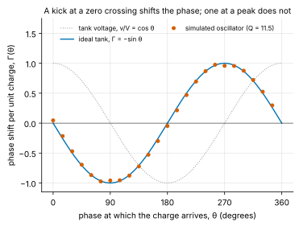

<!-- status: verified -->
# 21-06 · Oscillators and VCOs

| | |
|---|---|
| **Course** | [21 · RF and Microwave Engineering](../README.md) |
| **University equivalent** | The oscillator chapters of a senior or first-year graduate RF IC course: LC oscillators as negative resistance and tank, amplitude by the describing function, phase noise by Leeson's model and the impulse sensitivity function, flicker up-conversion, varactor and capacitor-bank tuning, quadrature generation, injection locking and pulling (Razavi, *RF Microelectronics*, the oscillator chapter; Lee, *The Design of CMOS Radio-Frequency Integrated Circuits*, the oscillator and phase-noise chapters) |
| **Prerequisites** | [12-09](../../12-electronics-2/chapters/12-09-oscillators.md) (Barkhausen, cross-coupled pair, $g_m > 2/R_p$), [20-10](../../20-analog-and-mixed-signal-ic-design/chapters/20-10-plls-and-jitter.md) (phase noise $\mathcal{L}(f)$, Leeson's formula, the oscillator FoM), [21-05](21-05-mixers.md) (image rejection), [17-06](../../17-communication-systems/chapters/17-06-bandpass-digital-modulation.md) (EVM) |
| **Estimated study hours** | 6 |
| **Last verified** | 2026-11-24 |

**Learning objectives.** After this chapter you can:

1. Model an LC oscillator as a negative resistance across a lossy tank: combine component Qs, check startup, and find the steady-state amplitude with the describing function.
2. Derive phase noise from the impulse sensitivity function, show that it reproduces Leeson's formula, and predict the 1/f³ corner from the ISF's average value.
3. Plan a tuning range with a varactor and a switched-capacitor bank, compute $K_{VCO}$ across bands, and quantify the phase noise and spurs that tuning-line noise causes.
4. Scale phase noise through frequency division and multiplication, and integrate it into rms phase error and EVM.
5. Generate quadrature LO signals by divide-by-2, RC-CR polyphase networks or coupled oscillators, and convert their errors into image rejection.
6. Derive the injection-locking range and the pulled frequency outside it, and evaluate oscillator figure-of-merit claims.

## 1. Big picture

Every radio needs a clean sinusoid at a precisely controlled frequency: the local oscillator that drives its mixers (21-05), the carrier its transmitter modulates, the chirp its radar sweeps. Inside a chip that sinusoid comes from a **voltage-controlled oscillator** (VCO), almost always an LC tank kept alive by a transistor pair, tuned by a voltage-variable capacitor and locked to a crystal reference by a PLL (20-10). The VCO's imperfections pass straight into the radio. Its **phase noise** mixes blockers onto the wanted channel (reciprocal mixing, 21-03) and rotates every constellation point (EVM, 17-06). Its **tuning range** decides how many bands one oscillator can serve. Its **quadrature accuracy** sets the image rejection of a zero-IF receiver. Its susceptibility to **pulling** by the transmitter's own power amplifier constrains the frequency plan. This chapter builds on the oscillator basics of 12-09 and the phase-noise and PLL theory of 20-10, and develops each of these four properties from first principles.

- **Phase noise is the VCO's headline specification.** It is set by the tank's quality factor, the signal swing and the noise of the transistors, and it costs power to improve.
- **Tuning is a compromise.** Wide range needs large capacitance variation, which lowers Q and raises the VCO gain, which in turn makes the oscillator more sensitive to noise on its control line.
- **Quadrature generation** (I and Q LO phases) costs power: a divider needs a VCO at twice the frequency, a polyphase filter costs loss, and coupled oscillators cost phase noise.
- **Pulling and injection locking** are the same physics: a small current near the oscillation frequency pulls the oscillator toward it. It is a nuisance in transmitters and a tool in frequency dividers and multipliers.
- **Figure-of-merit claims need decoding.** A record FoM can come from very low power with mediocre absolute phase noise, so engineers always ask for the phase noise at the offset their standard needs.

## 2. Intuition first

An LC tank is a pendulum. Energy sloshes between the capacitor's electric field and the inductor's magnetic field at $\omega_0 = 1/\sqrt{LC}$, and a little is lost each cycle in the tank's resistance. The transistors give back exactly what is lost, like a parent pushing a swing at the right moment. When the swing is small they push more than enough, so it grows; when it is large they push less, because they saturate. The amplitude settles where the push equals the loss.

Now kick the swing with a random impulse, which is what each electron of noise does. Where in the cycle the kick lands matters:

```text
   tank voltage v = A cos(theta)
       peak (theta = 0)          zero crossing (theta = 90 deg)
        _                               \
      /   \        kick here:            \   kick here:
     /     \       changes AMPLITUDE      \  shifts the TIMING
    /       \      (restored by the        \  (nothing restores it:
   /         \      saturating devices)     \  the phase error is permanent)
```

A kick at the peak changes the amplitude; the saturating transistors then restore it within a few tank time constants. A kick at a zero crossing changes nothing about the energy but moves the crossing in time: the swing is now early or late, and nothing pulls it back, because an oscillator has no memory of absolute time. Phase errors therefore accumulate, a random walk, and a random walk in phase is exactly the $1/\Delta f^2$ phase-noise spectrum of 20-10. Hajimiri and Lee made this picture quantitative with the **impulse sensitivity function**: the phase shift per unit of injected charge, as a function of where in the cycle it lands [2].

**The analogy's limits.** A playground swing is driven at one moment per cycle, but transistor noise arrives continuously and the transistors' own noise is strongest at particular parts of the cycle, so the timing of the noise and the timing of the sensitivity must be combined (§3.3). And a real oscillator is not perfectly sinusoidal, so the sensitivity is not exactly a sine; the asymmetries are what convert slow (flicker) noise into close-in phase noise.

## 3. Theory

> **Conventions.** All tank quantities are differential: $L$, $C$ and the parallel loss resistance $R_p$ appear between the two outputs, and $v$ is the differential voltage with amplitude $V$. Temperature is 300 K, so $kT$ = 4.142 × 10⁻²¹ J. $\mathcal{L}(\Delta f)$ is single-sideband phase noise in dBc/Hz (20-10). In this chapter $\Gamma$ is the impulse sensitivity function, not a reflection coefficient.

### 3.1 The tank and the negative resistance

**Combining losses.** A real inductor has series resistance $r_s$, so its quality factor is $Q_L = \omega L/r_s$. Near resonance a series $r_s$ is equivalent to a parallel resistance: the admittance of $r_s + j\omega L$ is

$$
\frac{1}{r_s + j\omega L} = \frac{r_s - j\omega L}{r_s^2 + \omega^2L^2} \approx \frac{1}{Q_L^2r_s} + \frac{1}{j\omega L} \quad (Q_L \gg 1),
$$

a parallel resistance $Q_L^2r_s = Q_L\omega L$ across an ideal inductor. A capacitor or varactor with quality factor $Q_C$ likewise has a parallel loss resistance $Q_C/(\omega C)$. The tank's total parallel loss conductance is the sum,

$$
\frac{1}{R_p} = \frac{1}{Q_L\omega_0L} + \frac{\omega_0C}{Q_C} = \frac{1}{\omega_0L}\left(\frac{1}{Q_L} + \frac{1}{Q_C}\right),
$$

using $\omega_0C = 1/(\omega_0L)$ at resonance. Since the tank's Q is $R_p/(\omega_0L)$,

$$
\frac1Q = \frac{1}{Q_L} + \frac{1}{Q_C} .
$$

Losses add as reciprocal Qs. At a few gigahertz the on-chip inductor is usually the larger loss. Capacitor Q, $Q_C = 1/(\omega CR_{series})$, falls as frequency rises, so at millimetre waves the capacitors and varactors dominate; and a varactor's Q falls as its tuning ratio rises, so a wide-tuning VCO pays for its range in tank Q.

**Startup.** 12-09 showed that a cross-coupled pair presents $-2/g_m$ across the tank, so oscillation starts if the small-signal **loop gain** $g_mR_p/2$ exceeds 1. Designers use a loop gain of two or three to cover process and temperature (12-09).

### 3.2 Amplitude: the describing function

The negative resistance is nonlinear: as the swing grows, the transistors saturate and their effective transconductance falls. Write the tank voltage as $v = V\cos\theta$ with $\theta = \omega_0t$ and let the device inject a current $i = g(v)$ into the tank. Because the tank's impedance is $R_p$ at $\omega_0$ and small at harmonics, only the fundamental of $i$ matters for the amplitude. Its amplitude is

$$
I_1(V) = \frac{1}{\pi}\int_0^{2\pi} g(V\cos\theta)\cos\theta\,d\theta ,
$$

and the **describing function** is the large-signal transconductance $G(V) = I_1(V)/V$. In steady state the device must supply exactly what $R_p$ dissipates:

$$
G(V) = \frac{1}{R_p} .
$$

**Is the amplitude stable?** The tank stores energy $E = \tfrac12CV^2$. It gains $\tfrac12V^2G(V)$ per second from the device and loses $\tfrac12V^2/R_p$ in the resistance (average powers of a sinusoid of amplitude $V$). Setting $dE/dt = CV\,dV/dt$ equal to the difference gives the envelope equation

$$
\frac{dV}{dt} = \frac{V}{2C}\left[G(V) - \frac{1}{R_p}\right] .
$$

At small amplitude $G = g_m/2$ for the cross-coupled pair, and the amplitude grows as $e^{\sigma t}$ with $\sigma = (g_m/2 - 1/R_p)/(2C)$. Near the steady state $V_s$, write $V = V_s + \delta$ and linearize: $d\delta/dt = (V_sG'(V_s)/2C)\,\delta$. The amplitude is stable if $G'(V_s) < 0$: a larger swing must reduce the push. Every saturating device satisfies this. For a hard limiter (below), $V_sG'(V_s) = -G(V_s) = -1/R_p$, so amplitude errors decay with time constant

$$
\tau_A = 2R_pC = \frac{2Q}{\omega_0} ,
$$

the tank's own energy time constant: **0.7346** ns, under four cycles, for the oscillator of Example 21-06.1. This is why amplitude noise in an LC oscillator stays bounded while phase noise accumulates.

**The cross-coupled bipolar pair.** For a bipolar pair with tail current $I_{tail}$, the differential current into the tank is $(I_{tail}/2)\tanh(v/2V_T)$ (12-01 derives the tanh). So $g(v) = I_0\tanh(v/V_0)$ with $I_0 = I_{tail}/2$ and $V_0 = 2V_T$. Its slope at the origin is $I_0/V_0 = g_m/2$, with $g_m = I_C/V_T$ per device, which recovers 12-09's startup condition. At large swing the tanh becomes a square wave of amplitude $I_0$, whose fundamental is $4I_0/\pi$ (11-05). The hard-limit amplitude is therefore

$$
V_{hard} = \frac{4}{\pi}I_0R_p = \frac{2}{\pi}I_{tail}R_p ,
$$

12-09's current-limited result. A MOS pair has a different shape, but the same hard-switching limit.

> **Going deeper — the soft-switching correction.** For finite $V/V_0 = a$, the tanh departs from a square wave only near the zero crossings, where $\cos\theta \approx \pm s$ with $s = \pi/2 - \theta$. There $\tanh(a\lvert s\rvert) = 1 - 2/(e^{2a\lvert s\rvert} + 1)$, and the missing area is $\int_{-\infty}^{\infty}\lvert s\rvert\,\frac{2}{e^{2a\lvert s\rvert} + 1}\,ds = 4\int_0^\infty\frac{s\,ds}{e^{2as} + 1} = \frac{4}{4a^2}\cdot\frac{\pi^2}{12}$, using $\int_0^\infty x/(e^x + 1)\,dx = \pi^2/12$. Each of the two zero crossings removes this from the integral that defines $I_1$, so $I_1 \approx (4I_0/\pi)\left[1 - \pi^2/(24a^2)\right]$ and
>
> $$
> V \approx V_{hard}\left[1 - \frac{\pi^2}{24}\left(\frac{V_0}{V_{hard}}\right)^2\right] .
> $$
>
> With a loop gain of 7 the correction is half a percent (Example 21-06.1).

**Current-limited and voltage-limited.** The amplitude rises with $I_{tail}$ until the swing approaches the supply. Beyond that point the transistors enter triode (or the tail transistor loses its headroom), the amplitude stops growing and the extra current only adds noise: the **voltage-limited** regime. The best phase noise per milliwatt is at the boundary. The efficiency with which the oscillator turns DC power into tank signal power $P_s = V^2/(2R_p)$ is, in the current-limited regime,

$$
\eta = \frac{P_s}{I_{tail}V_{DD}} = \frac{(2/\pi)^2I_{tail}^2R_p^2/(2R_p)}{I_{tail}V_{DD}} = \frac{1}{\pi}\cdot\frac{V}{V_{DD}} .
$$

Even at the voltage limit a plain cross-coupled pair converts well under half its DC power into tank signal, and §3.4 shows that this inefficiency costs phase noise directly.

> **Going deeper — why the frequency is not exactly $1/\sqrt{LC}$.** The device's current is not sinusoidal, and its harmonics flow mostly through $C$ (the lowest impedance at $n\omega_0$), storing extra electric energy that the magnetic side must balance. For a memoryless device $i = g(v)$, the integral $\oint g(v)\,dv$ over a cycle is zero, which forces the reactive powers at all harmonics, weighted by $n$, to sum to zero. With harmonic voltages $V_n = h_nV$ across a tank whose reactive admittance at $n\omega$ is $n\omega C - 1/(n\omega L)$, this gives $\sum_n n\,V_n^2\left[n\omega C - 1/(n\omega L)\right] = 0$, and for small $h_n$
>
> $$
> \frac{\omega}{\omega_0} \approx 1 - \frac12\sum_{n \ge 2}(n^2 - 1)h_n^2 .
> $$
>
> This is **Groszkowski's** result (1933) [6]: harmonics always pull the frequency down. For a square-wave current, $h_n = 1/[(n^2 - 1)Q]$ for odd $n$ (the $n$-th harmonic current is $1/n$ of the fundamental, and the tank's impedance there is about $n/[(n^2 - 1)\omega_0C]$), and the sum over odd $n \ge 3$ of $1/(n^2 - 1)$ is 1/4, so the shift is $-1/(8Q^2)$: **−0.0939** % for $Q$ = 11.54. The softer tanh of Example 21-06.1 gives **4.9968** GHz instead of 5 GHz, which the lab's ngspice run confirms. The shift matters because it depends on amplitude, so amplitude noise becomes a little phase noise (AM-to-PM conversion).

### 3.3 Phase noise from the impulse sensitivity function

**The ISF of an ideal LC tank.** In the lossless tank, the state is the pair $(v, i_L)$, which moves on a circle: $v = V\cos\theta$, and the inductor current, scaled by $\sqrt{L/C}$, is $V\sin\theta$. Inject a short current pulse of charge $\Delta q$ into the capacitor. It changes $v$ by $\Delta V = \Delta q/C$ instantly and leaves $i_L$ unchanged. The new phase angle is

$$
\theta' = \operatorname{atan2}(V\sin\theta,\ V\cos\theta + \Delta V) \approx \theta - \frac{\Delta V}{V}\sin\theta ,
$$

and the new amplitude is $V + \Delta V\cos\theta$. Writing the charge relative to the maximum charge swing on the capacitor, $q_{max} = CV$, the phase shift is

$$
\Delta\phi = \Gamma(\theta)\,\frac{\Delta q}{q_{max}}, \qquad \Gamma(\theta) = -\sin\theta .
$$

$\Gamma$ is the **impulse sensitivity function** (ISF). It is largest at the zero crossings ($\theta = 90°$ and 270°) and zero at the peaks, just as §2 argued. The amplitude part, $\Delta V\cos\theta$, is largest at the peaks and decays with $\tau_A$; the phase part is permanent.



*Figure 1. The ISF of the oscillator of Example 21-06.1 (Q = 11.5), measured in the lab by kicking a simulation of its differential equation at 24 phases, against the ideal tank's $-\sin\theta$. The small departures, a few per cent near the zero crossings and a slight offset at the peaks, come from the waveform's harmonics and from amplitude-to-phase conversion; they shrink as Q rises.*

**From kicks to phase noise.** The response is linear in small kicks, so a continuous noise current $i(t)$ is a train of kicks $i(\tau)\,d\tau$, and the phase is their sum:

$$
\phi(t) = \frac{1}{q_{max}}\int_{-\infty}^{t}\Gamma(\omega_0\tau)\,i(\tau)\,d\tau .
$$

This is a linear but **time-varying** system: the same kick has different effects at different moments of the cycle. Two steps turn it into a spectrum.

> **Math refresher — noise times a periodic function, then integrated.** Expand the periodic ISF in a Fourier series, $\Gamma(x) = \Gamma_{dc} + \sum_{n \ge 1}c_n\cos(nx + \theta_n)$. Multiplying white noise of one-sided density $S_i$ by $\Gamma_{dc}$ leaves white noise of density $\Gamma_{dc}^2S_i$. Multiplying it by $c_n\cos(n\omega_0t + \theta_n)$ shifts the noise from the two bands around $\pm n\omega_0$ down to low frequency, each with amplitude $c_n/2$; the two bands are independent, so the low-frequency density is $2(c_n/2)^2S_i = c_n^2S_i/2$. Adding the independent contributions, the slow part of $\Gamma(\omega_0t)\,i(t)$ is white with density $S_i\left(\Gamma_{dc}^2 + \sum c_n^2/2\right) = \Gamma_{rms}^2S_i$, by Parseval's theorem. Integrating a signal divides its spectrum by $\omega^2$ (integration is $1/(j\omega)$ in the frequency domain).

With those two steps, $S_\phi(\Delta f) = \Gamma_{rms}^2S_i/(q_{max}^2\Delta\omega^2)$ with $\Delta\omega = 2\pi\Delta f$, and since $\mathcal{L} = S_\phi/2$ (20-10),

$$
\mathcal{L}(\Delta f) = \frac{\Gamma_{rms}^2\,S_i}{2\,q_{max}^2\,\Delta\omega^2} .
$$

This is Hajimiri and Lee's formula for white noise [2]. For the ideal tank, $\Gamma_{rms}^2 = \overline{\sin^2\theta} = 1/2$ ($\Gamma_{rms}$ = **0.7071**): half of any white noise becomes phase noise and half becomes amplitude noise, which the oscillator suppresses.

**It reproduces Leeson.** Let the only noise be the tank resistance's, $S_i = 4kT/R_p$. Then

$$
\mathcal{L}(\Delta f) = \frac{(1/2)(4kT/R_p)}{2C^2V^2\Delta\omega^2} = \frac{kT}{R_pC^2V^2\Delta\omega^2} .
$$

Leeson's formula from 20-10 in its $1/\Delta f^2$ region, with $F$ = 1 and the tank signal power $P_s = V^2/(2R_p)$, is

$$
\frac{2kT}{P_s}\left(\frac{\omega_0}{2Q\,\Delta\omega}\right)^2 = \frac{4kTR_p}{V^2}\cdot\frac{\omega_0^2}{4\,\omega_0^2R_p^2C^2\,\Delta\omega^2} = \frac{kT}{R_pC^2V^2\Delta\omega^2},
$$

using $Q = \omega_0R_pC$. The two are identical. Leeson's empirical form, with its prefactor defined through $P_s$, is the exact time-varying result for tank noise. The transistors' noise adds to $S_i$; lumping it as $S_i = F\cdot4kT/R_p$ defines Leeson's excess noise factor $F$. 20-10 quoted Razavi's estimate $F = 1 + \gamma$ for a simple cross-coupled pair, with γ the channel-noise coefficient of 21-04.

**Why the transistor noise is less than it looks.** The transistors' noise is not stationary: a cross-coupled pair is noisy while both devices conduct, near the zero crossings, and quiet when one is switched off. The right ISF for a cyclostationary source is the product of $\Gamma$ and the noise's own modulation, the **effective ISF**. This product is what designers shape: if the devices inject their noise near the peaks, where $\Gamma$ is small, the oscillator ignores it. Class-C oscillators (§3.4) exploit exactly this.

**The 1/f³ corner.** Flicker noise has density $S_i(f) = S_w(1 + \omega_{1/f}/\omega)$, rising below the device's flicker corner $\omega_{1/f}$. In the Fourier expansion above, only the $\Gamma_{dc}$ term passes low-frequency noise to the phase without shifting it; the $c_n$ terms bring noise down from near $n\omega_0$, where flicker noise is negligible. So the phase spectrum is

$$
S_\phi(\Delta\omega) \propto \frac{S_w\left[\Gamma_{rms}^2 + \Gamma_{dc}^2\,\omega_{1/f}/\Delta\omega\right]}{\Delta\omega^2} ,
$$

and the two terms are equal at the **1/f³ corner**

$$
\Delta\omega_{1/f^3} = \omega_{1/f}\,\frac{\Gamma_{dc}^2}{\Gamma_{rms}^2} .
$$

Below it the phase noise falls at −30 dB per decade. The corner is much lower than the device's own flicker corner when $\Gamma_{dc}$ is small, that is, when the waveform has rise and fall symmetry: the ideal tank's $-\sin\theta$ averages to zero. Lee and Hajimiri's tutorial "identifies the importance of symmetry in suppressing the upconversion of 1/f noise" [2]. Asymmetric waveforms, mismatched devices and tail-current modulation raise $\Gamma_{dc}$.

### 3.4 The FoM bound and how topologies approach it

Combine the oscillator FoM of 20-10 with Leeson's $1/\Delta f^2$ region:

$$
\text{FoM} = -\mathcal{L} + 20\log_{10}\frac{f_0}{\Delta f} - 10\log_{10}\frac{P_{DC}}{1\text{ mW}} = 10\log_{10}\frac{2Q^2\,(1\text{ mW})}{FkT} + 10\log_{10}\frac{P_s}{P_{DC}} .
$$

The first term is the bound of 20-10; the second is the efficiency η of §3.2, always negative in decibels. Every topology innovation attacks one of three terms:

- **Tank Q.** Better inductors, or higher-Q resonators at millimetre waves (transformer tanks, transmission lines). Q is the strongest lever: 20 dB per decade.
- **Excess noise F.** The switching pair commutates the tail current's noise near $2\omega_0$ into phase noise [15]; Hegazi, Sjöland and Abidi showed that a passive LC filter in the tail lowers the phase-noise factor "to its fundamental minimum" [7]. The other route is to shape the transistors' conduction so their noise lands where Γ is small.
- **Efficiency η.** Class-C biasing drives the transistors with narrow current pulses at the voltage peaks, raising the fundamental for the same DC current; Mazzanti and Andreani derived "a theoretical 3.9 dB phase noise improvement compared to the standard differential-pair LC-tank oscillator ... for the same current consumption" [8]. Class-F designs enforce "a pseudo-square voltage waveform around the LC tank by increasing the third-harmonic" with a second tank resonance, so that "the effective impulse sensitivity function (ISF) decreases" [9].

**More cores, same FoM.** Coupling $N$ identical oscillators averages their independent noise: the phase noise falls by $10\log_{10}N$ while the power rises $N$-fold, so the FoM is unchanged. Multi-core oscillators therefore buy absolute phase noise with power and area; they do not improve the FoM (§9).

### 3.5 Tuning: varactors, capacitor banks and K_VCO

The oscillation frequency is $f = 1/(2\pi\sqrt{LC_{tot}})$, with $C_{tot}$ the sum of a **fixed** part (transistor, wiring, buffer and inductor parasitics), a **switched** part (a binary-weighted bank of capacitors with MOS switches) and a **varactor** (a MOS capacitor whose value depends on its DC bias). Two relations follow from $f \propto C_{tot}^{-1/2}$:

$$
\frac{f_{max}}{f_{min}} = \sqrt{\frac{C_{tot,max}}{C_{tot,min}}}, \qquad \frac{\Delta f}{f} \approx -\frac{1}{2}\,\frac{\Delta C}{C_{tot}} .
$$

The fixed capacitance dilutes the variable part: a varactor with a 2:1 ratio tunes far less than $\sqrt2$ once it sits beside a larger fixed capacitance. **Coarse** tuning comes from the bank, which divides the range into overlapping **bands** selected by a digital calibration when the PLL starts (20-10). **Fine** tuning comes from the varactor, under the PLL's analog control.

**VCO gain.** $K_{VCO} = df/dV_{ctrl}$ (in hertz per volt here; 20-10 multiplies by 2π) follows from the chain rule, $K_{VCO} = (df/dC)(dC/dV) = -(f/2C_{tot})\,dC/dV$. Because $f \propto C_{tot}^{-1/2}$, for the same varactor $K_{VCO} \propto C_{tot}^{-3/2}$: it is largest in the highest band. A 1.5:1 spread in $C_{tot}$ gives a 1.8:1 spread in $K_{VCO}$ and hence in the PLL's loop bandwidth, unless the loop compensates (Example 21-06.3).

**Why low $K_{VCO}$ is valuable.** Any noise on the control line frequency-modulates the VCO. A sinusoid of peak amplitude $V_m$ at frequency $f_m$ deviates the frequency by $K_{VCO}V_m$, so the phase is $\beta\sin(2\pi f_mt)$ with modulation index $\beta = K_{VCO}V_m/f_m$ (17-03). For small β each sideband is $\beta/2$ relative to the carrier:

$$
\text{spur} = 20\log_{10}\frac{K_{VCO}V_m}{2f_m}\ \text{dBc} .
$$

A white voltage noise $S_v$ (V²/Hz) behaves the same way, one hertz at a time: the phase spectrum is $S_\phi = K_{VCO}^2S_v/\Delta f^2$, and

$$
\mathcal{L}(\Delta f) = \frac{K_{VCO}^2\,S_v}{2\,\Delta f^2} .
$$

Like the tank's own noise it falls at −20 dB per decade, so it simply adds to the oscillator's phase noise. A 1 kΩ loop-filter resistor at a few hundred megahertz per volt contributes as much as the tank itself (Example 21-06.4). Splitting the tuning into a bank plus a small varactor keeps $K_{VCO}$ low without giving up range. Inside the PLL's bandwidth the loop suppresses this noise; outside it, it does not.

### 3.6 Division, multiplication and integrated phase noise

**Dividers and multipliers.** An ideal frequency divider by $N$ divides the phase by $N$: it counts cycles, so a timing error $\Delta t$ is a phase error $\omega_0\Delta t$ at the input and $(\omega_0/N)\Delta t$ at the output. The phase spectrum falls by $N^2$:

$$
\mathcal{L}_{out}(\Delta f) = \mathcal{L}_{in}(\Delta f) - 20\log_{10}N ,
$$

so each divide-by-2 improves the phase noise by $20\log_{10}2$ = **6.02** dB. A multiplier does the opposite, which is why a 77 GHz radar LO has phase noise some 30 dB worse than a 2.4 GHz one of similar quality (Example 21-06.5). Real dividers add their own noise floor, so the improvement saturates far from the carrier.

**Integrated phase error.** A constellation point rotated by a small phase φ moves by $\lvert s\rvert\lvert\phi\rvert$, so if phase noise were the only impairment, the EVM would equal the rms phase error in radians:

$$
\text{EVM} \approx \phi_{rms}, \qquad \phi_{rms}^2 = \int_0^\infty S_\phi(f)\,df = 2\int_0^\infty\mathcal{L}(f)\,df ,
$$

where $\mathcal{L}$ is in linear units per hertz and the factor 2 counts both sidebands (20-10). A PLL's output is roughly flat at an in-band level $\mathcal{L}_0$ up to about its loop bandwidth $f_c$ and then falls. With the one-pole shape $\mathcal{L}(f) = \mathcal{L}_0/[1 + (f/f_c)^2]$, the integral is $\mathcal{L}_0f_c\pi/2$, so

$$
\phi_{rms} = \sqrt{\pi\,\mathcal{L}_0\,f_c} .
$$

In OFDM (17-10) the slow part of the phase noise rotates all subcarriers together and is removed by pilot tracking, so this is an upper bound on the EVM it causes; the fast part spreads into neighbouring subcarriers and is not removed.

**Reciprocal mixing.** 21-03 §3.8 showed how a blocker at offset Δf mixes the LO's phase noise at Δf onto the wanted channel, so the required phase noise is set by the largest blocker: $\mathcal{L}(\Delta f) \le P_{sig} - P_{block} - \text{SNR}_{min} - 10\log_{10}B$. Together with EVM, this is how a phase-noise specification is derived rather than quoted.

### 3.7 Quadrature generation

Zero-IF and image-reject receivers need two LO signals 90° apart (21-05). Their gain error ε and phase error θ set the image-rejection ratio through 21-05's formula, which for ε = 0 reduces to $\text{IRR} = \cot^2(\theta/2)$. Three methods dominate.

**Divide-by-2.** Two latches in a master-slave loop, clocked by complementary phases of a VCO at $2f_{LO}$, toggle at the clock's rising and falling edges respectively, producing outputs at $f_{LO}$ a quarter of an output period apart. If the $2f_{LO}$ clock has duty cycle $D$, the falling edge arrives $DT_{clk}$ after the rising edge instead of $T_{clk}/2$. One output period is $2T_{clk}$, so the error of $(D - \tfrac12)T_{clk}$ is a phase error of

$$
\theta = \left(D - \frac12\right)\frac{T_{clk}}{2T_{clk}}\times 360° = \left(D - \frac12\right)\times 180° .
$$

A 1% duty-cycle error costs 1.8°. The divider is wideband and robust, but the VCO must run at twice the frequency, and the divider and buffers consume power: a 2024 Bluetooth LE receiver generates its I/Q signals passively at RF precisely to avoid "the power-hungry divider-by-2 and LO buffers" [16]. Running the VCO away from the transmit frequency is also the standard defence against pulling (§3.8).

**RC-CR polyphase.** A resistor-capacitor low-pass and a capacitor-resistor high-pass driven by the same signal give

$$
V_I = \frac{1}{1 + j\omega RC}, \qquad V_Q = \frac{j\omega RC}{1 + j\omega RC}, \qquad \frac{V_Q}{V_I} = j\omega RC .
$$

The phase difference is exactly 90° at every frequency, but the amplitudes are equal only at $\omega = 1/(RC)$; elsewhere the gain error is $\varepsilon = \omega RC - 1$. Process variation of R and C shifts the centre, so single-stage networks are narrowband; multistage polyphase filters with staggered centre frequencies widen the band at the cost of loss (Behbahani and colleagues reached 60 dB image rejection with multistage polyphase filters [17]). Mismatch between the two paths' R or C introduces a phase error as well (Problem 21-06.13).

**Quadrature VCO (QVCO).** Two identical LC oscillators coupled in a ring, each injecting a current into the other, lock 90° apart at the LO frequency itself [12]. There is no $2f$ VCO and no divider, but the coupling moves each oscillator off its tank's resonance, which degrades phase noise, and tank mismatch becomes phase error. Andreani and colleagues reported a 1.8 GHz QVCO with an "equivalent phase error between I and Q signals ... at most 0.25°" [12].

### 3.8 Injection locking and pulling

Inject a small current $I_{inj}$ at frequency $\omega_{inj}$ near the oscillator's own $\omega_0$ into its tank. The oscillator's device current $I_{osc}$ (the fundamental, in phase with the tank voltage) and the injected current add as phasors. Away from resonance the tank's impedance has a phase shift: for a parallel tank, $Z = R_p/[1 + j2Q(\omega - \omega_0)/\omega_0]$, so to run at $\omega_{inj}$ the total current must lead the voltage by $\alpha$ with

$$
\tan\alpha = \frac{2Q(\omega_{inj} - \omega_0)}{\omega_0} .
$$

The injected current can rotate the total current relative to $I_{osc}$ by at most the angle whose sine is $I_{inj}/I_{osc}$ (the tip of the injected phasor runs around a circle of radius $I_{inj}$; the steepest line from the origin is tangent to it). The oscillator therefore **locks** to the injection if $\lvert\omega_{inj} - \omega_0\rvert \le \omega_L$, with

$$
\omega_L = \frac{\omega_0}{2Q}\cdot\frac{I_{inj}/I_{osc}}{\sqrt{1 - (I_{inj}/I_{osc})^2}} \approx \frac{\omega_0}{2Q}\cdot\frac{I_{inj}}{I_{osc}} ,
$$

Razavi's form of the classical result [5]. The lock range is the tank's half-bandwidth $\omega_0/2Q$ scaled by the injection ratio. Here $\omega_0$ is the actual free-running frequency, including the Groszkowski shift.

**Adler's equation.** Outside the lock range the oscillator is pulled but not captured. For weak injection the angle of the total current is $\alpha \approx (I_{inj}/I_{osc})\sin\psi$, where $\psi = \theta_{inj} - \theta_{osc}$ is the phase of the injection relative to the oscillator, and the oscillator runs at the frequency whose tank phase matches it: $d\theta_{osc}/dt = \omega_0 + (\omega_0/2Q)\tan\alpha \approx \omega_0 + \omega_L\sin\psi$. With $\Delta\omega = \omega_{inj} - \omega_0$,

$$
\frac{d\psi}{dt} = \Delta\omega - \omega_L\sin\psi ,
$$

Adler's equation (1946) [5]. If $\lvert\Delta\omega\rvert \le \omega_L$ it has a fixed point, $\sin\psi = \Delta\omega/\omega_L$: locked, with a static phase offset. If not, ψ slips through 2π periodically. The time per slip is

$$
T_{beat} = \int_0^{2\pi}\frac{d\psi}{\Delta\omega - \omega_L\sin\psi} = \frac{2\pi}{\sqrt{\Delta\omega^2 - \omega_L^2}} ,
$$

so the beat frequency is $\sqrt{\Delta\omega^2 - \omega_L^2}$ and the oscillator's average frequency is pulled toward the injection by $\Delta\omega - \sqrt{\Delta\omega^2 - \omega_L^2} \approx \omega_L^2/(2\Delta\omega)$ for large detuning.


*Figure 2. Injection locking and pulling. Inside ±1 lock range the oscillator runs at the injection frequency; outside, its average frequency is pulled toward the injection by $\Delta\omega - \sqrt{\Delta\omega^2 - \omega_L^2}$. The points are simulations of a Q = 10 oscillator with a 5% injection, with detuning measured from its actual free-running frequency.*

> **Math refresher — the slip integral.** For $a > \lvert b\rvert$, $\int_0^{2\pi}d\psi/(a - b\sin\psi) = 2\pi/\sqrt{a^2 - b^2}$. The integrand has period 2π, so integrate from −π to π instead and substitute $t = \tan(\psi/2)$, which runs from −∞ to ∞: $\sin\psi = 2t/(1 + t^2)$ and $d\psi = 2\,dt/(1 + t^2)$, so the integral becomes $\int_{-\infty}^{\infty}2\,dt/(at^2 - 2bt + a)$. Completing the square, $at^2 - 2bt + a = a[(t - b/a)^2 + c^2]$ with $c = \sqrt{a^2 - b^2}/a$, and $\int_{-\infty}^{\infty}du/(u^2 + c^2) = \pi/c$, so the result is $(2/a)(\pi/c) = 2\pi/\sqrt{a^2 - b^2}$.

**Pulling in transmitters.** A power amplifier radiating at the VCO's frequency couples a little of its output back into the tank, and its modulation then pulls the oscillator: a distorted spectrum and worse EVM. The standard frequency plans keep the VCO away from the PA's output and its harmonics: a VCO at $2f$ or $4f$ with dividers, or at an offset such as $(4/3)f$ with a divider and mixer. Deliberate injection locking is useful, too: injection-locked dividers and frequency multipliers at millimetre waves, and coupled quadrature oscillators (§3.7).

## 4. Worked examples

### Example 21-06.1 · Tank, startup and amplitude (tier A)

**Setup.** A 5 GHz cross-coupled bipolar VCO uses a 1 nH (differential) inductor with $Q_L$ = 15 and capacitors with $Q_C$ = 50. The tail current is 2 mA from a 1.2 V supply; $V_T$ = 25.85 mV at 300 K. Find (a) the tank capacitance, (b) the tank Q and (c) $R_p$; (d) the minimum transconductance per device and (e) the actual loop gain; (f) the hard-limit amplitude and (g) the describing-function amplitude, with (h) the soft-switching closed form; (i) the start-up growth time constant $1/\sigma$; (j) the signal power and (k) the efficiency.

**Solution.**

- (a) $C = 1/(\omega_0^2L) = 1/[(2\pi \times 5\text{ GHz})^2 \times 1\text{ nH}]$ = **1.013** pF.
- (b) $1/Q = 1/15 + 1/50 = 0.08667$, so $Q$ = **11.54**.
- (c) $R_p = Q\omega_0L$ = 11.54 × 31.42 Ω = **362.5** Ω.
- (d) $g_m > 2/R_p$ = **5.517** mS.
- (e) Each device carries 1 mA, so $g_m = I_C/V_T$ = 38.68 mS and the loop gain $g_mR_p/2$ = **7.01**. It starts reliably.
- (f) $I_0 = I_{tail}/2$ = 1 mA and $V_{hard} = (4/\pi)I_0R_p$ = **0.4615** V.
- (g) Solving $G(V) = 1/R_p$ numerically for $g = I_0\tanh(v/2V_T)$ gives **0.4591** V.
- (h) With $V_0/V_{hard}$ = 51.70 mV/0.4615 V = 0.1120, the correction is $(\pi^2/24)(0.1120)^2$ = 0.0052, so $V \approx$ **0.4592** V.
- (i) $\sigma = (g_m/2 - 1/R_p)/(2C) = (19.34 - 2.759)\text{ mS}/2.026\text{ pF}$ = 8.18 × 10⁹ s⁻¹, so the amplitude grows e-fold every **0.122** ns, about 0.6 cycle.
- (j) $P_s = V^2/(2R_p)$ = **0.2907** mW.
- (k) $\eta = P_s/(I_{tail}V_{DD})$ = 0.2907/2.4 = **12.1** %.

**Units check.** $g_m$: A/V; $R_p$: V/A; loop gain dimensionless. $\sigma$: (A/V)/F = 1/s. $V^2/R$: W.

**Sanity check.** The differential amplitude of 0.46 V means each output swings about 0.23 V around its DC level, well inside a 1.2 V supply: current-limited, as assumed. The efficiency is low, and §3.4 shows it costs about 9 dB of FoM. The lab's ngspice model of this oscillator agrees with (g) to better than 0.1%.

### Example 21-06.2 · Phase noise from the ISF (tier B)

**Setup.** For the oscillator of Example 21-06.1, find (a) $q_{max}$ and (b) the tank's noise current density; (c) $\mathcal{L}$(1 MHz) from the ISF with tank noise only, and (d) from Leeson's formula; (e) the phase noise if the transistors double the noise ($F$ = 2) and (f) the resulting FoM at 2.4 mW; (g) the FoM bound for this Q with $F$ = 1. (h) The switching pair's effective ISF has $\Gamma_{dc}/\Gamma_{rms}$ = 0.15 and its devices have a 1 MHz flicker corner: find the 1/f³ corner and (i) the phase noise at 10 kHz.

**Solution.**

- (a) $q_{max} = CV$ = 1.013 pF × 0.4591 V = **0.4652** pC.
- (b) $S_i = 4kT/R_p$ = 1.657 × 10⁻²⁰/362.5 = **4.571 × 10⁻²³** A²/Hz.
- (c) $\mathcal{L} = \Gamma_{rms}^2S_i/(2q_{max}^2\Delta\omega^2)$ with $\Gamma_{rms}^2$ = 1/2 and $\Delta\omega$ = 6.283 × 10⁶ rad/s: 1.333 × 10⁻¹², **−118.74** dBc/Hz.
- (d) $(2kT/P_s) \times \left[1 + (f_0/2Q\Delta f)^2\right]$ with $f_0/(2Q\Delta f)$ = 216.7: **−118.74** dBc/Hz. They agree, as §3.3 proved.
- (e) Doubling $S_i$ adds 3.01 dB: **−115.73** dBc/Hz.
- (f) FoM = 115.73 + 20 log(5000) − 10 log(2.4) = 115.73 + 73.98 − 3.80 = **185.9** dB.
- (g) $10\log_{10}[2Q^2(1\text{ mW})/kT]$ = **198.1** dB. The gap to (f) is $10\log_{10}F$ = 3.0 dB plus $-10\log_{10}\eta$ = 9.2 dB, exactly.
- (h) $\Delta f_{1/f^3} = f_{1/f}(\Gamma_{dc}/\Gamma_{rms})^2$ = 1 MHz × 0.0225 = **22.5** kHz.
- (i) The $1/\Delta f^2$ part at 10 kHz is 40 dB above its 1 MHz value, −75.73 dBc/Hz; the flicker factor $1 + 22.5/10$ = 3.25 adds 5.12 dB: **−70.61** dBc/Hz.

**Units check.** $S_i/(q^2\omega^2)$: (A²/Hz)/(C²·s⁻²) = 1/Hz. FoM: dB relative to 1/(Hz·mW).

**Sanity check.** A FoM near 186 dB is typical of a simple cross-coupled design; published state-of-the-art LC VCOs reach 189–195 dB (§9) by attacking the 9 dB of efficiency loss and the excess noise.

### Example 21-06.3 · A tuning plan (tier B)

**Setup.** The 1 nH tank has 0.70 pF of fixed capacitance and a varactor that varies from 0.15 to 0.30 pF over a 0–1 V control range. A 3-bit binary capacitor bank with a 60 fF least significant bit (ideal switches) adds 0 to 420 fF. Find (a) the band covered with the bank at code 0, (b) its fractional tuning range and (c) its average $K_{VCO}$; (d) the band at code 7 and (e) its average $K_{VCO}$; (f) the total tuning range; (g) the ratio of $K_{VCO}$ between top and bottom bands, and compare with the $C^{-3/2}$ rule.

**Solution.**

- (a) $C_{tot}$ = 0.85 to 1.00 pF, so $f$ = **5.033** to **5.459** GHz.
- (b) $(5.459 - 5.033)/5.246$ = **8.12** %.
- (c) 426 MHz over 1 V: **426** MHz/V.
- (d) $C_{tot}$ = 1.27 to 1.42 pF: **4.224** to **4.466** GHz.
- (e) **242** MHz/V.
- (f) 4.224 to 5.459 GHz, a tuning range of **25.5** % about the centre.
- (g) 426/242 = **1.76**. The $C^{-3/2}$ rule with the band-centre capacitances, $(1.345/0.925)^{3/2}$, gives **1.75**.

**Units check.** $1/\sqrt{\text{H·F}}$ = 1/s. MHz/V for $K_{VCO}$.

**Sanity check.** Each band spans the varactor's 0.15 pF while adjacent bands are 60 fF apart, so neighbours overlap by 90 fF: no gaps, even with some process spread. The bank multiplies the range by three while the varactor, and therefore $K_{VCO}$, stays small.

### Example 21-06.4 · Tuning-line noise and spurs (tier B)

**Setup.** (a) What is the noise density of a 1 kΩ loop-filter resistor at 300 K? (b) What phase noise does it cause at 1 MHz offset in a VCO with $K_{VCO}$ = 400 MHz/V, and (c) with 50 MHz/V? (d) A 10 µV peak ripple at 1 MHz on the control line: what spurs result at 400 MHz/V, and (e) at 50 MHz/V?

**Solution.**

- (a) $\sqrt{4kTR}$ = $\sqrt{1.657 \times 10^{-17}}$ = **4.070** nV/√Hz.
- (b) $\mathcal{L} = K_{VCO}^2S_v/(2\Delta f^2)$ = (4 × 10⁸)² × 1.657 × 10⁻¹⁷/(2 × 10¹²) = 1.33 × 10⁻¹², **−118.78** dBc/Hz.
- (c) 8 times less $K_{VCO}$, 18.06 dB less: **−136.84** dBc/Hz.
- (d) $\beta = K_{VCO}V_m/f_m$ = 4 × 10⁻³; each sideband $20\log_{10}(\beta/2)$ = **−53.98** dBc.
- (e) **−72.04** dBc.

**Units check.** $K^2S_v/\Delta f^2$: (Hz/V)²(V²/Hz)/Hz² = 1/Hz. β: (Hz/V)(V)/Hz, dimensionless.

**Sanity check.** At 400 MHz/V, one resistor's noise equals the whole tank's (Example 21-06.2: −118.74 dBc/Hz), which would cost 3 dB. This is why wide-range VCOs split coarse and fine tuning.

### Example 21-06.5 · Dividers, multipliers and EVM (tier B)

**Setup.** (a) A synthesizer's VCO has −131.9 dBc/Hz at 1 MHz offset from 6 GHz (TI LMX2820 typical [13]). What does an ideal divide-by-4 give? (b) A 77 GHz radar LO has −96 dBc/Hz at 1 MHz (TI AWR2944 [14]). How much is it penalized relative to 2.4 GHz, and (c) what phase noise would a 2.4 GHz source need to match it? (d) A PLL output has a flat −100 dBc/Hz up to a one-pole corner at 300 kHz. Find the rms phase error in (d) radians and (e) degrees, the EVM in (f) percent and (g) dB, and (h) the fraction of a −38 dB EVM budget (Wi-Fi 7 4096-QAM, 02-01) it uses.

**Solution.**

- (a) −131.9 − 20 log 4 = −131.9 − 12.04 = **−143.9** dBc/Hz.
- (b) $20\log_{10}(77/2.4)$ = **30.13** dB.
- (c) −96 − 30.13 = **−126.1** dBc/Hz.
- (d) $\phi_{rms} = \sqrt{\pi \times 10^{-10} \times 3 \times 10^5}$ = **9.708** mrad.
- (e) **0.556**°.
- (f) **0.971** %.
- (g) $20\log_{10}(0.009708)$ = **−40.26** dB.
- (h) $10^{-4.026}/10^{-3.8}$ = **59** %.

**Units check.** $\mathcal{L}_0f_c$: (1/Hz)(Hz), dimensionless, rad².

**Sanity check.** A 77 GHz LO "only" 30 dB worse than a 2.4 GHz one is a source of comparable quality, multiplied. And a respectable −100 dBc/Hz PLL alone consumes most of the most demanding Wi-Fi EVM budget, which is why 4096-QAM radios need excellent synthesizers.

### Example 21-06.6 · Quadrature accuracy and image rejection (tier C)

**Setup.** (a) A divide-by-2 is clocked by a 4.8 GHz signal with 51% duty cycle: what is the I/Q phase error, and (b) the resulting IRR with no gain error? An RC-CR network is centred at 2.45 GHz ($R$ = 1 kΩ, $C$ = 64.96 fF). At 2.40 GHz, find (c) the I/Q amplitude ratio in dB, (d) the phase difference and (e) the IRR; (f) the IRR at 2.50 GHz; (g) the IRR at 2.45 GHz if process variation raises RC by 10%.

**Solution.**

- (a) $\theta = (0.51 - 0.5) \times 180°$ = **1.8**°.
- (b) $\cot^2(0.9°)$ = 4052: **36.08** dB.
- (c) $\lvert V_Q/V_I\rvert = \omega RC = 2.40/2.45$ = 0.97959: **−0.1791** dB.
- (d) **90.00**°, at any frequency.
- (e) With $a$ = 0.97959 and θ = 0, IRR = $[(1 + a)/(1 - a)]^2$ = 97.0² = 9416: **39.74** dB.
- (f) $a$ = 1.02041: **39.91** dB.
- (g) $a$ = 1.1: $(2.1/0.1)^2$ = 441, **26.44** dB.

**Units check.** $\omega RC$: (1/s)(Ω)(F) = (1/s)(s), dimensionless.

**Sanity check.** A 2% gain error gives about 40 dB, consistent with 21-05's $4/\varepsilon^2$ rule. RC tolerances of ±10% or more are normal on chip, so a single RC-CR stage needs trimming or calibration, or more stages.

### Example 21-06.7 · Injection locking and pulling (tier C)

**Setup.** The oscillator of Example 21-06.1 ($Q$ = 11.54, free-running near 5 GHz). Find the lock range for an injected current of (a) 1% and (b) 10% of the oscillator's own current. (c) A 1% tone sits 10 MHz from the free-running frequency: find the beat frequency and (d) the average pull. (e) In the lab's ngspice run, a 10% injection at 5.010 GHz is applied to the oscillator, which free-runs at 4.9968 GHz (§3.2): at what frequency does it run?

**Solution.**

- (a) $f_L = (f_0/2Q)\,r/\sqrt{1 - r^2}$ = 216.7 MHz × 0.0100005 = **2.167** MHz.
- (b) 216.7 MHz × 0.1/$\sqrt{0.99}$ = **21.78** MHz.
- (c) $\sqrt{10^2 - 2.167^2}$ = **9.762** MHz.
- (d) 10 − 9.762 = **0.238** MHz toward the injection (the approximation $f_L^2/2\Delta f$ gives **0.235** MHz).
- (e) The detuning is 5.010 − 4.9968 = **13.2** MHz, inside the 21.78 MHz lock range, so the oscillator locks and runs at exactly **5.010** GHz.

**Units check.** $f_0/2Q$ is in hertz; the ratio is dimensionless.

**Sanity check.** Even a 1% coupling locks the oscillator over ±2 MHz, wider than many channels. A PA 40 dB below the VCO's own current still pulls it measurably, which is why transmit VCOs run at a different frequency from the PA.

### Example 21-06.8 · Reading figure-of-merit claims (tier C)

**Setup.** (a) Fanori and Andreani's class-C VCO: −152 dBc/Hz at 20 MHz from 4 GHz, 5.5 mA from 1.2 V [8]. Compute its FoM. (b) Kurtoglu and colleagues' 24.5–29.1 GHz VCO: −106.5 dBc/Hz at 1 MHz, 0.88 mW [11]. Compute its FoM at 29.1 GHz and (c) at 24.5 GHz. (d) Scale design (a)'s phase noise to 1 MHz offset from 28 GHz, assuming the $1/\Delta f^2$ region, and (e) scale design (b)'s to 28 GHz. (f) How much better is (a) in absolute phase noise, and how many coupled copies of (b) would match it?

**Solution.**

- (a) $P$ = 6.6 mW: FoM = 152 + 46.02 − 8.20 = **189.8** dB (the paper reports 191 dB, from a measured value somewhat below −152 dBc/Hz).
- (b) 106.5 + 89.28 + 0.555 = **196.3** dB.
- (c) 106.5 + 87.78 + 0.555 = **194.8** dB. The headline depends on which carrier is paired with the power.
- (d) −152 + 20 log 20 + 20 log 7 = −152 + 26.02 + 16.90 = **−109.1** dBc/Hz.
- (e) −106.5 − 20 log(29.1/28) = **−106.8** dBc/Hz.
- (f) **2.24** dB better; $10\log_{10}N \ge 2.24$ needs $N$ = 2 cores (3.01 dB) at 1.76 mW, still below (a)'s 6.6 mW.

**Units check.** Every term is in decibels relative to the stated reference.

**Sanity check.** The design with the "worse" FoM has better phase noise at the same carrier and offset; the record FoM comes from very low power. The FoM is a fair comparison of efficiency, not of whether a design meets a specification.

### Answer key

<!-- answer-key -->
| ID | Quantity | Value | Unit |
|---|---|---|---|
| Ex 21-06.1a | tank capacitance | 1.013 | pF |
| Ex 21-06.1b | tank Q | 11.54 | |
| Ex 21-06.1c | parallel loss resistance | 362.5 | Ω |
| Ex 21-06.1d | minimum gm per device | 5.517 | mS |
| Ex 21-06.1e | loop gain | 7.01 | |
| Ex 21-06.1f | hard-limit amplitude | 0.4615 | V |
| Ex 21-06.1g | describing-function amplitude | 0.4591 | V |
| Ex 21-06.1h | soft-switching closed form | 0.4592 | V |
| Ex 21-06.1i | start-up e-folding time | 0.122 | ns |
| Ex 21-06.1j | tank signal power | 0.2907 | mW |
| Ex 21-06.1k | efficiency | 12.1 | % |
| Ex 21-06.2a | q_max | 0.4652 | pC |
| Ex 21-06.2b | tank noise current density | 4.571e-23 | A²/Hz |
| Ex 21-06.2c | phase noise at 1 MHz, ISF, tank only | −118.74 | dBc/Hz |
| Ex 21-06.2d | phase noise at 1 MHz, Leeson | −118.74 | dBc/Hz |
| Ex 21-06.2e | phase noise with F = 2 | −115.73 | dBc/Hz |
| Ex 21-06.2f | FoM | 185.9 | dB |
| Ex 21-06.2g | FoM bound, F = 1 | 198.1 | dB |
| Ex 21-06.2h | 1/f³ corner | 22.5 | kHz |
| Ex 21-06.2i | phase noise at 10 kHz | −70.61 | dBc/Hz |
| Ex 21-06.3a | code-0 band, low edge | 5.033 | GHz |
| Ex 21-06.3b | code-0 band, high edge | 5.459 | GHz |
| Ex 21-06.3c | code-0 tuning range | 8.12 | % |
| Ex 21-06.3d | code-0 average K_VCO | 426 | MHz/V |
| Ex 21-06.3e | code-7 band, low edge | 4.224 | GHz |
| Ex 21-06.3f | code-7 band, high edge | 4.466 | GHz |
| Ex 21-06.3g | code-7 average K_VCO | 242 | MHz/V |
| Ex 21-06.3h | total tuning range | 25.5 | % |
| Ex 21-06.3i | K_VCO ratio, top to bottom band | 1.76 | |
| Ex 21-06.3j | C^(-3/2) estimate of the ratio | 1.75 | |
| Ex 21-06.4a | 1 kΩ noise density | 4.070 | nV/√Hz |
| Ex 21-06.4b | control-noise phase noise, 400 MHz/V | −118.78 | dBc/Hz |
| Ex 21-06.4c | control-noise phase noise, 50 MHz/V | −136.84 | dBc/Hz |
| Ex 21-06.4d | ripple spur, 400 MHz/V | −53.98 | dBc |
| Ex 21-06.4e | ripple spur, 50 MHz/V | −72.04 | dBc |
| Ex 21-06.5a | divided-by-4 phase noise | −143.9 | dBc/Hz |
| Ex 21-06.5b | 77 GHz vs 2.4 GHz penalty | 30.13 | dB |
| Ex 21-06.5c | equivalent 2.4 GHz phase noise | −126.1 | dBc/Hz |
| Ex 21-06.5d | rms phase error | 9.708 | mrad |
| Ex 21-06.5e | rms phase error | 0.556 | deg |
| Ex 21-06.5f | EVM | 0.971 | % |
| Ex 21-06.5g | EVM | −40.26 | dB |
| Ex 21-06.5h | share of −38 dB budget | 59 | % |
| Ex 21-06.6a | divide-by-2 phase error | 1.8 | deg |
| Ex 21-06.6b | IRR from divider phase error | 36.08 | dB |
| Ex 21-06.6c | RC-CR amplitude ratio at 2.40 GHz | −0.1791 | dB |
| Ex 21-06.6d | RC-CR phase difference | 90.00 | deg |
| Ex 21-06.6e | IRR at 2.40 GHz | 39.74 | dB |
| Ex 21-06.6f | IRR at 2.50 GHz | 39.91 | dB |
| Ex 21-06.6g | IRR with RC 10 % high | 26.44 | dB |
| Ex 21-06.7a | lock range, 1 % injection | 2.167 | MHz |
| Ex 21-06.7b | lock range, 10 % injection | 21.78 | MHz |
| Ex 21-06.7c | beat frequency | 9.762 | MHz |
| Ex 21-06.7d | average pull | 0.238 | MHz |
| Ex 21-06.7e | locked frequency | 5.010 | GHz |
| Ex 21-06.7f | approximate pull f_L²/2Δf | 0.235 | MHz |
| Ex 21-06.7g | detuning from free-running | 13.2 | MHz |
| Ex 21-06.8a | FoM, class-C design | 189.8 | dB |
| Ex 21-06.8b | FoM at 29.1 GHz | 196.3 | dB |
| Ex 21-06.8c | FoM at 24.5 GHz | 194.8 | dB |
| Ex 21-06.8d | design (a) scaled to 28 GHz, 1 MHz | −109.1 | dBc/Hz |
| Ex 21-06.8e | design (b) scaled to 28 GHz | −106.8 | dBc/Hz |
| Ex 21-06.8f | absolute phase-noise advantage of (a) | 2.24 | dB |
| Ex 21-06.8g | cores of (b) needed | 2 | |
| Txt 21-06.a | ideal-tank ISF rms value | 0.7071 | |
| Txt 21-06.b | Groszkowski shift, square-wave current, Q = 11.54 | −0.0939 | % |
| Txt 21-06.c | free-running frequency, Example 21-06.1 | 4.9968 | GHz |
| Txt 21-06.d | phase-noise improvement per divide-by-2 | 6.02 | dB |
| Txt 21-06.e | amplitude time constant 2R_pC, Example 21-06.1 | 0.7346 | ns |
| Txt 21-06.f | FoM of the tail-filtered 1.1 GHz VCO | 194.6 | dB |

## 5. Simulate it

The lab ([labs/21-06-lab](../labs/21-06-lab/README.md)) collects the formulas in `vco.py`, integrates the oscillator's differential equation to extract its ISF and its response to injection, and confirms the amplitude, the Groszkowski shift, injection locking and the RC-CR network in ngspice (`vco.cir`, `polyphase.cir`).

**Predict, then run.**

1. Predict the amplitude of the Example 21-06.1 oscillator from the hard-limit formula and from the describing function, then run `ngspice -b vco.cir` (Part 1). Which prediction is closer, and why is the ngspice frequency not 5 GHz?
2. Predict the phase shift caused by a small charge kick at the peak and at the zero crossing, then measure the ISF by simulation and compare it with $-\sin\theta$ (Part 2).
3. Predict the phase noise at 100 kHz and 1 MHz from the tank, the devices and the tuning line, then plot the budget (Part 3).
4. Predict how $K_{VCO}$ changes from the top band to the bottom band of a capacitor bank, then compute the band map (Part 4).
5. Predict the IRR of an RC-CR network across a 2.40–2.50 GHz band with ±10% RC spread, then run `ngspice -b polyphase.cir` and sweep (Part 5).
6. Predict whether an injection at 1.1 and at 2 lock-ranges locks, and the beat frequency if not, then simulate it (Part 6).

## 6. Engineering tradeoffs

| Knob | Improves | Costs | Typical decision owner |
|---|---|---|---|
| Tank Q (inductor size, metal stack, resonator type) | Phase noise (20 dB per decade of Q), power | Area, tuning range, cost of thick metal | RF designer and technology team |
| Tail current (swing) | Phase noise, until the voltage limit | Power; beyond the limit only noise | RF designer |
| Topology (class-B, class-C, class-F, tail filter) | Efficiency and excess noise, so FoM | Start-up robustness, headroom, area | RF designer |
| Tuning range (bank bits, varactor size) | Bands covered, process margin | Tank Q, $K_{VCO}$ spread, calibration time | Synthesizer architect |
| $K_{VCO}$ (varactor size vs bank resolution) | Tuning-line noise and spur immunity | More bank bits, finer calibration | Synthesizer designer |
| Quadrature method (divide-by-2, polyphase, QVCO) | I/Q accuracy, bandwidth, pulling immunity | VCO at 2f and divider power; loss; phase noise | Transceiver architect |
| Number of cores | Absolute phase noise ($10\log N$) | Power and area ($N\times$), FoM unchanged | Product team |
| VCO frequency plan (2f, 4f, 4/3 f) | Immunity to PA pulling | Divider and buffer power, spurs | Transceiver architect |

## 7. Numbers to know

| Quantity | Typical value | Note |
|---|---|---|
| Ideal-tank ISF | $\Gamma = -\sin\theta$, $\Gamma_{rms}$ = 0.707 | Half of white noise becomes phase noise |
| FoM bound | $10\log_{10}[2Q^2(1\text{ mW})/(FkT)]$: 196.8 dB at Q = 10, F = 1 | 20-10 |
| Best LC VCO FoM, 1–9 GHz | about 189–195 dB | [7, 8, 9, 10] (as of Nov 2026) |
| Best VCO FoM, 25–30 GHz | about 184–193 dB | [10, 12] (as of Nov 2026) |
| Integrated synthesizer VCO | about −128 to −132 dBc/Hz at 1 MHz from 6–8 GHz | TI LMX2595, LMX2820 [13] |
| 77 GHz radar LO | −93 to −96 dBc/Hz at 1 MHz | TI AWR2944, AWR1843 [14] |
| Division by N | $-20\log_{10}N$: 6.02 dB per divide-by-2 | Until the divider's noise floor |
| Class-C improvement over class-B | 3.9 dB, theoretical, same current | [8] |
| Quadrature error | ≤0.25° (QVCO, 1.8 GHz) to 0.9° (28 GHz coupled-PLL QVCO) | [12] |
| Lock range | $(f_0/2Q)(I_{inj}/I_{osc})$: about 2 MHz at 5 GHz, Q = 11.5, 1% | §3.8 |

## 8. Common mistakes

- **Comparing phase noise at different carriers or offsets.** Normalize by $20\log_{10}(f_0)$ and, in the $1/\Delta f^2$ region, by $20\log_{10}(\Delta f)$ before comparing.
- **Treating FoM as phase noise.** FoM credits low power by 10 dB per decade; a sub-milliwatt design can top the table and still miss a cellular mask.
- **Forgetting the excess noise and the efficiency.** Leeson's formula with $F$ = 1 and $P_s = P_{DC}$ is a bound, typically 10 dB better than a real design.
- **Running into the voltage-limited regime.** Past the point where the swing reaches the supply, more current buys noise, not amplitude.
- **Ignoring the tuning line.** A large $K_{VCO}$ turns every microvolt of loop-filter noise, supply ripple or substrate coupling into phase noise and spurs.
- **Assuming a divide-by-2 is automatically in quadrature.** Its phase error is $(D - \tfrac12) \times 180°$ for a clock of duty cycle $D$, plus latch mismatch.
- **Measuring detuning from the nominal $1/\sqrt{LC}$.** Lock range and pulling are measured from the actual free-running frequency, which harmonics and parasitics move.
- **Quoting a PLL's in-band "FoM" as the VCO's.** They are different metrics with different signs (§9).

## 9. Practitioner lens

### State of the art (as of Nov 2026)

- **The theory is settled [Established].** Leeson's 1966 model [1], Razavi's 1996 study of CMOS oscillators [3] and Hajimiri and Lee's 1998 impulse-sensitivity theory, which works "by acknowledging the true periodically time-varying nature of all oscillators" and "explains the details of how 1/f noise in a device upconverts into close-in phase noise" [2], remain the working tools. Kinget popularized the FoM in its current form in 1999; in his comparison table, "The power consumption P is for the oscillator core only and does not include the output buffer" [4].
- **Topology advances [Established per paper].** Tail-current filtering gave 1.1 GHz VCOs at −153 dBc/Hz at 3 MHz from 3.7 mA at 2.5 V (FoM **194.6** dB, our arithmetic), which the authors note "exceed discrete transistor modules in figure of merit" [7]. In Andreani and colleagues' comparison, a cross-coupled LC-tank design reached −142 dBc/Hz at 3 MHz from 2.9 GHz at 16 mW (FoM about 189 dB), with the differential Colpitts about 5 dB lower in FoM [7]. Class-C: a theoretical 3.9 dB improvement [8] and a measured FoM of 191 dB at 3.4–4.5 GHz [8]. Class-F: FoM 192 dB at 5.9–7.6 GHz [9].
- **Recent results [Established per paper].** A 2026 self-injection LC oscillator reports a peak FoM of 193 dB at 4.6–6 GHz with a 1/f³ corner of 5–35 kHz [10]. A 28 GHz multi-core oscillator reaches 192.7–193.3 dB [10]. A 65 nm multi-core series-resonance design claims "the lowest PN using CMOS technology in open literature so far, albeit with tradeoffs in power and area", with FoMs of 187–188 dB [10]. A mode-switching oscillator covers 2.88–5.87 GHz (68% tuning range) at FoM 191.5 dB [10]. At 30 GHz, a class-F23 design reaches FoM 184 dB with a 120 kHz flicker corner [10].
- **Quadrature [Established per paper].** The coupled LC QVCO dates to Rofougaran and colleagues' 900 MHz design at ISSCC 1996 [12]. A 2024 coupled-PLL QVCO at 24–29.2 GHz reports a 0.9° average quadrature error at 60 mW, and a 2023 30 GHz quadrature DCO reports image rejection ">47 dB over the whole 18% tuning range" [12].
- **Commercial synthesizers [Established].** TI's LMX2595 covers its 7.5–15 GHz fundamental range with seven VCO cores, each with a capacitor bank, and quotes −128 dBc/Hz at 1 MHz from 8 GHz (VCO1, open loop, typical) and a VCO calibration time of under 20 µs with its "close frequency" assistance, about 50 µs without [13]. The LMX2820's single octave, 5.65–11.3 GHz, gives −131.9 dBc/Hz at 1 MHz from 6 GHz, a $K_{VCO}$ of 95–156 MHz/V and a 2.5 µs calibration [13]. Single-chip 76–81 GHz radars specify −93 to −96 dBc/Hz at 1 MHz [14].

### Why it matters commercially

- **Synthesizers decide modulation order.** 1024-QAM and 4096-QAM Wi-Fi and 256-QAM cellular need rms phase errors well under a degree (Example 21-06.5); a better VCO is often what moves a radio to the next constellation.
- **Radar resolution and range** depend on close-in phase noise at millimetre waves, where Q is low and multiplication costs 20 dB per decade.
- **Multi-band radios** (cellular, Wi-Fi tri-band, satellite terminals) need many octaves of LO coverage; the cost is in VCO cores, calibration time and area.
- **Low-power IoT and wearables** run sub-milliwatt VCOs with relaxed phase noise; there the FoM table's leaders matter, because power is the specification (a 2024 Bluetooth LE receiver consumes 167 µW including its VCO [16]).

### Marketing vs Reality

- **"FoM −236 dBc/Hz."** That is a PLL's in-band noise metric, defined by TI as $\text{PLL}_{flat} = \text{PLL}_{FOM} + 20\log(f_{VCO}/f_{PD}) + 10\log(f_{PD}/1\text{ Hz})$ [13], not the oscillator FoM of §3.4. The two cannot be compared.
- **"Record FoM of 195 dB."** A sub-milliwatt 28 GHz VCO earns it with −106.5 dBc/Hz at 1 MHz [11], no better in absolute terms than a 184 dB JSSC design [10]. Ask for the phase noise at your offset and carrier (Example 21-06.8).
- **"Lowest phase noise ever reported."** Bought with power and area: the multi-core design that claims it has FoM 187–188 dB [10]. Ask what it costs per decibel.
- **"Tunes 7.5–15 GHz."** With seven separate VCO cores and band calibration [13]. Ask about lock time after a band switch, and whether calibration must rerun with temperature.
- **"Class-C gives 3.9 dB better phase noise."** A theoretical figure for equal current [8]. Ask for the measured FoM across the tuning range, over several samples.

### Questions for engineering leaders

1. **"What VCO phase noise do you need at the offset that matters, and how did you derive it?"** *Strong:* derives it from reciprocal mixing with the worst blocker (21-03), from the EVM budget, or from radar dynamic range, and distinguishes open-loop VCO from closed-loop PLL noise. *Evasive:* quotes only a FoM.
2. **"What FoM, at what carrier and offset, and including which power?"** *Strong:* states carrier, offset, core versus core-plus-buffer power, the spread over the tuning range and over samples. *Evasive:* a single best-case number.
3. **"How many cores or bands cover your range, and what is the calibration time and temperature-drift policy?"** *Strong:* core count, bank resolution, calibration time (2.5 µs to tens of µs in commercial parts [13]) and a recalibration plan. *Evasive:* "It tunes over an octave."
4. **"Where is your 1/f³ corner and what keeps it low?"** *Strong:* a value in kilohertz and a mechanism (waveform symmetry, common-mode resonance, tail filtering) tied to $\Gamma_{dc}$. *Evasive:* "Our thermal phase noise is excellent."
5. **"How do you generate quadrature, and what are the measured I/Q error and the power of the LO chain?"** *Strong:* method, measured phase error in degrees, IRR with and without calibration, divider and buffer power. *Evasive:* "A standard divider."
6. **"How do you keep the PA from pulling the VCO?"** *Strong:* frequency plan (VCO at 2f or 4f, or offset), measured isolation, and EVM with the PA at full power. *Evasive:* "We have good shielding."

## 10. Concept check

**Q1.** Why does a charge kick at the peak of the tank voltage cause no lasting phase error, while one at the zero crossing does?

<details><summary>Answer</summary>

At the peak, the kick is in phase with the voltage and changes only the amplitude, which the saturating devices restore with time constant $2Q/\omega_0$. At the zero crossing it is in quadrature with the voltage and shifts the timing; an oscillator has no restoring force on its phase, so the shift is permanent. The ISF $-\sin\theta$ captures this.

</details>

**Q2.** Why do Leeson's formula and the ISF give the same phase noise for tank noise?

<details><summary>Answer</summary>

Both describe the same physics: white current noise, half of which becomes phase noise ($\Gamma_{rms}^2$ = 1/2), integrated into a random walk. Leeson's prefactor $2kT/P_s$ with $P_s = V^2/2R_p$ and his $(\omega_0/2Q\Delta\omega)^2$ combine to $kT/(R_pC^2V^2\Delta\omega^2)$, exactly the ISF result.

</details>

**Q3.** What makes the 1/f³ corner of an oscillator lower than its transistors' flicker corner?

<details><summary>Answer</summary>

Only the average (DC) value of the effective ISF converts low-frequency noise directly into phase. A symmetric waveform has a small $\Gamma_{dc}$, and the corner is the device's flicker corner times $(\Gamma_{dc}/\Gamma_{rms})^2$.

</details>

**Q4.** Why does $K_{VCO}$ vary across the bands of a capacitor-bank VCO?

<details><summary>Answer</summary>

$K_{VCO} = (f/2C_{tot})\,dC/dV$ and $f \propto C_{tot}^{-1/2}$, so for the same varactor $K_{VCO} \propto C_{tot}^{-3/2}$: largest in the highest band, where the total capacitance is smallest.

</details>

**Q5.** Why does dividing an oscillator by 2 improve its phase noise by 6 dB?

<details><summary>Answer</summary>

A divider preserves timing errors but halves the frequency, so it halves the phase error; the phase spectrum falls by $2^2$, which is 6.02 dB.

</details>

**Q6.** An RC-CR network always produces exactly 90°. Why isn't its image rejection perfect?

<details><summary>Answer</summary>

Its amplitudes are equal only at $\omega = 1/RC$; elsewhere the I/Q gain error is $\omega RC - 1$, and process variation moves the centre. Path mismatch adds phase error too.

</details>

**Q7.** What sets an oscillator's injection-lock range?

<details><summary>Answer</summary>

The tank's half-bandwidth $\omega_0/2Q$ scaled by the ratio of injected to oscillator current. A higher Q or a stronger oscillator is harder to lock or pull.

</details>

**Q8.** Two designs: one with FoM 196 dB at 0.9 mW, one with 190 dB at 6.6 mW, both at 28 GHz. Which has better phase noise?

<details><summary>Answer</summary>

Not determined by FoM alone. $-\mathcal{L} = \text{FoM} - 20\log(f_0/\Delta f) + 10\log(P/1\text{ mW})$, so the second design's 8.7 dB higher power more than offsets its 6 dB lower FoM: it is about 2.7 dB better in absolute phase noise.

</details>

Problems: [21-06 problem set](../problems/21-06-problems.md) · Worked solutions: [21-06 solutions](../solutions/21-06-solutions.md)

## 11. Key terms

[Voltage-controlled oscillator (VCO)](../../../reference/glossary.md#voltage-controlled-oscillator-vco) · [Phase noise](../../../reference/glossary.md#phase-noise) · [Describing function](../../../reference/glossary.md#describing-function) · [Groszkowski frequency shift](../../../reference/glossary.md#groszkowski-frequency-shift) · [Impulse sensitivity function (ISF)](../../../reference/glossary.md#impulse-sensitivity-function-isf) · [Flicker-noise up-conversion](../../../reference/glossary.md#flicker-noise-up-conversion) · [Oscillator figure of merit (FoM)](../../../reference/glossary.md#oscillator-figure-of-merit-fom) · [Varactor](../../../reference/glossary.md#varactor) · [Switched-capacitor bank](../../../reference/glossary.md#switched-capacitor-bank) · [VCO gain (KVCO)](../../../reference/glossary.md#vco-gain-kvco) · [Quadrature VCO (QVCO)](../../../reference/glossary.md#quadrature-vco-qvco) · [Polyphase filter](../../../reference/glossary.md#polyphase-filter) · [Injection locking](../../../reference/glossary.md#injection-locking) · [Oscillator pulling](../../../reference/glossary.md#oscillator-pulling)

## 12. Connections

- **Builds on:** [12-09](../../12-electronics-2/chapters/12-09-oscillators.md) (oscillator basics), [20-10](../../20-analog-and-mixed-signal-ic-design/chapters/20-10-plls-and-jitter.md) (phase noise, Leeson, the PLL around the VCO), [21-03](21-03-noise-figure-and-linearity.md) (reciprocal mixing), [21-05](21-05-mixers.md) (image rejection), [17-06](../../17-communication-systems/chapters/17-06-bandpass-digital-modulation.md) (EVM).
- **Next:** [21-07](21-07-power-amplifiers.md) builds the power amplifier whose output can pull this oscillator.
- **Used later:** LO planning in [21-08](21-08-transceiver-architectures.md), millimetre-wave LO distribution in [21-10](21-10-antennas-arrays-mmwave.md), link budgets in [21-11](21-11-link-budgets.md).

## 13. Further study

- B. Razavi, *RF Microelectronics*, 2nd ed., Prentice Hall, 2012: the oscillator chapter (cross-coupled and Colpitts oscillators, phase noise, quadrature oscillators) [15].
- T. H. Lee, *The Design of CMOS Radio-Frequency Integrated Circuits*, 2nd ed., Cambridge University Press, 2004: the oscillator and phase-noise chapters, the most readable account of the ISF.
- T. H. Lee and A. Hajimiri, "Oscillator phase noise: A tutorial" [2], and B. Razavi, "A study of injection locking and pulling in oscillators" [5]: both clear enough to read straight after this chapter.

## 14. Sources

1. D. B. Leeson, "A simple model of feedback oscillator noise spectrum," *Proc. IEEE*, vol. 54, no. 2, pp. 329–330, Feb. 1966, DOI 10.1109/PROC.1966.4682; D. B. Leeson, "Oscillator phase noise: A 50-year review," *IEEE Trans. Ultrason., Ferroelectr., Freq. Control*, vol. 63, no. 8, pp. 1208–1225, Aug. 2016, DOI 10.1109/TUFFC.2016.2562663 [R-377].
2. A. Hajimiri and T. H. Lee, "A general theory of phase noise in electrical oscillators," *IEEE J. Solid-State Circuits*, vol. 33, no. 2, pp. 179–194, Feb. 1998, DOI 10.1109/4.658619 (corrections, vol. 33, no. 6, p. 928, DOI 10.1109/4.678662); T. H. Lee and A. Hajimiri, "Oscillator phase noise: A tutorial," *IEEE J. Solid-State Circuits*, vol. 35, no. 3, pp. 326–336, Mar. 2000, DOI 10.1109/4.826814 [R-377].
3. B. Razavi, "A study of phase noise in CMOS oscillators," *IEEE J. Solid-State Circuits*, vol. 31, no. 3, pp. 331–343, Mar. 1996, DOI 10.1109/4.494195 [R-377].
4. P. Kinget, "Integrated GHz voltage controlled oscillators," in *Analog Circuit Design*, Kluwer, 1999, pp. 353–381, DOI 10.1007/978-1-4757-3047-0_17 [R-377].
5. R. Adler, "A study of locking phenomena in oscillators," *Proc. IRE*, vol. 34, no. 6, pp. 351–357, Jun. 1946, DOI 10.1109/JRPROC.1946.229930; B. Razavi, "A study of injection locking and pulling in oscillators," *IEEE J. Solid-State Circuits*, vol. 39, no. 9, pp. 1415–1424, Sep. 2004, DOI 10.1109/JSSC.2004.831608 [R-377].
6. J. Groszkowski, "The interdependence of frequency variation and harmonic content, and the problem of constant-frequency oscillators," *Proc. IRE*, vol. 21, no. 7, pp. 958–981, Jul. 1933, DOI 10.1109/JRPROC.1933.227821 [R-377].
7. E. Hegazi, H. Sjöland and A. A. Abidi, "A filtering technique to lower LC oscillator phase noise," *IEEE J. Solid-State Circuits*, vol. 36, no. 12, pp. 1921–1930, Dec. 2001, DOI 10.1109/4.972142; P. Andreani, X. Wang, L. Vandi and A. Fard, "A study of phase noise in Colpitts and LC-tank CMOS oscillators," *IEEE J. Solid-State Circuits*, vol. 40, no. 5, pp. 1107–1118, May 2005, DOI 10.1109/JSSC.2005.845991 [R-378].
8. A. Mazzanti and P. Andreani, "Class-C harmonic CMOS VCOs, with a general result on phase noise," *IEEE J. Solid-State Circuits*, vol. 43, no. 12, pp. 2716–2729, Dec. 2008, DOI 10.1109/JSSC.2008.2004867; L. Fanori and P. Andreani, "Highly efficient class-C CMOS VCOs, including a comparison with class-B VCOs," *IEEE J. Solid-State Circuits*, vol. 48, no. 7, pp. 1730–1740, Jul. 2013, DOI 10.1109/JSSC.2013.2253402 [R-378].
9. M. Babaie and R. B. Staszewski, "A class-F CMOS oscillator," *IEEE J. Solid-State Circuits*, vol. 48, no. 12, pp. 3120–3133, Dec. 2013, DOI 10.1109/JSSC.2013.2273823; M. Babaie and R. B. Staszewski, "An ultra-low phase noise class-F2 CMOS oscillator with 191 dBc/Hz FoM and long-term reliability," *IEEE J. Solid-State Circuits*, vol. 50, no. 3, pp. 679–692, Mar. 2015, DOI 10.1109/JSSC.2014.2379265 [R-378].
10. Recent oscillator results: B. Jafari et al., *IEEE J. Solid-State Circuits*, vol. 61, no. 3, pp. 816–829, Mar. 2026, DOI 10.1109/JSSC.2025.3643322; Y. Shu and X. Luo, *IEEE J. Solid-State Circuits*, vol. 58, no. 12, pp. 3308–3319, Dec. 2023, DOI 10.1109/JSSC.2023.3321647; X. Shan et al., *IEEE J. Solid-State Circuits*, vol. 59, no. 9, pp. 2774–2787, Sep. 2024, DOI 10.1109/JSSC.2024.3385642; S. Zhang, W. Deng, H. Jia, Z. Wang and B. Chi, *IEEE J. Solid-State Circuits*, vol. 60, no. 5, pp. 1644–1655, May 2025, DOI 10.1109/JSSC.2025.3529600; Y. Hu, T. Siriburanon and R. B. Staszewski, *IEEE J. Solid-State Circuits*, vol. 53, no. 7, pp. 1977–1987, Jul. 2018, DOI 10.1109/JSSC.2018.2818681 [R-379].
11. A. Kurtoglu, A. H. M. Shirazi, S. Mirabbasi and H. M. Lavasani, "An ultra-low-power 65 nm single-tank 24.5-to-29.1 GHz Gm-enhanced CMOS LC VCO achieving 195.2 dBc/Hz FoM at 1 MHz," *Electronics* (MDPI), vol. 13, no. 6, art. 1162, Mar. 2024, DOI 10.3390/electronics13061162 [R-379].
12. Quadrature oscillators: A. Rofougaran, J. Rael, M. Rofougaran and A. Abidi, "A 900 MHz CMOS LC-oscillator with quadrature outputs," ISSCC 1996, pp. 392–393, DOI 10.1109/ISSCC.1996.488731; P. Andreani, A. Bonfanti, L. Romano and C. Samori, "Analysis and design of a 1.8-GHz CMOS LC quadrature VCO," *IEEE J. Solid-State Circuits*, vol. 37, no. 12, pp. 1737–1747, Dec. 2002, DOI 10.1109/JSSC.2002.804352; A. Iesurum, D. Manente, F. Padovan, M. Bassi and A. Bevilacqua, *IEEE J. Solid-State Circuits*, vol. 59, no. 1, pp. 294–306, Jan. 2024, DOI 10.1109/JSSC.2023.3280360; X. Chen et al., *IEEE J. Solid-State Circuits*, vol. 58, no. 7, pp. 1945–1958, Jul. 2023, DOI 10.1109/JSSC.2023.3237788 [R-380].
13. Texas Instruments, *LMX2595 20-GHz wideband PLLatinum RF synthesizer*, SNAS736C (rev. Apr. 2019); *LMX2820 22.6-GHz wideband PLLatinum RF synthesizer*, SNAS783C (rev. Feb. 2021) [R-381].
14. Texas Instruments, *AWR2944* data sheet, SWRS273E (rev. Feb. 2026); *AWR1843* data sheet, SWRS222D (rev. Sep. 2024) [R-381].
15. B. Razavi, *RF Microelectronics*, 2nd ed., Prentice Hall, 2012.
16. H. Shao, R. P. Martins and P.-I. Mak, "A 167-µW 71.7-dB SFDR 2.4-GHz BLE receiver using a passive quadrature front end, a double-sided double-balanced cascaded mixer, and a dual-transformer-coupled class-D VCO," *IEEE J. Solid-State Circuits*, vol. 59, no. 12, pp. 3980–3992, Dec. 2024, DOI 10.1109/JSSC.2024.3462093 [R-372, R-380].
17. F. Behbahani, Y. Kishigami, J. Leete and A. A. Abidi, "CMOS mixers and polyphase filters for large image rejection," *IEEE J. Solid-State Circuits*, vol. 36, no. 6, pp. 873–887, Jun. 2001, DOI 10.1109/4.924850 [R-375].
