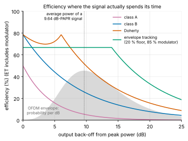
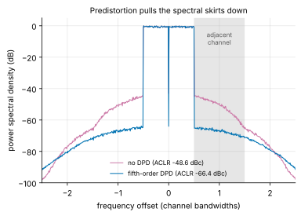

<!-- status: reviewed -->
# 21-07 · Power Amplifiers

| | |
|---|---|
| **Course** | [21 · RF and Microwave Engineering](../README.md) |
| **University equivalent** | The power-amplifier chapters of a senior or first-year graduate RF course: load-line design, drain efficiency and PAE, reduced-conduction-angle classes A, AB, B and C, switching and harmonic-tuned classes E and F, linearity and back-off for high-PAPR signals, the Doherty amplifier, envelope tracking, digital predistortion (Cripps, *RF Power Amplifiers for Wireless Communications*; Razavi, *RF Microelectronics*, the power-amplifier chapters) |
| **Prerequisites** | [12-07](../../12-electronics-2/chapters/12-07-output-stages.md) (output stages, classes A, B, D), [21-02](21-02-impedance-matching-networks.md) (matching networks), [21-03](21-03-noise-figure-and-linearity.md) (compression, IIP3), [03-03](../../03-probability-statistics-and-random-variables/chapters/03-03-expectation-and-functions-of-rvs.md) (PAPR, CCDF, Rayleigh envelope), [17-06](../../17-communication-systems/chapters/17-06-bandpass-digital-modulation.md) (EVM) |
| **Estimated study hours** | 9 |
| **Last verified** | 2026-11-24 |

**Learning objectives.** After this chapter you can:

1. Set a power amplifier's optimum load from its load line, size the impedance transformation, and distinguish drain efficiency from power-added efficiency.
2. Derive efficiency and output power against conduction angle (classes A, AB, B and C) and the ideal efficiencies of class-E and class-F amplifiers.
3. Quantify how efficiency falls in back-off and compute the average efficiency for a signal of given peak-to-average power ratio.
4. Derive the Doherty amplifier's load modulation and efficiency curve, and compare it with envelope tracking.
5. Relate adjacent-channel leakage to a PA's third-order nonlinearity, and explain how digital predistortion and crest-factor reduction restore linearity.
6. Evaluate PA claims (peak PAE, back-off efficiency, technology) against the conditions that produced them.

## 1. Big picture

The power amplifier (PA) is the last active stage before the antenna, and it is usually the largest consumer of power in a radio. In a phone it draws most of the battery current while transmitting; in a cellular base station it dominates the electricity bill and the heat that the site must remove. Its job looks simple, to make the signal bigger, but it must do three hard things at once: deliver watts into a 50 Ω antenna from a supply of a few volts (or a few tens of volts), do so efficiently, and keep the signal clean enough that it neither corrupts its own constellation (EVM, 17-06) nor spills into neighbouring channels (ACLR). Efficiency and linearity pull in opposite directions, and modern signals make the conflict worse: OFDM's peak power is about 10 dB above its average (9.64 dB at the $10^{-4}$ point, 03-03), so a PA sized for the peaks spends most of its time far below them, where conventional amplifiers are inefficient. Most of PA engineering since 1990 is about escaping that trap.

- **Efficiency is money and heat.** A base-station PA at 40% instead of 30% average efficiency saves a quarter of its DC power; a handset PA's efficiency sets talk time and how hot the phone gets.
- **Linearity is a regulatory requirement.** Standards cap adjacent-channel leakage and EVM; a PA that violates them cannot be sold.
- **Back-off is the core problem.** Conventional classes are efficient only near saturation. The Doherty amplifier, envelope tracking and digital predistortion all exist to operate efficiently while the signal is mostly well below its peaks.
- **Technology follows the load line.** Watts from a low supply need a very low load impedance, which is why base stations use high-voltage GaN and LDMOS, handsets use GaAs HBTs, and CMOS PAs combine many small devices.

## 2. Intuition first

A transistor in a PA is a valve between the supply and the load. It controls how much current flows, but every joule that does not reach the load is burned in the valve itself. The valve wastes nothing when it is fully open (no voltage across it) or fully shut (no current through it); it wastes the most when it is half open, carrying current with voltage across it.

```text
   class A                class B                    switching (class D/E/F)
   valve always           valve open for             valve either fully open or shut,
   half open:             half of each cycle:        timed so that voltage and
   current flows all      no current when idle       current never overlap
   the time

   efficiency <= 50 %     <= 78.5 %                  -> 100 % ideally
   most linear            linear (two halves)        amplitude must be restored some other way
```

**An analogy: an engine and a throttle.** A car engine is most efficient near full load and wastes fuel when throttled back in traffic. A PA is the same: it is efficient at its rated peak power and inefficient at the average power where an OFDM signal spends most of its time. The Doherty amplifier is like a car with a small engine for cruising and a second engine that joins in on hills; envelope tracking is like lowering the engine's fuel pressure to match the load at every instant; predistortion is like a driver who knows exactly how the car responds and presses the pedal accordingly.

**Where the analogy breaks.** An engine's waste is heat from combustion; a PA's waste is the product of voltage and current in the transistor at the same instant, so it can be reduced by shaping waveforms (classes E and F), which has no engine equivalent. And a PA's "smoothness" matters at a level no engine faces: one part in 10⁴ of leaked power into the neighbouring channel can violate a standard.

## 3. Theory

> **Conventions.** $V_{DD}$ is the supply, $V_k$ the knee voltage below which the transistor stops acting as a current source, $I_{max}$ the peak drain current. **Drain efficiency** $\eta = P_{out}/P_{DC}$; **power-added efficiency** $\text{PAE} = (P_{out} - P_{in})/P_{DC}$. Amplitudes are peak values; RF chokes and DC blocks are ideal. For complex-baseband signals, power means envelope power, as in 03-03.

### 3.1 The load line and why PAs are not conjugate-matched

A transistor driven hard has two limits: its drain voltage cannot fall below $V_k$, and its current cannot exceed $I_{max}$. With an RF choke feeding $V_{DD}$, the drain voltage swings symmetrically about $V_{DD}$, so its largest sinusoidal amplitude is $V_{DD} - V_k$. To reach both limits at once, the load must be

$$
R_{opt} = \frac{V_{DD} - V_k}{I_1}, \qquad P_{out} = \frac{(V_{DD} - V_k)\,I_1}{2} \;\Rightarrow\; R_{opt} = \frac{(V_{DD} - V_k)^2}{2P_{out}},
$$

with $I_1$ the amplitude of the fundamental drain current. This is Cripps' **load-line** argument [14]: a PA's load is chosen to use the full voltage and current swing, not to maximize small-signal gain. A conjugate match would absorb the transistor's output resistance, which is usually much larger than $R_{opt}$, and would make the current limit bind long before the voltage limit: less power. In practice designers find $R_{opt}$ (plus the reactance that cancels the device's output capacitance) by **load-pull**, sweeping the load impedance on a tuner and mapping power and efficiency contours.

**The impedance problem.** $R_{opt}$ scales as $V^2/P$. A 1 W handset PA from a 3.4 V battery needs a few ohms; 40 W from 3.4 V would need a fraction of an ohm, impossible to match to 50 Ω with low loss over any useful bandwidth (the Bode–Fano limit of 21-02 punishes high transformation ratios). Base stations therefore use 28–50 V transistors (GaN, LDMOS), whose $R_{opt}$ is tens of ohms (Example 21-07.1). The device technology is chosen by the load line as much as by gain or frequency (09-13).

**Tuned class A.** Bias at $I_{DC} = I_1$ so that the current swings between 0 and $2I_{DC}$. The drain efficiency at full swing is

$$
\eta_A = \frac{(V_{DD} - V_k)I_1/2}{V_{DD}I_{DC}} = \frac{1}{2}\left(1 - \frac{V_k}{V_{DD}}\right) ,
$$

50% ideally, twice the 25% of 12-07's resistively loaded emitter follower, because the choke lets the drain swing above the supply instead of wasting a series resistor's drop. **PAE** subtracts the drive power: a PA with 10 dB of gain loses a tenth of its output to drive, so high-frequency PAs, whose gain is low, show PAE well below their drain efficiency.

### 3.2 Reduced conduction angle: classes AB, B and C

Bias the transistor lower, so that it conducts only for part of each cycle. With a sinusoidal drive the drain current is a truncated cosine of conduction angle α:

$$
i_D(\theta) = I_{max}\,\frac{\cos\theta - \cos(\alpha/2)}{1 - \cos(\alpha/2)}, \qquad \lvert\theta\rvert \le \frac\alpha2 ,
$$

and zero for the rest of the cycle. Its DC value and fundamental follow from the Fourier integrals (11-05). Writing $c = \cos(\alpha/2)$ and $s = \sin(\alpha/2)$,

$$
I_{DC} = \frac{1}{2\pi}\int_{-\alpha/2}^{\alpha/2}i_D\,d\theta = \frac{I_{max}}{2\pi}\cdot\frac{2s - \alpha c}{1 - c}, \qquad I_1 = \frac1\pi\int_{-\alpha/2}^{\alpha/2}i_D\cos\theta\,d\theta = \frac{I_{max}}{2\pi}\cdot\frac{\alpha - \sin\alpha}{1 - c} .
$$

(For $I_1$: $\int\cos^2\theta\,d\theta = \alpha/2 + sc$ and $c\int\cos\theta\,d\theta = 2sc$, and $2sc = \sin\alpha$.) A tank at the drain shorts the harmonics, so the drain voltage stays sinusoidal with amplitude up to $V_{DD}$ (taking $V_k = 0$), and

$$
\eta(\alpha) = \frac{1}{2}\cdot\frac{I_1}{I_{DC}} = \frac{\alpha - \sin\alpha}{2\,(2\sin(\alpha/2) - \alpha\cos(\alpha/2))} .
$$

- **Class A** (α = 360°): η = 50%.
- **Class AB** (180° < α < 360°): between; at 240°, 66.0%, and slightly *more* output power than class A for the same peak current.
- **Class B** (α = 180°): $I_{DC} = I_{max}/\pi$, $I_1 = I_{max}/2$, η = π/4 = **78.54** %, the same output power as class A.
- **Class C** (α < 180°): efficiency rises toward 100% as α shrinks, but the fundamental, and with it the output power, falls toward zero, and the gain falls too.

Class B is linear in principle, since the fundamental current is proportional to drive, but a single device conducting half the time is only linear if the turn-on is perfectly sharp; real devices are biased slightly into class AB to avoid the crossover distortion of 12-07. Class C is not linear in amplitude and serves constant-envelope signals or the auxiliary device of a Doherty (§3.5).

### 3.3 Switching and harmonic-tuned classes: E and F

Efficiency below 100% means the transistor carries current and voltage at the same time. The switching classes shape the waveforms so that they do not overlap.

**Class F: square up the voltage.** Keep the class-B half-sine current, but add a third-harmonic voltage that flattens the bottom of the drain voltage, so the voltage sits near zero while the current flows. Write $v(\theta) = V_{DD} - V_1\cos\theta + V_3\cos3\theta$. The flattest bottom at θ = 0 needs $v''(0) = 0$, so $V_1 = 9V_3$. Then

$$
v'(\theta) = V_1\left(\sin\theta - \frac{\sin3\theta}{3}\right) = \frac43V_1\sin^3\theta \ge 0 \quad (0 \le \theta \le \pi),
$$

using $\sin3\theta = 3\sin\theta - 4\sin^3\theta$: the minimum is at θ = 0, where $v = V_{DD} - \tfrac89V_1$. The fundamental can therefore grow to $V_1 = \tfrac98V_{DD}$ before the voltage touches zero. The half-sine current contains no third harmonic, so the third-harmonic voltage costs no power, and

$$
\eta_{F3} = \frac{\tfrac12V_1I_1}{V_{DD}I_{DC}} = \frac98\cdot\frac\pi4 = 88.36\ \% .
$$

The flattest waveform is not quite the best. Allowing a slightly rippled bottom, with $V_3 = V_1/6$, raises the fundamental to $V_1 = (2/\sqrt3)V_{DD}$ = 1.155 $V_{DD}$ while the voltage still stays non-negative, and the efficiency to $(2/\sqrt3)(\pi/4)$ = **90.69**%, the true maximum with one harmonic [3].

With more odd harmonics the voltage approaches a square wave, the overlap vanishes and η → 100%. The **inverse class F** swaps the roles: a square current and a half-sine voltage.

**Class E: switch at zero voltage.** A transistor used as a switch, a shunt capacitor $C$ (which can be the transistor's own output capacitance), and a series resonator tuned slightly inductive into the load $R$. The network is designed so that when the switch closes the voltage across it is already zero and has zero slope: **zero-voltage switching**, so the capacitor's charge is never dumped through the switch. Sokal and Sokal introduced it in 1975 [3]. The results, derived below, are

$$
P_{out} = \frac{8}{\pi^2 + 4}\cdot\frac{V_{DD}^2}{R} = 0.5768\,\frac{V_{DD}^2}{R}, \qquad \omega CR = \frac{8}{\pi(\pi^2 + 4)} = 0.1836, \qquad \frac XR = 1.1525,
$$

with peak switch voltage 3.562 $V_{DD}$ and peak switch current 2.862 $I_{DC}$, and 100% efficiency in the ideal limit.

> **Going deeper — deriving class E.** Assume an ideal choke (DC current $I_{DC}$), a 50% duty cycle with the switch open for $\pi \le \theta < 2\pi$, and a load current $i_o = I_m\sin(\theta + \varphi)$ (the series resonator passes only the fundamental). While the switch is open, the capacitor takes the difference: $\omega C\,dv/d\theta = I_{DC} - I_m\sin(\theta + \varphi)$, so
>
> $$
> v(\theta) = \frac{1}{\omega C}\left[I_{DC}(\theta - \pi) + I_m\left(\cos(\theta + \varphi) - \cos(\pi + \varphi)\right)\right] .
> $$
>
> Zero voltage at turn-on, $v(2\pi) = 0$, gives $I_m\cos\varphi = -\pi I_{DC}/2$; zero slope, $v'(2\pi) = 0$, gives $I_m\sin\varphi = I_{DC}$. Hence $\tan\varphi = -2/\pi$ (with $\cos\varphi < 0$) and $I_m = I_{DC}\sqrt{1 + \pi^2/4}$ = 1.862 $I_{DC}$. The choke carries no DC voltage, so the average of $v$ must equal $V_{DD}$; integrating $v$ over the open half-cycle gives $2I_{DC}/(2\pi\omega C) = V_{DD}$, so $I_{DC} = \pi\omega CV_{DD}$. With no losses, $P_{out} = I_m^2R/2 = P_{DC} = V_{DD}I_{DC}$, which gives $I_{DC} = 8V_{DD}/[(\pi^2 + 4)R]$ and the power and $\omega CR$ above. Projecting $v$ onto $\cos(\theta + \varphi)$, the component in quadrature with the load current, gives the series reactance the network must add, $X/R$ = 1.1525. The peak of $v$, found numerically, is 3.562 $V_{DD}$.

The price of switching classes is stress and bandwidth. Class E's switch sees 3.56 times the supply, a serious problem for CMOS, whose thin-oxide devices tolerate little more than their nominal supply; CMOS PAs stack transistors to share the voltage. Class F needs harmonic terminations at 2f and 3f, which are narrowband. And both are constant-envelope by nature: amplitude modulation must be added by varying the supply (§3.6) or by combining several amplifiers.

### 3.4 Linearity, PAPR and the cost of back-off

**AM-AM and AM-PM.** A PA's gain falls as it approaches saturation (compression, 21-03) and its phase shift changes with amplitude, because device capacitances vary with voltage. These two curves, output amplitude and phase against input amplitude, describe a memoryless PA; real PAs also have memory (thermal and bias-network time constants), so their distortion depends on recent history.

**Efficiency in back-off.** Let $x$ be the output amplitude relative to its maximum, so the output power is $x^2$ of peak. A class-A amplifier draws constant DC current, so its efficiency falls with power: $\eta_A = \tfrac12x^2$. A class-B amplifier's DC current is proportional to its fundamental, so it falls more slowly: $\eta_B = (\pi/4)x$. At 6 dB back-off ($x$ = 1/2), class A has 12.5% and class B 39.3%.

**Average efficiency for a modulated signal.** The DC power and output power must each be averaged over the envelope's distribution before dividing:

$$
\bar\eta = \frac{\mathbb{E}[P_{out}(x)]}{\mathbb{E}[P_{DC}(x)]} = \frac{\mathbb{E}[x^2]}{\mathbb{E}[x^2/\eta(x)]} ,
$$

not the average of η. 03-03 (Example 03-03.7) did this for class B with a complex-Gaussian (OFDM-like) signal whose peak, set at its $10^{-4}$ PAPR of 9.64 dB, just reaches saturation: 29.2%, against 78.5% at peak. That gap is the motivation for everything in §§3.5–3.6.

**Adjacent-channel leakage from a cubic nonlinearity.** Model the PA's envelope response as $y = a_1x + a_3x\lvert x\rvert^2$, where $x$ now denotes the complex baseband signal (not the normalized amplitude above), a complex-Gaussian signal of average power $P = \mathbb{E}\lvert x\rvert^2$ with a flat spectrum of width $B$. Its power $\lvert x\rvert^2$ is exponential with mean $P$ (03-03), and the $k$-th moment of an exponential is $k!P^k$, so $\mathbb{E}\lvert x\rvert^4 = 2P^2$ and $\mathbb{E}\lvert x\rvert^6 = 6P^3$. These split the cubic term into a part that looks like gain and a part that does not. The part of $x\lvert x\rvert^2$ correlated with $x$ is $(\mathbb{E}\lvert x\rvert^4/P)\,x = 2Px$, a gain change of $2a_3P$: compression. The remainder $d = a_3(x\lvert x\rvert^2 - 2Px)$ is uncorrelated with $x$ and has power

$$
\mathbb{E}\lvert d\rvert^2 = \lvert a_3\rvert^2\left(6P^3 - 2 \cdot 4P^3 + 4P^3\right) = 2\lvert a_3\rvert^2P^3 .
$$

Its spectrum is the triple convolution of the signal's flat spectrum (a product of three signals in time is a convolution of three spectra), a smooth bump three times as wide: in units of $B$, $\tfrac34 - f^2$ for $\lvert f\rvert \le \tfrac12$ and $\tfrac12(\tfrac32 - \lvert f\rvert)^2$ for $\tfrac12 \le \lvert f\rvert \le \tfrac32$. Integrating, two-thirds of its power stays in the channel (a floor under the constellation, part of EVM) and one-sixth lands in each adjacent channel. The **adjacent-channel leakage ratio** is therefore

$$
\text{ACLR} = \frac{\tfrac16 \cdot 2\lvert a_3\rvert^2P^3}{\lvert a_1\rvert^2P} = \frac{\lvert a_3\rvert^2P^2}{3\lvert a_1\rvert^2} = \frac{1}{3}\left(\frac{P}{P_{IIP3}}\right)^2 ,
$$

where $P_{IIP3} = \lvert a_1/a_3\rvert$ is the two-tone input intercept in the same (envelope-power) units: for a tone of power $p$ each, the third-order product is $\lvert a_3\rvert p^{3/2}$ against $\lvert a_1\rvert p^{1/2}$. In decibels,

$$
\text{ACLR (dBc)} = 2\,(P_{in} - \text{IIP3}) - 4.77 ,
$$

with $P_{in}$ the modulated signal's average input power and IIP3 the per-tone intercept, both in dBm. Each decibel of back-off buys two decibels of ACLR, as for two-tone IM3 (21-03), but the modulated signal's leakage sits 4.77 dB below what a naive "IM3 at the average power" estimate suggests. The lab confirms the formula, to within a few tenths of a decibel, with a simulated OFDM signal.

### 3.5 The Doherty amplifier

Doherty's 1936 idea [1] is to combine two amplifiers so that, at low power, one of them sees a higher load impedance and reaches its full voltage swing, and therefore its peak efficiency, early.

**The circuit.** A **main** (carrier) amplifier, biased class B (in practice AB), feeds the load through a quarter-wave line of impedance $Z_0 = R_{opt}$. An **auxiliary** (peaking) amplifier, biased class C so that it turns on only above half drive, connects directly to the load node, driven 90° late to match the line's delay. The load is $R_L = R_{opt}/2$.

**Low power** ($x \le 1/2$, auxiliary off). The quarter-wave line inverts impedance: the main amplifier sees $Z_0^2/R_L = 2R_{opt}$. With fundamental current $I_{main} = xI_{1,max}$, where $I_{1,max} = V_{DD}/R_{opt}$ is the main device's fundamental current at full power (its peak drain current is twice that in class B, unlike the $I_{max}$ of §3.2), its drain voltage is $2xV_{DD}$, so at $x$ = 1/2 it reaches the full swing $V_{DD}$ while delivering a quarter of its peak power: it is at peak class-B efficiency, π/4, **6.02 dB below the combined peak**.

**High power** ($x > 1/2$). The auxiliary amplifier injects $I_a = (2x - 1)I_{1,max}$ into the load node. A quarter-wave line ties the voltage at one end to the current at the other: $\lvert V_L\rvert = Z_0\lvert I_{main}\rvert = xV_{DD}$ and $\lvert V_m\rvert = Z_0\lvert I_2\rvert$, where $I_2$ is the line's output current. The load node needs $I_2 + I_a = V_L/R_L = 2xI_{1,max}$, so $I_2 = I_{1,max}$ and $\lvert V_m\rvert = V_{DD}$: the main amplifier stays at full swing while the auxiliary's current **pulls its load down** from $2R_{opt}$ to $R_{opt}$. This is **load modulation**. At $x$ = 1 both amplifiers deliver $V_{DD}I_{1,max}/2$.

**Efficiency.** Output power is $V_L^2/(2R_L) = x^2V_{DD}^2/R_{opt}$; DC power is $(2/\pi)V_{DD}$ times the sum of the fundamental currents. Hence

$$
\eta_D(x) = \frac\pi2\cdot\frac{x^2}{x + \max(0,\ 2x - 1)} = \begin{cases} \dfrac\pi2x, & x \le \tfrac12 \\[2mm] \dfrac\pi2\cdot\dfrac{x^2}{3x - 1}, & x > \tfrac12 \end{cases}
$$

This is the ideal-Doherty idealization: the auxiliary is modelled as a class-B current source whose fundamental grows linearly from zero at $x$ = ½, with DC current $(2/\pi)$ times its fundamental. A real class-C auxiliary turns on more gradually and has a different DC-to-fundamental ratio, which is one reason measured curves sag (Practical limits, below). The ideal curve gives 78.5% at 6.02 dB back-off and at peak, with a shallow dip to $(\pi/2)(4/9)$ = 69.8% at $x$ = 2/3 (Figure 1). For an OFDM signal this lifts the average efficiency from class B's 29.2% to 54.9% (Example 21-07.5).



*Figure 1. Efficiency against back-off for ideal class A, class B, the symmetric Doherty (peaks at 0 and 6.02 dB) and envelope tracking with a 20% supply floor and an 85% modulator, over the density of a 9.64 dB-PAPR OFDM envelope (grey). A signal spends most of its time 5 to 15 dB below its peak, which is where the architectures differ most.*

**Asymmetric Doherty.** If the auxiliary device can deliver γ times the main's current (and $R_L = R_{opt}/(1 + \gamma)$), the first efficiency peak moves to a back-off of $20\log_{10}(1 + \gamma)$: 9.54 dB for γ = 2, closer to the PAPR of modern signals (Problem 21-07.9).

**Practical limits.** The quarter-wave inverter and the 90° offset are exact at one frequency, so the classic Doherty is narrowband; widening it is an active research topic (§9). The class-C auxiliary has low gain and turns on gradually, so the real curve sags, and the main device's load modulation interacts with its nonlinearity, so Doherty PAs almost always need predistortion.

### 3.6 Envelope tracking and polar transmitters

Instead of changing the load, change the supply. In **envelope tracking** (ET), a fast DC-DC converter, the **supply modulator**, lowers $V_{DD}$ whenever the envelope is small, so that the PA always runs near full voltage swing. An ideal class-B PA then stays at π/4 at every envelope level. Two efficiencies multiply:

$$
\eta_{ET} = \eta_{PA}\,\eta_{mod} .
$$

In practice the supply cannot go to zero (the PA's gain collapses and its phase changes), so it tracks down to a floor $V_{min}$; the efficiency is then $(\pi/4)\,x/\max(x, v_{min})$ with $v_{min} = V_{min}/V_{max}$. With a 20% floor and an 85% efficient modulator, an OFDM signal averages 65.5% (Example 21-07.7). The modulator is the hard part. The envelope $\lvert x(t)\rvert$ of a signal of bandwidth $B$ has a spectrum several times wider than $B$ (the magnitude operation is nonlinear), so the modulator must track at a bandwidth well beyond the signal's while staying efficient; ET therefore gets harder as channels widen (§9 gives the state of practice).

**Average power tracking** (APT) is the slow cousin: the supply is set per time slot to suit the average power, recovering efficiency when the phone is close to the base station, with no wideband modulator. **Envelope elimination and restoration** (Kahn, 1952 [2]) and **polar** transmitters go further: a saturated (switching) PA amplifies a constant-envelope phase signal, and the amplitude is restored entirely through the supply.

### 3.7 Digital predistortion and crest-factor reduction

**Predistortion.** If the PA is $y = G(u)$, drive it with $u = G^{-1}(x)$ and the output is $x$ times the target gain. For the cubic model $y = a_1u + a_3u\lvert u\rvert^2$, try $u = x + b_3x\lvert x\rvert^2$:

$$
y = a_1x + (a_1b_3 + a_3)\,x\lvert x\rvert^2 + O(\lvert x\rvert^5) ,
$$

so $b_3 = -a_3/a_1$ cancels the third-order term, leaving fifth- and higher-order residue; adding $b_5$, $b_7$, ... cancels successively higher orders. **Digital** predistortion (DPD) implements $u$ in the transmitter's baseband. Its coefficients are learned, not designed: an **observation receiver** samples the PA output, and the coefficients are fitted by least squares, commonly by **indirect learning** (fit a post-inverse that maps the PA output back to its input, then copy it in front of the PA). Real PAs have memory, so practical DPD uses memory polynomials, sums of delayed terms $x(n - m)\lvert x(n - m)\rvert^{k-1}$ [13].

**DPD's bandwidth cost.** A $k$-th-order term is a product of $k$ copies of the signal, so its spectrum is $k$ times as wide: the predistorted drive $u$ occupies three to five or more times the channel bandwidth, and so must the DAC, the upconverter and the observation receiver.

**What DPD cannot do.** It cannot make the PA deliver more than its saturated power. Peaks that would need more are clipped whatever the predistorter does, so the achievable ACLR is set by how often the signal exceeds saturation (Example 21-07.8). Hence **crest-factor reduction** (CFR): deliberately clip and filter the signal's rare peaks in baseband, accepting a controlled EVM penalty (03-03 computed the error power of clipping an OFDM signal 8 dB above average: −39.25 dB), so the PA can run closer to saturation. CFR, DPD and an efficient PA architecture together form the modern transmitter line-up.



*Figure 2. A Rapp-model PA driven by 16-QAM OFDM with 12 dB between average power and saturation (the lab's Part 6): without predistortion the third- and fifth-order products form skirts in the adjacent channels; a fifth-order predistorter learned by indirect learning lowers them by about 18 dB.*

## 4. Worked examples

### Example 21-07.1 · Load line, matching and efficiency (tier A)

**Setup.** A handset PA delivers 1 W (30 dBm) from a 3.4 V supply; the transistor's knee is 0.4 V and it runs class B with 15 dB of gain. Find (a) $R_{opt}$, (b) the impedance transformation ratio to 50 Ω and (c) the Q of an L-match; (d) the fundamental and (e) the DC current, (f) the DC power, (g) the drain efficiency, (h) the input power, (i) the PAE and (j) the dissipated power. (k) What $R_{opt}$ would a 40 W base-station PA need from a 48 V supply with a 5 V knee?

**Solution.**

- (a) $R_{opt} = (3.4 - 0.4)^2/(2 \times 1)$ = **4.5** Ω.
- (b) 50/4.5 = **11.1**.
- (c) $Q = \sqrt{11.1 - 1}$ = **3.18** (21-02).
- (d) $I_1 = (V_{DD} - V_k)/R_{opt}$ = 3.0/4.5 = **0.667** A.
- (e) Class B: $I_{DC} = (2/\pi)I_1$ = **0.424** A.
- (f) $P_{DC}$ = 3.4 × 0.424 = **1.443** W.
- (g) η = 1/1.443 = **69.3** %, which is $(\pi/4)(1 - V_k/V_{DD})$.
- (h) $P_{in} = 10^{(30 - 15)/10}$ mW = **31.6** mW.
- (i) PAE = (1 − 0.0316)/1.443 = **67.1** %.
- (j) $P_{DC} + P_{in} - P_{out}$ = **0.475** W, heat in the transistor.
- (k) $(48 - 5)^2/(2 \times 40)$ = **23.1** Ω, close to 50 Ω.

**Units check.** V²/W = Ω; V × A = W.

**Sanity check.** A transformation ratio of 11 is comfortable for one or two L-sections; the base-station PA, from a supply 14 times higher, needs almost none despite 40 times the power. That is the load line's case for high-voltage transistors.

### Example 21-07.2 · Conduction angle (tier B)

**Setup.** For conduction angles of 360°, 240°, 180° and 120°, find the drain efficiency at full voltage swing and the output power relative to class A for the same peak current.

**Solution.** With $I_{max}$ = 1:

| α | $I_{DC}$ | $I_1$ | η | Power vs class A |
|---|---|---|---|---|
| 360° (A) | 0.5000 | 0.5000 | **50.00** % | **0.00** dB |
| 240° (AB) | 0.4060 | 0.5363 | **66.05** % | **+0.30** dB |
| 180° (B) | 0.3183 | 0.5000 | **78.54** % | **0.00** dB |
| 120° (C) | 0.2180 | 0.3910 | **89.68** % | **−1.07** dB |

Every class swings the full $V_1 = V_{DD}$, so $P_{out} = \tfrac12V_{DD}I_1$ and the power ratio is the current ratio, $10\log_{10}(I_1/I_{1,A})$. The optimum load is $V_{DD}/I_1$, so it changes with class: in units of $V_{DD}/I_{max}$, 2.000 for classes A and B, **1.865** for 240° and **2.558** for 120°.

**Units check.** Currents in units of $I_{max}$; efficiency and power ratios dimensionless.

**Sanity check.** Class C's efficiency gain costs power: at 120° the device delivers 1.1 dB less from the same peak current, and needs more drive to get there.

### Example 21-07.3 · Designing a class-E stage (tier B)

**Setup.** Design an ideal class-E PA for 1 W at 2 GHz from 3.3 V. Find (a) $R$, (b) the shunt capacitance, (c) the excess series reactance and (d) its inductance, (e) the DC current, (f) the peak switch voltage, (g) the peak switch current, and (h) the ideal efficiency and (i) output power.

**Solution.**

- (a) $R = 0.5768\,V_{DD}^2/P$ = **6.281** Ω.
- (b) $C = 0.1836/(\omega R)$ = 0.1836/(1.2566 × 10¹⁰ × 6.281) = **2.326** pF.
- (c) $X = 1.1525R$ = **7.239** Ω, and (d) $L_x = X/\omega$ = **0.5761** nH.
- (e) $I_{DC} = P/V_{DD}$ = **0.3030** A (lossless).
- (f) 3.562 × 3.3 V = **11.75** V.
- (g) 2.862 × 0.3030 A = **0.8673** A.
- (h) **100** % ideally, delivering (i) **1.000** W.

**Units check.** $1/(\omega R)$: s/(rad·Ω) = F.

**Sanity check.** The lab's ngspice model, with a resonator Q of 30 and a 1 µH choke instead of the ideal infinite values, delivers about 1.3% more power at 99.95% efficiency, and its peak switch voltage is about 1.6% higher. An 11.75 V peak is several times what a 3.3 V-class CMOS device can withstand, which is why CMOS class-E PAs stack devices or use thick-oxide transistors.

### Example 21-07.4 · Class F with a third harmonic (tier B)

**Setup.** A class-B current waveform is combined with a maximally flat drain voltage using only the third harmonic. Find (a) the fundamental voltage amplitude relative to $V_{DD}$, (b) the third-harmonic amplitude, (c) the efficiency and (d) the output power gain over class B at the same current.

**Solution.** (a) $V_1 = \tfrac98V_{DD}$ = **1.125** $V_{DD}$. (b) $V_3 = V_1/9$ = **0.125** $V_{DD}$. (c) $\tfrac98 \cdot \tfrac\pi4$ = **88.36** %. (d) The fundamental voltage is 9/8 of class B's for the same current, so the power $\tfrac12V_1I_1$ rises by 9/8: $10\log_{10}(9/8)$ = **0.51** dB, into a load 9/8 as large (the same 9/8 as the efficiency ratio, since the DC power is unchanged).

**Units check.** Ratios throughout.

**Sanity check.** One harmonic buys 10 points of efficiency; the next ones buy less, which is why practical class-F designs control only the second and third harmonics.

### Example 21-07.5 · Back-off and average efficiency (tier B)

**Setup.** (a, b) Find the efficiency of ideal class A and class B at 6.02 dB back-off, and (c, d) at 9.64 dB back-off. An OFDM-like (complex-Gaussian) signal has its $10^{-4}$ PAPR of 9.64 dB set at the PA's saturation. Find the average efficiency of (e) class A, (f) class B and (g) an ideal Doherty.

**Solution.**

- (a) $\tfrac12(1/2)^2$ = **12.5** %; (b) $(\pi/4)(1/2)$ = **39.27** %.
- At 9.64 dB, $x = 10^{-9.64/20}$ = 0.3296: (c) **5.43** %, (d) **25.89** %.
- The envelope power is exponential with mean $\bar P$ (03-03), with $x = \sqrt{P/(9.21\bar P)}$, clipped at 1. Averaging $x^2$ and $x^2/\eta(x)$ by numerical integration gives (e) **5.43** % (class A's DC power is constant, so its average efficiency is its efficiency at the average power), (f) **29.20** % (03-03's result), and (g) **54.90** %.

**Units check.** Ratios of powers.

**Sanity check.** The Doherty almost doubles class B's average efficiency because the envelope spends most of its time between 6 and 12 dB below the peak, exactly where the Doherty's main device is near full swing.

### Example 21-07.6 · A symmetric Doherty design (tier C)

**Setup.** Two GaN devices, each with $R_{opt}$ = 25 Ω at 28 V, form a 2 GHz Doherty. Find (a) the load $R_L$ and (b) the inverter impedance; (c) the peak output power in watts and (d) in dBm; at 6.02 dB back-off (e) the output power, (f) the efficiency and (g) the main drain's voltage amplitude; at $x$ = 2/3 (h) the power and (i) the efficiency; (j) the average efficiency for the OFDM signal of Example 21-07.5; (k) the impedance of a quarter-wave transformer from $R_L$ to 50 Ω.

**Solution.**

- (a) $R_L = R_{opt}/2$ = **12.5** Ω; (b) $Z_0 = R_{opt}$ = **25** Ω.
- (c) $V_{DD}^2/R_{opt}$ = 784/25 = **31.36** W, (d) **44.96** dBm.
- (e) A quarter: **7.84** W; (f) **78.54** %; (g) the main sees 50 Ω and swings **28.0** V, its full supply.
- (h) $(2/3)^2 \times 31.36$ = **13.94** W; (i) $(\pi/2)(4/9)/1$ = **69.81** %.
- (j) **54.90** %, as in Example 21-07.5.
- (k) $\sqrt{12.5 \times 50}$ = **25.0** Ω.

**Units check.** V²/Ω = W.

**Sanity check.** The lab's ngspice model (ideal class-B current sources, a 25 Ω line, tanks shorting the harmonics) reproduces the main drain's 28 V swing at both back-off and peak, 7.84 W at back-off and the three efficiencies to better than 0.1%.

### Example 21-07.7 · Envelope tracking (tier B)

**Setup.** A class-B PA is supplied by an envelope-tracking modulator of 85% efficiency, for the OFDM signal of Example 21-07.5. Find the PA's average efficiency and the overall efficiency (a, b) with perfect tracking to zero, and (c, d) with a supply floor of 20% of the peak supply.

**Solution.**

- (a) With perfect tracking the PA always runs at full swing: **78.54** %; (b) × 0.85 = **66.76** %.
- (c) With the floor, $\eta(x) = (\pi/4)x/\max(x, 0.2)$; averaging as in Example 21-07.5 gives **77.03** %, and (d) **65.48** % overall.

**Units check.** Ratios.

**Sanity check.** The envelope is below the floor often, $1 - e^{-0.04 \times 9.21}$ = **30.8** % of the time, but those samples carry little power, $1 - e^{-a}(1 + a)$ with $a$ = 0.368, or **5.3** % of the output, so the floor costs only 1.5 points. The modulator's own efficiency costs much more, which is why its design is the crux of ET.

### Example 21-07.8 · ACLR, back-off and predistortion (tier C)

**Setup.** (a) A PA's two-tone IIP3 is 20 dB above the average input power of an OFDM signal. Estimate its ACLR. (b) How far below IIP3 must the input be for ACLR = −45 dBc, the NR base-station limit [5]? (c) The lab simulates a Rapp-model PA (smoothness p = 2, no AM-PM) driven by a seeded 16-QAM OFDM signal whose average power is 10 dB below saturation. Read off the ACLR without DPD, with a fifth-order polynomial DPD learned by indirect learning, and with an ideal inverse that clips at saturation.

**Solution.**

- (a) $2(-20) - 4.77$ = **−44.77** dBc.
- (b) $(-45 + 4.77)/2$ = **−20.11** dB.
- (c) Without DPD **−41.8** dBc; with the fifth-order DPD **−48.3** dBc; with the ideal clipping inverse **−55.2** dBc. The clipping limit is set by the few samples (the simulated signal's $10^{-4}$ PAPR is **10.2** dB) that exceed saturation; reducing the crest factor raises it.

**Units check.** dB relative to the in-channel power.

**Sanity check.** Ten decibels of back-off on a 10 dB-PAPR signal leaves the PA barely linear enough; DPD gains several decibels, but the ideal inverse shows the ceiling that only crest-factor reduction or more back-off can lift.

### Answer key

<!-- answer-key -->
| ID | Quantity | Value | Unit |
|---|---|---|---|
| Ex 21-07.1a | R_opt | 4.5 | Ω |
| Ex 21-07.1b | transformation ratio | 11.1 | |
| Ex 21-07.1c | L-match Q | 3.18 | |
| Ex 21-07.1d | fundamental current | 0.667 | A |
| Ex 21-07.1e | DC current | 0.424 | A |
| Ex 21-07.1f | DC power | 1.443 | W |
| Ex 21-07.1g | drain efficiency | 69.3 | % |
| Ex 21-07.1h | input power | 31.6 | mW |
| Ex 21-07.1i | PAE | 67.1 | % |
| Ex 21-07.1j | dissipated power | 0.475 | W |
| Ex 21-07.1k | base-station R_opt | 23.1 | Ω |
| Ex 21-07.2a | efficiency, 360° | 50.00 | % |
| Ex 21-07.2b | efficiency, 240° | 66.05 | % |
| Ex 21-07.2c | efficiency, 180° | 78.54 | % |
| Ex 21-07.2d | efficiency, 120° | 89.68 | % |
| Ex 21-07.2e | power vs class A, 360° | 0.00 | dB |
| Ex 21-07.2f | power vs class A, 240° | 0.30 | dB |
| Ex 21-07.2g | power vs class A, 180° | 0.00 | dB |
| Ex 21-07.2h | power vs class A, 120° | −1.07 | dB |
| Ex 21-07.2i | normalized R_opt, 240° | 1.865 | |
| Ex 21-07.2j | normalized R_opt, 120° | 2.558 | |
| Ex 21-07.3a | load resistance | 6.281 | Ω |
| Ex 21-07.3b | shunt capacitance | 2.326 | pF |
| Ex 21-07.3c | excess reactance | 7.239 | Ω |
| Ex 21-07.3d | excess inductance | 0.5761 | nH |
| Ex 21-07.3e | DC current | 0.3030 | A |
| Ex 21-07.3f | peak switch voltage | 11.75 | V |
| Ex 21-07.3g | peak switch current | 0.8673 | A |
| Ex 21-07.3h | ideal efficiency | 100 | % |
| Ex 21-07.3i | output power | 1.000 | W |
| Ex 21-07.4a | fundamental voltage | 1.125 | V_DD |
| Ex 21-07.4b | third-harmonic voltage | 0.125 | V_DD |
| Ex 21-07.4c | efficiency | 88.36 | % |
| Ex 21-07.4d | power gain over class B | 0.51 | dB |
| Ex 21-07.5a | class A at 6.02 dB back-off | 12.5 | % |
| Ex 21-07.5b | class B at 6.02 dB back-off | 39.27 | % |
| Ex 21-07.5c | class A at 9.64 dB back-off | 5.43 | % |
| Ex 21-07.5d | class B at 9.64 dB back-off | 25.89 | % |
| Ex 21-07.5e | class A average, OFDM | 5.43 | % |
| Ex 21-07.5f | class B average, OFDM | 29.20 | % |
| Ex 21-07.5g | Doherty average, OFDM | 54.90 | % |
| Ex 21-07.6a | load | 12.5 | Ω |
| Ex 21-07.6b | inverter impedance | 25 | Ω |
| Ex 21-07.6c | peak power | 31.36 | W |
| Ex 21-07.6d | peak power | 44.96 | dBm |
| Ex 21-07.6e | power at 6.02 dB back-off | 7.84 | W |
| Ex 21-07.6f | efficiency at 6.02 dB back-off | 78.54 | % |
| Ex 21-07.6g | main drain amplitude | 28.0 | V |
| Ex 21-07.6h | power at x = 2/3 | 13.94 | W |
| Ex 21-07.6i | efficiency at x = 2/3 | 69.81 | % |
| Ex 21-07.6j | average efficiency, OFDM | 54.90 | % |
| Ex 21-07.6k | output transformer impedance | 25.0 | Ω |
| Ex 21-07.7a | PA average, perfect tracking | 78.54 | % |
| Ex 21-07.7b | overall, perfect tracking | 66.76 | % |
| Ex 21-07.7c | PA average, 20 % floor | 77.03 | % |
| Ex 21-07.7d | overall, 20 % floor | 65.48 | % |
| Ex 21-07.7e | time below the floor | 30.8 | % |
| Ex 21-07.7f | output power below the floor | 5.3 | % |
| Ex 21-07.8a | ACLR at IIP3 − 20 dB | −44.77 | dBc |
| Ex 21-07.8b | input below IIP3 for −45 dBc | −20.11 | dB |
| Ex 21-07.8c | simulated ACLR, no DPD | −41.8 | dBc |
| Ex 21-07.8d | simulated ACLR, 5th-order DPD | −48.3 | dBc |
| Ex 21-07.8e | simulated ACLR, ideal clipping inverse | −55.2 | dBc |
| Ex 21-07.8f | simulated signal's 1e-4 PAPR | 10.2 | dB |
| Txt 21-07.a | class-B efficiency | 78.54 | % |
| Txt 21-07.b | class-F3 efficiency | 88.36 | % |
| Txt 21-07.c | class-E P R / V_DD² | 0.5768 | |
| Txt 21-07.d | class-E ωCR | 0.1836 | |
| Txt 21-07.e | class-E X / R | 1.1525 | |
| Txt 21-07.f | class-E peak voltage | 3.562 | V_DD |
| Txt 21-07.g | class-E peak current | 2.862 | I_DC |
| Txt 21-07.h | class-E load-current amplitude | 1.862 | I_DC |
| Txt 21-07.i | Doherty first peak back-off | 6.02 | dB |
| Txt 21-07.j | Doherty dip efficiency | 69.8 | % |
| Txt 21-07.k | asymmetric Doherty back-off, γ = 2 | 9.54 | dB |
| Txt 21-07.l | ACLR constant | −4.77 | dB |
| Txt 21-07.m | ET average with 20 % floor and 85 % modulator | 65.5 | % |
| Txt 21-07.n | Wi-Fi 7 TX output at 9 dB back-off | 21.15 | dBm |
| Txt 21-07.o | Wi-Fi 7 TX efficiency at that point | 15.7 | % |
| Txt 21-07.p | class F3 maximum efficiency (V3 = V1/6) | 90.69 | % |
| Txt 21-07.q | class F3 maximum fundamental | 1.155 | V_DD |

## 5. Simulate it

The lab ([labs/21-07-lab](../labs/21-07-lab/README.md)) collects the formulas in `pa.py`, generates a seeded OFDM signal, measures ACLR and EVM through PA models with and without predistortion, and confirms a class-E stage and a Doherty amplifier in ngspice (`classe.cir`, `doherty.cir`).

**Predict, then run.**

1. Predict the efficiency at conduction angles of 360°, 240°, 180° and 120°, then plot efficiency and power against angle (Part 1).
2. Predict the class-E design's power, efficiency and peak switch voltage, then run `ngspice -b classe.cir` and look at the switch waveforms (Part 2).
3. Predict each architecture's efficiency at 6 and 10 dB back-off, then plot the curves over the OFDM envelope and compute the averages (Part 3).
4. Predict the Doherty's main-device swing and efficiency at three drive levels, then run `ngspice -b doherty.cir` (Part 4).
5. Predict the ACLR of a cubic PA from §3.4's formula, then measure it with OFDM (Part 5).
6. Predict whether predistortion helps more with 12 or 10 dB of saturation margin, then apply it (Part 6).

## 6. Engineering tradeoffs

| Knob | Improves | Costs | Typical decision owner |
|---|---|---|---|
| Conduction angle (class A → AB → B → C) | Peak efficiency | Gain, linearity (class C), power per device (class C) | PA designer |
| Switching or harmonic tuning (class E, F) | Peak efficiency toward 100% | Voltage stress (3.56 V_DD for class E), bandwidth of harmonic terminations, amplitude linearity | PA designer |
| Supply voltage and device technology | Easier matching ($R_{opt} \propto V^2/P$), power density | Breakdown requirements, cost, integration with CMOS | Product architect and technology team |
| Back-off from saturation | Linearity, ACLR, EVM | Efficiency, roughly in proportion to the back-off | System engineer |
| Doherty (symmetric or asymmetric) | Back-off efficiency at 6–10 dB | Bandwidth, gain of the class-C auxiliary, need for DPD | PA architect |
| Envelope tracking | Efficiency across the whole envelope range | A wideband, efficient supply modulator; tight timing alignment | PA and power-management teams |
| Digital predistortion | ACLR and EVM at higher drive | DSP power, observation receiver, wider DAC and upconverter bandwidth | Transceiver and DSP teams |
| Crest-factor reduction | Lets the PA run closer to saturation | EVM budget, in-band distortion | System engineer |

## 7. Numbers to know

| Quantity | Value | Note |
|---|---|---|
| Ideal tuned class A | 50% (×(1 − V_k/V_DD)) | §3.1 |
| Ideal class B | π/4 = 78.5% | §3.2 |
| Class F, third harmonic only | 88.4% maximally flat ($V_3 = V_1/9$); 90.7% maximum ($V_3 = V_1/6$) | §3.3 [3] |
| Class E | P = 0.5768 V_DD²/R; ωCR = 0.1836; X/R = 1.1525; peak 3.56 V_DD and 2.86 I_DC | §3.3 |
| Class-B efficiency at 6 dB back-off | 39.3% | $(\pi/4)x$ |
| Symmetric Doherty | 78.5% at 6.02 dB back-off and at peak, 69.8% dip | §3.5 |
| Asymmetric Doherty, γ = 2 | first peak at 9.54 dB back-off | §3.5 |
| Average efficiency for a 9.64 dB-PAPR OFDM signal | class B 29.2%, Doherty 54.9%, ET (20% floor, 85% modulator) 65.5% | Examples 21-07.5, 21-07.7 |
| ACLR of a cubic PA | $2(P_{in} - \text{IIP3}) - 4.77$ dB | §3.4 |
| Distortion bandwidth | $k$-th order spans $k$ times the channel | §3.7 |
| NR handset limits | 23 dBm (power class 3); NR ACLR 30 dB; 256-QAM EVM 3.5%; MPR up to 6.5 dB | 3GPP TS 38.101-1 V19.7.0 [4] (as of Nov 2026) |
| NR base-station limits | ACLR 45 dB; 1024-QAM EVM 2.5% | TS 38.104 V19.6.0 [5] |
| FR2 handset ACLR | 16–17 dB | TS 38.101-2 [4] |
| Wi-Fi 7 4096-QAM EVM | −38 dB | [6] |
| OFDM/NR PAPR at 0.01% | about 10–12 dB raw (TI quotes 10–15 dB), 6.5–8 dB after CFR | [7] |
| GaN MMIC Doherty, 4–6 GHz | 38.5–46.5% drain efficiency at 6 dB back-off | [9] (2022) |
| 28 GHz silicon Doherty | 38% PAE at P1dB; 15–21% average with 64/256-QAM | [11] (2026) |

## 8. Common mistakes

- **Averaging efficiency instead of power.** The average efficiency of a modulated signal is average output power over average DC power, not the mean of the instantaneous efficiency.
- **Quoting peak PAE for a modulated signal.** A PA with 70% PAE at saturation may deliver 25% at the average power of an OFDM signal; ask for efficiency at the stated back-off and signal.
- **Conjugate-matching a PA.** The load is set by the load line (voltage and current limits), not by the device's small-signal output impedance.
- **Forgetting the knee and the breakdown.** The swing is $V_{DD} - V_k$ on the way down and must stay below breakdown on the way up; class E needs a device rated for 3.56 $V_{DD}$.
- **Expecting DPD to fix saturation.** Predistortion linearizes up to saturation; peaks beyond it need crest-factor reduction or more back-off.
- **Ignoring PAE at millimetre waves.** With 8–10 dB of gain per stage, drive power eats a large share of the output.
- **Treating the Doherty as wideband.** The quarter-wave inverter and the phase offset are exact at one frequency; performance across a wide band must be shown, not assumed.

## 9. Practitioner lens

### State of the art (as of Nov 2026)

- **The architectures are old; the implementations are new [Established].** Doherty's 1936 paper reported "Plate circuit efficiencies of sixty to sixty-five per cent independent of modulation", obtained from "varying circuit impedance over the modulation cycle", in a 50 kW broadcast transmitter [1]. Chireix's outphasing (1935) and Kahn's envelope elimination and restoration (1952) date from the same era, and Sokal and Sokal's class E (1975) reached "96 percent transistor efficiency at 3.9 MHz at 26-W output" [2, 3]. Raab's analyses showed that the maximum efficiency "depends not upon the class of operation, but upon the number of harmonics employed" [3].
- **What the standards demand [Established].** A 5G NR handset (power class 3) transmits up to 23 dBm and must keep its NR ACLR at 30 dB (33 dB to a 3G neighbour when signalled) and its 256-QAM EVM within 3.5% [4]. The standard openly allows a **maximum power reduction** of up to 6.5 dB for CP-OFDM 256-QAM, an admission that a handset PA cannot hold full power with a high-PAPR waveform [4]. A base station must reach 45 dB ACLR and, for 1024-QAM, 2.5% EVM [5]. Millimetre-wave handsets are allowed 16–17 dB ACLR, because their EIRP comes from array gain rather than one PA [4]. Wi-Fi 7's 4096-QAM needs −38 dB EVM [6].
- **PAPR and crest-factor reduction [Established].** Uncoded OFDM and NR signals have a PAPR of about 10–12 dB at the 0.01% CCDF point (TI quotes 10–15 dB); crest-factor reduction brings it to about 6.5–8 dB [7]. The 0.01% point is written into the data sheets the industry buys against: NXP's GaN Doherty transistors are characterized with a 9.9 dB-PAR test signal and guarantee the output PAR at 0.01% probability [8]. (Trade press reported in December 2025 that NXP is leaving the RF power market and closing its Chandler GaN fab around 2027 [R-419]; not confirmed here from NXP's own release. The 0.01% CCDF convention is industry-wide and outlives any one supplier.)
- **Base-station GaN Doherty PAs [Established per paper].** A 4.1–5.6 GHz GaN MMIC Doherty delivers about 8 W with 38.5–46.5% drain efficiency at 6 dB back-off and, after DPD, better than −45 dBc ACLR at more than 38% average efficiency with a 6.5 dB-PAPR signal [9]. A 3.5 GHz design with an 8.5 dB back-off point reaches 38.9–56.8% drain efficiency with 20 MHz LTE (−45 dBc ACLR after DPD) and 38.5–50.2% with 100 MHz NR, where its ACLR without DPD is "under −24.6 dBc"; reaching a 45 dB base-station limit there would need some 20 dB from DPD (our inference) [9]. An Infineon GaN-on-Si module reaches 51–53% efficiency at 8 W average, with linearized ACLR of −63 dBc at 20 MHz but only −42 dBc at 530 MHz [9]; a Mitsubishi Electric 7 GHz module reaches 34.5% PAE with ACLR below −51.4 dBc after DPD [9].
- **Handsets [Established per paper].** A Murata Doherty PA amplifies 100 MHz 5G signals "without requiring digital predistortion", at 42.8% PAE and −35 dBc ACLR, 5 dB inside the 30 dB requirement [10]. Envelope tracking is described as "essential technology" for handsets; a 2022 Samsung supply modulator claims 200 MHz bandwidth and 93.6% efficiency [10].
- **Millimetre waves [Established per paper].** 3GPP's own study notes that PA power capability "roughly degrades by 20 dB per decade" of frequency and, in 2017, that the best reported PAE was about 40% at 30 GHz and 25% at 77 GHz [11]. Recent silicon Doherty PAs reach 38% PAE at the 1 dB compression point at 28 GHz in 0.154 mm² [11], and a 2026 Samsung 22 nm FDSOI design averages more than 15.8 dBm and 16.9% PAE across 24–28 GHz with a 100 MHz 64-QAM signal [11]. At W-band the Doherty's advantage shrinks: a CMOS Doherty improves 6 dB back-off efficiency only 1.25× over ideal class B [11].
- **CMOS at watt level and Wi-Fi 7 [Established per paper].** A 28 nm CMOS transformer-combined Doherty digital PA delivers 4.1 W peak [12]. Intel's all-digital polar Wi-Fi 7 transmitter in 16 nm FinFET reaches 30.15 dBm at 34.7% at peak and meets −38 dB EVM for 4096-QAM 9 dB below peak while consuming 830 mW [12].

### Why it matters commercially

- **Energy is the base station's running cost.** Every point of PA efficiency multiplies across millions of radios; GaN Doherty plus CFR plus DPD is the standard line-up because it is the cheapest watt per bit delivered.
- **The handset PA decides battery life while transmitting and the phone's thermal budget,** and its MPR behaviour decides uplink coverage at the cell edge.
- **Millimetre-wave and massive-MIMO arrays** multiply the PA count by tens to hundreds, shifting the problem from one perfect PA to many cheap, small, efficient ones sharing one DPD [11].
- **Wi-Fi 7's 4096-QAM** pushes EVM to −38 dB, so Wi-Fi front ends run far backed off; efficiency there is set by linearity, not by peak PAE.

### Marketing vs Reality

- **"38% PAE."** At the 1 dB compression point. The same 28 GHz Doherty averages 21.0% PAE with a 64-QAM signal and 15.1% with 256-QAM [11]. Intel's Wi-Fi 7 transmitter is 34.7% efficient at peak but, by our arithmetic and only if the 6.1 GHz peak equals the reported 5.2 GHz peak, about **15.7** % at the −38 dB-EVM operating point (**21.15** dBm out for 830 mW consumed; an estimate, not a reported figure, and the 830 mW may include more than the PA) [12]. Ask for efficiency at the average power of the actual signal.
- **"93.6%-efficient envelope tracker."** Modulator efficiency is not system efficiency: a 2026 class-G modulator with 88.9% peak efficiency raised a commercial PA's system PAE from 6.2% (average power tracking) to 7.1% with a 200 MHz NR signal [10].
- **"4096-QAM capable."** A 40 nm CMOS watt-level PA showed −43.0 dB EVM with 4096-QAM, but at 5 MSym/s; at 50 MSym/s 256-QAM it managed −31.5 dB [12]. Headline modulation orders are often shown at the narrowest bandwidth.
- **"−45 dBc ACLR."** After DPD. The raw PA may be near −25 dBc [9]; the DPD, its observation receiver and its wider DAC are part of the product and part of the power budget.
- **"6 dB less back-off with CFR."** TI's classic CFR data sheet draws a figure labelled 6 dB, while its own numbers and text promise 2–3 dB more drive [7]. Read the numbers, not the cartoon.
- **"32% PAE at 8 dB back-off."** The best point in the band; the same design's range is 18.6–32% [11].

### Questions for engineering leaders

1. **"What is your efficiency at the average power of the real signal, at its PAPR and bandwidth, with DPD on, and including the DPD's own power?"** *Strong:* average PAE for a named waveform (e.g. 100 MHz NR, 7.5 dB PAPR after CFR), with and without DPD power. *Evasive:* peak PAE from a CW test.
2. **"What are ACLR and EVM before DPD, and how much correction does DPD supply across your instantaneous bandwidth?"** *Strong:* raw and linearized ACLR at the widest supported bandwidth (Infineon's −63 vs −42 dBc at 20 vs 530 MHz [9] is the kind of disclosure to expect). *Evasive:* only the linearized number at 20 MHz.
3. **"How does the PA hold up under antenna mismatch, temperature and supply variation?"** *Strong:* ACLR and efficiency against VSWR and temperature, and a protection strategy (Murata names "load variation, gain variation, and supply variation" as the handset Doherty's obstacles [10]). *Evasive:* 50 Ω results only.
4. **"What MPR does your handset need for CP-OFDM 256-QAM at the band edge?"** *Strong:* measured MPR against the 3GPP allowance (up to 6.5 dB [4]) and its effect on cell-edge throughput. *Evasive:* "We meet 3GPP."
5. **"What limits your bandwidth: the Doherty combiner, the envelope tracker, or the DPD?"** *Strong:* names the bottleneck with numbers (combiner fractional bandwidth, modulator bandwidth, DPD observation bandwidth at 3–5× the channel). *Evasive:* "It is wideband."
6. **"Why this technology (GaN-on-SiC, GaN-on-Si, LDMOS, GaAs, CMOS) for this power and frequency?"** *Strong:* the load-line, breakdown and cost-per-watt argument for the product's power level and frequency. *Evasive:* "GaN is the best."

## 10. Concept check

**Q1.** Why is a power amplifier's load chosen from its load line rather than by conjugate matching?

<details><summary>Answer</summary>

The goal is maximum power within the device's voltage and current limits. The load that uses the full voltage swing at the full current swing is $R_{opt} = (V_{DD} - V_k)/I_1$; a conjugate match to the device's (much higher) output resistance would hit the current limit long before the voltage limit and deliver less power.

</details>

**Q2.** Why is class B more efficient than class A, and why does it keep the same output power?

<details><summary>Answer</summary>

Class B draws current only during half of each cycle, and its DC current ($I_{max}/\pi$) is lower than class A's ($I_{max}/2$) while its fundamental is the same ($I_{max}/2$). Efficiency rises from 50% to π/4 at the same peak current and output power.

</details>

**Q3.** What does zero-voltage switching buy a class-E amplifier, and what does it cost?

<details><summary>Answer</summary>

The switch closes when its voltage is already zero with zero slope, so the shunt capacitor's charge is never dumped through it: no switching loss, 100% ideal efficiency, even with a large device capacitance. The cost is a peak switch voltage of 3.56 times the supply and a waveform that carries no amplitude information.

</details>

**Q4.** Why does an OFDM signal make conventional PAs inefficient?

<details><summary>Answer</summary>

Its peaks are about 10–12 dB above its average at the 0.01% point before crest-factor reduction, so a PA sized for the peaks spends most of its time far below saturation, where class A and B efficiencies fall in proportion to amplitude or power. The average efficiency of an ideal class-B PA drops from 78.5% to about 29%.

</details>

**Q5.** How does the Doherty amplifier keep its main device efficient at 6 dB back-off?

<details><summary>Answer</summary>

Through a quarter-wave inverter, the main device sees twice its optimum load when the auxiliary is off, so it reaches full voltage swing, and peak efficiency, at half the current. As the auxiliary turns on, its current pulls the main's load back down to $R_{opt}$ (load modulation), keeping the main at full swing.

</details>

**Q6.** Why does an ACLR measured with a modulated signal sit 4.77 dB below a naive IM3 estimate?

<details><summary>Answer</summary>

For a noise-like signal, the uncorrelated third-order distortion has power $2\lvert a_3\rvert^2P^3$, spread over a bump three channels wide; only one-sixth of it lands in each adjacent channel. The result is $(P/P_{IIP3})^2/3$, which is −4.77 dB relative to $(P/P_{IIP3})^2$.

</details>

**Q7.** Why can't digital predistortion fix a PA driven into saturation?

<details><summary>Answer</summary>

DPD supplies the input that makes the output linear, but no input can make the output exceed saturation. Peaks above saturation are clipped regardless, and that clipping sets the floor on ACLR and EVM; only crest-factor reduction or more back-off lifts it.

</details>

**Q8.** Why do base-station PAs use 28–50 V GaN or LDMOS while handset PAs run from the battery?

<details><summary>Answer</summary>

$R_{opt} = (V_{DD} - V_k)^2/(2P)$. Tens of watts from a few volts would need a load of a fraction of an ohm, which cannot be matched to 50 Ω with low loss. A high supply puts $R_{opt}$ near 10–50 Ω. A handset's watt or less is manageable from 3–5 V.

</details>

Problems: [21-07 problem set](../problems/21-07-problems.md) · Worked solutions: [21-07 solutions](../solutions/21-07-solutions.md)

## 11. Key terms

[Load line](../../../reference/glossary.md#load-line) · [Load-pull](../../../reference/glossary.md#load-pull) · [Drain efficiency](../../../reference/glossary.md#drain-efficiency) · [Power-added efficiency (PAE)](../../../reference/glossary.md#power-added-efficiency-pae) · [Conduction angle](../../../reference/glossary.md#conduction-angle) · [Class-A amplifier](../../../reference/glossary.md#class-a-amplifier) · [Class-B amplifier](../../../reference/glossary.md#class-b-amplifier) · [Class-C amplifier](../../../reference/glossary.md#class-c-amplifier) · [Class-E amplifier](../../../reference/glossary.md#class-e-amplifier) · [Class-F amplifier](../../../reference/glossary.md#class-f-amplifier) · [Peak-to-average power ratio (PAPR)](../../../reference/glossary.md#peak-to-average-power-ratio-papr) · [Doherty amplifier](../../../reference/glossary.md#doherty-amplifier) · [Load modulation](../../../reference/glossary.md#load-modulation) · [Envelope tracking (ET)](../../../reference/glossary.md#envelope-tracking-et) · [Average power tracking (APT)](../../../reference/glossary.md#average-power-tracking-apt) · [Adjacent-channel leakage ratio (ACLR)](../../../reference/glossary.md#adjacent-channel-leakage-ratio-aclr) · [AM-PM conversion](../../../reference/glossary.md#am-pm-conversion) · [Digital predistortion (DPD)](../../../reference/glossary.md#digital-predistortion-dpd) · [Crest-factor reduction (CFR)](../../../reference/glossary.md#crest-factor-reduction-cfr)

## 12. Connections

- **Builds on:** [12-07](../../12-electronics-2/chapters/12-07-output-stages.md) (output stages), [21-02](21-02-impedance-matching-networks.md) (matching the PA's low $R_{opt}$ to 50 Ω), [21-03](21-03-noise-figure-and-linearity.md) (compression and intercepts), [03-03](../../03-probability-statistics-and-random-variables/chapters/03-03-expectation-and-functions-of-rvs.md) (PAPR, the Rayleigh envelope, clipping), [17-06](../../17-communication-systems/chapters/17-06-bandpass-digital-modulation.md) (EVM), [09-13](../../09-semiconductor-devices/chapters/09-13-compound-and-wide-bandgap-semiconductors.md) (GaN and GaAs devices), [21-06](21-06-oscillators-and-vcos.md) (PA pulling of the VCO).
- **Next:** [21-08](21-08-transceiver-architectures.md) puts the PA, the LNA, the mixers and the synthesizer into complete transceivers.
- **Used later:** front-end modules in [21-09](21-09-rf-front-end.md), array transmitters in [21-10](21-10-antennas-arrays-mmwave.md), link budgets in [21-11](21-11-link-budgets.md).

## 13. Further study

- S. C. Cripps, *RF Power Amplifiers for Wireless Communications*, 2nd ed., Artech House, 2006 [14]: load-line design, reduced conduction angle, class E and F, Doherty and linearization; the practitioner's reference.
- B. Razavi, *RF Microelectronics*, 2nd ed., Prentice Hall, 2012 [15]: the power-amplifier and transmitter chapters, with CMOS-specific techniques.
- The Doherty and class-E original papers [1, 3] are readable after this chapter, and Raab et al.'s 2002 survey [3] maps the whole field.

## 14. Sources

1. W. H. Doherty, "A new high efficiency power amplifier for modulated waves," *Proc. IRE*, vol. 24, no. 9, pp. 1163–1182, Sep. 1936, DOI 10.1109/JRPROC.1936.228468; R. Pengelly, C. Fager and M. Ozen, "Doherty's legacy," *IEEE Microwave Magazine*, vol. 17, no. 2, pp. 41–58, Feb. 2016, DOI 10.1109/MMM.2015.2498081; V. Camarchia et al., "The Doherty power amplifier: Review of recent solutions and trends," *IEEE Trans. Microw. Theory Techn.*, vol. 63, no. 2, pp. 559–571, Feb. 2015, DOI 10.1109/TMTT.2014.2387061 [R-382].
2. H. Chireix, "High power outphasing modulation," *Proc. IRE*, vol. 23, no. 11, pp. 1370–1392, Nov. 1935, DOI 10.1109/JRPROC.1935.227299; L. Kahn, "Single-sideband transmission by envelope elimination and restoration," *Proc. IRE*, vol. 40, no. 7, pp. 803–806, Jul. 1952, DOI 10.1109/JRPROC.1952.273844 [R-382].
3. N. O. Sokal and A. D. Sokal, "Class E—A new class of high-efficiency tuned single-ended switching power amplifiers," *IEEE J. Solid-State Circuits*, vol. 10, no. 3, pp. 168–176, Jun. 1975, DOI 10.1109/JSSC.1975.1050582; F. H. Raab, "Class-F power amplifiers with maximally flat waveforms," *IEEE Trans. Microw. Theory Techn.*, vol. 45, no. 11, pp. 2007–2012, Nov. 1997, DOI 10.1109/22.644215; F. H. Raab, "Class-E, class-C, and class-F power amplifiers based upon a finite number of harmonics," *IEEE Trans. Microw. Theory Techn.*, vol. 49, no. 8, pp. 1462–1468, Aug. 2001, DOI 10.1109/22.939927; F. H. Raab et al., "Power amplifiers and transmitters for RF and microwave," *IEEE Trans. Microw. Theory Techn.*, vol. 50, no. 3, pp. 814–826, Mar. 2002, DOI 10.1109/22.989965 [R-382].
4. 3GPP TS 38.101-1 V19.7.0 (2026-09), *NR; User Equipment (UE) radio transmission and reception; Part 1: Range 1 Standalone*; 3GPP TS 38.101-2 V19.5.0 (2026-09), *Part 2: Range 2 Standalone* [R-383].
5. 3GPP TS 38.104 V19.6.0 (2026-09), *NR; Base Station (BS) radio transmission and reception* [R-383].
6. Rohde & Schwarz, "Hints for IEEE 802.11be EVM measurements," application note 1EF114, v1e, Aug. 2024 [R-383].
7. Texas Instruments, *GC1115 Crest Factor Reduction Processor*, SLWS144D (rev. Apr. 2009), and *GC5322 Wideband Digital Predistortion Transmit Processor*, SLWS206D (rev. Nov. 2010); X. Zhang, H. Guo and T. Chi, *IEEE J. Solid-State Circuits*, vol. 59, no. 12, pp. 3898–3914, Dec. 2024, DOI 10.1109/JSSC.2024.3453321 [R-384].
8. NXP Semiconductors, Airfast GaN Doherty transistor data sheets (e.g., A3G22H400-04S, A5G35H110N), characterization conditions [R-384].
9. J. Pang et al., *IEEE J. Solid-State Circuits*, vol. 57, no. 7, pp. 2143–2154, Jul. 2022, DOI 10.1109/JSSC.2022.3145349; Y. C. Choi et al., *IEEE Trans. Microw. Theory Techn.*, vol. 70, no. 4, pp. 2258–2270, Apr. 2022, DOI 10.1109/TMTT.2022.3144422; S. Sakata et al., IMS 2025, pp. 49–52, DOI 10.1109/IMS40360.2025.11103774; M. Iqbal, I. Peppas, M. Pitton and P. Singerl, *IEEE Microw. Wireless Technol. Lett.*, vol. 35, no. 6, pp. 828–831, Jun. 2025, DOI 10.1109/LMWT.2025.3567969 [R-385].
10. S. Imai, K. Mukai, H. Okabe and T. Wada, *IEEE Trans. Microw. Theory Techn.*, vol. 73, no. 5, pp. 2695–2710, May 2025, DOI 10.1109/TMTT.2024.3477389; J.-S. Bang et al., ISSCC 2022, DOI 10.1109/ISSCC42614.2022.9731655; M. Liang et al., *IEEE J. Solid-State Circuits*, vol. 61, no. 10, pp. 5243–5255, Oct. 2026, DOI 10.1109/JSSC.2026.3711586 [R-386].
11. 3GPP TR 38.803 V14.5.0, clause 6.1.9.1 [R-383]; E. Liu and H. Wang, *IEEE J. Solid-State Circuits*, vol. 61, no. 6, pp. 2520–2531, Jun. 2026, DOI 10.1109/JSSC.2025.3626463; S. Park et al., ISSCC 2026, pp. 342–344, DOI 10.1109/ISSCC49663.2026.11409253; Y. Ibrahim and A. M. Niknejad, *IEEE J. Solid-State Circuits*, vol. 61, no. 10, pp. 5589–5600, Oct. 2026, DOI 10.1109/JSSC.2026.3708783; Z. Li et al., *IEEE J. Solid-State Circuits*, vol. 58, no. 4, pp. 901–914, Apr. 2023, DOI 10.1109/JSSC.2022.3232137; R. Liu et al., *IEEE Microw. Wireless Technol. Lett.*, vol. 34, no. 10, pp. 1174–1177, Oct. 2024, DOI 10.1109/LMWT.2024.3450752 [R-387].
12. J. Li et al., *IEEE J. Solid-State Circuits*, vol. 58, no. 12, pp. 3296–3307, Dec. 2023, DOI 10.1109/JSSC.2023.3310980; B. Yang, H. J. Qian, T. Wang and X. Luo, *IEEE J. Solid-State Circuits*, vol. 58, no. 2, pp. 357–370, Feb. 2023, DOI 10.1109/JSSC.2022.3191975; N. R. Shay et al., RFIC 2024, pp. 255–258, DOI 10.1109/RFIC61187.2024.10600000 [R-388].
13. L. Ding et al., "A robust digital baseband predistorter constructed using memory polynomials," *IEEE Trans. Commun.*, vol. 52, no. 1, pp. 159–165, Jan. 2004, DOI 10.1109/TCOMM.2003.822188; D. R. Morgan et al., "A generalized memory polynomial model for digital predistortion of RF power amplifiers," *IEEE Trans. Signal Process.*, vol. 54, no. 10, pp. 3852–3860, Oct. 2006, DOI 10.1109/TSP.2006.879264 [R-382].
14. S. C. Cripps, *RF Power Amplifiers for Wireless Communications*, 2nd ed., Artech House, 2006 [R-382].
15. B. Razavi, *RF Microelectronics*, 2nd ed., Prentice Hall, 2012.
