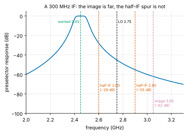
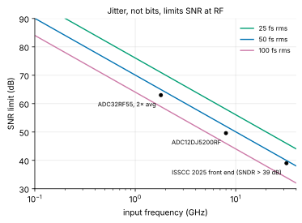

<!-- status: verified -->
# 21-08 · Transceiver Architectures

| | |
|---|---|
| **Course** | [21 · RF and Microwave Engineering](../README.md) |
| **University equivalent** | The transceiver-architecture chapter of a senior or first-year graduate RF IC course: superheterodyne frequency planning, image and spurious responses, direct-conversion (zero-IF) and low-IF receivers and their impairments, complex filtering, direct RF sampling and digital downconversion, transmitter architectures, software-defined radio (Razavi, *RF Microelectronics*, the transceiver-architecture chapter; Abidi's and Crols and Steyaert's architecture papers) |
| **Prerequisites** | [21-05](21-05-mixers.md) (mixers, image rejection), [21-03](21-03-noise-figure-and-linearity.md) (Friis, IIP2, IIP3), [21-06](21-06-oscillators-and-vcos.md) (LO phase noise, quadrature), [11-10](../../11-signals-and-systems/chapters/11-10-sampling-aliasing-reconstruction.md) (sampling and aliasing), [20-06](../../20-analog-and-mixed-signal-ic-design/chapters/20-06-data-converter-fundamentals.md) (ADC SNR, jitter), [16-09](../../16-digital-signal-processing/chapters/16-09-multirate-dsp.md) (decimation) |
| **Estimated study hours** | 7 |
| **Last verified** | 2026-11-24 |

**Learning objectives.** After this chapter you can:

1. Plan a superheterodyne receiver: choose an IF, size the preselector for image rejection, and locate the spurious responses, including the half-IF spur.
2. Explain the impairments of a zero-IF receiver (self-image from I/Q mismatch, DC offsets, flicker noise, second-order distortion) and set I/Q and IIP2 requirements from a modulation's EVM and an FDD transmitter's leakage.
3. Explain why low-IF receivers move the image to the adjacent channel, set their image-rejection requirement, and compute a complex filter's asymmetric response.
4. Size a direct RF-sampling receiver: Nyquist zone, jitter-limited SNR, the ADC's noise figure, the front-end gain that Friis requires, the blocker headroom it costs, and the processing gain of digital downconversion.
5. Budget a direct-conversion transmitter's sideband suppression, LO leakage and receive-band noise.
6. Match architectures to products (handsets, Bluetooth LE, Wi-Fi 7, base stations, SDR platforms) and evaluate architecture claims.

## 1. Big picture

Chapters 21-03 to 21-07 built the pieces of a radio: amplifiers, mixers, oscillators, power amplifiers. An **architecture** is the plan that connects them: how many frequency conversions, at which frequencies, with which filters, and where the signal becomes digital. Each choice moves a problem rather than removing it. A high intermediate frequency (IF) makes the image easy to filter but needs a high-Q channel filter; converting straight to zero frequency removes the image but invites DC offsets and second-order distortion; digitizing at RF removes the analog mixers but asks the ADC for jitter, noise and linearity that cost watts. The industry's answer has changed with integration and digital processing, and it differs by product: a 2026 smartphone receives its sub-6 GHz signals with dozens of zero-IF receivers on one die, its millimetre-wave signals through a superheterodyne, a Bluetooth earbud with a low-IF receiver, and a 5G base station increasingly with ADCs sampling at RF.

- **Every architecture is a filtering plan.** The question is where, and with what, the unwanted signals (image, blockers, harmonics) are removed.
- **Integration rewards architectures with no off-chip filters.** Zero-IF and low-IF won handsets because their filtering is on chip, at low frequency, and their imperfections can be calibrated digitally.
- **Data converters keep moving toward the antenna.** As ADCs and DACs reach gigasamples per second with low jitter, base stations and instruments digitize at RF and do the frequency translation in DSP.
- **Carrier aggregation multiplies everything.** A phone receiving five carriers on four antennas needs twenty receive chains and several independent LOs, so architecture is also a question of area and power per chain.

## 2. Intuition first

A receiver must pick one conversation out of a crowded room. The superheterodyne does it in two steps, like a sorting office that first moves every letter to a standard tray (the IF), where a single, carefully built, fixed sorting machine (the IF filter) can do the fine work. The price is that two different addresses map onto the same tray position (the wanted signal and its image), so a coarse pre-sort (the preselector) must catch the image before it gets there.

```text
 superheterodyne              zero-IF                         direct RF sampling
 RF -> filter -> mix -> IF    RF -> mix (I/Q) -> baseband     RF -> filter -> ADC (GS/s)
       (image)        filter        no image, but DC,               digital NCO + decimation
                      (fixed, high Q)  1/f, IIP2, I/Q mismatch      jitter, NF, power
```

Zero-IF moves every letter straight to its final pigeonhole, which removes the second tray and its image problem, but every smudge on the sorting machine (DC offsets, slow drifts) now lands right on top of the letters. Direct sampling photographs the whole room and sorts the picture in software: perfectly flexible, but the camera must be extraordinarily good, because everything in the room, wanted or not, is in the picture.

**Where the analogy breaks.** Letters do not interfere with each other, but radio signals do: a strong signal can desensitize the receiver even when it is perfectly filtered later (21-03), so the order in which gain and filtering happen matters as much as the filtering itself.

## 3. Theory

### 3.1 The superheterodyne and the image

A mixer converts both $f_{LO} + f_{IF}$ and $f_{LO} - f_{IF}$ to $f_{IF}$ (21-05). With a high-side LO the wanted signal is at $f_{RF} = f_{LO} - f_{IF}$ and its **image** at

$$
f_{im} = f_{LO} + f_{IF} = f_{RF} + 2f_{IF} ,
$$

$2f_{IF}$ away. The image must be attenuated before the mixer by a **preselector** filter, and the attenuation needed equals the image's worst-case excess over the wanted signal plus the SNR the demodulator needs.

**How sharp must the preselector be?** A band-pass filter of centre $f_0$ and bandwidth $B$ is a low-pass prototype under the frequency transformation

$$
x = \frac{f_0}{B}\left(\frac{f}{f_0} - \frac{f_0}{f}\right) ,
$$

which maps the pass band to $\lvert x\rvert \le 1$. An order-$n$ Butterworth prototype has $\lvert H\rvert^2 = 1/(1 + x^{2n})$, so its attenuation at the image is

$$
A(f_{im}) = 10\log_{10}\left(1 + x_{im}^{2n}\right) \approx 20n\log_{10}x_{im} \ \text{dB} .
$$

Each order buys $20\log_{10}x_{im}$ dB, so the image distance relative to the filter's bandwidth, not its absolute frequency, sets the difficulty. A high IF puts the image far away and needs few orders; a low IF puts it close and needs many (Example 21-08.1).

**The opposing pressure.** After the mixer, the IF filter must select one channel of width $B_{ch}$ at $f_{IF}$, so its quality factor is $Q_{IF} \approx f_{IF}/B_{ch}$. A 300 MHz IF and a 1 MHz channel need $Q$ = 300: a SAW or ceramic filter, off chip. Lowering the IF eases the channel filter but brings the image closer. **Dual conversion** resolves it: a high first IF for image rejection, then a low second IF for channel selection, at the cost of a second LO, a second mixer and a second set of spurs.

### 3.2 Spurious responses

Real mixers are not ideal multipliers. Harmonics of the LO (21-05) and nonlinearity of the RF path produce responses wherever

$$
\lvert m f_{LO} - n f_{RF}\rvert = f_{IF}
$$

for integers $m \ge 0$, $n \ge 1$. The wanted signal is $(m, n) = (1, 1)$; the image is its mirror. Every other solution is a **spurious response**: an input at that frequency reaches the IF. A frequency plan lists them all (a spur chart) and checks that each is attenuated by the preselector or weak enough at its order. The most notorious is the **half-IF spur**, $(m, n) = (2, 2)$:

$$
2f_{LO} - 2f_{RF} = \pm f_{IF} \;\Rightarrow\; f_{RF} = f_{LO} \mp \frac{f_{IF}}{2} ,
$$

which with a high-side LO sits halfway between the wanted signal and the LO, inside or close to the preselector's skirt. It is a second-order response in both the LO and the RF, so it is set by the mixer's even-order balance (its IIP2).



*Figure 1. The frequency plan of Examples 21-08.1 and 21-08.2: a 300 MHz IF puts the image 600 MHz away, where a third-order preselector gives 62 dB, but the half-IF spur at 2.60 GHz is only 150 MHz from the wanted signal and gets 28 dB.*

### 3.3 Zero-IF (direct conversion)

Set $f_{LO} = f_{RF}$ and convert with a quadrature mixer pair (21-05) straight to baseband. The image is the signal's own spectrum flipped about zero, so there is no external image to filter, and channel selection becomes on-chip low-pass filtering. Abidi's 1995 analysis set out both the appeal ("amplified and filtered at baseband rather than at some high intermediate frequency") and the condition: "Baseband digital signal processing must be coupled to the analog front-end to make direct-conversion transceivers a practical reality" [1]. The impairments are all near DC:

- **Self-image from I/Q mismatch.** Gain error ε and phase error θ between the I and Q paths leak each frequency $+f$ of the baseband signal onto $-f$ at a level $1/\text{IRR}$ (21-05). For OFDM, subcarrier $+k$ is corrupted by subcarrier $-k$; if they have equal power, the mismatch alone limits the SNR, and hence the EVM, to the IRR: $\text{EVM}_{IQ} = 10^{-\text{IRR}/20}$ (Example 21-08.3).
- **DC offsets** from LO leakage mixing with itself (21-05) and from device mismatch can exceed the wanted signal and saturate the baseband; they are removed by calibration and high-pass filtering, which notches the subcarriers near DC.
- **Flicker noise** of the mixer and baseband sits on top of the channel. It matters most for narrow channels: a 1 MHz channel next to a 100 kHz flicker corner loses noticeable sensitivity, a 100 MHz channel hardly any.
- **Second-order distortion.** An amplitude-modulated interferer $P$ produces, through second-order nonlinearity, a baseband product at $P_{IM2} = 2P - \text{IIP2}$ (input-referred, dBm), right on the channel. In an FDD phone the worst interferer is its own transmitter, leaking through the duplexer into the receiver; this sets the IIP2 requirement (Example 21-08.4).

### 3.4 Low-IF and complex filtering

A **low-IF** receiver converts to an IF of about one channel bandwidth, keeping the signal away from DC (and from offsets and much of the flicker noise) while staying low enough to filter on chip. Crols and Steyaert called it a topology "closely related to the zero-IF receiver" that "does not operate in the baseband, only near the baseband" [2]. The price is that the image is now the adjacent channel, $2f_{IF}$ away, which in many standards may be much stronger than the wanted signal. A quadrature downconverter suppresses it by its IRR, so

$$
\text{IRR}_{required} \ge \left(P_{adjacent} - P_{wanted}\right) + \text{SNR}_{required} .
$$

**Complex filters.** In I/Q form a signal can have different content at $+f$ and $-f$. A filter acting on the complex signal $y = y_I + jy_Q$ can therefore pass $+f_{IF}$ and reject $-f_{IF}$, which no real filter can do. Shift a low-pass prototype with pole $-\omega_p$ to $j\omega_{IF}$:

$$
\frac{dy}{dt} = -\omega_p\,(y - x) + j\omega_{IF}\,y \quad\Rightarrow\quad H(j\omega) = \frac{\omega_p}{\omega_p + j(\omega - \omega_{IF})} .
$$

In real terms, two RC sections (I and Q) cross-coupled by transconductances $\pm\omega_{IF}C$ (a **polyphase** or complex filter). The response is centred on $+\omega_{IF}$; at the image, $-\omega_{IF}$, its magnitude is $1/\sqrt{1 + (2\omega_{IF}/\omega_p)^2}$. An order-$n$ Butterworth version gives $10\log_{10}[1 + (2f_{IF}/f_p)^{2n}]$ of image selectivity. The filter's selectivity removes the image only to the extent that I and Q are balanced; any leakage that mismatch has already folded onto $+f_{IF}$ lands on the wanted signal and stays.

### 3.5 Direct RF sampling

Digitize the RF band directly with a gigasample ADC and do the frequency translation, channel filtering and decimation digitally. Five quantities decide whether it works.

**Nyquist zone.** A sampler at $f_s$ folds every input onto $[0, f_s/2]$ (11-10). An input in zone $k$ ($(k-1)f_s/2 \le f < kf_s/2$) appears at $f - \lfloor 2f/f_s\rfloor f_s/2$ in odd zones and mirrored in even zones. Everything in every zone that reaches the ADC lands somewhere in the first zone, so an RF band filter is still needed, now as an anti-alias filter.

**Jitter.** Sampling $A\sin\omega t$ a time $\delta t$ late produces an error $A\omega\cos(\omega t)\,\delta t$. With rms jitter $\sigma_t$ the error power is $(A\omega\sigma_t)^2/2$ against a signal power $A^2/2$, so

$$
\text{SNR}_{jitter} = -20\log_{10}(2\pi f_{in}\sigma_t) ,
$$

independent of the ADC's resolution, and falling 20 dB per decade of input frequency (20-06). This is why Walden's 1999 survey found resolution falling "by ~1 bit for every doubling of the sampling rate", attributing it to "uncertainty in the sampling instant due to aperture jitter" [3]; RF sampling became practical as jitter fell to tens of femtoseconds.



*Figure 2. The jitter limit $-20\log_{10}(2\pi f\sigma_t)$ for three jitter values, with published data points: TI's ADC32RF55 (63 dBFS at 1.8 GHz with 2× averaging) [7] and ADC12DJ5200RF (49.6 dBFS at 8.0 GHz) [R-333], and a 2025 sub-sampling front end with more than 39 dB SNDR up to 32 GHz [3]. Above a few gigahertz, jitter rather than resolution sets the SNR.*

**Noise figure of an ADC.** An ADC's data sheet gives its noise spectral density in dBFS/Hz. Adding the full-scale input power converts it to dBm/Hz, and comparing with $kT$ (−174 dBm/Hz) gives a noise figure:

$$
\text{NF}_{ADC} = \text{NSD}\ (\text{dBFS/Hz}) + P_{FS}\ (\text{dBm}) + 174 .
$$

Gigasample ADCs have noise figures around 20–30 dB, so a low-noise amplifier must precede them.

**Front-end gain and blocker headroom.** By Friis (21-03), an LNA of noise factor $F_1$ and gain $G$ ahead of the ADC gives $F = F_1 + (F_{ADC} - 1)/G$. Meeting a cascaded noise figure needs gain, but that gain also amplifies every blocker that passes the RF filter toward the ADC's full scale. Direct RF sampling therefore trades noise figure against blocker headroom through the front-end gain; filtering ahead of the LNA is what loosens the trade.

**Processing gain.** The ADC's noise spreads over $f_s/2$; after digital downconversion to a channel of bandwidth $B$, only the in-band part remains, an improvement of $10\log_{10}(f_s/2B)$ (16-09). A **digital downconverter** (DDC) multiplies by a numerically controlled oscillator (NCO) at the aliased centre frequency, low-pass filters and decimates.

### 3.6 Transmitter architectures

Transmitters mirror receivers.

- **Direct upconversion** (zero-IF transmit): I/Q baseband into a quadrature modulator at $f_{RF}$. Gain and phase mismatch create an unwanted sideband at $-f$ relative to the carrier, suppressed by the same IRR formula; baseband DC offsets create **LO leakage** (carrier feedthrough) at a level $20\log_{10}(V_{DC}/V_{signal})$. The PA's output at $f_{RF}$ can pull the VCO (21-06), which is why direct-conversion transmitters run the VCO at $2f$, $4f$ or an offset.
- **Two-step (IF) transmitters** filter at an IF before the final upconversion, at the cost of an extra LO and an image filter.
- **Polar and RF-DAC transmitters** (21-07) modulate phase on the LO and amplitude on the supply or a digital array; the RF-DAC of a direct-sampling base station synthesizes the carrier directly.

**Receive-band noise in FDD.** A frequency-division-duplex radio transmits and receives at the same time, separated by a duplexer of finite isolation. The transmitter's own noise at the receive frequency must be well below the receiver's noise floor after the duplexer's isolation: with $N_{TX}$ the transmit noise density in the receive band (dBm/Hz) and $L_{iso}$ the duplexer isolation (dB), $N_{TX} - L_{iso} \le -174 + \text{NF} - M$ for a margin $M$. Relative to the carrier this is often around −150 dBc/Hz, which sets the transmitter's noise floor, its DAC's, and the duplexer's isolation together (Example 21-08.7; 21-09 treats duplexers).

### 3.7 Software-defined radio

Mitola's software radio moves functions into software toward the antenna, partitioning the radio into "antenna, RF, IF, baseband, and bitstream segments" [4]. The ideal of digitizing at the antenna remains limited by the ADC's jitter, noise and power. Abidi's practical counterpoint for handsets: "it is enough to receive one channel with any bandwidth, situated in any band", so a wideband zero-IF front end followed by clock-programmable sampling and filtering gives software-defined behaviour at milliwatts [5]. Today's SDR platforms use both: low-cost boards built on a wideband zero-IF transceiver chip, and instrument-grade units that put a superheterodyne in front of RF-sampling converters (§9).

## 4. Worked examples

### Example 21-08.1 · IF choice and preselector order (tier A)

**Setup.** A receiver for a 2.45 GHz channel 1 MHz wide uses a high-side LO and a Butterworth preselector centred at 2.45 GHz with 100 MHz bandwidth. The image must be attenuated by at least 60 dB. With a 300 MHz IF, find (a) the LO, (b) the image, (c, d, e) the preselector's attenuation at the image for orders 1, 2 and 3, and (f) the order needed. (g) With a 40 MHz IF, where is the image, and (h) what order is needed? (i, j) What Q must each IF's channel filter have?

**Solution.**

- (a) $f_{LO} = f_{RF} + f_{IF}$ = **2.75** GHz; (b) $f_{im} = f_{RF} + 2f_{IF}$ = **3.05** GHz.
- With $x = (2.45/0.1)(3.05/2.45 - 2.45/3.05)$ = 10.82: (c) **20.72** dB, (d) **41.37** dB, (e) **62.05** dB; (f) order **3**.
- (g) **2.53** GHz, where $x$ = 1.575 and each order buys only 3.9 dB at large $n$: (h) order **16**, impractical.
- (i) $Q$ = 300/1 = **300**; (j) **40**.

**Units check.** $x$ is dimensionless; attenuation in dB.

**Sanity check.** The high IF needs a modest three-resonator preselector but a SAW-class IF filter; the low IF needs an easy IF filter but an impossible preselector. Dual conversion, or a quadrature (image-reject or zero-IF) architecture, breaks the deadlock.

### Example 21-08.2 · The spur chart (tier B)

**Setup.** For the plan of Example 21-08.1 (LO 2.75 GHz, IF 300 MHz), find (a, b) the two half-IF spur frequencies and (c, d) the third-order preselector's attenuation at each. (e) Which $(m, n) = (1, 2)$ responses lie between 1 and 2 GHz?

**Solution.**

- (a, b) $f_{RF} = f_{LO} \mp f_{IF}/2$ = **2.60** and **2.90** GHz.
- (c) At 2.60 GHz, $x$ = 2.913: **27.87** dB; (d) at 2.90 GHz: **55.15** dB.
- (e) $\lvert f_{LO} - 2f_{RF}\rvert = f_{IF}$ gives $f_{RF} = (f_{LO} \mp f_{IF})/2$ = **1.225** and **1.525** GHz.

**Units check.** Frequencies in GHz throughout.

**Sanity check.** The half-IF spur at 2.60 GHz is only 150 MHz from the wanted channel and gets just 28 dB from the preselector; the rest must come from the mixer's even-order balance. That is why frequency planners avoid IFs whose half-IF spur falls on a likely strong signal.

### Example 21-08.3 · I/Q mismatch in a zero-IF OFDM receiver (tier B)

**Setup.** A zero-IF receiver for 256-QAM must meet 3.5% EVM overall (17-06), and the designer allots I/Q mismatch an EVM of 1%. (a) What is 3.5% in dB, and (b) what IRR is required? (c, d) If gain and phase errors share the budget equally, how large may each be? (e) What IRR does Wi-Fi 7's −38 dB EVM need if mismatch is allotted −45 dB, and (f, g) what are the equal-share errors?

**Solution.**

- (a) $20\log_{10}0.035$ = **−29.12** dB.
- (b) EVM = $10^{-\text{IRR}/20}$, so IRR = **40** dB.
- (c, d) With $\varepsilon^2 = \theta^2$ and $4/(2\varepsilon^2) = 10^4$: ε = **1.41** % and θ = **0.81**°.
- (e) **45** dB; (f, g) ε = **0.80** % and θ = **0.46**°.

**Units check.** θ in radians inside the formula, converted to degrees.

**Sanity check.** Sub-degree, sub-percent matching is achievable on chip only with calibration, which is why every zero-IF Wi-Fi 7 and 5G transceiver calibrates its I/Q balance.

### Example 21-08.4 · IIP2 against transmitter leakage (tier B)

**Setup.** An FDD phone transmits 23 dBm; its duplexer isolates the receiver by 50 dB. The receiver has a 20 MHz channel and a 5 dB noise figure, and the second-order product of the leaked transmit signal must sit 10 dB below its noise floor. Find (a) the leakage at the receiver input, (b) the noise floor and (c) the required input-referred IIP2.

**Solution.**

- (a) 23 − 50 = **−27** dBm.
- (b) $-174 + 10\log_{10}(2 \times 10^7) + 5$ = **−95.99** dBm.
- (c) $P_{IM2} = 2P - \text{IIP2} \le -105.99$ dBm gives IIP2 ≥ 2(−27) + 105.99 = **51.99** dBm.

**Units check.** dBm throughout.

**Sanity check.** An IIP2 above +50 dBm is far beyond what an uncalibrated mixer achieves; zero-IF FDD receivers rely on balanced mixers, calibration and the duplexer together.

### Example 21-08.5 · A low-IF Bluetooth LE receiver (tier B)

**Setup.** A Bluetooth LE receiver uses a 1 MHz IF, so its image is the adjacent channel. Suppose the adjacent-channel interferer may be 15 dB stronger than the wanted signal and the demodulator needs 10 dB SNR. Find (a) the required IRR and (b, c) the equal-share gain and phase errors. A complex filter has a 1 MHz bandwidth ($f_p$ = 0.5 MHz) centred on +1 MHz: find its image selectivity for (d) a first-order and (e) a third-order Butterworth response.

**Solution.**

- (a) 15 + 10 = **25** dB.
- (b, c) $\varepsilon = \theta = \sqrt{2 \times 10^{-2.5}}$: ε = **7.95** %, θ = **4.56**°.
- With $2f_{IF}/f_p$ = 4: (d) $10\log_{10}(1 + 4^2)$ = **12.30** dB, (e) $10\log_{10}(1 + 4^6)$ = **36.12** dB.

**Units check.** Frequency ratios dimensionless.

**Sanity check.** A loose 25 dB image requirement is why low-IF suits Bluetooth: matching of a few per cent and degrees is easy, and the receiver avoids DC offsets and most flicker noise.

### Example 21-08.6 · Direct RF sampling of a 3.5 GHz band (tier C)

**Setup.** A base-station receiver samples a 3.5 GHz NR band with an ADC at 2949.12 MSPS. Find (a) the Nyquist zone and (b) the alias frequency; (c) the jitter-limited SNR for 50 fs; with a data-sheet NSD of −154.1 dBFS/Hz and a full scale of 2.6 dBm, (d) the noise floor and (e) the ADC's noise figure; (f) the LNA gain needed, with a 1.5 dB-NF LNA, for a 3 dB cascaded noise figure; (g) the level at the ADC of a −15 dBm out-of-band blocker that passes the filter; (h) the processing gain for a 100 MHz channel.

**Solution.**

- (a) $f_s/2$ = 1.4746 GHz; 3.5 GHz is in zone **3**. (b) $3.5 - 2.94912$ = **550.88** MHz (an odd zone, not mirrored).
- (c) $-20\log_{10}(2\pi \times 3.5\times10^9 \times 50\times10^{-15})$ = **59.18** dB.
- (d) −154.1 + 2.6 = **−151.5** dBm/Hz; (e) NF = **22.5** dB.
- (f) $G \ge (10^{2.25} - 1)/(10^{0.3} - 10^{0.15})$ = 303, **24.82** dB.
- (g) −15 + 24.82 = **+9.82** dBm, 7 dB above full scale.
- (h) $10\log_{10}(2949.12/200)$ = **11.69** dB.

**Units check.** NSD (dBFS/Hz) + full scale (dBm) = dBm/Hz.

**Sanity check.** The gain that buys the noise figure drives the blocker into clipping: the RF filter must remove 7 dB or more of it, or the LNA must give up gain and the system some sensitivity. This is direct RF sampling's central trade.

### Example 21-08.7 · A direct-conversion transmitter's budget (tier B)

**Setup.** A direct-conversion transmitter has (a) 1% gain and 1° phase error: what sideband suppression results? (b) A 0.5 mV residual DC offset rides on a 0.5 V baseband signal: what LO leakage? (c) For FDD with 50 dB duplexer isolation, a 5 dB receiver noise figure and a 10 dB margin, what transmit noise density is allowed in the receive band, and (d) how far below a 23 dBm carrier is that?

**Solution.**

- (a) The IRR formula of 21-05 gives **39.96** dB.
- (b) $20\log_{10}(0.5\text{ mV}/0.5\text{ V})$ = **−60** dBc.
- (c) $-174 + 5 - 10 + 50$ = **−129** dBm/Hz; (d) **−152** dBc/Hz.

**Units check.** dBm/Hz − dBm = dBc/Hz.

**Sanity check.** −152 dBc/Hz is close to the noise floors of good DACs and PAs, which is why FDD duplexers need 50 dB-class isolation and why the transmit chain's noise far from the carrier matters as much as its EVM.

### Example 21-08.8 · An EVM budget for a Wi-Fi 7 transceiver (tier C)

**Setup.** A Wi-Fi 7 synthesizer has 57.9 fs rms jitter at 7.115 GHz (a published value, §9). (a) What rms phase error and (b) what EVM does it alone cause? (c) Adding an I/Q image at −48 dB and PA distortion at −40 dB, what total EVM results, and (d) what margin remains against −38 dB?

**Solution.**

- (a) $\phi = 2\pi f\sigma_t$ = **2.588** mrad; (b) $20\log_{10}\phi$ = **−51.74** dB (21-06: EVM ≈ φ).
- (c) Independent errors add in power: $10\log_{10}(10^{-5.174} + 10^{-4.8} + 10^{-4.0})$ = **−39.12** dB.
- (d) **1.12** dB.

**Units check.** Radians to dB via $20\log_{10}$.

**Sanity check.** The synthesizer, at −52 dB, is not the problem; the PA is. Every contributor must be well below the target because they add.

### Answer key

<!-- answer-key -->
| ID | Quantity | Value | Unit |
|---|---|---|---|
| Ex 21-08.1a | LO frequency | 2.75 | GHz |
| Ex 21-08.1b | image | 3.05 | GHz |
| Ex 21-08.1c | attenuation, order 1 | 20.72 | dB |
| Ex 21-08.1d | attenuation, order 2 | 41.37 | dB |
| Ex 21-08.1e | attenuation, order 3 | 62.05 | dB |
| Ex 21-08.1f | order needed, 300 MHz IF | 3 | |
| Ex 21-08.1g | image with a 40 MHz IF | 2.53 | GHz |
| Ex 21-08.1h | order needed, 40 MHz IF | 16 | |
| Ex 21-08.1i | IF filter Q, 300 MHz | 300 | |
| Ex 21-08.1j | IF filter Q, 40 MHz | 40 | |
| Ex 21-08.2a | half-IF spur, lower | 2.60 | GHz |
| Ex 21-08.2b | half-IF spur, upper | 2.90 | GHz |
| Ex 21-08.2c | preselector at 2.60 GHz | 27.87 | dB |
| Ex 21-08.2d | preselector at 2.90 GHz | 55.15 | dB |
| Ex 21-08.2e | (1, 2) responses | 1.225 | GHz |
| Ex 21-08.2f | (1, 2) responses | 1.525 | GHz |
| Ex 21-08.3a | 3.5 % EVM | −29.12 | dB |
| Ex 21-08.3b | IRR for 1 % EVM | 40 | dB |
| Ex 21-08.3c | gain error | 1.41 | % |
| Ex 21-08.3d | phase error | 0.81 | deg |
| Ex 21-08.3e | IRR for −45 dB | 45 | dB |
| Ex 21-08.3f | gain error | 0.80 | % |
| Ex 21-08.3g | phase error | 0.46 | deg |
| Ex 21-08.4a | transmit leakage | −27 | dBm |
| Ex 21-08.4b | noise floor | −95.99 | dBm |
| Ex 21-08.4c | required IIP2 | 51.99 | dBm |
| Ex 21-08.5a | required IRR | 25 | dB |
| Ex 21-08.5b | gain error | 7.95 | % |
| Ex 21-08.5c | phase error | 4.56 | deg |
| Ex 21-08.5d | first-order complex filter | 12.30 | dB |
| Ex 21-08.5e | third-order complex filter | 36.12 | dB |
| Ex 21-08.6a | Nyquist zone | 3 | |
| Ex 21-08.6b | alias frequency | 550.88 | MHz |
| Ex 21-08.6c | jitter-limited SNR | 59.18 | dB |
| Ex 21-08.6d | noise floor | −151.5 | dBm/Hz |
| Ex 21-08.6e | ADC noise figure | 22.5 | dB |
| Ex 21-08.6f | LNA gain needed | 24.82 | dB |
| Ex 21-08.6g | blocker at the ADC | 9.82 | dBm |
| Ex 21-08.6h | processing gain | 11.69 | dB |
| Ex 21-08.7a | sideband suppression | 39.96 | dB |
| Ex 21-08.7b | LO leakage | −60 | dBc |
| Ex 21-08.7c | allowed TX noise | −129 | dBm/Hz |
| Ex 21-08.7d | allowed TX noise | −152 | dBc/Hz |
| Ex 21-08.8a | rms phase error | 2.588 | mrad |
| Ex 21-08.8b | EVM from jitter | −51.74 | dB |
| Ex 21-08.8c | total EVM | −39.12 | dB |
| Ex 21-08.8d | margin | 1.12 | dB |
| Txt 21-08.a | IRR for 0.3° phase error alone | 51.64 | dB |
| Txt 21-08.b | AFE7950 power per active chain (4T4R2F) | 1.05 | W |
| Txt 21-08.c | ADC32RF55 NSD gain from 2× averaging | 2.5 | dB |
| Txt 21-08.d | ideal gain from 2× averaging | 3.01 | dB |
| Txt 21-08.e | jitter-limited SNR at 6 GHz, 50 fs | 54.49 | dB |
| Txt 21-08.f | share of a BLE receiver's power in LO generation | 72 | % |
| Txt 21-08.g | receive chains for 5 carriers × 4 antennas | 20 | |
| Txt 21-08.h | ENOB of 39 dB SNDR | 6.19 | bits |
| Txt 21-08.i | jitter-limited SNR at 2.4 GHz, 50 fs | 62.5 | dB |

## 5. Simulate it

The lab ([labs/21-08-lab](../labs/21-08-lab/README.md)) collects the planning formulas in `trx.py`, simulates the impairments of each architecture, and confirms a preselector and a complex filter in ngspice (`preselect.cir`, `complexfilter.cir`).

**Predict, then run.**

1. Predict the preselector order needed to reject the image of a 2.45 GHz receiver with a 300 MHz and with a 40 MHz IF, then run `ngspice -b preselect.cir` and the spur search (Part 1).
2. Predict the EVM an OFDM signal suffers from 1% and 1° of I/Q mismatch in a zero-IF receiver, then simulate it (Part 2).
3. Predict a first-order complex filter's response at +1 MHz and −1 MHz, then run `ngspice -b complexfilter.cir` (Part 3).
4. Predict where a 3.5 GHz tone lands when sampled at 2949.12 MSPS and the SNR that 50 fs of jitter allows, then sample a jittered tone (Part 4).
5. Predict the SNR gain of downconverting and decimating a 20 MHz channel from a 3 GS/s stream, then run the digital downconverter (Part 5).

## 6. Engineering tradeoffs

| Knob | Improves | Costs | Typical decision owner |
|---|---|---|---|
| High IF (superheterodyne) | Image rejection with a simple preselector | High-Q (off-chip) IF filter, a second conversion, spurs | Radio architect |
| Zero-IF | No image filter, on-chip channel filtering, area per chain | DC offset, flicker noise, I/Q and IIP2 calibration, LO leakage | RFIC architect |
| Low-IF | Avoids DC and most flicker noise | Image is the adjacent channel; complex filtering; I/Q matching | RFIC architect |
| Direct RF sampling | Flexibility, fewer analog blocks, digital channelization | ADC power, jitter, NF; blocker headroom; anti-alias filtering | Base-station and instrument architect |
| Front-end gain before an ADC | Cascaded noise figure | Blocker headroom, linearity | RF system engineer |
| Calibration (I/Q, DC, IIP2, DPD) | Lets cheap analog meet tight specs | Calibration time, DSP power, test cost | RFIC and firmware teams |
| Number of chains and LOs (CA, MIMO) | Throughput | Area, power, LO coupling and spurs | Modem and RFIC architects |

## 7. Numbers to know

| Quantity | Value | Note |
|---|---|---|
| Image distance | $2f_{IF}$ from the wanted signal | §3.1 |
| Preselector selectivity per order | $20\log_{10}x_{im}$ dB | Butterworth, §3.1 |
| Half-IF spur | $f_{LO} \mp f_{IF}/2$ | §3.2 |
| I/Q-mismatch EVM floor | $10^{-\text{IRR}/20}$; 40 dB IRR → 1% | §3.3 |
| Jitter-limited SNR | $-20\log_{10}(2\pi f\sigma_t)$: 62.5 dB at 2.4 GHz, 54.5 dB at 6 GHz for 50 fs | §3.5 |
| RF-sampling ADC | NSD about −150 to −155 dBFS/Hz, NF about 19–30 dB | TI AFE7950 [7] (as of Nov 2026) |
| RF-sampling transceiver power | about 1 W per active chain | AFE7950, 4T4R2F [7] |
| Low-IF BLE receiver | 266 µW, 72% of it in LO generation | [10] (2022) |
| Wi-Fi 7 transceiver EVM floor | −42.6 to −46.1 dB | [9] (2023–2024) |

## 8. Common mistakes

- **Forgetting the image of the image.** Every conversion stage has its own image; a dual-conversion plan must check both.
- **Checking only the wanted path.** Spurious responses at $\lvert mf_{LO} - nf_{RF}\rvert = f_{IF}$ can be stronger than the image; draw the spur chart.
- **Treating zero-IF as image-free.** Its image is the signal's own mirror; I/Q mismatch sets an EVM floor.
- **Expecting a complex filter to fix I/Q mismatch.** Leakage already folded onto the wanted frequency cannot be filtered out.
- **Ignoring the ADC's noise figure.** An RF-sampling ADC needs 20–30 dB of low-noise gain in front, which then costs blocker headroom.
- **Quoting an ADC's SNR at low frequency.** At RF, jitter limits SNR; read the data sheet at your input frequency.
- **Forgetting transmit noise in the receive band.** In FDD the transmitter's far-out noise must clear the duplexer and the receiver's noise floor.

## 9. Practitioner lens

### State of the art (as of Nov 2026)

- **The architectures are a century old [Established].** Armstrong's 1921 superheterodyne paper described "Heterodyning, with the production of a beat frequency which is itself a radio frequency", followed by "Amplification at the beat radio frequency, preferably by a tuned amplifier" [6]; his 1924 paper credited its commercial success to "the reduction in the number of tubes required" [6]. Abidi's 1995 analysis of direct conversion [1], Crols and Steyaert's low-IF receiver [2] (whose quadrature downconverter achieved "a phase accuracy of less than 0.3°", worth **51.64** dB of image rejection by itself), and Mitola's 1995 software radio [4] set the modern options.
- **Handsets: zero-IF below 6 GHz, IF at millimetre waves [Established per paper].** Intel's 2019 5G transceiver was titled "Zero-IF" for sub-6 GHz and "IF" for millimetre waves [8]. Samsung's 2022 FR2 radio is a phased-array beamformer IC at RF plus a separate "quad-stream intermediate-frequency IC" [8]. Samsung's 2024 cellular transceiver integrates "24 receivers (RXs) and 7 RX local oscillators" covering 450 MHz to 7125 MHz on 43 mm² [8]: five carriers on four antennas alone need **20** receive chains.
- **Wi-Fi 7 transceivers [Established per paper].** MediaTek's 55 nm tri-band transceiver reaches a −42.6 dB transmit EVM floor with 4096-QAM using a 57.9 fs synthesizer [9]; Samsung's 14 nm FinFET design reaches −46.1 dB [9]. RF transceivers do not need leading-edge logic nodes.
- **Bluetooth LE: low-IF and ultra-low power [Established per paper].** A 28 nm BLE receiver consumes 266 µW, "191 µW in the LO divider + buffer" (**72** % of the total), using a complex baseband filter [10]: in such radios, generating the LO costs more than amplifying the signal.
- **Base stations: RF sampling against zero-IF [Established per data sheet and paper].** TI's AFE7950 samples up to 12 GHz with 3 GSPS ADCs and 12 GSPS DACs; its receive noise figure is 19–30 dB depending on frequency, and a 4-transmit, 4-receive, 2-feedback mode dissipates 10.5 W, **1.05** W per active chain by our arithmetic [7]. Its 8-channel sibling AFE8092 targets "Macro remote radio unit (RRU)" and massive-MIMO radios below 6 GHz [7]. Averaging two ADC cores in the ADC32RF55 improves noise density by **2.5** dB (against an ideal **3.01** dB) at 2.6 W per channel instead of 2.1 W [7]. Meanwhile Ericsson describes a "non-frequency-translating" 22 nm FD-SOI front end with 1.3–2 dB noise figure and 38.1 dBm saturated transmit power for such converters [8], and Analog Devices' 2026 O-RAN radio-unit SoC uses LOs from 400 MHz to 7.1 GHz, 24.1 W for four transmit and four receive chains [8].
- **The jitter wall [Established].** Walden's 1999 survey: resolution "falls off by ~1 bit for every doubling of the sampling rate", attributed to "uncertainty in the sampling instant due to aperture jitter" [3]. With 50 fs, the limit is **54.49** dB at 6 GHz; a 2025 sub-sampling front end with 38 GHz input bandwidth reports more than 39 dB SNDR, about **6.19** effective bits, from 1 to 32 GHz [3].
- **SDR platforms [Established].** Ettus' B210 covers 70 MHz–6 GHz with a zero-IF transceiver chip and specifies "SSB/LO Suppression -35/50 dBc" [11]; the instrument-grade X410 "features a two-stage superheterodyne architecture" in front of an RF-sampling RFSoC, at $33,020 [11].

### Why it matters commercially

- **Architecture sets cost and area per chain.** Carrier aggregation and MIMO multiply chains; zero-IF's compact, filter-free chain is what makes 24 receivers on one die possible.
- **Base-station radio units are being redesigned around RF sampling.** It removes mixers and IF filters and lets one radio cover several bands, at the price of watts in the converters; whether it wins depends on converter power per chain.
- **Calibration is product differentiation.** The analog front end's flaws (I/Q mismatch, DC offset, IIP2, PA nonlinearity) are corrected digitally; the quality of that firmware is invisible on a block diagram but decisive in the field.
- **Low-power IoT radios are LO-limited.** At sub-milliwatt budgets, the synthesizer and LO distribution dominate, so architecture choices that relax the LO (low-IF, passive I/Q generation) matter most.

### Marketing vs Reality

- **"Direct RF sampling: no analog front end."** The ADC's noise figure is 19–30 dB [7]; a low-noise amplifier with 20–30 dB of gain and an anti-alias filter are still required, and their gain eats blocker headroom (Example 21-08.6).
- **"Software-defined, 70 MHz to 6 GHz."** Flexibility in tuning is not performance: the B210's zero-IF chain specifies only 35 dBc sideband suppression [11], and the higher-grade X410 is a superheterodyne in front of its converters [11].
- **"2× averaging doubles the SNR."** Ideally +3.01 dB; measured +2.5 dB at 0.5 W more per channel [7]. Correlated noise (clock jitter, shared input) does not average away.
- **"4096-QAM-ready transceiver."** A −42.6 dB EVM floor leaves 4.6 dB against the −38 dB requirement before the PA and the channel add their share [9]. Ask for EVM at full output power through the whole chain.
- **"The first single-chip O-RAN radio unit."** The authors' claim [8]; such "firsts" are rarely checkable and usually conditioned on a definition.

### Questions for engineering leaders

1. **"Which architecture for which band, and why?"** *Strong:* zero-IF, low-IF, superheterodyne or RF sampling per band, with the impairment each brings and how it is calibrated. *Evasive:* "We use the latest architecture."
2. **"What are your I/Q image rejection, DC offset and IIP2 before and after calibration, and over temperature?"** *Strong:* numbers both ways, drift and recalibration policy, and the EVM and sensitivity impact. *Evasive:* only post-calibration values at room temperature.
3. **"For your RF-sampling receiver: cascaded noise figure, blocker headroom and converter power per chain?"** *Strong:* front-end gain, NF, the largest blocker at the ADC relative to full scale, and watts per chain against the zero-IF alternative. *Evasive:* the ADC's SNR at 100 MHz.
4. **"Show me your spur plan."** *Strong:* a spur chart including LO harmonics, clock spurs and coupling between LOs in carrier aggregation, verified in measurement. *Evasive:* "No spurs in band."
5. **"Where does the power go in your lowest-power mode?"** *Strong:* a breakdown between LO generation, LNA and baseband (in BLE-class radios the LO dominates [10]). *Evasive:* a single total.

## 10. Concept check

**Q1.** Why does a higher IF make the preselector easier but the IF filter harder?

<details><summary>Answer</summary>

The image sits $2f_{IF}$ from the wanted signal, so a higher IF moves it further out on the preselector's skirt, where each filter order buys more attenuation. But the channel filter at the IF needs $Q \approx f_{IF}/B_{ch}$, which grows with the IF.

</details>

**Q2.** What is the half-IF spur and why is it hard to filter?

<details><summary>Answer</summary>

The response at $f_{RF} = f_{LO} \mp f_{IF}/2$, where the second harmonics of the RF and LO mix to the IF. With a high-side LO it lies halfway between the wanted signal and the LO, only $f_{IF}/2$ away, so the preselector gives it little attenuation; the mixer's even-order balance must suppress it.

</details>

**Q3.** A zero-IF receiver has no external image. Why does I/Q mismatch still limit its EVM?

<details><summary>Answer</summary>

Its "image" is the signal's own mirror about DC: mismatch leaks content at $-f$ onto $+f$ at a level $1/\text{IRR}$. For OFDM each subcarrier receives its mirror subcarrier's leakage, an EVM floor of $10^{-\text{IRR}/20}$.

</details>

**Q4.** Why does a low-IF receiver need image rejection when zero-IF did not need an image filter?

<details><summary>Answer</summary>

At low IF the image is the adjacent channel, a different and possibly much stronger signal, $2f_{IF}$ away. The quadrature downconversion must suppress it by its excess over the wanted signal plus the needed SNR.

</details>

**Q5.** How can a filter pass +1 MHz but reject −1 MHz?

<details><summary>Answer</summary>

By acting on the complex signal $y_I + jy_Q$: cross-coupling the I and Q sections shifts a low-pass response to $+f_{IF}$, a response no real filter can have. It works only as well as I and Q are balanced.

</details>

**Q6.** Why does direct RF sampling still need an RF filter and a low-noise amplifier?

<details><summary>Answer</summary>

Every Nyquist zone folds onto the first, so out-of-band signals must be filtered before sampling; and the ADC's noise figure of 20–30 dB needs low-noise gain ahead of it for a usable cascaded noise figure.

</details>

**Q7.** Why does jitter matter more at higher input frequency?

<details><summary>Answer</summary>

A timing error $\delta t$ becomes a voltage error proportional to the signal's slope, $A\omega$; the jitter-limited SNR, $-20\log_{10}(2\pi f\sigma_t)$, falls 20 dB per decade of input frequency regardless of the ADC's resolution.

</details>

**Q8.** Why must an FDD transmitter care about its noise far from the carrier?

<details><summary>Answer</summary>

At the receive frequency, typically tens of MHz away, the transmitter's noise leaks through the duplexer into the receiver at the same time as reception. It must be below the receiver's noise floor after the duplexer's isolation, often around −150 dBc/Hz.

</details>

Problems: [21-08 problem set](../problems/21-08-problems.md) · Worked solutions: [21-08 solutions](../solutions/21-08-solutions.md)

## 11. Key terms

[Superheterodyne receiver](../../../reference/glossary.md#superheterodyne-receiver) · [Intermediate frequency (IF)](../../../reference/glossary.md#intermediate-frequency-if) · [Image frequency](../../../reference/glossary.md#image-frequency) · [Preselector](../../../reference/glossary.md#preselector) · [Spurious response](../../../reference/glossary.md#spurious-response) · [Half-IF spur](../../../reference/glossary.md#half-if-spur) · [Direct-conversion (zero-IF) receiver](../../../reference/glossary.md#direct-conversion-zero-if-receiver) · [Low-IF receiver](../../../reference/glossary.md#low-if-receiver) · [Complex filter](../../../reference/glossary.md#complex-filter) · [Direct RF sampling](../../../reference/glossary.md#direct-rf-sampling) · [Nyquist zone](../../../reference/glossary.md#nyquist-zone) · [Aperture jitter](../../../reference/glossary.md#aperture-jitter) · [Digital downconverter (DDC)](../../../reference/glossary.md#digital-downconverter-ddc) · [Processing gain](../../../reference/glossary.md#processing-gain) · [Software-defined radio (SDR)](../../../reference/glossary.md#software-defined-radio-sdr) · [LO leakage](../../../reference/glossary.md#lo-leakage)

## 12. Connections

- **Builds on:** [21-03](21-03-noise-figure-and-linearity.md) (Friis, IIP2), [21-05](21-05-mixers.md) (mixers, image rejection), [21-06](21-06-oscillators-and-vcos.md) (LOs, quadrature, pulling), [21-07](21-07-power-amplifiers.md) (transmitters), [11-10](../../11-signals-and-systems/chapters/11-10-sampling-aliasing-reconstruction.md) (aliasing), [20-06](../../20-analog-and-mixed-signal-ic-design/chapters/20-06-data-converter-fundamentals.md) (ADC SNR and jitter), [16-09](../../16-digital-signal-processing/chapters/16-09-multirate-dsp.md) (decimation).
- **Next:** [21-09](21-09-rf-front-end.md) builds the filters, duplexers and switches that every architecture still needs at the antenna.
- **Used later:** link budgets in [21-11](21-11-link-budgets.md), modem baseband in [21-12](21-12-modem-baseband-and-standards.md).

## 13. Further study

- B. Razavi, *RF Microelectronics*, 2nd ed., Prentice Hall, 2012 [12]: the transceiver-architecture chapter.
- S. Mirabbasi and K. Martin, "Classical and modern receiver architectures" [12], a compact survey; A. A. Abidi, "The path to the software-defined radio receiver" [5].
- V. Bhagavatula, "Exploring multimode cellular transceiver design: A short tutorial" [12], for how a modern cellular transceiver is organized.

## 14. Sources

1. A. A. Abidi, "Direct-conversion radio transceivers for digital communications," *IEEE J. Solid-State Circuits*, vol. 30, no. 12, pp. 1399–1410, Dec. 1995, DOI 10.1109/4.482187 [R-389].
2. J. Crols and M. S. J. Steyaert, "A single-chip 900 MHz CMOS receiver front-end with a high performance low-IF topology," *IEEE J. Solid-State Circuits*, vol. 30, no. 12, pp. 1483–1492, Dec. 1995, DOI 10.1109/4.482196; "Low-IF topologies for high-performance analog front ends of fully integrated receivers," *IEEE Trans. Circuits Syst. II*, vol. 45, no. 3, pp. 269–282, Mar. 1998, DOI 10.1109/82.664233 [R-389].
3. R. H. Walden, "Analog-to-digital converter survey and analysis," *IEEE J. Sel. Areas Commun.*, vol. 17, no. 4, pp. 539–550, Apr. 1999, DOI 10.1109/49.761034; J. Heel, H. S. Bindra, S. Louwsma, A. Dezzani and B. Nauta, ISSCC 2025, pp. 76–78, DOI 10.1109/ISSCC49661.2025.10904786 [R-389, R-391].
4. J. Mitola, "The software radio architecture," *IEEE Commun. Mag.*, vol. 33, no. 5, pp. 26–38, May 1995, DOI 10.1109/35.393001 [R-389].
5. A. A. Abidi, "The path to the software-defined radio receiver," *IEEE J. Solid-State Circuits*, vol. 42, no. 5, pp. 954–966, May 2007, DOI 10.1109/JSSC.2007.894307 [R-389].
6. E. H. Armstrong, "A new system of short wave amplification," *Proc. IRE*, vol. 9, no. 1, pp. 3–11, Feb. 1921, DOI 10.1109/JRPROC.1921.220092; "The super-heterodyne—its origin, development, and some recent improvements," *Proc. IRE*, vol. 12, no. 5, pp. 539–552, Oct. 1924, DOI 10.1109/JRPROC.1924.219990 [R-389].
7. Texas Instruments data sheets: AFE7950, SBASA41E (rev. May 2025); AFE8092, SBASA16B (rev. Nov. 2024); ADC32RF5x, SBAS500B (rev. Aug. 2023) [R-390].
8. B. Jann et al., ISSCC 2019, pp. 352–354, DOI 10.1109/ISSCC.2019.8662417; A. Verma et al., ISSCC 2022, DOI 10.1109/ISSCC42614.2022.9731664; J. Bae et al., ISSCC 2024, pp. 80–82, DOI 10.1109/ISSCC49657.2024.10454281; C. Elgaard et al., *IEEE J. Solid-State Circuits*, vol. 60, no. 7, pp. 2367–2383, Jul. 2025, DOI 10.1109/JSSC.2025.3552278; K. Gard et al., RFIC 2026, pp. 3–6, DOI 10.1109/RFIC70222.2026.11602200 [R-391].
9. T.-M. Chen et al., RFIC 2023, pp. 181–184, DOI 10.1109/RFIC54547.2023.10186200; J. Lee et al., *IEEE J. Solid-State Circuits*, vol. 59, no. 12, pp. 3966–3979, Dec. 2024, DOI 10.1109/JSSC.2024.3441858 [R-391].
10. H. Shao, P.-I. Mak, G. Qi and R. P. Martins, "A 266-μW Bluetooth Low-Energy (BLE) receiver featuring an N-path passive balun-LNA and a pipeline down-mixing BB-extraction scheme," *IEEE J. Solid-State Circuits*, vol. 57, no. 12, pp. 3669–3680, Dec. 2022, DOI 10.1109/JSSC.2022.3200932 [R-391].
11. Ettus Research (NI), *USRP B200/B210* spec sheet; *USRP X410* product page, read 24 Nov 2026 [R-392].
12. B. Razavi, *RF Microelectronics*, 2nd ed., Prentice Hall, 2012; S. Mirabbasi and K. Martin, "Classical and modern receiver architectures," *IEEE Commun. Mag.*, vol. 38, no. 11, pp. 132–139, Nov. 2000, DOI 10.1109/35.883502; V. Bhagavatula, "Exploring multimode cellular transceiver design: A short tutorial," *IEEE Solid-State Circuits Mag.*, vol. 13, no. 1, pp. 35–47, 2021, DOI 10.1109/MSSC.2020.3036144 [R-389].
