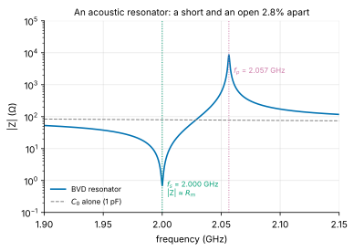

<!-- status: reviewed -->
# 21-09 · The RF Front End: Filters, Switches and Modules

| | |
|---|---|
| **Course** | [21 · RF and Microwave Engineering](../README.md) |
| **University equivalent** | The front-end and filter material of a senior RF course or a graduate microwave-acoustics elective: acoustic resonators and the Butterworth-Van Dyke model, ladder filters, temperature drift, duplexers and multiplexers, RF switches and their figure of merit, antenna tuning, front-end modules and carrier-aggregation coexistence (Ruppel's and Aigner's reviews; Pozar, *Microwave Engineering*, the filter chapter) |
| **Prerequisites** | [12-09](../../12-electronics-2/chapters/12-09-oscillators.md) (the quartz crystal's series and parallel resonance), [07-08](../../07-circuit-analysis-2-transient-and-ac/chapters/07-08-filters-and-resonance.md) (resonance and Q), [21-02](21-02-impedance-matching-networks.md) (mismatch, Bode–Fano), [21-07](21-07-power-amplifiers.md) (PA power and harmonics), [21-08](21-08-transceiver-architectures.md) (FDD, transmit leakage) |
| **Estimated study hours** | 6 |
| **Last verified** | 2026-11-24 |

**Learning objectives.** After this chapter you can:

1. Model an acoustic resonator with the Butterworth-Van Dyke circuit, relate its resonance spacing to the coupling coefficient k², and explain why acoustic waves make gigahertz filters small.
2. Explain how a ladder of resonators forms a band-pass filter, and estimate its bandwidth from k² and its loss from Q.
3. Compute temperature drift against a duplex gap and explain the roles of SAW, TC-SAW, BAW and XBAR technologies.
4. Budget a duplexer's isolation and insertion loss against a transmitter's power and a receiver's noise floor.
5. Evaluate an RF switch through its R_on·C_off figure of merit, its insertion loss and isolation, and the stacking its power handling requires; quantify antenna mismatch and what a tuner recovers.
6. Explain front-end modules and carrier-aggregation coexistence (harmonics landing in other bands), and read the industry's structure from its filings.

## 1. Big picture

Between the antenna and the transceiver of 21-08 sits the **RF front end**: power amplifiers, low-noise amplifiers, switches that route signals between dozens of paths, antenna tuners, and above all filters. A flagship phone in 2026 lists 29 NR and 31 LTE bands [8]; every band needs filtering, every frequency-division band needs a duplexer, and every carrier-aggregation combination needs those filters to work at the same time without loading each other. The filters cannot be ordinary LC circuits: on-chip inductors have Q of 10–20 and a duplexer must separate transmit and receive frequencies 1% apart while isolating them by 50 dB or more. The industry's answer is **acoustic** filters, in which the signal travels as a sound wave in a piezoelectric crystal, tens of thousands of times slower than light, so that resonators a few micrometres across resonate at gigahertz with Q in the thousands. Front-end modules package PAs, LNAs, switches and acoustic filters together; their design, and the filters' fabrication, is a multi-billion-dollar market concentrated in a handful of companies.

- **Acoustic filters exist because LC filters are too lossy and too large** for the selectivity cellular duplexing demands.
- **Temperature is the enemy of narrow duplex gaps:** a filter that drifts tens of ppm per degree eats a large share of a 1% gap over a phone's temperature range.
- **Switches and tuners are silicon-on-insulator CMOS,** judged by one figure of merit, R_on·C_off, and by how many transistors they must stack to survive the PA's voltage.
- **Carrier aggregation multiplies coexistence problems:** harmonics and intermodulation of one band land in another, and filters for several bands must share one antenna.

## 2. Intuition first

A guitar string resonates at a frequency set by its length and the speed of waves on it. An electrical resonator works the same way, with electromagnetic waves at the speed of light: a resonant line at 2 GHz is several centimetres long. A piezoelectric crystal converts an electrical signal into a mechanical vibration and back. Its sound waves travel at about 4 km/s (surface waves on lithium tantalate) to 11 km/s (bulk waves in aluminium nitride), tens of thousands of times slower than light, so the acoustic wavelength at 2 GHz is only **2.0** to **5.5** µm, against **15** cm for the electromagnetic wave. A resonator made from a thin film or a comb of electrodes on a crystal is therefore microscopic, and because crystals lose little mechanical energy per cycle, its Q is in the thousands.

```text
   SAW: comb electrodes (IDT) on a crystal surface       BAW/FBAR: a thin piezo film between two electrodes
   ||| ||| ||| |||   surface wave travels along             ====  top electrode
   ---------------   pitch ~ half a wavelength              ////  AlN film ~ half a wavelength thick
   crystal (LiTaO3, LiNbO3)                                 ====  bottom electrode, over an air gap or Bragg mirror
```

**The analogy and its limits.** A guitar string has one fundamental and its harmonics; an acoustic resonator also has a second, electrical resonance, because the electrodes form a capacitor in parallel with the mechanical motion. That pair of close resonances, one where the impedance is nearly zero and one where it is nearly infinite, is what makes a resonator a filter element, and it has no counterpart on a guitar.

## 3. Theory

### 3.1 The Butterworth-Van Dyke model

Near its resonance, any acoustic resonator, SAW or BAW, behaves like the circuit already met for the quartz crystal in 12-09: a **motional** branch $R_m$, $L_m$, $C_m$ (the mechanical mass, stiffness and loss seen through the piezoelectric coupling) in parallel with the **static** capacitance $C_0$ of the electrodes. Its impedance is

$$
Z(s) = \frac{1}{sC_0 + \dfrac{1}{R_m + sL_m + 1/(sC_m)}} .
$$

Ignoring $R_m$, the motional branch is a short circuit at the **series resonance** $f_s = 1/(2\pi\sqrt{L_mC_m})$, and the whole resonator is an open circuit where the motional branch, now inductive, resonates with $C_0$. That **parallel (anti-) resonance** satisfies $\omega L_m - 1/(\omega C_m) = 1/(\omega C_0)$, so $\omega^2L_m = 1/C_m + 1/C_0$ and

$$
f_p = f_s\sqrt{1 + \frac{C_m}{C_0}} \approx f_s\left(1 + \frac{C_m}{2C_0}\right) .
$$

The spacing $(f_p - f_s)/f_s \approx C_m/(2C_0)$ is set by the ratio $r = C_0/C_m$, which is set by how strongly the material converts electrical to mechanical energy: the **electromechanical coupling**. For thickness-mode resonators the conventional effective coupling is

$$
k^2_{eff} = \frac{\pi}{2}\,\frac{f_s}{f_p}\cot\left(\frac{\pi}{2}\,\frac{f_s}{f_p}\right) \approx \frac{\pi^2}{4}\,\frac{f_p - f_s}{f_p} .
$$



**Q** is set by the motional loss, $Q = 2\pi f_sL_m/R_m$. Two numbers therefore characterize a resonator technology: k² (how far apart $f_s$ and $f_p$ are, which bounds the filter's bandwidth) and Q (how lossy, which sets insertion loss and skirt steepness).

### 3.2 Ladder filters

A **ladder filter** alternates resonators in series and in shunt. Choose the series resonators' $f_s$ at the band centre and detune the shunt resonators down so that their $f_p$ falls on the same frequency. At the centre, the series resonators are nearly short circuits and the shunt resonators nearly open: the signal passes. Below the band, the shunt resonators reach their own series resonance and short the signal to ground; above it, the series resonators reach their anti-resonance and block it. These two notches form the steep skirts. The pass band spans roughly from the shunt $f_s$ to the series $f_p$, so its width is of the order of the resonance spacing, and therefore of k²: the two notches sit about one spacing below and one above the centre, so a plain ladder's pass band cannot be wider than about twice the spacing, which is why wide 5G bands need high-coupling materials. In Example 21-09.2 the notches sit 2.75% below and 2.83% above the centre, and the 3 dB bandwidth is 1.3 times the spacing.

Loss in the pass band comes from the resonators' $R_m$: at the centre each series resonator presents roughly $R_m$ in the signal path and each shunt resonator a large but finite impedance, so the insertion loss scales as $1/Q$ (Example 21-09.2: a fourfold drop in Q quadruples the loss). Filter designers also trade the number of sections (more rejection, more loss) and the area ratio of shunt to series resonators.


### 3.3 Temperature drift and the duplex gap

Acoustic velocities and dimensions change with temperature, so the resonances move: the **temperature coefficient of frequency** (TCF), in ppm/°C. A filter edge at $f$ drifts by $f \cdot \text{TCF} \cdot \Delta T$. In an FDD band the transmit and receive bands are separated by a **duplex gap**, sometimes under 1% of the carrier; the duplexer's skirt must fall from pass to 50 dB of rejection across that gap at every temperature. A drift comparable to the gap makes the duplexer impossible.

The technologies differ mainly here. Plain SAW on lithium tantalate drifts about −40 ppm/°C (implied by [5]); **TC-SAW** adds a silicon-dioxide overlay whose positive TCF partly cancels the crystal's negative one [5]; Murata's **IHP-SAW** multilayer substrate reached a Bode-Q over 4000 and −8 ppm/°C [5]; FBARs measured about 27 ppm/°C in magnitude [4]. Example 21-09.3 puts these against a 15 MHz gap.

**Which technology where.** "In the frequency range up to 1 GHz, surface acoustic wave (SAW) filters are almost exclusively employed, while in the higher frequency range, bulk acoustic wave (BAW) and SAW filters are competing" [1]. SAW electrodes must be patterned at a quarter wavelength, which becomes impractically fine and lossy at high frequency; BAW resonance is set by a film thickness, which scales easily to 6 GHz and beyond. The newest high-coupling technologies, scandium-doped AlN BAW and lithium-niobate **XBARs**, target the wide 5G bands at 3–6 GHz (§9).

### 3.4 Duplexers and multiplexers

A **duplexer** is two filters, transmit and receive, joined at the antenna port with matching so that each band sees the other filter as an open circuit. Its key specifications follow from 21-08:

- **Transmit-to-receive isolation in the transmit band.** The PA's carrier leaks into the receiver; with 25 dBm at the duplexer and 55 dB isolation, −30 dBm reaches the LNA. That sets the LNA's compression and the receiver's IIP2 and IIP3 requirements (21-08, Example 21-08.4).
- **Isolation in the receive band.** The PA's noise at the receive frequency must fall below the receiver's noise floor after isolation (21-08 §3.6).
- **Insertion loss** on both paths: transmit loss raises the PA's required output, and therefore its DC power; receive loss adds directly to the noise figure.

A **multiplexer** (quadplexer, hexaplexer) extends this to several bands sharing one antenna port, which carrier aggregation requires: each filter must present a high impedance in the other bands' pass bands, so filters are designed together and the module, not the filter, is the product.

### 3.5 RF switches and stacking

An RF switch is a field-effect transistor used as a voltage-controlled resistor: on, a resistance $R_{on}$; off, a capacitance $C_{off}$. For a transistor of width $W$, $R_{on} \propto 1/W$ and $C_{off} \propto W$, so their product is a property of the technology, the **figure of merit** $R_{on}C_{off}$ (in femtoseconds), or equivalently a cut-off frequency $1/(2\pi R_{on}C_{off})$.

**On and off.** A series switch between two $Z_0$ ports has insertion loss $20\log_{10}(1 + R_{on}/2Z_0)$ when on. When off, the series capacitance passes

$$
\lvert S_{21}\rvert = \frac{2Z_0\omega C_{off}}{\sqrt{1 + (2Z_0\omega C_{off})^2}} ,
$$

so isolation falls 6 dB per octave of frequency. Widening the switch lowers loss but raises $C_{off}$ and worsens isolation; only a better figure of merit improves both.

**Stacking.** A PA's output swings tens of volts: 33 dBm into 50 Ω is a 14.1 V peak, and an antenna mismatch can raise it by $(1 + \lvert\Gamma\rvert)$. Thin-film SOI transistors withstand only a few volts each, so switches stack $N$ transistors in series to share the voltage. Stacking multiplies $R_{on}$ by $N$ and divides $C_{off}$ by $N$, leaving the figure of merit unchanged; to recover the on-resistance, each transistor is made $N$ times wider. Silicon-on-insulator is "the dominant technology for RF switches in RF FEMs for cell phones and WiFi" [9] because its buried oxide isolates the stacked transistors from the substrate.

### 3.6 Antenna mismatch and tuning

A phone's antenna impedance changes with the hand, the head, the case and the band. A load with reflection coefficient Γ reflects $\lvert\Gamma\rvert^2$ of the incident power (21-01); in terms of the voltage standing-wave ratio, $\lvert\Gamma\rvert = (\text{VSWR} - 1)/(\text{VSWR} + 1)$, and the **mismatch loss** is

$$
L_{mm} = -10\log_{10}\left(1 - \lvert\Gamma\rvert^2\right) .
$$

An **antenna tuner** (switched capacitors or inductors, built from the same SOI switches) re-matches the antenna (impedance tuning) or shifts its resonance (aperture tuning). It pays off when the mismatch loss it removes exceeds its own insertion loss; the Bode–Fano limit of 21-02 still caps the bandwidth over which a small antenna can be matched.

### 3.7 Modules and carrier-aggregation coexistence

Discrete parts have given way to **front-end modules**: the PAMiD (PA module with integrated duplexers), L-PAMiD (with LNAs too), diversity receive modules and switch-filter modules. A 2026 example integrates the PAs, the controller, band and antenna switches, couplers, and a quadplexer for two bands with carrier-aggregation support for a third in 4.32 × 4.4 × 0.642 mm [10]. Integration lets the vendor co-design the filters, matching and switches, which is the only way to meet coexistence requirements across many band combinations.

**Coexistence.** With carrier aggregation the phone transmits in one band while receiving in others. Harmonics and intermodulation of the transmit signal fall wherever arithmetic puts them: a transmitter at 704 MHz has its third harmonic at 2112 MHz, and if another band receives there, the harmonic arrives through that band's own filter, unattenuated. No filter in the receive path can remove an interferer that sits in its pass band; it must be suppressed at the source, by the PA's harmonic filtering and the switches' linearity (Example 21-09.7). Each additional band combination adds such cases, which is why the number of combinations, not the number of bands, drives front-end complexity.

## 4. Worked examples

### Example 21-09.1 · An AlN resonator in the BVD model (tier A)

**Setup.** An AlN thin-film resonator has $k^2_{eff}$ = 6.6% (a published value for AlN FBARs, §9) with series resonance at 2.00 GHz, $C_0$ = 1 pF and Q = 2000. Find (a) the anti-resonance, (b) the fractional spacing, (c) the capacitance ratio $r = C_0/C_m$, (d) $C_m$, (e) $L_m$ and (f) $R_m$, and (g) the small-spacing estimate of k². (h) A lithium-niobate XBAR shows an 11% spacing: what $k^2_{eff}$ does that imply, and (i) what does the approximation give?

**Solution.**

- (a) Solving $k^2_{eff}(f_s, f_p)$ = 0.066 numerically: $f_p$ = **2.0565** GHz.
- (b) **2.83** %.
- (c) $r = 1/[(f_p/f_s)^2 - 1]$ = **17.44**.
- (d) $C_m = C_0/r$ = **57.33** fF; (e) $L_m = 1/[(2\pi f_s)^2C_m]$ = **110.5** nH; (f) $R_m = 2\pi f_sL_m/Q$ = **0.694** Ω.
- (g) $(\pi^2/4)(f_p - f_s)/f_p$ = **6.78** %.
- (h) With $f_p/f_s$ = 1.11: **22.21** %; (i) **24.45** %.

**Units check.** $1/(\omega^2C)$: s²/F = H. $\omega L/Q$: Ω.

**Sanity check.** A tiny motional capacitance (57 fF) and a huge inductance (110 nH) in a resonator a fraction of a millimetre across: no real inductor could do that at 2 GHz with Q 2000, which is the point of acoustic resonators.

### Example 21-09.2 · A three-section ladder filter (tier B)

**Setup.** Build a ladder of three series resonators (as in Example 21-09.1, $C_0$ = 1 pF, $f_s$ = 2.00 GHz) and three shunt resonators ($C_0$ = 2 pF, same $r$ and Q, $f_s$ detuned so that their $f_p$ = 2.00 GHz), with 50 Ω terminations. Find (a) the insertion loss at 2.00 GHz, (b, c) the band edges where the loss is 3 dB above its value at 2.00 GHz, (d, e) the rejection at 1.88 and 2.12 GHz, and (f) the loss at 2.00 GHz if Q falls to 500. (g) What is the shunt resonators' $f_s$, and (h) the 3 dB bandwidth?

**Solution.** Cascading the ABCD matrices of the six resonators (lab `frontend.py`):

- (g) $f_s/(f_p/f_s)$ = **1.9450** GHz.
- (a) **0.328** dB.
- (b, c) **1963.9** and **2036.2** MHz; (h) a bandwidth of **72.2** MHz, 3.6% of the centre frequency.
- (d) **32.15** dB and (e) **33.20** dB.
- (f) **1.31** dB.

**Units check.** Losses in dB from $\lvert S_{21}\rvert$.

**Sanity check.** The bandwidth, 3.6%, is about 1.3 times the 2.83% resonance spacing, as §3.2 predicts; quartering Q multiplies the loss by four. The lab's ngspice model reproduces (a), (d) and (e). The pass band is not flat: with no matching elements the loss ripples by about 1.5 dB inside the band, which production designs remove with series inductors and optimized resonator areas.

### Example 21-09.3 · Temperature drift against a duplex gap (tier B)

**Setup.** A Band 25-class duplexer has a 15 MHz duplex gap with its edge near 1.915 GHz (a published small-cell duplexer, §9). Over −20 to +85 °C, how far does the edge drift, and what fraction of the gap is that, for (a, b) plain SAW at −40 ppm/°C, (c, d) IHP-SAW at −8 ppm/°C and (e, f) an FBAR at 27 ppm/°C in magnitude?

**Solution.** $\Delta f = f \cdot \text{TCF} \cdot \Delta T$ with $\Delta T$ = 105 °C:

- (a) **8.04** MHz, (b) **53.6** % of the gap.
- (c) **1.61** MHz, (d) **10.7** %.
- (e) **5.43** MHz, (f) **36.2** %.

**Units check.** Hz × ppm/°C × °C = Hz × 10⁻⁶.

**Sanity check.** Plain SAW would spend half the gap on drift, leaving too little for the skirt; this is why narrow-gap bands use temperature-compensated SAW or BAW, and why the small-cell duplexer's guaranteed isolation drops at cold temperature.

### Example 21-09.4 · A duplexer budget (tier B)

**Setup.** A handset transmits 23 dBm at the antenna through a duplexer with 2.0 dB typical transmit loss and 55 dB minimum transmit-to-receive isolation (the Band 2 path of a published quadplexer, §9). (a) What power must the PA deliver, and (b) what reaches the LNA? If the loss were the 3.5 dB maximum, what DC power would a 40%-efficient PA draw (c) at the typical and (d) at the maximum loss, and (e) how much more is that? (f) The PA's noise in the receive band is −135 dBm/Hz; with a 3 dB receiver noise figure and 10 dB margin, what receive-band isolation is needed?

**Solution.**

- (a) 23 + 2 = **25** dBm; (b) 25 − 55 = **−30** dBm.
- (c) At 25 dBm, 316.2 mW needs **790.6** mW of DC; (d) at 26.5 dBm, 446.7 mW needs **1116.7** mW; (e) **326.1** mW more.
- (f) $-135 - L \le -174 + 3 - 10$: $L \ge$ **46** dB.

**Units check.** dBm − dB = dBm; mW/efficiency = mW.

**Sanity check.** 1.5 dB of extra filter loss costs a third of a watt of battery power while transmitting: filter loss is a power and heat problem, not just a link-budget entry.

### Example 21-09.5 · An antenna-tuning switch (tier B)

**Setup.** A tuning switch has $R_{on}$ = 2 Ω and $C_{off}$ = 189 fF (a published part, §9). Find (a) its figure of merit and (b) cut-off frequency; as a series switch between 50 Ω ports, (c) its on-state loss and (d) its off-state isolation at 2 GHz, and (e) at 0.7 GHz. (f) What peak voltage does 33 dBm produce on a 50 Ω line under a 3:1 VSWR, and (g) how many transistors rated for 2.5 V each must be stacked?

**Solution.**

- (a) 2 Ω × 189 fF = **378** fs; (b) $1/(2\pi R_{on}C_{off})$ = **421.0** GHz.
- (c) $20\log_{10}(1 + 2/100)$ = **0.172** dB.
- (d) $2Z_0\omega C_{off}$ = 0.2375, isolation **12.72** dB; (e) **21.64** dB.
- (f) $\sqrt{2 \times 50 \times 1.995} \times 1.5$ = **21.19** V; (g) 21.19/2.5 = 8.5, so **9** transistors.

**Units check.** Ω × F = s.

**Sanity check.** 12.7 dB is poor isolation for a signal switch but acceptable for a tuner, whose off state only needs to detune a capacitor. A part-level figure of merit of 378 fs is several times the process's (~100 fs), because a high-voltage stack adds pads, routing and protection.

### Example 21-09.6 · Mismatch and tuning (tier A)

**Setup.** Find the mismatch loss at a VSWR of (a) 3 and (b) 6. (c) A tuner with 0.5 dB loss restores the VSWR from 6 to 1.5: what is the remaining mismatch loss, and (d) the net improvement?

**Solution.**

- (a) $\lvert\Gamma\rvert$ = 0.5: **1.25** dB. (b) $\lvert\Gamma\rvert$ = 5/7: **3.10** dB.
- (c) $\lvert\Gamma\rvert$ = 0.2: **0.18** dB. (d) 3.10 − (0.5 + 0.18) = **2.42** dB.

**Units check.** Γ dimensionless; losses in dB.

**Sanity check.** A hand on the phone can cost 3 dB, half the transmitted power; a tuner that recovers 2.4 dB is worth more than most PA efficiency improvements.

### Example 21-09.7 · A harmonic in another band (tier C)

**Setup.** A phone transmits 23 dBm at 704 MHz while receiving a 10 MHz channel in a band that includes 2112 MHz (receiver NF 3 dB). The PA's harmonic filtering leaves the third harmonic 45 dB below the carrier at the antenna port. (a) Where is the harmonic, (b) at what level, and (c) what is the receiver's noise floor? (d) How far below the carrier must the harmonic be for it to sit 10 dB under the noise floor?

**Solution.**

- (a) 3 × 704 = **2112** MHz, inside the receive band.
- (b) 23 − 45 = **−22** dBm, in the receive filter's pass band.
- (c) $-174 + 10\log_{10}(10^7) + 3$ = **−101** dBm.
- (d) The harmonic must be at −111 dBm: **134** dBc below the carrier.

**Units check.** dBm and dBc consistently.

**Sanity check.** No PA filter delivers 134 dBc; such a band combination needs a separate antenna path, a harmonic trap ahead of the shared port, scheduling that avoids the overlap, or an accepted loss of sensitivity. Coexistence is solved at the system level, not by any single filter.

### Example 21-09.8 · Reading the filings (tier C)

**Setup.** Skyworks' fiscal-2026 revenue was $3,959.6 million, 61% from Apple; Qorvo's fiscal-2026 revenue was $3,678.5 million, 50% from Apple; the two combined on 5 October 2026 (§9). Ignoring their different fiscal year ends, find (a) Skyworks' and (b) Qorvo's Apple revenue, (c) the combined total and (d) Apple's share of the combined revenue.

**Solution.**

- (a) 0.61 × 3,959.6 = **2,415** $M; (b) 0.50 × 3,678.5 = **1,839** $M.
- (c) **4,255** $M; (d) 4,255/7,638.1 = **55.7** %.

**Units check.** Millions of dollars throughout.

**Sanity check.** More than half the merged company's revenue comes from one customer, which is developing its own modem (§9): the front-end business is concentrated on the customer side as much as on the supplier side.

### Answer key

<!-- answer-key -->
| ID | Quantity | Value | Unit |
|---|---|---|---|
| Ex 21-09.1a | anti-resonance | 2.0565 | GHz |
| Ex 21-09.1b | fractional spacing | 2.83 | % |
| Ex 21-09.1c | capacitance ratio | 17.44 | |
| Ex 21-09.1d | motional capacitance | 57.33 | fF |
| Ex 21-09.1e | motional inductance | 110.5 | nH |
| Ex 21-09.1f | motional resistance | 0.694 | Ω |
| Ex 21-09.1g | approximate k² | 6.78 | % |
| Ex 21-09.1h | XBAR k²_eff, 11 % spacing | 22.21 | % |
| Ex 21-09.1i | approximate k², 11 % spacing | 24.45 | % |
| Ex 21-09.2a | insertion loss at 2.00 GHz | 0.328 | dB |
| Ex 21-09.2b | lower 3 dB edge | 1963.9 | MHz |
| Ex 21-09.2c | upper 3 dB edge | 2036.2 | MHz |
| Ex 21-09.2d | rejection at 1.88 GHz | 32.15 | dB |
| Ex 21-09.2e | rejection at 2.12 GHz | 33.20 | dB |
| Ex 21-09.2f | insertion loss at Q = 500 | 1.31 | dB |
| Ex 21-09.2g | shunt series resonance | 1.9450 | GHz |
| Ex 21-09.2h | 3 dB bandwidth | 72.2 | MHz |
| Ex 21-09.3a | drift, −40 ppm/°C | 8.04 | MHz |
| Ex 21-09.3b | share of the gap | 53.6 | % |
| Ex 21-09.3c | drift, −8 ppm/°C | 1.61 | MHz |
| Ex 21-09.3d | share of the gap | 10.7 | % |
| Ex 21-09.3e | drift, 27 ppm/°C | 5.43 | MHz |
| Ex 21-09.3f | share of the gap | 36.2 | % |
| Ex 21-09.4a | PA output | 25 | dBm |
| Ex 21-09.4b | leakage at the LNA | −30 | dBm |
| Ex 21-09.4c | DC power at 25 dBm | 790.6 | mW |
| Ex 21-09.4d | DC power at 26.5 dBm | 1116.7 | mW |
| Ex 21-09.4e | extra DC power | 326.1 | mW |
| Ex 21-09.4f | receive-band isolation needed | 46 | dB |
| Ex 21-09.5a | figure of merit | 378 | fs |
| Ex 21-09.5b | cut-off frequency | 421.0 | GHz |
| Ex 21-09.5c | on-state loss | 0.172 | dB |
| Ex 21-09.5d | isolation at 2 GHz | 12.72 | dB |
| Ex 21-09.5e | isolation at 0.7 GHz | 21.64 | dB |
| Ex 21-09.5f | peak voltage | 21.19 | V |
| Ex 21-09.5g | stacked transistors | 9 | |
| Ex 21-09.6a | mismatch loss, VSWR 3 | 1.25 | dB |
| Ex 21-09.6b | mismatch loss, VSWR 6 | 3.10 | dB |
| Ex 21-09.6c | mismatch loss, VSWR 1.5 | 0.18 | dB |
| Ex 21-09.6d | net improvement | 2.42 | dB |
| Ex 21-09.7a | third harmonic | 2112 | MHz |
| Ex 21-09.7b | harmonic level | −22 | dBm |
| Ex 21-09.7c | noise floor | −101 | dBm |
| Ex 21-09.7d | required harmonic suppression | 134 | dBc |
| Ex 21-09.8a | Skyworks Apple revenue | 2415 | $M |
| Ex 21-09.8b | Qorvo Apple revenue | 1839 | $M |
| Ex 21-09.8c | combined | 4255 | $M |
| Ex 21-09.8d | Apple share of combined | 55.7 | % |
| Txt 21-09.a | acoustic wavelength at 2 GHz, 4 km/s | 2.0 | µm |
| Txt 21-09.b | acoustic wavelength at 2 GHz, 11 km/s | 5.5 | µm |
| Txt 21-09.c | electromagnetic wavelength at 2 GHz | 15 | cm |
| Txt 21-09.d | lower notch below the centre (Example 21-09.2) | 2.75 | % |
| Txt 21-09.e | upper notch above the centre | 2.83 | % |
| Txt 21-09.f | 3 dB bandwidth over resonance spacing | 1.3 | |
| Txt 21-09.g | L-PAMiD footprint | 19.0 | mm² |
| Txt 21-09.h | n79 XBAR filter fractional bandwidth | 12.8 | % |
| Txt 21-09.i | NR bands listed, iPhone 18 Pro | 29 | |
| Txt 21-09.j | LTE bands listed, iPhone 18 Pro | 31 | |
| Txt 21-09.k | LTE bands listed, iPhone 13 | 32 | |
| Txt 21-09.l | switch cut-off frequency at 120 fs | 1.33 | THz |
| Txt 21-09.m | switch cut-off frequency at 11.6 fs | 13.7 | THz |
| Txt 21-09.n | small-cell B25 duplex gap as a fraction of the carrier | 0.78 | % |
| Txt 21-09.o | cold-temperature drop in guaranteed isolation | 6 | dB |
| Txt 21-09.p | extra transmit loss of a CMOS duplexer | 1.2 | dB |
| Txt 21-09.q | Qualcomm plus Broadcom share of mobile RFFE, 2024 | 39 | % |
| Txt 21-09.r | Qualcomm plus Broadcom mobile RFFE revenue implied | 6.0 | $B |
| Txt 21-09.s | Skyworks revenue change, FY2025 to FY2026 | −3.1 | % |
| Txt 21-09.t | peak voltage of 33 dBm on a matched 50 Ω line | 14.1 | V |

## 5. Simulate it

The lab ([labs/21-09-lab](../labs/21-09-lab/README.md)) collects the resonator, ladder, switch and mismatch formulas in `frontend.py`, and confirms the ladder filter and the switch in ngspice (`ladder.cir`, `switch.cir`).

**Predict, then run.**

1. Predict the anti-resonance of a 2 GHz resonator with $C_0/C_m$ = 17.4, and what happens to it if $C_0$ is doubled with the motional branch unchanged; then plot $\lvert Z\rvert$ (Part 1).
2. Predict how the ladder's 3 dB bandwidth changes if the coupling doubles (the capacitance ratio halves); then run the sweep (Part 2).
3. Predict the centre loss of the ladder at Q = 1000, then edit the motional resistances in `ladder.cir` and run `ngspice -b ladder.cir` (Part 2).
4. Predict, for a −20 ppm/°C filter, the edge drift from −30 to +85 °C at 1.9 GHz, then sweep the ladder over temperature and watch the rejection at a fixed frequency just above the upper notch (Part 3).
5. Predict the off-state isolation of the 378 fs switch at 0.7, 2 and 6 GHz, then run `ngspice -b switch.cir` and the stacking calculator (Part 4).
6. Predict the VSWR at which mismatch costs 1 dB, then find it numerically and test a tuner's break-even loss (Part 5).

## 6. Engineering tradeoffs

| Knob | Improves | Costs | Typical decision owner |
|---|---|---|---|
| Piezoelectric material (AlN → ScAlN → thin-film LiNbO₃) | Coupling k², so achievable bandwidth | Q, power handling, temperature drift, manufacturability | Filter technologist |
| Number of ladder sections | Rejection and skirt steepness | Insertion loss, area | Filter designer |
| Resonator area ($C_0$) | Impedance level, power handling | Die area, cost | Filter designer |
| Temperature compensation (SiO₂ overlay, multilayer substrate) | TCF, so narrow duplex gaps | Process steps, sometimes coupling | Filter technologist |
| SAW vs BAW vs XBAR | Cost (SAW), high frequency and power (BAW), bandwidth (XBAR) | Each loses on the others' axes | Module architect |
| Switch transistor width | On-state loss | Off-state isolation ($C_{off} \propto W$), area | RF switch designer |
| Stack height | Voltage handling and linearity under mismatch | Area (each transistor N times wider to hold $R_{on}$), biasing complexity | RF switch designer |
| Antenna tuner | Radiated power and sensitivity under hand and head loading | Its own loss, control loops, harmonics | Antenna and system engineer |
| Module integration (PAMiD) | Co-design, coexistence, size | Flexibility, single-vendor dependence, regional variants | Phone OEM RF architect |
| Bands and CA combinations supported | Coverage, throughput, carrier approval | Filters, switch paths, desense cases, test time | OEM product management with carriers |

## 7. Numbers to know

| Quantity | Value | Note |
|---|---|---|
| Acoustic velocity | ~4 km/s (SAW on LiTaO₃) to ~11 km/s (bulk AlN) | §2; wavelength at 2 GHz 2–5.5 µm |
| Resonance spacing | $(f_p - f_s)/f_s \approx C_m/2C_0$ | §3.1 |
| AlN BAW coupling | $k^2_{eff}$ ≈ 6.6%, spacing ≈ 2.8% | [3]; Example 21-09.1 |
| High-coupling resonators (research) | ScAlN FBAR > 20% (2024); XBAR ~25%, spacing ~11% (2019) | [6], [7] |
| Resonator Q | > 4000 (IHP-SAW, 2017); 3585 (AlN FBAR at 5 GHz, 2004); ~300 (first XBARs) | [3], [5], [6] |
| TCF | ≈ −40 ppm/°C plain LiTaO₃ SAW (implied); −8 IHP-SAW; ~27 (magnitude) FBAR | [4], [5] |
| Ladder bandwidth | at most ≈ 2 × the resonance spacing | §3.2 |
| Duplexer TX-to-RX isolation | 50–55 dB guaranteed minimum | [2], [11] |
| Duplexer or quadplexer loss | 2.0–2.8 dB typical, 3.0–3.8 dB maximum | [11] |
| Handset transmit power | 23 dBm at the antenna (NR power class 3) | 21-07 |
| SOI switch figure of merit | ~100–120 fs (process); 378 fs for one shipping tuner part | [9], [12], [17] |
| Mismatch loss | 0.18 dB at VSWR 1.5; 1.25 dB at 3; 3.10 dB at 6 | §3.6 |
| Mobile RFFE market | $15.4 billion (2024) [Industry estimate] | [15] |

## 8. Common mistakes

- **Mixing k² definitions.** The exact thickness-mode formula and the small-spacing approximation differ by 10% at high coupling (22.2% vs 24.5% for an 11% spacing); papers often do not say which they use.
- **Reading typical isolation instead of the guaranteed minimum.** Data sheets give both; the minimum over temperature, at the band edge next to the duplex gap, is what a link budget can rely on.
- **Treating filter loss as a link-budget entry only.** Transmit-path loss must be made up by the PA, costing DC power and heat (Example 21-09.4).
- **Expecting a receive filter to remove an interferer in its own pass band.** A transmit harmonic or intermodulation product inside the receive band can only be suppressed before it reaches the shared antenna path.
- **Quoting a process figure of merit for a product.** Pads, ESD protection, shunt arms and stacking overheads put a part's $R_{on}C_{off}$ several times above the process's.
- **Sizing a stack for the matched voltage.** Under mismatch the peak voltage rises by $(1 + \lvert\Gamma\rvert)$; a 3:1 VSWR adds 50%.
- **Counting bands as filters.** Bands overlap (Band 2 inside Band 25, Band 4 inside Band 66), so a band list overstates the filter count; the number of band combinations, not bands, drives the front end's complexity.

## 9. Practitioner lens

### State of the art (as of Nov 2026)

- **Where each technology lives [Established].** "In the frequency range up to 1 GHz, surface acoustic wave (SAW) filters are almost exclusively employed, while in the higher frequency range, bulk acoustic wave (BAW) and SAW filters are competing for their shares" [1]. Qorvo's filter team described BAW as "in particular well suited to address the new radio bands below 6 GHz" [7].
- **The AlN BAW baseline [Established].** Fujitsu's 2004 AlN FBAR with ruthenium electrodes reached "an unloaded resonant quality factor, Q_r, of 3585 and an effective electromechanical coupling coefficient, k², of 6.6% at 5 GHz" [3]. The first FBAR duplexer (1999) measured 5 × 8 × 2.2 mm³ with isolation exceeding "50 dB over most of the Tx band and 46 dB in the Rx band", handling 2 W [2]. Its successors' transmit filters dissipate up to 343 mW in resonators, "~1 MWatts/cm³" per FBAR [4]: filter loss is a thermal problem.
- **Temperature-compensated SAW [Established].** Murata's multilayer IHP-SAW resonator reached "a Bode-Q over 4000 and TCF of -8 ppm/°C, which are four times higher than and one-fifth as small as those of a conventional 4° YX-LT SAW resonator", and enabled "a band 25 duplexer with very narrow duplex gap" [5].
- **High-coupling resonators [Established as research; production Contested].** The first lithium-niobate XBARs (2019) showed "a resonance Q-factor ∼300, strong piezoelectric coupling ∼25%, (indicated by the large Resonance-antiResonance frequency spacing, ∼11%)" [6]; an n79 XBAR filter followed with "1 dB mid-band loss and 600 MHz bandwidth" at 4.7 GHz, a **12.8** % fractional bandwidth [6]. Murata completed its acquisition of Resonant, the XBAR developer, on 28 March 2022 [18]; as late as September 2025 Murata wrote that "the feasibility of XBARs for practical mass production remains unreported" before presenting its own Wi-Fi filter data [6]. Scandium-doped AlN FBARs have exceeded 20% coupling in research (2024) [7], and thin-film lithium-niobate resonators have reached k² of 46.4%, but at Q 598 [7]: coupling is bought with Q.
- **Duplexers in data sheets [Established].** A handset SAW quadplexer for Bands 2/25 and 66 guarantees 55 dB TX-to-RX isolation over most of the transmit band, relaxing to 50 dB at the edge next to the duplex gap, with 2.0 dB typical and 3.5 dB maximum transmit loss on the Band 2 path (2.6/3.8 dB for Band 25) [11]. A small-cell Band 25 duplexer, whose duplex gap of 15 MHz is **0.78** % of the carrier, guarantees 37 dB isolation in its transmit band from −20 to +95 °C but only 31 dB from −40 to −20 °C [11]: **6** dB of guaranteed isolation lost to temperature drift.
- **Integrated CMOS duplexers [Established per paper].** "The stringent isolation requirements prohibit the integration of RF duplexers on silicon," wrote the authors of a 2009 electrical-balance design [13]. A 2016 CMOS duplexer reached about 50 dB isolation over 1.6–2.2 GHz with "about 3.2 dB" transmit loss and a 6.5 dB cascaded noise figure [13], **1.2** dB more transmit loss than the quadplexer's typical.
- **Switches [Established].** "CMOS Silicon-on-insulator (SOI) has emerged over the past few years as the dominant technology for RF switches in RF FEMs for cell phones and WiFi" (2016, with a sub-120 fs process, a cut-off above **1.33** THz) [9]. GlobalFoundries reported 98 fs at 28 GHz in 22 nm FD-SOI (2018) [17]; a 2023 study projected a "60fs record" by simulation while measuring a 7.2% improvement in $C_{off}$ [17]; a 2024 TSMC phase-change switch reported 11.6 fs (a **13.7** THz cut-off) below 1.8 V, as research [17]. Qorvo sources "silicon on insulator ("SOI") for LNAs, switches and tuners" and MEMS for some switches and tuners [14]. A shipping aperture-tuning switch: 2 Ω, 189 fF, 42 V peak [12].
- **Modules [Established].** Skyworks' SKY58813-11 L-PAMiD (Feb 2026) "integrates power amplifier (PA) blocks for 4G/5G, a controller with MIPI RFFE interface, RF band switches, MB/HB antenna switches, bi-directional couplers, and filters for Bands 25, 66, and 41", with an "Integrated quadplexer filter for Bands 25 and 66, with carrier aggregation (CA) support for Band 41", in 4.32 × 4.4 × 0.642 mm (**19.0** mm²) [10].
- **Bands and carrier aggregation [Established for the lists; approximate for the count].** The iPhone 18 Pro lists 18 FDD, 8 TDD and 3 millimetre-wave NR bands (**29**) and 23 FDD and 8 TDD LTE bands (**31**) [8]; the iPhone 13 listed 24 + 8 = **32** LTE bands (R-134). Growth is in NR, MIMO order and band combinations, not LTE bands. 3GPP TS 38.101-1 v19.7.0 (Oct 2026) tabulates FR1 inter-band carrier aggregation of up to six bands; this curriculum's count of its tables finds about 3,200 configurations covering about 980 band combinations, excluding LTE-NR dual connectivity and millimetre-wave combinations [16]. Treat the count as approximate (±a few percent).

### Why it matters commercially

- **Market size and shares [Industry estimate].** Yole valued the mobile RF front-end market at $15.4 billion in 2024, with Qualcomm at 21% "thanks to its end-to-end platform strategy" and Broadcom at 18% "due to its FBAR filter solutions for Apple" (together **39** %, about **6.0** $B), the traditional leaders above 70%, and Maxscend leading Chinese suppliers at 4% [15]. Murata described itself in 2022 as holding "a 50 percent global market share" of SAW filters for communications [18], a vendor claim.
- **What the filings say [Established].** Skyworks' fiscal-2026 revenue fell **3.1** % to $3,959.6 million, "driven primarily by a decrease in market share at a significant customer"; Apple was 61% of revenue (67% and 69% in the two prior years); the combination with Qorvo closed on 5 October 2026 [14]. Qorvo's fiscal-2026 revenue was $3,678.5 million, 50% from Apple [14]. Qualcomm sells RF front ends "from the modem and transceiver to the antenna" and makes RFFE modules and filters in its own fabs in Germany and Singapore [14]; Broadcom makes FBAR filters in its own fab (R-134). The iPhone 18 Pro uses an "Apple C2 cellular modem" [8]; which vendors supply its front end is not public.
- **Why a corporate-development team cares.** Filter IP (FBAR, temperature-compensated and multilayer SAW, XBAR) and its fabs are the scarce assets; module integration decides who captures the value; and customer concentration and modem-vendor bundling are the strategic risks the filings themselves name [14].

### Marketing vs Reality

1. **"XBAR: Q above 1000 and 25% coupling."** The Q above 1000 was simulated; the first measured devices had Q of about 300, and in 2025 the company that acquired the technology wrote that mass-production feasibility "remains unreported" [6]. Lab coupling arrives years before production reliability.
2. **"ScAlN gives 20%+ coupling."** True for research FBARs [7]; the production baseline is AlN near 6–7% [3]. Ask what scandium fraction ships, at what Q and with what yield.
3. **"Integrated CMOS duplexers will replace acoustic filters."** Electrical-balance duplexers reach about 50 dB isolation at 3–4 dB transmit loss [13]; an acoustic quadplexer guarantees 55 dB at 2.0 dB typical [11], and modules still integrate acoustic multiplexers seventeen years after the first CMOS demonstration [10].
4. **"Record Ron·Coff."** A 60 fs "record" can be a simulation [17]; a shipping tuning switch sits at 378 fs at the part level [12], several times the process figure. Ask for the part's numbers, and its harmonics at full power into a 3:1 VSWR.
5. **"We lead the market with 50% share."** Shares depend on the definition: SAW filters, mobile RFFE, all RF. Yole's $15.4 billion mobile RFFE market and a different Yole scope's figures are not additive [15]. The filings' customer-concentration numbers are harder facts [14].

### Questions for engineering leaders

1. **"Band by band, which filter technology do you use, and why?"** *Strong:* ties each choice to frequency, required bandwidth (k²), duplex gap against TCF, and power handling (temperature-compensated SAW for a narrow-gap band such as Band 25, BAW or XBAR for n77/n79). *Evasive:* "Best-in-class filters everywhere."
2. **"What TX-to-RX isolation do you guarantee over temperature at the band edge next to the duplex gap?"** *Strong:* quotes minimum values per sub-band and temperature range and explains the cold-temperature drop [11]. *Evasive:* a single typical number.
3. **"What are your switch's Ron and Coff at the module port, and its harmonics at full power into a 3:1 VSWR?"** *Strong:* gives part-level numbers and separates process from product figures of merit [12], [17]. *Evasive:* "Our process is around 100 fs."
4. **"Which of your XBAR or ScAlN results are in shipping parts, and what power-durability qualification has passed?"** *Strong:* names qualified bands, power-durability tests (dBm, hours, temperature) and volumes [4], [6]. *Evasive:* "Sampling to leading customers."
5. **"How exposed are you to your largest customer and to modem vendors bundling their own RF?"** *Strong:* quantifies concentration (61% and 50% Apple shares in the FY2026 filings [14]), names the in-house-silicon and bundling risks, and describes the design-win cadence. *Evasive:* "We're diversified."

## 10. Concept check

**Q1.** Why can a phone not use LC filters for its duplexers?

<details><summary>Answer</summary>

A duplexer must separate bands about 1% apart with 50 dB of isolation and a few dB of loss. That needs resonators with Q in the thousands; on-chip inductors reach 10–20 and discrete ones under 100 at these frequencies, so an LC filter would be either far too lossy or far too broad, and much larger. Acoustic resonators supply Q above 1000 in a fraction of a square millimetre.

</details>

**Q2.** What sets the spacing between an acoustic resonator's series and parallel resonances, and why does it matter for filters?

<details><summary>Answer</summary>

The ratio of the motional to the static capacitance, $(f_p - f_s)/f_s \approx C_m/2C_0$, which is set by the material's electromechanical coupling. A ladder's pass band spans from the shunt resonators' series resonance to the series resonators' anti-resonance, about twice the spacing at most, so k² bounds the filter's bandwidth.

</details>

**Q3.** In a ladder filter, why are the shunt resonators tuned lower than the series ones?

<details><summary>Answer</summary>

So that their anti-resonance (open circuit) lands on the band centre, where the series resonators are at series resonance (short circuit): the signal passes. Below the band the shunt resonators reach their own series resonance and short the signal to ground, forming the lower notch.

</details>

**Q4.** Why is temperature drift critical for Band 25 but much less so for a wide TDD band such as n77?

<details><summary>Answer</summary>

Band 25's duplexer must reach 50 dB of rejection across a 15 MHz gap, under 1% of the carrier; a drift of several MHz consumes much of it. A TDD band needs no duplexer, and a band hundreds of MHz wide has relative margins that a few MHz of drift barely touch.

</details>

**Q5.** Why does stacking transistors in a switch not change its $R_{on}C_{off}$?

<details><summary>Answer</summary>

N transistors in series multiply the on-resistance by N and divide the off-capacitance by N, so the product is unchanged; making each transistor N times wider then restores the original $R_{on}$ and $C_{off}$ while the stack holds N times the voltage. The cost is N² times the area.

</details>

**Q6.** A transmit harmonic falls inside another band's receive channel. Why can that band's receive filter not help?

<details><summary>Answer</summary>

The harmonic is inside the receive filter's pass band, so the filter passes it exactly as it passes the wanted signal. It must be suppressed before it reaches the shared antenna path: by the PA's harmonic filtering, switch linearity, separate antennas or scheduling.

</details>

**Q7.** When does an antenna tuner pay for itself?

<details><summary>Answer</summary>

When the mismatch loss it removes exceeds its own insertion loss. At VSWR 6 (3.10 dB) a 0.5 dB tuner that restores VSWR 1.5 gains 2.42 dB; near a good match it only adds loss.

</details>

Problems: [21-09 problem set](../problems/21-09-problems.md) · Worked solutions: [21-09 solutions](../solutions/21-09-solutions.md)

## 11. Key terms

[Acoustic wave filter](../../../reference/glossary.md#acoustic-wave-filter) · [Surface acoustic wave (SAW) filter](../../../reference/glossary.md#surface-acoustic-wave-saw-filter) · [Bulk acoustic wave (BAW) resonator](../../../reference/glossary.md#bulk-acoustic-wave-baw-resonator) · [Butterworth-Van Dyke model](../../../reference/glossary.md#butterworth-van-dyke-model) · [Electromechanical coupling coefficient](../../../reference/glossary.md#electromechanical-coupling-coefficient) · [Temperature coefficient of frequency (TCF)](../../../reference/glossary.md#temperature-coefficient-of-frequency-tcf) · [Ladder filter](../../../reference/glossary.md#ladder-filter) · [Duplexer](../../../reference/glossary.md#duplexer) · [Duplex gap](../../../reference/glossary.md#duplex-gap) · [Laterally excited bulk-wave resonator (XBAR)](../../../reference/glossary.md#laterally-excited-bulk-wave-resonator-xbar) · [Switch figure of merit (Ron·Coff)](../../../reference/glossary.md#switch-figure-of-merit-ron-coff) · [Transistor stacking](../../../reference/glossary.md#transistor-stacking) · [Antenna tuner](../../../reference/glossary.md#antenna-tuner) · [Front-end module (PAMiD)](../../../reference/glossary.md#front-end-module-pamid) · [Carrier aggregation](../../../reference/glossary.md#carrier-aggregation) · [Desense](../../../reference/glossary.md#desense) · [Mismatch loss](../../../reference/glossary.md#mismatch-loss) · [Silicon-on-insulator](../../../reference/glossary.md#silicon-on-insulator)

## 12. Connections

- **Builds on:** [12-09](../../12-electronics-2/chapters/12-09-oscillators.md) (the crystal's series and parallel resonance), [07-08](../../07-circuit-analysis-2-transient-and-ac/chapters/07-08-filters-and-resonance.md) (resonance and Q), [13-08](../../13-electromagnetics/chapters/13-08-transmission-lines-sinusoidal-steady-state.md) (VSWR), [21-02](21-02-impedance-matching-networks.md) (matching, Bode–Fano), [21-07](21-07-power-amplifiers.md) (PA power and harmonics), [21-08](21-08-transceiver-architectures.md) (FDD and transmit leakage).
- **Next:** [21-10](21-10-antennas-arrays-mmwave.md) turns to the antenna itself, whose impedance the tuner of §3.6 tracks.
- **Used later:** link budgets in [21-11](21-11-link-budgets.md) (filter loss and isolation), RF-SOI and filter processes in [25-05](../../25-fabrication-packaging-test-and-reliability/chapters/25-05-foundries-pdks-specialty-processes.md), module packaging in [25-06](../../25-fabrication-packaging-test-and-reliability/chapters/25-06-packaging-fundamentals.md), and the phone's radio subsystem in [27-02](../../27-system-architectures/chapters/27-02-smartphone-soc.md).

## 13. Further study

- A. Hagelauer et al., "From microwave acoustic filters to millimeter-wave operation and new applications" [19], an open-access survey of SAW, BAW and XBAR technology by the field's leading authors.
- C. C. W. Ruppel, "Acoustic wave filter technology–a review" [1], and R. Aigner, "SAW and BAW technologies for RF filter applications" [19], two compact reviews from inside the industry.
- D. M. Pozar, *Microwave Engineering*, 4th ed., Wiley, 2012 [19]: the microwave-filters chapter, for the classical filter theory that acoustic ladders approximate.

## 14. Sources

1. C. C. W. Ruppel, "Acoustic wave filter technology–a review," *IEEE Trans. Ultrason., Ferroelectr., Freq. Control*, vol. 64, no. 9, pp. 1390–1400, Sep. 2017, DOI 10.1109/TUFFC.2017.2690905 [R-393].
2. R. Ruby, P. Bradley, J. D. Larson and Y. Oshmyansky, "PCS 1900 MHz duplexer using thin film bulk acoustic resonators (FBARs)," *Electronics Letters*, vol. 35, no. 10, pp. 794–795, May 1999, DOI 10.1049/el:19990559 [R-393].
3. T. Yokoyama, T. Nishihara, S. Taniguchi, M. Iwaki, Y. Satoh, M. Ueda and T. Miyashita, "New electrode material for low-loss and high-Q FBAR filters," *Proc. IEEE Ultrasonics Symp.*, 2004, pp. 429–432, DOI 10.1109/ULTSYM.2004.1417754 [R-393].
4. J. D. Larson et al., "Power handling and temperature coefficient studies in FBAR duplexers for the 1900 MHz PCS band," *Proc. IEEE Ultrasonics Symp.*, 2000, pp. 869–874, DOI 10.1109/ULTSYM.2000.922680 [R-393].
5. T. Takai et al., "High-performance SAW resonator on new multilayered substrate using LiTaO₃ crystal," *IEEE Trans. Ultrason., Ferroelectr., Freq. Control*, vol. 64, no. 9, pp. 1382–1389, Sep. 2017, DOI 10.1109/TUFFC.2017.2738119; K. Hashimoto et al., "Recent development of temperature compensated SAW devices," *Proc. IEEE Int. Ultrasonics Symp.*, 2011, pp. 79–86, DOI 10.1109/ULTSYM.2011.0021 [R-393].
6. V. Plessky et al., "5 GHz laterally-excited bulk-wave resonators (XBARs) based on thin platelets of lithium niobate," *Electronics Letters*, vol. 55, no. 2, pp. 98–100, Jan. 2019, DOI 10.1049/el.2018.7297; P. J. Turner et al., "5 GHz Band n79 wideband microacoustic filter using thin lithium niobate membrane," *Electronics Letters*, vol. 55, no. 17, pp. 942–944, Aug. 2019, DOI 10.1049/el.2019.1658; T. Kimura, P. J. Turner, T. Yamaji and S. Yamazaki, "XBAR filter technologies for Wi-Fi applications," *Proc. IEEE Int. Ultrasonics Symp.*, Sep. 2025, DOI 10.1109/IUS62464.2025.11201436 [R-394].
7. R. Gerbe, Y. Yang and D. Hou, "ScAlN BAW resonator technology with coupling coefficients up to 21% for high performance filter design," *IEEE UFFC-JS*, 2024, DOI 10.1109/UFFC-JS60046.2024.10793838; R. Lu, Y. Yang, S. Link and S. Gong, "A1 resonators in 128° Y-cut lithium niobate with electromechanical coupling of 46.4%," *J. Microelectromech. Syst.*, vol. 29, no. 3, pp. 313–319, Jun. 2020, DOI 10.1109/JMEMS.2020.2982775; R. Aigner et al., "BAW filters for 5G bands," *IEDM*, 2018, pp. 14.5.1–14.5.4, DOI 10.1109/IEDM.2018.8614564 [R-394].
8. Apple, "iPhone 18 Pro and iPhone 18 Pro Max – Technical Specifications," read 24 Nov 2026 [R-397].
9. F. Gianesello et al., "Highly linear and sub 120 fs Ron × Coff 130 nm RF SOI technology targeting 5G carrier aggregation RF switches and FEM SOC," *IEEE SiRF*, Jan. 2016, pp. 9–12, DOI 10.1109/SIRF.2016.7445454 [R-396].
10. Skyworks Solutions, *SKY58813-11 Sky5 Mid- and High-Band Front-End Module for 4G/5G Applications*, product summary 207343B, 3 Feb 2026 [R-397].
11. Kyocera, SAW quadplexer SQ25-1745K6SUA1 data sheet (SXC11055-03, Dec 2025) and SAW duplexer SD25-1962R9UUA1 data sheet (SXC11374-02, Jun 2025) [R-395].
12. Skyworks Solutions, *SKY19257-684LF 0.1 to 3.8 GHz SP4T GPIO Antenna Tuning Switch*, product summary 205065B, 10 Aug 2018 [R-396].
13. M. Mikhemar, H. Darabi and A. Abidi, "A tunable integrated duplexer with 50dB isolation in 40nm CMOS," *ISSCC*, 2009, pp. 386–387, DOI 10.1109/ISSCC.2009.4977470; M. Elkholy, M. Mikhemar, H. Darabi and K. Entesari, "Low-loss integrated passive CMOS electrical balance duplexers with single-ended LNA," *IEEE Trans. Microw. Theory Techn.*, vol. 64, no. 5, pp. 1544–1559, May 2016, DOI 10.1109/TMTT.2016.2541118 [R-395].
14. Skyworks Solutions, Form 10-K for fiscal 2026 (filed 10 Nov 2026); Qorvo, Form 10-K for fiscal 2026 (filed 8 May 2026); Qualcomm, Form 10-K for fiscal 2026 [R-398].
15. "RF front-end modules for mobile: how Chinese OEMs are driving innovation and disruption," *Microwave Journal*, 8 Sep 2025 (reporting Yole Group's *RF Front-End Module for Mobile 2025*); "RF to be a $70b market by 2030," *Compound Semiconductor*, 28 Jul 2025 [R-398].
16. ETSI TS 138 101-1 V19.7.0 (2026-10), 3GPP TS 38.101-1 Release 19, *User Equipment (UE) radio transmission and reception; Part 1: Range 1 Standalone*, Tables 5.5A.3.1 to 5.5A.3.5 [R-397].
17. A. Balasubramaniyan and A. Bellaouar, "RF/mmWave front-end module switch in 22nm FDSOI process," *IEEE S3S*, 2018, DOI 10.1109/S3S.2018.8640171; D. Gheysens et al., "Improving off-state capacitance of SOI-CMOS RF switches: how good are air microcavities?," *ESSDERC*, 2023, pp. 109–112, DOI 10.1109/ESSDERC59256.2023.10268524; H. J. Li et al., "A novel phase change material RF switch with 16nm technology to achieve low voltage and low Ron*Coff for mmWave," *Symp. VLSI Technology and Circuits*, 2024, DOI 10.1109/VLSITechnologyandCir46783.2024.10631337 [R-396].
18. Murata Manufacturing, "Murata completes acquisition of Resonant Inc.," newsroom, 29 Mar 2022 [R-394].
19. A. Hagelauer et al., "From microwave acoustic filters to millimeter-wave operation and new applications," *IEEE J. Microwaves*, vol. 3, no. 1, pp. 484–508, Jan. 2023, DOI 10.1109/JMW.2022.3226415; R. Aigner, "SAW and BAW technologies for RF filter applications: a review of the relative strengths and weaknesses," *Proc. IEEE Ultrasonics Symp.*, 2008, pp. 582–589, DOI 10.1109/ULTSYM.2008.0140; D. M. Pozar, *Microwave Engineering*, 4th ed., Wiley, 2012.
