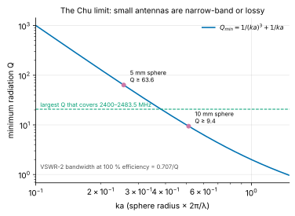
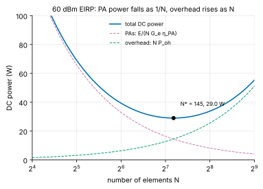

<!-- status: reviewed -->
# 21-10 · Antennas, Arrays, Beamforming and mmWave

| | |
|---|---|
| **Course** | [21 · RF and Microwave Engineering](../README.md) |
| **University equivalent** | The antenna and phased-array material of a senior antennas or microwave course: microstrip patches, electrically small antennas and the Chu limit, planar arrays and scan loss, phase shifters against true-time delay, phase quantization, EIRP and array sizing, analog/digital/hybrid beamforming hardware, millimetre-wave propagation and antenna-in-package (Balanis, *Antenna Theory*, the microstrip and array chapters; Mailloux, *Phased Array Antenna Handbook*) |
| **Prerequisites** | [13-11](../../13-electromagnetics/chapters/13-11-radiation-and-antennas.md) (dipoles, directivity, Friis, the array factor), [17-11](../../17-communication-systems/chapters/17-11-mimo-and-beamforming.md) (beamforming as signal processing, hybrid beamforming), [21-09](21-09-rf-front-end.md) (mismatch, tuners), [21-07](21-07-power-amplifiers.md) (PA efficiency), [20-06](../../20-analog-and-mixed-signal-ic-design/chapters/20-06-data-converter-fundamentals.md) (ADC figures of merit) |
| **Estimated study hours** | 8 |
| **Last verified** | 2026-11-24 |

**Learning objectives.** After this chapter you can:

1. Design a rectangular microstrip patch to first order and explain what sets its bandwidth; apply the Chu limit to judge whether a small antenna can cover a band, and at what efficiency.
2. Compute the gain, beamwidth, scan loss and grating-lobe limit of linear and planar arrays.
3. Derive beam squint for a phase-shifter array, compute the bandwidth it allows, and size a true-time-delay alternative.
4. Quantify the gain loss and sidelobe floor caused by phase-shifter quantization.
5. Size a transmit array from an EIRP target, find the element count that minimizes DC power, and compare the power of analog, hybrid and digital beamforming.
6. Build a millimetre-wave link budget with array gain, absorption and blockage, and explain why handsets use several antenna-in-package modules.

## 1. Big picture

An antenna converts a guided wave into a radiated one, and an array of antennas lets electronics, instead of motors, decide where the energy goes. Chapter 13-11 derived the dipole, directivity, the Friis equation and the array factor; chapter 17-11 treated beamforming as signal processing. This chapter is about the hardware between them: the printed patches that make up modern arrays, the physical limit that makes small antennas narrow-band or lossy, the phase shifters and delay lines that steer beams, and the power and packaging arithmetic that decides how many elements a phone, a base station or a radar carries. At millimetre-wave frequencies these choices dominate: a 28 GHz link only closes because arrays recover the gain that short wavelengths cost, and the array must live in the package, next to the transceiver, because at about 0.3 dB/mm a few millimetres of routing cost around 1 dB.

- **Every wireless product is antenna-limited somewhere:** wearables by the Chu limit, phones by hand blockage and the number of modules, base stations by EIRP and DC power, radars by aperture.
- **Arrays trade elements for power:** EIRP grows as $N^2$, so doubling the element count lets each PA deliver a quarter of the power.
- **Wide bandwidth and wide scan fight each other** in a phase-shifter array: the beam squints with frequency.
- **Analog, hybrid and digital beamforming** are a power and flexibility trade set by how many converters the system can afford.

## 2. Intuition first

Picture a line of people passing buckets of water to a fire. If everyone throws at the same moment, the water lands straight ahead. If each person throws a fixed fraction of a second after the neighbour on the left, the spray sweeps to the right: the delay between neighbours sets the direction. An array steers the same way, by delaying each element's signal relative to its neighbour.

There are two ways to impose that delay. A **true-time delay** is an actual delay line: the right delay works at every frequency. A **phase shifter** imitates the delay by rotating the phase of a sinusoid; since a phase is a delay only at one frequency, the beam points in the right direction only at the frequency where the phases were set, and drifts (**squints**) elsewhere.

**The analogy and its limits.** The bucket line captures steering by progressive delay, but water does not interfere. In a real array the signals add as waves: in the steered direction they add in phase (amplitude N times one element, power N² times), and in other directions they partly cancel, producing nulls, sidelobes and, if the elements are too far apart, **grating lobes**, full-strength copies of the beam in the wrong direction.

```text
     wavefront arriving at angle θ                     phase-shifter array (receive)
        \   \   \   \                                    elem 0 ──[φ0]──┐
         \   \   \   \   extra path d·sinθ                elem 1 ──[φ1]──┤
     ──●───●───●───●──   per element                      elem 2 ──[φ2]──┼── Σ ── to one RF chain
       0   1   2   3     d apart                          elem 3 ──[φ3]──┘
```

## 3. Theory

### 3.1 What an antenna designer specifies

From 13-11: directivity $D$, gain $G = e_rD$ with radiation efficiency $e_r$, effective aperture $A_e = G\lambda^2/4\pi$, and the far-field distance $2D_a^2/\lambda$. A product specification adds:

- **Total efficiency** $e_{tot} = e_r(1 - \lvert\Gamma\rvert^2)$: what reaches free space out of what the PA delivers, including the mismatch loss of 21-09.
- **Impedance bandwidth**: the band over which $\lvert\Gamma\rvert$ stays below a limit, often VSWR 2 (return loss 9.5 dB) or VSWR 3 for phones.
- **Polarization**: a linearly polarized antenna receiving a linear wave tilted by $\psi_p$ loses $\cos^2\psi_p$; linear receiving circular loses half, 3 dB.
- **Total radiated power (TRP)** and **total isotropic sensitivity (TIS)**: transmit power and receiver sensitivity averaged over all directions, measured in an anechoic chamber with the phone in a hand or against a head phantom. Carriers specify these, not antenna gain.

### 3.2 The microstrip patch

A **patch** is a rectangle of copper of length $L$ on a grounded dielectric slab of thickness $h \ll \lambda$ and permittivity $\varepsilon_r$. Under the patch the field is that of a cavity: it resonates when $L$ is about half a wavelength in the dielectric, with the electric field pointing up at one edge and down at the other. At the two open edges the field fringes into the air; the fringing fields at the two edges point the same horizontal way and radiate like two slots half a wavelength apart, giving a broad beam normal to the patch (element gain about 5–8 dBi, depending on the substrate and ground plane).

Because part of the fringing field is in air, the wave sees an **effective permittivity** between 1 and $\varepsilon_r$, and the fringing makes the patch look electrically longer by $\Delta L$ at each end. The standard design equations (the transmission-line model, Balanis ch. 14) are, for resonance at $f_0$:

$$
W = \frac{c}{2f_0}\sqrt{\frac{2}{\varepsilon_r + 1}}, \qquad
\varepsilon_{eff} = \frac{\varepsilon_r + 1}{2} + \frac{\varepsilon_r - 1}{2}\left(1 + \frac{12h}{W}\right)^{-1/2},
$$

$$
\frac{\Delta L}{h} = 0.412\,\frac{(\varepsilon_{eff} + 0.3)(W/h + 0.264)}{(\varepsilon_{eff} - 0.258)(W/h + 0.8)}, \qquad
L = \frac{c}{2f_0\sqrt{\varepsilon_{eff}}} - 2\Delta L .
$$

The first sets a width that radiates efficiently; the last makes $L + 2\Delta L$ half a guided wavelength. These are empirical fits accurate to a few per cent; production designs are finished with electromagnetic simulation.

**Bandwidth.** The patch is a cavity that stores energy under the patch and leaks it from the edges, so it behaves like a resonator of quality factor $Q$, and its bandwidth is about $1/Q$. A thin substrate stores much and leaks little: bandwidth grows roughly in proportion to $h/\lambda$ and falls as $\varepsilon_r$ rises. Thicker substrates widen the band but launch **surface waves** that carry power sideways and couple neighbouring elements; stacked patches and slot-coupled feeds widen the band without them.

**Why arrays use patches.** They are printed with the circuit board or package, low profile, and their width ($W < \lambda_0/2$) fits within the half-wavelength element spacing that avoids grating lobes (Example 21-10.1).

### 3.3 Small antennas and the Chu limit

A wearable or IoT device often has room for an antenna much smaller than $\lambda/2\pi$. Enclose the antenna in the smallest sphere of radius $a$ and write $ka = 2\pi a/\lambda$. Outside the sphere the fields can be expanded in spherical modes; for $ka < 1$ every mode stores far more reactive energy near the sphere than it radiates per cycle, whatever the antenna inside. Chu (1948) derived the resulting bound on the radiation Q, and McLean (1996) gave it the exact form for a linearly polarized antenna radiating the lowest mode:

$$
Q_{min} = \frac{1}{(ka)^3} + \frac{1}{ka} .
$$

> **Going deeper — where $1/(ka)^3$ comes from.** The lowest spherical mode outside the sphere is the field of a Hertzian dipole (13-11). Its near-field energy density falls as $1/r^6$, so the energy stored outside radius $a$ grows as $1/a^3$ while the radiated power is fixed; the ratio, in units of radiated energy per radian, is $1/(ka)^3$. The full derivation subtracts the energy that travels outward with the radiated wave, leaving the bound above.

**From Q to bandwidth.** Near resonance an antenna matched at its centre frequency behaves like a series RLC with $Z = R(1 + j2Q\delta)$, where $\delta = (f - f_0)/f_0$. Then

$$
\Gamma = \frac{Z - R}{Z + R} = \frac{jQ\delta}{1 + jQ\delta}, \qquad \lvert\Gamma\rvert = \frac{Q\delta}{\sqrt{1 + (Q\delta)^2}} .
$$

Setting $\lvert\Gamma\rvert = (s - 1)/(s + 1)$ for a VSWR limit $s$ and solving gives $Q\delta = (s - 1)/(2\sqrt{s})$, so the fractional bandwidth $2\delta$ is

$$
B = \frac{s - 1}{Q\sqrt{s}} \qquad (B = 0.707/Q \text{ for VSWR 2}).
$$



**Efficiency buys bandwidth.** Loss lowers the total Q: with radiation efficiency $e_r$, $Q_{total} = e_r Q_{rad}$, since the loss resistance adds to the radiation resistance while the stored energy stays the same. A small antenna can therefore cover a wider band than Chu allows only by wasting power, which is exactly what many compact designs do (Example 21-10.2).

### 3.4 Planar arrays, element patterns and scan loss

An $N_x \times N_y$ rectangular array with spacings $d_x$, $d_y$ has an array factor that is the product of two linear array factors (13-11), in the direction cosines $u = \sin\theta\cos\phi$ and $v = \sin\theta\sin\phi$. Its pattern is the **element pattern** times the array factor, and its gain toward the steered direction $\theta_0$ is

$$
G(\theta_0) \approx N\,G_e(\theta_0), \qquad N = N_xN_y .
$$

**Scan loss.** An element's gain falls off broadside because its projected area does: for an ideal aperture element $G_e(\theta) \propto \cos\theta$, so steering to 45° costs 1.5 dB and to 60° costs 3.0 dB; the same projected-aperture effect widens the beam by $1/\cos\theta_0$ (one effect seen two ways, not two losses to add). Real patches fall a little faster. Mutual coupling also changes each element's input impedance with the scan angle (the **active reflection coefficient**), and at some angles a surface wave can make it total: **scan blindness**. Arrays are therefore usually specified for ±45° to ±60°, and phones use several modules facing different ways rather than one module that scans everywhere.

**Grating lobes in two dimensions.** In each axis the spacing must satisfy $d \le \lambda/(1 + \lvert\sin\theta_{max}\rvert)$ for the scan range it needs. Base-station arrays that scan little in elevation can space elements farther apart vertically and save RF chains.

### 3.5 Phase shifters, true-time delay and beam squint

To steer a linear array to $\theta_0$, element $k$ must be delayed by $k\tau$ with $\tau = d\sin\theta_0/c$. A **phase shifter** instead applies the phase $\beta_k = -2\pi f_0k\tau$, set at the centre frequency $f_0$ and constant over frequency. At another frequency $f$, the wave from direction θ arrives with phase $2\pi fk\,d\sin\theta/c$ at element $k$, and the beam forms where it cancels the phase shifter's setting:

$$
f\sin\theta = f_0\sin\theta_0 \quad\Longrightarrow\quad \sin\theta_{beam}(f) = \frac{f_0}{f}\sin\theta_0 .
$$

The beam **squints** toward larger angles below $f_0$ and smaller angles above it; at broadside ($\theta_0 = 0$) it does not move. Toward the intended direction $\theta_0$, the residual phase per element is

$$
\psi = 2\pi\frac{d}{\lambda_0}\sin\theta_0\left(\frac{f}{f_0} - 1\right),
$$

and the array factor $\lvert\sin(N\psi/2)/(N\sin(\psi/2))\rvert$ falls to $1/\sqrt2$ when $N\psi/2 \approx$ 1.392 for large $N$ (13-11, 17-11). The fractional bandwidth over which the gain toward $\theta_0$ stays within 3 dB is therefore approximately

$$
\frac{B_{3dB}}{f_0} \approx \frac{2 \times 2.783}{2\pi N(d/\lambda_0)\sin\theta_0} = \frac{0.886}{N(d/\lambda_0)\sin\theta_0} ,
$$

which is the broadside beamwidth in radians divided by $\sin\theta_0$: **the larger the array and the wider the scan, the narrower the band**. A 400 MHz 5G carrier at 28 GHz (1.4%) is comfortable for phone-sized arrays; multi-gigahertz signals on large, widely scanned arrays are not.


**True-time delay (TTD)** removes squint by delaying each element by $k\tau$ for real. The delays span $(N - 1)d\sin\theta_0/c$, many periods of the carrier, which is why TTD is expensive on chip (long lines or switched delay networks) and is used mainly in wideband radar, satellite terminals and the digital domain, where digital beamforming applies true delays per channel.

### 3.6 Phase quantization

Digital phase shifters have $b$ bits, so each element's phase is rounded to the nearest multiple of $2\pi/2^b$. If the rounding errors $\varepsilon_k$ are uniform in $\pm\pi/2^b$ and independent between elements (which calibration offsets usually make them), the average array output toward $\theta_0$ is scaled by $\langle e^{j\varepsilon}\rangle = \sin x/x$ with $x = \pi/2^b$. To get the mean power, write $AF = \frac1N\sum_k a_ke^{j\varepsilon_k}$ with unit-magnitude ideal phasors $a_k$, so $AF_0 = \frac1N\sum_k a_k$, and average $\lvert AF\rvert^2 = \frac1{N^2}\sum_k\sum_l a_ka_l^*e^{j(\varepsilon_k - \varepsilon_l)}$ term by term. The $N$ diagonal terms ($k = l$) average to 1; each off-diagonal term averages to $\lvert\langle e^{j\varepsilon}\rangle\rvert^2 = S$ because the errors are independent. The off-diagonal sum is the full double sum minus its diagonal, $\lvert\sum_k a_k\rvert^2 - N$, so $\langle\lvert AF\rvert^2\rangle = \frac1{N^2}\left[S\left(N^2\lvert AF_0\rvert^2 - N\right) + N\right]$, which is

$$
\langle\lvert AF\rvert^2\rangle = S\,\lvert AF_0\rvert^2 + \frac{1 - S}{N}, \qquad S = \left(\frac{\sin x}{x}\right)^2 ,
$$

where $AF_0$ is the ideal normalized pattern. The first term is the beam, reduced by $S$ (the **gain loss**); the second is a floor of scattered power, uniform in angle and $10\log_{10}[(1 - S)/N]$ below the peak, that fills the nulls and raises the average sidelobes. The rms phase error is $180°/(2^b\sqrt3)$, and each extra bit lowers the floor by about 6 dB. If the errors are not decorrelated, quantizing a linear phase ramp produces a periodic error and discrete **quantization lobes** instead of a floor.

### 3.7 EIRP, element count and beamforming architecture

**EIRP grows as N².** With $N$ elements each radiating $P_e$ through gain $G_e$, the total power is $NP_e$ and the array gain is $NG_e$:

$$
\text{EIRP} = N^2P_eG_e, \qquad \text{EIRP [dBm]} = P_e\,[\text{dBm}] + G_e\,[\text{dBi}] + 20\log_{10}N .
$$

On receive, signals add coherently while each element's noise adds incoherently, so the SNR improves by $N$, or $10\log_{10}N$ dB; the receive figure of merit $G/T$ grows as $N$.

**The DC-optimal element count.** For a target EIRP $E$, each PA must deliver $P_e = E/(N^2G_e)$. With PA efficiency $\eta_{PA}$ and a fixed overhead $P_{oh}$ per element (phase shifter, driver, bias, its share of LO distribution), the DC power is

$$
P_{DC}(N) = N\left(\frac{P_e}{\eta_{PA}} + P_{oh}\right) = \frac{E}{NG_e\eta_{PA}} + NP_{oh} .
$$

The first term falls and the second rises with $N$; setting $dP_{DC}/dN = 0$ gives

$$
N^* = \sqrt{\frac{E}{G_e\eta_{PA} P_{oh}}}, \qquad P_{DC}(N^*) = 2\sqrt{\frac{EP_{oh}}{G_e\eta_{PA}}} ,
$$

at which the PAs' share and the overhead share are equal. The minimum is flat: halving or doubling $N$ costs only about 25% more power (Example 21-10.6). In practice $\eta_{PA}$ falls at low output power and thermal density limits large $P_e$, so real designs sit near this optimum with technology constraints deciding the side.



**Analog, hybrid and digital.** An **analog** beamformer combines all elements in RF (one RF chain, one pair of converters) but forms one beam at a time. A **digital** beamformer gives every element its own chain and converters, forming any number of beams with true delays, at the cost of $N$ times the converter and chain power. A **hybrid** beamformer uses a few RF chains, each with an analog subarray (17-11). With a Walden figure of merit (20-06), an ADC consumes $P_{ADC} = \text{FoM}\cdot 2^{ENOB}f_s$, so a wide-band digital array pays for $2N$ such converters (Example 21-10.7). Analog and hybrid arrays must also find the beam: covering ±θ_max with beams spaced by their width takes about $N\sin\theta_{max}$ beams per axis for a λ/2 array, each needing a measurement slot.

### 3.8 Millimetre-wave propagation and packaging

From 13-11, free-space path loss grows as $f^2$ for antennas of fixed gain but the link improves as $f^2$ for antennas of fixed area: millimetre-wave works when apertures stay large in square centimetres, which means arrays of many small elements that must be steered. On top of free space, millimetre waves suffer:

- **Atmospheric absorption**, small near 28 and 39 GHz but large near the 60 GHz oxygen line (§9).
- **Rain**, several dB per kilometre in heavy rain at 28 GHz, which matters for backhaul but little within a few hundred metres.
- **Blockage**: bodies, hands, foliage and walls absorb or reflect tens of dB, while diffraction around them is weak because obstacles are many wavelengths across. Links rely on line of sight or strong reflections, and a hand over the module can cut the link (§9).

**Antenna in package.** At 28 GHz package routing loses about 0.3 dB/mm (§9), so a few millimetres of printed transmission line cost around 1 dB, and every dB of loss between PA and antenna is lost EIRP and wasted DC power. Millimetre-wave transceivers therefore put the antennas in the same package as the RFIC (**antenna-in-package**, AiP), and phones carry several such modules on different edges so that a hand cannot block all of them.

### 3.9 MIMO radar and virtual arrays

An automotive radar transmits from $N_{TX}$ antennas in turn (or with orthogonal codes) and receives on $N_{RX}$. The phase at receiver $j$ from transmitter $i$ depends on the sum of their positions, so every TX–RX pair behaves like one element at that sum position: a **virtual array** of $N_{TX}N_{RX}$ elements. With receivers λ/2 apart and transmitters $N_{RX}\lambda/2$ apart, the virtual array is a filled line of $N_{TX}N_{RX}$ elements at λ/2, whose angular resolution near broadside is about $2/(N_{TX}N_{RX})$ radians, from only $N_{TX} + N_{RX}$ physical antennas.

## 4. Worked examples

### Example 21-10.1 · A 28 GHz patch (tier A)

**Setup.** Design a patch for 28 GHz on a substrate with $\varepsilon_r$ = 3.0 and $h$ = 0.25 mm. Find (a) $W$, (b) $\varepsilon_{eff}$, (c) $\Delta L$ and (d) $L$. (e) Does the patch fit inside a half-wavelength array cell?

**Solution.**

- (a) $W = (c/2f_0)\sqrt{2/4}$ = 5.353 × 0.7071 = **3.785** mm.
- (b) $W/h$ = 15.14, so $\varepsilon_{eff} = 2 + 1/\sqrt{1 + 12/15.14}$ = **2.747**.
- (c) $\Delta L = 0.412 \times 0.25 \times (3.047 \times 15.41)/(2.489 \times 15.94)$ = **0.122** mm.
- (d) $L = c/(2f_0\sqrt{2.747}) - 2\Delta L$ = 3.230 − 0.244 = **2.986** mm.
- (e) The cell is $\lambda_0/2$ = **5.353** mm square; the 3.79 × 2.99 mm patch fits with room for its feed.

**Units check.** $c/f$ in metres; $\Delta L$ scales with $h$.

**Sanity check.** $L \approx \lambda_0/(2\sqrt{\varepsilon_r})$ = **3.09** mm (f) before the fringing corrections; fringing in air lowers $\varepsilon_{eff}$ (lengthening the wavelength) but adds $2\Delta L$ of electrical length, and the second effect wins here.

### Example 21-10.2 · Can a 1 cm antenna cover Bluetooth? (tier C)

**Setup.** A wearable needs an antenna for 2400–2483.5 MHz. (a–c) If the antenna fits in a sphere of radius 10 mm, find $ka$ at the band centre, the Chu bound on Q and the VSWR-2 bandwidth it allows. (d–f) Repeat for 5 mm. (g) What fractional bandwidth does the band need, (h) what is the largest total Q that covers it, and (i) for the 5 mm antenna, what is the highest radiation efficiency at which it can cover the band, and (j) what is that in dB?

**Solution.** The centre is 2441.75 MHz, λ = 122.8 mm.

- (a) $ka = 2\pi \times 10/122.8$ = **0.512**; (b) $Q_{min} = 1/0.512^3 + 1/0.512$ = **9.42**; (c) $B = 0.707/9.42$ = **7.51** %.
- (d) **0.256**; (e) **63.6**; (f) **1.11** %.
- (g) 83.5/2441.75 = **3.42** %; (h) $Q \le 0.707/0.0342$ = **20.7**.
- (i) The total Q is $e_r Q_{rad} \ge e_r \times 63.6$, so $e_r \le 20.7/63.6$ = **32.5** %, (j) **−4.88** dB.

**Units check.** $ka$ and Q dimensionless.

**Sanity check.** The 10 mm antenna has bandwidth to spare; halving its size multiplies the bound by **6.8** (k), mostly through the $1/(ka)^3$ term, and the 5 mm antenna can cover the band only by throwing away two-thirds of its power. Tiny wearable antennas with "wideband" claims are usually lossy, which shows up in radiated efficiency, not in return loss.

### Example 21-10.3 · A handset module against the 3GPP limits (tier B)

**Setup.** A phone's 28 GHz (n257) module has 4 patches of 5 dBi each. 3GPP requires a power-class-3 phone to reach at least 22.4 dBm peak EIRP in n257, and caps it at 23 dBm total radiated power (TRP) and 43 dBm EIRP (§9). The designer targets 3 dB above the minimum. Each PA reaches its patch through 5 mm of package routing at 0.3 dB/mm (a published redistribution-layer loss, §9). Find (a) the EIRP target, (b) the power each patch must radiate, (c) each PA's output, (d) the TRP and (e) the EIRP when steered to 45° (cosine element). (f) How far below the 43 dBm cap is the target? (g) With 8 patches, what would each PA deliver? (h) What array-plus-element gain would reach 43 dBm EIRP at the 23 dBm TRP cap, and how many 5 dBi elements is that?

**Solution.**

- (a) 22.4 + 3 = **25.4** dBm.
- (b) $25.4 - 5 - 20\log_{10}4$ = **8.36** dBm.
- (c) 8.36 + 1.5 = **9.86** dBm.
- (d) Four patches radiating 8.36 dBm each (lossless patches): $8.36 + 10\log_{10}4$ = **14.38** dBm, well under 23 dBm.
- (e) $25.4 + 10\log_{10}\cos 45°$ = **23.89** dBm, still above 22.4 dBm.
- (f) **17.6** dB.
- (g) $25.4 - 5 - 20\log_{10}8 + 1.5$ = **3.84** dBm.
- (h) 43 − 23 = **20** dB of gain, $NG_e$ = 100, so (i) $N = 100/3.162$ = **31.6**: about 32 elements.

**Units check.** dBm + dBi + dB = dBm; TRP adds powers, $10\log_{10}N$.

**Sanity check.** A phone meets 3GPP's peak-EIRP requirement with PAs of only about 10 dBm, which silicon delivers easily; reaching the 43 dBm regulatory ceiling would take a 32-element array per direction, which no phone carries. The ceiling is regulation, not capability, and the binding requirement in practice is coverage over the whole sphere with a hand on the phone.

### Example 21-10.4 · Beam squint in a 16-element array (tier B)

**Setup.** A 16-element linear array has λ/2 spacing at 28 GHz and is steered to 60° with phase shifters set at 28 GHz. The signal spans 26–30 GHz. Find the beam direction at (a) 26 GHz and (b) 30 GHz, (c) the half-power beamwidth at 60° and 28 GHz, (d) the bandwidth over which the gain toward 60° stays within 3 dB, in GHz and (h) as a fraction, and (e) the gain loss toward 60° at 26 and 30 GHz. (f) What delay span would true-time delay need, and (g) by how much does a TTD array's coherent output exceed one element's at any frequency?

**Solution.**

- (a) $\sin\theta = (28/26)\sin 60°$ = 0.9326: **68.85**°. (b) $(28/30)\sin 60°$ = 0.8083: **53.93**°.
- (c) From the array factor: **12.99**° (the estimate $0.886 \times 2/16/\cos 60°$ rad = 12.69°).
- (d, h) The large-N formula gives $0.886/(16 \times 0.5 \times 0.866)$ = 12.79%; solving the array factor exactly for the −3 dB frequencies gives **12.8** %, or **3.59** GHz.
- (e) $\psi = \pi \times 0.866 \times (2/28)$ = 0.1943 rad; $\lvert\sin(8\psi)/(16\sin(\psi/2))\rvert$ = 0.644: **−3.82** dB at both edges.
- (f) $15 \times 5.353\ \text{mm} \times 0.866/c$ = **232** ps, **6.50** carrier periods (i).
- (g) Sixteen equal voltages add in phase: $20\log_{10}16$ = **24.08** dB.

**Units check.** Angles from arcsines; delay = length/c.

**Sanity check.** The beam moves **8.85**° at 26 GHz (k) and **6.07**° at 30 GHz (l). The shifts are unequal and so are the beamwidths (the beam is narrower at 30 GHz and nearer broadside), so no single "half the beamwidth" rule applies; the exact result is that both ±2 GHz edges fall just outside the 3.59 GHz (12.8 %) 3 dB bandwidth, hence a loss slightly beyond 3 dB at both. The lab's ngspice model (`squint.cir`) builds both arrays from delay lines and reproduces (e) and (g). The 24.08 dB is signal power; noise from 16 elements adds incoherently, so the SNR gain is $10\log_{10}16$ = **12.04** dB (j), as in §3.7.

### Example 21-10.5 · How many phase-shifter bits? (tier A)

**Setup.** A 64-element array uses phase shifters whose errors are decorrelated by calibration. For (a–c) 3 bits and (d–f) 4 bits, find the gain loss, the rms phase error and the scattered-power floor relative to the peak.

**Solution.** $x = \pi/8$ gives $S = (\sin x/x)^2$ = 0.9496; $x = \pi/16$ gives 0.9872.

- (a) $-10\log_{10}S$ = **0.22** dB; (b) $22.5°/\sqrt3$ = **13.0**°; (c) $10\log_{10}(0.0504/64)$ = **−31.0** dB.
- (d) **0.056** dB; (e) **6.50**°; (f) **−37.0** dB.

**Units check.** Losses in dB; rms error in degrees.

**Sanity check.** Three bits already cost under a quarter of a decibel of gain; the extra bits buy sidelobe and null depth (6 dB each), which matters for interference rejection more than for range.

### Example 21-10.6 · How many elements minimize DC power? (tier C)

**Setup.** A transmit array must reach 60 dBm EIRP with elements of 5 dBi gain, PAs of 15% efficiency and 100 mW of overhead per element. Find (a) the optimal element count, (b) its DC power and (c) the power each PA then delivers, in mW and (g) dBm. Find the DC power with (d) 64 and (f) 256 elements, and (e) the PA power at 64 elements.

**Solution.** $E$ = 1000 W, $G_e$ = 3.162.

- (a) $N^* = \sqrt{1000/(3.162 \times 0.15 \times 0.1)}$ = **145**.
- (b) $2\sqrt{1000 \times 0.1/(3.162 \times 0.15)}$ = **29.0** W.
- (c) $P_e = 1000/(145.2^2 \times 3.162)$ = **15.0** mW, (g) **11.8** dBm.
- (d) $1000/(64 \times 0.474) + 6.4$ = **39.3** W, with (e) **77.2** mW per PA (**18.9** dBm, h).
- (f) $1000/(256 \times 0.474) + 25.6$ = **33.8** W.

**Units check.** W/(dimensionless) = W; $N \times$ W = W.

**Sanity check.** At the optimum the PAs and the overhead each take **14.5** W (i). With 64 elements each PA must deliver 18.9 dBm, a harder PA than the 11.8 dBm at the optimum; with 256 elements the overhead dominates. Real arrays also face a thermal limit per square centimetre.

### Example 21-10.7 · Analog, hybrid or digital? (tier B)

**Setup.** A 64-element receive array processes a 400 MHz channel. A full receive chain (LNA, mixer, LO buffer, baseband) takes 40 mW plus two ADCs (I and Q) at 1 GS/s with ENOB 8 and a Walden figure of 20 fJ per conversion step. An analog element (LNA and phase shifter) takes 15 mW. Find (a) the power of one ADC, and the total power of (b) a digital array (a full chain per element), (c) a hybrid array (64 analog elements feeding 4 chains) and (d) an analog array (one chain).

**Solution.**

- (a) $20 \times 10^{-15} \times 2^8 \times 10^9$ = **5.12** mW.
- (b) $64 \times (40 + 10.24)$ mW = **3.22** W.
- (c) $4 \times 50.24 + 64 \times 15$ mW = **1.16** W.
- (d) $50.24 + 960$ mW = **1.01** W.

**Units check.** J × Hz = W.

**Sanity check.** The ADCs are not the main cost: replicating the whole chain (mixers, LO distribution, baseband) per element is. Hybrid costs **15** % more than analog (e) yet supports four simultaneous beams or streams; full digital costs **3.2** times as much (f) and buys every beam at once with true delays.

### Example 21-10.8 · A 28 GHz street link (tier C)

**Setup.** A 28 GHz small cell declares 60 dBm EIRP in a 100 MHz carrier (the US cap is 75 dBm per 100 MHz, §9). A phone receives on the 4-patch module of Example 21-10.3 at broadside, with a 10 dB noise figure. Use the 3GPP TR 38.901 urban-microcell (street canyon) path-loss formulas with $f_c$ in GHz and 3-D distance $d$ in metres: LOS $32.4 + 21\log_{10}d + 20\log_{10}f_c$; NLOS the larger of the LOS value and $35.3\log_{10}d + 22.4 + 21.3\log_{10}f_c$ (phone height 1.5 m). Find (a) the phone's receive gain and (b) the noise floor. For a line-of-sight phone 100 m away, find (c) the path loss, (d) the received power and (e) the SNR. For a non-line-of-sight phone 200 m away in heavy rain (25 mm/h), find (f) the path loss, (g) the rain loss from ITU-R P.838-3 ($\gamma = kR^\alpha$ with $k$ = 0.2051, $\alpha$ = 0.9679 at 28 GHz, horizontal polarization), adding 0.02 dB of gaseous absorption, (h) the received power and (i) the SNR. (j) What is the SNR if the user's hand covers the module (30 dB, the TR 38.901 self-blocking value)?

**Solution.**

- (a) $5 + 10\log_{10}4$ = **11.02** dBi. (b) $-174 + 10\log_{10}10^8 + 10$ = **−84.0** dBm.
- (c) $32.4 + 21\log_{10}100 + 20\log_{10}28$ = **103.34** dB. (d) 60 − 103.34 + 11.02 = **−32.32** dBm. (e) **51.7** dB.
- (f) $35.3\log_{10}200 + 22.4 + 21.3\log_{10}28$ = **134.45** dB (the LOS formula gives only **109.66** dB, l).
- (g) $0.2051 \times 25^{0.9679}$ = **4.62** dB/km, so **0.92** dB over 200 m (k).
- (h) 60 − 134.45 − 0.92 − 0.02 + 11.02 = **−64.38** dBm (unrounded terms). (i) **19.6** dB.
- (j) **−10.4** dB: the link is lost unless another module, facing another way, takes over.

**Units check.** All terms in dB, dBm or dBi.

**Sanity check.** Line of sight at 100 m is so strong that the SNR is limited by EVM, not noise. Around a corner at 200 m the extra **31.1** dB of path loss (m) still leaves a usable 20 dB, and rain costs under 1 dB at this range; a hand, at 30 dB, is the killer. This is why phones carry several modules and why measured mmWave use concentrates within about 150 m of a site (§9).

### Example 21-10.9 · A radar's virtual array (tier B)

**Setup.** A 77 GHz radar chip has 3 transmitters and 4 receivers. The receivers are λ/2 apart and the transmitters 2λ apart. Find (a) the wavelength, (b) the number of virtual elements, (c) the virtual aperture, (d) the angular resolution near broadside and (e) the number of physical antennas.

**Solution.**

- (a) $c/77$ GHz = **3.89** mm.
- (b) $3 \times 4$ = **12** virtual elements, filling a λ/2 grid (the transmitter offsets 0, 2λ, 4λ shift copies of the 1.5λ receive array end to end).
- (c) $11 \times \lambda/2$ = **21.4** mm.
- (d) $2/12$ rad = **9.55**°.
- (e) **7** antennas.

**Units check.** Lengths in mm; resolution in radians, then degrees.

**Sanity check.** Seven antennas give the angular resolution of a 12-element receive array, because the transmitter positions add to the receiver positions. The price is that the transmitters must be separated in time or code, which costs measurement time.

### Answer key

<!-- answer-key -->
| ID | Quantity | Value | Unit |
|---|---|---|---|
| Ex 21-10.1a | patch width | 3.785 | mm |
| Ex 21-10.1b | effective permittivity | 2.747 | |
| Ex 21-10.1c | fringing extension | 0.122 | mm |
| Ex 21-10.1d | patch length | 2.986 | mm |
| Ex 21-10.1e | half-wavelength cell | 5.353 | mm |
| Ex 21-10.1f | uncorrected half guided wavelength | 3.09 | mm |
| Ex 21-10.2a | ka, 10 mm | 0.512 | |
| Ex 21-10.2b | Chu bound, 10 mm | 9.42 | |
| Ex 21-10.2c | VSWR-2 bandwidth, 10 mm | 7.51 | % |
| Ex 21-10.2d | ka, 5 mm | 0.256 | |
| Ex 21-10.2e | Chu bound, 5 mm | 63.6 | |
| Ex 21-10.2f | VSWR-2 bandwidth, 5 mm | 1.11 | % |
| Ex 21-10.2g | bandwidth needed | 3.42 | % |
| Ex 21-10.2h | largest total Q | 20.7 | |
| Ex 21-10.2i | highest efficiency, 5 mm | 32.5 | % |
| Ex 21-10.2j | highest efficiency, 5 mm | −4.88 | dB |
| Ex 21-10.2k | ratio of the bounds | 6.8 | |
| Ex 21-10.3a | EIRP target | 25.4 | dBm |
| Ex 21-10.3b | power per patch | 8.36 | dBm |
| Ex 21-10.3c | PA output | 9.86 | dBm |
| Ex 21-10.3d | TRP | 14.38 | dBm |
| Ex 21-10.3e | EIRP at 45° | 23.89 | dBm |
| Ex 21-10.3f | margin to the 43 dBm cap | 17.6 | dB |
| Ex 21-10.3g | PA output, 8 patches | 3.84 | dBm |
| Ex 21-10.3h | gain for 43 dBm at 23 dBm TRP | 20 | dB |
| Ex 21-10.3i | elements for that gain | 31.6 | |
| Ex 21-10.4a | beam direction at 26 GHz | 68.85 | deg |
| Ex 21-10.4b | beam direction at 30 GHz | 53.93 | deg |
| Ex 21-10.4c | beamwidth at 60° | 12.99 | deg |
| Ex 21-10.4d | 3 dB squint bandwidth | 3.59 | GHz |
| Ex 21-10.4e | loss toward 60° at 26 and 30 GHz | −3.82 | dB |
| Ex 21-10.4f | TTD delay span | 232 | ps |
| Ex 21-10.4g | TTD coherent gain over one element | 24.08 | dB |
| Ex 21-10.4h | 3 dB squint bandwidth | 12.8 | % |
| Ex 21-10.4i | delay span in carrier periods | 6.50 | |
| Ex 21-10.4j | SNR gain of 16 elements | 12.04 | dB |
| Ex 21-10.4k | beam shift at 26 GHz | 8.85 | deg |
| Ex 21-10.4l | beam shift at 30 GHz | 6.07 | deg |
| Ex 21-10.5a | gain loss, 3 bits | 0.22 | dB |
| Ex 21-10.5b | rms phase error, 3 bits | 13.0 | deg |
| Ex 21-10.5c | scattered floor, 3 bits | −31.0 | dB |
| Ex 21-10.5d | gain loss, 4 bits | 0.056 | dB |
| Ex 21-10.5e | rms phase error, 4 bits | 6.50 | deg |
| Ex 21-10.5f | scattered floor, 4 bits | −37.0 | dB |
| Ex 21-10.6a | optimal element count | 145 | |
| Ex 21-10.6b | minimum DC power | 29.0 | W |
| Ex 21-10.6c | PA power at the optimum | 15.0 | mW |
| Ex 21-10.6d | DC power, 64 elements | 39.3 | W |
| Ex 21-10.6e | PA power, 64 elements | 77.2 | mW |
| Ex 21-10.6f | DC power, 256 elements | 33.8 | W |
| Ex 21-10.6g | PA power at the optimum | 11.8 | dBm |
| Ex 21-10.6h | PA power, 64 elements | 18.9 | dBm |
| Ex 21-10.6i | each share at the optimum | 14.5 | W |
| Ex 21-10.7a | one ADC | 5.12 | mW |
| Ex 21-10.7b | digital array | 3.22 | W |
| Ex 21-10.7c | hybrid array | 1.16 | W |
| Ex 21-10.7d | analog array | 1.01 | W |
| Ex 21-10.7e | hybrid over analog | 15 | % |
| Ex 21-10.7f | digital over analog | 3.2 | |
| Ex 21-10.8a | phone receive gain | 11.02 | dBi |
| Ex 21-10.8b | noise floor | −84.0 | dBm |
| Ex 21-10.8c | LOS path loss, 100 m | 103.34 | dB |
| Ex 21-10.8d | received power, LOS | −32.32 | dBm |
| Ex 21-10.8e | SNR, LOS | 51.7 | dB |
| Ex 21-10.8f | NLOS path loss, 200 m | 134.45 | dB |
| Ex 21-10.8g | rain specific attenuation | 4.62 | dB/km |
| Ex 21-10.8h | received power, NLOS in rain | −64.38 | dBm |
| Ex 21-10.8i | SNR, NLOS in rain | 19.6 | dB |
| Ex 21-10.8j | SNR with hand blockage | −10.4 | dB |
| Ex 21-10.8k | rain loss over 200 m | 0.92 | dB |
| Ex 21-10.8l | LOS formula at 200 m | 109.66 | dB |
| Ex 21-10.8m | extra path loss, NLOS 200 m vs LOS 100 m | 31.1 | dB |
| Ex 21-10.9a | wavelength at 77 GHz | 3.89 | mm |
| Ex 21-10.9b | virtual elements | 12 | |
| Ex 21-10.9c | virtual aperture | 21.4 | mm |
| Ex 21-10.9d | angular resolution | 9.55 | deg |
| Ex 21-10.9e | physical antennas | 7 | |
| Txt 21-10.a | return loss at VSWR 2 | 9.5 | dB |
| Txt 21-10.b | linear-to-circular polarization loss | 3 | dB |
| Txt 21-10.c | VSWR-2 bandwidth coefficient | 0.707 | |
| Txt 21-10.d | cosine scan loss at 45° | 1.5 | dB |
| Txt 21-10.e | cosine scan loss at 60° | 3.0 | dB |
| Txt 21-10.f | DC power penalty at twice or half the optimal count | 25 | % |
| Txt 21-10.g | 400 MHz carrier at 28 GHz | 1.4 | % |
| Txt 21-10.h | PC3 peak minus median EIRP, n257 | 10.9 | dB |
| Txt 21-10.i | PC3 peak minus median EIRP, n260 | 12.6 | dB |
| Txt 21-10.j | 43 dBm in watts | 20.0 | W |
| Txt 21-10.k | SSB beams per half-frame, FR2 | 64 | |
| Txt 21-10.l | N² EIRP scaling of 64 elements | 36.1 | dB |
| Txt 21-10.m | loss of 5 mm of package routing | 1.5 | dB |
| Txt 21-10.n | rain at 25 mm/h, 39 GHz | 7.0 | dB/km |
| Txt 21-10.o | rain at 25 mm/h, 60 GHz | 10.1 | dB/km |
| Txt 21-10.p | share of 5G operators with mmWave launched | 6 | % |

## 5. Simulate it

The lab ([labs/21-10-lab](../labs/21-10-lab/README.md)) collects the design formulas in `antenna.py` and builds the squinting and true-time-delay arrays of Example 21-10.4 from delay lines in ngspice (`squint.cir`).

**Predict, then run.**

1. Predict how much shorter a 39 GHz patch is than a 28 GHz one, and how the Chu bandwidth bound changes as a Bluetooth antenna's sphere shrinks from 10 to 7.5 to 5 mm (Part 1).
2. Predict where a 16-element array with 0.8λ spacing, steered to 30°, puts its grating lobe; then plot it beside a λ/2 array (Part 2).
3. Predict the beam direction at 26 and 30 GHz for the 16-element array steered to 60°, then run the patterns and `ngspice -b squint.cir` (Part 3).
4. Predict the gain loss and the floor at the first null for 3-bit phase shifters on 64 elements, then run the Monte Carlo (Part 4).
5. Predict the DC-optimal element count for 60 dBm EIRP and how flat the optimum is, then sweep it (Part 5).

## 6. Engineering tradeoffs

| Knob | Improves | Costs | Typical decision owner |
|---|---|---|---|
| Substrate thickness under a patch | Bandwidth, efficiency | Surface waves, coupling, package height | Antenna and package designer |
| Antenna size (small devices) | Bandwidth and efficiency (Chu) | Product volume, industrial design | Product architect with industrial design |
| Element count N | EIRP (N²), receive SNR (N), beamwidth | Area, cost, overhead power, calibration, beam-search time | System architect |
| Element spacing | Fewer elements for an aperture | Grating lobes, scan range | Array designer |
| Phase shifters vs true-time delay | Phase shifters: compact, cheap | Squint limits bandwidth × scan; TTD costs area and loss | RFIC architect |
| Phase-shifter bits | Sidelobe floor, null depth (6 dB per bit) | Area, insertion loss, control | RFIC designer |
| Analog / hybrid / digital beamforming | Digital: many beams, true delays, flexibility | Converter and chain power per element | System and SoC architects |
| Number of modules in a phone | Coverage with a hand present | Cost, board area, switching and control | Phone RF architect |
| Antenna in package vs on board | Feed loss (dB/mm), integration | Package cost and complexity | Package and RFIC teams |

## 7. Numbers to know

| Quantity | Value | Note |
|---|---|---|
| Half wavelength | 5.35 mm at 28 GHz; 3.84 mm at 39 GHz; 1.95 mm at 77 GHz | Array cell size |
| Patch element gain | about 5–8 dBi | §3.2 |
| Chu bound | $Q \ge 1/(ka)^3 + 1/ka$; VSWR-2 bandwidth $0.707/Q$ | §3.3 |
| Cosine scan loss | 1.5 dB at 45°, 3.0 dB at 60° | §3.4 |
| Squint bandwidth | $0.886/[N(d/\lambda_0)\sin\theta_0]$ | §3.5 |
| Phase quantization | 3 bits: 0.22 dB loss; each bit −6 dB floor | §3.6 |
| EIRP scaling | $20\log_{10}N$ + element gain + element power | §3.7 |
| 5G FR2 handset (PC3, n257) | ≥ 22.4 dBm peak EIRP; ≤ 23 dBm TRP, ≤ 43 dBm EIRP; ≥ 11.5 dBm at the 50 %-tile | [1] (as of Sep 2026) |
| US mmWave EIRP caps | 43 dBm mobile; 75 dBm per 100 MHz base station; 40 dBm average at 57–71 GHz | [2] |
| Gaseous absorption (sea level, standard atmosphere, 7.5 g/m³ water vapour) | about 0.1 dB/km at 28–39 GHz; about 15 dB/km near 60 GHz | [3] |
| Rain, 25 mm/h | 4.6 dB/km at 28 GHz; 10.1 dB/km at 60 GHz | [3] |
| Hand blockage (3GPP model) | 30 dB | [4] |
| 28 GHz beamformer ICs | 32 elements per IC; 54 dBm EIRP from 64 dual-polarized elements | [6] |
| AiP vs on-chip antenna efficiency (60 GHz) | above 90% vs below 12% | [9] |

## 8. Common mistakes

- **Quoting return loss as efficiency.** A lossy antenna can be perfectly matched; radiated efficiency must be measured in a chamber.
- **Treating 43 dBm as what a phone transmits.** It is the regulatory ceiling; the 3GPP minimum is 22.4 dBm peak and 11.5 dBm at the median direction.
- **Counting array gain twice.** EIRP grows as $N^2$ (power and gain); receive SNR grows only as $N$, because noise adds from every element.
- **Ignoring squint.** A phase-shifter array designed at the centre frequency points elsewhere at the band edges, worst at wide scan angles.
- **Forgetting the element pattern.** The array factor peaks at every steering angle; the element's cosine-like pattern and the active impedance do not.
- **Assuming free-space path loss at mmWave.** Blockage by bodies and buildings, not distance, usually ends the link.
- **Comparing EIRP claims across different assumptions:** peak vs median, conducted vs radiated, LOS vs NLOS, CPE at 6 m vs phone in a hand.

## 9. Practitioner lens

### State of the art (as of Nov 2026)

- **What 3GPP demands of a phone [Established].** For a power-class-3 handheld in n257, TS 38.101-2 (V20.1.0, Sep 2026) requires at least 22.4 dBm peak EIRP, caps total radiated power at 23 dBm and EIRP at 43 dBm, and requires 11.5 dBm at the 50th percentile of the sphere ("The minimum EIRP at the 50th percentile of the distribution of radiated power measured over the full sphere around the UE is defined as the spherical coverage requirement") [1]. The standard itself expects the median direction to be **10.9** dB below the peak in n257 (**12.6** dB in n260). Its maximum EIRP is "derived from regulatory requirements" [1]; the US caps mobiles at 43 dBm (**20.0** W) and base stations at 75 dBm EIRP per 100 MHz [2].
- **Base stations declare, rather than meet, an EIRP class [Established].** For millimetre-wave base stations "There is no upper limit for the rated carrier TRP output power"; a declared EIRP must be met within ±3.4 dB [1]. Beam sweeping is built into the air interface: up to 64 synchronization-signal beams per 5 ms half-frame in FR2 (**64**, my count from the candidate positions) [1].
- **Beamformer ICs [Established per paper].** IBM and Ericsson's 2017 28 GHz IC integrates 32 transmit/receive elements in SiGe BiCMOS with "13.5 dBm/16 dBm Op1dB/Psat per front end"; four of them with 64 dual-polarized antennas reach "A maximum saturated effective isotropic radiated power of 54 dBm" and steer ±50° "without requiring calibration" [6]; the $N^2$ scaling alone contributes **36.1** dB. UCSD's 32-element array reaches 43 dBm EIRP at P1dB, the handset cap, consuming 130 mW per channel in receive and 200 mW in transmit [6]. CMOS 64-element arrays reach 52–53 dBm at 28 and 39 GHz [6]. Large satellite-terminal arrays use 1024 elements (75 dBm EIRP per polarization at Ku band, ±75° scan from a triangular lattice) [7].
- **Packaging [Established].** On-chip antennas are below 12% efficient, "due to large ohmic losses and surface waves", against more than 90% for an antenna in an LTCC package at 60 GHz [9]. TSMC's InFO redistribution layer loses 0.3 dB/mm [9], so 5 mm of routing costs **1.5** dB: the beamformer sits directly under its patches.
- **Propagation [Established].** ITU-R P.676-13's line-by-line model (evaluated by this curriculum's research; the Recommendation publishes curves) gives about 0.1 dB/km at 28–39 GHz and about 15 dB/km near 60 GHz, where "many oxygen absorption lines merge together at sea-level pressures to form a single, broad absorption band" [3]. P.838-3's coefficients give 4.6, **7.0** and **10.1** dB/km of rain at 25 mm/h at 28, 39 and 60 GHz [3]. TR 38.901 models a hand as a 30 dB self-blocker over a defined angular region and urban NLOS path loss with a distance exponent of 3.53 [4]. New York measurements in 2012 found NLOS exponents of 4.58–5.76 and outages at 57% of locations, mostly beyond 200 m [5].
- **Radar [Established].** TI's AWR2944 covers "76 to 81GHz" with "4 receive and 3 – 4 transmit channels", "13.5dBm" per transmitter and "6 bit programmable phase shifter[s]": 16 virtual channels [8].

### Why it matters commercially

- **Millimetre-wave is a niche, not the mainstream [Industry estimate].** GSA counted 203 operators investing in 5G mmWave but only 24 that had launched it (July 2025), against 392 operators with 5G of any kind (April 2026), about **6** % [10]. In US drive tests in the second half of 2025, mmWave appeared in 2.2% of Verizon's samples and 0.2% of AT&T's; "5G mmWave signals aren't usable beyond 900 meters", and most samples were within 150 m of a site [10].
- **Where arrays do sell.** Fixed wireless access (Qualcomm's QTM547 module: "16 to 64 dual polarization antenna elements, achieving up to 48 dBm of peak EIRP") [8], satellite user terminals ("the only true mass market deployment of phased array antenna technology", in one 2026 trade article) [7], automotive radar [8] and sub-6 GHz massive MIMO (Nokia's 64-TRX Habrok 64 weighs 24 kg) [10].
- **The FR1 lesson.** Sub-6 GHz massive MIMO is fully digital per transceiver because the channel count is moderate (64) and the bandwidth (hundreds of MHz) affordable; millimetre-wave arrays are analog or hybrid because element counts are higher and bandwidths wider. Whether low-resolution digital beamforming changes that is contested: one model-based study finds a 16-antenna 4-bit digital receiver (243 mW) cheaper than an analog one (292 mW) and an 8-bit one 2.5 times dearer [11].

### Marketing vs Reality

1. **"Up to 1.7 km of mmWave coverage."** Qualcomm's 2019 module briefing assumed a customer-premises unit 6 m up, light foliage and a 7:1 TDD configuration [8]; drive tests with phones find mmWave unusable beyond 900 m and mostly within 150 m [10]. Ask: what height, what EIRP, LOS or not, what percentile?
2. **"A 43 dBm EIRP phone."** 43 dBm is the regulatory ceiling; 3GPP requires 22.4 dBm peak and 11.5 dBm at the median direction [1], and a hand costs 30 dB in the 3GPP model [4]. Ask for spherical coverage with a hand phantom.
3. **"Massive MIMO multiplies capacity."** A single-site operator study found median cell traffic up 38% and cell throughput up to 212% against a 10 MHz FDD baseline [10]. Gains depend on the baseline, user distribution and layers actually scheduled. Ask for median and cell-edge results.
4. **"Digital beamforming is too power-hungry."** True at 8 bits under one model, possibly false at 3–4 bits [11]. Ask for measured milliwatts per chain.

### Questions for engineering leaders

1. **"What is your module's EIRP at the 50th percentile of the sphere, with and without a hand phantom, per band?"** *Strong:* cites the TS 38.101-2 spherical-coverage margin (e.g., n257 ≥ 11.5 dBm), phantom measurements and the module count [1]. *Evasive:* quotes only peak EIRP or "43 dBm".
2. **"Analog, hybrid or digital, how many ADC bits per chain, and why?"** *Strong:* a power table per chain, the beam-sweep overhead (up to 64 SSB beams in FR2) and how many simultaneous beams are needed [1], [11]. *Evasive:* "Digital is always better" or "hybrid is standard".
3. **"What is the scan loss at ±50–60°, and are there grating lobes at the top of the band?"** *Strong:* spacing in wavelengths at the highest frequency, the lattice (triangular or square) and measured scan loss [7]. *Evasive:* broadside gain only.
4. **"Where does the loss go between the PA and the patch?"** *Strong:* dB/mm of the package routing, antenna-in-package efficiency, switch and feed loss [9]. *Evasive:* "antenna gain" figures.
5. **"What fraction of users' time is on mmWave, and what is the median, not peak, throughput?"** *Strong:* drive-test or crowdsourced shares and typical distances [10] with a site-density plan. *Evasive:* peak speed-test results.
6. **"How do you handle squint over 400–800 MHz channels?"** *Strong:* fractional bandwidth against scan angle and array size (§3.5), true-time delay or digital sub-arrays where needed, and band-edge EVM measured across scan. *Evasive:* "Our phase shifters are accurate."

## 10. Concept check

**Q1.** Why is a patch's bandwidth small, and how is it widened?

<details><summary>Answer</summary>

A patch is a cavity that stores much more energy under it than it radiates per cycle from its edges, so its Q is high and its bandwidth ($\approx 1/Q$) small. Thicker substrates of lower permittivity radiate more per cycle and widen the band, at the cost of surface waves; stacked patches and slot-coupled feeds widen it further.

</details>

**Q2.** A 5 mm antenna for 2.4 GHz is advertised as wideband and well matched. What must be true?

<details><summary>Answer</summary>

Its Chu bound (Q ≥ 64) allows only about 1.1% bandwidth at full efficiency, so a wider match means low radiation efficiency: power is being lost in the antenna or its matching. Ask for radiated efficiency, not return loss.

</details>

**Q3.** Why does a phase-shifter beam squint, and why not at broadside?

<details><summary>Answer</summary>

A phase shift equals the required delay only at one frequency; elsewhere the array's phase progression corresponds to a different direction, $\sin\theta = (f_0/f)\sin\theta_0$. At broadside the required delays are zero, which a zero phase reproduces at every frequency.

</details>

**Q4.** Why does EIRP grow as $N^2$ but receive SNR only as $N$?

<details><summary>Answer</summary>

On transmit, $N$ PAs add $N$ times the power and the array concentrates it with $N$ times the gain. On receive, the signal voltages add coherently ($N^2$ in power) but the noise of $N$ independent front ends adds in power ($N$), so the SNR improves by $N$.

</details>

**Q5.** Why is there a DC-optimal element count?

<details><summary>Answer</summary>

PA power for a fixed EIRP falls as $1/N$ (each element needs $1/N^2$ of the power, and there are $N$ of them), while per-element overhead grows as $N$. Their sum has a minimum at $N^* = \sqrt{E/(G_e\eta_{PA} P_{oh})}$, where the two terms are equal.

</details>

**Q6.** Why do phones carry several millimetre-wave modules?

<details><summary>Answer</summary>

Each module scans only about ±45–60° from its face, and a hand or the body over it costs about 30 dB. Modules on different edges cover the sphere and give the phone a module that is not blocked.

</details>

**Q7.** How does a radar with 3 transmitters and 4 receivers act like 12 antennas?

<details><summary>Answer</summary>

The phase of each transmit-receive pair depends on the sum of the two positions, so the 12 pairs sample 12 distinct positions: a virtual array. Spacing the transmitters by the receive array's length fills a uniform λ/2 line.

</details>

Problems: [21-10 problem set](../problems/21-10-problems.md) · Worked solutions: [21-10 solutions](../solutions/21-10-solutions.md)

## 11. Key terms

[Microstrip patch antenna](../../../reference/glossary.md#microstrip-patch-antenna) · [Chu limit](../../../reference/glossary.md#chu-limit) · [Total radiated power (TRP)](../../../reference/glossary.md#total-radiated-power-trp) · [Spherical coverage](../../../reference/glossary.md#spherical-coverage) · [Scan loss](../../../reference/glossary.md#scan-loss) · [Grating lobe](../../../reference/glossary.md#grating-lobe) · [Beam squint](../../../reference/glossary.md#beam-squint) · [True-time delay](../../../reference/glossary.md#true-time-delay) · [Phase quantization](../../../reference/glossary.md#phase-quantization) · [Hybrid beamforming](../../../reference/glossary.md#hybrid-beamforming) · [Antenna-in-package (AiP)](../../../reference/glossary.md#antenna-in-package-aip) · [Virtual array](../../../reference/glossary.md#virtual-array) · [Gaseous absorption](../../../reference/glossary.md#gaseous-absorption) · [EIRP](../../../reference/glossary.md#eirp)

## 12. Connections

- **Builds on:** [13-11](../../13-electromagnetics/chapters/13-11-radiation-and-antennas.md) (dipoles, directivity, Friis, array factor), [17-11](../../17-communication-systems/chapters/17-11-mimo-and-beamforming.md) (beamforming and hybrid architectures), [20-06](../../20-analog-and-mixed-signal-ic-design/chapters/20-06-data-converter-fundamentals.md) (ADC figures of merit), [21-07](21-07-power-amplifiers.md) (PA efficiency), [21-09](21-09-rf-front-end.md) (mismatch and tuners).
- **Next:** [21-11](21-11-link-budgets.md) assembles antennas, path loss, noise and margins into complete link budgets.
- **Used later:** standards and modems in [21-12](21-12-modem-baseband-and-standards.md), packaging in [25-06](../../25-fabrication-packaging-test-and-reliability/chapters/25-06-packaging-fundamentals.md), and the phone's radio subsystem in [27-02](../../27-system-architectures/chapters/27-02-smartphone-soc.md).

## 13. Further study

- C. A. Balanis, *Antenna Theory: Analysis and Design*, 4th ed., Wiley, 2016: the microstrip-antenna and array chapters.
- R. J. Mailloux, *Phased Array Antenna Handbook*, Artech House: scan loss, grating lobes, quantization and true-time delay in depth.
- B. Sadhu et al. [6], for how a production-grade millimetre-wave phased-array IC is organized, and T. S. Rappaport et al. [5], for the measurements that started 5G millimetre-wave.

## 14. Sources

1. 3GPP TS 38.101-2 V20.1.0 (2026-09), *UE radio transmission and reception; Part 2: Range 2 Standalone*, Tables 6.2.1.3-1 to 6.2.1.3-3; 3GPP TS 38.104 V20.1.0 (2026-09), §9.2.3 and §9.3.1; 3GPP TS 38.213 V19.5.0 (2026-09), §4.1 [R-399].
2. 47 CFR §30.202 (Upper Microwave Flexible Use Service power limits) and §15.255 (57–71 GHz), eCFR, read 24 Nov 2026 [R-400].
3. Rec. ITU-R P.676-13 (08/2022), *Attenuation by atmospheric gases and related effects*; Rec. ITU-R P.838-3 (03/2005), *Specific attenuation model for rain for use in prediction methods* [R-401].
4. 3GPP TR 38.901 V19.5.0 (2026-09), *Study on channel model for frequencies from 0.5 to 100 GHz*, Table 7.4.1-1 and §7.6.4.1 [R-401].
5. T. S. Rappaport et al., "Millimeter wave mobile communications for 5G cellular: it will work!," *IEEE Access*, vol. 1, pp. 335–349, 2013, DOI 10.1109/ACCESS.2013.2260813 [R-401].
6. B. Sadhu et al., "A 28-GHz 32-element TRX phased-array IC with concurrent dual-polarized operation and orthogonal phase and gain control for 5G communications," *IEEE J. Solid-State Circuits*, vol. 52, no. 12, pp. 3373–3391, Dec. 2017, DOI 10.1109/JSSC.2017.2766211; U. Kibaroglu, M. Sayginer and G. M. Rebeiz, *IEEE J. Solid-State Circuits*, vol. 53, no. 5, pp. 1260–1274, May 2018, DOI 10.1109/JSSC.2018.2791481; Y. Wang et al., *IEEE J. Solid-State Circuits*, vol. 55, no. 5, pp. 1249–1269, 2020, DOI 10.1109/JSSC.2020.2980509; J. Pang et al., *IEEE J. Solid-State Circuits*, vol. 56, no. 4, pp. 1310–1326, 2021, DOI 10.1109/JSSC.2020.3045258 [R-402].
7. G. Gültepe, T. Kanar, S. Zihir and G. M. Rebeiz, *IEEE Trans. Microw. Theory Techn.*, vol. 69, no. 9, pp. 4157–4168, 2021, DOI 10.1109/TMTT.2021.3075678; S. Lankshear, "Hybrid phased arrays for mass market satellite user terminals," *Microwave Journal*, 12 May 2026 [R-402, R-404].
8. Texas Instruments, *AWR2943/AWR2944* data sheet, SWRS273E (rev. Feb 2026); Qualcomm, *QTM547 mmWave Antenna Module* product brief (2021) and *QTM527* briefing (Sep 2019) [R-402, R-403].
9. Y. P. Zhang and D. Liu, "Antenna-on-chip and antenna-in-package solutions to highly integrated millimeter-wave devices for wireless communications," *IEEE Trans. Antennas Propag.*, vol. 57, no. 10, pp. 2830–2841, Oct. 2009, DOI 10.1109/TAP.2009.2029295; C.-T. Wang et al., "InFO_AiP technology for high performance and compact 5G millimeter wave system integration," *ECTC*, 2018, pp. 202–207, DOI 10.1109/ECTC.2018.00039 [R-402].
10. GSA, *Millimetre-Wave Spectrum July 2025* and *State of the Market April 2026*; M. Dano, "A return to mmWave 5G," Ookla, 13 Apr 2026; Nokia, Habrok press release, 26 Feb 2023; E. Zeydan, O. Dedeoğlu and Y. Türk, *IEEE Access*, vol. 8, pp. 33202–33214, 2020, DOI 10.1109/ACCESS.2020.2974277 [R-404].
11. S. Dutta, C. N. Barati, D. Ramírez, A. Dhananjay, J. F. Buckwalter and S. Rangan, "A case for digital beamforming at mmWave," *IEEE Trans. Wireless Commun.*, vol. 19, no. 2, pp. 756–770, 2020, DOI 10.1109/TWC.2019.2948329 [R-402].
12. L. J. Chu, "Physical limitations of omni-directional antennas," *J. Appl. Phys.*, vol. 19, no. 12, pp. 1163–1175, Dec. 1948, DOI 10.1063/1.1715038; J. S. McLean, "A re-examination of the fundamental limits on the radiation Q of electrically small antennas," *IEEE Trans. Antennas Propag.*, vol. 44, no. 5, p. 672, May 1996, DOI 10.1109/8.496253; E. O. Hammerstad, "Equations for microstrip circuit design," *5th European Microwave Conf.*, 1975, pp. 268–272, DOI 10.1109/EUMA.1975.332206 [R-405].
