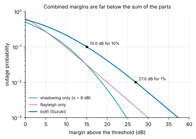

<!-- status: verified -->
# 21-11 · Link Budgets

| | |
|---|---|
| **Course** | [21 · RF and Microwave Engineering](../README.md) |
| **University equivalent** | The system-design and link-budget material of a senior wireless-communications or RF systems course: the link-budget ledger, sensitivity in rate form, maximum allowable path loss, fade and shadowing margins, cell-edge against area coverage, interference margin, and complete budgets for short-range, Wi-Fi, cellular, low-power wide-area, satellite and GNSS links (Rappaport, *Wireless Communications*, the propagation and cellular chapters; Pozar, *Microwave and RF Design of Wireless Systems*) |
| **Prerequisites** | [17-02](../../17-communication-systems/chapters/17-02-noise-and-snr.md) (noise floor, sensitivity), [17-09](../../17-communication-systems/chapters/17-09-wireless-channels.md) (path loss, shadowing, Rayleigh fading), [13-11](../../13-electromagnetics/chapters/13-11-radiation-and-antennas.md) (Friis), [21-03](21-03-noise-figure-and-linearity.md) (noise figure, REFSENS), [21-10](21-10-antennas-arrays-mmwave.md) (antenna and array gain) |
| **Estimated study hours** | 5 |
| **Last verified** | 2026-11-24 |

**Learning objectives.** After this chapter you can:

1. Build a link budget as a ledger from transmit power to required received power, and compute the maximum allowable path loss and the range it implies.
2. Write sensitivity in rate form, explain the range-against-rate trade, and quantify what repetition and narrow bandwidth buy.
3. Size shadowing, fading and combined margins for a target outage, and convert cell-edge to area coverage.
4. Include interference (noise rise), body and penetration losses, and explain why cellular links are uplink-limited.
5. Work complete budgets for Bluetooth LE, Wi-Fi, 5G NR, NB-IoT, a direct-to-phone satellite link and GPS, and judge a vendor's range claim.

## 1. Big picture

A link budget is the accounting that decides whether a radio link works. It starts with the power a transmitter puts out, adds the antenna gains, subtracts every loss on the way (cables, free space, walls, bodies, rain), and compares what arrives with what the receiver needs, plus a margin for the things that vary. Every number in it was derived in an earlier chapter (noise floor and sensitivity in 17-02, Friis in 13-11, path loss and fading in 17-09, antennas in 21-10); this chapter assembles them into the tool engineers actually use, and applies it to the radios in the learner's portfolio: Bluetooth in wearables, Wi-Fi, 5G phones and base stations, low-power IoT, satellite-to-phone and GPS. The budget is also the most useful sanity check on marketing: a range claim that does not survive a one-page link budget is wrong.

- **A budget is a ledger, not a formula:** each line has an owner (PA designer, antenna team, RF front end, modem) and a cost.
- **Range is a weak function of everything:** with a path-loss exponent of 3.5, 10 dB of improvement buys only 1.9 times the range.
- **Low data rate is the cheapest way to go far:** each halving of the rate buys 3 dB of sensitivity, which is how NB-IoT and LoRa reach coupling losses of 160 dB or more and how Bluetooth's Coded PHY extends its range.
- **Margins dominate real budgets:** shadowing, fading, walls, bodies and interference often add up to more than 20 dB.

## 2. Intuition first

Think of the budget as a household budget in decibels. The transmitter's power is income; antenna gains are bonuses; path loss is rent, by far the largest expense; cable, wall and body losses are recurring bills; and the receiver's sensitivity is the minimum balance the bank requires. The margin is the emergency fund: the link must stay solvent not only on an average month but on a bad one, when shadowing and fading take an unpredictable bite.

```text
  P_t ── −L_tx ──► +G_t ═══ EIRP ═══ −PL(d) − L_walls − L_body ═══► +G_r ── −L_rx ──► P_r ≥ S + M
  (PA)   (switch,   (TX        (radiated)     (the channel)              (RX       (front      (sensitivity
         filter)    antenna)                                             antenna)  end)         + margin)
```

**The analogy and its limits.** Money adds linearly; decibels add because they are logarithms of multiplicative factors, which is why a budget in dB is a sum. But margins are probabilities, not fixed costs: a 10 dB shadowing margin and a 20 dB fading margin do not combine into a 30 dB need, because bad shadowing and a deep fade rarely coincide (§3.3).

## 3. Theory

### 3.1 The ledger and the maximum allowable path loss

With all quantities in dB(m), the received power is

$$
P_r = P_t - L_t + G_t - PL - L_{ex} + G_r - L_r ,
$$

where $P_t$ is the PA output, $L_t$ the loss between PA and antenna (switches, filters, matching, 21-09), $G_t$ and $G_r$ the antenna gains (21-10), $PL$ the propagation loss (17-09), $L_{ex}$ the extra losses of the environment (walls, bodies, foliage, rain) and $L_r$ the loss from the receive antenna to the LNA. The link closes if

$$
P_r \ge S + M ,
$$

with $S$ the receiver's sensitivity and $M$ the margin for random variation. Rearranging puts all the known terms on one side and gives the **maximum allowable path loss** (MAPL):

$$
\text{MAPL} = \underbrace{P_t - L_t + G_t}_{\text{EIRP}} + G_r - L_r - S - M - L_{ex} .
$$

3GPP's coverage targets use the closely related **maximum coupling loss** (MCL), the loss between the two antenna connectors, which excludes antenna gains: $\text{MCL} = P_t - S$ when both are referred to the antenna ports. With a path-loss model $PL(d) = PL(d_0) + 10n\log_{10}(d/d_0)$, the range follows by inversion:

$$
d_{max} = d_0 \cdot 10^{(\text{MAPL} - PL(d_0))/(10n)} .
$$

Every decibel gained anywhere in the ledger extends the range by the same factor, $10^{1/(10n)}$: 12% per dB in free space ($n$ = 2), 7% per dB at $n$ = 3.5. That is why engineers fight over single decibels and why range claims are fragile.

### 3.2 Sensitivity in rate form, and the range-against-rate trade

Chapter 17-02 wrote the sensitivity as $S = -174 + 10\log_{10}B + \text{NF} + \text{SNR}_{req} + \text{IM}$. Since $\text{SNR} = (E_b/N_0)(R_b/B)$ for a bit rate $R_b$ in bandwidth $B$, the same sensitivity in terms of the bit rate is

$$
S = -174 + 10\log_{10}R_b + \left(\frac{E_b}{N_0}\right)_{req} + \text{NF} + \text{IM} \quad [\text{dBm}].
$$

The bandwidth has dropped out: what matters is the energy per bit. For a given modulation and code (fixed $E_b/N_0$), **halving the bit rate improves sensitivity by 3 dB**. Shannon's limit (17-07) sets the floor: at spectral efficiency η b/s/Hz, $E_b/N_0 \ge (2^\eta - 1)/\eta$, which tends to $\ln 2$, or −1.59 dB, as η → 0. No code at any rate does better.

**Repetition.** Sending each bit $N$ times and combining the copies coherently multiplies the energy per information bit by $N$: a gain of $10\log_{10}N$ dB at the cost of $N$ times the airtime. Long-range IoT systems (NB-IoT, LTE-M, Bluetooth's Coded PHY, LoRa) stack narrow bandwidth, robust coding and repetition to reach budgets about 20 dB beyond broadband ones (§9). Repetition is not free: airtime means battery energy, latency and network capacity.

### 3.3 Margins and coverage probability

**Shadowing** (17-09): the local mean power is lognormal with standard deviation σ (typically 4–8 dB), so meeting the threshold with probability $p$ needs $M_s = \sigma Q^{-1}(1 - p)$.

**Fast fading** (17-09): with Rayleigh fading the instantaneous power is exponential about its local mean, so outage $p$ needs $M_f = -10\log_{10}[-\ln(1 - p)]$, about 20 dB for 1%.

**Combined.** When both act (the Suzuki model), outage happens when the shadowed local mean, minus the instantaneous fade, falls below the threshold:

$$
P_{out}(M) = \int_{-\infty}^{\infty}\left[1 - \exp\left(-10^{-(M + x)/10}\right)\right]\frac{e^{-x^2/2\sigma^2}}{\sigma\sqrt{2\pi}}\,dx ,
$$

where $x$ is the shadowing in dB. The combined margin for a target outage is found numerically. It is always less than the sum of the separate margins, because the probabilities of the two bad events multiply where they overlap rather than adding in dB (Example 21-11.3). Systems with diversity, coding across time and frequency, or HARQ retransmissions average out much of the fast fading, so cellular budgets usually carry only the shadowing margin plus a small fast-fading allowance.



**Edge against area coverage.** A margin set for probability $p$ at the cell edge gives a higher probability averaged over the cell, because most of the area is closer in. Averaging the edge probability over a disc of radius $R$, with the mean falling as $10n\log_{10}(r/R)$, gives Jakes's formula. With $a = M/(\sigma\sqrt2)$ (the edge margin in units of $\sigma\sqrt2$) and $b = 10n\log_{10}e/(\sigma\sqrt2)$,

$$
U = \frac{1}{2}\left[1 + \text{erf}(a)\right] + \frac{1}{2}\exp\left(\frac{1 + 2ab}{b^2}\right)\left[1 - \text{erf}\left(\frac{1 + ab}{b}\right)\right] .
$$

> **Going deeper — deriving Jakes's formula.** At radius $r$ the coverage probability is $P(r) = \tfrac12[1 + \text{erf}(a - b\ln(r/R))]$, since the mean falls by $10n\log_{10}(r/R) = 10n\log_{10}e\cdot\ln(r/R)$. The area average is $U = (2/R^2)\int_0^R P(r)\,r\,dr$. With $t = \ln(r/R)$, $r\,dr = R^2e^{2t}dt$, so $U = \int_{-\infty}^0 e^{2t}[1 + \text{erf}(a - bt)]\,dt$. Integrating by parts (with $\int e^{2t}dt = e^{2t}/2$ and $\tfrac{d}{dt}\text{erf}(a - bt) = -\tfrac{2b}{\sqrt\pi}e^{-(a - bt)^2}$) gives $\tfrac12[1 + \text{erf}(a)]$ plus $\tfrac{b}{\sqrt\pi}\int_{-\infty}^0 e^{2t - (a - bt)^2}dt$, and completing the square in the exponent turns the last integral into the erfc term above.

With σ = 8 dB and $n$ = 3.5, 75% coverage at the edge gives about 90% over the area; 90% at the edge gives about 97% (Example 21-11.4).

**Interference margin.** In a loaded cell, other users' signals raise the effective noise. If a fraction η of the receiver's total noise-plus-interference power is interference (the **load**), the noise floor rises by

$$
\text{NR} = 10\log_{10}\frac{1}{1 - \eta} ,
$$

3 dB at 50% load and 6 dB at 75%. Cellular budgets carry this as an interference margin, larger on the uplink of busy cells.

**Environment losses.** Building penetration (often 10–30 dB, more through modern coated glass), body loss for a phone held to the head or in a hand (several dB at sub-6 GHz, up to 30 dB at millimetre wave, 21-10), foliage and rain (millimetre wave) are added as separate lines, each with its own variability.

### 3.4 Uplink against downlink

A base station transmits tens of watts through high-gain antennas; a phone transmits at most a fraction of a watt (23 dBm for a standard 5G handset, 21-07) through a small, hand-loaded antenna. The base station also has a lower noise figure and more receive antennas. Even so, the uplink usually has the smaller MAPL, so **cellular coverage is uplink-limited**: the edge of the cell is where the phone can no longer be heard, not where it can no longer hear. Operators balance the links with more base-station receive antennas (diversity and beamforming gain), uplink power classes above 23 dBm, narrower uplink allocations (concentrating the phone's power into fewer resource blocks raises the power spectral density) and, in TDD, by trading downlink slots for uplink ones.

### 3.5 Satellite links and GNSS

For a satellite link the budget is usually written as a carrier-to-noise-density ratio, with the receiver described by its **figure of merit** $G/T$ (antenna gain over system noise temperature, dB/K):

$$
\frac{C}{N_0} = \text{EIRP} - L_{path} - L_{other} + \frac{G}{T} - 10\log_{10}k \quad [\text{dBHz}],
$$

with $10\log_{10}k$ = −228.6 dBW/K/Hz. The achievable bandwidth then follows from the SNR needed: $B = (C/N_0)/\text{SNR}_{req}$. For a low-Earth-orbit satellite at altitude $h$ seen at elevation ε from a terminal on an Earth of radius $R_E$, the slant range is

$$
d = \sqrt{(R_E + h)^2 - R_E^2\cos^2\varepsilon} - R_E\sin\varepsilon ,
$$

600 km overhead but 1075 km at 30° elevation, 5.1 dB more path loss. A phone's G/T is very poor (a near-isotropic antenna in a hand, with a few hundred kelvin of noise), which is why direct-to-phone satellite service starts at text messages and narrowband voice (§9).

**GNSS** is the extreme case: the GPS signal arrives below the thermal noise in its 2 MHz bandwidth, and the receiver recovers it only by correlating against the known spreading code for a millisecond or more (17-02). Its budget is a C/N0: a −128.5 dBm signal (the specified minimum, §9) in a receiver with a 2 dB noise figure gives 43.5 dBHz. A modern receiver keeps tracking signals tens of dB weaker than that by integrating for longer, but it needs much stronger signals to find the satellites from a cold start without help (Example 21-11.9), which is why a phone keeps its fix moving indoors but struggles to get one there.

## 4. Worked examples

### Example 21-11.1 · A wearable's Bluetooth link indoors (tier B)

**Setup.** A smartwatch transmits Bluetooth LE at 0 dBm through an antenna of −5 dBi (small antennas sit between −10 and +10 dBi, §9) to a phone with a 0 dBi antenna across an office, 20 m away through walls. The wrist and body cost 5 dB. Use the ITU-R P.1238-13 site-general office non-line-of-sight model, $L = 23.9\log_{10}d + 30.13 + 24.0\log_{10}f_{GHz}$ (σ = 5.01 dB), at 2.44 GHz. Find (a) the EIRP, (b) the model's intercept at 2.44 GHz, (c) the path loss and (d) the received power. Against a typical modern 1M receiver (−96.5 dBm, §9), find (e) the margin, (f) the shadowing margin for 90% probability and (g) what is left. (h) What is the margin against the Bluetooth specification's minimum of −70 dBm, and (i) at what distance would such a receiver fail (90% probability)? (j) With the Coded PHY (−102 dBm), what is the margin at 20 m?

**Solution.**

- (a) 0 − 5 = **−5** dBm.
- (b) $30.13 + 24.0\log_{10}2.44$ = **39.43** dB; (c) $39.43 + 23.9\log_{10}20$ = **70.52** dB.
- (d) −5 − 70.52 − 5 + 0 = **−80.52** dBm.
- (e) **15.98** dB; (f) $5.01 \times 1.2816$ = **6.42** dB; (g) **9.56** dB.
- (h) **−10.52** dB: a receiver built to the specification's minimum fails.
- (i) $d = 10^{(-5 - 5 + 70 - 6.42 - 39.43)/23.9}$ = **3.9** m.
- (j) **21.48** dB.

**Units check.** dBm − dB = dBm; the model gives dB with $d$ in metres and $f$ in GHz.


**Sanity check.** The specification's −70 dBm is a floor that every certified receiver beats; real radios are 25–30 dB better, and that difference is a tenfold range difference indoors. The 1M budget in (i) applied to a −96.5 dBm receiver would extend beyond the model's 4–30 m fitting range, so for long-range claims the model must be replaced by measurement.

### Example 21-11.2 · What a slower PHY buys (tier B)

**Setup.** Bluetooth's Coded PHY with S = 8 runs at 125 kb/s against 1 Mb/s. (a) At equal $E_b/N_0$, how much sensitivity should the 8× slower rate buy? Data sheets give (b) 5.5 dB (TI CC2340R5: −96.5 to −102 dBm), (c) 8 dB (Nordic nRF52840: −95 to −103 dBm) and (d) 7.5 dB (Silicon Labs FG22: −98.9 to −106.4 dBm). (e) What range factor does 5.5 dB buy in the office model of Example 21-11.1, and (f) what would the ideal gain buy? (g) What is the Shannon limit on $E_b/N_0$ at 1 b/s/Hz, (h) at 0.125 b/s/Hz and (i) as the spectral efficiency goes to zero?

**Solution.**

- (a) $10\log_{10}8$ = **9.03** dB.
- (b–d) **5.5**, **8** and **7.5** dB: real parts collect 60–90% of the ideal energy gain, because the extra redundancy is not combined perfectly and the receiver must still synchronize at the lower SNR.
- (e) $10^{5.5/23.9}$ = **1.70**; (f) $10^{9.03/23.9}$ = **2.39**.
- (g) $(2^1 - 1)/1$ = 1: **0** dB; (h) $(2^{0.125} - 1)/0.125$: **−1.40** dB; (i) $\ln 2$: **−1.59** dB.

**Units check.** dB ratios; spectral efficiency in b/s/Hz.

**Sanity check.** Rate is a powerful lever but a slow one in range: an 8× slower link reaches about 1.7× farther indoors. Bluetooth Coded PHY, LTE-M, NB-IoT and LoRa all buy range this way, paying in airtime and energy per message.

### Example 21-11.3 · Shadowing, fading and both (tier B)

**Setup.** A narrowband link sees lognormal shadowing with σ = 8 dB and Rayleigh fading. For 10% outage, find (a) the shadowing-only margin, (b) the Rayleigh-only margin, (c) their sum and (d) the combined (Suzuki) margin. Repeat for 1% outage: (e–h).

**Solution.**

- (a) $8 \times Q^{-1}(0.1) = 8 \times 1.2816$ = **10.25** dB; (b) $-10\log_{10}(-\ln 0.9)$ = **9.77** dB; (c) **20.03** dB; (d) by numerical integration, **15.03** dB.
- (e) $8 \times 2.3263$ = **18.61** dB; (f) **19.98** dB; (g) **38.59** dB; (h) **26.95** dB.

**Units check.** Margins in dB.

**Sanity check.** The combined margin is 5 dB (10%) and 12 dB (1%) below the naive sum, because a deep fade and a deep shadow rarely coincide. Adding margins in dB over-designs the link; worse, it hides where the real risk sits.

### Example 21-11.4 · Edge against area coverage (tier B)

**Setup.** A cell has path-loss exponent 3.5 and shadowing σ = 8 dB. Find the area coverage for (a) 75% and (b) 90% coverage at the edge, the edge margins (c, d) these require, and (e) the edge probability and (f) margin that give 95% area coverage.

**Solution.** With Jakes's formula (§3.3), $b = 35\log_{10}e/(8\sqrt2)$ = 1.344:

- (a) **89.9** %; (b) **96.6** %.
- (c) $8 \times 0.6745$ = **5.40** dB; (d) **10.25** dB.
- (e) Solving $U$ = 0.95: **86.2** % at the edge, (f) **8.70** dB.

**Units check.** Probabilities; margins in dB.

**Sanity check.** Operators quote area coverage; engineers design the edge. The two differ by 10–15 percentage points, so the same network can honestly be described as "90%" or "75%". The verify script confirms (a) and (b) by Monte Carlo over a disc.

### Example 21-11.5 · Wi-Fi's rate–range curve (tier B)

**Setup.** An 802.11ax 20 MHz channel has 234 data subcarriers and 13.6 µs symbols (12.8 µs plus a 0.8 µs guard interval). Find the single-stream rate for (a) MCS0 (BPSK, rate 1/2), (b) MCS9 (256-QAM, 5/6) and (c) MCS11 (1024-QAM, 5/6), and (d) the MCS11/MCS0 rate ratio in dB. The IEEE minimum sensitivities are −82 and −52 dBm (§9): (e) what is the difference? Compare with Shannon: (f, g) the minimum $E_b/N_0$ at the MCS0 and MCS11 spectral efficiencies and (h) the total Shannon difference in required power. A Wi-Fi 6 chip transmits 19.5 dBm at MCS0 and 16.5 dBm at MCS9 (back-off for EVM), with sensitivities of −93.8 and −69.0 dBm (§9). Find (i, j) the link budget (transmit power minus sensitivity) for each, (k) the difference and (l) the range ratio in the office model of Example 21-11.1.

**Solution.**

- (a) $234 \times 1 \times \tfrac12/13.6\ \mu\text{s}$ = **8.60** Mb/s; (b) $234 \times 8 \times \tfrac56/13.6\ \mu\text{s}$ = **114.7** Mb/s; (c) **143.4** Mb/s; (d) **12.22** dB.
- (e) **30** dB.
- (f) η = 0.430 b/s/Hz: **−0.93** dB; (g) η = 7.17 b/s/Hz: **13.00** dB; (h) 13.92 + 12.22 = **26.14** dB.
- (i) 19.5 + 93.8 = **113.3** dB; (j) 16.5 + 69.0 = **85.5** dB; (k) **27.8** dB; (l) $10^{27.8/23.9}$ = **14.6**.

**Units check.** Bits per symbol × code rate / symbol time = b/s.

**Sanity check.** High rates cost twice: more bits per second (12 dB) and much more energy per bit (14 dB by Shannon, more in practice). Fourteen times the range separates the slowest and fastest modes, which is why Wi-Fi throughput collapses with distance and why rate adaptation is the most important algorithm in a Wi-Fi driver.

### Example 21-11.6 · Why the uplink limits the cell (tier B)

**Setup.** Using 3GPP's coupling-loss template assumptions (base station 46 dBm, phone 23 dBm, base-station noise figure 5 dB, phone 9 dB, §9) and the same required SNR (0 dB) in both directions, find the maximum coupling loss (a) on the downlink spread over 10 MHz, (b) on the uplink if the phone spreads its power over 10 MHz and (c) if it concentrates it in 360 kHz. (d) What imbalance remains? (e) A power-class-2 phone (26 dBm) gains 3 dB: by what factor does that extend uplink range in the 3GPP urban-macro NLOS model, whose distance slope is 39.08 dB/decade?

**Solution.** MCL = $P_t - 10\log_{10}B + 174 - \text{NF} - \text{SNR}$:

- (a) 46 − 70 + 174 − 9 = **141** dB.
- (b) 23 − 70 + 174 − 5 = **122** dB.
- (c) $10\log_{10}(360\ \text{kHz})$ = 55.56 dB: **136.44** dB.
- (d) **4.56** dB.
- (e) $10^{3/39.08}$ = **1.19**.

**Units check.** dBm − dB(Hz) + dBm/Hz terms give dB.

**Sanity check.** The phone's 23 dBm against the base station's 46 dBm is a 23 dB gap; the base station's better noise figure recovers 4 dB and narrowband scheduling 14 dB. What remains is closed with base-station receive diversity and beamforming (21-10). The cell edge is where the phone can no longer be heard.

### Example 21-11.7 · How NB-IoT reaches 164 dB (tier C)

**Setup.** 3GPP's massive-IoT target is a 164 dB maximum coupling loss at 160 b/s with a 23 dBm device and a 5 dB base-station noise figure (§9). Find (a) the sensitivity this requires, (b) the noise in one 15 kHz subcarrier and (c) the SNR the base station must work at. (d) In rate form, what $E_b/N_0$ does it imply? (e) If one transmission needs 1 dB SNR, how many repetitions close the gap (round up to a power of 2)?

**Solution.**

- (a) 23 − 164 = **−141** dBm. (b) $-174 + 10\log_{10}15000 + 5$ = **−127.24** dBm. (c) **−13.76** dB.
- (d) $-141 - (-174 + 10\log_{10}160 + 5)$ = **5.96** dB: comfortable for a coded link.
- (e) $10^{(1 + 13.76)/10}$ = 29.9, so **32** repetitions.

**Units check.** dBm and dB throughout.

**Sanity check.** 164 dB is 20–25 dB beyond broadband cellular, bought with a single narrow subcarrier (17 dB less noise than 1 MHz) and tens of repetitions. The price is seconds of airtime per message, acceptable for a meter, useless for video.

### Example 21-11.8 · A satellite talks to a phone (tier C)

**Setup.** 3GPP's NTN study (§9) analyses a low-Earth-orbit satellite at 600 km serving a handheld at 30° elevation in S-band (2 GHz). The satellite radiates 34 dBW/MHz over 30 MHz; the phone has a 0 dBi antenna, a 290 K antenna temperature and a 7 dB noise figure; atmosphere, shadowing and scintillation add 0.1 + 3 + 2.2 dB. Find (a) the slant range, (b) the path loss, (c) the phone's system temperature and (d) its G/T, (e) the downlink EIRP, (f) the C/N0 and (g) the CNR in 30 MHz. On the uplink the phone sends 23 dBm (−7 dBW) to a satellite with G/T 1.1 dB/K: find (h) the C/N0, (i) the CNR in 360 kHz and (j) the Shannon capacity of that channel.

**Solution.**

- (a) $\sqrt{6971^2 - 6371^2\cos^2 30°} - 6371\sin 30°$ = **1075** km. (b) $20\log_{10}(4\pi \times 1.075 \times 10^6/0.1499)$ = **159.10** dB.
- (c) $T = 290 + 290(10^{0.7} - 1)$ = **1453** K; (d) $0 - 10\log_{10}1453$ = **−31.62** dB/K.
- (e) $34 + 10\log_{10}30$ = **48.77** dBW.
- (f) 48.77 − 159.10 − 5.3 − 31.62 + 228.6 = **81.3** dBHz; (g) 81.35 − 74.77 = **6.6** dB.
- (h) −7 − 159.10 − 5.3 + 1.1 + 228.6 = **58.3** dBHz; (i) 58.30 − 55.56 = **2.7** dB (3GPP rounds to 2.8).
- (j) $360\ \text{kHz} \times \log_2(1 + 10^{0.274})$ = **549** kb/s.

**Units check.** dBW − dB + dB/K − dBW/(K·Hz) = dBHz.

**Sanity check.** Even with a satellite antenna 30 dBi strong, the phone's uplink closes at under 3 dB SNR in a few hundred kilohertz: about half a megabit per second at the Shannon limit, shared by everyone in the beam. Direct-to-phone service starts with messaging and needs huge satellite apertures to grow (§9).

### Example 21-11.9 · GPS indoors (tier B)

**Setup.** GPS L1 C/A arrives at no less than −128.5 dBm (§9). (a) With a 2 dB noise figure, what C/N0 results? (b) What is the SNR in the 2 MHz signal bandwidth, and (c) in the 1 kHz bandwidth of a 1 ms correlation? A receiver tracks down to −167 dBm and cold-starts from −148 dBm (§9). How much attenuation can it tolerate (d) while tracking and (e) for a cold start, and (f) what C/N0 corresponds to −167 dBm?

**Solution.**

- (a) −128.5 + 174 − 2 = **43.5** dBHz.
- (b) 43.5 − 63.01 = **−19.51** dB: below the noise. (c) 43.5 − 30 = **13.5** dB after despreading.
- (d) **38.5** dB; (e) **19.5** dB; (f) **5** dBHz.

**Units check.** dBm − dBm/Hz = dBHz; dBHz − dB(Hz) = dB.

**Sanity check.** A house costs 10–30 dB: a receiver that already has its fix keeps it indoors, but one starting cold needs to find satellites with 19 dB less margin, which is why phones download satellite data over the cellular network (assisted GNSS).

### Answer key

<!-- answer-key -->
| ID | Quantity | Value | Unit |
|---|---|---|---|
| Ex 21-11.1a | EIRP | −5 | dBm |
| Ex 21-11.1b | model intercept at 2.44 GHz | 39.43 | dB |
| Ex 21-11.1c | path loss at 20 m | 70.52 | dB |
| Ex 21-11.1d | received power | −80.52 | dBm |
| Ex 21-11.1e | margin, 1M receiver | 15.98 | dB |
| Ex 21-11.1f | shadowing margin, 90 % | 6.42 | dB |
| Ex 21-11.1g | margin left | 9.56 | dB |
| Ex 21-11.1h | margin, specification minimum | −10.52 | dB |
| Ex 21-11.1i | range, specification minimum | 3.9 | m |
| Ex 21-11.1j | margin, Coded PHY | 21.48 | dB |
| Ex 21-11.2a | ideal gain of an 8× slower rate | 9.03 | dB |
| Ex 21-11.2b | CC2340R5 gain | 5.5 | dB |
| Ex 21-11.2c | nRF52840 gain | 8 | dB |
| Ex 21-11.2d | FG22 gain | 7.5 | dB |
| Ex 21-11.2e | range factor, 5.5 dB | 1.70 | |
| Ex 21-11.2f | range factor, 9.03 dB | 2.39 | |
| Ex 21-11.2g | Shannon Eb/N0, 1 b/s/Hz | 0 | dB |
| Ex 21-11.2h | Shannon Eb/N0, 0.125 b/s/Hz | −1.40 | dB |
| Ex 21-11.2i | Shannon Eb/N0 limit | −1.59 | dB |
| Ex 21-11.3a | shadowing margin, 10 % | 10.25 | dB |
| Ex 21-11.3b | Rayleigh margin, 10 % | 9.77 | dB |
| Ex 21-11.3c | sum, 10 % | 20.03 | dB |
| Ex 21-11.3d | combined margin, 10 % | 15.03 | dB |
| Ex 21-11.3e | shadowing margin, 1 % | 18.61 | dB |
| Ex 21-11.3f | Rayleigh margin, 1 % | 19.98 | dB |
| Ex 21-11.3g | sum, 1 % | 38.59 | dB |
| Ex 21-11.3h | combined margin, 1 % | 26.95 | dB |
| Ex 21-11.4a | area coverage, 75 % edge | 89.9 | % |
| Ex 21-11.4b | area coverage, 90 % edge | 96.6 | % |
| Ex 21-11.4c | edge margin, 75 % | 5.40 | dB |
| Ex 21-11.4d | edge margin, 90 % | 10.25 | dB |
| Ex 21-11.4e | edge probability for 95 % area | 86.2 | % |
| Ex 21-11.4f | edge margin for 95 % area | 8.70 | dB |
| Ex 21-11.5a | MCS0 rate | 8.60 | Mb/s |
| Ex 21-11.5b | MCS9 rate | 114.7 | Mb/s |
| Ex 21-11.5c | MCS11 rate | 143.4 | Mb/s |
| Ex 21-11.5d | rate ratio | 12.22 | dB |
| Ex 21-11.5e | sensitivity difference | 30 | dB |
| Ex 21-11.5f | Shannon Eb/N0, MCS0 | −0.93 | dB |
| Ex 21-11.5g | Shannon Eb/N0, MCS11 | 13.00 | dB |
| Ex 21-11.5h | Shannon power difference | 26.14 | dB |
| Ex 21-11.5i | budget at MCS0 | 113.3 | dB |
| Ex 21-11.5j | budget at MCS9 | 85.5 | dB |
| Ex 21-11.5k | difference | 27.8 | dB |
| Ex 21-11.5l | range ratio | 14.6 | |
| Ex 21-11.6a | downlink MCL | 141 | dB |
| Ex 21-11.6b | uplink MCL, 10 MHz | 122 | dB |
| Ex 21-11.6c | uplink MCL, 360 kHz | 136.44 | dB |
| Ex 21-11.6d | remaining imbalance | 4.56 | dB |
| Ex 21-11.6e | range factor of 3 dB | 1.19 | |
| Ex 21-11.7a | required sensitivity | −141 | dBm |
| Ex 21-11.7b | noise in 15 kHz | −127.24 | dBm |
| Ex 21-11.7c | required SNR | −13.76 | dB |
| Ex 21-11.7d | implied Eb/N0 | 5.96 | dB |
| Ex 21-11.7e | repetitions | 32 | |
| Ex 21-11.8a | slant range | 1075 | km |
| Ex 21-11.8b | path loss | 159.10 | dB |
| Ex 21-11.8c | system temperature | 1453 | K |
| Ex 21-11.8d | handheld G/T | −31.62 | dB/K |
| Ex 21-11.8e | downlink EIRP | 48.77 | dBW |
| Ex 21-11.8f | downlink C/N0 | 81.3 | dBHz |
| Ex 21-11.8g | downlink CNR, 30 MHz | 6.6 | dB |
| Ex 21-11.8h | uplink C/N0 | 58.3 | dBHz |
| Ex 21-11.8i | uplink CNR, 360 kHz | 2.7 | dB |
| Ex 21-11.8j | uplink Shannon capacity | 549 | kb/s |
| Ex 21-11.9a | C/N0 at the minimum level | 43.5 | dBHz |
| Ex 21-11.9b | SNR in 2 MHz | −19.51 | dB |
| Ex 21-11.9c | SNR in 1 kHz | 13.5 | dB |
| Ex 21-11.9d | attenuation tolerated, tracking | 38.5 | dB |
| Ex 21-11.9e | attenuation tolerated, cold start | 19.5 | dB |
| Ex 21-11.9f | C/N0 at −167 dBm | 5 | dBHz |
| Txt 21-11.a | range factor of 10 dB at n = 3.5 | 1.9 | |
| Txt 21-11.b | range gain per dB, n = 2 | 12 | % |
| Txt 21-11.c | range gain per dB, n = 3.5 | 7 | % |
| Txt 21-11.d | Rayleigh margin for 1 % | 20 | dB |
| Txt 21-11.e | noise rise at 50 % load | 3 | dB |
| Txt 21-11.f | noise rise at 75 % load | 6 | dB |
| Txt 21-11.g | extra path loss at 30° elevation, 600 km | 5.1 | dB |
| Txt 21-11.h | packet error rate at 0.1 % BER, 37-byte payload | 30.8 | % |
| Txt 21-11.i | US minus EU 2.4 GHz EIRP ceiling | 16 | dB |
| Txt 21-11.j | LoRa headline budget | 170 | dB |
| Txt 21-11.k | LoRa SF12 bit rate, 10.4 kHz | 24 | b/s |
| Txt 21-11.l | LoRa SF12 bit rate, 125 kHz | 293 | b/s |
| Txt 21-11.m | PFD limit as received power, 0 dBi at 1.9 GHz | −117.0 | dBm/MHz |
| Txt 21-11.n | waiver PFD as received power | −107.6 | dBm/MHz |

## 5. Simulate it

The lab ([labs/21-11-lab](../labs/21-11-lab/README.md)) puts the ledger, the margins and the coverage formulas into `linkbudget.py` and checks them by Monte Carlo. A link budget has no circuit to simulate in ngspice; the lab instead simulates the randomness the margins are meant to cover.

**Predict, then run.**

1. Predict the received power and margin of the wearable link of Example 21-11.1 at 10, 20 and 30 m, then plot received power against distance with the 1M, Coded and specification sensitivities (Part 1).
2. Predict the combined shadowing-plus-Rayleigh margin for 10% outage, then draw a million samples of shadowing and fading and count the outages (Part 2).
3. Predict the area coverage for 75% at the edge, then scatter users uniformly over a disc and count (Part 3).
4. Predict how many repetitions an NB-IoT device at 164 dB needs, then simulate coherent combining of noisy BPSK repetitions and measure the SNR gain (Part 4).
5. Predict the uplink CNR of the satellite link of Example 21-11.8 at 90° and 20° elevation, then sweep elevation (Part 5).

## 6. Engineering tradeoffs

| Knob | Improves | Costs | Typical decision owner |
|---|---|---|---|
| Transmit power | Range, robustness | Battery, heat, PA cost; regulatory caps | PA designer, regulatory |
| Antenna gain and efficiency | Every link at once | Size, industrial design, directivity (coverage elsewhere) | Antenna and industrial design |
| Data rate (MCS, PHY) | Range when lowered (3 dB per halving, more for robust modulation) | Throughput, airtime, energy per message | Modem and protocol designers |
| Repetition and narrow bandwidth | Coupling loss (IoT, satellite) | Latency, airtime, network capacity | System architect |
| Fade and shadowing margin | Reliability | Range, or more sites | Network planner |
| Receive diversity and beamforming | Uplink budget, fade margin | Antennas, RF chains, power | Base-station architect |
| Noise figure | Sensitivity, dB for dB | LNA power, filter loss, cost | RF front-end designer |
| Site density | Coverage and capacity | Capital and operating cost | Operator |

## 7. Numbers to know

| Quantity | Value | Note |
|---|---|---|
| Thermal noise | −174 dBm/Hz | 17-02 |
| Range per dB | ×1.12 (n = 2), ×1.07 (n = 3.5) | §3.1 |
| Shannon limit | $E_b/N_0$ ≥ −1.59 dB | §3.2 |
| Rayleigh margin | 9.8 dB (10%), 20 dB (1%) | §3.3 |
| Bluetooth LE sensitivity, specification | −70 dBm (1M, 2M), −82 dBm (Coded S = 8) | [1] (Core 6.2) |
| Bluetooth LE sensitivity, real parts | about −95 to −99 dBm (1M), −102 to −107 dBm (Coded) | [2] (as of Nov 2026) |
| Wi-Fi minimum sensitivity, 20 MHz | −82 dBm (MCS0) to −52 dBm (MCS11); −3 dB per bandwidth doubling | [3] |
| 2.4 GHz power limits | US 30 dBm conducted + 6 dBi; EU 20 dBm EIRP | [4] |
| NR UE power classes | 23 / 26 / 29 / 31 dBm | [5] |
| 3GPP coupling-loss targets | 164 dB (massive IoT, 160 b/s); 140–143 dB (eMBB extreme coverage) | [5] |
| Shadowing σ (3GPP) | 4 dB (LOS), 6–8 dB (NLOS) | [6] |
| Satellite to handheld (LEO 600 km, S-band) | G/T −31.6 dB/K; path loss 159 dB; uplink CNR about 3 dB in 360 kHz | [7] |
| GPS L1 C/A minimum | −128.5 dBm | [9] |

## 8. Common mistakes

- **Using the specification's sensitivity as the design point.** It is a floor (−70 dBm for Bluetooth 1M); real receivers are 25 dB better, and each data sheet's own number is a different PER, payload and PHY.
- **Mixing conducted and radiated numbers.** Data-sheet sensitivities are measured at a connector; the antenna's gain (often negative in a wearable) and the body come on top.
- **Adding margins in dB.** Shadowing and fading margins combine probabilistically; the sum over-designs (Example 21-11.3).
- **Confusing edge and area coverage.** 75% at the edge is about 90% of the area.
- **Forgetting the uplink.** The phone's 23 dBm, not the base station's 46 dBm, usually sets the cell edge.
- **Comparing budgets across data rates.** A "170 dB" LoRa budget is at 24 b/s; a 111 dB Bluetooth budget is at 125 kb/s. Compare at equal rates or in $E_b/N_0$.
- **Extrapolating path-loss models.** Every model has a fitted distance and frequency range; outside it, measure.

## 9. Practitioner lens

### State of the art (as of Nov 2026)

- **What the standards demand [Established].** Bluetooth Core 6.2 sets the reference sensitivity at "-70 dBm" for the uncoded PHYs and −75 and −82 dBm for Coded S = 2 and S = 8, at a bit-error rate of 0.1% for short packets, and allows transmit power "between 0.01 mW (-20 dBm) and 100 mW (+20 dBm)" [1]. With random bit errors, 0.1% BER on a 37-byte test packet (368 counted bits) is a **30.8** % packet-error rate. Wi-Fi's minimum sensitivities (draft 802.11be tables, 10% PER with 4096-byte packets) run from −82 dBm at MCS0 to −52 dBm at MCS11 in 20 MHz [3]. 5G NR phones are 23 dBm by default, with 26, 29 and 31 dBm classes ("PC1 UE is not targeted for smartphone form factor"); a wide-area base station has "no upper limit" on rated power [5].
- **What real radios do [Industry estimate, vendor typicals].** TI's CC2340R5 receives Bluetooth 1M at −96.5 dBm and Coded at −102 dBm and transmits 0 dBm on 5.1 mA [2]; Nordic's nRF52840 quotes −95 and −103 dBm and "a total link budget of >111 dBm [sic]", which is its +8 dBm maximum minus its best sensitivity [2]. Espressif's ESP32-C6 is about 12 dB better than the IEEE Wi-Fi minimums (−93.8 dBm at MCS0) and backs its transmit power off from 19.5 to 16.5 dBm at MCS9 to meet the EVM limit [3].
- **Regulation [Established].** In the US a 2.4 GHz digital transmitter may deliver 1 W with antennas up to 6 dBi; the EU caps "e.i.r.p." at 20 dBm: a **16** dB difference in budget [4].
- **Coverage targets [Established].** 3GPP's requirement study sets a 164 dB maximum coupling loss target for massive IoT at 160 b/s and 140–143 dB for extreme-coverage broadband, with base-station and device noise figures of 5 and 9 dB [5]; the ITU's IMT-2020 evaluations assume 5 and 7 dB [5].
- **Low-power wide area [Industry estimate].** Semtech's LoRa transceiver advertises a "170 dB maximum link budget": +22 dBm and −148 dBm sensitivity at SF12 in a 10.4 kHz channel, about **24** b/s; at the 125 kHz bandwidth common in networks it is −137 dBm at about **293** b/s [8].
- **Satellite to phone [Established study; Industry estimate for services].** 3GPP's NTN study finds a low-orbit S-band link to a handheld closes at a 2.8 dB uplink CNR in 360 kHz [7]. Apple warns that "a message might take 30 seconds or more to send" with a clear view of the sky [7]. AST SpaceMobile's BlueBird 6 deploys a "phased array antenna spanning nearly 2,400 square feet" (trade press, Dec 2025) [7]: the satellite's aperture closes the link a phone's antenna cannot.
- **GNSS [Established].** GPS specifies L1 C/A at no less than −158.5 dBW (−128.5 dBm) at a 3 dBi antenna [9]; a current receiver tracks to −167 dBm ("Demonstrated with a good external LNA") but cold-starts only from −148 dBm [9].

### Why it matters commercially

- **Battery life is a link budget.** Every dB of antenna efficiency or sensitivity in a wearable trades directly against transmit power or retries, which is current from a small battery.
- **Coverage is capital.** In cellular networks the uplink budget sets the cell radius, and site count scales roughly as $1/R^2$: a 3 dB uplink improvement at $n$ = 3.9 is about 30% fewer sites for the same area (Problem 21-11.9).
- **Interference rules are commercial fights.** The FCC let SpaceX's direct-to-cell service exceed the −120 dBW/m²/MHz out-of-band limit up to −110.6 dBW/m²/MHz; AT&T predicted an 18% throughput loss and T-Mobile 0.2–1.8% [7]. At a 0 dBi antenna at 1.9 GHz those limits are **−117.0** and **−107.6** dBm/MHz, against a −108 dBm/MHz noise floor: both sides' numbers follow from the same budget with different assumptions [Contested].

### Marketing vs Reality

1. **"Sensitivity −106 dBm."** At which PHY and error rate? Bluetooth sensitivities are at 0.1% BER, about 31% packet loss; the headline is the Coded PHY, 8× slower than 1M [1], [2]. Ask for the number at the rate you will use.
2. **"170 dB link budget."** At 24 b/s, with boosted receive gain and switch loss excluded; a 125 kHz network link has about 159 dB [8]. Compare budgets at equal rates.
3. **"More than a kilometre of Bluetooth range."** The SIG itself says range is "More than a kilometer. Less than a meter.", with antennas spanning "–10 dBi to +10 dBi" [1]: 20 dB of antenna spread alone is a factor of 7 in range indoors.
4. **"Works anywhere a phone does" (satellite).** A 2.8 dB uplink CNR in 360 kHz outdoors [7]; walls and foliage take more than that.

### Questions for engineering leaders

1. **"Your data sheet says −105 dBm. At what PHY, error rate, payload and test setup?"** *Strong:* names the PHY (e.g., Coded S = 8), the 0.1% BER / 30.8% PER criterion, conducted measurement, and the rate the product actually uses with its sensitivity [1], [2]. *Evasive:* "Best-in-class sensitivity."
2. **"What margin do you carry, and from what statistics?"** *Strong:* names σ (3GPP 4–8 dB), the outage or coverage target, edge versus area, and whether fading is averaged by diversity or HARQ [6]. *Evasive:* "We add 10 dB to be safe."
3. **"Which link limits your coverage, uplink or downlink, and by how much?"** *Strong:* a two-column budget with powers, noise figures and allocations, and the measures that balance it (Example 21-11.6) [5]. *Evasive:* "Our base station transmits 80 W."
4. **"For the satellite service: what uplink CNR and bandwidth at 30° elevation, and what indoors?"** *Strong:* cites about 3 dB in a few hundred kilohertz outdoors and explains the latency [7]. *Evasive:* "Works anywhere."
5. **"Is your transmit power limited by regulation, by PA linearity or by battery?"** *Strong:* separates the regulatory cap [4], the EVM back-off at high rates [3] and the current budget [2]. *Evasive:* "We transmit at maximum power."

## 10. Concept check

**Q1.** What is the maximum allowable path loss, and why is it more useful than a range?

<details><summary>Answer</summary>

It is everything the link can lose between the antennas and still close: EIRP plus receive gain minus receive losses, sensitivity and margins. It is independent of the environment; the range follows only once a path-loss model is chosen, and the same MAPL gives very different ranges outdoors and indoors.

</details>

**Q2.** Why does halving the data rate improve sensitivity by 3 dB, and what limits the trick?

<details><summary>Answer</summary>

At fixed $E_b/N_0$ the required power is proportional to the bit rate. The limit is Shannon's $E_b/N_0 \ge -1.59$ dB, plus practical costs: airtime, energy per message, latency and synchronization at very low SNR.

</details>

**Q3.** Why is the combined shadowing-and-fading margin smaller than the sum of the two?

<details><summary>Answer</summary>

Outage needs the total (shadowing plus fade) to fall below the threshold; a deep shadow and a deep fade rarely occur together, so the probability of their sum exceeding a margin is much less than either margin alone suggests.

</details>

**Q4.** Why is 75% coverage at the edge about 90% over the area?

<details><summary>Answer</summary>

Most of a disc's area is at larger radii but still inside the edge, where the mean signal is stronger; averaging the coverage probability over the disc weights these better-served points (Jakes's formula).

</details>

**Q5.** Why are cellular cells uplink-limited, and how do operators rebalance them?

<details><summary>Answer</summary>

The phone transmits about 23 dB less than the base station. The base station's better noise figure recovers a few dB; narrow uplink allocations, receive diversity and beamforming, higher UE power classes and TDD slot ratios recover the rest.

</details>

**Q6.** How does NB-IoT reach 164 dB of coupling loss?

<details><summary>Answer</summary>

By sending a very low rate (160 b/s) in a narrow subcarrier, so the noise bandwidth is small, and repeating each transmission tens of times so the receiver can combine the energy; the base station then works at an SNR near −14 dB.

</details>

**Q7.** Why is a satellite-to-phone link so slow?

<details><summary>Answer</summary>

The phone's antenna is near-isotropic and its noise temperature high (G/T about −32 dB/K), and the path loss is about 159 dB at 2 GHz from 600 km: the uplink closes at about 3 dB SNR in a few hundred kilohertz, half a megabit per second at the Shannon limit, shared by the whole beam.

</details>

Problems: [21-11 problem set](../problems/21-11-problems.md) · Worked solutions: [21-11 solutions](../solutions/21-11-solutions.md)

## 11. Key terms

[Link budget](../../../reference/glossary.md#link-budget) · [Maximum allowable path loss (MAPL)](../../../reference/glossary.md#maximum-allowable-path-loss-mapl) · [Maximum coupling loss (MCL)](../../../reference/glossary.md#maximum-coupling-loss-mcl) · [Fade margin](../../../reference/glossary.md#fade-margin) · [Area coverage](../../../reference/glossary.md#area-coverage) · [Noise rise](../../../reference/glossary.md#noise-rise) · [Repetition gain](../../../reference/glossary.md#repetition-gain) · [G/T (figure of merit)](../../../reference/glossary.md#g-t-figure-of-merit) · [Uplink-limited coverage](../../../reference/glossary.md#uplink-limited-coverage) · [Carrier-to-noise-density ratio](../../../reference/glossary.md#carrier-to-noise-density-ratio) · [EIRP](../../../reference/glossary.md#eirp)

## 12. Connections

- **Builds on:** [17-02](../../17-communication-systems/chapters/17-02-noise-and-snr.md) (sensitivity), [17-07](../../17-communication-systems/chapters/17-07-information-theory-and-shannon.md) (Shannon's limit), [17-09](../../17-communication-systems/chapters/17-09-wireless-channels.md) (path loss, shadowing, fading), [13-11](../../13-electromagnetics/chapters/13-11-radiation-and-antennas.md) (Friis), [21-03](21-03-noise-figure-and-linearity.md) (noise figure, REFSENS), [21-10](21-10-antennas-arrays-mmwave.md) (antenna and array gain).
- **Next:** [21-12](21-12-modem-baseband-and-standards.md) turns from the RF link to the modem that runs over it and the standards that define both.
- **Used later:** the wearable and IoT radios of [27-03](../../27-system-architectures/chapters/27-03-wearables-smartwatch.md) and the capstones.

## 13. Further study

- T. S. Rappaport, *Wireless Communications: Principles and Practice*, 2nd ed., Prentice Hall, 2002: the propagation chapters, including the edge-to-area coverage derivation.
- W. C. Jakes (ed.), *Microwave Mobile Communications*, Wiley, 1974, the origin of the area-coverage formula, and H. Suzuki [10] for combined shadowing and fading.
- 3GPP TR 38.913 [5], whose coupling-loss template is the industry's standard one-page budget.

## 14. Sources

1. Bluetooth SIG, *Bluetooth Core Specification* v6.2 (2025-11-03), Vol 6 Part A, §3–4; Bluetooth SIG, "Understanding Bluetooth range," read 24 Nov 2026 [R-406].
2. Texas Instruments, *CC2340R SimpleLink family* data sheet, SWRS272F (rev. May 2026); Nordic Semiconductor, *nRF52840 Product Brief* v2.3; Silicon Labs, *EFR32FG22* preliminary data sheet rev 0.4 [R-406].
3. L. Ward and J. Köpp, *IEEE 802.11be Technology Introduction*, Rohde & Schwarz white paper, Mar 2022, Table 6-4 (from draft D1.0); Espressif, *ESP32-C6 Series Datasheet* v1.6 (Nov 2026) [R-407].
4. 47 CFR §15.247 and §15.407 (eCFR, as of 1 Nov 2026); ETSI EN 300 328 V2.2.2 (2019-07) [R-407].
5. 3GPP TS 38.101-1 V19.7.0 (2026-10), Tables 6.2.1-1 and 7.3.2; 3GPP TS 38.104 V19.6.0 (2026-09); 3GPP TR 38.913 V19.0.0 (2025-10), §7.10; Report ITU-R M.2412-0 (10/2017) [R-408].
6. 3GPP TR 38.901 V19.5.0 (2026-09), §7.4; Rec. ITU-R P.1238-13 (09/2025); Rec. ITU-R P.525-5 (11/2024) [R-409].
7. 3GPP TR 38.821 V16.2.0 (2023-03), Tables 6.1.1.1 and 6.1.3.3-1; 3GPP TS 38.101-5 V19.6.0 (2026-09); FCC Order DA 25-197, 7 Mar 2025; Apple Support articles 105097 and 101573; "AST SpaceMobile deploys BlueBird 6," SatNews, 24 Dec 2025 [R-410].
8. Semtech, *SX1261/2 Data Sheet* Rev 1.1 (Dec 2017) and *LoRa SX126x* product brochure [R-411].
9. IS-GPS-200N (1 Aug 2022), §3.3.1.6; u-blox, *MAX-M10S Data Sheet*, UBX-20035208 R08 (30 Jan 2026) [R-411].
10. H. Suzuki, "A statistical model for urban radio propogation [sic]," *IEEE Trans. Commun.*, vol. 25, no. 7, pp. 673–680, Jul. 1977, DOI 10.1109/TCOM.1977.1093888; W. C. Jakes (ed.), *Microwave Mobile Communications*, Wiley, 1974; H. T. Friis, "A note on a simple transmission formula," *Proc. IRE*, vol. 34, no. 5, pp. 254–256, May 1946, DOI 10.1109/JRPROC.1946.234568 [R-412].
