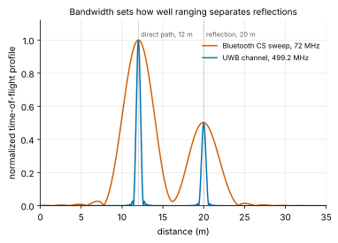
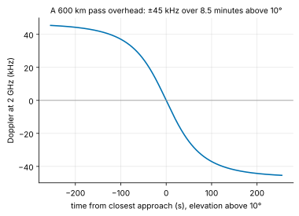

<!-- status: verified -->
# 21-12 · Modem Baseband Architecture and Wireless Standards

| | |
|---|---|
| **Course** | [21 · RF and Microwave Engineering](../README.md) |
| **University equivalent** | The system-level close of a senior wireless-systems sequence: the modem datapath from ADC to IP packet, peak-rate and capability arithmetic, decoder and memory sizing, ranging radios (Bluetooth Channel Sounding, UWB), GNSS signal structure, satellite-to-device adaptations, and the standards process that defines them (Dahlman, Parkvall and Sköld, *5G NR: The Next Generation Wireless Access Technology*; Kaplan and Hegarty, *Understanding GPS/GNSS*) |
| **Prerequisites** | [17-10](../../17-communication-systems/chapters/17-10-ofdm.md) (OFDM), [17-08](../../17-communication-systems/chapters/17-08-channel-coding.md) (channel coding), [17-11](../../17-communication-systems/chapters/17-11-mimo-and-beamforming.md) (MIMO, the NR peak-rate formula), [17-12](../../17-communication-systems/chapters/17-12-multiple-access-and-cellular-wifi.md) (cellular and Wi-Fi systems), [21-08](21-08-transceiver-architectures.md) (transceivers), [21-11](21-11-link-budgets.md) (link budgets) |
| **Estimated study hours** | 9 |
| **Last verified** | 2026-11-24 |

**Learning objectives.** After this chapter you can:

1. Trace a received signal through the modem datapath and estimate the compute each stage needs.
2. Compute peak data rates from the 3GPP capability formula across carrier aggregation, and check a vendor's claim against it.
3. Size a modem's channel decoder, HARQ soft buffer and layer-2 buffer from first principles and published silicon.
4. Derive the rates of Wi-Fi 7 from its tone plan, and explain where "46 Gbps" comes from.
5. Derive the ranging resolution and error budgets of UWB two-way ranging, Bluetooth Channel Sounding and GNSS, including the dual-frequency ionosphere correction.
6. Explain what satellite-to-device operation changes in a modem (Doppler, delay, HARQ), and place 4G, 5G, 5G-Advanced, 6G, Wi-Fi 7 and 8, Bluetooth 6, UWB and GNSS on a dated standards map.

## 1. Big picture

The **modem** (modulator-demodulator, or baseband processor) is the digital engine between a radio's converters and the operating system's network stack. It turns samples into packets and back: filtering, FFTs, channel estimation, MIMO detection, demodulation, decoding, retransmission, ciphering and the protocol layers that schedule all of it. In a phone it is one of the largest and most power-hungry blocks after the application processor, and it is where the standards bodies' documents become silicon: every feature 3GPP, IEEE 802.11 or the Bluetooth SIG writes into a specification costs gates, memory and milliwatts in someone's modem. This chapter takes the RF chain of Course 21 to the bit pipe and gives the learner the arithmetic to read a modem product brief, and the standards map to judge which features are real, shipping and certified.

- **Peak rates are arithmetic, not measurements:** bandwidth × layers × bits per symbol × code rate, minus overhead; real users see 1–3% of them.
- **Decoding and memory dominate the modem's silicon:** LDPC decoders run at picojoules per bit, and the HARQ soft buffer is tens of megabytes.
- **Ranging is now a radio feature:** UWB, Bluetooth Channel Sounding and dual-frequency GNSS turn timing and phase into position.
- **Standards are dated, staged commitments:** a feature is real when it is frozen, implemented, certified and deployed, in that order.

## 2. Intuition first

Picture the receive side of a modem as a factory line. Raw material (ADC samples) enters at one end; finished goods (IP packets) leave at the other. Each station removes one kind of uncertainty: the digital front end removes out-of-band signals and the wrong sample rate; the FFT separates the subcarriers; channel estimation learns how each subcarrier was bent; the MIMO detector unmixes the layers; the demapper turns each symbol into soft bit beliefs (log-likelihood ratios); HARQ combining merges retransmissions; the decoder corrects errors; and the protocol layers reorder, decipher and deliver.

```text
 ADC ─► DFE ─► FFT ─► channel est. ─► MIMO detect ─► demap (LLRs) ─► HARQ combine ─► LDPC/polar decode ─► MAC/RLC/PDCP ─► IP
        filter,  per     pilots →       per-subcarrier   soft bits      soft buffer      iterative         reorder,
        decimate antenna H(f)           matrix inverse                  (MBs of SRAM)    (pJ/bit)          decipher
```

**The analogy and its limits.** A factory's stations run at a fixed rate; a modem's load swings with the scheduler from idle to peak within a millisecond, and its stations must meet hard deadlines set by the standard (an acknowledgement must go back within a few slots). The line is also two-way: the transmit side runs the same stations in reverse, and the control plane (scheduling, power states) decides minute to minute how much of the factory is switched on.

## 3. Theory

### 3.1 Peak rate: the capability formula

3GPP defines a phone's maximum data rate by arithmetic over its supported band combination (TS 38.306, used in 17-11 [R-289]):

$$
R = 10^{-6}\sum_{j} v_{layers}^{(j)}\,Q_m^{(j)}\,f^{(j)}\,R_{max}\,\frac{N_{PRB}^{(j)}\cdot 12}{T_s^{\mu}}\,(1 - OH^{(j)}) \quad [\text{Mb/s}],
$$

summed over component carriers $j$, with $v$ the MIMO layers, $Q_m$ the bits per symbol (10 for 1024-QAM), $f$ a scaling factor (1, 0.8, 0.75 or 0.4), $R_{max}$ = 948/1024 the highest code rate, $N_{PRB}$ the resource blocks (273 in 100 MHz at 30 kHz), $T_s^\mu = 10^{-3}/(14\cdot2^\mu)$ the average symbol duration and $OH$ the overhead (0.14 for FR1 downlink). Every term is a ceiling: all resources to one user, the highest modulation and code rate, every layer the channel can carry. NR states this per band combination: "The DL, UL and SL max data rate supported by the UE is calculated by band or band combinations supported by the UE" [1]; LTE instead had fixed UE categories (Category 4: 150,752 bits per 1 ms TTI) [1].

**What users get.** The ITU's 5G requirements are explicit about the gap: a peak of 20 Gb/s downlink, but a user-experienced rate, defined as "the 5% point of the cumulative distribution function", of 100 Mb/s [2]. The ratio is 200.

### 3.2 The receive datapath and its compute

For one OFDM symbol on one antenna, a size-$N$ FFT costs $(N/2)\log_2N$ complex multiplications (17-10). A 100 MHz carrier at 30 kHz uses a 4096-point FFT, and with 14 symbols per 0.5 ms slot there are 28,000 symbols per second, so each antenna needs about 0.69 billion complex multiplications per second for the FFT alone (Example 21-12.5). Channel estimation interpolates pilot measurements across time and frequency; the MIMO detector solves, per subcarrier, a small linear system (an MMSE equalizer inverts a matrix of the layer count's size, $O(v^3)$); the demapper computes a log-likelihood ratio per bit. These are regular, highly parallel operations, implemented in dedicated hardware and vector DSPs rather than general-purpose cores.

The **channel decoder** is the most energy-intensive digital block per bit. NR uses LDPC codes for data ("UL-SCH, DL-SCH and PCH" use "LDPC") and polar codes for control [3]. An LDPC decoder passes messages along the edges of the code's graph for several iterations; its power scales with throughput times energy per bit. Published 5G decoders span 5–60 pJ per bit (§9), so decoding 10 Gb/s costs between about 50 and 600 mW (Example 21-12.4): one reason modem power climbs steeply with rate, and why decoders stop iterating early when the parity checks are satisfied.

### 3.3 Memory: HARQ soft buffers and layer-2 buffers

**Hybrid ARQ** retransmits a failed block and lets the receiver combine the new copy with the stored soft information of the old one. Each HARQ process must therefore keep the LLRs of its block until it is decoded: "a maximum of 16 HARQ processes per cell are supported by the UE, or subject to UE capability, a maximum of 32" [4]. The stored size is capped by **limited-buffer rate matching**: the receiver stores at most $N_{ref} = \lfloor TBS_{LBRM}/(C\cdot R_{LBRM})\rfloor$ coded bits per code block, with $R_{LBRM}$ = 2/3 [3], that is, 1.5 coded bits per information bit instead of the mother code's three. With a few bits per LLR, a single wide carrier at peak rate needs tens of megabytes of soft buffer (Example 21-12.3).

**Layer-2 buffers** hold packets while the radio-link control (RLC) and packet data convergence protocol (PDCP) layers reorder and retransmit. 3GPP sizes them as the data in flight over one RLC round trip: "MaxDLDataRate * RLC RTT + MaxULDataRate * RLC RTT", with an RLC round-trip time of 50, 40, 30 and 20 ms at 15, 30, 60 and 120 kHz spacing [1]. At 10 Gb/s down and 3.5 Gb/s up, that is 67.5 MB (Example 21-12.2). Buffers of this size sit partly on die and partly in the phone's DRAM, and the bandwidth between them is part of the modem's power.

### 3.4 Wi-Fi rates from the tone plan

An 802.11be (Wi-Fi 7) symbol at 320 MHz carries 3920 data subcarriers, each with $\log_2 M$ coded bits; the symbol lasts 12.8 µs plus a guard interval of 0.8, 1.6 or 3.2 µs [5]. The PHY rate per spatial stream is

$$
R = \frac{N_{SD}\cdot\log_2 M\cdot R_c}{T_{sym}} ,
$$

2882 Mb/s at 4096-QAM, rate 5/6, 0.8 µs guard. The standard allows "Up to 8 spatial streams" [5], 23.1 Gb/s; the often-quoted 46 Gb/s assumes 16 streams, which did not make it into the amendment (§9). A phone with two streams at 160 MHz peaks at the same 2.88 Gb/s as one 320 MHz stream. Moving from 1024-QAM to 4096-QAM adds two bits to ten, the "20% higher transmission rates" the Wi-Fi Alliance quotes [5], and needs a much cleaner transmitter (EVM near −38 dB, 21-08).

### 3.5 Ranging radios: UWB, Bluetooth Channel Sounding and GNSS

**Time resolution from bandwidth.** A pulse of bandwidth $B$ has a time resolution of about $1/B$; for an 802.15.4z UWB channel of 499.2 MHz [6] that is 2.0 ns, or 60 cm of path. Receivers estimate the first path's arrival to a small fraction of this, giving centimetre-level ranging.

**Two-way ranging and clock offset.** Two devices without a shared clock measure range by a round trip: A sends at $t_0$; B replies after a known delay $T_{reply}$ measured by its own clock; A receives at $t_1$. Then the time of flight is $\tau = (T_{round} - T_{reply})/2$ with $T_{round} = t_1 - t_0$. If A's and B's clocks run fast by fractions $e_A$ and $e_B$, the estimate becomes

$$
\hat\tau = \frac{(1 + e_A)T_{round} - (1 + e_B)T_{reply}}{2} \approx \tau + \frac{(e_A - e_B)\,T_{reply}}{2} ,
$$

using $T_{round} \approx T_{reply}$ (the flight time is tiny). With a 1 ms reply time and a 20 ppm clock difference the error is 10 ns, **3.00** m: single-sided ranging is useless at UWB's resolution unless the clocks are corrected. **Double-sided** two-way ranging adds a second exchange in the other direction; the terms proportional to the reply times cancel, leaving an error of about the distance times the mean clock offset (0.1 mm at 10 m and 10 ppm). That is the scheme UWB phones and car keys use.

**Phase-based ranging.** Bluetooth's Channel Sounding (Core 6.0) adds a "Phase-Based Ranging" method that measures the phase of tones on up to 72 channels at 1 MHz spacing [7]. A round trip of distance $d$ shifts a tone of frequency $f$ by $\phi = 4\pi fd/c$, so the phase difference between two tones $\Delta f$ apart gives

$$
d = \frac{c\,\Delta\phi}{4\pi\,\Delta f} ,
$$

unambiguous up to $c/(2\Delta f)$ = 150 m for 1 MHz steps; using all the tones resolves multipath to about $c/(2B)$ with $B$ the span (about 2 m for 72 MHz), which is why Bluetooth ranging is decimetre-to-metre class and UWB centimetre class.



**GNSS.** GPS L1 C/A spreads its data with a 1.023 Mchip/s code; L5 uses 10.23 Mchip/s at 1176.45 MHz, "115 times 10.23 MHz" [8]. A chip is 293 m long at L1 and 29.3 m at L5, and a receiver's ranging precision is a fraction of a chip, so L5 is ten times sharper and far better at rejecting late, reflected copies. The **ionosphere** delays each signal by $40.3\,\text{TEC}/f^2$ metres, so a receiver with two frequencies can remove it: with pseudoranges $\rho_1$ and $\rho_5$,

$$
\rho_{IF} = \frac{f_1^2\rho_1 - f_5^2\rho_5}{f_1^2 - f_5^2} ,
$$

which cancels the $1/f^2$ term exactly (Example 21-12.9). The price is noise: the coefficients are 2.26 and −1.26, amplifying uncorrelated noise by 2.59. Dual-frequency phones have shipped since 2018 (§9).

### 3.6 Satellites in the modem: Doppler, delay and HARQ

3GPP Release 17 added non-terrestrial networks: "Only transparent payload", new bands n255 (L-band) and n256 (S-band), handheld power-class-3 devices, and "UEs with GNSS capabilities are assumed", because "the UE shall autonomously pre-compensate the Timing Advance, as well as the frequency Doppler shift" [9]. The physics explains each choice:

- **Doppler.** A low-orbit satellite at 600 km moves at $\sqrt{GM/(R_E + h)}$ = 7.56 km/s; its line-of-sight velocity toward a ground user reaches about $vR_E/(R_E + h)$ = 6.91 km/s near the horizon, a Doppler shift of ±46 kHz at 2 GHz, more than three 15 kHz subcarriers. The phone must know its own position (GNSS) and the satellite's orbit to pre-compensate.
- **Delay.** At 30° elevation the slant range is 1075 km (21-11): a 7.2 ms round trip to the satellite alone, longer via a ground gateway. Timing advance must be pre-computed for the same reason.
- **HARQ.** Stop-and-wait HARQ needs enough processes to keep the pipe full during one round trip; with 1 ms per transport block and a round trip of tens of milliseconds, 16 processes stall, so the number "can be increased to 32 (e.g., in NGSO satellite systems)" or feedback disabled [9].



### 3.7 The standards map

A feature becomes real in stages: a study, a work item, a **frozen** specification (Stage 3, then ASN.1), conformance tests, certification, operator deployment and devices in volume. Product briefs routinely announce features at the first of these stages.

- **3GPP.** Release 15 (2019) was the first 5G; Releases 18 and 19 are "5G-Advanced" (Release 19 "is now complete" with specifications at the end of 2025); Release 20 carries early 6G studies; "Release 21 will be the first normative 6G release", with Stage 3 frozen in December 2028 and ASN.1 in March 2029 [10]. The ITU accepts IMT-2030 (6G) proposals from February 2027 to February 2029 [10].
- **IEEE 802.11.** Wi-Fi 7 (802.11be) was approved in September 2024 and certified from January 2024 (the certification preceded final ratification); Wi-Fi 8 (802.11bn, "Ultra High Reliability") is projected for final approval in May 2028 [5].
- **Bluetooth.** Core 6.0 added Channel Sounding; 6.1 randomized address updates; 6.2 shortened the minimum connection interval from 7.5 ms to 375 µs [7]. LE Audio (LC3 codec, Auracast broadcast) is complete.
- **UWB.** IEEE 802.15.4z (2020) added secure ranging; 802.15.4ab is extending it to sensing and higher rates [6]. The Car Connectivity Consortium's Digital Key Release 3 uses UWB with Bluetooth LE for hands-free car access [6].
- **GNSS.** GPS L1 C/A and L5, Galileo E1 and E5a (1575.420 and 1176.450 MHz), and the other constellations share frequencies precisely so that one multi-constellation receiver can use them all [8].

## 4. Worked examples

### Example 21-12.1 · Checking a modem's peak-rate claim (tier B)

**Setup.** Samsung claims "FR1-only transfer rates of up to 11.2Gbps with 1024 QAM" for its Exynos Modem 5400 over "three of 100MHz and two of 40MHz" carriers (§9). With the 3GPP formula, 30 kHz spacing (273 and 106 resource blocks), 4 layers, $Q_m$ = 10, $f$ = 1 and 14% overhead, find (a) the rate of one 100 MHz carrier, (b) of one 40 MHz carrier, (c) the total and (d) the claim's excess over the formula. (e) What would one 100 MHz carrier give with 256-QAM?

**Solution.** $T_s = 10^{-3}/28$ s, so each resource block-symbol slot contributes $12 \times 28{,}000$ symbols per second:

- (a) $4 \times 10 \times 0.9258 \times 273 \times 12 \times 28{,}000 \times 0.86$ = **2921.3** Mb/s.
- (b) The same with 106 RBs: **1134.3** Mb/s.
- (c) $3 \times 2921.3 + 2 \times 1134.3$ = **11,032** Mb/s.
- (d) 11.2 Gb/s is **1.5** % above the formula: a vendor test with slightly different overhead, not a contradiction.
- (e) $Q_m$ = 8: **2337.0** Mb/s, the 17-11 result.

**Units check.** layers × bits/symbol × subcarriers × symbols/s = b/s.

**Sanity check.** The headline is a sum over five carriers, each needing four receive paths at 1024-QAM SNR (over 30 dB); a phone sees this only next to a site on an empty network with all five carriers deployed.

### Example 21-12.2 · From LTE categories to NR buffers (tier A)

**Setup.** (a) LTE Category 4 carries 150,752 bits per 1 ms TTI: what peak rate is that? Its specified layer-2 buffer is 1.9 MB. (b) A modem rated 10 Gb/s down and 3.5 Gb/s up at 30 kHz (RLC round trip 40 ms) needs what layer-2 buffer by the 3GPP formula, and (c) how many times Category 4's?

**Solution.**

- (a) 150,752 bits/ms = **150.8** Mb/s.
- (b) $(10 + 3.5) \times 10^9 \times 0.040/8$ = **67.5** MB.
- (c) **35.5** times.

**Units check.** b/s × s / (8 b/B) = B.

**Sanity check.** The buffer scales with rate × round-trip time, so faster modems need proportionally more memory; much of it lives in DRAM, and moving data there and back costs power that never appears in a peak-rate headline.

### Example 21-12.3 · Sizing a HARQ soft buffer (tier C)

**Setup.** For the 100 MHz carrier of Example 21-12.1 (2921.3 Mb/s, 0.5 ms slots), estimate (a) the information bits per slot. With limited-buffer rate matching ($R_{LBRM}$ = 2/3), (b) how many coded bits must each HARQ process store? (c) With 16 processes and 6-bit LLRs, how many megabytes of soft buffer does this one carrier need?

**Solution.**

- (a) $2921.3 \times 10^6 \times 0.5 \times 10^{-3}$ = **1.461** Mb per slot.
- (b) $1.461/(2/3)$ = **2.191** Mb.
- (c) $16 \times 2.191 \times 10^6 \times 6/8$ = **26.3** MB.

**Units check.** bits × bits per LLR / 8 = bytes.

**Sanity check.** Tens of megabytes of fast memory per wide carrier is why soft-buffer size is a negotiated UE capability, why LBRM exists (without it the buffer would double), and why HARQ memory is a large share of modem area.

### Example 21-12.4 · What decoding 10 Gb/s costs (tier B)

**Setup.** Published 5G decoders reach 5.14 pJ/b (16 nm LDPC, 118.3 Gb/s, 2.35 mm²) and 58.6 pJ/b (40 nm, dual-mode LDPC/polar, 2.38 Gb/s) (§9). Find the power to decode 10 Gb/s at (a) 5.14 and (b) 58.6 pJ/b, (c) the 16 nm decoder's power at its peak, (d) its area efficiency and (e) the area it would need for 10 Gb/s.

**Solution.**

- (a) $10^{10} \times 5.14 \times 10^{-12}$ = **51.4** mW; (b) **586** mW.
- (c) $118.3 \times 10^9 \times 5.14 \times 10^{-12}$ = **0.608** W.
- (d) 118.3/2.35 = **50.3** Gb/s/mm²; (e) 10/50.3 = **0.199** mm².

**Units check.** b/s × J/b = W.

**Sanity check.** A tenfold spread in energy per bit separates nodes and architectures; at the 40 nm figure, decoding alone would take a large fraction of a phone modem's budget. Process scaling and early termination are why modern decoders are a small part of modem power.

### Example 21-12.5 · FFT load of a 100 MHz carrier (tier A)

**Setup.** A 100 MHz NR carrier at 30 kHz uses a 4096-point FFT and 14 symbols per 0.5 ms slot. Find (a) the complex multiplications per FFT, (b) per second per antenna, and (c) for four receive antennas.

**Solution.**

- (a) $(4096/2)\log_2 4096 = 2048 \times 12$ = **24,576**.
- (b) $24{,}576 \times 28{,}000$ = **688.1** million per second.
- (c) **2.75** billion per second.

**Units check.** multiplications per symbol × symbols per second.

**Sanity check.** A few billion multiplications per second is trivial for dedicated hardware (each is a few picojoules) but large for a general-purpose CPU, which is why the datapath is fixed-function hardware and the processors handle control.

### Example 21-12.6 · Wi-Fi 7's numbers (tier A)

**Setup.** 802.11be uses 3920 data subcarriers at 320 MHz and 1960 at 160 MHz, with 13.6 µs symbols (0.8 µs guard). Find the rate of (a) one stream at 320 MHz, 4096-QAM, rate 5/6, (b) eight streams, (c) sixteen streams, (d) a two-stream phone at 160 MHz and (e) a two-stream laptop at 320 MHz. (f) By what fraction does 4096-QAM raise the rate over 1024-QAM?

**Solution.**

- (a) $3920 \times 12 \times \tfrac56/13.6\ \mu\text{s}$ = **2882** Mb/s.
- (b) **23.06** Gb/s; (c) **46.12** Gb/s.
- (d) $2 \times 1960 \times 12 \times \tfrac56/13.6\ \mu\text{s}$ = **2882** Mb/s; (e) **5765** Mb/s.
- (f) 12/10: **20** %.

**Units check.** subcarriers × bits × code rate / s.

**Sanity check.** The "46 Gbps" headline is sixteen streams, a configuration not in the approved standard; real phones peak near 2.9 Gb/s at the PHY and deliver well under half that as throughput.

### Example 21-12.7 · UWB ranging and the clock problem (tier B)

**Setup.** An 802.15.4z UWB channel is 499.2 MHz wide. Find (a) its time resolution and (b) the corresponding path length. In single-sided two-way ranging with a 1 ms reply time, a 20 ppm clock difference causes what (c) timing error and (d) range error? (e) What clock difference keeps the error below 10 cm?

**Solution.**

- (a) $1/499.2\ \text{MHz}$ = **2.00** ns; (b) **0.60** m.
- (c) $\tfrac12 \times 10^{-3} \times 20 \times 10^{-6}$ = **10.0** ns; (d) **3.00** m.
- (e) $2 \times 0.1/(c \times 10^{-3})$ = **0.67** ppm.

**Units check.** s × (dimensionless) = s; s × m/s = m.

**Sanity check.** No cheap crystal holds 0.67 ppm across temperature, so UWB uses double-sided ranging, which cancels the clock difference to first order, and the STS field of 802.15.4z to make the timestamps hard to forge.

### Example 21-12.8 · Bluetooth phase-based ranging (tier B)

**Setup.** Two tones 1 MHz apart show a round-trip phase difference of 30°. Find (a) the distance, (b) the unambiguous range for 1 MHz steps and (c) the multipath resolution of a 72 MHz sweep.

**Solution.**

- (a) $d = c\,\Delta\phi/(4\pi\Delta f) = c \times (\pi/6)/(4\pi \times 10^6)$ = **12.49** m.
- (b) $c/(2 \times 10^6)$ = **149.9** m.
- (c) $c/(2 \times 72 \times 10^6)$ = **2.08** m.

**Units check.** (m/s × rad)/(rad × Hz) = m.

**Sanity check.** Phase gives fine precision but only a 72 MHz span to separate reflections, against UWB's 499.2 MHz; Bluetooth ranging suits "is my phone within a few metres of the door" better than "is it inside the car".

### Example 21-12.9 · Two GNSS frequencies (tier C)

**Setup.** GPS L1 is at 1575.42 MHz and L5 at 1176.45 MHz, with chip rates of 1.023 and 10.23 Mchip/s. Find (a, b) the chip lengths, and (c, d) the L1 and L5 frequencies as multiples of 10.23 MHz. (e) The ionosphere delays L1 by 5.00 m: what is the L5 delay? Find (f, g) the ionosphere-free combination's coefficients and (h) the factor by which it amplifies equal, uncorrelated noise.

**Solution.**

- (a) $c/1.023\ \text{MHz}$ = **293.05** m; (b) **29.31** m.
- (c) **154**; (d) **115**.
- (e) $5.00 \times (1575.42/1176.45)^2$ = **8.97** m.
- (f) $f_1^2/(f_1^2 - f_5^2)$ = **2.261**; (g) **−1.261**.
- (h) $\sqrt{2.261^2 + 1.261^2}$ = **2.59**.

**Units check.** m/s ÷ chips/s = m per chip; delays in metres.

**Sanity check.** Removing a metres-scale ionospheric error at the cost of 2.6 times the noise is a good trade once the shorter L5 chip has cut the noise and multipath error tenfold: the reason dual-frequency receivers reach decimetre accuracy.

### Example 21-12.10 · A satellite in the loop (tier C)

**Setup.** A satellite orbits at 600 km ($GM$ = 3.986 × 10¹⁴ m³/s², $R_E$ = 6371 km). Find (a) its orbital speed, (b) the largest line-of-sight speed toward a ground user, $vR_E/(R_E + h)$, (c) the Doppler shift at 2 GHz and (d) the round trip to the satellite at 30° elevation (slant range 1075 km). (e) For a geostationary satellite (35,786 km altitude) seen overhead, a transparent payload makes the round trip four legs; how long is it, and (f) how many 1 ms HARQ processes would keep the pipe full?

**Solution.**

- (a) $\sqrt{3.986 \times 10^{14}/6.971 \times 10^6}$ = **7.56** km/s; (b) $7.562 \times 6371/6971$ = **6.91** km/s.
- (c) $2 \times 10^9 \times 6911/c$ = **46.1** kHz.
- (d) $2 \times 1075\ \text{km}/c$ = **7.17** ms.
- (e) $4 \times 35{,}786\ \text{km}/c$ = **477** ms; (f) **478** processes.

**Units check.** √(m³/s² / m) = m/s; Hz × (m/s)/(m/s) = Hz.

**Sanity check.** Forty-six kilohertz of Doppler is three subcarriers at 15 kHz: the phone must correct it before it can even synchronize, which is why Release 17 assumes GNSS in every NTN device. A geostationary round trip would need hundreds of HARQ processes, so NTN allows HARQ feedback to be disabled instead.

### Answer key

<!-- answer-key -->
| ID | Quantity | Value | Unit |
|---|---|---|---|
| Ex 21-12.1a | rate of one 100 MHz carrier | 2921.3 | Mb/s |
| Ex 21-12.1b | rate of one 40 MHz carrier | 1134.3 | Mb/s |
| Ex 21-12.1c | total | 11032 | Mb/s |
| Ex 21-12.1d | claim above the formula | 1.5 | % |
| Ex 21-12.1e | 100 MHz at 256-QAM | 2337.0 | Mb/s |
| Ex 21-12.2a | LTE Category 4 peak | 150.8 | Mb/s |
| Ex 21-12.2b | NR layer-2 buffer | 67.5 | MB |
| Ex 21-12.2c | ratio to Category 4 | 35.5 | |
| Ex 21-12.3a | information bits per slot | 1.461 | Mb |
| Ex 21-12.3b | coded bits stored per process | 2.191 | Mb |
| Ex 21-12.3c | soft buffer for one carrier | 26.3 | MB |
| Ex 21-12.4a | decoding power at 5.14 pJ/b | 51.4 | mW |
| Ex 21-12.4b | decoding power at 58.6 pJ/b | 586 | mW |
| Ex 21-12.4c | 16 nm decoder power at peak | 0.608 | W |
| Ex 21-12.4d | area efficiency | 50.3 | Gb/s/mm² |
| Ex 21-12.4e | area for 10 Gb/s | 0.199 | mm² |
| Ex 21-12.5a | complex multiplications per FFT | 24576 | |
| Ex 21-12.5b | per second per antenna | 688.1 | million |
| Ex 21-12.5c | four antennas | 2.75 | billion/s |
| Ex 21-12.6a | one stream, 320 MHz | 2882 | Mb/s |
| Ex 21-12.6b | eight streams | 23.06 | Gb/s |
| Ex 21-12.6c | sixteen streams | 46.12 | Gb/s |
| Ex 21-12.6d | two streams, 160 MHz | 2882 | Mb/s |
| Ex 21-12.6e | two streams, 320 MHz | 5765 | Mb/s |
| Ex 21-12.6f | 4096-QAM over 1024-QAM | 20 | % |
| Ex 21-12.7a | UWB time resolution | 2.00 | ns |
| Ex 21-12.7b | path-length resolution | 0.60 | m |
| Ex 21-12.7c | single-sided timing error | 10.0 | ns |
| Ex 21-12.7d | single-sided range error | 3.00 | m |
| Ex 21-12.7e | clock difference for 10 cm | 0.67 | ppm |
| Ex 21-12.8a | distance | 12.49 | m |
| Ex 21-12.8b | unambiguous range | 149.9 | m |
| Ex 21-12.8c | multipath resolution | 2.08 | m |
| Ex 21-12.9a | L1 chip length | 293.05 | m |
| Ex 21-12.9b | L5 chip length | 29.31 | m |
| Ex 21-12.9c | L1 / 10.23 MHz | 154 | |
| Ex 21-12.9d | L5 / 10.23 MHz | 115 | |
| Ex 21-12.9e | L5 ionospheric delay | 8.97 | m |
| Ex 21-12.9f | L1 coefficient | 2.261 | |
| Ex 21-12.9g | L5 coefficient | −1.261 | |
| Ex 21-12.9h | noise amplification | 2.59 | |
| Ex 21-12.10a | orbital speed | 7.56 | km/s |
| Ex 21-12.10b | largest line-of-sight speed | 6.91 | km/s |
| Ex 21-12.10c | Doppler at 2 GHz | 46.1 | kHz |
| Ex 21-12.10d | round trip at 30° | 7.17 | ms |
| Ex 21-12.10e | geostationary four-leg round trip | 477 | ms |
| Ex 21-12.10f | HARQ processes to fill it | 478 | |
| Txt 21-12.a | IMT-2020 peak over experienced rate | 200 | |
| Txt 21-12.b | FFT multiplications per second per antenna | 0.69 | billion |
| Txt 21-12.c | 16-stream Wi-Fi 7 PHY rate | 46 | Gb/s |
| Txt 21-12.d | unambiguous range, 1 MHz steps | 150 | m |
| Txt 21-12.e | multipath resolution, 72 MHz | 2 | m |
| Txt 21-12.f | vendor peak over US median 5G download, 10 Gb/s | 31.8 | |
| Txt 21-12.g | vendor peak over US median 5G download, 12.5 Gb/s | 39.8 | |
| Txt 21-12.h | handsets share of QCT revenue, FY2026 | 64.7 | % |
| Txt 21-12.i | QCT handsets change, FY2025 to FY2026 | −13.4 | % |
| Txt 21-12.j | 16 nm LDPC decoder area efficiency | 50 | Gb/s/mm² |

## 5. Simulate it

The lab ([labs/21-12-lab](../labs/21-12-lab/README.md)) collects the capability and ranging arithmetic in `modem.py` and simulates the three ranging methods. A modem is digital; the lab simulates its algorithms rather than circuits, so there is no ngspice netlist.

**Predict, then run.**

1. Predict the peak rate of a modem with two 100 MHz carriers of 4 layers at 256-QAM plus one 20 MHz carrier of 2 layers at 64-QAM (15 kHz), then compute it and compare with the five-carrier case of Example 21-12.1 (Part 1).
2. Predict the range error of single-sided and double-sided two-way ranging with ±20 ppm clocks and a 1 ms reply, then simulate a thousand exchanges (Part 2).
3. Predict the distance a 72-tone phase sweep reports for a 12 m path with a second, weaker path at 20 m, then estimate it from the phase slope and from an inverse FFT (Part 3).
4. Predict how much the ionosphere-free combination amplifies 1 m of independent pseudorange noise, then simulate it (Part 4).
5. Predict the Doppler shift across a 600 km satellite pass at 2 GHz, then plot it against time (Part 5).

## 6. Engineering tradeoffs

| Knob | Improves | Costs | Typical decision owner |
|---|---|---|---|
| Carriers, layers and bandwidth supported | Peak rate, band-combination coverage | Receive chains, memory, power, test and certification | Modem product management with operators |
| LDPC decoder parallelism and node | Throughput, energy per bit | Area, leakage, cost | Modem SoC architect |
| HARQ soft-buffer size (LBRM, bits per LLR) | Retransmission performance at high rate | Megabytes of SRAM or DRAM traffic | Modem architect |
| Fixed-function datapath vs programmable DSP | Energy efficiency | Flexibility for new releases | SoC architect |
| Discrete modem vs integrated in the SoC | Board area, power (integrated); flexibility, faster release cadence (discrete) | Process mismatch, single-vendor dependence | OEM platform architect |
| In-house modem vs merchant | Control, margin, integration | Years of field tuning, band and carrier certification | OEM executive team |
| Ranging technology (UWB, Bluetooth CS, GNSS) | Accuracy (UWB), cost and installed base (Bluetooth), global coverage (GNSS) | Extra radio and antennas (UWB), metre-class accuracy (Bluetooth), indoor failure (GNSS) | System architect |
| Early adoption of a release | Marketing and differentiation | Features not yet certified or deployed | Product and standards teams |

## 7. Numbers to know

| Quantity | Value | Note |
|---|---|---|
| NR peak per 100 MHz carrier (FR1, 4 layers) | 2.34 Gb/s (256-QAM), 2.92 Gb/s (1024-QAM) | §3.1 |
| ITU 5G peak vs experienced rate | 20 Gb/s vs 100 Mb/s (5th percentile) | [2] |
| Modem peak claims (2025–2026) | 10–12.5 Gb/s downlink, 3.5–3.7 Gb/s uplink | [11] (vendor claims, as of Nov 2026) |
| US median 5G download (best operator, H1 2026) | 314 Mb/s | [12] |
| HARQ processes | 16 per cell, up to 32 by capability | [4] |
| Soft-buffer rate cap $R_{LBRM}$ | 2/3 | [3] |
| RLC round trip for L2 sizing | 50 / 40 / 30 / 20 ms at 15 / 30 / 60 / 120 kHz | [1] |
| LDPC decoder state of the art | 118.3 Gb/s, 5.14 pJ/b, 2.35 mm² (16 nm, 2026) | [13] |
| Wi-Fi 7 | ≤ 8 streams; 2882 Mb/s per stream at 320 MHz | [5] |
| UWB channel | 499.2 MHz (channels 5 and 9 at 6489.6 and 7987.2 MHz) | [6] |
| GPS chips | L1 C/A 1.023 Mchip/s (293 m); L5 10.23 Mchip/s (29.3 m) | [8] |
| LEO Doppler at 2 GHz (600 km) | up to about ±46 kHz | §3.6 |
| First normative 6G release | 3GPP Release 21: Stage 3 Dec 2028, ASN.1 Mar 2029 | [10] |

## 8. Common mistakes

- **Treating peak rate as performance.** It is a ceiling summed over every carrier a phone supports; median users see 2–3% of it.
- **Comparing peak rates across different assumptions.** Carriers, layers, modulation, FR1 versus FR1 + FR2, and lab versus field all change the number.
- **Ignoring memory.** Soft buffers and layer-2 buffers scale with rate × round trip; they are megabytes and cost area and DRAM power.
- **Equating a release's freeze with shipping products.** Features need certification and operator deployment; "Release-18-ready" may mean software not yet enabled.
- **Expecting Bluetooth ranging to match UWB.** Resolution follows bandwidth: 72 MHz against 499.2 MHz.
- **Using single-sided ranging without clock correction.** 20 ppm over a 1 ms reply is 3 m of error.
- **Assuming the ionosphere-free combination is free.** It removes the ionosphere but amplifies noise by about 2.6.

## 9. Practitioner lens

### State of the art (as of Nov 2026)

- **Modems [vendor claims].** Qualcomm's Snapdragon X80 lists "5G Peak Download Speed: 10 Gbps" and "5G Peak Upload Speed: 3.5 Gbps", "6xRx for smartphones" and "fully integrated Snapdragon Satellite support including NB-NTN" [11]; the X85 claims 12.5 and 3.7 Gb/s and "first downlink carrier aggregation with 400MHz bandwidth in Sub-6GHz" [11]. MediaTek's M90 claims "up to 12Gbps", with "near 10Gbps download speed in a live network" [11]. Samsung's Exynos Modem 5400 claims "up to 14.79Gbps*" ("* Based on internal test result for NR-DC") and 11.2 Gb/s in FR1 over 380 MHz, on "4nm EUV" [11] (Example 21-12.1 reproduces the FR1 figure to 1.5%). Apple's C1 is "the first cellular modem designed by Apple"; C1X is "up to 2x faster than C1" and uses "30 percent less energy overall"; its N1 chip "enables Wi-Fi 7, Bluetooth 6, and Thread" [11].
- **Decoders [Established, as published].** A 2026 EPFL LDPC decoder reaches 118.3 Gb/s at 5.14 pJ/b in 2.35 mm² of 16 nm, **50** Gb/s/mm² [13]; a 2022 40 nm dual-mode LDPC/polar decoder reaches 2.38 Gb/s at 58.6 pJ/b [13]; a 2021 polar list decoder 3.25 Gb/s at 13.2 pJ/b [13].
- **Satellite to phone [Established for standards; Industry estimate for services].** Release 17 was "the first release with normative requirements for NTN" [9]. T-Mobile's T-Satellite is "Powered by 650+ Starlink Direct to Cell Satellites" and "started with just text messaging and text-to-911" [9]; AST SpaceMobile moved its commercial launch "to early 2027" (trade press reporting a filing) [9].
- **Ranging [Established].** UWB channels 5 and 9 are 499.2 MHz wide [6]; Apple's second-generation UWB chip connects "at three times the range as before" [6]; Bluetooth Channel Sounding uses "72 channels with 1MHz channel spacing" for phase-based ranging [7]. The first dual-frequency (L1/L5) phone shipped in May 2018 [8].
- **What users see [Industry estimate].** Ookla's US report for the first half of 2026 found the fastest operator's median 5G download at 314 Mb/s [12], **31.8** to **39.8** times below 10–12.5 Gb/s modem peaks.

### Why it matters commercially

- **The modem is a strategic asset.** Qualcomm's chipset business (QCT) took $24.1 billion from handsets in fiscal 2026, **64.7** % of QCT and down **13.4** % on the year, and the company expects "that Apple will primarily use its own modem products, rather than our products, in its devices going forward" [14]. Building a competitive modem took Apple years; independent tests found its C1X at "real-world parity in download and latency performance" with Qualcomm's X80 but trailing in upload, "held back by limited uplink carrier aggregation capability" [12].
- **Shipment volumes [Industry estimate].** ABI Research forecasts Bluetooth devices rising from 5.4 billion (2025) to 8.1 billion (2030) a year and UWB from 597 million (2026) to 1.18 billion (2030) [15].
- **6G timing.** Release 21's Stage 3 freezes in December 2028 [10]: "6G" products before 2029 are pre-standard.

### Marketing vs Reality

1. **"12.5 Gbps modem."** A sum over carriers, layers and FR1 + FR2 at peak modulation, for one user alone; the ITU itself pairs a 20 Gb/s peak with a 100 Mb/s experienced rate [2], and US medians are near 300 Mb/s [12].
2. **"Wi-Fi 7: 46 Gbps."** Sixteen streams, not in the approved standard; eight streams give 23 Gb/s and a two-stream phone 2.9 Gb/s at the PHY (Example 21-12.6) [5].
3. **"Parity with the incumbent."** Downlink parity is the easy part; uplink carrier aggregation, band coverage and years of carrier certification are where in-house modems lag [12].
4. **"6G-ready."** No normative 6G specification exists until Release 21 freezes [10]; a "5G/6G" decoder supports a code its authors proposed, not a standardized one [13].
5. **"Satellite messaging anywhere."** Apple quotes "as little as 15 seconds in clear conditions" but "a few minutes" otherwise [9]; services started with texting.

### Questions for engineering leaders

1. **"Your brief says X Gb/s. Which band combination, layers, modulation and overhead produce it, and what is your median throughput on a named network?"** *Strong:* recites the 38.306 inputs (Example 21-12.1) and shows field CDFs by market, downlink and uplink. *Evasive:* "Industry-leading peak speeds."
2. **"How are your HARQ soft buffer and layer-2 memory sized, and what is on die versus in DRAM?"** *Strong:* megabytes per carrier from LBRM and the 38.306 formula (Examples 21-12.2, 21-12.3) and the DRAM traffic it implies. *Evasive:* "Handled in firmware."
3. **"What is your decoder's energy per bit, and what share of modem power is decoding against RF and DSP?"** *Strong:* pJ/b against published silicon [13], early-termination statistics, power by state. *Evasive:* AI-accelerator TOPS.
4. **"Which release features are certified and deployed today, and which are software promises?"** *Strong:* lists features with certification status and operator launches. *Evasive:* "Fully 5G-Advanced capable."
5. **"For ranging: what accuracy, at what percentile, with what clock and multipath handling?"** *Strong:* bandwidth-limited resolution, double-sided ranging, STS security, measured CDFs (Examples 21-12.7, 21-12.8). *Evasive:* "Centimetre accuracy."

## 10. Concept check

**Q1.** What does the 3GPP peak-rate formula multiply, and why is it a ceiling?

<details><summary>Answer</summary>

Layers × bits per symbol × scaling factor × maximum code rate × subcarriers per second × (1 − overhead), summed over carriers. Each factor is at its maximum: every resource to one user, the highest modulation and code rate the channel could ever support, every layer.

</details>

**Q2.** Why does a modem need tens of megabytes of memory?

<details><summary>Answer</summary>

HARQ stores the soft values of every unfinished block (up to 16 or 32 processes per carrier, capped at 1.5 coded bits per information bit by LBRM), and layer 2 holds a round trip's worth of data at the peak rate for reordering and retransmission.

</details>

**Q3.** Where does "46 Gbps" for Wi-Fi 7 come from?

<details><summary>Answer</summary>

From 2.88 Gb/s per stream at 320 MHz and 4096-QAM times sixteen streams; the approved standard allows eight (23 Gb/s), and phones have two.

</details>

**Q4.** Why does single-sided two-way ranging fail with ordinary crystals, and how does double-sided ranging fix it?

<details><summary>Answer</summary>

The error is half the reply time times the clock-frequency difference: 3 m for 20 ppm over 1 ms. Double-sided ranging adds a second exchange in the other direction, and the two clock errors cancel to first order.

</details>

**Q5.** Why is UWB more accurate than Bluetooth Channel Sounding?

<details><summary>Answer</summary>

Resolution of separate paths follows bandwidth: 499.2 MHz gives about 0.6 m, a 72 MHz sweep about 2 m. Both refine below that, but multipath that cannot be separated biases the estimate.

</details>

**Q6.** How do two GNSS frequencies remove the ionosphere?

<details><summary>Answer</summary>

The ionospheric delay scales as $1/f^2$, so a weighted difference of the two pseudoranges with weights $f^2/(f_1^2 - f_5^2)$ cancels it exactly, at the cost of amplifying uncorrelated noise by about 2.6.

</details>

**Q7.** Why does Release 17 assume every satellite-capable phone has GNSS?

<details><summary>Answer</summary>

A low-orbit satellite's Doppler (tens of kHz) and delay (milliseconds) must be pre-compensated before the phone can synchronize and transmit in time; that needs the phone's own position and the satellite's orbit.

</details>

Problems: [21-12 problem set](../problems/21-12-problems.md) · Worked solutions: [21-12 solutions](../solutions/21-12-solutions.md)

## 11. Key terms

[Baseband processor (modem)](../../../reference/glossary.md#baseband-processor-modem) · [Peak data rate (3GPP)](../../../reference/glossary.md#peak-data-rate-3gpp) · [Hybrid ARQ (HARQ)](../../../reference/glossary.md#hybrid-arq-harq) · [Soft buffer](../../../reference/glossary.md#soft-buffer) · [Limited-buffer rate matching](../../../reference/glossary.md#limited-buffer-rate-matching) · [Two-way ranging](../../../reference/glossary.md#two-way-ranging) · [Phase-based ranging](../../../reference/glossary.md#phase-based-ranging) · [Ionosphere-free combination](../../../reference/glossary.md#ionosphere-free-combination) · [Non-terrestrial network (NTN)](../../../reference/glossary.md#non-terrestrial-network-ntn) · [Specification freeze](../../../reference/glossary.md#specification-freeze)

## 12. Connections

- **Builds on:** [17-08](../../17-communication-systems/chapters/17-08-channel-coding.md) (LDPC and polar codes), [17-10](../../17-communication-systems/chapters/17-10-ofdm.md) (OFDM), [17-11](../../17-communication-systems/chapters/17-11-mimo-and-beamforming.md) (MIMO, peak rate), [17-12](../../17-communication-systems/chapters/17-12-multiple-access-and-cellular-wifi.md) (cellular and Wi-Fi), [21-08](21-08-transceiver-architectures.md) (transceivers), [21-11](21-11-link-budgets.md) (link budgets).
- **Next:** this chapter closes Course 21. The course exam, equation sheet and notes follow, then the audit.
- **Used later:** the smartphone SoC of [27-02](../../27-system-architectures/chapters/27-02-smartphone-soc.md) and the wearables of [27-03](../../27-system-architectures/chapters/27-03-wearables-smartwatch.md), where the modem and radios are integrated.

## 13. Further study

- E. Dahlman, S. Parkvall and J. Sköld, *5G NR: The Next Generation Wireless Access Technology*, Academic Press: the physical-layer and HARQ chapters.
- E. D. Kaplan and C. J. Hegarty (eds.), *Understanding GPS/GNSS: Principles and Applications*, Artech House: signal structure and dual-frequency processing.
- D. Coppens et al. [6], an open review of UWB standards and ranging.

## 14. Sources

1. ETSI TS 138 306 V19.4.0 (2026-09) (3GPP TS 38.306), clauses 4.1.1–4.1.4; ETSI TS 136 306 V19.3.0 (2026-08), Tables 4.1-1 and 4.1-3 [R-413].
2. Report ITU-R M.2410-0 (11/2017), *Minimum requirements related to technical performance for IMT-2020 radio interface(s)* [R-413].
3. ETSI TS 138 212 V19.4.0 (2026-07) (3GPP TS 38.212), Tables 5.3-1 and 5.3-2, clause 5.4.2.1 [R-413].
4. ETSI TS 138 214 V19.5.0 (2026-09) (3GPP TS 38.214), clause 5.1 [R-413].
5. Wi-Fi Alliance, "Wi-Fi Alliance introduces Wi-Fi CERTIFIED 7," 8 Jan 2024; Keysight N7617 "802.11be Introduction"; G. Geraci et al., "Wi-Fi: twenty-five years and counting," arXiv:2507.09613; IEEE 802.11 TGbn update page (Nov 2026) [R-416, R-288].
6. IEEE Std 802.15.4z-2020 (IEEE SA page); D. Coppens et al., "An overview of UWB standards and organizations (IEEE 802.15.4, FiRa, Apple)," *IEEE Access*, vol. 10, pp. 70219–70241, 2022, DOI 10.1109/ACCESS.2022.3187410; Apple Newsroom, 12 Sep 2023; Car Connectivity Consortium, Digital Key Release 3 press release, 26 Jul 2022 [R-417].
7. Texas Instruments, *High Accuracy, Low Cost, Secure Ranging with Bluetooth Channel Sounding*, SWRA791 (Feb 2024); Bluetooth SIG Core 6.0–6.2 feature overviews (secondary) [R-417].
8. IS-GPS-705J (1 Aug 2022); Galileo OS SIS ICD Issue 2.2 (Nov 2025); EUSPA, "World's first dual-frequency GNSS smartphone hits the market," 4 Jun 2018 [R-418].
9. 3GPP, "NTN overview" and "NTN & Satellite in Rel-17 & 18" pages; Apple Newsroom, 15 Nov 2022; T-Mobile Newsroom, 1 Oct 2025; SatNews, 16 Jul 2026 [R-415].
10. 3GPP Release 18, 19 and 21 pages; ITU-R IMT-2030 page (read Nov 2026) [R-413, R-291].
11. Qualcomm, *Snapdragon X80* and *X85* product briefs; MediaTek M90 press release, 26 Feb 2025; Samsung, *Exynos Modem 5400* product page; Apple Newsroom, 19 Feb 2025 and 9 Sep 2025 [R-414].
12. IEEE ComSoc Technology Blog, "Highlights from Ookla's U.S. Speedtest connectivity report," 23 Jul 2026; ISPreview, "Ookla benchmarks Apple's C1X," 23 Mar 2026 [R-414].
13. Y. Ren et al., VLSI Symposium 2026, DOI 10.1109/VLSITechnologyandCir65830.2026.11577322; Y.-J. Su et al., *IEEE Solid-State Circuits Lett.*, vol. 5, pp. 98–101, 2022, DOI 10.1109/LSSC.2022.3167423; X. Tao et al., *IEEE J. Solid-State Circuits*, vol. 56, no. 2, pp. 612–623, 2021, DOI 10.1109/JSSC.2020.3005763 [R-414].
14. Qualcomm, Form 10-K for fiscal 2026 [R-416].
15. ABI Research press release, 15 Jul 2026 [R-416].
