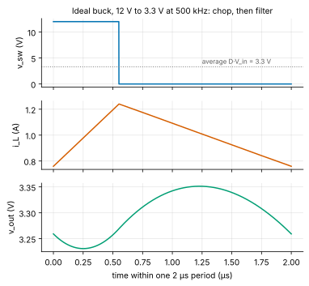

<!-- status: reviewed -->
# 22-01 · Power Conversion Principles

| | |
|---|---|
| **Course** | [22 · Power Electronics and Energy Conversion](../README.md) |
| **University equivalent** | The opening weeks of a senior power-electronics course: efficiency and loss, linear against switching regulation, why ideal switches and reactive elements convert power without loss, the capacitor-charging loss, the shape of a converter's efficiency curve, power density, and energy storage for hold-up (Erickson & Maksimović, *Fundamentals of Power Electronics*, ch. 1–2; MIT 6.334, first lectures) |
| **Prerequisites** | [06-01](../../06-circuit-analysis-1-dc/chapters/06-01-charge-current-voltage-power.md) (power, efficiency), [07-01](../../07-circuit-analysis-2-transient-and-ac/chapters/07-01-capacitors-and-inductors.md) (capacitor and inductor energy, continuity), [07-02](../../07-circuit-analysis-2-transient-and-ac/chapters/07-02-first-order-rc-rl-transients.md) (RC charging), [11-05](../../11-signals-and-systems/chapters/11-05-fourier-series.md) (Fourier series), [20-04](../../20-analog-and-mixed-signal-ic-design/chapters/20-04-ldo-regulators.md) (LDO regulators) |
| **Estimated study hours** | 6 |
| **Last verified** | 2026-11-25 |

**Learning objectives.** After this chapter you can:

1. Compute efficiency and loss, explain why the last points of efficiency matter most for heat, and multiply efficiencies through a conversion chain to find where the loss sits.
2. Derive the efficiency of a linear regulator, and decide between an LDO and a switching converter for a given rail, load profile and battery.
3. Show why ideal switches and reactive elements convert power without loss, derive the ½CV² charging loss and the charge-sharing loss, and estimate how switching frequency sets the size of the output filter.
4. Build a fixed-plus-proportional-plus-resistive loss model of a converter, find its peak-efficiency load, and quantify what pulse-frequency modulation and phase shedding buy at light load.
5. Compute and critique a power-density claim, including its thermal limit and the boundary of its box, and size the energy storage for a hold-up requirement.

## 1. Big picture

Every electronic product converts power before it does anything else. A watch turns a 3.6 V cell into the lower voltages its radio and processor want; a phone's power-management chip makes many rails from one battery; an AI rack takes three-phase AC at hundreds of volts and delivers well under a volt to each processor at hundreds of amperes. Power conversion is the art of changing voltage and current while wasting as little as possible, because what is wasted becomes heat that must be removed and energy that must be paid for. This chapter sets out the principles that every later chapter builds on: what efficiency really measures, why a linear regulator can never beat $V_{out}/V_{in}$, why a switching converter can in principle reach 100%, what makes real converters fall short, and how efficiency, size and stored energy trade against one another.

- **Wearables and IoT:** at microamp loads, quiescent current, not conversion efficiency, decides battery life.
- **Phones and SoCs:** multi-rail PMICs combine buck converters for the big rails with LDOs for the quiet ones (22-08).
- **AI datacenters:** a rack of 100 kW or more passes its power through four or five conversion stages; each stage's loss becomes heat, cooling power and operating cost (22-10).
- **Automotive and industry:** 12 V, 48 V and 400–800 V buses, battery chargers and motor drives (22-09, 22-11).
- **Commercial lens:** efficiency at specified load points, power density and cost per watt are the numbers on which power-supply and power-semiconductor companies compete.

## 2. Intuition first

**Two ways to drop a voltage.** Suppose you have a 12 V source and a load that wants 3.3 V at 1 A. The first way is to put something in series that drops the other 8.7 V: a resistor, or better a transistor whose resistance a feedback loop adjusts so the output stays at 3.3 V whatever the load does. That is a **linear regulator**. It is simple, quiet and fast, but the full 1 A flows through the 8.7 V drop, so 8.7 W turns to heat to deliver 3.3 W.

The second way is to chop. Connect the load's filter to 12 V for 27.5% of the time and to ground for the rest, thousands or millions of times a second, and let an inductor and a capacitor average the chopped waveform. An ideal switch is either closed (no voltage across it) or open (no current through it), so it never dissipates power; an ideal inductor or capacitor stores energy and gives it back without loss. The average of the chopped waveform is 3.3 V, and nothing in the circuit turns energy into heat. That is a **switching converter**, here a **buck converter**.

**An analogy, and where it breaks.** A linear regulator is a tap on a water pipe: it controls the outlet pressure by throttling, the flow in equals the flow out, and the pressure dropped across the tap is lost. A switching converter is closer to a gearbox, or to a currency exchange that charges no fee: it trades voltage for current at constant power, so 12 V at 0.275 A in becomes 3.3 V at 1 A out. The analogy breaks in two places. A gearbox converts continuously, while a converter must *store* energy every cycle in its inductor and capacitor, and the size of that store is what sets its volume. And the real converter's "fee" is not a simple percentage: part of it is fixed (the cost of switching at all), part grows with current and part with current squared. That structure gives every real converter an efficiency curve with a peak, and it is why light-load efficiency needs its own techniques.

## 3. Theory

### 3.1 Efficiency, loss and leverage

The **efficiency** of a converter is the ratio of the power it delivers to the power it draws:

$$
\eta = \frac{P_{out}}{P_{in}}, \qquad P_{loss} = P_{in} - P_{out} = P_{out}\,\frac{1 - \eta}{\eta} .
$$

Both powers are averages over many switching cycles, in watts; η is dimensionless. The second form is the one engineers use, because the load fixes $P_{out}$ and the question is how much heat comes with it. It shows the **leverage** of the last points of efficiency. Going from 90% to 91% cuts the loss per kilowatt delivered from **111.1** W (Txt e) to **98.9** W (Txt f), **12.2** W or **11.0** % of the loss (Txt a, b). Going from 98% to 99% cuts it from **20.4** W (Txt g) to **10.1** W (Txt h), **10.3** W or **50.5** % (Txt c, d): a single point near the top halves the heat. Differentiating,

$$
\frac{dP_{loss}}{d\eta} = -\frac{P_{out}}{\eta^2} ,
$$

so each point of efficiency is worth roughly 1% of the output power in heat at any efficiency, but that fixed number of watts is a far larger share of a small loss. The heat, not the efficiency, is what limits a design: it sets the temperature rise $\Delta T = R_{th}P_{loss}$ through a thermal resistance $R_{th}$ in K/W (02-02), the size of the heat sink or fan, and the cooling power a datacenter spends to remove it.

**Chains multiply.** Power usually passes through several converters in series: a datacenter's grid-to-chip path has a UPS, a power supply, an intermediate bus converter and a voltage regulator. Each stage's input is the previous stage's output, so

$$
\eta_{chain} = \prod_k \eta_k , \qquad P_{in} = \frac{P_{load}}{\eta_1\eta_2\cdots\eta_n} ,
$$

and the loss in stage $k$ is its own input power times $1 - \eta_k$. The stage nearest the load carries the least power but often has the lowest efficiency; Example 22-01.8 shows that it can hold more than half of the chain's total loss.

### 3.2 The linear regulator and its ceiling

A series linear regulator (the LDO of 20-04 is the common integrated form) places a pass transistor between input and output and adjusts its drop so that $v_{OUT}$ follows a reference. Whatever the transistor does, the load current must flow through it. The regulator's control circuits also draw a **quiescent current** $I_Q$ from the input (for an LDO this is the ground-pin current). Kirchhoff's current law at the input therefore gives $I_{in} = I_{out} + I_Q$, and

$$
\eta_{LDO} = \frac{V_{out}I_{out}}{V_{in}(I_{out} + I_Q)} \le \frac{V_{out}}{V_{in}} .
$$

The ceiling $V_{out}/V_{in}$ does not depend on how good the transistor is; it is set by the voltages alone. The loss splits into the throttling term $(V_{in} - V_{out})I_{out}$ and the overhead $V_{in}I_Q$. At heavy load the first dominates and η sits at the ceiling. At light load the second takes over: when $I_{out} = I_Q$ the efficiency is half its ceiling, and below that it collapses. This is why wearable regulators advertise quiescent currents in nanoamps.

**What the battery sees.** In a battery-powered product the useful measure is often charge, not power, because a battery's capacity is rated in ampere-hours. A linear regulator draws $I_{out} + I_Q$ from the battery whatever the battery voltage is: from the battery's point of view it is a current pass-through. A switching converter with efficiency η draws

$$
I_{in} = \frac{V_{out}I_{out}}{\eta\,V_{in}} ,
$$

which is *less* than the load current whenever $\eta V_{in} > V_{out}$. A buck converter can therefore make a battery last longer than the load current alone would suggest; a linear regulator never can.

**Dropout.** A linear regulator needs some minimum voltage across its pass device to keep regulating, the **dropout voltage** $V_{DO}$ (20-04). A data sheet states it at a stated load current and output voltage. As the battery discharges, the regulator stops regulating when $V_{in} < V_{out} + V_{DO}$.

**Where linear regulators win.** They have no switching ripple and no electromagnetic interference, they respond within the bandwidth of their loop, they reject supply noise (PSRR, 20-04), and they need no inductor. When $V_{out}/V_{in}$ is close to 1, their ceiling is close to 100%. A low-noise analog rail, a reference, a small radio rail made from a slightly higher pre-regulated rail: these are LDO jobs. A **shunt regulator** (a Zener diode or a TL431-style circuit across the load, fed through a resistor) is worse still. It draws its maximum current all the time and burns whatever the load does not use, which is why it survives only as a reference or a protection clamp.

### 3.3 Why switching can be lossless

**The ideal switch dissipates nothing.** The power into a two-terminal element is $p(t) = v(t)\,i(t)$ (06-01). A closed ideal switch has $v = 0$; an open one has $i = 0$. In either state $p = 0$, and an ideal switch changes state instantly, so it dissipates no energy. An ideal inductor and an ideal capacitor store energy ($\tfrac12Li^2$ and $\tfrac12Cv^2$, 07-01) and return it; over a periodic steady state their net energy change per cycle is zero. A network of ideal switches, inductors and capacitors therefore has, averaged over a period,

$$
P_{in} = P_{out} \quad\Longrightarrow\quad V_{in}I_{in} = V_{out}I_{out} ,
$$

with all quantities cycle averages. Such a network is a lossless **DC transformer** with some **conversion ratio** $M = V_{out}/V_{in}$, and therefore $I_{in} = M\,I_{out}$.

**The buck's ratio from averaging.** In the synchronous buck of the figure in §2, the high-side switch connects the **switch node** to $V_{in}$ for a fraction $D$ of each period $T_s = 1/f_s$ (the **duty cycle**), and the low-side switch connects it to ground for the rest. The switch-node voltage $v_{sw}(t)$ is a rectangular wave between 0 and $V_{in}$, with average

$$
\langle v_{sw}\rangle = \frac{1}{T_s}\int_0^{T_s} v_{sw}\,dt = \frac{1}{T_s}\,V_{in}\,DT_s = DV_{in} .
$$

In periodic steady state the inductor's average voltage is zero: over one period $\int v_L\,dt = L\,\Delta i_L = 0$, because the current returns to its starting value. The capacitor's average current is zero for the same reason. So the average of $v_{sw}$ appears across the load, $V_{out} = DV_{in}$, and $M = D$. Check the power balance from the currents. The input current is the inductor current while the high-side switch is closed and zero otherwise, so its average is $D\,I_L$; the average inductor current equals the load current, because the capacitor's average current is zero. Then $P_{in} = V_{in}DI_{out} = V_{out}I_{out} = P_{out}$, as the lossless argument requires. Chapter 22-02 turns these two balance conditions (volt-second balance on the inductor, charge balance on the capacitor) into the general tool for every topology.

> **Math refresher — the Fourier series of a rectangular wave.** A wave equal to $V_{in}$ for $0 < t < DT_s$ and 0 for the rest of the period has the series (11-05)
> $$v_{sw}(t) = DV_{in} + \sum_{n=1}^{\infty} \frac{2V_{in}}{n\pi}\sin(n\pi D)\cos\!\left(n\omega_st - n\pi D\right), \qquad \omega_s = 2\pi f_s .$$
> To derive it, compute $c_n = \tfrac{1}{T_s}\int_0^{DT_s}V_{in}e^{-jn\omega_st}dt = \tfrac{V_{in}}{j2\pi n}(1 - e^{-j2\pi nD})$, whose magnitude is $V_{in}\lvert\sin(n\pi D)\rvert/(n\pi)$. The real amplitude of harmonic $n$ is $2\lvert c_n\rvert$.

**Filtering sets the size.** The DC term is the wanted output; the harmonics at $f_s, 2f_s, \dots$ are what the filter must remove. With the load resistance $R$ across $C$, the LC filter's transfer function from switch node to output is

$$
H(j\omega) = \frac{1}{1 - \omega^2LC + j\omega L/R}, \qquad f_0 = \frac{1}{2\pi\sqrt{LC}} ,
$$

so well above the corner $f_0$ each harmonic is attenuated by about $(f_0/nf_s)^2$. The fundamental dominates the ripple. A first-harmonic estimate of the peak-to-peak output ripple is twice the fundamental's amplitude times $\lvert H(j\omega_s)\rvert$; Example 22-01.4 shows that it lands within a few per cent of the exact waveform.

The scaling that follows is the heart of why switching frequency matters. Multiply $f_s$ by $k$ and divide both $L$ and $C$ by $k$. Every impedance in the circuit at every harmonic is unchanged, because $\omega L$, $1/\omega C$ and $R$ are each the same at $n\cdot kf_s$ as before at $nf_s$. The output waveform is therefore identical, compressed in time by $k$. The inductor's peak stored energy $\tfrac12LI^2$ and the capacitor's $\tfrac12CV^2$ both fall by $k$, and a passive component's volume grows with the energy it must store, so the filter shrinks roughly as $1/f_s$. That is the whole case for high-frequency conversion, and §3.5 shows the price.

### 3.4 What switches must never do

Real switches are not ideal, but the topology itself can also waste energy, even with ideal parts, if it breaks either of two rules.

**Rule 1: never connect a capacitor directly to a source at a different voltage.** Charge a capacitor $C$ from 0 to $V$ through any resistance $R$ (07-02). The current is $i(t) = (V/R)e^{-t/RC}$, and the energy dissipated in $R$ is

$$
E_R = \int_0^\infty i^2R\,dt = \frac{V^2}{R}\int_0^\infty e^{-2t/RC}dt = \frac{V^2}{R}\cdot\frac{RC}{2} = \frac12CV^2 .
$$

$R$ has cancelled. The source delivers charge $Q = CV$ at voltage $V$, energy $CV^2$; the capacitor keeps $\tfrac12CV^2$; the other half is lost however small the resistance. A smaller resistance gives a larger, shorter current, with the same total heat. Charging in $N$ equal steps of $V/N$ loses $\tfrac12C(V/N)^2$ per step, $\tfrac12CV^2/N$ in total, which is how stepwise ("adiabatic") charging recovers energy. More generally, connecting a capacitor $C_1$ at $V_1$ to a capacitor $C_2$ at $V_2$ conserves charge, so the final voltage is $V_f = (C_1V_1 + C_2V_2)/(C_1 + C_2)$, and the energy lost is

$$
E_{share} = \tfrac12C_1V_1^2 + \tfrac12C_2V_2^2 - \tfrac12(C_1 + C_2)V_f^2 = \frac12\,\frac{C_1C_2}{C_1 + C_2}\,(V_1 - V_2)^2 ,
$$

where the last step multiplies out and collects $(V_1 - V_2)^2$. Switched-capacitor converters, which use only switches and capacitors, live with this loss. Each charge transfer happens across a voltage difference proportional to the load current, so the loss behaves like an output resistance. Problem 22-01.7 derives the simplest case, $R_{eq} = 1/(f_sC)$.

**Rule 2: never interrupt an inductor's current.** An inductor's current cannot change instantly ($v = L\,di/dt$, 07-01). Opening the only path for its current would demand an infinite voltage, which in practice destroys the switch. Every switching converter therefore provides a second path that takes over the inductor current when the first switch opens: the buck's low-side switch, or a diode in its place. The inductor is the element that lets a switching converter move charge between voltage levels without breaking Rule 1, because it carries current smoothly from one node to another.

> **Going deeper — resonant charging is lossless.** Charge a capacitor from a source $V$ through an ideal inductor instead of a resistor. The series LC rings: $v_C(t) = V(1 - \cos\omega_0t)$ with $\omega_0 = 1/\sqrt{LC}$. If a diode or switch stops the current at its first zero, $t = \pi/\omega_0$, the capacitor is left at $2V$. The source delivered charge $Q = 2CV$ at voltage $V$, energy $2CV^2$; the capacitor holds $\tfrac12C(2V)^2 = 2CV^2$. Nothing was lost. Resonant and soft-switching converters (22-04, 22-06) exploit exactly this, and hybrid switched-capacitor converters add a small inductor to escape Rule 1's charge-sharing loss. M. D. Seeman and S. R. Sanders analysed the switched-capacitor limits in *IEEE Trans. Power Electronics* (2008) [13].

### 3.5 The loss model and the shape of the efficiency curve

Real converters lose power in a handful of ways, which chapter 22-06 quantifies device by device. For reasoning about efficiency against load, they group by how they scale with the output current $I$:

$$
P_{loss}(I) = P_0 + aI + RI^2 .
$$

- **$P_0$, fixed loss (W):** controller quiescent power, the gate-drive energy $Q_gV_{dr}$ spent every cycle, and the energy stored in the switches' output capacitance and discharged each cycle. These are paid at the switching frequency whether or not the load draws current, so they scale with $f_s$.
- **$a$, the proportional coefficient (V, or W/A):** switching-transition loss, in which voltage and current overlap for a short time $t_{sw}$ each transition. It is about $\tfrac12V_{in}I\,t_{sw}f_s$ per transition, so it is proportional to both current and frequency. Diode conduction at a forward drop $V_F$ adds to it.
- **$R$, the resistive coefficient (Ω):** conduction loss in switch on-resistance, inductor winding resistance and board traces, referred to the output current.

With output voltage $V$, the efficiency is $\eta(I) = VI/(VI + P_0 + aI + RI^2)$. It is highest where the loss *per unit output*, $P_{loss}/I = P_0/I + a + RI$, is lowest. Setting its derivative to zero gives

$$
-\frac{P_0}{I^2} + R = 0 \quad\Longrightarrow\quad I^* = \sqrt{\frac{P_0}{R}}, \qquad RI^{*2} = P_0 .
$$

Peak efficiency comes at the load where the fixed loss equals the conduction loss; the proportional term does not move it. Above $I^*$, conduction loss grows as $I^2$ and efficiency sags. Below it, the fixed loss is spread over less and less output and efficiency collapses toward zero. The second derivative, $2P_0/I^3 > 0$, confirms a minimum of loss per unit output.

> **Math refresher — minimizing a/x + bx.** For positive $a$ and $b$, $f(x) = a/x + bx$ has $f'(x) = -a/x^2 + b = 0$ at $x = \sqrt{a/b}$, where both terms are equal and $f = 2\sqrt{ab}$. The same answer follows without calculus from $a/x + bx \ge 2\sqrt{ab}$ (the arithmetic mean of two positive numbers is at least their geometric mean, with equality when they are equal). This pattern recurs throughout power electronics: optimal frequency, optimal number of phases, optimal device size.

**Light load.** Two techniques attack the fixed loss when the load is small.

**Pulse-frequency modulation and burst mode** stop switching at a fixed frequency. The converter delivers a burst of pulses and then sleeps until the output droops, so the switching-related fixed loss falls roughly in proportion to the load. The cost is output ripple at a load-dependent frequency, which can land in an audio or radio band.

**Phase shedding** applies to multiphase converters. These are $N$ identical converters in parallel, each carrying $I/N$. Each phase brings its own fixed loss, while the conduction loss falls with more phases, because $N$ phases of resistance $R$ each dissipate $NR(I/N)^2 = RI^2/N$. So

$$
P_{loss,N}(I) = NP_0 + aI + \frac{RI^2}{N} .
$$

Setting $P_{loss,N} = P_{loss,N+1}$ gives the current at which adding a phase starts to pay:

$$
P_0 = RI^2\left(\frac1N - \frac1{N + 1}\right) = \frac{RI^2}{N(N + 1)} \quad\Longrightarrow\quad I_{N\to N+1} = \sqrt{\frac{N(N + 1)P_0}{R}} .
$$

A processor voltage regulator turns phases off as the load falls, and back on as it rises.

**Why regulators specify several load points.** A single peak efficiency says nothing about where the product actually runs. The EU and US rules for external power supplies define an "average active efficiency" as the mean at 25, 50, 75 and 100% of rated output, add a separate no-load power limit, and (in the EU) require the 10% figure to be declared [2, 3]. The 80 PLUS programme for computer and datacenter supplies specifies 10, 20, 50 and 100% points, plus 5% for its top tier [1]. These points exist because the efficiency curve has a peak.

### 3.6 Power density and its thermal limit

**Power density** is rated output power divided by the volume of a defined box, quoted in W/in³ (1 in³ = 16.387 cm³) or W/cm³. Two physical limits bound it. The passives shrink as $1/f_s$ (§3.3), while the fixed and proportional losses grow with $f_s$ (§3.5). Because removing the loss also takes volume (heat sinks, fans, board area), there is a best frequency. If the passives' volume goes as $A/f_s$ and the volume needed to remove the frequency-dependent loss goes as $Bf_s$, total volume is smallest at $f_s^* = \sqrt{A/B}$, by the refresher above. Faster switches, with smaller switching energy (22-06), shrink $B$ and push $f_s^*$ up; that is the commercial argument for GaN and SiC.

The second limit is heat. Suppose a box can reject at most $q$ watts of heat per unit volume at its allowed temperature rise. This is a property of its cooling (natural convection, a fan, a cold plate) and not of the converter. Then $P_{loss}/\text{Vol} \le q$, and with $P_{loss} = P_{out}(1 - \eta)/\eta$,

$$
\rho = \frac{P_{out}}{\text{Vol}} \le q\,\frac{\eta}{1 - \eta} .
$$

Efficiency and density are therefore the same fight. At 95% a box can hold **19** times its heat-rejection capacity in output (Txt i); at 99%, **99** times (Txt j). Halving the loss nearly doubles the achievable density.

**The box matters.** A density figure is meaningless without its boundary. A power-factor-correction stage measured open-frame, a converter measured "without connector", a charger in its plastic case and a server power supply with its fan and hold-up capacitors are four different boxes. Example 22-01.6 recomputes published densities from published dimensions, and §9 tabulates how far apart honest numbers can be.

### 3.7 Energy flow: hold-up and the conversion chain

**Hold-up.** A server power supply must keep its output in regulation for a specified **hold-up time** after the AC input disappears, for example 20 ms in a 2026 server-supply reference [9], long enough to ride through a short dropout or to let a transfer switch act. During that time the downstream DC-DC stage draws its input power $P_{bus}$ from the bulk capacitor on the internal bus. That stage can regulate only while the bus stays above some minimum $V_2$. Energy balance from the nominal bus voltage $V_1$ gives

$$
\tfrac12C\left(V_1^2 - V_2^2\right) = P_{bus}\,t_{hold} \quad\Longrightarrow\quad C = \frac{2P_{bus}t_{hold}}{V_1^2 - V_2^2} .
$$

Only the energy between $V_1$ and $V_2$ is usable. A DC-DC stage that keeps regulating down to a lower $V_2$ shrinks the capacitor, which is one of the largest parts of a high-density supply, at the price of a wider input range for that stage. This is a typical power-electronics trade: one stage's specification sets another stage's size.

**The chain from grid to chip.** Energy reaches a processor through a sequence of conversions: AC to a DC bus (with power-factor correction, 07-06), DC bus to 48–54 V, 48 V to an intermediate bus, and finally to the sub-1 V core rail at hundreds of amperes. The chain's efficiency is the product of the stages', and §3.1 shows that the stage carrying the least power can hold the most loss. Chapter 22-10 sources each stage's real numbers; Example 22-01.8 uses stated assumptions to show the arithmetic.

### 3.8 Choosing between an LDO and a switcher

The choice is rarely all-or-nothing. A common pattern is a buck from the battery or bus to a rail slightly above the target, followed by an LDO (**post-regulation**). The buck does the large voltage step efficiently, and the LDO cleans up the ripple at a small $V_{out}/V_{in}$ penalty. The decision runs through five questions:

1. **What is the load profile?** Average efficiency over the time the product spends at each load is what drains the battery or the electricity bill. A wearable that sleeps at microamps and transmits at milliamps needs good efficiency at both, so quiescent current matters as much as peak efficiency.
2. **What is $V_{out}/V_{in}$?** Near 1, an LDO's ceiling is near 100% and a switcher buys little; at 1.8 V from 3.6 V the LDO cannot exceed 50%.
3. **How quiet must the rail be?** RF synthesizers, data-converter references and sensor front ends often need an LDO's PSRR and the absence of switching spurs (20-04, 21-06).
4. **What do area and bill of materials allow?** A switcher needs an inductor, which is the largest and often the most expensive part at low power.
5. **What transient response is needed?** Both can be fast, but a switcher's control loop (22-07) is bounded by its switching frequency.

## 4. Worked examples

### Example 22-01.1 · The leverage of the last half-point (tier A)

**Setup.** The 80 PLUS programme's redundant datacenter supplies at 230 V must reach 96% at 50% load for the Titanium level and 96.5% for Ruby [1]. (a, b) What is the loss per kilowatt delivered at each? (c) By what fraction does Ruby cut the loss? (d) For a 33 kW power shelf running at 50% load (16.5 kW), how many watts and (e) how many kilowatt-hours per year does the half-point save?

**Solution.**

- (a) $1000(1/0.96 - 1)$ = **41.67** W; (b) $1000(1/0.965 - 1)$ = **36.27** W.
- (c) $1 - 36.27/41.67$ = **12.95** %.
- (d) $16\,500(1/0.96 - 1/0.965)$ = **687.5** − **598.4** = **89.1** W (g, h are the two losses).
- (e) $89.05\ \text{W} \times 8760\ \text{h}$ = **780** kWh per year, for one shelf.

**Units check.** Watts times hours gives watt-hours; divide by 1000 for kWh.

**Sanity check.** Half a point of efficiency is 0.5% of the input power, about **86** W (f) at 16.5 kW of output, close to (d). The relative saving of 13% is far larger than 0.5% because the loss is only 4% of the throughput. In a datacenter each watt of loss is also a watt of cooling load, so the facility-level saving is larger still.

### Example 22-01.2 · An LDO or a buck for a wearable's 1.8 V rail (tier A)

**Setup.** A wearable's 1.8 V rail runs from a Li-ion cell at its nominal 3.6 V. Two candidate regulators have published data: an LDO with 25 nA quiescent current, and a buck that reaches 80% efficiency at 1 µA load from 3.6 V to 1.8 V [5]. Find the LDO's efficiency and loss at (a, b) 10 mA and (c, d) 1 µA. At 1 µA, find (e) the buck's battery current and (f) the ratio of the LDO's battery current to the buck's.

**Solution.**

- (a) $1.8 \times 10\ \text{mA}/(3.6 \times 10.000\,025\ \text{mA})$ = **50.0** %, at the ceiling; (b) $3.6 \times 10.000\,025 - 1.8 \times 10$ = **18.0** mW.
- (c) $1.8/(3.6 \times 1.025)$ = **48.78** %; (d) $3.6 \times 1.025 - 1.8$ = **1.89** µW.
- (e) $I_{in} = 1.8 \times 1\ \mu\text{A}/(0.8 \times 3.6)$ = **0.625** µA.
- (f) $1.025/0.625$ = **1.64**: the buck makes the 1 µA sleep load last 64% longer.

**Units check.** Volts times amps gives watts throughout; the battery currents are in µA.

**Sanity check.** The LDO's battery current can never be below the load current, while the buck's is below it whenever $\eta V_{in} > V_{out}$ (0.8 × 3.6 = 2.88 V > 1.8 V). At 1 µA the LDO's 25 nA quiescent current costs only **2.5** % (g): nanoamp quiescent currents are what make both regulators usable in sleep. A regulator with a quiescent current of tens of microamps would draw more for itself than the 1 µA load draws.

### Example 22-01.3 · The price of charging a capacitor (tier B)

**Setup.** (a) A 10 µF capacitor is charged from 0 to 5 V by connecting it to a 5 V source through a 1 Ω switch. How much energy is lost? (b) How much if it is charged in four equal steps? (c) A switched-capacitor converter connects a 1 µF flying capacitor at 5.0 V to a 1 µF output capacitor at 4.8 V. How much energy does each connection lose, and (d) how much power if it happens a million times a second?

**Solution.**

- (a) $\tfrac12 \times 10\ \mu\text{F} \times 25$ = **125** µJ, half the **250** µJ (e) the source delivered, independent of the 1 Ω.
- (b) $125/4$ = **31.25** µJ.
- (c) $\tfrac12 \cdot \tfrac{1 \times 1}{1 + 1}\ \mu\text{F} \cdot (0.2)^2$ = **10.0** nJ.
- (d) $10\ \text{nJ} \times 10^6\ \text{s}^{-1}$ = **10.0** mW.

**Units check.** Farads times volts squared gives joules; joules per second give watts.

**Sanity check.** The lab charges the same capacitor through 1 Ω and through 100 Ω in ngspice and finds the same 125 µJ, and 31.25 µJ for the four-step staircase. The loss in (c) depends on the square of the voltage difference, so halving the difference halves the loss power at a given load current, whether by doubling $C$ or doubling the clock ($P = I^2/(f_sC)$, Problem 22-01.7): a switched-capacitor converter is efficient only when its capacitors swing little.

### Example 22-01.4 · Switching plus filtering (tier B)

**Setup.** An ideal synchronous buck converts 12 V to 3.3 V at 500 kHz with $L$ = 10 µH, $C$ = 1 µF and a 3.3 Ω load. Find (a) the duty cycle, (b) the average input current at 1 A out, (c) the filter's corner frequency, (d) the amplitude of the switch node's fundamental, (e) the first-harmonic estimate of the peak-to-peak output ripple using the unloaded filter $\lvert 1 - (f_s/f_0)^2\rvert^{-1}$, and (f) the exact ripple from the periodic steady-state solution. (g) If the switching frequency doubles to 1 MHz, what $L$ and $C$ give the same waveform?

**Solution.**

- (a) $D = 3.3/12$ = **0.275**.
- (b) $I_{in} = DI_{out}$ = **0.275** A; check: 12 × 0.275 = 3.3 W = 3.3 V × 1 A.
- (c) $f_0 = 1/(2\pi\sqrt{10^{-11}})$ = **50.33** kHz.
- (d) $(2 \times 12/\pi)\sin(0.275\pi)$ = **5.809** V.
- (e) $\lvert 1 - (500/50.33)^2\rvert$ = **97.70** (k), so the ripple is about $2 \times 5.809/97.70$ = **118.9** mV peak to peak.
- (f) Solving the two linear circuits (switch high, switch low) with matrix exponentials and requiring the state to repeat each period gives **120.3** mV peak to peak, with the average exactly 3.300 V; the lab's ngspice model agrees.
- (g) $L$ = **5** µH and (h) $C$ = **0.5** µF: every impedance at every harmonic is unchanged.

**Units check.** $\sqrt{LC}$ has units of $\sqrt{\text{H}\cdot\text{F}}$ = s; ripple is in volts.

**Sanity check.** The estimate in (e) omits the higher harmonics and lands **1.2** % low (i), close enough for a first design. Using the unloaded filter slightly overstates the fundamental, because the load adds attenuation above resonance, so the whole shortfall comes from the harmonics. Ripple of 120 mV is **3.6** % of 3.3 V (j), too much for a processor rail, so a real design would raise $f_s$, $L$ or $C$. Item (g) shows the commercial point: doubling $f_s$ halves the energy each passive stores, and roughly its volume, if the switches' extra loss can be afforded.

### Example 22-01.5 · Where the efficiency peaks, and how to fix light load (tier B)

**Setup.** A 1.0 V point-of-load converter has $P_0$ = 150 mW, $a$ = 30 mW/A and $R$ = 3 mΩ. Find (a) the load for peak efficiency and (b) the peak efficiency. Find the efficiency at (c) 20 A, (d) 1 A and (e) 0.1 A. (f) A pulse-frequency mode cuts $P_0$ to 15 mW at light load; what is the efficiency at 0.1 A? (g) Above what load does a second identical phase reduce the loss, and (h) above what load does a third? (i) At 20 A, the converter sits on a board whose thermal resistance to ambient is 25 K/W: how much does it heat its surroundings?

**Solution.**

- (a) $I^* = \sqrt{0.15/0.003}$ = **7.07** A; (b) the loss there is 0.150 + 0.212 + 0.150 = **0.512** W (k), so η = 7.071/7.583 = **93.25** %.
- (c) Loss 0.15 + 0.6 + 1.2 = **1.95** W (l): η = 20/21.95 = **91.12** %. (d) Loss **0.183** W (m): η = **84.53** %. (e) Loss **0.153** W (n): η = **39.52** %.
- (f) Loss 0.015 + 0.003 + 0.000\,03 = **0.018** W (o): η = **84.72** %.
- (g) $\sqrt{1 \cdot 2 \cdot 0.15/0.003}$ = **10.0** A; (h) $\sqrt{2 \cdot 3 \cdot 0.15/0.003}$ = **17.3** A.
- (i) $25 \times 1.95$ = **48.8** K.

**Units check.** $P_0/R$ is W/Ω = A², so its root is in amperes.

**Sanity check.** At the peak the fixed and conduction losses are both 150 mW, as derived. At 0.1 A the fixed 150 mW is 1.5 times the 100 mW output, which is why every converter for battery products has a light-load mode. A 49 K rise at full load would not pass a 40 °C-ambient design with 85 °C parts (88.8 °C): two phases at 20 A cut the conduction loss from 1.2 to 0.6 W and the total to **1.5** W (j), a **37.5** K rise (77.5 °C).

### Example 22-01.6 · Recomputing power-density claims (tier C)

**Setup.** Infineon's 18 kW three-phase server-supply reference measures 104 × 710 × 40 mm and is described as 100 W/in³ [9]: find (a) its volume and (b) its density. (c) Advanced Energy's 5.5 kW ORv3 power supply measures 640 × 73.5 × 40 mm [11]: what is its density? (d, e, f) If a box can reject 3 W/in³ of heat (an illustrative assumption), what densities do 95%, 97.5% and 99% efficiency allow?

**Solution.**

- (a) $104 \times 710 \times 40\ \text{mm}^3$ = **2.954** L (g) = **180.2** in³, so (b) 18 kW gives **99.9** W/in³: the claim is consistent with the stated box.
- (c) **1.882** L (h) = **114.8** in³ (i), so **47.9** W/in³.
- (d) $3 \times 0.95/0.05$ = **57** W/in³; (e) $3 \times 0.975/0.025$ = **117** W/in³; (f) $3 \times 0.99/0.01$ = **297** W/in³.

**Units check.** mm³ × 10⁻⁶ = L; 1 in³ = 16.387 cm³.

**Sanity check.** Both products are server supplies of similar efficiency, but one is twice as dense as the other, so its designers had to remove heat twice as fast per unit volume (or count a different box). The thermal limit shows why: at 97.5% a box can only reach 117 W/in³ if it rejects 3 W/in³, so a 100 W/in³ product is near what a box rejecting 3 W/in³ allows at that efficiency.

### Example 22-01.7 · Sizing a hold-up capacitor (tier C)

**Setup.** A 5.5 kW server supply must hold its output for 20 ms after losing AC input. Its DC-DC stage is 98.5% efficient (an assumption for this example), runs from a 400 V bus and regulates down to 320 V. Find (a) the power drawn from the bus, (b) the capacitance and (c) the energy stored at 400 V. (d) What capacitance is needed if the DC-DC stage can regulate down to 300 V, and (e) by what fraction does that shrink the capacitor?

**Solution.**

- (a) $P_{bus} = 5500/0.985$ = **5584** W.
- (b) $C = 2 \times 5584 \times 0.020/(400^2 - 320^2)$ = 223.4/57 600 = **3.88** mF.
- (c) $\tfrac12 \times 3.878\ \text{mF} \times 400^2$ = **310** J, of which only $P_{bus}t_{hold}$ = **111.7** J (f), **36** % (g), is used.
- (d) $223.4/(400^2 - 300^2)$ = **3.19** mF; (e) **17.7** % smaller.

**Units check.** W·s/V² = J/V² = F.

**Sanity check.** Stopping at 320 V leaves $(320/400)^2$ = 64% of the stored energy in the capacitor. The wider the DC-DC stage's input range, the more of the bulk capacitor's energy is usable, which is why resonant DC-DC stages designed for a wide input range are prized in high-density supplies.

### Example 22-01.8 · Where the loss sits in a grid-to-chip chain (tier C)

**Setup.** Assume (for illustration; 22-10 sources real values) a chain of a UPS at 97%, a power supply at 97.5%, an intermediate bus converter at 97.7% and a processor voltage regulator (VRM) at 90%, delivering 1 kW to the processor. Find (a) the chain efficiency, (b) the total loss, and the loss in (c) the VRM and (d) the UPS. (e) How much does raising the VRM to 92% save, and (f) how much does raising the UPS to 98% save?

**Solution.**

- (a) $0.97 \times 0.975 \times 0.977 \times 0.90$ = **83.16** %; (b) $1000/0.8316 - 1000$ = **202.5** W.
- (c) The VRM draws 1000/0.9 = 1111.1 W: **111.1** W of loss, **55** % of the total (g). (d) Working back, the intermediate bus converter loses **26.2** W (h), the supply **29.2** W (i) and the UPS **36.1** W.
- (e) With the VRM at 92%: total loss **176.4** W (k), a saving of **26.1** W. (f) With the UPS at 98%: a saving of **12.3** W.

**Units check.** Every stage's loss is its input power minus its output power, in watts; the four losses add to 202.5 W.

**Sanity check.** The two-point VRM improvement saves about twice as much as the one-point UPS improvement, and almost all of that factor is simply that it is two points. Raising any stage $k$ from $\eta_k$ to $\eta_k + \Delta\eta$ saves $P_{wall}\Delta\eta/(\eta_k + \Delta\eta)$ at the wall, because every stage carries the same wall-referred power: per point, **13.1** W at the VRM against **12.3** W at the UPS (l). Each watt lost at the processor does cost 1/(0.97 × 0.975 × 0.977) = **1.08** W (j) at the wall, but the UPS handles more power than the VRM by almost exactly that factor, so the two effects cancel. Point-of-load efficiency matters because that is where most of the loss sits (55%) and where most points remain to be won, not because a point there is worth much more; that is why 22-10's vertical power delivery and 48 V architectures exist.

### Answer key

<!-- answer-key -->

| ID | Quantity | Value | Unit |
|---|---|---|---|
| Ex 22-01.1a | loss per kW at 96 % | 41.67 | W |
| Ex 22-01.1b | loss per kW at 96.5 % | 36.27 | W |
| Ex 22-01.1c | fractional loss reduction | 12.95 | % |
| Ex 22-01.1d | saving for a 16.5 kW shelf | 89.1 | W |
| Ex 22-01.1e | annual energy saving | 780 | kWh |
| Ex 22-01.1f | half a point of the input power | 86 | W |
| Ex 22-01.1g | shelf loss at 96 % | 687.5 | W |
| Ex 22-01.1h | shelf loss at 96.5 % | 598.4 | W |
| Ex 22-01.2a | LDO efficiency at 10 mA | 50.0 | % |
| Ex 22-01.2b | LDO loss at 10 mA | 18.0 | mW |
| Ex 22-01.2c | LDO efficiency at 1 µA | 48.78 | % |
| Ex 22-01.2d | LDO loss at 1 µA | 1.89 | µW |
| Ex 22-01.2e | buck battery current at 1 µA | 0.625 | µA |
| Ex 22-01.2f | battery-current ratio, LDO to buck | 1.64 | |
| Ex 22-01.2g | quiescent current as a share of the load current at 1 µA | 2.5 | % |
| Ex 22-01.3a | single-step charging loss | 125 | µJ |
| Ex 22-01.3b | four-step charging loss | 31.25 | µJ |
| Ex 22-01.3c | charge-sharing loss per connection | 10.0 | nJ |
| Ex 22-01.3d | charge-sharing power at 1 MHz | 10.0 | mW |
| Ex 22-01.3e | energy delivered by the source | 250 | µJ |
| Ex 22-01.4a | duty cycle | 0.275 | |
| Ex 22-01.4b | average input current | 0.275 | A |
| Ex 22-01.4c | filter corner frequency | 50.33 | kHz |
| Ex 22-01.4d | fundamental amplitude at the switch node | 5.809 | V |
| Ex 22-01.4e | first-harmonic ripple estimate | 118.9 | mV |
| Ex 22-01.4f | exact peak-to-peak ripple | 120.3 | mV |
| Ex 22-01.4g | inductance at 1 MHz | 5 | µH |
| Ex 22-01.4h | capacitance at 1 MHz | 0.5 | µF |
| Ex 22-01.4i | shortfall of the first-harmonic estimate | 1.2 | % |
| Ex 22-01.4j | ripple as a share of the output | 3.6 | % |
| Ex 22-01.4k | filter attenuation factor at the fundamental | 97.70 | |
| Ex 22-01.5a | peak-efficiency load | 7.07 | A |
| Ex 22-01.5b | peak efficiency | 93.25 | % |
| Ex 22-01.5c | efficiency at 20 A | 91.12 | % |
| Ex 22-01.5d | efficiency at 1 A | 84.53 | % |
| Ex 22-01.5e | efficiency at 0.1 A | 39.52 | % |
| Ex 22-01.5f | efficiency at 0.1 A with PFM | 84.72 | % |
| Ex 22-01.5g | load to add a second phase | 10.0 | A |
| Ex 22-01.5h | load to add a third phase | 17.3 | A |
| Ex 22-01.5i | temperature rise at 20 A | 48.8 | K |
| Ex 22-01.5j | two-phase loss at 20 A | 1.5 | W |
| Ex 22-01.5k | loss at the peak | 0.512 | W |
| Ex 22-01.5l | loss at 20 A | 1.95 | W |
| Ex 22-01.5m | loss at 1 A | 0.183 | W |
| Ex 22-01.5n | loss at 0.1 A | 0.153 | W |
| Ex 22-01.5o | loss at 0.1 A with PFM | 0.018 | W |
| Ex 22-01.6a | volume of the 18 kW reference | 180.2 | in³ |
| Ex 22-01.6b | density of the 18 kW reference | 99.9 | W/in³ |
| Ex 22-01.6c | density of the 5.5 kW ORv3 PSU | 47.9 | W/in³ |
| Ex 22-01.6g | volume of the 18 kW reference | 2.954 | L |
| Ex 22-01.6h | volume of the 5.5 kW PSU | 1.882 | L |
| Ex 22-01.6i | volume of the 5.5 kW PSU | 114.8 | in³ |
| Ex 22-01.6d | thermal density limit at 95 % | 57 | W/in³ |
| Ex 22-01.6e | thermal density limit at 97.5 % | 117 | W/in³ |
| Ex 22-01.6f | thermal density limit at 99 % | 297 | W/in³ |
| Ex 22-01.7a | bus power during hold-up | 5584 | W |
| Ex 22-01.7b | hold-up capacitance to 320 V | 3.88 | mF |
| Ex 22-01.7c | stored energy at 400 V | 310 | J |
| Ex 22-01.7d | hold-up capacitance to 300 V | 3.19 | mF |
| Ex 22-01.7e | capacitor reduction | 17.7 | % |
| Ex 22-01.7f | energy used during hold-up | 111.7 | J |
| Ex 22-01.7g | share of the stored energy used | 36 | % |
| Ex 22-01.8a | chain efficiency | 83.16 | % |
| Ex 22-01.8b | total chain loss | 202.5 | W |
| Ex 22-01.8c | VRM loss | 111.1 | W |
| Ex 22-01.8d | UPS loss | 36.1 | W |
| Ex 22-01.8e | saving from a 92 % VRM | 26.1 | W |
| Ex 22-01.8f | saving from a 98 % UPS | 12.3 | W |
| Ex 22-01.8g | VRM share of the loss | 55 | % |
| Ex 22-01.8h | bus-converter loss | 26.2 | W |
| Ex 22-01.8i | power-supply loss | 29.2 | W |
| Ex 22-01.8j | upstream multiplier | 1.08 | |
| Ex 22-01.8k | total loss with a 92 % VRM | 176.4 | W |
| Txt 22-01.a | loss saved per kW, 90 to 91 % | 12.2 | W |
| Txt 22-01.b | share of the loss saved, 90 to 91 % | 11.0 | % |
| Txt 22-01.c | loss saved per kW, 98 to 99 % | 10.3 | W |
| Txt 22-01.d | share of the loss saved, 98 to 99 % | 50.5 | % |
| Txt 22-01.e | loss per kW at 90 % | 111.1 | W |
| Txt 22-01.f | loss per kW at 91 % | 98.9 | W |
| Txt 22-01.g | loss per kW at 98 % | 20.4 | W |
| Txt 22-01.h | loss per kW at 99 % | 10.1 | W |
| Txt 22-01.i | output over heat capacity at 95 % | 19 | |
| Txt 22-01.j | output over heat capacity at 99 % | 99 | |
| Txt 22-01.k | four 97 % stages | 88.5 | % |
| Txt 22-01.l | 99 % PFC times 98 % DC-DC | 97.0 | % |
| Ex 22-01.8l | saving per point at the VRM | 13.1 | W |
| Ex 22-01.8m | saving per point at the UPS | 12.3 | W |
| Ex 22-01.5p | temperature rise with two phases | 37.5 | K |

## 5. Simulate it

The lab ([labs/22-01-lab](../labs/22-01-lab/README.md)) collects the chapter's formulas in `power.py` and runs three ngspice netlists:

- `ldo.cir`: a PMOS-pass linear regulator at two loads;
- `cap_charge.cir`: capacitor charging through two resistances and in a staircase;
- `buck.cir`: an ideal synchronous buck at 500 kHz.

**Predict, then run.**

1. *Predict* the linear regulator's efficiency at 10 mA and at 1 µA from 3.6 V to 1.8 V with 25 nA of quiescent current, then run `ldo.cir` (Part 2).
2. *Predict* the energy lost charging 10 µF to 5 V through 1 Ω and through 100 Ω, and in four steps. Run `cap_charge.cir` and explain why the resistance does not matter (Part 3).
3. *Predict* the buck's average output and peak-to-peak ripple. Run `buck.cir`, then halve $L$ and $C$ and double $f_s$ in the notebook's state-space model and confirm that the ripple does not change (Part 4).
4. *Predict* where the loss model of Example 22-01.5 peaks and where phases should be added. Plot the curves with and without PFM and a second phase (Part 5).

## 6. Engineering tradeoffs

| Knob | Improves | Costs | Typical decision owner |
|---|---|---|---|
| Linear regulator instead of a switcher | Noise, PSRR, simplicity, no inductor, fast response | Efficiency capped at $V_{out}/V_{in}$; heat at large drops | Analog / power IC architect |
| Higher switching frequency | Smaller L and C, faster control bandwidth | Fixed and switching losses grow with $f_s$; EMI moves up | Power-stage designer |
| Lower switch on-resistance (bigger device) | Conduction loss | Larger gate and output charge, so higher fixed loss; cost and area | Power-device and stage designer |
| PFM / burst mode at light load | Light-load efficiency, standby power | Variable-frequency ripple that can fall in audio or RF bands | PMIC architect with system / RF team |
| More phases | Conduction loss and ripple at heavy load; thermal spreading | Fixed loss per phase, more parts and area; needs shedding | VRM / board power architect |
| Wider DC-DC input range | Smaller hold-up capacitor, more usable stored energy | Harder resonant or DC-DC design, lower peak efficiency | PSU architect |
| Post-regulating LDO after a buck | Clean rail | Dropout loss $(V_{in} - V_{out})I$ | System power architect |

## 7. Numbers to know

| Quantity | Typical value | Source |
|---|---|---|
| 80 PLUS Titanium, 230 V redundant supplies (10/20/50/100% load) | 90 / 94 / 96 / 91% | [1] (as of Nov 2026) |
| 80 PLUS Ruby, 230 V redundant supplies (5/10/20/50/100%) | 90 / 91 / 95 / 96.5 / 92% | [1] (as of Nov 2026) |
| EU and US external supplies above 49 W (to 250 W), basic-voltage (output ≥ 6 V) single-voltage AC-DC | ≥ 88.0% average active efficiency; ≤ 0.21 W no-load | [2, 3] |
| AC-DC external supplies of 49 W or less | ≤ 0.10 W no-load | [2, 3] |
| USB Power Delivery maximum | 240 W (48 V × 5 A), Revision 3.3 (Oct 2026) | [4] |
| Ultra-low-quiescent LDO / buck for wearables | 25 nA / 60 nA quiescent; buck 80% at 1 µA | [5] |
| GaN 65 W USB-PD adapter reference | 25.29 W/in³ (box unstated); 92.8–94.3% at full load | [6] |
| GaN totem-pole PFC stage | 99–99.2% peak; 120 W/in³ open frame | [7] |
| AI server supplies, 2024–26 references | 97.5% peak; 100–137 W/in³ | [8–10] |
| ORv3 power shelf | six 5.5 kW supplies = 33 kW per 1OU shelf; about 48 W/in³ per supply | [11] |
| 48 V to 12 V intermediate bus converter | 97.7%; 1300 W/in³ "without connector" | [12] |
| Charging loss through any resistance | ½CV², half the energy delivered | §3.4 |

## 8. Common mistakes

- **Adding efficiencies instead of multiplying them.** Four 97% stages give **88.5** % (Txt k), not "97% each, so about 97%".
- **Quoting peak efficiency for a product that lives at light load.** Use the efficiency at the actual load profile, or the standard's weighted points.
- **Believing an LDO's efficiency depends on how good the LDO is.** To first order it is $V_{out}/V_{in}$; only $I_Q$ and dropout distinguish good from bad.
- **Forgetting quiescent current at microamp loads.** At $I_{out} = I_Q$ an LDO is at half its ceiling, and a switcher's fixed loss can exceed its output.
- **Thinking a smaller resistance reduces capacitor-charging loss.** It does not: ½CV² is lost whatever the resistance; only charging in steps or through an inductor avoids it.
- **Choosing the lowest on-resistance switch by default.** A larger device has more gate and output charge, so it trades conduction loss for fixed loss; the right size depends on the load profile (22-06).
- **Comparing W/in³ figures without the box.** Open-frame, without connector, cased, with or without hold-up and fan are different quantities.
- **Using all of a capacitor's stored energy for hold-up.** Only the energy between the nominal and minimum bus voltages is usable.

## 9. Practitioner lens

**State of the art (as of Nov 2026).**

- **Standards set the targets [Established].**
  - **80 PLUS:** for redundant datacenter supplies at 230 V, Titanium requires 90/94/96/91% at 10/20/50/100% load, and the Ruby tier 90/91/95/96.5/92% at 5/10/20/50/100%, with power-factor floors attached. The 10% Platinum point is described as "suggested" rather than required [1].
  - **External power supplies:** the EU Ecodesign regulation and the US DOE Level VI rules (in force since 2016) use the same formulas for single-voltage AC-DC supplies. For basic-voltage supplies (output 6 V or more), the average of the 25/50/75/100% points must be at least 88.0% above 49 W, and the formula $0.071\ln P_O - 0.0014P_O + 0.67$ applies from 1 to 49 W (low-voltage supplies use $0.0834\ln P_O - 0.0014P_O + 0.609$ and 87.0%); no-load power is capped at 0.10 W up to 49 W and 0.21 W above [2, 3].
  - **USB Power Delivery:** Revision 3.3 (October 2026) keeps Extended Power Range at 28, 36 and 48 V, up to "240W (48V/5A)" [4].
- **Wearables live on quiescent current [Established as data-sheet values].** A current ultra-low-I_Q LDO quotes "25 nA (typ), even in dropout", and a companion buck "60-nA operating quiescent current" with "80% efficiency at 1 µA IOUT (3.6 VIN to 1.8 VOUT)" [5].
- **Datacenter supplies [Industry estimate].**
  - **ORv3 racks:** open-rack power shelves take six 5.5 kW supplies, 33 kW per 1OU shelf, at "over 97.5%" efficiency [11].
  - **Reference designs:** a 2024 Infineon 8 kW reference claims 97.5% (trade press reported 98% for the same design, so treat the difference as [Contested]) at 100 W/in³ [8]. Its 2026 18 kW three-phase reference claims 97.5% at 100 W/in³, consistent with its stated dimensions (Example 22-01.6) [9]. Navitas claims 137 W/in³ and over 97% for a 4.5 kW CRPS185 design [10].
  - **Mixed devices:** the best designs use silicon carbide in the PFC stage, GaN in the high-frequency DC-DC stage, and silicon where switching losses are small [8, 9].
- **Adapters and bus converters [Industry estimate].** A TI 65 W GaN adapter reference reaches 25.29 W/in³ and 92.8–94.3% at full load, without saying whether that density is for a cased unit [6]. A TI 48 V to 12 V bus converter claims 97.7% and "1300 W/in^3 without connector" [12]. A 5 kW GaN totem-pole PFC stage reaches 99–99.2% peak at 120 W/in³ open frame [7].

**Commercial relevance.** For a semiconductor company, power is both a product line and a constraint on every other line:

- **Power products:** power-management ICs, discrete and integrated GaN and SiC switches, controllers and gate drivers compete on efficiency at specified load points, density and cost per watt.
- **A constraint on everything else:** an AI accelerator's achievable performance is bounded by what its power delivery can supply without overheating. A wearable's battery life is bounded by quiescent currents measured in nanoamps.
- **Diligence:** a target's power claims should be recomputed from first principles, with the arithmetic of this chapter, before they are believed.

**Marketing vs Reality.**

- **"Industry-leading X W/in³."** The box decides the number. Published figures span an open-frame PFC stage alone (120 W/in³), a bus converter "without connector" (1300 W/in³), a full server supply with stated dimensions (48–100 W/in³) and a charger whose box is unstated (around 18–25 W/in³). Ask for the dimensions and recompute, as in Example 22-01.6.
- **"97.5% efficient."** Is that peak, full load or a regulated weighted average, at which input voltage, and measured on which unit? The same 8 kW design was reported at both 97.5% and 98% [8].
- **"99% efficiency."** Often true of one stage (a PFC stage alone [7]), not of the supply: 99% PFC times 98% DC-DC is **97.0** % (Txt l).
- **"Silicon's switching frequency cannot significantly go beyond 150 kHz."** One GaN vendor's framing [10] [Contested]. Silicon superjunction devices run in resonant converters above that, and the best designs keep silicon where its switching loss is small [8]. Chapter 22-06 compares the devices properly.

**Questions for engineering leaders.**

1. **"What is your efficiency at 10% and 20% load, and your no-load power?"** *Strong:* numbers at the standard's load points, input voltage stated, production units, with the light-load mode (burst, PFM, phase shedding) explained. *Evasive:* "Peak is 97.5%."
2. **"Where exactly is the box for your W/in³, and what is outside it?"** *Strong:* dimensions you can recompute, with hold-up capacitors, fans, connectors and heat sinks itemized and the thermal derating stated. *Evasive:* "Open-frame, without hold-up" disclosed only when asked.
3. **"Where in the chain is your loss, and what does a point there save at the wall?"** *Strong:* a stage-by-stage loss budget with the upstream multiplier (Example 22-01.8). *Evasive:* only the stage they sell.
4. **"How does efficiency change with input voltage across the battery's discharge or the bus's range?"** *Strong:* curves at minimum, nominal and maximum input, and the dropout or minimum-input point. *Evasive:* a single typical curve.
5. **"What sets your switching frequency?"** *Strong:* the passive-size against switching-loss optimum, the EMI bands to avoid and the device technology's charge figures. *Evasive:* "Higher is better."

## 10. Concept check

**Q1.** Why can a series linear regulator never exceed $V_{out}/V_{in}$, however good its transistor?

Answer

The load current must flow through the pass device, so the input current is at least the output current. Then $P_{in} \ge V_{in}I_{out}$ while $P_{out} = V_{out}I_{out}$, giving $\eta \le V_{out}/V_{in}$. A better transistor lowers the dropout voltage, not the ceiling.

**Q2.** Why does an ideal switch dissipate no power?

Answer

Power is $v \cdot i$. A closed ideal switch has zero voltage and an open one has zero current, so the product is zero in both states, and an ideal switch changes state instantly.

**Q3.** A capacitor is charged from a voltage source through a 1 mΩ switch instead of a 1 Ω switch. Does the energy lost change?

Answer

No. The loss is ½CV² whatever the resistance: a smaller resistance gives a larger, shorter current pulse with the same total $\int i^2R\,dt$. Only charging in steps or through an inductor reduces it.

**Q4.** At what load does a converter with $P_{loss} = P_0 + aI + RI^2$ reach peak efficiency, and why does $a$ not matter?

Answer

At $I^* = \sqrt{P_0/R}$, where the fixed loss equals the conduction loss. The proportional term adds the constant $a$ to the loss per unit output, $P_0/I + a + RI$, so it lowers the efficiency at every load but does not shift the minimum.

**Q5.** Doubling the switching frequency while halving $L$ and $C$ leaves the output ripple unchanged. Why, and what is gained?

Answer

At the new harmonic frequencies $n\cdot 2f_s$, the halved inductor and capacitor have the same impedances $\omega L$ and $1/\omega C$ as the old ones had at $nf_s$, and the load resistance is unchanged, so the circuit's response is identical, compressed in time. The inductor and capacitor store half the energy, so they can be roughly half the size; the price is roughly twice the frequency-dependent loss.

**Q6.** Why is an LDO from a 3.6 V battery to a 1.8 V rail at most 50% efficient, yet sometimes still the right choice?

Answer

Its ceiling is 1.8/3.6. It may still be right when the rail must be quiet (RF or a data-converter reference), when the current is so small that the loss does not matter, or when the inductor's area and cost are not affordable. A buck followed by an LDO from a slightly higher rail often gives both efficiency and cleanliness.

**Q7.** A supply's DC-DC stage can run from 400 V down to 320 V. Why does widening that range to 300 V shrink the hold-up capacitor?

Answer

The usable energy is $\tfrac12C(V_1^2 - V_2^2)$. Lowering $V_2$ from 320 to 300 V raises $V_1^2 - V_2^2$ from 57 600 to 70 000 V², so the same hold-up energy needs about 18% less capacitance.

**Q8.** In a chain of a 97% stage feeding a 90% stage, which stage should you improve first, and why?

Answer

Usually the 90% stage, because it holds the larger loss and so has more points to win. Per point, a stage saves about $P_{in}/\eta_k$ of input power, so a point at the 90% stage is worth only about 8% more than a point at the 97% stage (1/0.90 against 1/0.97): if the upstream point is much cheaper, improve that one first.

Now work the [problem set](../problems/22-01-problems.md).

## 11. Key terms

[Efficiency](../../../reference/glossary.md#efficiency) · [Linear regulator](../../../reference/glossary.md#linear-regulator) · [Low-dropout regulator (LDO)](../../../reference/glossary.md#low-dropout-regulator-ldo) · [Quiescent current](../../../reference/glossary.md#quiescent-current) · [Dropout voltage](../../../reference/glossary.md#dropout-voltage) · [Switching converter](../../../reference/glossary.md#switching-converter) · [Buck converter](../../../reference/glossary.md#buck-converter) · [Switch node](../../../reference/glossary.md#switch-node) · [Duty cycle](../../../reference/glossary.md#duty-cycle) · [Conversion ratio](../../../reference/glossary.md#conversion-ratio) · [DC transformer](../../../reference/glossary.md#dc-transformer) · [Capacitor charging loss](../../../reference/glossary.md#capacitor-charging-loss) · [Switched-capacitor converter](../../../reference/glossary.md#switched-capacitor-converter) · [Pulse-frequency modulation (PFM)](../../../reference/glossary.md#pulse-frequency-modulation-pfm) · [Phase shedding](../../../reference/glossary.md#phase-shedding) · [Power density](../../../reference/glossary.md#power-density) · [Hold-up time](../../../reference/glossary.md#hold-up-time) · [Post-regulation](../../../reference/glossary.md#post-regulation) · [Average active efficiency](../../../reference/glossary.md#average-active-efficiency)

## 12. Connections

- **Previous:** this chapter opens Course 22. It builds on [06-01](../../06-circuit-analysis-1-dc/chapters/06-01-charge-current-voltage-power.md) (power and efficiency), [07-01](../../07-circuit-analysis-2-transient-and-ac/chapters/07-01-capacitors-and-inductors.md) and [07-02](../../07-circuit-analysis-2-transient-and-ac/chapters/07-02-first-order-rc-rl-transients.md) (stored energy and RC charging), [11-05](../../11-signals-and-systems/chapters/11-05-fourier-series.md) (Fourier series) and [20-04](../../20-analog-and-mixed-signal-ic-design/chapters/20-04-ldo-regulators.md) (the LDO's circuit design).
- **Next:** [22-02](22-02-buck-converter-steady-state.md) turns the averaging argument of §3.3 into volt-second and charge balance and designs a buck converter in full.
- **Used later:**
  - [22-03](22-03-boost-buck-boost-topologies.md) and [22-04](22-04-isolated-converters.md) (other conversion ratios);
  - [22-05](22-05-magnetics-design.md) (how stored energy sets inductor size);
  - [22-06](22-06-converter-losses-and-wide-bandgap.md) (the device physics behind $P_0$, $a$ and $R$);
  - [22-07](22-07-converter-dynamics-and-control.md) (the control loop);
  - [22-08](22-08-pmics.md) (LDO and buck choices in a PMIC);
  - [22-09](22-09-batteries-charging-fuel-gauging.md) (battery life);
  - [22-10](22-10-datacenter-power-delivery.md) (the grid-to-chip chain with real numbers).
- **Related:** [18-09](../../18-embedded-systems-and-microcontrollers/chapters/18-09-ultra-low-power-design.md) (duty-cycled power budgets in microcontrollers).

## 13. Further study

- R. W. Erickson and D. Maksimović, *Fundamentals of Power Electronics*, 3rd ed., Springer, 2020: ch. 1 (introduction: why switching, efficiency and size) and ch. 2 (principles of steady-state analysis).
- J. G. Kassakian, D. J. Perreault, G. C. Verghese and M. F. Schlecht, *Principles of Power Electronics*, 2nd ed., Cambridge University Press, 2023: the opening chapters on switching conversion and averaging.
- MIT OpenCourseWare, 6.334 *Power Electronics*: the first lectures on switching power conversion.
- University of Colorado Boulder, *Introduction to Power Electronics* (Coursera, R. W. Erickson): the first module.

## 14. Sources

1. CLEAResult, "80 PLUS: What do the different PSU ratings mean?" (115 V internal, 230 V and 277 V internal redundant, and DC internal redundant tables), read Nov 2026 [R-421].
2. US Department of Energy, 88 FR 7284 (2 Feb 2023), Table II.1 (Level VI standards at 10 CFR 430.32(w), in force since 10 Feb 2016) [R-421].
3. Commission Regulation (EU) 2019/1782, Annex II and Art. 2 (as adopted; legislation.gov.uk copy) [R-421].
4. USB Implementers Forum, *USB Power Delivery Specification*, Revision 3.3, Version 1.0, 16 Oct 2026 [R-421].
5. Texas Instruments, *TPS7A02* data sheet, SBVS277C (Sep 2022); *TPS62840* data sheet, SLVSEC6D (Mar 2020) [R-422].
6. Texas Instruments, TIDA-050072 design guide TIDUF57 (Nov 2023) [R-423].
7. Texas Instruments, PMP40988 test report TIDT294 (Jun 2022); PMP23475 test report TIDT415 (Mar 2025) [R-423].
8. Infineon 8 kW PSU announcement, reprinted by *Semiconductor Today*, 24 May 2024; *All About Circuits*, 30 May 2024 [R-423].
9. Infineon 18 kW PSU reference design, *Semiconductor Today*, 29 Jun 2026 [R-423].
10. Navitas 4.5 kW CRPS185 reference design, *Semiconductor Today*, 26 Jul 2024; EEPower, 27 Nov 2024 [R-423].
11. OCP Marketplace, Delta 33 kW 1OU Open Rack V3 power shelf; Advanced Energy, 5.5 kW 50 V HPR PSU data sheet (Jun 2026) [R-423].
12. Texas Instruments, PMP23340UCD reference design page [R-423].
13. M. D. Seeman and S. R. Sanders, "Analysis and Optimization of Switched-Capacitor DC–DC Converters," *IEEE Trans. Power Electronics* 23(2):841–851, Mar 2008.
