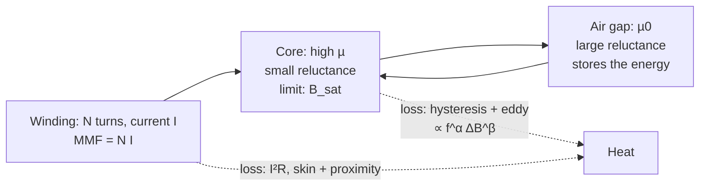
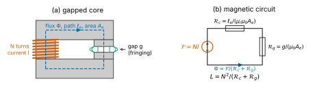

<!-- status: reviewed -->
# 22-05 · Magnetics Design

| | |
|---|---|
| **Course** | [22 · Power Electronics and Energy Conversion](../README.md) |
| **University equivalent** | The magnetics weeks of a senior power-electronics course: magnetic circuits with air gaps, core materials and loss (hysteresis, eddy currents, the Steinmetz equation), winding loss (skin and proximity effects, Dowell's analysis), and inductor and transformer design by the area-product and $K_g$ methods (Erickson & Maksimović, *Fundamentals of Power Electronics*, the basic magnetics, inductor design and transformer design chapters) |
| **Prerequisites** | [22-04](22-04-isolated-converters.md) (transformer model, flyback energy storage, leakage), [22-02](22-02-buck-converter-steady-state.md) (inductor ripple and peak current), [13-03](../../13-electromagnetics/chapters/13-03-magnetostatics-and-inductance.md) (magnetic circuits, reluctance, the gapped core), [04-07](../../04-physics-for-ee/chapters/04-07-faraday-lenz-and-inductance.md) (Faraday's law, inductance, energy) |
| **Estimated study hours** | 7 |
| **Last verified** | 2026-11-25 |

**Learning objectives.** After this chapter you can:

1. Model a gapped core as a magnetic circuit, and compute its inductance, $A_L$ value and effective permeability.
2. Derive why a gapped inductor stores its energy in the gap, and size the gap and turns so that the core does not saturate at the peak current.
3. Estimate core loss with the Steinmetz equation and its improved form for converter waveforms, and derive the eddy-current loss of a lamination.
4. Compute winding loss, including the temperature rise of copper's resistance, the skin depth, and the proximity effect in multilayer windings.
5. Select a core by the area-product or $K_g$ method, find the flux swing that minimizes a transformer's total loss, and estimate its leakage inductance with and without interleaving.
6. Compare core materials and magnetic structures (ferrite, powder, nanocrystalline, planar, coupled) and explain where each is used.

## 1. Big picture

Inductors and transformers are usually the largest and least integrated parts of a power converter, and often the lossiest. They cannot be bought by value alone: a 10 µH inductor that suits a 1 A buck will saturate, overheat or both in a 20 A one. Each is a small design problem in its own right: choose a core material and shape, a number of turns, an air gap and a wire, so that the core does not saturate and the core and copper losses fit the thermal budget. This chapter builds the tools: the magnetic circuit with a gap (where the energy actually lives), the loss mechanisms in core and copper, and the area-product and $K_g$ methods that turn a converter's ratings into a core size. It closes with powder and nanocrystalline materials, planar windings and coupled inductors.

- **Every switching converter** has at least one magnetic part, whose stored energy (22-01, 22-04) and losses help set its size and efficiency.
- **USB-C chargers:** the flyback's gapped transformer (22-04) is usually the tallest part; planar and higher-frequency designs shrink it.
- **Datacenter VRMs:** each phase's inductor must carry tens of amperes without saturating and still let the current slew fast. Coupled inductors and the trans-inductor voltage regulator (TLVR) trade these off (22-10).
- **Wearables and phones:** chip inductors of a few microhenries in packages a few millimetres on a side often set the floor on a PMIC's footprint (22-08).
- **Automotive and grid:** onboard chargers and solid-state transformers push magnetics to high power at high frequency.

## 2. Intuition first

**Flux is cheap to steer and expensive to store.** A ferrite core is a flux pipe. Its permeability is thousands of times that of air, so very little magnetomotive force (ampere-turns) drives flux around it. That makes it a poor place to store energy: the energy density is $B^2/(2\mu)$, so at the same flux density a high-$\mu$ material stores little. An inductor's job is to store energy, so designers cut a small **air gap** into the core. The core steers the flux and the gap, a slice of air a fraction of a millimetre thick, stores the energy.

**The core has a speed limit and a capacity limit.** Above a **saturation flux density** $B_{sat}$ (about 0.4–0.5 T for power ferrites, 0.8–1.5 T for powder cores and up to 1.8 T for silicon steel) the material's magnetic domains are all aligned and its permeability collapses toward $\mu_0$. The inductance collapses and the current shoots up, often destroying the switch. Since $B = \lambda/(NA)$ and $\lambda = LI$, the peak current sets the peak flux density: that is the capacity limit. The speed limit is loss: each cycle the domains are dragged around a hysteresis loop and eddy currents circulate, so the loss rises with frequency and steeply with flux swing.

**An analogy and its limits.** A gapped inductor is like a fund that keeps its cash in a small, safe, liquid account (the gap) and uses a large, low-cost network of correspondent banks (the core) to move it. The network must not be overloaded (saturation), and every transfer costs a fee that rises steeply with its size (N87's core loss rises as $\Delta B^{2.25}$). The analogy breaks down in two ways. The core's "fees" depend on how fast the money moves (frequency), not only on how much. And the gap has no limit of its own: air never saturates, so the energy is limited by how much flux the core can carry to the gap.

## 3. Theory

### 3.1 The gapped core as a magnetic circuit

Chapter 13-03 built the magnetic circuit; here is the part a designer uses every day. A core of effective path length $\ell_e$ (m), effective cross-section $A_e$ (m²) and relative permeability $\mu_r$ carries a winding of $N$ turns, with an air gap of length $g$ in the flux path. Ampère's law around the path, $\oint \mathbf{H}\cdot d\boldsymbol{\ell} = NI$, with $H = B/(\mu_r\mu_0)$ in the core and $B/\mu_0$ in the gap, and the same flux $\Phi = BA_e$ through both (fringing neglected), gives

$$
NI = \Phi\left(\frac{\ell_e}{\mu_r\mu_0A_e} + \frac{g}{\mu_0A_e}\right) = \Phi\,(\mathcal{R}_c + \mathcal{R}_g),
$$

with reluctances $\mathcal{R}$ in A/Wb (ampere-turns per weber). The flux linkage is $\lambda = N\Phi$ and the inductance $L = \lambda/I$:

$$
L = \frac{N^2}{\mathcal{R}_c + \mathcal{R}_g} = \frac{\mu_0 N^2 A_e}{g + \ell_e/\mu_r} .
$$

Units: H/m × m² / m = H. ✓ The gap is $\mu_r$ times more reluctant than the same length of core, so a gap a few hundredths of the path length dominates a ferrite with $\mu_r$ in the thousands. Three consequences follow.

- **The inductance is set by geometry.** With $g \gg \ell_e/\mu_r$, $L \approx \mu_0N^2A_e/g$, independent of $\mu_r$, whose tolerance is wide (an ungapped N87 ETD34 set is specified at $A_L$ = 2600 nH +30/−20% [10]) and which also drifts with temperature and flux density. The gap is ground to a tolerance; the permeability is not.
- **Vendors quote $A_L$.** The **inductance factor** $A_L = L/N^2 = 1/\mathcal{R}$, usually in nH per turn squared, is printed for each standard gap. Then $N = \sqrt{L/A_L}$, with no need to know $\mu_r$ or the fringing.
- **The gapped core behaves like a lower-permeability material.** The **effective permeability** $\mu_e$ is the permeability a gapless core of the same shape would need to give the same $L$: setting $\mu_e\mu_0A_e/\ell_e = \mu_0A_e/(g + \ell_e/\mu_r)$,

$$
\mu_e = \frac{\mu_r}{1 + \mu_r g/\ell_e} .
$$

**Fringing.** Flux bulges outward at the gap, so the gap's effective area is larger than $A_e$ and the gap's reluctance smaller. Dixon's empirical correction adds the gap length to each side of a rectangular centre leg of sides $a$ and $b$, $A_g \approx (a + g)(b + g)$, and he notes it is useful when the correction is below about 20% [12]. Fringing raises the inductance, and the bulging flux cuts through nearby turns, inducing eddy currents in them: "windings have been known to melt in this vicinity" [12]. That is why windings are kept away from the gap, or the gap is split into several smaller ones, which "dramatically reduce the extent of the fringing field" [12]. The vendor's measured $A_L$ for a gapped core includes fringing, which is another reason to design from $A_L$ when it is available (Example 22-05.1).

### 3.2 Energy, saturation and the gap

**Flux density from the circuit's point of view.** Since $\lambda = N\Phi = NBA_e$ and $\lambda = LI$,

$$
B = \frac{LI}{NA_e} .
$$

Units: H × A / m² = V·s/m² = T. ✓ This is the most useful equation in the chapter. The peak current sets the peak flux density, and the design must keep $B_{pk} = LI_{pk}/(NA_e)$ below a chosen $B_{max}$ with margin to $B_{sat}$ at the hottest operating temperature (3C95's falls from about 530 to 410 mT between 25 and 100 °C [1]). For a given $L$ and $I_{pk}$, more turns lower $B$. But more turns need a bigger gap to hold $L$ (since $L \propto N^2/g$), and they mean more copper resistance.

**Where the energy is.** The energy stored at current $I$ is $W = \tfrac12LI^2$. In field terms, the energy density is $w = B^2/(2\mu)$ (J/m³), and the flux density $B$ is the same in core and gap. So

$$
W = \frac{B^2}{2\mu_0}A_e\left(g + \frac{\ell_e}{\mu_r}\right),
$$

and the gap's share is

$$
\frac{W_{gap}}{W} = \frac{g}{g + \ell_e/\mu_r} = \frac{1}{1 + \ell_e/(\mu_rg)} .
$$

Substituting $B = LI/(NA_e)$ and $L = \mu_0N^2A_e/(g + \ell_e/\mu_r)$ into the first expression gives back $\tfrac12LI^2$, the units check being (T² / (H/m)) × m³ = J. ✓

**The energy limit.** At $B = B_{max}$ the stored energy is

$$
W_{max} = \frac{B_{max}^2}{2\mu_0}A_e\left(g + \frac{\ell_e}{\mu_r}\right) \approx \frac{B_{max}^2}{2\mu_0}V_{gap}, \qquad V_{gap} = A_eg .
$$

This is the key design insight. **The energy an inductor can store is set by the volume of its gap times the energy density that the core's saturation allows.** At 0.3 T, $B^2/(2\mu_0)$ = 35.8 kJ/m³, or 35.8 µJ per cubic millimetre of gap. A flyback that stores 0.7 mJ per cycle (Example 22-04.2) needs about 20 mm³ of gap volume; a core with a 100 mm² centre leg needs a gap of about 0.2 mm. An ungapped ferrite core, with $\ell_e/\mu_r$ of a few hundredths of a millimetre, can store almost nothing before it saturates. A transformer, which is not meant to store energy, is ungapped for exactly that reason: its magnetizing inductance should be large.

**Design equations.** Given $L$, $I_{pk}$, a chosen $B_{max}$ and a core with $A_e$ and $\ell_e$, the turns and gap follow:

$$
N = \frac{LI_{pk}}{B_{max}A_e}, \qquad g = \frac{\mu_0N^2A_e}{L} - \frac{\ell_e}{\mu_r} .
$$

Round $N$ up (which lowers $B_{pk}$) and recompute $g$. Then check that the winding fits the window (§3.6).

> **Math refresher — energy from the B–H curve.** The energy delivered to a magnetic material per unit volume while its flux density rises from $B_1$ to $B_2$ is $\int_{B_1}^{B_2} H\,dB$. For a linear material, $H = B/\mu$ and the integral from 0 to $B$ is $B^2/(2\mu)$. A hysteresis loop is the same integral around a closed path: the area enclosed by the B–H loop is the energy lost as heat per unit volume per cycle.

### 3.3 Core materials and the eddy-current problem

**Hysteresis.** A ferromagnet's B–H curve is a loop, not a line: the domains do not return the energy they took on the way up. The loop's area is energy per unit volume per cycle, so the **hysteresis loss** rises at least linearly with frequency and grows with the flux swing.

**Eddy currents.** The core is itself a conductor, and a changing flux induces circulating currents in it. Take a lamination of thickness $t$ (thin compared with its width, so the currents run along the width and return at the edges), resistivity $\rho$, with a uniform flux density $B(t)$ along its length. By symmetry the induced field is zero at the mid-plane. Faraday's law around a rectangle reaching a distance $x$ either side of the mid-plane gives the induced field $E(x) = x\,dB/dt$. The loss density at $x$ is $E^2/\rho$, and averaging over the thickness,

$$
p_{eddy} = \frac{1}{t}\int_{-t/2}^{t/2}\frac{x^2}{\rho}\left(\frac{dB}{dt}\right)^2dx = \frac{t^2}{12\rho}\left(\frac{dB}{dt}\right)^2 .
$$

For a sinusoid $B = B_{pk}\sin\omega t$, the time average of $(dB/dt)^2$ is $\omega^2B_{pk}^2/2$, so

$$
p_{eddy} = \frac{\pi^2f^2B_{pk}^2t^2}{6\rho} .
$$

Units: (T/s)² × m²/(Ω·m) = (V/m)²/(Ω·m) = W/m³, since T/s × m = V/m. ✓ The eddy loss rises as $f^2$ and $t^2$ and falls as $1/\rho$. This one formula explains the materials table. Silicon steel, a metal, works at 50–60 Hz in laminations a few tenths of a millimetre thick, and is hopeless at 100 kHz, where the $f^2$ factor is $4 \times 10^6$ times larger than at 50 Hz. Nanocrystalline alloys are metals too, but they are made as ribbon about 18 µm thick [3]. Ferrites are ceramics: 3C95's resistivity is about 5 Ω·m [1], 4.3 million times that of the nanocrystalline alloy, so ferrites can be solid blocks at hundreds of kilohertz. The derivation assumes the lamination is thinner than the material's skin depth; otherwise the flux crowds to the surface and the formula overestimates the loss.

| Material | $B_{sat}$ | Resistivity | Typical use |
|---|---|---|---|
| MnZn power ferrite (3C95, N87) | about 0.39–0.53 T, falling with temperature | about 5 Ω·m | 25 kHz–1 MHz transformers and gapped inductors |
| Powder cores (Kool Mµ, High Flux, MPP) | about 0.8–1.5 T | insulated particles | buck and PFC inductors with DC bias; soft saturation |
| Nanocrystalline (VITROPERM) | 1.24 T | 1.15 µΩ·m, in about 18 µm ribbon | common-mode chokes, high-power medium-frequency transformers |
| Grain-oriented silicon steel | 1.5–1.8 T | metallic, in laminations | 50/60 Hz transformers and machines |

Values from [1], [2] and [3]; the N87, steel and High Flux values are from the vendor pages logged in R-081.

**Powder cores and the distributed gap.** A powder core is made of magnetic metal particles separated by insulating binder. Every particle boundary is a microscopic gap, so the whole core behaves as a uniformly gapped material of low effective permeability; Magnetics sells its Kool Mµ material in grades such as 26µ and 60µ, among others [2]. There is no discrete gap to fringe, and the gap is spread through the volume, so the energy is stored everywhere. As the DC bias rises the particles saturate progressively, and the permeability falls gradually, not suddenly: **soft saturation**. A 60µ Kool Mµ core keeps 80% of its initial permeability at 45 Oe (3.58 kA/m) and 50% at 95 Oe (7.56 kA/m) [2]. An inductor's datasheet therefore quotes a "saturation current" at which $L$ has fallen by a stated percentage (Coilcraft's XAL7070, for example, uses 30%, R-082), not a cliff. That suits buck and boost inductors, which carry a large DC current, and is why molded powder chip inductors dominate point-of-load converters.

### 3.4 Core loss: the Steinmetz equation and converter waveforms

Hysteresis and eddy loss in ferrites are too material-specific to compute from first principles, so designers fit measured data with the **Steinmetz equation**, for sinusoidal flux of peak $B_{pk}$ at frequency $f$:

$$
P_v = k\,f^{\alpha}B_{pk}^{\beta} ,
$$

with $P_v$ the loss per unit volume (or per unit mass) and $k$, $\alpha$ and $\beta$ fitted over a limited range of frequency, flux density and temperature. One characterization of N87 gives $\alpha$ = 1.635 and $\beta$ = 2.253 for sine-wave excitation [4]. Two facts dominate design:

- **Loss rises steeply with flux swing.** Halving $B_{pk}$ divides the loss by $2^{\beta}$, about 4.8 for $\beta$ = 2.253. So in transformers and high-ripple inductors, loss, not saturation, sets the usable flux swing. Dixon's rule of thumb is to use "the ∆B value that results in a core loss of 100mW/cm3" [12], which at 100 kHz and above lands well below saturation (Example 22-05.8 finds an optimum of 0.14 T at 250 kHz).
- **Loss depends on temperature.** 3C95 is described as having "low power losses from 25 to 100 °C": about 350 kW/m³ at 25 °C and 290 kW/m³ at 100 °C, at 100 kHz and 200 mT [1]. Its sibling 3C97 is specified at about 320 kW/m³ at 60 °C and 380 kW/m³ at 140 °C [1]. The fitted $k$ is temperature-dependent, and each material has a temperature of minimum loss.

**Non-sinusoidal flux.** Converters do not drive cores with sine waves. A buck inductor's flux is a triangle wave: it rises for $DT_s$ and falls for $(1 - D)T_s$. A fit made with sine waves misestimates the loss for such shapes, especially at small or large $D$, because the loss depends on how fast the flux changes, not only on how far it swings. The **improved generalized Steinmetz equation (iGSE)** [5] keeps the sine-wave parameters and models the loss as an average over the period of a function of $|dB/dt|$:

$$
P_v = \frac{1}{T}\int_0^T k_i\left|\frac{dB}{dt}\right|^{\alpha}(\Delta B)^{\beta - \alpha}\,dt, \qquad k_i = \frac{k}{(2\pi)^{\alpha - 1}\displaystyle\int_0^{2\pi}|\cos\theta|^{\alpha}\,2^{\beta - \alpha}\,d\theta},
$$

where $\Delta B$ is the peak-to-peak flux swing. The constant $k_i$ is chosen so that the formula reproduces $kf^{\alpha}B_{pk}^{\beta}$ exactly for a sinusoid, as you can check by substituting $B = B_{pk}\sin\omega t$, $\Delta B = 2B_{pk}$. For a triangle wave of swing $\Delta B$ that rises for $DT$ and falls for $(1 - D)T$, $|dB/dt|$ is $\Delta B/(DT)$ for a time $DT$ and $\Delta B/((1 - D)T)$ for a time $(1 - D)T$. The integral splits into two constant pieces:

$$
P_v = k_i(\Delta B)^{\beta}f^{\alpha}\left[D^{1 - \alpha} + (1 - D)^{1 - \alpha}\right].
$$

For $\alpha > 1$ the bracket grows as $D$ moves away from 0.5: a fast edge costs more than its share. With the N87 exponents, a symmetric triangle loses about 0.89 times as much as a sine wave of the same peak and frequency, and a triangle at $D$ = 0.1 about 1.54 times as much (Example 22-05.4).

> **Going deeper — what the Steinmetz family leaves out.** The iGSE ignores relaxation (the extra loss when the flux stops changing, as in a flyback's idle interval), DC bias (a buck inductor's flux swings around a large DC value, which raises the loss for the same swing), and temperature. Each has an extended model in the literature. Data-driven models trained on large measured datasets, such as the open MagNet database [6], now compete with the fitted equations. In practice designers start from the vendor's loss curves, apply the iGSE for the waveform shape, and verify on the bench.

### 3.5 Winding loss: DC resistance, skin and proximity effects

**DC resistance.** A winding of $N$ turns of wire of cross-section $A_w$ (m²) on a core whose **mean length per turn** is $\text{MLT}$ (m) has

$$
R_{dc} = \frac{\rho N\,\text{MLT}}{A_w} .
$$

Copper's resistivity is $1/58$ Ω·mm²/m (17.24 nΩ·m) at 20 °C and rises by about 0.393% per kelvin [7], so at 100 °C it is 31% higher: 22.66 nΩ·m. Hot copper loses more, and magnetic parts run hot. Always evaluate the winding at its operating temperature.

**Skin effect.** At high frequency, current crowds to a conductor's surface within the **skin depth**

$$
\delta = \sqrt{\frac{\rho}{\pi f\mu_0}} ,
$$

which is 0.209 mm in copper at 100 kHz and 20 °C, and 0.240 mm at 100 °C (13-05 derived it). A round wire much thicker than about $2\delta$ wastes its centre at that frequency. A converter's winding current has a DC or fundamental part plus harmonics, and each harmonic sees its own, higher resistance.

**Proximity effect.** In a multilayer winding the skin effect is the smaller problem. Each layer sits in the magnetic field produced by the layers inside it. That field is parallel to the layer's surface and induces eddy currents in it, which add loss even if the layer's own current were zero. In a winding section of $M$ layers, the field steps up by one layer's worth of ampere-turns per layer, so the outer layer of the section sits between fields of $(M - 1)$ and $M$ layers' worth, and its loss grows roughly as $M^2$.

Dowell analysed a winding of $M$ layers of foil (or of round wire treated as equivalent foil) of thickness $h$, in a one-dimensional field [8]. Write $\Delta = h/\delta$. Solving the diffusion equation $d^2H/dx^2 = j\omega\mu_0H/\rho$ in each layer, with the field set at each layer's two faces by the ampere-turns inside it, gives the ratio of AC to DC resistance averaged over the section:

$$
F_R = \frac{R_{ac}}{R_{dc}} = \Delta\left[\frac{\sinh 2\Delta + \sin 2\Delta}{\cosh 2\Delta - \cos 2\Delta} + \frac{2(M^2 - 1)}{3}\,\frac{\sinh\Delta - \sin\Delta}{\cosh\Delta + \cos\Delta}\right].
$$

For thin layers ($\Delta \lesssim 1$) a series expansion gives the simpler form

$$
F_R \approx 1 + \frac{5M^2 - 1}{45}\Delta^4 .
$$

Two lessons follow. First, $F_R$ grows as $M^2$: five layers at $\Delta$ = 1 have $F_R$ = 3.65, against 1.09 for one layer. Second, there is an optimum thickness. Thinner layers have a higher DC resistance but a much lower $F_R$, and for many layers the best $\Delta$ is well below 1. The remedies are:

- **Litz wire**: many fine strands, each insulated and twisted so that every strand takes every position in the bundle, keeping each strand's $\Delta$ small and sharing current equally;
- **Interleaving**: splitting the primary into sections on either side of the secondary, which halves the peak field in each section and cuts the effective $M$ (§3.6);
- **Fewer, wider layers**: foil or planar windings that span the full window breadth, so that the field is one-dimensional and $M$ is small.

> **Going deeper — the diffusion equation in a layer.** Inside a conductor, Ampère's and Faraday's laws combine (13-05) into $d^2H/dx^2 = 2jH/\delta^2$ for a field parallel to the layer, solved by $\cosh$ and $\sinh$ of $(1 + j)x/\delta$. The current density is $dH/dx$ and the loss per unit area $(\rho/2)\int|dH/dx|^2dx$. With $H$ fixed at each face by the enclosed ampere-turns, the integral has a closed form, and averaging over the $M$ layers gives Dowell's expression. The verify script recovers it by finite differences.

### 3.6 Design methods

**The area product.** The core must satisfy two constraints at once. The flux constraint (§3.2) is $NA_eB_{max} \ge LI_{pk}$. The window constraint is that $N$ turns carrying $I_{rms}$ at a chosen current density $J$ (A/m²) fit into the winding window of area $W_A$ with a **window utilization factor** $K_u$ (the fraction of the window that is copper, after insulation, bobbin and packing; Dixon puts it at "perhaps only 25% or 30%" for a small bobbin-wound transformer with high-voltage isolation, and uses 40% in a design example [12]): $NI_{rms} \le K_uW_AJ$. Multiplying the two eliminates $N$:

$$
A_p = A_eW_A \ge \frac{LI_{pk}I_{rms}}{K_uJB_{max}} .
$$

Units: H × A²/((A/m²) × T) = (V·s/A)·A²/((A/m²)·(V·s/m²)) = m⁴. ✓ The **area product** $A_p$ is a property of the core's shape, tabulated by vendors or computed from the data sheet. Pick the smallest core with $A_p$ above the requirement. Note that $LI_{pk}I_{rms}$ is close to twice the peak stored energy when the ripple is small: energy storage sets inductor size.

**The $K_g$ method.** Choosing $J$ is a proxy for the real limit, which is copper loss (and the temperature rise it causes). Erickson and Maksimović make the copper loss explicit [9]. With $N = LI_{pk}/(B_{max}A_e)$ and wire area $A_w = K_uW_A/N$,

$$
P_{cu} = I_{rms}^2\frac{\rho N\,\text{MLT}}{A_w} = \frac{\rho N^2\,\text{MLT}\,I_{rms}^2}{K_uW_A} = \frac{\rho L^2I_{pk}^2I_{rms}^2\,\text{MLT}}{B_{max}^2A_e^2K_uW_A}.
$$

Collecting the core's geometry on one side defines the **core geometrical constant**:

$$
K_g = \frac{A_e^2W_A}{\text{MLT}} \ge \frac{\rho L^2I_{pk}^2I_{rms}^2}{B_{max}^2P_{cu}K_u} .
$$

$K_g$ (m⁵) grows as the fifth power of the core's linear size, so a modest change in the loss budget moves the core size only a little: halving $P_{cu}$ needs twice the $K_g$, which is a core only $2^{1/5}$ = 1.15 times larger in each dimension.

**The inductor design procedure** (Example 22-05.7):

1. Choose $B_{max}$ below the hot saturation value with margin, lower if the flux ripple makes core loss matter.
2. Choose a core by $A_p$ or $K_g$; then $N = \lceil LI_{pk}/(B_{max}A_e)\rceil$ and the gap for $A_L = L/N^2$.
3. Choose the wire (area $K_uW_A/N$, subdivided if $\delta$ requires it), then check core loss on the flux ripple, copper loss with $F_R$, and the temperature rise.

**Transformers: the optimum flux swing.** A transformer stores no intended energy, so saturation rarely binds. The flux swing per cycle is set by Faraday's law, $\Delta B = \lambda_{on}/(NA_e)$, where $\lambda_{on}$ is the primary's volt-seconds per half-cycle (22-04). Fewer turns mean a larger $\Delta B$ and more core loss, which rises as $\Delta B^{\beta}$. More turns mean thinner wire in the same window and more copper loss, which rises as $N^2 \propto 1/\Delta B^2$. With $P_{fe} = a\,\Delta B^{\beta}$ and $P_{cu} = b/\Delta B^2$, setting $d(P_{fe} + P_{cu})/d\Delta B = 0$ gives $\beta a\,\Delta B^{\beta - 1} = 2b/\Delta B^3$, so

$$
\Delta B_{opt} = \left(\frac{2b}{\beta a}\right)^{1/(\beta + 2)}, \qquad \frac{P_{fe}}{P_{cu}}\bigg|_{opt} = \frac{2}{\beta} .
$$

At the optimum the core loss is $2/\beta$ times the copper loss, 0.89 for $\beta$ = 2.253: **roughly equal core and copper loss** is the classic rule [9], and Dixon's version is that total loss is at a broad minimum when core loss is "approximately equal to or a little less than winding losses" [12]. Now you know why it is a little less. The total-loss minimum is flat, so a design near $\Delta B_{opt}$ loses little (Example 22-05.8).

**Leakage inductance and interleaving.** Chapter 22-04 showed that leakage energy is burned in a clamp. Where does leakage come from? Consider a primary of $N$ turns in a section of height $h_p$ and a secondary in a section of height $h_s$, separated by insulation of thickness $d$, all spanning a window breadth $b_w$, with mean length per turn MLT. With the secondary carrying the balancing ampere-turns, the field between the windings is parallel to the layers. By Ampère's law it rises linearly from zero to $H_0 = NI/b_w$ across the primary, stays at $H_0$ across the insulation, and falls linearly to zero across the secondary. The stored energy is

$$
W = \frac{\mu_0}{2}\int H^2\,dV = \frac{\mu_0}{2}H_0^2\,b_w\,\text{MLT}\left(\frac{h_p}{3} + d + \frac{h_s}{3}\right),
$$

since $\int_0^h(x/h)^2dx = h/3$. Setting $W = \tfrac12L_{lk}I^2$:

$$
L_{lk} = \frac{\mu_0N^2\,\text{MLT}}{b_w}\left(\frac{h_p}{3} + d + \frac{h_s}{3}\right).
$$

Leakage grows as $N^2$ and with the winding heights and spacing, and falls with a wider window. Now split the primary into two halves either side of the secondary (P/2–S–P/2). The field peaks at only $H_0/2$: it rises to $H_0/2$ across the first half-primary, falls from $+H_0/2$ to $-H_0/2$ across the secondary, and returns to zero across the second half-primary, with two insulation layers at $|H| = H_0/2$. Integrating,

$$
L_{lk,\,int} = \frac{\mu_0N^2\,\text{MLT}}{b_w}\left(\frac{h_p}{12} + \frac{d}{2} + \frac{h_s}{12}\right),
$$

a quarter of the winding terms and half the insulation term. The same halving of the peak field cuts the proximity loss (§3.5), whose $M^2$ dependence comes from the same field. Interleaving costs extra insulation layers (each must meet the safety rules of 22-04 if it separates primary from secondary) and raises the inter-winding capacitance, which couples common-mode noise across the barrier.

### 3.7 Scaling, temperature and integrated magnetics

**Why higher frequency shrinks magnetics, up to a point.** For a transformer driven by a square wave of amplitude $V$ at frequency $f$, the volt-seconds of each half-cycle, $V/(2f)$, equal $NA_e\Delta B$, so $\Delta B = V/(2NA_ef)$ peak to peak. At fixed $\Delta B$ and $J$ the power a core can handle rises in proportion to $f\,A_p$: doubling the frequency halves the required area product. But core loss density rises as $f^{\alpha}\Delta B^{\beta}$ and $F_R$ rises with $\Delta$, so at high frequency the designer must lower $\Delta B$, giving back part of the gain. Heat compounds this. If every linear dimension scales by $s$, the surface that sheds heat scales as $s^2$, so halving every dimension quarters the loss the part may dissipate at the same temperature rise, while the converter's currents stay the same.

**Planar and coupled magnetics.** Planar windings, made from PCB layers or stamped copper on low-profile cores, give a flat part with repeatable leakage and capacitance and easy interleaving, at the cost of copper fill and higher inter-winding capacitance. Coupling a multiphase buck's inductors (22-10) breaks the trade between fast slew and small ripple; the **trans-inductor voltage regulator (TLVR)**, with every phase's secondary in one series loop, is the current example (§9).

## 4. Worked examples

The examples use one real core throughout: TDK's ETD 34/17/11 set in N87 ferrite. Its data sheet gives $\ell_e$ = 78.6 mm, $A_e$ = 97.1 mm², $V_e$ = 7630 mm³, an ungapped $A_L$ of 2600 nH (+30/−20%), gapped $A_L$ values of 790, 482, 251, 153 and 80 nH for gaps of 0.10, 0.20, 0.50, 1.00 and 2.50 mm, and a fit $A_L \approx 153\,s^{-0.713}$ nH for a gap of $s$ mm between 0.1 and 2.5 mm. Its coil former has a winding area of 122 mm² and a mean length per turn of 60.5 mm [10]. N87's saturation flux density is 390 mT at 100 °C (R-081).

### Example 22-05.1 · The gapped core's magnetic circuit (tier A)

**Setup.** The ETD34 set is gapped to 0.50 mm in its round centre pole, 11.1 mm in diameter. Find (a) the core's reluctance from the ungapped $A_L$, (b) the gap's reluctance, (c) the ideal (no-fringing) $A_L$ and (d) the gap's share of the reluctance. Correct for fringing by scaling the gap area by $((d + g)/d)^2$, the round-pole form of the rule that adds the gap length to each dimension of the pole [12]: find (e) the corrected gap area and (f) the corrected $A_L$. Compare with the data sheet's 251 nH: (g) the ideal model's error and (h) the corrected model's error. With 20 turns, find (i) the inductance and (j) the effective permeability, both from the data-sheet $A_L$.

**Solution.**

- (a) The ungapped set's reluctance includes the core and the tiny residual gap at its ground mating faces: $\mathcal{R}_c = 1/A_L = 1/(2600\ \text{nH})$ = **3.85** × 10⁵ A/Wb.
- (b) $\mathcal{R}_g = g/(\mu_0A_e) = 0.5\ \text{mm}/(4\pi \times 10^{-7} \times 97.1\ \text{mm}^2)$ = **4.10** × 10⁶ A/Wb.
- (c) $A_L = 1/(\mathcal{R}_c + \mathcal{R}_g) = 1/(4.482 \times 10^6)$ = **223** nH; (d) the gap carries $4.098/4.482$ = **91.4** %.
- (e) $A_g = 97.1 \times (11.6/11.1)^2$ = **106.0** mm²; (f) $\mathcal{R}_g = 3.752 \times 10^6$ A/Wb, so $A_L$ = **242** nH.
- (g) $223.1/251 - 1$ = **−11.1** %; (h) $241.7/251 - 1$ = **−3.7** %.
- (i) $L = A_LN^2 = 251\ \text{nH} \times 400$ = **100.4** µH; (j) $\mu_e = A_L\ell_e/(\mu_0A_e) = 251\ \text{nH} \times 78.6\ \text{mm}/(\mu_0 \times 97.1\ \text{mm}^2)$ = **162** (the data sheet lists 161).

**Units check.** m/(H/m × m²) = 1/H = A/Wb; and 1/(A/Wb) = Wb/A = H. ✓

**Sanity check.** The gap dominates as designed. The ideal model is 11% low because fringing makes the gap look wider; the first-order correction recovers most of it. Dixon notes the correction is reliable when it is below about 20% [12]; here it enlarges the gap area by **9** % (k). A design should use the vendor's measured $A_L$.

### Example 22-05.2 · Saturation current and stored energy (tier B)

**Setup.** For Example 22-05.1's inductor (100.4 µH, 20 turns, 0.50 mm gap), find (a) the flux density per ampere, (b) the current at which the core reaches N87's 390 mT at 100 °C, (c) the current at a design limit of 300 mT and (d) the energy stored at 300 mT. For the same core ungapped with 20 turns, find (e) the inductance, (f) the current at 300 mT and (g) the stored energy. (h) What is the ratio of the energies, and why?

**Solution.**

- (a) $B/I = L/(NA_e) = 100.4\ \mu\text{H}/(20 \times 97.1\ \text{mm}^2)$ = **0.0517** T/A.
- (b) $0.39/0.0517$ = **7.54** A; (c) $0.3/0.0517$ = **5.80** A; (d) $\tfrac12 \times 100.4\ \mu\text{H} \times 5.803^2$ = **1.69** mJ.
- (e) $2600\ \text{nH} \times 400$ = **1.04** mH; (f) $I = BNA_e/L = 0.3 \times 20 \times 97.1\ \text{mm}^2/1.04\ \text{mH}$ = **0.560** A; (g) $\tfrac12 \times 1.04\ \text{mH} \times 0.5602^2$ = **0.163** mJ.
- (h) $1.690/0.1632$ = **10.4**. At fixed $B_{max}$ and $N$, the flux linkage $\lambda = NA_eB_{max}$ is fixed and $W = \lambda^2/(2L)$, so the energy scales as $1/L$, that is, as $1/A_L$: 2600/251 = 10.4.

**Units check.** H·A/(m²) = Wb/m² = T; H·A² = J. ✓

**Sanity check.** Gapping cut the inductance tenfold and raised the energy the core can hold tenfold. The ungapped core would saturate at 0.56 A: fine for a transformer's magnetizing current, useless for an inductor.

### Example 22-05.3 · The flyback transformer of Example 22-04.2 (tier B)

**Setup.** Example 22-04.2's 65 W flyback needs $L_m$ = 223 µH and a peak primary current of 2.52 A at $D$ = 0.561 and 100 kHz, with $n$ = 6.4. Wind it on the ETD34 set with 32 primary and 5 secondary turns. Find (a) the $A_L$ required, (b) the peak flux density, (c) the gap from TDK's fit and (d) the gap from the ideal model, using the ungapped set's $\ell_e/\mu_e$ = 78.6 mm/1675 for the core term. Find (e) the stored energy, (f) the primary's RMS current, (g) the secondary's peak and (h) its RMS current, both at the boundary of conduction. At 4.2 A/mm² (a current density Dixon uses with a 40% copper window [12]), find (i) the copper area needed and (j) the fraction of the 122 mm² window it fills.

**Solution.**

- (a) $A_L = L/N^2 = 223\ \mu\text{H}/1024$ = **218** nH.
- (b) $B_{pk} = LI_{pk}/(NA_e) = 223\ \mu\text{H} \times 2.52/(32 \times 97.1\ \text{mm}^2)$ = **0.181** T, under half the hot saturation value.
- (c) $s = (217.8/153)^{-1/0.713}$ = **0.61** mm; (d) $g = \mu_0N^2A_e/L - \ell_e/\mu_e$ = 0.5603 − 0.0469 = **0.513** mm. Fringing lets the real gap be about a fifth longer for the same $A_L$.
- (e) $\tfrac12 \times 223\ \mu\text{H} \times 2.52^2$ = **0.708** mJ (Example 22-04.2's 0.707 mJ carries the unrounded 2.517 A).
- (f) The primary current is a ramp from 0 to $I_{pk}$ for $DT_s$, so $I_{rms} = I_{pk}\sqrt{D/3} = 2.52\sqrt{0.561/3}$ = **1.09** A.
- (g) $nI_{pk} = 6.4 \times 2.52$ = **16.1** A, falling to zero over $(1 - D)T_s$; (h) $16.13\sqrt{0.439/3}$ = **6.17** A.
- (i) $(32 \times 1.090 + 5 \times 6.170)/4.2$ = **15.6** mm²; (j) $15.65/122$ = **0.128**.

**Units check.** A·turns/(A/mm²) = mm². ✓

**Sanity check.** The copper fills under 13% of the window, below the 25–30% Dixon expects of a small isolated transformer [12]. The slack is not waste: reinforced insulation (22-04) consumes much of the window.

### Example 22-05.4 · Core loss of the flyback transformer (tier B)

**Setup.** In Example 22-05.3 the flux rises from 0 to 0.181 T in $DT_s$ ($D$ = 0.561) and returns in $(1 - D)T_s$, at 100 kHz. The data sheet guarantees at most 4.00 W per set at 200 mT (sine), 100 kHz, 100 °C [10]. Scale from that point with N87's Steinmetz exponents $\alpha$ = 1.635 and $\beta$ = 2.253 [4], using the iGSE. Find (a) the anchor's loss density, (b) $k_i/k$, (c) the iGSE bracket, (d) the loss as a fraction of the anchor and (e) the loss. (f) What would a sine wave of the same peak-to-peak flux give? (g) What fraction of the 70.65 W input is (e)?

**Solution.**

- (a) $4.00\ \text{W}/7630\ \text{mm}^3$ = **524** kW/m³.
- (b) $\int_0^{2\pi}|\cos\theta|^{1.635}d\theta$ = **3.389** (h), so $k_i/k = 1/((2\pi)^{0.635} \times 3.389 \times 2^{0.618})$ = **0.0598**.
- (c) $0.561^{-0.635} + 0.439^{-0.635}$ = **3.13**.
- (d) With the anchor $kf^{\alpha}(0.2)^{\beta}$ at the same frequency, the ratio is $(k_i/k)(\Delta B/0.2)^{\beta}[\,\cdot\,] = 0.05985 \times 0.7972 \times 3.130$ = **0.149**.
- (e) $0.149 \times 4.00$ = **0.60** W.
- (f) $B_{pk} = 0.0904$ T: $4.00 \times (0.0904/0.2)^{2.253}$ = **0.67** W.
- (g) $0.597/70.65$ = **0.85** %.

**Units check.** W/m³ from W/m³; the ratios are dimensionless. ✓

**Sanity check.** Under 1% of the power for the core is a healthy flyback. The iGSE gives a little less than the equal-swing sine because the triangle's slopes are gentler than a sine's peak slope. The number is an upper bound in one way (the anchor is a guaranteed maximum, not a typical value) and optimistic in another: the flux swings from 0 to 0.181 T, a DC bias the Steinmetz family ignores, and the N87 exponents come from one characterization.

### Example 22-05.5 · Eddy currents: ribbon, plate and block (tier A)

**Setup.** (a) A nanocrystalline core (VITROPERM 800: ribbon 18 µm thick, 1.15 µΩ·m [3]) runs at 100 kHz and 0.3 T. Find its classical eddy-current loss density, and (b) compare with the data sheet's total of at most 80 W/kg at a density of 7350 kg/m³. (c) What would a 0.35 mm sheet of the same alloy lose? (d) Treat the ETD34's 11.1 mm ferrite centre pole as a slab of 3C95 (about 5 Ω·m [1]) at 100 kHz and 0.2 T: find its eddy loss density, and (e) compare with 3C95's typical 290 kW/m³ total at 100 °C [1].

**Solution.**

- (a) $p = \pi^2f^2B_{pk}^2t^2/(6\rho) = \pi^2 \times 10^{10} \times 0.09 \times (18\ \mu\text{m})^2/(6 \times 1.15\ \mu\Omega\text{m})$ = **417** kW/m³.
- (b) The total is at most $80 \times 7350$ = **588** kW/m³ (f), so the classical eddy loss is **71** % of it.
- (c) The loss scales as $t^2$: $(350/18)^2$ = **378** (g) times more, **158** MW/m³.
- (d) $\pi^2 \times 10^{10} \times 0.04 \times (11.1\ \text{mm})^2/(6 \times 5\ \Omega\text{m})$ = **16.2** kW/m³; (e) **5.6** % of the total.

**Units check.** (T/s)² m²/(Ω·m) = (V/m)²/(Ω·m) = W/m³. ✓

**Sanity check.** In the metal, eddy currents are most of the loss even in 18 µm ribbon. For a 0.35 mm sheet the classical formula gives 158 W/cm³; the sheet is then several skin depths thick at 100 kHz (for any relative permeability above a few hundred), so the flux crowds to the surfaces and the real loss is lower than this estimate, but the point stands: thick metal is hopeless at 100 kHz. In the ferrite, eddy loss is a small part of the total even in a solid 11 mm pole, so its loss is mostly hysteresis and residual loss. (A round pole loses less than a slab; Problem 22-05.11.)

### Example 22-05.6 · A foil winding's AC resistance (tier B)

**Setup.** A transformer secondary has 4 turns of copper foil, 20 mm wide, one turn per layer, on the ETD34 bobbin (MLT 60.5 mm). It carries 20 A RMS at 100 kHz (sinusoidal) at 100 °C. Find (a) the skin depth. For 0.10 mm foil find (b) $R_{dc}$, (c) $\Delta$, (d) $F_R$ and (e) the loss. For 0.30 mm foil find (f) $R_{dc}$, (g) $\Delta$, (h) $F_R$ and (i) the loss. (j) With 0.30 mm foil and interleaving that splits the winding into two sections of two layers, what are $F_R$ and (k) the loss? (l) What foil thickness minimizes the loss of the four-layer winding, and (m) what is that loss?

**Solution.**

- (a) $\rho_{100}$ = 22.66 nΩ·m; $\delta = \sqrt{\rho/(\pi f\mu_0)}$ = **0.240** mm.
- (b) $R_{dc} = \rho N\,\text{MLT}/(hb) = 22.66\ \text{n}\Omega\text{m} \times 4 \times 60.5\ \text{mm}/(0.1 \times 20\ \text{mm}^2)$ = **2.74** mΩ; (c) $\Delta = 0.1/0.2396$ = **0.417**; (d) Dowell with $M$ = 4: $F_R$ = **1.053**; (e) $20^2 \times 2.742\ \text{m}\Omega \times 1.053$ = **1.16** W.
- (f) **0.914** mΩ; (g) **1.25**; (h) $F_R$ = **4.93**; (i) $400 \times 0.914\ \text{m}\Omega \times 4.93$ = **1.80** W.
- (j) $M$ = 2: $F_R$ = **1.95**; (k) **0.711** W.
- (l) Minimizing $R_{dc}(h)F_R(h)$ numerically gives $h$ = **0.159** mm ($\Delta$ = **0.66**, n), with (m) **0.923** W.

**Units check.** Ω·m × m/m² = Ω. ✓

**Sanity check.** Tripling the foil thickness cut the DC resistance threefold and *raised* the loss by more than half: proximity effect. Interleaving the thick foil beats every non-interleaved thickness, and the four-layer optimum sits at $\Delta$ = 0.66, well below one skin depth, as §3.5 predicted.

### Example 22-05.7 · Designing a buck inductor by area product (tier C)

**Setup.** A 48 V to 12 V, 20 A buck switches at 250 kHz with a 30% ripple ratio. Find (a) $L$, (b) $I_{pk}$ and (c) $I_{rms}$. With $K_u$ = 0.4, $J$ = 4.2 A/mm² and $B_{max}$ = 0.3 T, find (d) the required area product and (e) the ETD34's area product. Find (f) the turns before rounding, then with 5 turns (g) $B_{pk}$, (h) the ideal-model gap and (i) the gap from TDK's $A_L$ fit. Filling 40% of the window, find (j) the wire area per turn, (k) the winding resistance at 100 °C and (l) the DC copper loss. (m) Find the ETD34's $K_g$ and (n) the $K_g$ needed for 0.5 W of copper loss. (o) Find the flux ripple and (p) an estimate of the core loss, excluding the DC-bias penalty, by the method of Example 22-05.4 (scaling $f^{\alpha}$ from 100 to 250 kHz). (q) Bound the ripple's extra copper loss if its $F_R$ were as high as 10.

**Solution.**

- (a) $D$ = 0.25, $\Delta i$ = 6 A, $L = V(1 - D)/(f_s\Delta i) = 12 \times 0.75/(250\ \text{kHz} \times 6)$ = **6.0** µH; (b) **23** A; (c) $\sqrt{20^2 + 6^2/12}$ = **20.07** A.
- (d) $A_p = LI_{pk}I_{rms}/(K_uJB_{max}) = 6\ \mu\text{H} \times 23 \times 20.07/(0.4 \times 4.2\ \text{A/mm}^2 \times 0.3\ \text{T})$ = **5.50** × 10³ mm⁴; (e) $97.1 \times 122$ = **1.18** × 10⁴ mm⁴, about twice the requirement.
- (f) $N = LI_{pk}/(B_{max}A_e)$ = **4.74**; with 5 turns (g) $B_{pk}$ = **0.284** T.
- (h) $g = \mu_0 \times 25 \times 97.1\ \text{mm}^2/6\ \mu\text{H} - 0.047$ mm = **0.461** mm; (i) $A_L$ = 240 nH, so $s = (240/153)^{-1/0.713}$ = **0.53** mm.
- (j) $0.4 \times 122/5$ = **9.76** mm²; (k) $22.66\ \text{n}\Omega\text{m} \times 5 \times 60.5\ \text{mm}/9.76\ \text{mm}^2$ = **0.702** mΩ; (l) $20.07^2 \times 0.702\ \text{m}\Omega$ = **0.283** W.
- (m) $K_g = A_e^2W_A/\text{MLT}$ = **1.90** × 10⁻¹¹ m⁵; (n) $\rho L^2I_{pk}^2I_{rms}^2/(B_{max}^2P_{cu}K_u)$ = **9.66** × 10⁻¹² m⁵, half the core's.
- (o) $\Delta B = L\Delta i/(NA_e)$ = **0.0742** T; (p) ratio $= 0.05985 \times (0.0742/0.2)^{2.253} \times 2.5^{1.635} \times (0.25^{-0.635} + 0.75^{-0.635}) = 0.1034$, so about **0.41** W before any DC-bias penalty: the ripple rides on a large DC flux, which raises the real loss (§3.4).
- (q) The ripple's RMS is $6/\sqrt{12}$ = **1.73** A (r); $1.732^2 \times 10 \times 0.702\ \text{m}\Omega$ = **0.021** W.

**Units check.** With H = Wb/A and T = Wb/m², H·A²/((A/m²)·T) = (Wb·A)/(A·Wb/m⁴) = m⁴; Ω·m·m/m² = Ω. ✓

**Sanity check.** About 0.7 W of magnetics loss in a 240 W converter is reasonable. The ripple bound shows why a buck inductor can use thick conductors: the large DC current sees only $R_{dc}$. Both $A_p$ and $K_g$ say the ETD34 is about twice as large as needed, so a smaller core or a powder part would do.

### Example 22-05.8 · A transformer's optimum flux swing and its leakage (tier C)

**Setup.** A 250 kHz bridge transformer on the ETD34 core with $N_1$ = 6 turns runs at $\Delta B$ = 0.2 T, where its core loss is 1.2 W and its copper loss 0.3 W (assumed, from vendor curves and a winding calculation; take $\beta$ = 2.253 and a full window at any turn count). Find (a) the optimum flux swing, (b) the core loss, (c) the copper loss and (d) the total there, (e) the turns that give it, and (f) the total loss with 9 turns. With 9 primary turns in a 0.6 mm section, a 0.6 mm secondary section and 0.1 mm insulation across the 20.9 mm window breadth (MLT 60.5 mm), find (g) the leakage inductance, (h) the leakage with P/2–S–P/2 interleaving and (i) the magnetizing inductance from the ungapped $A_L$.

**Solution.**

- (a) $P_{fe} = a\,\Delta B^{\beta}$ with $a = 1.2/0.2^{2.253}$, and $P_{cu} = b/\Delta B^2$ with $b = 0.3 \times 0.2^2$. Then $\Delta B_{opt} = (2b/(\beta a))^{1/(\beta + 2)} = 0.2 \times (0.6/(2.253 \times 1.2))^{1/4.253}$ = **0.140** T.
- (b) $1.2 \times 0.7019^{2.253}$ = **0.541** W; (c) $0.3/0.7019^2$ = **0.609** W; (d) **1.149** W, against 1.5 W at the start. The ratio is 0.888 = $2/\beta$. ✓
- (e) $\Delta B \propto 1/N$: $6/0.7019$ = **8.55** turns.
- (f) 9 turns: $\Delta B$ = **0.1333** T (j), $P_{fe}$ = **0.481** W (k), $P_{cu} = 0.3 \times (9/6)^2$ = **0.675** W (l), total **1.156** W, within 1% of the optimum.
- (g) $L_{lk} = \mu_0N^2\,\text{MLT}\,(h_p/3 + d + h_s/3)/b_w = \mu_0 \times 81 \times 60.5\ \text{mm} \times 0.5\ \text{mm}/20.9\ \text{mm}$ = **0.147** µH.
- (h) $(h_p/12 + d/2 + h_s/12) = 0.15$ mm, so **0.0442** µH, 30% of (g).
- (i) $2600\ \text{nH} \times 81$ = **210.6** µH, so the leakage is 0.07% of $L_m$.

**Units check.** H/m × m × m/m = H. ✓

**Sanity check.** The total-loss minimum is flat: 9 turns instead of 8.55 costs 0.6%. In practice the turns ratio forces integer choices, and the flat optimum is what makes that cheap. Interleaving cut leakage by 70% at the cost of a second insulation layer and more inter-winding capacitance. The lab confirms (g) and (h) with a short-circuit test in ngspice.

<!-- answer-key -->

| ID | Quantity | Value | Unit |
|---|---|---|---|
| Ex 22-05.1a | core reluctance | 3.85 | ×10⁵ A/Wb |
| Ex 22-05.1b | gap reluctance | 4.10 | ×10⁶ A/Wb |
| Ex 22-05.1c | ideal A_L | 223 | nH |
| Ex 22-05.1d | gap share of reluctance | 91.4 | % |
| Ex 22-05.1e | fringing-corrected gap area | 106.0 | mm² |
| Ex 22-05.1f | fringing-corrected A_L | 242 | nH |
| Ex 22-05.1g | ideal-model error | −11.1 | % |
| Ex 22-05.1h | corrected-model error | −3.7 | % |
| Ex 22-05.1i | inductance with 20 turns | 100.4 | µH |
| Ex 22-05.1j | effective permeability | 162 | |
| Ex 22-05.1k | fringing enlargement of the gap area | 9 | % |
| Ex 22-05.2a | flux density per ampere | 0.0517 | T/A |
| Ex 22-05.2b | current at 390 mT | 7.54 | A |
| Ex 22-05.2c | current at 300 mT | 5.80 | A |
| Ex 22-05.2d | energy at 300 mT, gapped | 1.69 | mJ |
| Ex 22-05.2e | ungapped inductance | 1.04 | mH |
| Ex 22-05.2f | ungapped current at 300 mT | 0.560 | A |
| Ex 22-05.2g | ungapped energy at 300 mT | 0.163 | mJ |
| Ex 22-05.2h | energy ratio | 10.4 | |
| Ex 22-05.3a | required A_L | 218 | nH |
| Ex 22-05.3b | peak flux density | 0.181 | T |
| Ex 22-05.3c | gap from the A_L fit | 0.61 | mm |
| Ex 22-05.3d | gap from the ideal model | 0.513 | mm |
| Ex 22-05.3e | stored energy | 0.708 | mJ |
| Ex 22-05.3f | primary RMS current | 1.09 | A |
| Ex 22-05.3g | secondary peak current | 16.1 | A |
| Ex 22-05.3h | secondary RMS current | 6.17 | A |
| Ex 22-05.3i | copper area | 15.6 | mm² |
| Ex 22-05.3j | window fraction | 0.128 | |
| Ex 22-05.4a | anchor loss density | 524 | kW/m³ |
| Ex 22-05.4b | k_i/k | 0.0598 | |
| Ex 22-05.4h | integral of the cosine power | 3.389 | |
| Ex 22-05.4c | iGSE bracket | 3.13 | |
| Ex 22-05.4d | loss relative to anchor | 0.149 | |
| Ex 22-05.4e | core loss | 0.60 | W |
| Ex 22-05.4f | equal-swing sine loss | 0.67 | W |
| Ex 22-05.4g | share of input | 0.85 | % |
| Ex 22-05.5a | ribbon eddy loss density | 417 | kW/m³ |
| Ex 22-05.5b | eddy share of total | 71 | % |
| Ex 22-05.5c | 0.35 mm sheet loss density | 158 | MW/m³ |
| Ex 22-05.5d | ferrite slab eddy loss density | 16.2 | kW/m³ |
| Ex 22-05.5e | ferrite eddy share | 5.6 | % |
| Ex 22-05.5f | data-sheet total loss density | 588 | kW/m³ |
| Ex 22-05.5g | thickness-squared ratio | 378 | |
| Ex 22-05.6a | skin depth | 0.240 | mm |
| Ex 22-05.6b | R_dc, 0.10 mm foil | 2.74 | mΩ |
| Ex 22-05.6c | Δ, 0.10 mm foil | 0.417 | |
| Ex 22-05.6d | F_R, 0.10 mm foil | 1.053 | |
| Ex 22-05.6e | loss, 0.10 mm foil | 1.16 | W |
| Ex 22-05.6f | R_dc, 0.30 mm foil | 0.914 | mΩ |
| Ex 22-05.6g | Δ, 0.30 mm foil | 1.25 | |
| Ex 22-05.6h | F_R, 0.30 mm foil | 4.93 | |
| Ex 22-05.6i | loss, 0.30 mm foil | 1.80 | W |
| Ex 22-05.6j | F_R, interleaved | 1.95 | |
| Ex 22-05.6k | loss, interleaved | 0.711 | W |
| Ex 22-05.6l | optimum foil thickness | 0.159 | mm |
| Ex 22-05.6m | loss at the optimum | 0.923 | W |
| Ex 22-05.6n | Δ at the optimum | 0.66 | |
| Ex 22-05.7a | inductance | 6.0 | µH |
| Ex 22-05.7b | peak current | 23 | A |
| Ex 22-05.7c | RMS current | 20.07 | A |
| Ex 22-05.7d | required area product | 5.50 | ×10³ mm⁴ |
| Ex 22-05.7e | ETD34 area product | 1.18 | ×10⁴ mm⁴ |
| Ex 22-05.7f | turns before rounding | 4.74 | |
| Ex 22-05.7g | peak flux density, 5 turns | 0.284 | T |
| Ex 22-05.7h | ideal-model gap | 0.461 | mm |
| Ex 22-05.7i | gap from the A_L fit | 0.53 | mm |
| Ex 22-05.7j | wire area per turn | 9.76 | mm² |
| Ex 22-05.7k | winding resistance at 100 °C | 0.702 | mΩ |
| Ex 22-05.7l | DC copper loss | 0.283 | W |
| Ex 22-05.7m | ETD34 K_g | 1.90 | ×10⁻¹¹ m⁵ |
| Ex 22-05.7n | required K_g | 9.66 | ×10⁻¹² m⁵ |
| Ex 22-05.7o | flux ripple | 0.0742 | T |
| Ex 22-05.7p | core-loss estimate (no DC-bias penalty) | 0.41 | W |
| Ex 22-05.7q | ripple AC-loss bound | 0.021 | W |
| Ex 22-05.7r | ripple RMS current | 1.73 | A |
| Ex 22-05.8a | optimum flux swing | 0.140 | T |
| Ex 22-05.8b | core loss at the optimum | 0.541 | W |
| Ex 22-05.8c | copper loss at the optimum | 0.609 | W |
| Ex 22-05.8d | total at the optimum | 1.149 | W |
| Ex 22-05.8e | optimum turns | 8.55 | |
| Ex 22-05.8f | total with 9 turns | 1.156 | W |
| Ex 22-05.8g | leakage inductance | 0.147 | µH |
| Ex 22-05.8h | interleaved leakage | 0.0442 | µH |
| Ex 22-05.8i | magnetizing inductance | 210.6 | µH |
| Ex 22-05.8j | flux swing with 9 turns | 0.1333 | T |
| Ex 22-05.8k | core loss with 9 turns | 0.481 | W |
| Ex 22-05.8l | copper loss with 9 turns | 0.675 | W |
| Txt 22-05.a | energy density at 0.3 T | 35.8 | kJ/m³ |
| Txt 22-05.b | gap volume for 0.7 mJ at 0.3 T | 20 | mm³ |
| Txt 22-05.c | gap length for 100 mm² | 0.2 | mm |
| Txt 22-05.d | loss ratio for half the flux | 4.8 | |
| Txt 22-05.e | copper resistivity at 100 °C | 22.66 | nΩ·m |
| Txt 22-05.f | copper resistance rise, 20 to 100 °C | 31 | % |
| Txt 22-05.g | skin depth, 100 kHz, 20 °C | 0.209 | mm |
| Txt 22-05.h | skin depth, 100 kHz, 100 °C | 0.240 | mm |
| Txt 22-05.i | F_R, 5 layers at Δ = 1 | 3.65 | |
| Txt 22-05.j | F_R, 1 layer at Δ = 1 | 1.09 | |
| Txt 22-05.k | symmetric triangle vs sine | 0.89 | |
| Txt 22-05.l | 10% triangle vs sine | 1.54 | |
| Txt 22-05.m | iGSE bracket, D = 0.1 vs 0.5 | 1.7 | |
| Txt 22-05.n | core scale for twice K_g | 1.15 | |
| Txt 22-05.o | optimum P_fe/P_cu | 0.89 | |
| Txt 22-05.p | f² factor, 100 kHz against 50 Hz | 4 | ×10⁶ |
| Txt 22-05.q | resistivity ratio, 3C95 to nanocrystalline | 4.3 | ×10⁶ |
| Txt 22-05.r | 45 Oe in SI | 3.58 | kA/m |
| Txt 22-05.s | 95 Oe in SI | 7.56 | kA/m |
| Txt 22-05.t | guaranteed ETD34 3C95 loss density | 484 | kW/m³ |
| Txt 22-05.u | guaranteed over typical loss | 1.67 | |
| Txt 22-05.v | Kool Mµ 60µ permeability at 50 Oe | 76.7 | % |
| Txt 22-05.w | Kool Mµ 60µ permeability at 100 Oe | 47.7 | % |
| Txt 22-05.x | interleaved leakage as a share of L_m | 0.02 | % |

## 5. Simulate it

The lab is [labs/22-05-lab/](../labs/22-05-lab/README.md). `magnetics.py` collects this chapter's formulas. Two ngspice netlists build magnetic parts from their physics:

- `saturation.cir` models Example 22-05.3's gapped flyback core with a saturating B–H curve ($B = B_{sat}\tanh(\mu_r\mu_0H/B_{sat}) + \mu_0H$ in the ferrite, linear in the gap). It integrates the winding voltage to get the flux linkage and computes the current from the magnetic circuit. A 100 V step then shows the current ramp at $V/L$ and its runaway as the core saturates.
- `leakage.cir` runs a short-circuit test on Example 22-05.8's transformer, without and with interleaving, and reads the leakage inductance from the input impedance.

**Predict, then run:**

1. *Predict* the current at the flyback's on-time (5.61 µs at 100 V) and the time at which the flux density reaches N87's 390 mT. Run `ngspice -b saturation.cir` and compare the currents at 5.61, 11.5 and 12.5 µs with the saturation time of about 12.1 µs. How much warning does the gapped core give before saturation?
2. *Predict* the two leakage inductances of Example 22-05.8, then run `ngspice -b leakage.cir`.
3. In the notebook, *predict* the shape of Dowell's $F_R$ against $\Delta$ for 1 to 5 layers, and the foil thickness that minimizes Example 22-05.6's loss. Then plot core, copper and total loss against flux swing and find the optimum.
4. Evaluate Magnetics' powder-core roll-off fit and see how a 60µ Kool Mµ inductor's inductance falls with current (Part 4).

## 6. Engineering tradeoffs

| Knob | Improves | Costs | Typical decision owner |
|---|---|---|---|
| Larger air gap (more turns to hold $L$) | Energy storage before saturation; $L$ set by geometry, not $\mu_r$ | More turns and copper loss; fringing loss in nearby turns | Magnetics designer |
| Higher $B_{max}$ (fewer turns) | Less copper, smaller core | Core loss rises as $B^{\beta}$; closer to saturation when hot | Magnetics designer |
| Higher switching frequency | Smaller $A_p$ and less stored energy per cycle | Core loss density, skin and proximity loss, switching loss (22-06) | Power architect |
| Powder core instead of gapped ferrite | Soft saturation, no gap fringing, high $B_{sat}$ | Higher core loss at large flux ripple; $L$ falls with DC bias | Component engineer |
| Litz or foil windings, interleaving | Lower AC resistance; lower leakage | Cost, poorer fill (Litz), more insulation layers and inter-winding capacitance | Magnetics designer, EMC engineer |
| Planar windings | Low profile, repeatable leakage, automated assembly | Copper fill, inter-winding capacitance, board area | Mechanical and power architect |
| Coupled inductors (multiphase) | Fast transient with low ripple; fewer output capacitors | Custom magnetics, extra circulating current, design complexity | VRM architect |
| Lower temperature rise target | Reliability, safety margin | Bigger core and more copper | System and reliability engineers |

## 7. Numbers to know

| Quantity | Value | Source |
|---|---|---|
| $\mu_0$ | $4\pi \times 10^{-7}$ H/m (to 1 part in 10⁹) | SI |
| Energy density at 0.3 T in air | 35.8 kJ/m³ = 35.8 µJ/mm³ | §3.2 |
| MnZn ferrite $B_{sat}$ (3C95) | about 530 mT at 25 °C, 410 mT at 100 °C | [1] |
| MnZn ferrite loss (3C95, 100 kHz, 200 mT) | about 350 kW/m³ at 25 °C, 290 kW/m³ at 100 °C | [1] |
| Ferrite resistivity (3C95) | about 5 Ω·m | [1] |
| Nanocrystalline (VITROPERM 800) | $B_{sat}$ 1.24 T; ≤ 80 W/kg at 100 kHz, 0.3 T; 1.15 µΩ·m | [3] |
| Powder cores $B_{sat}$ | about 1.05 T (Kool Mµ), 1.5 T (High Flux) | R-081 |
| Steinmetz exponents (N87, sine fit) | $\alpha$ = 1.635, $\beta$ = 2.253 | [4] |
| Copper resistivity | 17.24 nΩ·m at 20 °C; +0.393%/K; 22.66 nΩ·m at 100 °C | [7] |
| Skin depth in copper, 100 kHz | 0.209 mm (20 °C), 0.240 mm (100 °C) | §3.5 |
| Optimum transformer loss split | $P_{fe}/P_{cu} = 2/\beta$ ≈ 0.89 for $\beta$ = 2.253 | §3.6 |

## 8. Common mistakes

- **Designing to $B_{sat}$ at room temperature.** Ferrite's saturation falls by more than a fifth by 100 °C, exactly when the converter is at full load. Design to the hot value with margin, and include the current limit's peak, not just the full-load peak.
- **Using the full-load current for core loss.** Core loss follows the flux *swing* (the ripple), not the DC level. A buck inductor at 30% ripple has a small $\Delta B$ however large its DC current. Saturation, on the other hand, follows the peak.
- **Applying sine-wave Steinmetz numbers to a 10% duty triangle.** The iGSE bracket at $D$ = 0.1 is 1.7 times its value at 0.5 for the N87 exponents. Use the waveform-corrected form or the vendor's square-wave data.
- **Computing $R_{dc}$ at 20 °C.** At 100 °C, copper's resistance is 31% higher, so the copper loss at a given current is 31% higher.
- **Stacking many layers of thick wire.** Proximity loss grows as $M^2$; a winding that looks fine at DC can have an $F_R$ well above 3 at the switching frequency (five layers at $\Delta$ = 1 give 3.65, §3.5) and more at its harmonics. Check $\Delta$ and $M$, and interleave or use Litz.
- **Forgetting fringing.** A large single gap can raise $L$ noticeably above $\mu_0N^2A_e/g$ and heat the turns next to it. Use the vendor's $A_L$ for the gap you buy, and keep windings away from the gap.
- **Gapping a forward or bridge transformer.** A gap lowers $L_m$ and raises the magnetizing current the reset circuit and switches must carry (22-04). Forward and hard-switched bridge transformers are normally ungapped; flybacks (coupled inductors) and LLC transformers, whose magnetizing inductance is part of the resonant tank and supplies the ZVS current (22-06), are gapped on purpose.

## 9. Practitioner lens

*State of the art as of Nov 2026. Sources are logged as R-427 to R-429.*

**Read the data sheet like a contract** [Established]. Ferroxcube's 3C95 sheet gives a *typical* 290 kW/m³ at 100 kHz, 200 mT and 100 °C [1]. Its ETD34 product sheet *guarantees* at most 3.700 W per set under the same conditions: 484 kW/m³ over the set's 7640 mm³, 1.67 times typical [11]. Names are not standards either. TDK's PQ 32/30 has $A_e$ = 153.8 mm² and $V_e$ = 10 440 mm³; Ferroxcube's PQ32/30 has 167 mm² and 12 500 mm³ [20]. A "drop-in second source" can change both inductance and loss.

**Powder cores are specified by roll-off curves** [Established]. Magnetics fits the fraction of initial permeability left at DC bias $H$ (in oersteds) as $1/(a + bH^c)$, "valid only for range shown on graph" [2]. For 60µ Kool Mµ ($a$ = 0.01, $b$ = 2.142 × 10⁻⁶, $c$ = 1.855) it gives **76.7** % at 50 Oe and **47.7** % at 100 Oe. At full load, a powder inductor's $L$ can be half its zero-bias value, and the ripple grows to match.

**Windings: rules of thumb against analysis.** Dixon's TI notes call an $R_{AC}/R_{DC}$ of 1.5 "generally considered optimum" for transformers [12] [Established practice]. New England Wire's Litz table recommends 38 AWG strands for 50–100 kHz and 40 AWG for 100–200 kHz [13] [Industry estimate]. Sullivan and Zhang warn that such tables "can backfire, in some cases leading to higher resistance than a simple solid-wire or foil winding" [14] [Contested]. Example 22-05.6 shows why: the best conductor depends on the layer count and field, not on frequency alone.

**Coupled inductors and the TLVR** [Established for the disclosures; Industry estimate for vendor results]. Google disclosed the TLVR in 2019: each phase's output inductor is "the secondary winding of a transformer whose primary windings are all connected in a series loop" [17]. TI reports "a >40% capacitor reduction for the design example reviewed" [15] [Industry estimate]. Infineon notes that the polymer output capacitors "can be removed" but that "the output ripple current becomes larger" [16]. A 2025 APEC paper adds poor light-load efficiency "due to the interphase coupling", and a reconfigurable fix worth 2.9% on average at light load in a 12 V to 1.8 V, 80 A, four-phase design [18] [Established, one paper].

**Planar magnetics and data-driven models.** A planar maker claims leakage of "~0.2% of primary inductance" and "efficiency (typically 98–99%)" [19] [Industry estimate, vendor marketing]. Example 22-05.8's wound, interleaved design reached 0.02% on paper, but the flyback of Problem 22-05.14, with reinforced insulation, sits at 0.6–1.8%: a leakage percentage means little without its insulation and $L_m$, and the planar's firmer advantage is repeatability. Princeton's MagNet database now holds "over 2,000,000 data points … for 15 different materials", and its 2023 challenge drew "39 teams from 17 countries" to fit neural-network loss models [6] [Established]. Waveform-, bias- and temperature-aware loss estimates will increasingly come from such models.

**Marketing vs Reality.**

- *"Saturation current 30 A."* At what drop and temperature? Coilcraft's XAL7070 rating is a 30% drop (R-082), and ferrite $B_{sat}$ falls by more than a fifth from 25 to 100 °C [1].
- *"Core loss 290 kW/m³."* Typical, sine wave, one temperature. Check the guaranteed maximum, correct for waveform, and expect DC bias to add loss.
- *"Litz for low AC loss."* Only if strands and layers suit the field; a well-chosen foil can beat it.
- *"TLVR removes 40% of output capacitance."* For one design. Ask about ripple, light-load efficiency and controller support.

**Questions for engineering leaders.**

1. **"What limits your inductor: saturation, core loss or copper loss?"** *Strong:* $B_{pk}$ against hot $B_{sat}$ at the current limit, and the loss split. *Evasive:* "We picked a part with enough current rating."
2. **"How did you estimate core loss for your actual waveform?"** *Strong:* vendor data at temperature, iGSE or measured data for the duty cycle and bias, bench confirmation. *Evasive:* "From the Steinmetz curve."
3. **"What is $R_{ac}/R_{dc}$ of your windings at the switching frequency?"** *Strong:* a number from Dowell or FEA, the layer structure and interleaving. *Evasive:* "We use Litz wire."
4. **"How repeatable is your leakage inductance in production?"** *Strong:* the measured spread and its effect on clamp loss or resonant tuning. *Evasive:* "The vendor controls that."
5. **"Why this frequency?"** *Strong:* magnetic size, core-loss density and winding loss traded against switching loss (22-06). *Evasive:* "Higher frequency is always smaller."

## 10. Concept check

**Q1.** Why does a gapped inductor store most of its energy in the gap, when the gap is a tiny fraction of the flux path?

Answer

The flux density $B$ is the same in the core and the gap, and the energy density is $B^2/(2\mu)$. The gap's permeability is $\mu_r$ times lower, so per unit volume it stores $\mu_r$ times more energy. With $g \gg \ell_e/\mu_r$, the gap's share $1/(1 + \ell_e/(\mu_rg))$ is close to 1.

**Q2.** An inductor's current doubles. What happens to its peak flux density and to its core loss, if the ripple is unchanged?

Answer

The peak flux density $B = LI/(NA_e)$ roughly doubles (its DC part doubles), bringing the core closer to saturation. The core loss depends on the flux swing, set by the ripple, so it is nearly unchanged (DC bias raises it somewhat in practice). The copper loss quadruples.

**Q3.** Why are ferrites usable at hundreds of kilohertz while silicon steel is not?

Answer

Eddy-current loss density is $\pi^2f^2B^2t^2/(6\rho)$. Ferrite's resistivity is millions of times that of a metal, so even a solid block has small eddy losses. Steel would need laminations far thinner than can be made economically to offset the $f^2$ factor between 50 Hz and 100 kHz.

**Q4.** A transformer designer halves the flux swing by doubling the turns. Roughly how do the core and copper losses change, for $\beta$ = 2.25 and a full window?

Answer

Core loss falls by $2^{2.25}$ ≈ 4.8 times. With twice the turns in the same window, each turn's wire has half the area, so the resistance rises four times at the same current: the copper loss quadruples. Whether the total falls depends on where the design started relative to the optimum, where $P_{fe}/P_{cu} = 2/\beta$.

**Q5.** Why does adding layers to a winding raise its AC resistance faster than its DC resistance?

Answer

Each layer sits in the field of the layers inside it, which induces eddy currents (the proximity effect). The field at the $m$-th layer grows with $m$, and the loss grows with the field squared, so the average loss in an $M$-layer section grows as $M^2$ (Dowell's $(5M^2 - 1)\Delta^4/45$ term), while the DC resistance grows only as $M$.

**Q6.** What does interleaving the primary around the secondary do to leakage inductance and to proximity loss, and what does it cost?

Answer

It halves the peak field between the windings, which cuts the winding terms of the leakage inductance to a quarter (and the insulation term to half), and reduces the effective layer count, cutting the proximity loss. It costs extra insulation layers and raises the inter-winding capacitance, which couples common-mode noise across the isolation barrier.

**Q7.** A powder-core inductor's datasheet gives a "saturation current" of 30 A. Will the inductor fail abruptly at 31 A?

Answer

No. Powder cores saturate softly: the saturation current is where the inductance has fallen by a stated percentage (for example 30%). Above it, $L$ keeps falling gradually, so the ripple and peak current grow. The converter may misbehave (current-limit trips, more ripple), but there is no cliff as with a gapped ferrite.

**Q8.** Why does the $K_g$ method barely change the core size when the copper-loss budget is halved?

Answer

$K_g = A_e^2W_A/\text{MLT}$ scales as the fifth power of the core's linear dimensions. Halving $P_{cu}$ doubles the required $K_g$, which needs only $2^{1/5}$ ≈ 1.15 times larger dimensions.

Now work the [22-05 problem set](../problems/22-05-problems.md).

## 11. Key terms

[Air gap](../../../reference/glossary.md#air-gap) · [Inductance factor](../../../reference/glossary.md#inductance-factor) · [Effective permeability](../../../reference/glossary.md#effective-permeability) · [Fringing flux](../../../reference/glossary.md#fringing-flux) · [Saturation flux density](../../../reference/glossary.md#saturation-flux-density) · [Hysteresis (magnetic)](../../../reference/glossary.md#hysteresis-magnetic) · [Eddy currents](../../../reference/glossary.md#eddy-currents) · [Core loss](../../../reference/glossary.md#core-loss) · [Steinmetz equation](../../../reference/glossary.md#steinmetz-equation) · [Improved generalized Steinmetz equation](../../../reference/glossary.md#improved-generalized-steinmetz-equation) · [Powder core](../../../reference/glossary.md#powder-core) · [Soft saturation](../../../reference/glossary.md#soft-saturation) · [Skin depth](../../../reference/glossary.md#skin-depth) · [Proximity effect](../../../reference/glossary.md#proximity-effect) · [Dowell's equation](../../../reference/glossary.md#dowells-equation) · [Litz wire](../../../reference/glossary.md#litz-wire) · [Mean length per turn](../../../reference/glossary.md#mean-length-per-turn) · [Window utilization factor](../../../reference/glossary.md#window-utilization-factor) · [Area product](../../../reference/glossary.md#area-product) · [Core geometrical constant](../../../reference/glossary.md#core-geometrical-constant) · [Winding interleaving](../../../reference/glossary.md#winding-interleaving) · [Leakage inductance](../../../reference/glossary.md#leakage-inductance) · [Planar magnetics](../../../reference/glossary.md#planar-magnetics) · [Coupled inductor](../../../reference/glossary.md#coupled-inductor) · [Trans-inductor voltage regulator](../../../reference/glossary.md#trans-inductor-voltage-regulator)

## 12. Connections

- **Previous:** [22-04](22-04-isolated-converters.md) needed a gapped flyback transformer and low leakage; this chapter designs both. [22-02](22-02-buck-converter-steady-state.md) set the inductor's ripple and peak current.
- **Prerequisites:** [13-03](../../13-electromagnetics/chapters/13-03-magnetostatics-and-inductance.md) (magnetic circuits and the gapped core), [13-05](../../13-electromagnetics/chapters/13-05-plane-waves.md) (skin depth), [04-07](../../04-physics-for-ee/chapters/04-07-faraday-lenz-and-inductance.md) (Faraday's law and magnetic energy), [07-09](../../07-circuit-analysis-2-transient-and-ac/chapters/07-09-mutual-inductance-and-transformers.md) (transformer models and core loss).
- **Used later:**
  - [22-06](22-06-converter-losses-and-wide-bandgap.md) puts core and winding loss into the converter's full loss budget, and shows how faster switches push frequency up;
  - [22-07](22-07-converter-dynamics-and-control.md) uses the inductance (and its fall with bias) in the control loop;
  - [22-10](22-10-datacenter-power-delivery.md) uses coupled inductors and TLVR in multiphase VRMs;
  - [22-12](22-12-power-systems-fundamentals.md) returns to line-frequency transformers.
- **Next:** [22-06](22-06-converter-losses-and-wide-bandgap.md) completes the loss picture with the switches.

## 13. Further study

- R. W. Erickson and D. Maksimović, *Fundamentals of Power Electronics*, 3rd ed., Springer, 2020: ch. 10 (basic magnetics theory, including the proximity effect and Dowell's analysis), ch. 11 (inductor design, the $K_g$ method) and ch. 12 (transformer design, the optimum flux density).
- N. Mohan, T. M. Undeland and W. P. Robbins, *Power Electronics: Converters, Applications, and Design*, 3rd ed., Wiley, 2003: the chapters on magnetic components and on inductor and transformer design.
- C. W. T. McLyman, *Transformer and Inductor Design Handbook*: the area-product method with core tables.
- Vendor design tools and loss curves for the core family you use; the MagNet database for measured loss data [6].

## 14. Sources

1. Ferroxcube, *3C95 Material specification* (2015 October 02) and *3C97 Material specification* (2018 August 09), ferroxcube.com. [R-427]
2. Magnetics, *2025 Magnetics Powder Cores Catalog* (Apr 2025; distributor copy), and "Learn More about Powder Cores", mag-inc.com. [R-429]
3. VACUUMSCHMELZE, *VITROPERM 500/800* data sheet, Rev. 2019-03. [R-427]
4. U.S. DOE NETL, *MnZn Ferrite Material (EPCOS N87) datasheet*, Rev 0.1, Sep 2018: Steinmetz fits per unit mass, Table 5. [R-427]
5. K. Venkatachalam, C. R. Sullivan, T. Abdallah and H. Tacca, "Accurate prediction of ferrite core loss with nonsinusoidal waveforms using only Steinmetz parameters," *IEEE COMPEL*, 2002, pp. 36–41, doi:10.1109/CIPE.2002.1196712.
6. H. Li et al., "MagNet: An Open-Source Database for Data-Driven Magnetic Core Loss Modeling," *IEEE APEC*, 2022, pp. 588–595, doi:10.1109/APEC43599.2022.9773372; H. Li et al., "How MagNet: Machine Learning Framework for Modeling Power Magnetic Material Characteristics," *IEEE Trans. Power Electron.* 38(12):15829–15853, 2023, doi:10.1109/TPEL.2023.3309232; M. Chen et al., "MagNet Challenge for Data-Driven Power Magnetics Modeling," *IEEE Open J. Power Electron.* 6:883–898, 2025, doi:10.1109/OJPEL.2024.3469916. [R-429]
7. National Bureau of Standards, *Copper Wire Tables*, Handbook 100, Feb 1966: the IEC international standard of resistance for annealed copper. [R-428]
8. P. L. Dowell, "Effects of eddy currents in transformer windings," *Proc. IEE* 113(8):1387–1394, 1966, doi:10.1049/piee.1966.0236.
9. R. W. Erickson and D. Maksimović, *Fundamentals of Power Electronics*, 3rd ed., Springer, 2020, ch. 10–12, doi:10.1007/978-3-030-43881-4.
10. TDK Electronics, *ETD 34/17/11 – Core and accessories*, B66361/B66362, Oct 2022. [R-427]
11. Ferroxcube, *ETD34/17/11* product specification (2016), and the 2002 ETD34 data sheet for the CPH-ETD34 coil former. [R-427]
12. L. Dixon, TI Magnetics Design Handbook sections: "Windings" (SLUP125), "Power Transformer Design" (SLUP126) and "Inductor and Flyback Transformer Design" (SLUP127), Texas Instruments, 2000–2001. [R-428]
13. New England Wire Technologies, "Traditional Litz Wire Theory" (web page, undated, read Nov 2026). [R-428]
14. C. R. Sullivan and R. Y. Zhang, "Simplified design method for litz wire," *IEEE APEC*, 2014, pp. 2667–2674, doi:10.1109/APEC.2014.6803681. [R-428]
15. M. Schurmann and M. Ahmed, "Introduction to the Trans-Inductor Voltage Regulator (TLVR)," TI Power Supply Design Seminar, SLUP413, 2024. [R-429]
16. Infineon, *Multiphase buck converter with TLVR output filter*, application note AN_2011_PL12_2012_221647, V1.0, 2021. [R-429]
17. Google, defensive publication on the trans-inductor voltage regulator, Technical Disclosure Commons, 9 May 2019. [R-429]
18. Z. Wang, Y. Li and Y. Wang, "Reconfigurable Trans-Inductor Voltage Regulator with Improved Light Load Efficiency in Data Center Applications," *IEEE APEC*, 2025, pp. 485–490, doi:10.1109/APEC48143.2025.10977329. [R-429]
19. Payton Planar, "About Payton's planar transformer" (web page, undated, read Nov 2026). [R-429]
20. TDK Electronics, *PQ 32/30 – Core and accessories* (Oct 2022), and Ferroxcube, *PQ32/30* product specification (2016). [R-427]
