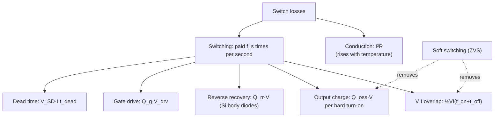

<!-- status: verified -->
# 22-06 · Converter Losses and Wide-Bandgap Switches

| | |
|---|---|
| **Course** | [22 · Power Electronics and Energy Conversion](../README.md) |
| **University equivalent** | The switch-realization and loss weeks of a senior power-electronics course: conduction and switching losses, output-capacitance and reverse-recovery losses, gate drive and dead time, Si, SiC and GaN power devices and their figures of merit, and an introduction to soft switching (Erickson & Maksimović, *Fundamentals of Power Electronics*, the switch-realization chapter; Baliga, *Fundamentals of Power Semiconductor Devices*) |
| **Prerequisites** | [22-02](22-02-buck-converter-steady-state.md) (RMS currents, synchronous rectification, dead time), [22-01](22-01-power-conversion-principles.md) (the $P_0 + aI + RI^2$ loss model), [09-13](../../09-semiconductor-devices/chapters/09-13-compound-and-wide-bandgap-semiconductors.md) (critical field, Baliga's limit), [10-02](../../10-electronics-1/chapters/10-02-mosfet-dc-operation-and-biasing.md) (MOSFET operation) |
| **Estimated study hours** | 7 |
| **Last verified** | 2026-11-24 |

**Learning objectives.** After this chapter you can:

1. Itemize a hard-switched converter's losses (conduction, voltage–current overlap, output capacitance, reverse recovery, gate drive and dead time) and derive each from the switching waveforms.
2. Derive why a hard turn-on in a half bridge dissipates $Q_{oss}V$, not $E_{oss}$, and use data-sheet charges to compare Si, SiC and GaN devices.
3. Derive the device size that minimizes conduction plus charge-related loss, and show that the minimum depends only on the device's figure of merit $R_{DS(on)}Q$.
4. Compute a switch's junction temperature with a temperature-dependent on-resistance, and find the current at which the electrothermal loop runs away.
5. State and apply the zero-voltage-switching condition, and size an LLC converter's magnetizing current to achieve it.
6. Compare Si, SiC and GaN switches by material, data-sheet parameters and reliability caveats, and explain where each is used.

## 1. Big picture

Chapters 22-02 to 22-05 treated the switches as ideal: zero resistance when on, zero current when off, and instant transitions. Real switches have resistance, take nanoseconds to switch, store charge in their capacitances and, in silicon, in their body diodes, and need charge to drive their gates. Each imperfection costs energy, and the switching-related ones cost it every cycle, so they grow with frequency. This is what limits how fast a converter can switch, and so how small its magnetics and capacitors can be (22-01, 22-05). Wide-bandgap materials (SiC and GaN) attack exactly these losses, which is why they lead every high-density charger and AI-server power-supply announcement. This chapter builds the loss model mechanism by mechanism, compares the devices with real data-sheet numbers, and introduces soft switching, the circuit-level answer that removes the largest switching loss altogether.

- **USB-C chargers:** GaN switches in quasi-resonant flybacks (22-04) let adapters run faster and shrink.
- **AI-server and datacenter supplies:** totem-pole PFC stages need switches without reverse recovery (SiC or GaN), and LLC converters use GaN to raise frequency (22-10).
- **Electric vehicles:** 800 V traction inverters and onboard chargers moved to 1200 V SiC MOSFETs.
- **48 V and point-of-load converters:** 100 V GaN and silicon trench MOSFETs compete on charge per milliohm (22-08, 22-10).
- **Industry structure:** the device choice touches foundry strategy, wafer-size transitions and second sourcing (§9).

## 2. Intuition first

**Every transition is a toll.** When a switch turns on into a circuit that is still holding the full voltage across it, current and voltage overlap for a few nanoseconds, and the switch absorbs their product. The switch's own output capacitance, charged to the bus voltage, empties into its channel. In silicon, the opposite switch's body diode, which was conducting, must first be swept clear of its stored charge, and that charge flows through the turning-on switch at full voltage. And each cycle the gate is charged and discharged by its driver. None of these depends much on the load current except the overlap loss; all of them are paid $f_s$ times per second.

**Conduction is rent; switching is a per-transaction fee.** A finance analogy fits well. Conduction loss, $I_{rms}^2R_{DS(on)}$, is rent: it depends on how much current you carry and for how long. Switching loss is a transaction fee charged on every trade: it scales with how often you switch. A bigger switch has lower rent (lower resistance) but higher fees (more charge to move), so there is an optimal size, set by the product of the two, the figure of merit $R_{DS(on)} \times Q$. Wide-bandgap devices are like a broker with both low rent and low fees: their much higher critical field (09-13) lets a smaller, thinner device block the same voltage, so it has far less charge for the same resistance. The analogy fails in one respect: in power electronics the "fee" can be avoided altogether by timing the trade, letting the circuit's own inductor current move the charge before the switch turns on. That is **soft switching**.

## 3. Theory

### 3.1 Conduction loss

A MOSFET (silicon, SiC) or HEMT (GaN) that is fully on behaves as a resistor $R_{DS(on)}$. Its conduction loss is $I_{rms}^2R_{DS(on)}$ with the switch's own RMS current (22-02 gave $I\sqrt{D}$ for a buck's high side and $I\sqrt{1 - D}$ for its low side, ignoring ripple). Two facts make this harder than it looks.

- **On-resistance rises with temperature.** In a majority-carrier device the mobility falls as the lattice heats. A 650 V GaN HEMT's typical $R_{DS(on)}$ rises from 55 mΩ at 25 °C to 120 mΩ at 150 °C, a factor of 2.2 [1]. A 650 V SiC MOSFET rises from 50 to 82 mΩ between 25 and 175 °C [2]. Loss is therefore computed at the operating junction temperature, which depends on the loss (§3.6).
- **Bipolar devices behave differently.** An **IGBT** (insulated-gate bipolar transistor) is a MOSFET that injects minority carriers into a thick, lightly doped drift layer, flooding it with charge so that its resistance collapses. Its conduction loss is closer to $V_{CE0}I_{avg} + r_{CE}I_{rms}^2$, with a near-constant knee voltage, which beats a silicon MOSFET above about 1 kV, where Baliga's limit (09-13) makes a unipolar silicon device impossibly resistive. The cost is that the stored charge must be removed at turn-off, producing a slow "tail" current and large switching loss. IGBTs dominate low-frequency, high-voltage applications such as motor drives (22-11), and SiC MOSFETs now compete with them at 1200 V.

### 3.2 Hard switching: the voltage–current overlap

Consider a switch in a half bridge driving an inductor whose current $I$ is essentially constant over a switching transition: the **clamped inductive** load of every buck, boost and bridge. At turn-on, the opposite device (or diode) is carrying $I$, so the switch node is held at the opposite rail. The switch's current must first rise from 0 to $I$ while its voltage stays at $V$; only when it carries all of $I$ can the opposite device turn off and the voltage fall. If the current rises linearly in time $t_{ri}$ and the voltage then falls linearly in $t_{fv}$, the energy absorbed is

$$
E_{on} = \int_0^{t_{ri}} V\frac{It}{t_{ri}}\,dt + \int_0^{t_{fv}} I\,V\left(1 - \frac{t}{t_{fv}}\right)dt = \frac{VI(t_{ri} + t_{fv})}{2} = \tfrac12VIt_{on},
$$

where $t_{on} = t_{ri} + t_{fv}$ is the whole turn-on transition. Turn-off is the mirror image (the voltage rises first at full current, then the current falls), so it costs $\tfrac12VIt_{off}$. The **overlap loss** is

$$
P_{ov} = \tfrac12VI(t_{on} + t_{off})f_s .
$$

Units: V·A·s·Hz = W. ✓ The loss is proportional to $V$, $I$, $f_s$ and the transition time. Halving the transition time halves it, which is why fast devices and low-inductance layouts matter, and why it can be removed altogether if the voltage is already zero when the current rises (§3.7).

**Parasitic inductance.** Fast transitions have a cost. The **commutation loop** (input capacitor, high-side and low-side switches) has a parasitic inductance $L_{loop}$, and a current change $di/dt$ through it produces a voltage overshoot $L_{loop}\,di/dt$ on top of the bus. A 2 nH loop switching 20 A in 2 ns overshoots by 20 V, which for a 48 V converter using 100 V parts eats much of the voltage margin. Layout (tight loops, integrated half bridges) is therefore part of the device choice.

### 3.3 Output capacitance: why a hard turn-on costs $Q_{oss}V$

Every switch has an output capacitance $C_{oss}$ between drain and source, strongly voltage-dependent: large at low voltage, small at high voltage. Data sheets summarize it at a stated voltage $V$ by

- the **output charge** $Q_{oss}(V) = \int_0^V C_{oss}(v)\,dv$, the charge needed to raise it from 0 to $V$;
- the **stored energy** $E_{oss}(V) = \int_0^V v\,C_{oss}(v)\,dv$;
- two equivalent linear capacitances: the **time-related** $C_{o(tr)} = Q_{oss}/V$ (same charge, so same charging time at constant current) and the **energy-related** $C_{o(er)} = 2E_{oss}/V^2$ (same stored energy).

For a linear capacitor $Q_{oss}V = CV^2 = 2E_{oss}$. For a real device most of the charge goes in at low voltage, where it stores little energy, so $Q_{oss}V$ is much larger than $2E_{oss}$. A 600 V silicon superjunction MOSFET has $C_{o(tr)}$ = 1212 pF but $C_{o(er)}$ = 117 pF over 0–400 V [4]: a ratio of 10.

Now take a half bridge (two identical switches) whose switch node sits at 0 V, the inductor current flowing in the low-side device, when the high-side switch turns on. The high-side switch's own $C_{oss}$ is charged to $V$ and holds $E_{oss}$. The low-side switch's $C_{oss}$ is at 0 V and must be charged to $V$.

1. The high-side switch's own capacitance discharges through its own channel: it dissipates $E_{oss}$.
2. The low-side capacitance charges from 0 to $V$ through the high-side channel. The supply delivers charge $Q_{oss}$ at voltage $V$, energy $Q_{oss}V$, of which $E_{oss}$ ends up stored. The rest, $Q_{oss}V - E_{oss}$, is dissipated in the high-side channel.

The total is

$$
E_{C,on} = E_{oss} + (Q_{oss}V - E_{oss}) = Q_{oss}V .
$$

So a hard turn-on in a half bridge costs $Q_{oss}V$, not $E_{oss}$, a distinction that matters a great deal for superjunction silicon (Example 22-06.2). At the next switching edge, the energy stored in the low side's capacitance is dissipated in its turn, or recovered if the circuit soft-switches. The lab confirms the $Q_{oss}V$ result in ngspice with a nonlinear capacitance.

### 3.4 Reverse recovery

A silicon MOSFET's body diode is a p-n junction. When it conducts, minority carriers are stored in its drift region; before it can block voltage, that **reverse-recovery charge** $Q_{rr}$ must be removed. In a hard-switched half bridge where the body diode was freewheeling, the turning-on switch supplies $Q_{rr}$ at nearly the full bus voltage, so it absorbs about

$$
E_{rr} \approx Q_{rr}V
$$

per transition, plus a reverse current spike that adds to its overlap loss. Superjunction MOSFETs have very large $Q_{rr}$: 3.6 µC for a 45 mΩ, 600 V part, and 0.88 µC even for its fast-diode variant [4]. That makes hard-switched continuous-conduction circuits that commutate the body diode, such as the totem-pole PFC boost, impractical with silicon (Example 22-06.3). GaN HEMTs have no p-n body diode and no reverse-recovery charge ("Qrr 0 nC" [1]), though they still have $Q_{oss}$. SiC MOSFETs have a body diode with small but real recovery that depends on conditions: one vendor now quotes a "forward recovery charge" that *includes* $Q_{oss}$ [2], and notes that recovery charge falls substantially as the dead time shortens from 1 µs to 300 ns [3]. A data-sheet $Q_{rr}$ is meaningful only with its test conditions ($di/dt$, temperature, dead time, current).

### 3.5 Gate drive, dead time and the device-size optimum

**Gate drive.** Turning a switch on moves its total gate charge $Q_g$ from the driver's supply $V_{drv}$; turning it off dumps that charge to ground. Each cycle draws $Q_gV_{drv}$ from the driver's supply, and all of it ends up as heat in the driver and gate resistors:

$$
P_g = Q_gV_{drv}f_s .
$$

The gate resistance changes where the heat goes and how fast the switch moves, but not the total.

**Dead time.** A half bridge must never turn both switches on at once (the shoot-through would short the bus), so the controller leaves a **dead time** $t_d$ at each edge with both off. The inductor current then flows in the reverse direction through one switch: through the body diode in Si or SiC, at a drop $V_{SD}$ (4.3 V for a 650 V SiC MOSFET [2]), or by **third-quadrant** conduction in GaN, at a drop that depends on the off-state gate voltage. The dead-time loss is $V_{SD}I\,t_d$ per edge, $2V_{SD}It_df_s$ per cycle with two edges.

**The optimal device size.** Make a switch larger (more die area $A$) and its resistance falls as $R = r/A$, while all its charges rise as $Q = qA$. For a switch carrying $I_{rms}$, the conduction plus gate-drive loss is

$$
P(R) = I_{rms}^2R + \frac{(RQ)\,V_{drv}f_s}{R},
$$

because $Q = (RQ)/R$ and the product $RQ = rq$ does not depend on the size. Setting $dP/dR = 0$:

$$
R^* = \frac{\sqrt{(RQ)V_{drv}f_s}}{I_{rms}}, \qquad P_{min} = 2I_{rms}\sqrt{(RQ)V_{drv}f_s} .
$$

At the optimum, conduction and gate loss are equal. The best achievable loss depends on the device technology only through the **figure of merit** $R_{DS(on)} \times Q_g$, and grows as $\sqrt{f_s}$. The same argument applies to $R_{DS(on)} \times Q_{oss}$ for the output-charge loss. This is why vendors and designers compare technologies by $R \cdot Q$, and why a lower FOM translates directly into higher frequency at the same loss.

### 3.6 Why wide bandgap, and what the data sheets show

Chapter 09-13 derived Baliga's limit: the minimum specific on-resistance of a unipolar device blocking $V_B$ is $4V_B^2/(\varepsilon\mu\mathcal{E}_c^3)$. The critical field enters cubed. Tsao et al. tabulate $\mathcal{E}_c$ at a doping of 10¹⁶ cm⁻³ as 0.3 MV/cm for Si, 3.1 MV/cm for 4H-SiC and 4.9 MV/cm (projected) for GaN, giving Baliga figures of merit (with Tsao's ¼ convention) of 8.8, 6270 and 27 900 in units of 10⁶ V²Ω⁻¹cm⁻² [5]: about 700 and 3200 times silicon's. GaN's critical field is **[Contested]**: the same review lists 2.6 MV/cm as reported for an actual AlGaN/GaN HEMT [5]. For the same voltage and resistance, a wide-bandgap device can therefore be far smaller, with correspondingly less capacitance and charge. That is the physical origin of their switching advantage.

Data sheets of devices current in 2026 make this concrete (typical values at 25 °C) [1], [2], [4], [6], [7]:

| Device (class) | $R_{DS(on)}$ | $Q_g$ | $Q_{oss}$ | $Q_{rr}$ | $R \cdot Q_g$ (mΩ·nC) |
|---|---|---|---|---|---|
| GaN HEMT 650 V (Infineon IGOT65R055D2) | 55 mΩ | 4.7 nC | 35 nC at 400 V | 0 | 258.5 |
| SiC MOSFET 650 V (Infineon IMZA65R050M2H, 18 V drive) | 50 mΩ | 22 nC | 47 nC at 400 V | 49 nC "forward recovery" incl. $Q_{oss}$ | 1100 |
| Si superjunction 600 V (Infineon IPW60R045P7) | 38 mΩ | 90 nC | ≈485 nC at 400 V ($C_{o(tr)}V$) | 3.6 µC | 3420 |
| Si trench 100 V (Infineon ISC022N10NM6) | 1.8 mΩ | 73 nC (0–10 V) | 135 nC | 70 nC | 131.4 |
| GaN HEMT 100 V (Infineon IGC033S10S1) | 2.4 mΩ | 11 nC (5 V drive) | 43 nC at 50 V | 0 | 26.4 |

The table hides some caveats: the gate-drive voltages differ (5 V for GaN, 10 V for silicon, 18 V for SiC), and $R_{DS(on)}$ rises with temperature by different factors.

**Temperature and the electrothermal loop.** The junction temperature is $T_j = T_a + R_{th}P$, with $R_{th}$ the thermal resistance to ambient (K/W). With $R_{DS(on)}(T) = R_{25}[1 + k(T - 25\ ^\circ\text{C})]$ approximated as linear, and $P = I^2R_{DS(on)}(T_j)$, the junction temperature satisfies a linear equation whose solution is

$$
T_j = \frac{T_a + R_{th}I^2R_{25}(1 - 25k)}{1 - R_{th}I^2R_{25}k} .
$$

Units: K/W × A² × Ω = K. ✓ The denominator reveals **thermal runaway**: if $R_{th}I^2R_{25}k \ge 1$, each degree of heating adds more than a degree of heating, and no steady state exists (Example 22-06.5).

### 3.7 Soft switching

**Zero-voltage switching (ZVS).** Suppose that during the dead time the inductor current flows in the direction that *discharges* the switch that is about to turn on. Then the inductor, acting as a current source $I$, swings the switch node from one rail to the other by moving the output charge of both switches (one charges, one discharges), $2Q_{oss}$ in total, in time

$$
t_{tr} = \frac{2Q_{oss}}{I} = \frac{2C_{o(tr)}V}{I} .
$$

If $t_{tr} \le t_d$, the switch's voltage is already zero (its reverse conduction path clamps it) when its gate turns on. The overlap and output-charge losses vanish, and the stored energy is recycled rather than burned. That is the condition for ZVS:

$$
I \ge \frac{2Q_{oss}}{t_d} .
$$

$C_{o(tr)}$, not $C_{o(er)}$, sets the transition time, because the inductor must move the charge. **Zero-current switching (ZCS)**, the dual, turns a switch off when a resonant current has already fallen to zero; it suits IGBTs, whose tail current is the problem.

**How circuits arrange ZVS.**

- **Synchronous buck at light load or in triangular-current mode:** let the inductor current go slightly negative each cycle, so that it discharges the high-side switch before it turns on.
- **Phase-shifted full bridge (22-04):** the transformer's leakage and magnetizing currents swing each leg's switch node during the dead time, at the cost of losing ZVS at light load.
- **LLC resonant converter:** a series resonant tank ($L_r$, $C_r$) and the transformer's magnetizing inductance $L_m$, driven by a half or full bridge at a square wave near the tank's resonant frequency $f_r = 1/(2\pi\sqrt{L_rC_r})$. At resonance, the tank looks like a short, so the output is set by the turns ratio and the gain is 1, as in a DC transformer. The magnetizing current, which keeps flowing at each switching instant, provides ZVS. In a half bridge, the primary sees $\pm V/2$, so over a half period $L_m$ accumulates volt-seconds $(V/2)(T_s/2)$, and its triangular current peaks at

$$
I_{m,pk} = \frac{V}{8L_mf_s} .
$$

ZVS needs $I_{m,pk} \ge 2Q_{oss}/t_d$, an upper limit on $L_m$. A smaller $L_m$ makes ZVS easier but circulates more current, which costs conduction loss. Low-$Q_{oss}$ GaN switches allow a larger $L_m$ (less circulating current) or a higher frequency at the same $L_m$ (Example 22-06.7).

## 4. Worked examples

### Example 22-06.1 · Overlap loss (tier A)

**Setup.** A switch hard-switches 10 A at 400 V. Find the overlap loss with turn-on and turn-off transitions ($t_{on}$ and $t_{off}$) of (a) 5 ns each and (b) 20 ns each at 100 kHz, and (c, d) at 500 kHz.

**Solution.** $P_{ov} = \tfrac12VI(t_{on} + t_{off})f_s$, with $\tfrac12VI$ = 2000 W.

- (a) $2000 \times 10\ \text{ns} \times 100\ \text{kHz}$ = **2.0** W; (b) $2000 \times 40\ \text{ns} \times 100\ \text{kHz}$ = **8.0** W.
- (c) **10** W and (d) **40** W at 500 kHz.

**Units check.** W × s × Hz = W. ✓

**Sanity check.** Overlap loss scales linearly with transition time and frequency. A 4 kW PFC stage (10 A at 400 V) can afford a few watts, not 40: a fivefold frequency increase needs a fivefold faster switch or soft switching.

### Example 22-06.2 · The hard turn-on: $Q_{oss}V$ against $E_{oss}$ (tier B)

**Setup.** A half bridge hard-switches at 400 V and 100 kHz. Using the data sheets' typical values, find for each device the output charge, the turn-on loss per transition $Q_{oss}V$, the power, and the ratio $Q_{oss}V/E_{oss}$: (a–d) the 600 V Si superjunction ($C_{o(tr)}$ = 1212 pF, $E_{oss}$ = 9.4 µJ at 400 V [4]); (e–g) the 650 V SiC ($Q_{oss}$ = 47 nC, $E_{oss}$ = 6.3 µJ [2]); (h–j) the 650 V GaN ($Q_{oss}$ = 35 nC, $E_{oss}$ = 5.2 µJ [1]).

**Solution.**

- (a) $Q_{oss} = C_{o(tr)}V = 1212\ \text{pF} \times 400\ \text{V}$ = **484.8** nC; (b) $Q_{oss}V$ = **193.9** µJ; (c) at 100 kHz, **19.4** W; (d) $193.9/9.4$ = **20.6**.
- (e) $47\ \text{nC} \times 400$ = **18.8** µJ; (f) **1.88** W; (g) $18.8/6.3$ = **2.98**.
- (h) $35\ \text{nC} \times 400$ = **14.0** µJ; (i) **1.40** W; (j) $14.0/5.2$ = **2.69**.

**Units check.** C × V = J. ✓

**Sanity check.** For a linear capacitor the ratio would be 2; the wide-bandgap devices are near that, while the superjunction device is at 20.6 because most of its charge is stored below a few tens of volts. Using $E_{oss}$ alone would underestimate the superjunction's hard-switching loss twentyfold. Nineteen watts at 100 kHz is why superjunction silicon is used where it can soft-switch.

### Example 22-06.3 · Reverse recovery in a hard-switched bridge (tier B)

**Setup.** In a continuous-conduction totem-pole PFC at 400 V and 100 kHz, each switching edge hard-commutates the opposite device's reverse conduction. Estimate the recovery-related loss $Q_{rr}V f_s$ for (a, b) the superjunction part ($Q_{rr}$ = 3.6 µC), (c, d) its fast-diode variant (0.88 µC), (e, f) the SiC MOSFET (49 nC "forward recovery", which includes $Q_{oss}$) and (g, h) the GaN HEMT (no $Q_{rr}$; its $Q_{oss}$ = 35 nC still applies). Give the energy per transition and the power.

**Solution.**

- (a) $3.6\ \mu\text{C} \times 400$ = **1440** µJ; (b) **144** W.
- (c) **352** µJ; (d) **35.2** W.
- (e) **19.6** µJ; (f) **1.96** W.
- (g) **14.0** µJ; (h) **1.40** W.

**Units check.** C × V × Hz = W. ✓

**Sanity check.** A 3 kW PFC cannot dissipate 144 W in one switch, or even 35 W. That is why the CCM totem-pole PFC, the most efficient bridgeless rectifier, became practical only with SiC and GaN. The test conditions differ (the silicon values are at 100 A/µs and 8–14.6 A, the SiC at 1000 A/µs), so these are order-of-magnitude comparisons [2], [4]; the conclusion survives any reasonable correction.

### Example 22-06.4 · Gate drive and the optimal device size (tier B)

**Setup.** Compare the 100 V Si trench MOSFET (1.8 mΩ, $Q_g$ = 73 nC at 10 V) and the 100 V GaN HEMT (2.4 mΩ, 11 nC at 5 V) at 1 MHz. Find the gate-drive power of (a) the Si and (b) the GaN device, and their figures of merit (c) and (d). For a low-side switch carrying 17.32 A RMS, find the optimal on-resistance and minimum conduction-plus-gate loss for (e, f) Si and (g, h) GaN.

**Solution.**

- (a) $P_g = Q_gV_{drv}f_s = 73\ \text{nC} \times 10 \times 1\ \text{MHz}$ = **0.73** W; (b) $11 \times 5 \times 1$ = **0.055** W.
- (c) $1.8 \times 73$ = **131** mΩ·nC; (d) $2.4 \times 11$ = **26.4** mΩ·nC.
- (e) $R^* = \sqrt{131.4 \times 10^{-12} \times 10 \times 10^6}/17.32$ = **2.09** mΩ; (f) $P_{min} = 2 \times 17.32 \times 0.03625$ = **1.26** W.
- (g) $R^* = \sqrt{26.4 \times 10^{-12} \times 5 \times 10^6}/17.32$ = **0.66** mΩ; (h) $P_{min}$ = **0.40** W.

**Units check.** √(Ω·C·V·Hz) = √(Ω·W) = √(Ω²A²) = Ω·A; divided by A gives Ω. ✓

**Sanity check.** The Si optimum (2.09 mΩ) is close to the real part's 1.8 mΩ: it is well sized for 1 MHz at this current, and its best loss is 1.26 W. GaN's lower FOM and lower drive voltage give one-third of that loss at the optimum, with a device three times larger in resistance terms (a paralleled 0.66 mΩ). This counts gate loss only; $R \cdot Q_{oss}$ follows the same logic.

### Example 22-06.5 · Hot on-resistance and thermal runaway (tier B)

**Setup.** The 650 V GaN HEMT carries 6 A RMS. Its $R_{DS(on)}$ is 55 mΩ at 25 °C and 120 mΩ at 150 °C [1]; assume it is linear in between. The thermal resistance to ambient is 20 K/W and the ambient 60 °C (both assumed). Find (a) the resistance slope, (b) the junction temperature, (c) the hot resistance and (d) the loss. (e) What would a designer who used the 25 °C resistance predict for the temperature? (f) Above what RMS current does the loop run away?

**Solution.**

- (a) $(120 - 55)/125$ = **0.52** mΩ/K, so $R_{25}k$ = 0.52 mΩ/K.
- (b) With $R_{th}I^2$ = 720 K/Ω: $T_j = (60 + 720 \times (0.055 - 25 \times 0.00052))/(1 - 720 \times 0.00052) = 90.24/0.6256$ = **144.2** °C.
- (c) $55 + 0.52 \times 119.2$ = **117.0** mΩ; (d) $36 \times 0.1170$ = **4.21** W.
- (e) $60 + 20 \times 36 \times 0.055$ = **99.6** °C: an error of **45** K.
- (f) Runaway when $R_{th}I^2R_{25}k = 1$: $I = 1/\sqrt{20 \times 0.00052}$ = **9.81** A.

**Units check.** K/W × A² × Ω/K = 1, dimensionless. ✓

**Sanity check.** Electrothermal feedback more than doubled the loss here (4.21 W against **1.98** W cold). The runaway current is only **63** % above the operating point. Real designs keep the product $R_{th}I^2R_{25}k$ well below 1 with heat sinking, and check $R_{DS(on)}$ at the maximum junction temperature, not at 25 °C.

### Example 22-06.6 · A 48 V to 12 V buck: silicon against GaN (tier C)

**Setup.** A synchronous buck converts 48 V to 12 V at 20 A (240 W) and 500 kHz, using two identical 100 V devices, either the Si trench MOSFET or the GaN HEMT of the table. Ignore ripple ($D$ = 0.25). Assume turn-on and turn-off transitions $t_{on} = t_{off}$ of 8 ns for Si and 3 ns for GaN, a 20 ns dead time at each edge, and reverse-conduction drops of 0.8 V (Si body diode) and 2.5 V (GaN third quadrant); these are illustrative. For each technology find the conduction, gate-drive, output-charge ($Q_{oss}V_{in}f_s$, one hard turn-on per cycle), reverse-recovery, overlap and dead-time losses, the total, and the efficiency counting switch losses only.

**Solution.** RMS currents: high side $20\sqrt{0.25}$ = 10 A, low side $20\sqrt{0.75}$ = 17.32 A, so $\sum I^2 = 400$ A².

| Loss | Silicon | GaN |
|---|---|---|
| Conduction $\sum I^2R$ | $400 \times 1.8$ mΩ = **0.72** W | $400 \times 2.4$ mΩ = **0.96** W |
| Gate, two devices $2Q_gV_{drv}f_s$ | **0.73** W | **0.055** W |
| Output charge $Q_{oss}V_{in}f_s$ | $135\ \text{nC} \times 48 \times 0.5\ \text{MHz}$ = **3.24** W | $43 \times 48 \times 0.5$ = **1.03** W |
| Reverse recovery $Q_{rr}V_{in}f_s$ | $70 \times 48 \times 0.5$ = **1.68** W | 0 |
| Overlap $\tfrac12V_{in}I(t_{on} + t_{off})f_s$ | $480 \times 16\ \text{ns} \times 0.5$ MHz = **3.84** W | $480 \times 6 \times 0.5$ = **1.44** W |
| Dead time $2V_{SD}It_df_s$ | **0.32** W | **1.00** W |
| **Total** | **10.53** W | **4.49** W |
| Efficiency (switches only) | **95.8** % | **98.2** % |

**Units check.** Each term is in watts; the efficiency is $240/(240 + P)$. ✓

**Sanity check.** At 500 kHz silicon's switching-related losses (**9.8** W) dwarf its conduction loss; GaN cuts every switching term but pays more in conduction (higher $R_{DS(on)}$) and dead time (a higher reverse-conduction drop), which is why GaN designs use dead times of a few nanoseconds. The silicon part is sized for low frequency: Example 22-06.4's optimum shows a smaller silicon device would do better at 500 kHz. Real designs also soft-switch the low side naturally (its body diode conducts first), which this budget already reflects by charging $Q_{oss}$ only once per cycle.

### Example 22-06.7 · ZVS in an LLC half bridge (tier C)

**Setup.** A half-bridge LLC converter runs from a 400 V bus at 300 kHz with a 50 ns dead time. Find (a) the transition time with 2 A of magnetizing current for GaN ($C_{o(tr)}$ = 88 pF over 0–400 V [1]) and (b) for the superjunction part ($C_{o(tr)}$ = 1212 pF [4]). For ZVS within the dead time, find (c) the minimum switching current and (d) the largest magnetizing inductance for GaN, then (e) and (f) for the superjunction. (g) What RMS magnetizing current does the GaN design circulate at its limit?

**Solution.**

- (a) $t_{tr} = 2C_{o(tr)}V/I = 2 \times 88\ \text{pF} \times 400/2$ = **35.2** ns; (b) **484.8** ns.
- (c) $I \ge 2 \times 88\ \text{pF} \times 400/50\ \text{ns}$ = **1.41** A; (d) $L_m \le V/(8f_sI) = 400/(8 \times 300\ \text{kHz} \times 1.408)$ = **118** µH.
- (e) **19.4** A; (f) **8.6** µH.
- (g) A triangle of peak 1.408 A has RMS $1.408/\sqrt{3}$ = **0.81** A.

**Units check.** F × V/A = C/A = s; V/(Hz × A) = V·s/A = H. ✓

**Sanity check.** With GaN, 0.81 A of circulating magnetizing current buys ZVS in 50 ns. The superjunction part would need 19.4 A of magnetizing current at 300 kHz with that dead time, which is why silicon LLCs run at lower frequencies with longer dead times. The lab confirms the transition times in ngspice.

<!-- answer-key -->

| ID | Quantity | Value | Unit |
|---|---|---|---|
| Ex 22-06.1a | overlap loss, 5 ns, 100 kHz | 2.0 | W |
| Ex 22-06.1b | overlap loss, 20 ns, 100 kHz | 8.0 | W |
| Ex 22-06.1c | overlap loss, 5 ns, 500 kHz | 10 | W |
| Ex 22-06.1d | overlap loss, 20 ns, 500 kHz | 40 | W |
| Ex 22-06.2a | superjunction output charge | 484.8 | nC |
| Ex 22-06.2b | superjunction turn-on energy | 193.9 | µJ |
| Ex 22-06.2c | superjunction turn-on power | 19.4 | W |
| Ex 22-06.2d | superjunction Q_oss·V/E_oss | 20.6 | |
| Ex 22-06.2e | SiC turn-on energy | 18.8 | µJ |
| Ex 22-06.2f | SiC turn-on power | 1.88 | W |
| Ex 22-06.2g | SiC Q_oss·V/E_oss | 2.98 | |
| Ex 22-06.2h | GaN turn-on energy | 14.0 | µJ |
| Ex 22-06.2i | GaN turn-on power | 1.40 | W |
| Ex 22-06.2j | GaN Q_oss·V/E_oss | 2.69 | |
| Ex 22-06.3a | superjunction recovery energy | 1440 | µJ |
| Ex 22-06.3b | superjunction recovery power | 144 | W |
| Ex 22-06.3c | fast-diode recovery energy | 352 | µJ |
| Ex 22-06.3d | fast-diode recovery power | 35.2 | W |
| Ex 22-06.3e | SiC recovery energy | 19.6 | µJ |
| Ex 22-06.3f | SiC recovery power | 1.96 | W |
| Ex 22-06.3g | GaN output-charge energy | 14.0 | µJ |
| Ex 22-06.3h | GaN output-charge power | 1.40 | W |
| Ex 22-06.4a | Si gate power at 1 MHz | 0.73 | W |
| Ex 22-06.4b | GaN gate power at 1 MHz | 0.055 | W |
| Ex 22-06.4c | Si figure of merit | 131 | mΩ·nC |
| Ex 22-06.4d | GaN figure of merit | 26.4 | mΩ·nC |
| Ex 22-06.4e | Si optimal on-resistance | 2.09 | mΩ |
| Ex 22-06.4f | Si minimum loss | 1.26 | W |
| Ex 22-06.4g | GaN optimal on-resistance | 0.66 | mΩ |
| Ex 22-06.4h | GaN minimum loss | 0.40 | W |
| Ex 22-06.5a | resistance slope | 0.52 | mΩ/K |
| Ex 22-06.5b | junction temperature | 144.2 | °C |
| Ex 22-06.5c | hot on-resistance | 117.0 | mΩ |
| Ex 22-06.5d | loss | 4.21 | W |
| Ex 22-06.5e | cold-resistance prediction | 99.6 | °C |
| Ex 22-06.5f | runaway current | 9.81 | A |
| Ex 22-06.5g | loss at the cold resistance | 1.98 | W |
| Ex 22-06.5h | runaway margin | 63 | % |
| Ex 22-06.5i | temperature error | 45 | K |
| Ex 22-06.6a | Si conduction loss | 0.72 | W |
| Ex 22-06.6b | Si gate loss | 0.73 | W |
| Ex 22-06.6c | Si output-charge loss | 3.24 | W |
| Ex 22-06.6d | Si recovery loss | 1.68 | W |
| Ex 22-06.6e | Si overlap loss | 3.84 | W |
| Ex 22-06.6f | Si dead-time loss | 0.32 | W |
| Ex 22-06.6g | Si total | 10.53 | W |
| Ex 22-06.6h | Si efficiency | 95.8 | % |
| Ex 22-06.6i | GaN conduction loss | 0.96 | W |
| Ex 22-06.6j | GaN gate loss | 0.055 | W |
| Ex 22-06.6k | GaN output-charge loss | 1.03 | W |
| Ex 22-06.6l | GaN overlap loss | 1.44 | W |
| Ex 22-06.6m | GaN dead-time loss | 1.00 | W |
| Ex 22-06.6n | GaN total | 4.49 | W |
| Ex 22-06.6o | GaN efficiency | 98.2 | % |
| Ex 22-06.6p | Si switching-related losses | 9.8 | W |
| Ex 22-06.7a | GaN transition time | 35.2 | ns |
| Ex 22-06.7b | superjunction transition time | 484.8 | ns |
| Ex 22-06.7c | GaN minimum switching current | 1.41 | A |
| Ex 22-06.7d | GaN maximum magnetizing inductance | 118 | µH |
| Ex 22-06.7e | superjunction minimum switching current | 19.4 | A |
| Ex 22-06.7f | superjunction maximum magnetizing inductance | 8.6 | µH |
| Ex 22-06.7g | GaN magnetizing RMS current | 0.81 | A |
| Txt 22-06.a | GaN R_DS(on) rise, 25 to 150 °C | 2.2 | |
| Txt 22-06.b | overshoot, 2 nH at 20 A in 2 ns | 20 | V |
| Txt 22-06.c | superjunction C_o(tr)/C_o(er) | 10 | |
| Txt 22-06.d | SiC BFOM relative to Si | 700 | |
| Txt 22-06.e | GaN BFOM relative to Si | 3200 | |
| Txt 22-06.f | GaN R·Q_g | 258.5 | mΩ·nC |
| Txt 22-06.g | SiC R·Q_g | 1100 | mΩ·nC |
| Txt 22-06.h | superjunction R·Q_g | 3420 | mΩ·nC |
| Txt 22-06.i | superjunction Q_oss at 400 V | 485 | nC |
| Txt 22-06.j | concept-check turn-on loss | 40 | µJ |
| Txt 22-06.k | concept-check charging loss | 30 | µJ |

## 5. Simulate it

The lab is [labs/22-06-lab/](../labs/22-06-lab/README.md). `losses.py` collects the chapter's loss formulas, the sizing optimum, the electrothermal solution and the ZVS conditions. Two ngspice netlists test the two results that are easiest to get wrong:

- `coss_loss.cir` builds a half bridge whose two switches have a nonlinear output capacitance $C(v) = C_0/(1 + v/V_0)^{0.9}$ (the depletion capacitance of a reverse-biased junction, which is large at low voltage like a superjunction's), turns the high side on into it, and integrates the power in the switch's channel resistance. It compares the dissipated energy with $Q_{oss}V$ and with $E_{oss}$, and runs a linear capacitor with the same charge alongside.
- `zvs.cir` lets a 2 A inductor current swing a half bridge's switch node during the dead time, for GaN-like and superjunction-like output capacitances, and measures the transition times.

**Predict, then run:**

1. *Predict* the energy dissipated at the hard turn-on for $C_0$ = 2 nF and $V_0$ = 2 V at 400 V: is it $E_{oss}$, $2E_{oss}$ or $Q_{oss}V$, and does the linear twin dissipate the same? Run `ngspice -b coss_loss.cir`.
2. *Predict* the two ZVS transition times of Example 22-06.7(a, b), then run `ngspice -b zvs.cir`.
3. In the notebook, plot each loss of Example 22-06.6 against switching frequency for silicon and GaN, and find where their totals cross 2% of the output power.
4. Sweep the device size for Example 22-06.4 and confirm that the minimum falls where conduction and gate losses are equal.

## 6. Engineering tradeoffs

| Knob | Improves | Costs | Typical decision owner |
|---|---|---|---|
| Higher switching frequency | Smaller magnetics and capacitors (22-01, 22-05) | Every switching loss rises in proportion | Power architect |
| Larger switch (lower $R_{DS(on)}$) | Conduction loss | Gate, $Q_{oss}$ and recovery losses; cost | Power-stage designer |
| Faster transitions (lower gate resistance, stronger driver) | Overlap loss | Overshoot $L\,di/dt$, ringing, EMI | Power-stage and EMC engineers |
| Shorter dead time | Body-diode and third-quadrant loss, SiC recovery | Shoot-through risk; tighter driver timing | Controller and driver designer |
| GaN instead of Si | Switching charges, no $Q_{rr}$, higher $f_s$ | Cost per mΩ, gate fragility (5–6 V drive), dynamic $R_{DS(on)}$, no avalanche rating | Product line and reliability |
| SiC instead of Si at 650–1200 V | Recovery, high-temperature operation, 1200 V unipolar | Cost, threshold drift, short-circuit time, 4–5 V body-diode drop | Product line and reliability |
| Soft switching (ZVS topologies) | Removes overlap and $Q_{oss}$ losses | Circulating current, control complexity, light-load ZVS loss | Power architect |

## 7. Numbers to know

| Quantity | Value | Source |
|---|---|---|
| Critical field (at 10¹⁶ cm⁻³): Si / 4H-SiC / GaN | 0.3 / 3.1 / 4.9 (projected) MV/cm; GaN [Contested] | [5] |
| Baliga FOM relative to Si | about 700 (SiC), 3200 (GaN) | [5] |
| 650 V GaN, 55 mΩ class | $Q_g$ 4.7 nC, $Q_{oss}$ 35 nC, $Q_{rr}$ 0, $R_{DS(on)}$ ×2.2 at 150 °C | [1] |
| 650 V SiC, 50 mΩ class | $Q_g$ 22 nC, $Q_{oss}$ 47 nC, body-diode $V_{SD}$ 4.3 V | [2] |
| 600 V Si superjunction, 45 mΩ class | $Q_g$ 90 nC, $C_{o(tr)}$ 1212 pF, $Q_{rr}$ 3.6 µC | [4] |
| 100 V class $R \cdot Q_g$ | 131 (Si) vs 26.4 (GaN) mΩ·nC | [6], [7] |
| 1200 V SiC short-circuit withstand (where rated) | 3 µs at 800 V | [8] |
| Hard turn-on loss in a half bridge | $Q_{oss}V$ per transition | §3.3 |
| ZVS condition | $I \ge 2Q_{oss}/t_d$ | §3.7 |

## 8. Common mistakes

- **Using $E_{oss}$ for hard-switching loss.** A hard turn-on in a half bridge dissipates $Q_{oss}V$; for superjunction silicon that is twenty times $E_{oss}$ (Example 22-06.2).
- **Reading $Q_{rr}$ without its conditions.** Recovery charge depends on $di/dt$, current, temperature and dead time; one SiC vendor reports a "forward recovery" that includes $Q_{oss}$ [2], [3]. Compare like with like.
- **Computing conduction loss at 25 °C.** $R_{DS(on)}$ may double at the operating temperature, and the loss raises the temperature in turn (Example 22-06.5).
- **Choosing the lowest-resistance part by default.** Above a few hundred kilohertz a smaller device often has lower total loss; the optimum is where conduction and charge losses are equal (§3.5).
- **Comparing devices by $R_{DS(on)}$ at different gate voltages.** GaN is specified at 5–6 V, silicon at 10 V and SiC at 15–18 V; driving a SiC MOSFET at 15 V instead of 18 V raised the example part's resistance from 50 to 65 mΩ [2].
- **Ignoring dead-time conduction in GaN.** GaN has no body diode, but its reverse conduction drop can be several volts; dead times must be kept to a few nanoseconds (Example 22-06.6).
- **Assuming ZVS at all loads.** The current that swings the switch node falls with load in many topologies; check the condition at the lightest load where efficiency matters.

## 9. Practitioner lens

*State of the art as of Nov 2026. Sources are logged as R-423 and R-430 to R-432.*

**Mixed-material designs are the norm** [Industry estimate]. Infineon's 8 kW AI-server supply uses SiC in the totem-pole PFC, GaN in the LLC, and silicon "where switching losses are minimal" (R-423). Its 18 kW three-phase reference combines "650V CoolSiC MOSFETs, 80V CoolGaN switches" (R-423). The pattern follows this chapter's physics: SiC or GaN wherever a body diode would be hard-commutated, GaN where frequency must rise, and silicon wherever its switching losses are already small.

**Data sheets now describe new failure modes.**

- *GaN:* the 650 V part has no avalanche rating, only a transient one, "VDS,trans … 900 V … <1% duty cycle; <1 μs" [1]. Its on-resistance can rise transiently after switching because charge gets trapped: JEDEC's JEP173 guideline notes that "the value of the resulting measured RDS(on) is method dependent" [9] [Established].
- *SiC:* Infineon's gate-drive guideline names "drift of the gate threshold voltage VGS(th) during long-term operation" as an important issue, which mainly raises $R_{DS(on)}$ slowly over life [10] (my translation from the Japanese edition) [Contested in magnitude across vendors]. Short-circuit withstand, where rated, is about 3 µs at 800 V for 1200 V parts, and some data sheets omit it [8].
- *Integration:* 100 V GaN now ships as integrated half bridges with drivers (TI's LMG2100R044, "Integrated 4.4mΩ half-bridge GaN FETs and driver", up to 10 MHz [11]), which shrinks the commutation loop that limits switching speed.

**Market structure** [Industry estimate]. Yole's Power GaN 2026 report, as summarized by *Semiconductor Today* (Aug 2026), puts Innoscience at the top in 2025 and Infineon as the fastest gainer, with onsemi entering on a 200 mm GaN-on-silicon platform with GlobalFoundries [12]. TSMC told Navitas it "will end GaN wafer foundry production by end-July 2027", moving that volume to PSMC and others [13]. In SiC, Yole reported 2025 utilization of "around 50 percent for upstream processes and 70 percent for device lines", with recovery expected around 2027–2028 as 200 mm production ramps [14]. For a corporate-development reader, these are signals about pricing pressure (SiC), foundry dependence and second sourcing (GaN).

**Marketing vs Reality.**

- *"GaN is always more efficient."* Not at low frequency or in soft-switched sockets, where conduction loss and $R_{DS(on)}$ at temperature dominate; the best supplies mix all three materials.
- *"Qrr = 0."* True for GaN, but its $Q_{oss}$ is still dissipated at every hard turn-on (1.4 W in Example 22-06.2).
- *"Silicon cannot switch above 150 kHz."* A GaN vendor's framing (R-423) [Contested]. Silicon superjunction parts run in soft-switched resonant converters above that; the real limit is hard-switched loss, which this chapter quantifies.
- *"Lowest R_DS(on) in class."* Ask at what gate voltage and temperature, and what the device's charge is; $R \cdot Q$ is the figure that predicts loss.
- *"SiC is as robust as silicon."* Ask about threshold drift over the mission profile, short-circuit time and body-diode conditions.

**Questions for engineering leaders.**

1. **"What is your switching-loss budget, mechanism by mechanism, at full and at 20% load?"** *Strong:* overlap, $Q_{oss}$, recovery, gate and dead-time terms with test conditions, matched to measured efficiency. *Evasive:* "Total switching loss is about 30%."
2. **"Why this device in each socket?"** *Strong:* hard against soft switching, $R \cdot Q$ at the operating frequency, $R_{DS(on)}$ at 100–150 °C, cost per milliohm, and second sources. *Evasive:* "GaN is the future."
3. **"Where do you get ZVS, and where do you lose it?"** *Strong:* the current available at each transition against $2Q_{oss}/t_d$, and the light-load strategy (burst mode, variable frequency). *Evasive:* "It's a resonant design, so it's soft-switched."
4. **"How do you qualify dynamic on-resistance and threshold drift?"** *Strong:* JEP173-style dynamic measurement at application conditions; gate-voltage window and lifetime-normalized stress for SiC; field data. *Evasive:* "The parts are JEDEC-qualified."
5. **"What is your commutation-loop inductance and overshoot?"** *Strong:* a measured or extracted loop inductance, peak $V_{DS}$ against rating, and layout or packaging choices that set it. *Evasive:* "We use a snubber."

## 10. Concept check

**Q1.** Why does the overlap loss grow with frequency but the conduction loss does not?

Answer

Overlap energy is spent at every transition, so its power is energy per transition times $f_s$. Conduction loss depends on the RMS current through the on-resistance, which is set by the load and duty cycle, not by how often the switch toggles.

**Q2.** A half bridge's switch has $E_{oss}$ = 10 µJ and $Q_{oss}$ = 100 nC at 400 V. How much energy is lost at each hard turn-on?

Answer

$Q_{oss}V$ = 40 µJ: its own $E_{oss}$ (10 µJ) plus the $Q_{oss}V - E_{oss}$ (30 µJ) dissipated while charging the opposite switch's capacitance.

**Q3.** Why did the CCM totem-pole PFC become practical only with SiC and GaN?

Answer

Each edge hard-commutates the opposite device's reverse conduction. A silicon superjunction body diode's microcoulombs of recovery charge at 400 V cost tens to over a hundred watts at 100 kHz; SiC's small recovery charge and GaN's absence of it make the loss a watt or two.

**Q4.** Why does the minimum conduction-plus-gate loss depend only on $R \cdot Q_g$, not on the device size?

Answer

Resistance falls and charge rises in proportion to area, so their product is a property of the technology. Optimizing area trades one against the other, and the optimum loss $2I\sqrt{(RQ)V_{drv}f_s}$ contains only the product.

**Q5.** What sets the time a ZVS transition takes, and which data-sheet capacitance should you use?

Answer

The inductor current must move the output charge of both switches, $2Q_{oss}$, so $t = 2Q_{oss}/I$. The time-related capacitance $C_{o(tr)} = Q_{oss}/V$ gives the right charge; $C_{o(er)}$ would underestimate it badly for superjunction devices.

**Q6.** Why does a GaN converter need much shorter dead times than a silicon one?

Answer

GaN conducts in reverse with no body diode, at a drop of several volts that depends on the off-state gate voltage, so every nanosecond of dead time costs more than in silicon. GaN's small $Q_{oss}$ also means the ZVS transition finishes quickly, so a long dead time is unnecessary.

**Q7.** When can on-resistance's temperature coefficient cause thermal runaway?

Answer

When $R_{th}I^2R_{25}k \ge 1$: each degree of temperature rise then raises the loss enough to cause at least another degree, and there is no steady state.

Now work the [22-06 problem set](../problems/22-06-problems.md).

## 11. Key terms

[Hard switching](../../../reference/glossary.md#hard-switching) · [Soft switching](../../../reference/glossary.md#soft-switching) · [Conduction loss](../../../reference/glossary.md#conduction-loss) · [Switching loss](../../../reference/glossary.md#switching-loss) · [Overlap loss](../../../reference/glossary.md#overlap-loss) · [Output charge](../../../reference/glossary.md#output-charge) · [Time-related output capacitance](../../../reference/glossary.md#time-related-output-capacitance) · [Reverse recovery](../../../reference/glossary.md#reverse-recovery) · [Body diode](../../../reference/glossary.md#body-diode) · [Third-quadrant conduction](../../../reference/glossary.md#third-quadrant-conduction) · [Gate charge](../../../reference/glossary.md#gate-charge) · [Dead time](../../../reference/glossary.md#dead-time) · [Switch figure of merit](../../../reference/glossary.md#switch-figure-of-merit) · [Baliga's figure of merit](../../../reference/glossary.md#baligas-figure-of-merit) · [Commutation loop](../../../reference/glossary.md#commutation-loop) · [Thermal runaway](../../../reference/glossary.md#thermal-runaway) · [Zero-voltage switching](../../../reference/glossary.md#zero-voltage-switching) · [Zero-current switching](../../../reference/glossary.md#zero-current-switching) · [LLC converter](../../../reference/glossary.md#llc-converter) · [Superjunction MOSFET](../../../reference/glossary.md#superjunction-mosfet) · [Insulated-gate bipolar transistor](../../../reference/glossary.md#insulated-gate-bipolar-transistor) · [Totem-pole PFC](../../../reference/glossary.md#totem-pole-pfc) · [Dynamic on-resistance](../../../reference/glossary.md#dynamic-on-resistance) · [Threshold-voltage drift](../../../reference/glossary.md#threshold-voltage-drift)

## 12. Connections

- **Previous:** [22-05](22-05-magnetics-design.md) set the magnetics' losses; this chapter adds the switches', completing the converter loss budget. [22-02](22-02-buck-converter-steady-state.md) introduced dead time and synchronous rectification.
- **Prerequisites:** [09-13](../../09-semiconductor-devices/chapters/09-13-compound-and-wide-bandgap-semiconductors.md) (critical field and Baliga's limit), [10-02](../../10-electronics-1/chapters/10-02-mosfet-dc-operation-and-biasing.md) (MOSFET operation), [22-01](22-01-power-conversion-principles.md) (the loss model and the optimal frequency).
- **Used later:**
  - [22-07](22-07-converter-dynamics-and-control.md) (gate drivers and dead time inside the control loop);
  - [22-08](22-08-pmics.md) (on-chip power switches and light-load loss);
  - [22-10](22-10-datacenter-power-delivery.md) (GaN and SiC in AI-server supplies and 48 V stages);
  - [22-11](22-11-electric-machines.md) (IGBT and SiC inverters for motor drives).
- **Next:** [22-07](22-07-converter-dynamics-and-control.md) turns from steady state to dynamics and control.

## 13. Further study

- R. W. Erickson and D. Maksimović, *Fundamentals of Power Electronics*, 3rd ed., Springer, 2020, ch. 4 (switch realization: switching loss, diode recovery, device types) [15].
- B. J. Baliga, *Fundamentals of Power Semiconductor Devices*, 2nd ed., Springer, 2019: unipolar limits, superjunctions and IGBTs.
- N. Mohan, T. M. Undeland and W. P. Robbins, *Power Electronics*, 3rd ed., Wiley, 2003: the chapters on power devices and on resonant converters.
- Device vendors' application notes on reading data sheets (for example Infineon's on the CoolSiC 1200 V data sheet [3]).

## 14. Sources

1. Infineon, *IGOT65R055D2* (CoolGaN Transistor 650 V G5) data sheet, Rev 1.1, 2026-03-05. [R-430]
2. Infineon, *IMZA65R050M2H* (CoolSiC 650 V G2) data sheet, Rev 2.3, 2026-02-24. [R-430]
3. Infineon, AN2025-10, "Understanding and interpreting the CoolSiC MOSFET 1200 V datasheet", V1.2, 2026-10-30. [R-431]
4. Infineon, *IPW60R045P7* (CoolMOS P7, Rev 2.0, 2019-02-26) and *IPW60R040CFD7* (CoolMOS CFD7, Rev 2.1, 2018-02-27) data sheets. [R-430]
5. J. Y. Tsao et al., "Ultrawide-Bandgap Semiconductors: Research Opportunities and Challenges," *Adv. Electron. Mater.* 4(1):1600501, 2018, doi:10.1002/aelm.201600501, Tables 2 and 3. [R-431]
6. Infineon, *ISC022N10NM6* (OptiMOS 6 100 V) data sheet, Rev 2.1, 2023-02-14. [R-430]
7. Infineon, *IGC033S10S1* (CoolGaN 100 V G3) data sheet, Rev 1.1, 2025-04-22. [R-430]
8. Wolfspeed, *C3M0016120K* data sheet, Rev. 5, Nov 2025; Infineon, *IMZA120R020M1H* data sheet, Rev 1.30, 2024-11-15. [R-430]
9. EEPower, "JEDEC Publishes RDS(on) Test Guidelines for GaN HEMT-Based Devices," 11 Feb 2019 (on JEDEC JEP173). [R-431]
10. Infineon, AN2018-09, "CoolSiC MOSFET gate drive voltage window guideline," Rev 1.4, 2024-02-01 (Japanese edition). [R-431]
11. Texas Instruments, *LMG2100R044* data sheet, SNOSDF9B, Mar 2024. [R-430]
12. *Semiconductor Today*, 20 Aug 2026, on Yole's "Power GaN 2026". [R-432]
13. *Semiconductor Today*, 3 Jul 2025, "TSMC to exit GaN foundry" (citing a Navitas Form 8-K). [R-432]
14. *Compound Semiconductor*, 18 Dec 2025, "Power SiC faces overcapacity downturn, says Yole". [R-432]
15. R. W. Erickson and D. Maksimović, *Fundamentals of Power Electronics*, 3rd ed., Springer, 2020, ch. 4, doi:10.1007/978-3-030-43881-4_4.
