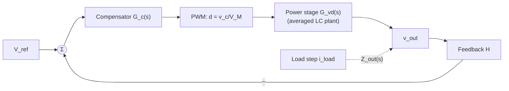
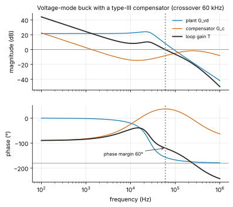

<!-- status: reviewed -->
# 22-07 · Converter Dynamics and Control

| | |
|---|---|
| **Course** | [22 · Power Electronics and Energy Conversion](../README.md) |
| **University equivalent** | The converter-dynamics weeks of a senior power-electronics course: averaged models, small-signal transfer functions of the buck and boost, the right-half-plane zero, voltage-mode compensation (type II and III), peak current-mode control and slope compensation, output impedance and load transients, and digital control (Erickson & Maksimović, *Fundamentals of Power Electronics*, the AC equivalent-circuit modeling, converter transfer functions, controller design and current-programmed control chapters) |
| **Prerequisites** | [22-02](22-02-buck-converter-steady-state.md) and [22-03](22-03-boost-buck-boost-topologies.md) (steady state), [15-07](../../15-control-systems/chapters/15-07-frequency-domain-design.md) (Bode design, phase margin), [15-09](../../15-control-systems/chapters/15-09-lead-lag-compensation.md) (lead compensation), [15-12](../../15-control-systems/chapters/15-12-control-applications-pll-regulators-thermal.md) (regulator loops, load line) |
| **Estimated study hours** | 9 |
| **Last verified** | 2026-11-25 |

**Learning objectives.** After this chapter you can:

1. Derive a converter's averaged model by averaging over a switching period, and linearize it into small-signal transfer functions.
2. Derive the buck's control-to-output transfer function and output impedance, and the boost's, including its right-half-plane zero.
3. Design a type-III voltage-mode compensator for a target crossover frequency and phase margin, and realize it with an op-amp network.
4. Derive the subharmonic instability of peak current-mode control and the slope compensation that removes it.
5. Estimate a regulator's load-step deviation from its crossover frequency and output capacitance, and the phase cost of a digital controller's delay.

## 1. Big picture

Chapters 22-02 to 22-06 asked what a converter does in steady state and how much it loses. A converter in a product must also *hold* its output while the load jumps from idle to full power in a microsecond, while the input sags, and while components age. That is a feedback-control problem, and a peculiar one: the plant switches, so it is not linear and its signals carry ripple, and its most important element, the LC filter, is a lightly damped resonator. This chapter builds the standard tools. Averaging over a switching period turns the switched circuit into a smooth nonlinear model; linearizing it gives transfer functions that classical control (Course 15) can work with. The buck turns out to be a well-behaved second-order plant, the boost hides a right-half-plane zero that limits how fast it can ever respond, and current-mode control simplifies both at the price of a subtle instability that slope compensation fixes.

- **Processor and AI accelerator rails:** load steps of hundreds of amperes in microseconds; the regulator's bandwidth and output capacitance decide how much the voltage droops (15-12, 22-10).
- **PMICs in phones and wearables:** many rails, each with a compensated loop that must stay stable over battery voltage, load and temperature (22-08).
- **Battery chargers:** the same converter switches between current and voltage regulation (22-09).
- **Boost and PFC stages:** the right-half-plane zero sets the achievable bandwidth (22-03).
- **Digital controllers:** firmware-configurable loops, telemetry and adaptive tuning, with delay as their main cost.

## 2. Intuition first

**Averaging hides the switching.** The inductor and capacitor cannot follow the switching edges; they respond to the average of the switch-node voltage over each cycle, $d\,V_g$ for a buck. If we watch the converter at frequencies well below $f_s$, the switch is just a voltage source $d\,V_g$ whose value the controller sets through the duty cycle. The buck is then an LC low-pass filter driven by a controllable source: a second-order plant with a resonance at $f_0 = 1/(2\pi\sqrt{LC})$, whose phase falls by 180° within an octave or two of $f_0$.

**The boost answers backwards first.** Asking a boost for more output means raising the duty cycle. But a longer on-time means a shorter off-time, the only time the inductor feeds the output, so the output first *drops* before the larger inductor current builds up and lifts it. A plant that initially moves the wrong way has a right-half-plane zero, and no controller can respond faster than that zero allows. An investor who must first fund a capex program before earnings rise faces the same constraint: push too hard on short-term targets and the system oscillates.

**Current mode turns the inductor into a current source.** If an inner loop sets the inductor's peak current every cycle, the outer voltage loop no longer sees the LC resonance, only a capacitor fed by a controlled current, a first-order plant that is easy to compensate. The analogy's limit: the inner loop samples once per cycle, and above 50% duty an error in the current grows from one cycle to the next unless an artificial ramp is added. That ramp is **slope compensation**.

## 3. Theory

### 3.1 Averaging and linearization

Average each state equation over one switching period, assuming the ripple is small (22-02). For the buck, the inductor sees $V_g - v$ for $dT_s$ and $-v$ for the rest, so with $\langle\cdot\rangle$ meaning the moving average over $T_s$:

$$
L\frac{d\langle i_L\rangle}{dt} = d\,v_g - \langle v\rangle, \qquad C\frac{d\langle v\rangle}{dt} = \langle i_L\rangle - \frac{\langle v\rangle}{R} .
$$

This **averaged model** is nonlinear in general (it multiplies $d$ by $v_g$) but continuous. It is valid for frequencies well below $f_s$, typically up to a fraction of $f_s/2$, where the ripple and the sampling nature of the PWM start to matter. To get transfer functions, perturb each quantity about its operating point, $d = D + \hat d$, $v = V + \hat v$, $i_L = I + \hat\imath$, $v_g = V_g + \hat v_g$, keep the first-order terms and drop products of small signals (Course 15's linearization). The hat marks a small-signal perturbation here, Erickson and Maksimović's convention for converters; elsewhere in the course a hat marks a unit vector ([notation](../../../reference/notation.md)).

**The buck.** The perturbed equations are $sL\hat\imath = V_g\hat d + D\hat v_g - \hat v$ and $sC\hat v = \hat\imath - \hat v/R$. Eliminating $\hat\imath$:

$$
G_{vd}(s) = \frac{\hat v}{\hat d} = \frac{V_g}{1 + s\dfrac{L}{R} + s^2LC}, \qquad G_{vg}(s) = \frac{\hat v}{\hat v_g} = \frac{D}{1 + s\dfrac{L}{R} + s^2LC} .
$$

Units: V divided by dimensionless (Ω·s/Ω and H·F = s²). ✓ The denominator is a standard second-order form with $\omega_0 = 1/\sqrt{LC}$ and quality factor $Q = R\sqrt{C/L}$ (a light load, large $R$, makes it sharper). The capacitor's ESR $R_c$ adds a left-half-plane zero at $\omega_{esr} = 1/(R_cC)$, which ceramic capacitors push far above crossover.

The **open-loop output impedance**, the response of $\hat v$ to an injected load current with $\hat d = 0$, is the parallel combination of $sL$, $R$ and $1/(sC)$:

$$
Z_{out}(s) = \frac{sL}{1 + s\dfrac{L}{R} + s^2LC} .
$$

It is small at low frequency (the inductor), small at high frequency (the capacitor) and peaks near $f_0$.

### 3.2 The boost and its right-half-plane zero

The boost's averaged equations are $L\,d\langle i_L\rangle/dt = v_g - (1 - d)\langle v\rangle$ and $C\,d\langle v\rangle/dt = (1 - d)\langle i_L\rangle - \langle v\rangle/R$. Both contain a product of $d$ with a state, so perturbing gives, with $D' = 1 - D$ and $v_g$ fixed:

$$
sL\hat\imath = -D'\hat v + V\hat d, \qquad sC\hat v = D'\hat\imath - I\hat d - \frac{\hat v}{R},
$$

where $I = V/(D'R)$ is the inductor's DC current (22-03). Substitute $\hat\imath = (V\hat d - D'\hat v)/(sL)$ into the second equation and multiply through by $sL/D'^2$:

$$
G_{vd}(s) = \frac{V}{D'}\cdot\frac{1 - s\dfrac{L}{D'^2R}}{1 + s\dfrac{L}{D'^2R} + s^2\dfrac{LC}{D'^2}} .
$$

Units: each $L/(D'^2R)$ is in seconds and $LC/D'^2$ in s². ✓ The numerator has a zero at $s = +D'^2R/L$, in the **right half plane**: its magnitude rises like a normal zero's but its phase *falls* by 90°. The intuition of §2 is in the minus sign: the term $-I\hat d$ in the capacitor equation is the output current lost when the off-time shrinks. The resonance moves to $\omega_0 = D'/\sqrt{LC}$, as if the inductor were $L/D'^2$. Because no compensator can undo a right-half-plane zero's phase lag without inverting it into an unstable pole, the crossover must stay well below $f_{RHP} = D'^2R/(2\pi L)$, which is lowest at heavy load (small $R$) and high duty (small $D'$). The buck-boost, flyback and SEPIC have the same feature.

### 3.3 The voltage-mode loop and its compensator

In **voltage-mode control**, an error amplifier compares the output with a reference and its output $v_c$ is compared with a sawtooth of peak $V_M$ to set the duty cycle, so $\hat d = \hat v_c/V_M$: the modulator is a gain $1/V_M$. With a feedback divider $H$ and a compensator $G_c(s)$, the **loop gain** is

$$
T(s) = G_c(s)\,\frac{1}{V_M}\,G_{vd}(s)\,H .
$$

Course 15 showed what $T$ must do: be large at low frequency (an integrator removes steady-state error), cross unity at a **crossover frequency** $f_c$ that sets the response speed, and have a **phase margin** $\text{PM} = 180° + \angle T(j2\pi f_c)$ of roughly 45–60° for a well-damped response. Two constraints bound $f_c$ from above: the averaged model fails as $f$ approaches $f_s/2$, and the switching ripple must not be amplified into the duty cycle, so $f_c$ is usually a fraction of $f_s$ (§9 gives vendor guidance); and in a boost, $f_c$ must stay below the right-half-plane zero.

Above $f_0$ the buck's plant phase approaches −180°, and the integrator adds −90°, so the compensator must supply more than 90° of phase lead near $f_c$. A single lead network gives less than 90°; two give up to 180°. The **type-III compensator** is an integrator with two zeros and two poles:

$$
G_c(s) = \frac{\omega_I}{s}\cdot\frac{(1 + s/\omega_z)^2}{(1 + s/\omega_p)^2} .
$$

**Placing the zeros and poles (the k-factor method).** Put the zeros a factor $k$ below $f_c$ and the poles a factor $k$ above it. At $f_c$ each zero contributes $\arctan k$ and each pole $-\arctan(1/k)$, so the compensator's phase is

$$
\angle G_c(j\omega_c) = -90° + 2\left[\arctan k - \arctan\frac{1}{k}\right] = -90° + 2\left[2\arctan k - 90°\right].
$$

For a desired phase margin and a plant phase $\varphi_p$ at $f_c$, the required **boost** above the integrator's −90° is $B = \text{PM} - 90° - \varphi_p$, and then

$$
k = \tan\left(\frac{B/2 + 90°}{2}\right).
$$

(Venable's original k-factor for type III is the square of this $k$, with the zeros at $f_c/\sqrt{k}$; the placements are identical.) Finally $\omega_I$ is chosen so that $|T(j\omega_c)| = 1$. Units: $\omega_I$ in rad/s makes $\omega_I/s$ dimensionless. ✓ When the capacitors' ESR zero falls below $f_c$, it supplies 90° of the lead itself and a **type-II** compensator (integrator, one zero, one pole) suffices. That is also the case for current-mode control (§3.4).

**Realizing it.** The classic type-III network wraps an op-amp with $R_2$ in series with $C_1$, in parallel with $C_2$, in the feedback path, and $R_1$ in parallel with $R_3$-in-series-with-$C_3$ in the input path. Its transfer function is

$$
G_c(s) = \frac{(1 + sR_2C_1)\,(1 + s(R_1 + R_3)C_3)}{sR_1(C_1 + C_2)\,\left(1 + sR_2\dfrac{C_1C_2}{C_1 + C_2}\right)(1 + sR_3C_3)},
$$

so $\omega_I = 1/(R_1(C_1 + C_2))$, the zeros are at $1/(R_2C_1)$ and $1/((R_1 + R_3)C_3)$, and the poles at $(C_1 + C_2)/(R_2C_1C_2)$ and $1/(R_3C_3)$. Choosing $R_1$ fixes the rest (Example 22-07.3).

### 3.4 Peak current-mode control and slope compensation

In **peak current-mode control** the switch turns on at each clock edge and turns off when the sensed inductor current $R_ii_L$ reaches the control voltage $v_c$. The inductor current rises at slope $m_1 = (V_g - V)/L$ and falls at $m_2 = V/L$ (buck). Suppose the current at the start of cycle $n$ is perturbed by $\Delta i_n$. The peak is fixed by $v_c$, so a higher starting current reaches the peak earlier, by $\Delta i_n/m_1$; the current then falls for that much longer, ending the cycle lower by $m_2\Delta i_n/m_1$:

$$
\Delta i_{n+1} = -\frac{m_2}{m_1}\Delta i_n .
$$

The perturbation alternates in sign and grows if $m_2 > m_1$, which for a buck is $D > 0.5$: **subharmonic oscillation** at $f_s/2$. Adding an artificial ramp of slope $m_a$ (in current units) to the sensed current, or subtracting it from $v_c$, changes the geometry: the turn-off point now moves along a line of slope $m_a$, and repeating the argument gives

$$
\Delta i_{n+1} = -\frac{m_2 - m_a}{m_1 + m_a}\,\Delta i_n = \alpha\,\Delta i_n .
$$

Stability needs $|\alpha| < 1$. Since $m_1 \to 0$ as $D \to 1$, the condition for all duty cycles is $m_a > m_2/2$, the classic rule. Choosing $m_a = m_2$ makes $\alpha = 0$: any perturbation dies in one cycle (deadbeat), at the cost of a weaker current loop.

With the current loop closed, the inductor acts approximately as a current source $\hat\imath \approx \hat v_c/R_i$ at frequencies well below $f_s$. The buck's outer plant becomes the capacitor and load alone,

$$
G_{vc}(s) \approx \frac{R}{R_i}\cdot\frac{1}{1 + sRC},
$$

a single pole at $1/(2\pi RC)$, so a type-II compensator suffices. Ridley's model refines this with a double pole at $f_s/2$ whose damping depends on $m_a$ [13]. Current mode also limits each cycle's peak current (inherent overcurrent protection) and shares current naturally between paralleled phases, which is why multiphase processor regulators use it or its relatives.

### 3.5 Load transients and digital delay

**Load steps.** With the loop closed, the output impedance falls to $Z_{out,cl} = Z_{out}/(1 + T)$: large loop gain makes the output stiff. Near and above crossover, $T$ is small and the output capacitor alone supplies the transient current. A useful first-order estimate follows from two approximations valid between $f_0$ and $f_c$: the open-loop output impedance is about the capacitor's, $Z_{out} \approx 1/(sC)$, and a well-compensated loop has $T \approx \omega_c/s$ there. Then $Z_{out,cl} = Z_{out}/(1 + T) \approx 1/(C(s + \omega_c))$, whose magnitude never exceeds $1/(\omega_cC)$: the closed-loop output impedance is at most the capacitor's impedance at $f_c$. The estimate assumes the loop gain is large enough at $f_0$ to suppress the LC peak; Problem 22-07.12 shows what happens when it is not. A load step $\Delta I$ therefore produces a peak deviation of about

$$
\Delta V \approx \frac{\Delta I}{2\pi f_cC} .
$$

Units: A/(Hz·F) = A/(A/V) = V. ✓ This links bandwidth to capacitance: halving the capacitance requires doubling the crossover frequency for the same droop, and the crossover is capped by $f_s$. It is the regulator-side counterpart of 15-12's load line and of 22-10's target impedance.

**Digital control.** A digital controller samples the output with an ADC, computes $d$ and updates the PWM. The conversion, computation and update together delay the response by $t_d$, often one to two switching periods. A pure delay has unit magnitude and phase $-\omega t_d$, so at crossover it costs

$$
\varphi_d = 360° \cdot f_c\,t_d
$$

of phase margin. Digital loops therefore cross over lower, or use faster sampling and predictive or nonlinear algorithms; in return they offer programmability, telemetry, adaptive tuning and multiphase management (§9). **Ripple-based** controls such as constant on-time skip the error amplifier altogether: they turn the switch on when the output ripple falls to a threshold, reacting within a cycle, at the cost of a variable frequency and a dependence on enough ripple at the sense point.

## 4. Worked examples

### Example 22-07.1 · The buck's plant (tier A)

**Setup.** The 12 V to 1.2 V, 10 A buck of Example 22-02.1 has $L$ = 0.6 µH and an effective output capacitance of 62.5 µF (Example 22-02.2) with 2 mΩ of ESR (assumed). Find (a) the load resistance, (b) $f_0$, (c) $Q$, (d) the low-frequency control-to-output gain in dB, (e) the ESR zero, and the plant's (f) magnitude in dB and (g) phase at 60 kHz, neglecting the ESR (its zero adds only about +2.8° there; it is checked once the design works, in Example 22-07.3).

**Solution.**

- (a) $R = 1.2/10$ = **0.12** Ω; (b) $f_0 = 1/(2\pi\sqrt{0.6\ \mu\text{H} \times 62.5\ \mu\text{F}})$ = **26.0** kHz; (c) $Q = 0.12\sqrt{62.5/0.6}$ = **1.22**.
- (d) $G_{vd}(0) = V_g$ = 12, or **21.6** dB.
- (e) $f_{esr} = 1/(2\pi \times 2\ \text{m}\Omega \times 62.5\ \mu\text{F})$ = **1.27** MHz, far above any crossover.
- (f) At 60 kHz, $|G_{vd}|$ = **2.54** (h), **8.1** dB; (g) phase **−156.5**°.

**Units check.** $\sqrt{\text{H·F}}$ = s; Ω·√(F/H) is dimensionless. ✓

**Sanity check.** At 2.3 times $f_0$ the magnitude falls roughly as $(f_0/f)^2$ from 12 (that would give **2.25** (i); the $Q$ term adds a little) and the phase is heading for −180°. The ESR zero is useless for compensation with ceramic capacitors, so this voltage-mode buck needs a type-III compensator.

### Example 22-07.2 · The boost's right-half-plane zero (tier B)

**Setup.** Example 22-03.1's boost converts 3.6 V to 5 V at 1.5 A with $L$ = 1 µH and $C$ = 22 µF. Find (a) $D$, (b) the load resistance, (c) the low-frequency control-to-output gain, (d) the resonant frequency $f_0$, (e) $Q = D'R\sqrt{C/L}$ and (f) the right-half-plane zero. (g) If the crossover is kept below a fifth of $f_{RHP}$, what is the limit?

**Solution.**

- (a) $D = 1 - 3.6/5$ = **0.28**; (b) $R = 5/1.5$ = **3.33** Ω; (c) $V/D' = 5/0.72$ = **6.94**.
- (d) $f_0 = D'/(2\pi\sqrt{LC}) = 0.72/(2\pi\sqrt{22 \times 10^{-12}})$ = **24.4** kHz; (e) $Q = 0.72 \times 3.333 \times \sqrt{22}$ = **11.3**.
- (f) $f_{RHP} = D'^2R/(2\pi L) = 0.5184 \times 3.333/(2\pi \times 1\ \mu\text{H})$ = **275** kHz.
- (g) **55.0** kHz.

**Units check.** Ω/H = 1/s. ✓

**Sanity check.** The RHP zero falls with load: at 3 A ($R$ halved) it halves to **138** kHz (h), so design at the heaviest load. The high $Q$ (the lightly damped resonance 22-03 saw in simulation) is why boosts are usually run in current mode.

### Example 22-07.3 · A type-III compensator for the buck (tier C)

**Setup.** Close the loop of Example 22-07.1 with voltage-mode control: $V_M$ = 1 V, $H$ = 1, crossover at $f_s/10$ = 60 kHz with a 60° phase margin. Find (a) the required phase boost, (b) $k$, (c) the zero and (d) pole frequencies, and (e) the integrator's unity-gain frequency $f_I = \omega_I/2\pi$. With $R_1$ = 10 kΩ, find (f) $C_1$, (g) $C_2$, (h) $R_2$, (i) $R_3$ and (j) $C_3$. (k) Confirm the phase margin.

**Solution.**

- (a) $B = 60° - 90° - (-156.47°)$ = **126.5**°; (b) $k = \tan((63.24° + 90°)/2)$ = **4.20**.
- (c) $f_z = 60/4.204$ = **14.27** kHz; (d) $f_p = 60 \times 4.204$ = **252.2** kHz.
- (e) $|G_c(j\omega_c)|$ must equal $V_M/|G_{vd}| = 1/2.541$ = **0.3935** (l). At $f_c$ each zero–pole pair has magnitude $|1 + jk|/|1 + j/k| = k$, so $|G_c| = (\omega_I/\omega_c)k^2$ and $\omega_I = 0.3935\,\omega_c/k^2$ = 8396 rad/s, so $f_I$ = **1.34** kHz.
- (f, g) $C_1 + C_2 = 1/(\omega_IR_1)$ = **11.91** nF (n) and $(C_1 + C_2)/C_2 = k^2$ = **17.67** (m), so $C_2$ = **0.674** nF and $C_1$ = **11.24** nF.
- (h) $R_2 = 1/(\omega_zC_1)$ = **992** Ω.
- (i) $(R_1 + R_3)/R_3 = k^2$ gives $R_3 = R_1/(k^2 - 1)$ = **600** Ω; (j) $C_3 = 1/(\omega_pR_3)$ = **1.052** nF.
- (k) Evaluating $T(j\omega)$ numerically: $|T|$ = 1 at **60.0** kHz (o) with phase −120.0°, a phase margin of **60.0**°. With the 2 mΩ ESR included in the plant, the same network crosses at **59.2** kHz with **63.2**° of margin (p, q): the ESR zero adds a little phase, as expected.

**Units check.** 1/(rad/s · Ω) = F; 1/(rad/s · F) = Ω. ✓

**Sanity check.** The zeros sit about two octaves below $f_c$ and a little below $f_0$ (14.3 against 26.0 kHz), so their phase lead is already rising when the double pole's lag arrives; the poles sit below $f_s/2$ = 300 kHz, where they attenuate the switching ripple. The lab builds this network around an ideal op-amp, closes the loop on the averaged buck in ngspice, and measures the crossover and phase margin by Middlebrook's injection method.

### Example 22-07.4 · Subharmonic instability and slope compensation (tier B)

**Setup.** A peak current-mode buck converts 5 V to 3.3 V with $L$ = 2.2 µH. Find (a) $D$, (b) $m_1$, (c) $m_2$ and (d) the perturbation ratio without slope compensation. With $m_a = m_2/2$, find (e) $\alpha$ and (f) the fraction of an initial perturbation left after 5 cycles. (g) What is the smallest $m_a$ for stability at this duty cycle? (h) With a 50 mΩ current-sense gain, what voltage slope does $m_a = m_2/2$ correspond to?

**Solution.**

- (a) **0.66**; (b) $m_1 = 1.7/2.2\ \mu\text{H}$ = **0.773** A/µs; (c) $m_2 = 3.3/2.2\ \mu\text{H}$ = **1.50** A/µs.
- (d) $-m_2/m_1$ = **−1.94**: each cycle the error doubles and flips sign.
- (e) $\alpha = -(1.5 - 0.75)/(0.773 + 0.75)$ = **−0.493**; (f) $\alpha^5$ = **−0.029**.
- (g) $|\alpha| < 1$ needs $m_2 - m_a < m_1 + m_a$, so $m_a > (m_2 - m_1)/2$ = **0.364** A/µs.
- (h) $0.75\ \text{A/µs} \times 50\ \text{m}\Omega$ = **37.5** mV/µs.

**Units check.** V/H = A/s. ✓

**Sanity check.** The minimum at this duty cycle is below $m_2/2$, but designing to $m_2/2$ covers every duty cycle the converter might reach (for example in dropout). Too much compensation makes the loop behave like voltage mode again, losing current mode's advantages.

### Example 22-07.5 · Load-step droop against crossover and capacitance (tier A)

**Setup.** A 1.0 V rail sees a 20 A load step. With $f_c$ = 100 kHz and $C$ = 1 mF, estimate (a) the droop. For a 20 mV limit, find (b) the capacitance needed at 100 kHz and (c) the crossover needed with 1 mF.

**Solution.**

- (a) $\Delta V = 20/(2\pi \times 100\ \text{kHz} \times 1\ \text{mF})$ = **31.8** mV.
- (b) $C = 20/(2\pi \times 100\ \text{kHz} \times 20\ \text{mV})$ = **1.59** mF.
- (c) $f_c = 20/(2\pi \times 1\ \text{mF} \times 20\ \text{mV})$ = **159** kHz.

**Units check.** A/(Hz · F) = V. ✓

**Sanity check.** Bandwidth and capacitance trade one for one. A 159 kHz crossover needs a switching frequency of roughly a megahertz or more; multiphase converters reach it with several interleaved phases (22-10), and coupled inductors and TLVR (22-05) attack the same trade.

### Example 22-07.6 · The phase cost of a digital controller (tier B)

**Setup.** A digital controller at $f_s$ = 500 kHz has a total loop delay of 1.5 switching periods. Find (a) the delay and (b) its phase lag at a 50 kHz crossover. (c) What crossover keeps the lag to 20°? (d) Repeat (c) at 1 MHz with the same delay in cycles.

**Solution.**

- (a) $1.5 \times 2\ \mu\text{s}$ = **3.0** µs; (b) $360° \times 50\ \text{kHz} \times 3\ \mu\text{s}$ = **54**°.
- (c) $20/(360 \times 3\ \mu\text{s})$ = **18.5** kHz; (d) with 1.5 µs, **37.0** kHz.

**Units check.** Hz × s is dimensionless; times 360° gives degrees. ✓

**Sanity check.** A delay of 54° at $f_s/10$ is unaffordable, so digital loops either cross over at a few per cent of $f_s$ or cut their delay (faster ADCs, sampling just before the PWM update, predictive algorithms). Doubling $f_s$ with the same delay in cycles doubles the usable crossover, one more reason digital VRMs run fast.

<!-- answer-key -->

| ID | Quantity | Value | Unit |
|---|---|---|---|
| Ex 22-07.1a | load resistance | 0.12 | Ω |
| Ex 22-07.1b | resonant frequency | 26.0 | kHz |
| Ex 22-07.1c | quality factor | 1.22 | |
| Ex 22-07.1d | low-frequency gain | 21.6 | dB |
| Ex 22-07.1e | ESR zero | 1.27 | MHz |
| Ex 22-07.1f | plant magnitude at 60 kHz | 8.1 | dB |
| Ex 22-07.1g | plant phase at 60 kHz | −156.5 | ° |
| Ex 22-07.1h | plant magnitude at 60 kHz, linear | 2.54 | |
| Ex 22-07.1i | asymptotic magnitude at 60 kHz | 2.25 | |
| Ex 22-07.2a | duty cycle | 0.28 | |
| Ex 22-07.2b | load resistance | 3.33 | Ω |
| Ex 22-07.2c | low-frequency gain | 6.94 | |
| Ex 22-07.2d | resonant frequency | 24.4 | kHz |
| Ex 22-07.2e | quality factor | 11.3 | |
| Ex 22-07.2f | right-half-plane zero | 275 | kHz |
| Ex 22-07.2g | crossover limit | 55.0 | kHz |
| Ex 22-07.2h | RHP zero at 3 A | 138 | kHz |
| Ex 22-07.3a | phase boost | 126.5 | ° |
| Ex 22-07.3b | k | 4.20 | |
| Ex 22-07.3c | zero frequency | 14.27 | kHz |
| Ex 22-07.3d | pole frequency | 252.2 | kHz |
| Ex 22-07.3e | integrator unity-gain frequency | 1.34 | kHz |
| Ex 22-07.3f | C1 | 11.24 | nF |
| Ex 22-07.3g | C2 | 0.674 | nF |
| Ex 22-07.3h | R2 | 992 | Ω |
| Ex 22-07.3i | R3 | 600 | Ω |
| Ex 22-07.3j | C3 | 1.052 | nF |
| Ex 22-07.3k | phase margin | 60.0 | ° |
| Ex 22-07.3l | compensator gain at crossover | 0.3935 | |
| Ex 22-07.3m | k² | 17.67 | |
| Ex 22-07.3n | C1 + C2 | 11.91 | nF |
| Ex 22-07.3o | achieved crossover | 60.0 | kHz |
| Ex 22-07.3p | crossover with the 2 mΩ ESR | 59.2 | kHz |
| Ex 22-07.3q | phase margin with the 2 mΩ ESR | 63.2 | ° |
| Ex 22-07.4a | duty cycle | 0.66 | |
| Ex 22-07.4b | up-slope | 0.773 | A/µs |
| Ex 22-07.4c | down-slope | 1.50 | A/µs |
| Ex 22-07.4d | perturbation ratio without compensation | −1.94 | |
| Ex 22-07.4e | perturbation ratio with m_a = m2/2 | −0.493 | |
| Ex 22-07.4f | perturbation left after 5 cycles | −0.029 | |
| Ex 22-07.4g | minimum compensation slope | 0.364 | A/µs |
| Ex 22-07.4h | compensation voltage slope | 37.5 | mV/µs |
| Ex 22-07.5a | droop | 31.8 | mV |
| Ex 22-07.5b | capacitance for 20 mV | 1.59 | mF |
| Ex 22-07.5c | crossover for 20 mV | 159 | kHz |
| Ex 22-07.6a | delay | 3.0 | µs |
| Ex 22-07.6b | phase lag at 50 kHz | 54 | ° |
| Ex 22-07.6c | crossover for 20° | 18.5 | kHz |
| Ex 22-07.6d | crossover for 20° at 1 MHz | 37.0 | kHz |
| Txt 22-07.a | delay phase at f_s/10, one period | 36 | ° |
| Txt 22-07.b | delay phase at f_s/10, two periods | 72 | ° |

## 5. Simulate it

The lab is [labs/22-07-lab/](../labs/22-07-lab/README.md). `control.py` collects the transfer functions, the k-factor design, the type-III component calculation, the slope-compensation ratio and the transient and delay estimates. Two ngspice netlists use averaged models, which run in AC analysis because they contain no switching:

- `loop.cir` closes Example 22-07.3's loop: the averaged buck, the type-III network around a high-gain op-amp, and a 1.2 V reference. A Middlebrook injection source in the feedback path measures the loop gain $T = -\hat v_{out}/\hat v_{fb}$, its crossover and its phase margin.
- `boost_avg.cir` replaces the boost's switch and diode by their averaged sources, $(1 - d)v_{out}$ and $(1 - d)i_L$, and measures $G_{vd}$ at 1 kHz and at the right-half-plane zero.

**Predict, then run:**

1. *Predict* the crossover and phase margin of Example 22-07.3, then run `ngspice -b loop.cir`. In the notebook, change $C_3$ by ±50% and watch the phase margin move.
2. *Predict* the boost's gain at 1 kHz and its magnitude and phase at $f_{RHP}$ = 275 kHz, then run `ngspice -b boost_avg.cir`. Why does the phase pass −180°, when a minimum-phase second-order plant never would?
3. In the notebook, iterate the current-mode perturbation map of Example 22-07.4 for 10 cycles with $m_a$ = 0, $m_2/2$ and $m_2$.
4. Plot the closed-loop output impedance of Example 22-07.3's loop and compare its peak with $1/(2\pi f_cC)$.

## 6. Engineering tradeoffs

| Knob | Improves | Costs | Typical decision owner |
|---|---|---|---|
| Higher crossover frequency | Load-step droop, less output capacitance | Ripple in the loop, sensitivity to model errors; capped by $f_s$ and the RHP zero | Power-stage and control designer |
| More phase margin | Damping, overshoot, robustness to component drift | Lower crossover for the same compensator, slower settling | Control designer |
| Current mode instead of voltage mode | First-order plant, cycle-by-cycle current limit, current sharing | Current sensing, slope compensation, noise sensitivity | Controller architect |
| More slope compensation | Subharmonic margin at all duty cycles | Behaves more like voltage mode; less current-loop gain | Controller designer |
| Constant on-time or other ripple-based control | Response within a cycle, no compensator | Variable frequency (EMI), needs ripple at the sense point | Product architect |
| Digital control | Programmability, telemetry, adaptive tuning, multiphase management | Sampling delay, quantization, firmware validation | System architect |
| More output capacitance | Lower droop at the same bandwidth | Cost, board area, lower resonant frequency | Board designer |

## 7. Numbers to know

| Quantity | Value | Source |
|---|---|---|
| Buck control-to-output | $V_g/(1 + sL/R + s^2LC)$; $f_0 = 1/(2\pi\sqrt{LC})$, $Q = R\sqrt{C/L}$ | §3.1 |
| Boost RHP zero | $f_{RHP} = D'^2R/(2\pi L)$; resonance at $D'/(2\pi\sqrt{LC})$ | §3.2 |
| Typical phase margin target | 45–60° | 15-07 |
| k-factor | $k = \tan((B/2 + 90°)/2)$ for a type-III boost $B$ | §3.3 |
| Slope compensation for all duty cycles | $m_a > m_2/2$; $m_a = m_2$ is deadbeat | §3.4 |
| Load-step droop estimate | $\Delta V \approx \Delta I/(2\pi f_cC)$ | §3.5 |
| Delay phase cost | $360° \cdot f_c t_d$ | §3.5 |

## 8. Common mistakes

- **Designing at the light-load corner only.** The buck's $Q$ rises at light load and the boost's RHP zero falls at heavy load; check the loop at every corner of line, load and temperature, including capacitor derating (22-02).
- **Pushing a boost's crossover toward its RHP zero.** No compensator can recover the zero's phase lag; keep the crossover well below it at maximum load.
- **Forgetting the modulator and divider gains.** $1/V_M$ and $H$ multiply the loop gain; a change of ramp amplitude or reference divider moves the crossover.
- **Skipping slope compensation, or adding too much.** Without it, a peak current-mode converter above 50% duty oscillates at $f_s/2$; with $m_a \gg m_2$ the current loop loses its benefits.
- **Trusting the averaged model near $f_s/2$.** Averaging assumes slow variation; above about $f_s/5$ the sampled nature of the PWM adds phase lag the model does not show.
- **Ignoring digital delay.** One and a half switching periods of delay cost 54° at $f_s/10$ (Example 22-07.6).
- **Injecting at the wrong point.** Middlebrook's method needs a point where the impedance looking back toward the output is much smaller than the impedance looking into the compensator; otherwise the measurement is wrong.

## 9. Practitioner lens

*State of the art as of Nov 2026. Sources are logged as R-433 and R-434.*

**Vendor rules of thumb, and why they differ** [Established]. A TI boost data sheet states that "the loop gain cross over 0 dB at the frequency no higher than the lower of either 1/10 of the switching frequency, fSW or 1/5 of the RHPZ frequency", with "greater than 45° of phase margin and greater than 10-dB gain margin" [1]. A Renesas note on voltage-mode bucks is more aggressive: "the bandwidth should be between 20 to 30% of the switching frequency" [2]. A TI note calls 45–60° of phase margin "safe values that yield well-damped transient load response" [3]. The spread reflects different assumptions about ripple and modulator delay; the averaged model of §3.1 cannot settle it, which is why designers confirm the loop on a switching simulation or on the bench.

**Type-III placement in practice.** Renesas's recipe places one zero at half the LC double pole and the other at the double pole, one pole at the ESR zero and the other at half the switching frequency [2]. That is a different choice from this chapter's symmetric $k$-factor placement around $f_c$, but it rests on the same 180° boost. Both are starting points to be checked against the full transfer function, as Example 22-07.3 did.

**Slope compensation as specified** [Established]. Controller data sheets state the same instability: "Peak current mode regulators can exhibit unstable behavior when operating above 50% duty cycle … known as sub-harmonic oscillation" [4]. One requires the compensation slope to be "greater than half of the sensed inductor current falling slope", and calls 82% of that slope "an optimal amount" [5]. That sits between the $m_2/2$ minimum and the deadbeat $m_2$ of §3.4.

**Ripple-based and digital control** [Established for data-sheet descriptions; Industry estimate for performance claims].

- *TI's D-CAP family* skips the error amplifier. D-CAP "uses the equivalent series resistance (ESR) of the output capacitor(s)" and "does not require an external phase compensation network", provided the ESR zero lies below a quarter of the switching frequency [6]. D-CAP3 adds an internal ramp so that ceramic capacitors work [7]. The multiphase D-CAP+ forms its control signal from the summed inductor currents and the output error [8].
- *Digital multiphase controllers* now manage AI-accelerator rails. Infineon's XDPE1A2G5C is a "digital dual loop 16 phase controller" with "Digitally programmable PID … loop compensation", "Configurable autonomous phase add/drop" and transient features for "fast di/dt load transients" [9]. Renesas's RAA229139 uses a "digital synthetic current modulation scheme" and an AMD SVI3 interface [10]. These parts move compensation from resistors and capacitors into registers, and the loop's delay (§3.5) into firmware design.

**Marketing vs Reality.**

- *"No compensation required."* The loop still exists; the vendor has fixed it, and the output capacitor's ESR or an internal ramp sets its stability. Ask what range of output capacitance and ESR is supported.
- *"Industry-best transient response."* Ask for the load step, slew rate, output capacitance and droop, measured on the same board as the competitor's (§3.5's estimate shows how much capacitance can buy).
- *"Autonomous phase shedding."* It improves light-load efficiency; ask about the transient when phases are re-added.
- *"Type III gives 180° of boost."* Only as the zeros and poles separate without limit. The boost at crossover is $2[\arctan k - \arctan(1/k)]$, **126.5**° for Example 22-07.3's $k$ = 4.2, and the op-amp's own bandwidth takes some of it back.

**Questions for engineering leaders.**

1. **"What are your crossover and phase margin at the worst corner of line, load, temperature and capacitor derating?"** *Strong:* a Bode plot at each corner, measured on hardware with a network analyzer. *Evasive:* "We simulated it at nominal."
2. **"How do you handle the boost's RHP zero at maximum load?"** *Strong:* crossover below a fifth of the zero, or current mode with that limit stated. *Evasive:* "We use a fast controller."
3. **"What droop do you get for the specified load step, and how much of it is capacitance versus bandwidth?"** *Strong:* the $\Delta I/(2\pi f_cC)$ budget, the measured droop and how it scales. *Evasive:* "It meets spec."
4. **"What is the total loop delay of your digital controller, and what phase does it cost at crossover?"** *Strong:* the delay in switching periods and the resulting phase budget. *Evasive:* "Digital is faster than analog."
5. **"How do you avoid subharmonic oscillation across input voltage?"** *Strong:* the slope compensation ratio relative to $m_2$ at the extreme duty cycle. *Evasive:* "The controller handles it."

## 10. Concept check

**Q1.** Why does averaging over a switching period give a useful model, and where does it break down?

Answer

The inductor and capacitor respond to the average of the switch-node voltage, so for signals much slower than $f_s$ the switch is a controlled source $dV_g$. Near $f_s/2$ the ripple and the PWM's sampling matter and the model loses phase it does not predict.

**Q2.** Why does a boost's output first drop when the duty cycle steps up?

Answer

A longer on-time shortens the off-time, the only interval in which the inductor feeds the output, so the output current briefly falls before the inductor current has risen. This is the right-half-plane zero.

**Q3.** Why does a voltage-mode buck with ceramic output capacitors need a type-III compensator?

Answer

Above $f_0$ the LC plant's phase approaches −180° and the integrator adds −90°, so the compensator must supply more than 90° of lead at crossover. With ceramics the ESR zero is far above crossover and does not help, and one zero–pole pair gives less than 90°.

**Q4.** What sets the minimum slope compensation in peak current-mode control, and why is $m_2/2$ the universal rule?

Answer

Stability needs $|(m_2 - m_a)/(m_1 + m_a)| < 1$, that is $m_a > (m_2 - m_1)/2$. As the duty cycle approaches 1, $m_1$ approaches 0, so covering every duty cycle needs $m_a > m_2/2$.

**Q5.** How do crossover frequency and output capacitance trade off for a load step?

Answer

The droop is about $\Delta I/(2\pi f_cC)$: doubling the bandwidth halves the capacitance needed for the same droop. The bandwidth is capped by the switching frequency and, for a boost, by the RHP zero.

**Q6.** Why do digital controllers often cross over at a lower fraction of $f_s$ than analog ones?

Answer

Their sampling, computation and PWM update add a delay of about one to two switching periods, which costs $360° \cdot f_ct_d$ of phase. At $f_s/10$ that is **36**–**72**°, too much to give away.

Now work the [22-07 problem set](../problems/22-07-problems.md).

## 11. Key terms

[Averaged model](../../../reference/glossary.md#averaged-model) · [Control-to-output transfer function](../../../reference/glossary.md#control-to-output-transfer-function) · [Right-half-plane zero](../../../reference/glossary.md#right-half-plane-zero) · [Output impedance (converter)](../../../reference/glossary.md#output-impedance-converter) · [Voltage-mode control](../../../reference/glossary.md#voltage-mode-control) · [PWM modulator gain](../../../reference/glossary.md#pwm-modulator-gain) · [Type-II compensator](../../../reference/glossary.md#type-ii-compensator) · [Type III compensator](../../../reference/glossary.md#type-iii-compensator) · [K-factor method](../../../reference/glossary.md#k-factor-method) · [Peak current-mode control](../../../reference/glossary.md#peak-current-mode-control) · [Subharmonic oscillation](../../../reference/glossary.md#subharmonic-oscillation) · [Slope compensation](../../../reference/glossary.md#slope-compensation) · [Middlebrook injection](../../../reference/glossary.md#middlebrook-injection) · [Constant on-time control](../../../reference/glossary.md#constant-on-time-control) · [Digital multiphase controller](../../../reference/glossary.md#digital-multiphase-controller)

## 12. Connections

- **Previous:** [22-06](22-06-converter-losses-and-wide-bandgap.md) completed the steady-state loss picture; this chapter adds dynamics. The plants come from [22-02](22-02-buck-converter-steady-state.md) and [22-03](22-03-boost-buck-boost-topologies.md).
- **Prerequisites:** [15-07](../../15-control-systems/chapters/15-07-frequency-domain-design.md) (Bode design and phase margin), [15-09](../../15-control-systems/chapters/15-09-lead-lag-compensation.md) (lead networks), [15-11](../../15-control-systems/chapters/15-11-digital-control.md) (sampling and delay), [15-12](../../15-control-systems/chapters/15-12-control-applications-pll-regulators-thermal.md) (regulator loops and load lines).
- **Used later:**
  - [22-08](22-08-pmics.md) (multi-rail PMIC loops, DVFS steps, light-load modes);
  - [22-09](22-09-batteries-charging-fuel-gauging.md) (charger current and voltage loops);
  - [22-10](22-10-datacenter-power-delivery.md) (multiphase VRMs, load lines and target impedance).
- **Next:** [22-08](22-08-pmics.md) applies these loops inside a PMIC.

## 13. Further study

- R. W. Erickson and D. Maksimović, *Fundamentals of Power Electronics*, 3rd ed., Springer, 2020: the chapters on AC equivalent-circuit modeling, converter transfer functions, controller design and current-programmed control.
- R. D. Middlebrook and S. Ćuk's state-space averaging paper [11], V. Vorpérian's PWM-switch model [12] and R. B. Ridley's current-mode model [13], the three classic papers behind this chapter.
- Vendor compensation notes such as TI SLVA662 [3] and Renesas TB417 [2].

## 14. Sources

1. Texas Instruments, *TPS55288* data sheet, SLVSF01B (rev. Dec 2020), §8.2.2.7. [R-433]
2. Renesas (Intersil), TB417, *Designing Stable Compensation Networks for Single Phase Voltage Mode Buck Regulators*, Rev 1.00, Dec 2003. [R-433]
3. Texas Instruments, SLVA662, *Demystifying Type II and Type III Compensators Using Op-Amp and OTA for DC/DC Converters*, July 2014. [R-433]
4. Texas Instruments, *LM25117* data sheet, SNVS714F (rev. Aug 2015), §8.3.2. [R-433]
5. Texas Instruments, *LM5155* data sheet, SNVSB75E (rev. Aug 2023), §9.3.6. [R-433]
6. Texas Instruments, *TPS53355* data sheet, SLUSAE5G (rev. Apr 2021). [R-434]
7. Texas Instruments, *TPS56C215* data sheet, SLVSD05H (rev. June 2025). [R-434]
8. Texas Instruments, *TPS536C7* data sheet, SLUSDI9 (Sep 2020). [R-434]
9. Infineon, *XDPE1A2G5C* short data sheet, Rev 1.1, 2026-03-02. [R-434]
10. Renesas, *RAA229139* short-form data sheet, R16DO0057EU0100 Rev.1.00, 18 Jun 2025. [R-434]
11. R. D. Middlebrook and S. Ćuk, "A general unified approach to modelling switching-converter power stages," *IEEE PESC*, 1976, pp. 18–34, doi:10.1109/PESC.1976.7072895.
12. V. Vorpérian, "Simplified analysis of PWM converters using model of PWM switch. Continuous conduction mode," *IEEE Trans. Aerospace and Electronic Systems* 26(3):490–496, 1990, doi:10.1109/7.106126.
13. R. B. Ridley, "A new, continuous-time model for current-mode control," *IEEE Trans. Power Electronics* 6(2):271–280, 1991, doi:10.1109/63.76813.
