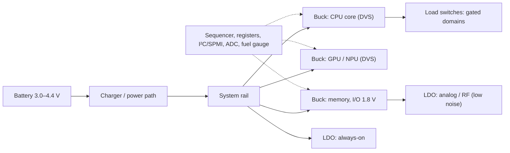
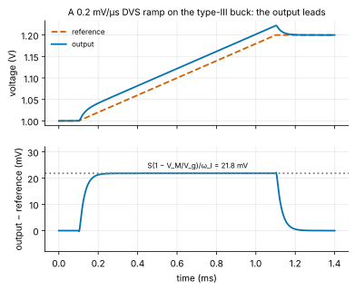
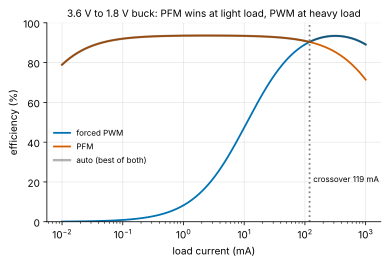

<!-- status: verified -->
# 22-08 · PMICs and Power Management for SoCs

| | |
|---|---|
| **Course** | [22 · Power Electronics and Energy Conversion](../README.md) |
| **University equivalent** | The power-management unit of a senior power-electronics or mixed-signal IC course: multi-rail regulator architectures, cascaded regulation, light-load efficiency, dynamic voltage scaling, power sequencing and soft start, and power gating, as practised in application-processor and wearable PMICs (Erickson & Maksimović for the converters; vendor PMIC data sheets for the system features) |
| **Prerequisites** | [22-07](22-07-converter-dynamics-and-control.md) (loops), [22-01](22-01-power-conversion-principles.md) (LDOs, the loss model, ½CV² charging), [22-02](22-02-buck-converter-steady-state.md) (PFM), [19-06](../../19-digital-vlsi-design/chapters/19-06-power-and-low-power-design.md) (DVFS and power gating), [18-09](../../18-embedded-systems-and-microcontrollers/chapters/18-09-ultra-low-power-design.md) (duty cycling, battery life) |
| **Estimated study hours** | 6 |
| **Last verified** | 2026-11-24 |

**Learning objectives.** After this chapter you can:

1. Describe a PMIC's building blocks and allocate an SoC's rails to bucks, LDOs and load switches, computing the efficiency of cascaded regulation.
2. Find the load at which a converter should switch between PFM and PWM, and compute a device's daily energy and battery life from its usage profile.
3. Compute the duration, extra current and energy of a dynamic-voltage-scaling transition, and the tracking error a compensated loop shows during a reference ramp.
4. Quantify the saving from adaptive voltage scaling, and size soft start and power-up sequencing against inrush current.
5. Compute the energy cost and break-even time of gating a power domain.

## 1. Big picture

A phone's application processor, a smartwatch's microcontroller or an AI accelerator's host SoC does not run from one supply. Its CPU cores, GPU, memory interface, always-on logic, radios, sensors and I/O each want their own voltage, often switched on and off or scaled thousands of times a second. The **power-management IC (PMIC)** delivers them: several buck converters and LDOs on one die, a sequencer that brings them up in the right order, registers through which the SoC sets each rail's voltage, and often a battery charger, a fuel gauge and an ADC for telemetry. This chapter treats the PMIC as a system designer does. It asks which regulator should feed each rail, how the converter should behave at microamps and at amps, what happens electrically when the SoC changes voltage or switches a domain on, and how those choices add up to battery life.

- **Phones and tablets:** an application-processor PMIC plus companion PMICs for camera, display and RF; dozens of rails.
- **Wearables and IoT:** a single small PMIC with a charger, a couple of bucks and LDOs, and nanoamp quiescent currents (18-09).
- **Automotive and industrial SoCs:** PMICs with functional-safety monitors, sequencing and voltage supervision.
- **Servers and AI accelerators:** the core rails go to multiphase VRMs (22-10); a PMIC still supplies the many auxiliary rails.

## 2. Intuition first

**A PMIC is a utility company inside the box.** It runs several substations (bucks for the heavy, efficiency-critical rails), local quiet transformers (LDOs for noise-sensitive analog and RF rails, often fed from a buck rather than the battery), and circuit breakers (load switches for domains that are switched off). It must bring the grid up in a safe order (sequencing), limit inrush when a neighbourhood is reconnected (soft start), and change voltage on request without blackouts (dynamic voltage scaling). Like a utility, it is judged on two numbers that pull against each other: efficiency at peak demand and standing losses at 3 a.m. A wearable spends most of its life at microamps, so its PMIC's quiescent current can matter more than its full-load efficiency.

The analogy breaks down in timescale and coupling. A PMIC's "neighbourhoods" switch in microseconds, the SoC itself requests the changes, and the loads are not passive: a CPU's current depends on the very voltage the PMIC sets.

## 3. Theory

### 3.1 What is inside a PMIC

A representative application-processor PMIC, Renesas's DA9063, has "Six buck converters, 0.3 V to 3.34 V up to 2.5 A" (two can run as a "Dual-phase mode up to 5 A"), "11 LDO regulators, 0.6 V to 3.6 V up to 300 mA", and "Dynamic Voltage Scaling (DVS)". It reaches high efficiency over a wide load range "by automatically selecting Pulse Frequency Modulation (PFM) or Pulse Width Modulation (PWM) modes" [1]. A wearable-class buck, TI's TPS62840, draws "60-nA quiescent current" and reaches "80% efficiency at 1 µA IOUT" [2]. Between these extremes sit PMICs that integrate a charger, a fuel gauge and load switches for battery-powered products (22-09). Every PMIC shares the same architecture:

- **Switching regulators** for the high-current, efficiency-critical rails (cores, memory), each with its own loop (22-07) and light-load mode;
- **LDOs** for low-current, noise-sensitive or always-on rails;
- **load switches** that connect or isolate power domains;
- **a sequencer** that enables rails in a programmed order with programmed delays and checks that each has reached regulation (a "power good" signal) before the next starts;
- **a control interface** (I²C, or the MIPI SPMI bus in phones [6]) through which the SoC sets voltages, modes and sequences;
- **monitoring:** an ADC for voltages, currents and temperature, and protection (over-current, over-temperature, under-voltage lockout).

### 3.2 Allocating rails: buck, LDO, or both

An LDO's efficiency is at most $V_{out}/V_{in}$ (22-01). A buck's efficiency is set by its losses, typically 85–95% at moderate load. An LDO *fed from a buck* (post-regulation) is common for rails that need an LDO's noise rejection but should not waste the battery's full headroom. Its efficiency is the product

$$
\eta_{chain} = \eta_{buck}\cdot\frac{V_{out}}{V_{mid}},
$$

where $V_{mid}$ is the buck's output. $V_{mid}$ must exceed $V_{out}$ by the LDO's dropout plus margin; every extra 100 mV of headroom costs $0.1/V_{mid}$ of efficiency. The rule that falls out: feed the heavy digital rails directly from bucks; use LDOs, ideally post-regulated, only where current is small or noise matters; and run always-on rails from an LDO with the lowest quiescent current, because their load is tiny but permanent.

### 3.3 Light load: PFM, PWM and the crossover

A buck in forced PWM switches every cycle whatever the load, so it pays a roughly fixed switching and gate-drive loss $P_f$ plus conduction $I^2R$ (22-01, 22-06). In **pulse-frequency modulation (PFM)** it switches only when the output needs charge (22-02), so its switching loss scales with load: a loss per coulomb delivered, $\alpha I$, plus its quiescent draw $V_{in}I_q$. PFM's pulses carry larger peak currents, so its conduction term $R_pI^2$ is larger than PWM's. With

$$
P_{PWM} = P_f + RI^2, \qquad P_{PFM} = V_{in}I_q + \alpha I + R_pI^2,
$$

the two are equal where $(R_p - R)I^2 + \alpha I + V_{in}I_q - P_f = 0$. Below that current PFM wins, above it PWM wins, and a PMIC's "auto" mode switches between them. The gap at light load is enormous: a 20 mW fixed PWM loss at 1 mA of a 1.8 V output (1.8 mW) gives under 10% efficiency, while PFM can stay above 90% (Example 22-08.2). The price of PFM is a variable switching frequency (noise that can land in an RF or audio band) and larger output ripple.

### 3.4 Usage profiles and battery life

Efficiency at one load is not what the user experiences. A device spends its day in a few states, each with an output power $P_i$, a converter efficiency $\eta_i$ at that load and a duration $t_i$. The energy drawn from the battery per day is

$$
E_{day} = \sum_i \frac{P_it_i}{\eta_i} + V_{bat}I_qT_{day},
$$

where the last term is the PMIC's own standing draw over the 86 400 s day. Battery life is the battery's energy, $Q_{bat}V_{bat}$, divided by $E_{day}$. The sum is usually dominated by the states that are either long (sleep) or power-hungry (display, radio), and the state with the worst efficiency is often the long, light one: that is why PMIC vendors fight over nanoamps (Example 22-08.3).

### 3.5 Dynamic voltage scaling

An SoC changes its core voltage with its clock frequency (19-06): it raises the voltage *before* raising the frequency and lowers the frequency *before* lowering the voltage, so the logic is never too slow for its clock. The PMIC ramps the rail at a programmed **slew rate** $S$ (V/s), because a step would cause a large current surge and, in a compensated loop, overshoot.

**Up-ramp.** Raising the rail by $\Delta V$ takes $t = \Delta V/S$. During it the converter must supply, beyond the load, the current that charges the output capacitance,

$$
I_{C} = C\,S,
$$

and it stores the extra energy $\tfrac12C(V_2^2 - V_1^2)$ in the capacitors. Units: F × V/s = A. ✓

**Down-ramp.** Lowering the rail requires removing charge. A converter in forced PWM can sink current and ramp down at $S$. In PFM it cannot sink, so the rail falls only as fast as the load discharges the capacitance, $dV/dt = -I_{load}/C$. At light load that can be far slower than the programmed slew, delaying the frequency change, which is why PMICs often force PWM during a DVS transition.

**Loop tracking.** The ramp is applied as a reference to a closed loop, which tracks it with some error. For the op-amp type-III compensator of 22-07, with the reference on the amplifier's non-inverting input, the control voltage is $v_c = (1 + K)V_{ref} - KV_{out}$ with $K = Z_f/Z_i$, so the output error is

$$
V_{out} - V_{ref} = V_{ref}\,\frac{G - 1}{1 + KG}, \qquad G = \frac{G_{vd}}{V_M}.
$$

At low frequency $K \approx \omega_I/s$ and $G \approx V_g/V_M$, so for a ramp of slew $S$ (Laplace $S/s^2$) the final-value theorem gives a steady lead

$$
e_{ramp} = \frac{S}{\omega_I}\left(1 - \frac{V_M}{V_g}\right).
$$

The output runs *ahead* of the reference because the reference also feeds straight through to the modulator. Faster ramps or a weaker integrator mean more lead; the lab measures it.

### 3.6 Adaptive voltage scaling

Each chip is given a supply margin to cover process, temperature, aging and supply noise. **Adaptive voltage scaling (AVS)** measures the actual chip (ring oscillators or critical-path monitors) and lowers the supply to what that chip needs. Because dynamic power is $\alpha CV^2f$ (19-06), lowering the voltage from $V_1$ to $V_2$ at the same frequency saves the fraction

$$
1 - \left(\frac{V_2}{V_1}\right)^2
$$

of dynamic power, and more of the leakage, which rises faster than linearly with voltage. A few tens of millivolts of margin at sub-volt supplies are worth the better part of ten per cent of a processor's power (Example 22-08.5), so the PMIC must accept fine voltage steps and a fast digital interface.

### 3.7 Soft start, inrush and sequencing

Switching a rail or domain on charges its capacitance $C$ to $V$. Charging a capacitor from a fixed source dissipates exactly $\tfrac12CV^2$ in the switch and wiring whatever the resistance (22-01), and the same holds whatever the *rate*. If the switch limits the current to $I_{ss}$, the voltage across it is $V - v(t)$ while it carries $C\,dv/dt$, so it dissipates

$$
\int_0^V (V - v)\,C\,dv = \tfrac12CV^2 ,
$$

the same as a hard turn-on. What soft start changes is the **peak current**: a hard turn-on through a switch of resistance $R_{on}$ draws $V/R_{on}$, enough to collapse the shared supply and reset its neighbours, while a controlled ramp draws only $I_{ss} = C\,dV/dt$. The ramp time $t_{ss} = CV/I_{ss}$ is the price.

**Sequencing** brings rails up in an order the SoC requires. Typical reasons: an I/O ring powered before its core can forward-bias protection diodes or float control signals; an analog block needs its reference before its supply; a memory interface needs its core before its I/O. The sequencer enables each rail after the previous one's power-good, with programmed delays. The total power-up time is the sum of the slots, which matters for wake-up from deep sleep.

### 3.8 Power gating and its break-even time

Turning a domain off with a load switch removes its leakage $P_{leak}$, but turning it back on costs energy: the domain's capacitance must be recharged, which takes $CV^2$ from the supply ($\tfrac12CV^2$ stored and $\tfrac12CV^2$ dissipated, §3.7), plus the energy $E_{state}$ to save and restore any state. Gating saves energy only if the domain stays off longer than the **break-even time**

$$
t_{be} = \frac{CV^2 + E_{state}}{P_{leak}} .
$$

Units: J/W = s. ✓ The SoC's power manager estimates the idle time and gates a domain only when it expects to beat $t_{be}$ (19-06, 18-09).

## 4. Worked examples

### Example 22-08.1 · Cascading a buck and an LDO (tier A)

**Setup.** A 1.2 V analog rail is fed either (a) by an LDO from a 3.8 V battery, (b) by a 90%-efficient buck to 1.8 V followed by an LDO, or (c) directly by an 88%-efficient buck (assumed efficiencies). Find each efficiency. (d) How much efficiency does lowering the intermediate rail from 1.8 V to 1.5 V gain in (b)?

**Solution.**

- (a) $1.2/3.8$ = **31.6** %; (b) $0.90 \times 1.2/1.8$ = **60.0** %; (c) **88** %.
- (d) $0.90 \times 1.2/1.5$ = 72.0%, a gain of **12.0** percentage points, if the LDO's dropout allows 300 mV of headroom.

**Units check.** Ratios of volts and efficiencies. ✓

**Sanity check.** Post-regulation nearly doubles the efficiency of an LDO from the battery, but still costs a third against a direct buck. It is worth it only for rails whose noise requirement a buck cannot meet.

### Example 22-08.2 · Where PFM should hand over to PWM (tier B)

**Setup.** A buck converts 3.6 V to 1.8 V. In forced PWM its losses are $P_f$ = 20 mW plus $0.2I^2$; in PFM they are $V_{in}I_q$ with $I_q$ = 1 µA, plus $0.12I$ (W per A) plus $0.6I^2$ (all assumed). Find (a) the crossover current, and the efficiency in (b) PWM and (c) PFM at 1 mA, and in (d) PWM and (e) PFM at 300 mA.

**Solution.**

- (a) Solve $0.4I^2 + 0.12I + 3.6\ \mu\text{W} - 20\ \text{mW} = 0$: $I$ = **119** mA.
- (b) At 1 mA, $P_{out}$ = 1.8 mW and $P_{PWM}$ = 20.0 mW: **8.3** %; (c) $P_{PFM}$ = 0.124 mW: **93.5** %.
- (d) At 300 mA, $P_{out}$ = 540 mW, $P_{PWM}$ = 38 mW: **93.4** %; (e) $P_{PFM}$ = 90 mW: **85.7** %.

**Units check.** W/A × A = W; Ω × A² = W. ✓

**Sanity check.** Each mode wins by a wide margin in its own region, which is why "auto" mode exists. The crossover depends on all four parameters, and PMICs add hysteresis so the converter does not chatter between modes near it.

### Example 22-08.3 · A fitness band's battery life (tier B)

**Setup.** A band has a 300 mAh, 3.85 V battery. Each day it spends 23 h asleep drawing 50 µW of regulated power (converter efficiency 80%), 55 min active at 15 mW (88%) and 5 min with the display and radio at 150 mW (90%); the PMIC's own quiescent current is 1 µA (all assumed). Find the daily energy of (a) sleep, (b) active, (c) display, (d) the PMIC's standing draw, (e) the total, and (f) the battery life in days.

**Solution.**

- (a) $50\ \mu\text{W} \times 82\,800\ \text{s}/0.80$ = **5.175** J; (b) $15\ \text{mW} \times 3300\ \text{s}/0.88$ = **56.3** J; (c) $150\ \text{mW} \times 300\ \text{s}/0.90$ = **50.0** J.
- (d) $3.85\ \text{V} \times 1\ \mu\text{A} \times 86\,400\ \text{s}$ = **0.333** J; (e) **111.8** J.
- (f) The battery holds $0.3 \times 3.85 \times 3600$ = 4158 J, so it lasts **37.2** days.

**Units check.** W × s = J; A·h × V × s/h = J. ✓

**Sanity check.** The 55 active minutes and 5 display minutes dominate; 23 hours of sleep cost under 5% of the energy. On this profile, the PMIC's quiescent current is noise, and improving the active rails' efficiency pays most. A device that sleeps at 5 µW would shift the balance toward quiescent current.

### Example 22-08.4 · A DVS step on a processor rail (tier B)

**Setup.** A core rail with 200 µF of capacitance is raised from 0.6 V to 0.9 V at 10 mV/µs. Find (a) the transition time, (b) the extra current that charges the capacitance and (c) the energy stored. Lowering it again in PFM with 1 A of load, find (d) the discharge rate and (e) the time.

**Solution.**

- (a) $0.3\ \text{V}/(10\ \text{mV/µs})$ = **30** µs; (b) $CS = 200\ \mu\text{F} \times 10^4\ \text{V/s}$ = **2.0** A; (c) $\tfrac12 \times 200\ \mu\text{F} \times (0.81 - 0.36)$ = **45** µJ.
- (d) $I/C = 1/200\ \mu\text{F}$ = **5.0** mV/µs; (e) **60** µs, twice the up-ramp.

**Units check.** F × V/s = A; A/F = V/s. ✓

**Sanity check.** Two amperes of capacitor current on top of the load during the ramp is why DVS slew rates are programmable and why the converter's current limit must cover them. The slow PFM down-ramp is why PMICs often force PWM during transitions.

### Example 22-08.5 · What adaptive voltage scaling is worth (tier A)

**Setup.** A processor runs at 0.75 V nominal with a 60 mV guardband, so its supply is set to 0.81 V. AVS cuts the guardband to 20 mV for a given chip. Find (a) the new supply, (b) the ratio of dynamic power, and (c) the saving.

**Solution.**

- (a) **0.77** V; (b) $(0.77/0.81)^2$ = **0.904**; (c) **9.6** %.

**Units check.** Ratios. ✓

**Sanity check.** Forty millivolts is 5% of the voltage and nearly 10% of the dynamic power, and leakage falls faster still. That is why AVS justifies its monitors, calibration and interface cost on high-volume processors.

### Example 22-08.6 · Soft start and the cost of switching a domain on (tier B)

**Setup.** A 1.0 V domain has 100 µF of decoupling. Find the inrush current for a voltage ramp of (a) 1 ms and (b) 10 µs, and (c) the energy dissipated in the switch either way. (d) Through a 0.1 Ω switch with no ramp control, what is the peak current?

**Solution.**

- (a) $C\,dV/dt = 100\ \mu\text{F} \times 1\ \text{V}/1\ \text{ms}$ = **0.1** A; (b) **10** A.
- (c) $\tfrac12 \times 100\ \mu\text{F} \times 1^2$ = **50** µJ in both cases.
- (d) $1\ \text{V}/0.1\ \Omega$ = **10** A at the first instant.

**Units check.** F × V/s = A; F × V² = J. ✓

**Sanity check.** Soft start trades time for peak current; it does not save energy. The lab confirms that the switch dissipates 50 µJ whether the current is limited to 0.1 A or reaches 10 A.

### Example 22-08.7 · When is power gating worth it? (tier C)

**Setup.** A domain has 20 nF of capacitance at 0.8 V and leaks 5 mW. Find (a) the energy to recharge it, and (b) the break-even time if no state must be saved. (c) With 1 µJ of state save and restore, what is the break-even time?

**Solution.**

- (a) $CV^2 = 20\ \text{nF} \times 0.64$ = **12.8** nJ.
- (b) $12.8\ \text{nJ}/5\ \text{mW}$ = **2.56** µs.
- (c) $(12.8\ \text{nJ} + 1\ \mu\text{J})/5\ \text{mW}$ = **203** µs.

**Units check.** F × V² = J; J/W = s. ✓

**Sanity check.** The electrical cost of gating is tiny; the state is what makes gating expensive. Domains with retention flops or SRAM that must be saved are gated only for long idles, while stateless domains can be gated almost freely.

<!-- answer-key -->

| ID | Quantity | Value | Unit |
|---|---|---|---|
| Ex 22-08.1a | LDO from the battery | 31.6 | % |
| Ex 22-08.1b | buck plus LDO | 60.0 | % |
| Ex 22-08.1c | direct buck | 88 | % |
| Ex 22-08.1d | gain from a 1.5 V intermediate rail | 12.0 | % |
| Ex 22-08.2a | PFM–PWM crossover current | 119 | mA |
| Ex 22-08.2b | PWM efficiency at 1 mA | 8.3 | % |
| Ex 22-08.2c | PFM efficiency at 1 mA | 93.5 | % |
| Ex 22-08.2d | PWM efficiency at 300 mA | 93.4 | % |
| Ex 22-08.2e | PFM efficiency at 300 mA | 85.7 | % |
| Ex 22-08.3a | sleep energy per day | 5.175 | J |
| Ex 22-08.3b | active energy per day | 56.3 | J |
| Ex 22-08.3c | display energy per day | 50.0 | J |
| Ex 22-08.3d | quiescent energy per day | 0.333 | J |
| Ex 22-08.3e | total energy per day | 111.8 | J |
| Ex 22-08.3f | battery life | 37.2 | days |
| Ex 22-08.3g | battery energy | 4158 | J |
| Ex 22-08.4a | up-ramp time | 30 | µs |
| Ex 22-08.4b | capacitor charging current | 2.0 | A |
| Ex 22-08.4c | stored energy | 45 | µJ |
| Ex 22-08.4d | PFM discharge rate | 5.0 | mV/µs |
| Ex 22-08.4e | PFM down-ramp time | 60 | µs |
| Ex 22-08.5a | AVS supply | 0.77 | V |
| Ex 22-08.5b | dynamic power ratio | 0.904 | |
| Ex 22-08.5c | saving | 9.6 | % |
| Ex 22-08.6a | inrush with a 1 ms ramp | 0.1 | A |
| Ex 22-08.6b | inrush with a 10 µs ramp | 10 | A |
| Ex 22-08.6c | energy dissipated | 50 | µJ |
| Ex 22-08.6d | hard turn-on peak current | 10 | A |
| Ex 22-08.7a | recharge energy | 12.8 | nJ |
| Ex 22-08.7b | break-even, no state | 2.56 | µs |
| Ex 22-08.7c | break-even with state | 203 | µs |
| Txt 22-08.a | longest TPS65219 power-up sequence (16 × 10 ms) | 160 | ms |
| Txt 22-08.b | nPM1300 PWM over auto-mode no-load current | 5000 | |
| Txt 22-08.c | TPS65219 0.8 V up-ramp at 3.2 mV/µs | 250 | µs |
| Txt 22-08.d | TPS65219 0.8 V down-ramp at 0.53 mV/µs | 1.51 | ms |
| Txt 22-08.e | down-ramp over up-ramp time | 6.0 | |
| Txt 22-08.f | charging current for 200 µF at 33.3 mV/µs | 6.7 | A |
| Txt 22-08.g | dynamic-power ratio across the QRB5165 nominal AVS window | 0.454 | |
| Txt 22-08.h | quiescent share of the band's daily energy | 0.3 | % |

## 5. Simulate it

The lab is [labs/22-08-lab/](../labs/22-08-lab/README.md). `pmic.py` collects the chapter's formulas: cascaded and LDO efficiency, the PFM and PWM loss models and their crossover, the daily energy budget, DVS ramps and loop tracking, AVS, soft start, sequencing and the gating break-even time. Two ngspice netlists exercise the electrical events:

- `dvs.cir` is Example 22-07.3's averaged buck and type-III loop. Its reference ramps from 1.0 V to 1.2 V at 0.2 mV/µs, and the netlist measures how far the output runs ahead of it.
- `softstart.cir` switches a 1.0 V, 100 µF domain on through a 0.1 Ω switch and through a current-limited one, and integrates the power each dissipates.

**Predict, then run:**

1. *Predict* the output's lead during the ramp from §3.5, then run `ngspice -b dvs.cir`. What happens at the instant the ramp stops? (The figure shows it: the lead becomes an overshoot that the integrator then removes.)
2. *Predict* the energy each switch dissipates and the two peak currents, then run `ngspice -b softstart.cir`.
3. In the notebook, plot PWM and PFM efficiency against load for Example 22-08.2 and find the crossover graphically.
4. Rebuild Example 22-08.3's battery budget. *Predict* which of three changes extends the band's life most: halving the sleep power, halving the PMIC's quiescent current, or halving the active-state converter losses.
5. Plot Problem 22-08.11's break-even time against temperature from 0 °C to 100 °C.

## 6. Engineering tradeoffs

| Knob | Improves | Costs | Typical decision owner |
|---|---|---|---|
| PFM or auto mode instead of forced PWM | Light-load efficiency by an order of magnitude | Variable switching frequency that can land in RF or audio bands, larger ripple, a slow down-ramp | PMIC designer with the RF and audio leads |
| Post-regulated LDO for a rail | Noise and ripple rejection | Efficiency falls by $V_{out}/V_{mid}$; another buck output and its headroom | Power architect |
| Faster DVS slew rate | Quicker performance changes, less time at a voltage too high for the work | Capacitor current $CS$ on top of the load, overshoot, current-limit and over-voltage trips | SoC power-management architect with the PMIC vendor |
| Adaptive voltage scaling | Power at a given performance, by removing guardband | On-die monitors, calibration and test time, an aging margin, a fast interface | SoC architect and product engineering |
| Finer voltage steps and a faster bus | Supply closer to what the silicon needs | Interface pins and protocol complexity in the PMIC and SoC | Platform architect |
| Longer soft start | Lower inrush, no collapse of a shared supply | Slower wake-up | Power architect |
| Parallel sequencing groups | Faster power-up and wake-up | Larger combined inrush, more ordering constraints to verify | SoC and board power architects |
| Aggressive power gating | Removes a domain's leakage | Recharge and state-save energy, wake latency, sleep-transistor area and IR drop | SoC architect |
| More rails in one PMIC | Fewer parts, coordinated sequencing, one control bus | One thermal hot spot and one supplier; less freedom to place regulators near loads | Platform architect and procurement |

## 7. Numbers to know

| Quantity | Typical value | Source |
|---|---|---|
| Cascaded efficiency | $\eta_{buck}V_{out}/V_{mid}$ | §3.2 |
| PFM–PWM crossover | where $(R_p - R)I^2 + \alpha I + V_{in}I_q = P_f$; tens to a hundred-odd mA | §3.3 |
| DVS capacitor current | $CS$; 2 A for 200 µF at 10 mV/µs | §3.5 |
| AVS saving | $1 - (V_2/V_1)^2$; 40 mV at 0.8 V is about 10% | §3.6 |
| Soft-start energy | $\tfrac12CV^2$ in the switch, whatever the ramp | §3.7 |
| Gating break-even | $(CV^2 + E_{state})/P_{leak}$ | §3.8 |
| Application-processor PMIC (as of Nov 2026) | 3–6 bucks of 2–4 A and 4–11 LDOs of 0.3–0.5 A per device | [1], [3], [4] |
| Wearable converter quiescent current (as of Nov 2026) | 60 nA (a single buck) to about 1 µA (a PMIC with two bucks in auto mode) | [2], [5] |
| DVS slew rates (as of Nov 2026) | about 0.3–33 mV/µs, programmable; 1–40 mV/µs over AVSBus | [4], [8] |
| DVS voltage resolution (as of Nov 2026) | 25 mV to 1 mV per step | [3], [4], [8] |
| Control buses (as of Nov 2026) | I²C at 0.1–1 MHz (3.4 MHz high-speed); SPMI to 26 MHz; AVSBus to 50 MHz | [3], [4], [6], [7] |

## 8. Common mistakes

- **Quoting a converter's headline quiescent current as the system's sleep draw.** A 60 nA buck sits inside a product whose PMIC, monitors, always-on LDO and leakage add up to far more. Ask for the current in the product's actual sleep state.
- **Comparing efficiencies at one load.** Battery life is set by the whole usage profile; a converter that wins at full load can lose the day (Example 22-08.3, Problem 22-08.4).
- **Raising the clock before the voltage has arrived.** The voltage must reach its new value (or the PMIC must report power-good) before the frequency rises. A down-ramp in PFM can take many times longer than the programmed slew (Example 22-08.4).
- **Forgetting the capacitor current during DVS.** $CS$ adds to the load and can trip the current limit; a fast slew into a large capacitance needs amperes (§9).
- **Believing soft start saves energy.** It reduces the peak current; the switch still dissipates $\tfrac12CV^2$.
- **Ignoring the loop's tracking error.** A loop that leads the reference by tens of millivolts during a ramp overshoots by the same amount when the ramp stops (§5).
- **Gating with one fixed idle threshold.** Leakage rises steeply with temperature, so the break-even time falls when the chip is hot (Problem 22-08.11).
- **Feeding a heavy rail from an LDO "because it is simpler".** At 3.8 V in and 1.8 V out an LDO wastes more than half the input power (Problem 22-08.12).

## 9. Practitioner lens

*State of the art as of Nov 2026. Sources are logged as R-424 and R-435 to R-438.*

**What an application-processor PMIC contains** [Established]. TI's TPS65219, for industrial processors, has one 3.5 A and two 2 A bucks and four LDOs of 300–400 mA, and is "designed to support systems with 14+ rails" when two are used together [3]. Its sequencer has "16 slots", each lasting "0ms, 1.5ms, 3ms or 10ms", and "a subsequent rail only gets enabled after the previous one passed the undervoltage threshold"; power-down is sequenced too, "gated by the previous rail being discharged" [3]. A full sequence can therefore take up to $16 \times 10$ = **160** ms. TI's automotive TPS6594-Q1 has five bucks that combine into multiphase rails of "up to 14 A", four LDOs, and a buck output set "in 5, 10, or 20-mV steps" [4]. Both are configured over I²C, and the TPS6594-Q1 uses SPMI "to distribute power state information to at most five satellite PMICs" [4].

**Phones use several PMICs** [Established]. iFixit's teardown of the Samsung Galaxy S25 Ultra identifies at least six power-management parts: two Qualcomm PMICs (PM8550VE and PM8550VS), another unnamed Qualcomm power-management IC, two Samsung PMICs and a display PMIC, plus a charger and a switched-capacitor charger [12]. Qualcomm's RB5 platform documentation describes the same structure: several PMICs, one of which "is the interface PMIC for charger and fuel gauge", and processor rails that gang several buck phases ("VDDCX | S1A + S2A + S3A") [13]. The SoC talks to them over MIPI's System Power Management Interface (SPMI), "a two-wire serial interface" built to "dynamically control the various supply voltages in real time" [6].

**Wearable PMICs** [Established]. Nordic's nPM1300 combines a charger set "between 32 mA and 800 mA", two 200 mA bucks and two 50 mA LDOs or load switches [5]. With both bucks enabled in auto mode and no load it draws about 1.1 µA; one buck forced into PWM draws 4.0 mA, **5000** times the 800 nA of one buck in auto mode. Auto mode hands over from hysteretic PFM to PWM at 90 mA and back at 40 mA, the hysteresis §3.3 described, and the ripple rises from 5 mV in PWM to 50 mV in hysteretic mode [5]. (The nPM1300 figures were read from a public copy of Nordic's specification, because Nordic's site blocked automated access; they should be re-confirmed against the original.)

**DVS in data sheets** [Established].

- *Fixed and asymmetric.* The TPS65219 changes its buck voltages in 25 mV steps between 0.6 V and 1.4 V at a fixed slew of 3.2 mV/µs up but only 0.53 mV/µs down (typical) [3]. A full 0.8 V swing takes **250** µs up and **1.51** ms down, **6.0** times longer.
- *Programmable.* The TPS6594-Q1 offers eight slew settings from 0.3125 to 33.3 mV/µs, with the warning that "output capacitance, forward and negative current limits and load current may limit the maximum and minimum slew rates" [4]. At 33.3 mV/µs, Example 22-08.4's 200 µF would need **6.7** A of charging current alone.
- *Server rails.* PMBus's AVSBus lets a processor "control their supply voltages as fast as possible" at "speeds up to 50 MHz" [7]. TI's TPS53676 multiphase controller sets the voltage at 1 mV per step through it and ramps at 1 to 40 mV/µs [8].

**What AVS is worth** [Established for the windows; Industry estimate for the savings]. Qualcomm's QRB5165 data sheet lists its CPU rail's AVS window at each operating point: at the nominal corner, between 0.605 V and 0.898 V [11]. The window spans chips from fast to slow, so a fast chip at the bottom can run that corner at **0.454** times the dynamic power of a slow chip at the top. The often-quoted large savings need context. The Razor paper measured 3.1% overhead and "up to 64.2%" energy savings on multiplier and adder circuits, not whole chips [9]. A TI brochure claims AVS "can reduce overall energy consumption by up to 60%", against a fixed-voltage scheme and with the footnote "Actual power savings will vary by process, temperature, aging, and other factors" [10].

**Marketing vs Reality.**

- *"60 nA quiescent current."* True for one converter in one mode with no load. The battery sees the whole PMIC: the TPS65219 draws 250 µA with all rails on in PFM and 15 µA in its INITIALIZE state [3]. Ask for the current in the product's real sleep configuration.
- *"Supports DVS."* Ask for the slew in both directions and what limits it. A down-ramp six times slower than the up-ramp (TPS65219) changes how fast the SoC can save power.
- *"AVS saves up to 60%."* Against a fixed worst-case voltage, including the voltage-frequency scaling that DVFS already provides. The guardband AVS alone removes is typically tens of millivolts, worth about 10% (Example 22-08.5, Problem 22-08.7).
- *"One PMIC for the whole platform."* Flagship phones use six or more power-management parts; a single PMIC that claims to replace them usually covers the core rails and leaves the camera, display and RF rails to companions.

**Questions for engineering leaders.**

1. **"What does the PMIC draw in our product's deepest sleep state, with the rails we actually keep on?"** *Strong:* a measured current per state, broken down by rail. *Evasive:* the data sheet's headline quiescent current.
2. **"How long does a voltage change take in each direction, and what does the power manager wait for?"** *Strong:* slew rates up and down, forced PWM during transitions, and a power-good handshake before the clock changes. *Evasive:* "It's effectively instantaneous."
3. **"How much guardband does AVS remove, and what protects us against aging and droop?"** *Strong:* per-chip calibration or closed-loop monitors, an aging margin, and data across process corners. *Evasive:* "Up to 60% savings."
4. **"Why is this rail on an LDO?"** *Strong:* a noise or PSRR requirement a buck cannot meet, and the efficiency cost quantified. *Evasive:* "It was simpler."
5. **"What is the wake-up time from deep sleep, and what sets it?"** *Strong:* the sequencer's slots, soft-start times and power-good delays added up, and which can run in parallel. *Evasive:* "A few milliseconds."
6. **"When does the power manager gate a domain?"** *Strong:* a break-even time that includes state save and depends on temperature. *Evasive:* "Whenever it's idle."

## 10. Concept check

**Q1.** Why feed a noise-sensitive 1.2 V rail from a buck-plus-LDO chain rather than from an LDO on the battery?

Answer

An LDO's efficiency is at most $V_{out}/V_{in}$: 32% from 3.8 V. Post-regulating from a 1.5–1.8 V buck output keeps the LDO's noise rejection but raises the chain's efficiency to 60–72% (Example 22-08.1).

**Q2.** Why is PFM so much more efficient than PWM at 1 mA, and what does it cost?

Answer

PWM pays its switching and gate-drive loss every cycle whatever the load, so a fixed 20 mW swamps a 1.8 mW output. PFM switches only when charge is needed, so its switching loss scales with load. The price is a variable frequency that can interfere with radios or audio, and more ripple.

**Q3.** Why must the SoC raise its voltage before raising its clock, and lower its clock before lowering its voltage?

Answer

Logic delay rises as the voltage falls. At any instant the voltage must be high enough for the current clock frequency, so the voltage leads on the way up and lags on the way down.

**Q4.** Why can a DVS down-ramp take longer than the up-ramp?

Answer

Lowering the voltage means removing charge from the output capacitance. A converter in PFM cannot sink current, so only the load discharges the capacitance, at $I_{load}/C$. At light load that is slower than the programmed slew.

**Q5.** A domain is switched on once with a 10 µs ramp and once with a 1 ms ramp. Compare the energy dissipated and the peak current.

Answer

The energy is $\tfrac12CV^2$ in both cases. The peak current is $CV/t_{ss}$, 100 times larger with the 10 µs ramp.

**Q6.** Why does the break-even time for power gating shrink when the chip is hot?

Answer

The cost of gating, $CV^2 + E_{state}$, barely changes with temperature, but leakage roughly doubles every few tens of kelvin. More power saved per second means the cost is repaid sooner.

**Q7.** In Example 22-08.3's fitness band, which change helps battery life most, and why?

Answer

Improving the active and display states' efficiency, because those 60 minutes take 95% of the daily energy. The PMIC's quiescent current is **0.3** % of the budget, so even eliminating it would barely matter.

Now work the [22-08 problem set](../problems/22-08-problems.md).

## 11. Key terms

[Power-management IC (PMIC)](../../../reference/glossary.md#power-management-ic-pmic) · [Post-regulation](../../../reference/glossary.md#post-regulation) · [Pulse-frequency modulation (PFM)](../../../reference/glossary.md#pulse-frequency-modulation-pfm) · [Forced PWM](../../../reference/glossary.md#forced-pwm) · [Quiescent current](../../../reference/glossary.md#quiescent-current) · [Usage profile](../../../reference/glossary.md#usage-profile) · [Dynamic voltage and frequency scaling (DVFS)](../../../reference/glossary.md#dynamic-voltage-and-frequency-scaling-dvfs) · [DVS slew rate](../../../reference/glossary.md#dvs-slew-rate) · [Adaptive voltage scaling (AVS)](../../../reference/glossary.md#adaptive-voltage-scaling-avs) · [Soft start](../../../reference/glossary.md#soft-start) · [Inrush current](../../../reference/glossary.md#inrush-current) · [Power sequencing](../../../reference/glossary.md#power-sequencing) · [Power-good signal](../../../reference/glossary.md#power-good-signal) · [Load switch](../../../reference/glossary.md#load-switch) · [Power gating](../../../reference/glossary.md#power-gating) · [Break-even time](../../../reference/glossary.md#break-even-time) · [System Power Management Interface (SPMI)](../../../reference/glossary.md#system-power-management-interface-spmi) · [AVSBus](../../../reference/glossary.md#avsbus)

## 12. Connections

- **Previous:** [22-07](22-07-converter-dynamics-and-control.md) built the loops this chapter ramps; [22-01](22-01-power-conversion-principles.md) and [22-02](22-02-buck-converter-steady-state.md) supplied LDOs, the loss model and PFM.
- **Prerequisites:** [19-06](../../19-digital-vlsi-design/chapters/19-06-power-and-low-power-design.md) (DVFS and power gating seen from the logic), [18-09](../../18-embedded-systems-and-microcontrollers/chapters/18-09-ultra-low-power-design.md) (duty cycling and battery life), [20-04](../../20-analog-and-mixed-signal-ic-design/chapters/20-04-ldo-regulators.md) (LDO design).
- **Used later:**
  - [22-09](22-09-batteries-charging-fuel-gauging.md) (the charger and fuel gauge inside a PMIC, and the battery behind it);
  - [22-10](22-10-datacenter-power-delivery.md) (multiphase VRMs, AVSBus-style voltage control and load lines for AI accelerators).
- **Next:** [22-09](22-09-batteries-charging-fuel-gauging.md) turns to the battery itself.

## 13. Further study

- R. W. Erickson and D. Maksimović, *Fundamentals of Power Electronics*, 3rd ed., Springer, 2020: the chapters on discontinuous conduction and light-load operation.
- J. Rabaey, *Low Power Design Essentials*, Springer, 2009: supply-voltage scaling, power gating and adaptive techniques from the logic designer's side.
- The data sheets of a full PMIC (TPS65219 [3] or TPS6594-Q1 [4]) and a wearable PMIC (nPM1300 [5]): read the sequencing, DVS and low-power-state sections against this chapter.
- D. Ernst et al., the Razor paper [9], for how timing speculation removes voltage guardband.

## 14. Sources

1. Renesas, *DA9063* product page (system PMIC), accessed Nov 2026. [R-424]
2. Texas Instruments, *TPS62840* data sheet, SLVSEC6D (rev. Mar 2020). [R-424]
3. Texas Instruments, *TPS65219 Power Management IC (PMIC) with 3 BUCKs and 4 LDOs for Industrial Applications*, SLVSGA0D (rev. Apr 2026). [R-435]
4. Texas Instruments, *TPS6594-Q1* data sheet, SLVSEA7B (rev. Feb 2022). [R-435]
5. Nordic Semiconductor, *nPM1300 Product Specification* v1.3, 2026-03-02. [R-435]
6. MIPI Alliance, *System Power Management Interface (SPMI)* specification page and *SPMI Overview* r01 (2012). [R-436]
7. PMBus, FAQ and current-specifications pages (AVSBus revision 2.1), accessed Nov 2026. [R-436]
8. Texas Instruments, *TPS53676* data sheet, SLUSDP0A (May 2021). [R-436]
9. D. Ernst et al., "Razor: A Low-Power Pipeline Based on Circuit-Level Timing Speculation," *Proc. 36th IEEE/ACM International Symposium on Microarchitecture (MICRO-36)*, Dec 2003. [R-437]
10. Texas Instruments, *Adaptive Voltage Scaling Technology*, SLYB186 (2012). [R-437]
11. Qualcomm, *QRB5165 Data Sheet*, 80-PV086-1 Rev. E (7 Jun 2023), Table 3-2. [R-437]
12. iFixit, *Samsung Galaxy S25 Ultra Chip ID*, 18 Feb 2025. [R-438]
13. Qualcomm, *Qualcomm Robotics RB5 Development Kit* documentation, 80-88500-4, PMIC and power-grid topics (published 18 Aug 2023). [R-438]
