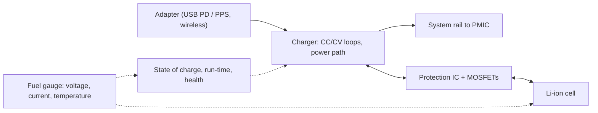
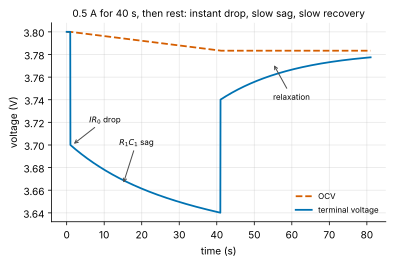
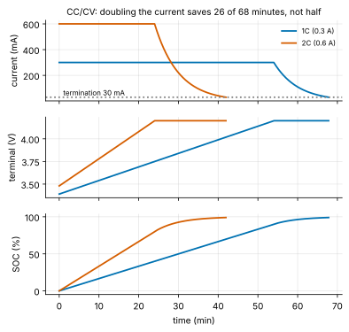

<!-- status: reviewed -->
# 22-09 · Batteries, Charging and Fuel Gauging

| | |
|---|---|
| **Course** | [22 · Power Electronics and Energy Conversion](../README.md) |
| **University equivalent** | The battery-systems unit of a senior power-electronics or energy-storage elective: lithium-ion cell fundamentals, equivalent-circuit modeling, CC/CV charging and charger architectures, state-of-charge estimation and aging (Plett, *Battery Management Systems* vols. I–II; *Linden's Handbook of Batteries* for chemistry) |
| **Prerequisites** | [22-08](22-08-pmics.md) (PMICs, usage profiles), [22-02](22-02-buck-converter-steady-state.md) (the buck), [07-02](../../07-circuit-analysis-2-transient-and-ac/chapters/07-02-first-order-rc-rl-transients.md) (first-order step response), [04-05](../../04-physics-for-ee/chapters/04-05-current-resistance-and-conduction.md) (current and conduction), [18-09](../../18-embedded-systems-and-microcontrollers/chapters/18-09-ultra-low-power-design.md) (battery life) |
| **Estimated study hours** | 8 |
| **Last verified** | 2026-11-25 |

**Learning objectives.** After this chapter you can:

1. Derive a cell's voltage from its reaction's Gibbs energy and its theoretical capacity from Faraday's law, and compute capacity, energy, C-rate and specific energy.
2. Model a cell with an open-circuit-voltage source, a series resistance and an RC branch, and predict its voltage under pulsed load and its usable capacity at a cutoff voltage and temperature.
3. Derive the CC/CV charge profile, including the exponential current taper and the charge time, and compare linear, switching and direct chargers.
4. Estimate state of charge by voltage and by coulomb counting, and budget the errors of each, including capacity learning.
5. Engineer a wearable's battery life with aging and temperature derating, and explain the mechanisms and stress factors of aging.

## 1. Big picture

Every portable product is a bargain struck with its battery. The battery sets the product's size and weight, the converter design inherits its voltage range, the charger decides how fast the user gets back to work, and the fuel gauge decides whether the "12% left" on the screen is honest. A lithium-ion cell is not an ideal voltage source with a fuel tank: its voltage depends on how full it is, it sags under load through an internal resistance that rises in the cold and with age, it must be charged under tight voltage and temperature rules, and it slowly loses capacity whether it is used or not. This chapter models the cell as an engineer must, derives how it charges and how its charge is measured, and turns those models into battery-life numbers for wearables.

- **Phones and laptops:** fast charging over USB Power Delivery, switched-capacitor chargers inside the phone, and gauges that throttle performance when an aged cell cannot deliver peak power.
- **Wearables and hearables:** cells of tens of milliampere-hours, where the gauge's own microamps and a cold morning both show up in battery life.
- **IoT nodes:** years-long lives in which calendar aging and self-discharge rival the load.
- **Electric vehicles and grid storage:** the same cell physics at a million times the energy, with pack-level management (BMS) that this chapter's single-cell models underpin.
- **Datacenters:** battery backup units in racks, and capacitor or battery energy storage that smooths AI training loads (22-10).

## 2. Intuition first

**A cell is a water tank whose outlet pipe has friction.** The water level is the open-circuit voltage: it falls as the tank empties, and the shape of the tank (the chemistry) sets how steeply. Drawing water quickly loses pressure in the pipe, the internal resistance, so the outlet pressure (terminal voltage) sits below the level; some of the loss recovers slowly after the flow stops, like a pipe that takes time to settle (the RC branch). The device switches off when the outlet pressure falls below a minimum (the cutoff voltage), which happens sooner at high flow or in the cold, when the pipe is stiffer, so "usable" water depends on how you draw it. Filling the tank, you may push hard at first (constant current), but near the top the pressure would overflow it, so you hold the pressure at the brim and let the flow taper (constant voltage).

The analogy breaks down in two places. A real tank does not wear out by being filled and emptied, but a cell loses capacity with every cycle and with time spent full and warm. And no water tank catches fire when overfilled; a lithium-ion cell can, which is why its charger, gauge and protection circuit are safety equipment as much as convenience.

## 3. Theory

### 3.1 Inside a lithium-ion cell

A lithium-ion cell stores lithium in two host materials: a graphite (or graphite-silicon) negative electrode and a transition-metal-oxide or phosphate positive electrode. On discharge, lithium leaves the graphite as a positive ion, crosses the electrolyte and inserts into the positive electrode, while the electron it left behind flows through the external circuit. Charging forces both back. Neither electrode is consumed; lithium is shuttled between them, which is why the cell is rechargeable.

**Where the voltage comes from.** Moving one mole of lithium from the negative to the positive electrode releases a Gibbs free energy $-\Delta G$ (J/mol), because lithium is more stable in the oxide. If that move pushes $n$ moles of electrons (charge $nF$, with Faraday's constant $F$ = 96 485 C/mol) through the external circuit against a voltage $E$, the electrical work $nFE$ equals the energy released:

$$
E = -\frac{\Delta G}{nF}.
$$

Units: (J/mol)/(C/mol) = J/C = V. ✓ For one electron per lithium ($n$ = 1), a 3.7 V cell corresponds to **357** kJ/mol, a strong chemical preference. As the positive electrode fills with lithium, adding more becomes less favorable, so $-\Delta G$ and the voltage fall: the **open-circuit voltage (OCV)** is a function of the **state of charge (SOC)** $z$, the fraction of the usable lithium inventory sitting in the negative electrode ($z$ = 1 full, $z$ = 0 empty). The chemistry fixes the shape: cobalt- and nickel-rich cells run from about 3.0 V empty to 4.2 V full, with a sloping curve, while lithium iron phosphate (LFP) sits near 3.2–3.3 V over most of its range [1], a flat curve that is pleasant for converters and miserable for voltage-based fuel gauges (§3.6).

**Where the capacity comes from.** Each lithium carries one electron's charge, so a mole of host material that accepts one lithium stores $F$ coulombs. Dividing by the molar mass $M$ (g/mol) and converting coulombs to milliampere-hours (1 mAh = 3.6 C) gives the theoretical specific capacity

$$
q_{th} = \frac{F}{3.6\,M}\ \text{mAh/g}.
$$

Graphite stores one lithium per six carbons; per gram of the C₆ host ($M$ = 72.07 g/mol) that is **372** mAh/g. By convention, anode capacities are quoted per gram of the delithiated host and cathode capacities per gram of the lithiated compound. Lithium cobalt oxide (LiCoO₂, $M$ = 97.87 g/mol) has a theoretical **274** mAh/g, but only part of its lithium can be removed before the structure degrades, which is one reason charge voltages are capped. Silicon alloys with far more lithium per gram, which is why silicon-anode cells promise more energy, at the price of large volume changes and shorter cycle life [1], [2].

**Ratings.** A cell's **capacity** $Q$ (A·h or mA·h) is the charge it delivers from full to empty at a stated current and temperature. Its energy is approximately $QV_{nom}$, where $V_{nom}$ is the average discharge voltage. Currents are quoted as a **C-rate**: 1C is the current that would empty the cell in one hour ($I = Q/1\ \text{h}$), so 0.5C takes two hours and 2C half an hour, ideally. **Specific energy** (Wh/kg) and energy density (Wh/L) compare chemistries and packages.

### 3.2 The equivalent-circuit model

A gauge or a system designer does not need the electrochemistry; they need a circuit that predicts the terminal voltage. The standard model has four parts:

- a voltage source $V_{OC}(z)$, the OCV at the present SOC;
- a series resistance $R_0$ (electrolyte, current collectors, contacts), which responds instantly;
- one or more parallel $R_1C_1$ branches, which capture the slower voltage loss from charge-transfer kinetics and lithium diffusion, with time constants of seconds to minutes;
- an SOC state that integrates the current.

With discharge current $i$ positive, the SOC falls as

$$
\frac{dz}{dt} = -\frac{i}{Q},
$$

with $Q$ in coulombs. The voltage across the RC branch, $v_1$, obeys $C_1\,dv_1/dt = i - v_1/R_1$, and the terminal voltage is

$$
v = V_{OC}(z) - iR_0 - v_1 .
$$

**Step response.** Starting at rest ($v_1$ = 0) and applying a constant current $I$ at $t$ = 0, the branch equation is a first-order ODE with the solution $v_1 = IR_1(1 - e^{-t/\tau_1})$, $\tau_1 = R_1C_1$ (07-02). If the SOC change during the step is small,

$$
v(t) = V_{OC} - IR_0 - IR_1\left(1 - e^{-t/\tau_1}\right).
$$

The terminal voltage drops by $IR_0$ instantly, then sags further by $IR_1$ over a few $\tau_1$. When the load is removed, the same two pieces recover in reverse: $IR_0$ at once, the rest over a few $\tau_1$, which is why a gauge must wait for the voltage to **relax** before reading it as OCV (§3.6). Over a long step, the SOC term adds a slow ramp: $V_{OC}$ falls by $(dV_{OC}/dz)\,It/Q$.

**Power limits.** The largest current a cell can supply without the terminal voltage falling below a cutoff $V_{cut}$ is

$$
I_{max} = \frac{V_{OC}(z) - V_{cut}}{R},
$$

with $R = R_0$ for a short pulse and $R_0 + R_1$ for a sustained one. The maximum-power-transfer current $V_{OC}/(2R)$ ([06-09](../../06-circuit-analysis-1-dc/chapters/06-09-maximum-power-transfer.md)) is far beyond it, and would waste half the energy as heat. The efficiency of discharge is $v/V_{OC}$, typically well above 90% at moderate rates.

The model's limits: $R_0$, $R_1$ and $C_1$ depend on SOC, temperature, current direction and age; diffusion is not a single exponential (two or three RC branches fit better); and the OCV on charge sits slightly above that on discharge (hysteresis), strongly so for LFP. Gauges carry tables of parameters against SOC and temperature for exactly this reason.

### 3.3 Usable capacity: cutoff, rate and temperature

The device switches off when the terminal voltage reaches $V_{cut}$, not when the cell is chemically empty. At a steady current $I$, that happens at the SOC $z_{end}$ where

$$
V_{OC}(z_{end}) = V_{cut} + IR .
$$

The usable fraction of capacity is $1 - z_{end}$, and the charge left behind is stranded until the load falls. Three consequences follow.

- **Rate matters.** A higher current raises $IR$, so the cutoff arrives at a higher SOC: a cell "runs out" sooner under heavy load and recovers some capacity at rest.
- **Cold matters twice.** Electrolyte conductivity and reaction kinetics slow in the cold, so $R$ rises steeply. That alone moves $z_{end}$ up (Example 22-09.3), and the capacity available even at low current also falls.
- **The curve's slope matters.** With a steep OCV curve, a given $IR$ costs little SOC; with a flat one, a small $IR$ near empty strands a lot of charge.

The energy delivered to the load is $\int v\,dq$, smaller than the energy drawn from the chemistry, $\int V_{OC}\,dq$, by the $I^2R$ heat. Low temperature therefore costs twice in energy: less charge reaches the cutoff, and more of it is lost inside.

### 3.4 Charging: constant current, then constant voltage

Two limits shape every lithium-ion charge.

- **A maximum cell voltage**, typically 4.2 V for cobalt- and nickel-based cells (some are rated a little higher) and about 3.65 V for LFP [1]. Above it the positive electrode becomes unstable and the electrolyte oxidizes, which ages the cell quickly and, far enough above, can start thermal runaway.
- **A maximum current, lower in the cold.** Lithium must enter the graphite faster than it can diffuse into it; push too hard, especially cold, and it plates as metal on the surface instead. In TI's summary of the Japanese JEITA guidelines, below a low-temperature threshold "the lithium ions could each gain one electron and become metallic lithium" [3]. Plated lithium is lost capacity at best and can grow into a short circuit at worst.

The **CC/CV** (constant-current, constant-voltage) profile respects both. The charger first drives a constant current $I_{cc}$. The terminal voltage $V_{OC}(z) + I_{cc}R$ climbs as the cell fills, until it reaches the charge voltage $V_{max}$ at

$$
V_{OC}(z_{cv}) = V_{max} - I_{cc}R .
$$

The charger then holds the terminal at $V_{max}$, and the current falls as the OCV rises toward it. Here $i$ is the charging current (positive into the cell, the opposite sign from §3.2), and the RC branch is taken as settled ($\tau_1 \ll RC_{eff}$), so $R = R_0 + R_1$:

$$
i = \frac{V_{max} - V_{OC}(z)}{R}.
$$

**Deriving the taper.** Near the top of charge, approximate the OCV curve as locally straight, with slope $k$ = $dV_{OC}/dq$ in volts per coulomb, and define the cell's incremental capacitance $C_{eff} = 1/k$ (farads: the charge that raises the OCV by one volt). Charging current raises the OCV at $dV_{OC}/dt = k\,i$. Differentiating $i$ and substituting,

$$
\frac{di}{dt} = -\frac{1}{R}\frac{dV_{OC}}{dt} = -\frac{k}{R}\,i \quad\Rightarrow\quad i(t) = I_{cc}\,e^{-t/(RC_{eff})} .
$$

Units: $RC_{eff}$ is Ω × F = s. ✓ The CV phase is the RC charging of a huge capacitor (often a thousand farads or more) through the cell's resistance. Charging ends when the current falls to a termination current $I_{term}$, after

$$
t_{cv} = RC_{eff}\ln\frac{I_{cc}}{I_{term}},
$$

having added the charge $(I_{cc} - I_{term})RC_{eff}$. Chargers and cell makers choose $I_{term}$ differently: TI's linear chargers default to 10% of the fast-charge current [14], [15], while cell data sheets rate capacity with a cut-off near 1–2% of 1C (50 mA, or **0.012**C, for a 4200 mAh cylindrical cell; 0.02C for a wearable coin cell) [11], [12]. A 900 mAh prismatic cell's data sheet recommends charging at 450 mA to 4.2 V and holding until the current falls to 90 mA, a C/10 termination [22]. The charger trades the last percent or two for a shorter CV tail. Three lessons fall out.

- **The CV phase is not optional.** Stopping at the end of CC leaves the cell short by $I_{cc}R$ worth of OCV, which at 1C is several percent of capacity.
- **Doubling the current does not halve the time.** A larger $I_{cc}$ reaches $V_{max}$ earlier, at a lower SOC, and leaves more for the CV phase, whose time constant does not change (Example 22-09.4). This is why "0–50% in 15 minutes" is advertised more than "0–100%".
- **Resistance sets the CV time.** An aged or cold cell, with a higher $R$, spends longer in CV.

Real chargers add three more phases. A **precharge** at 10–20% of the fast-charge current revives a deeply discharged cell, below a threshold of about 2.5–3.0 V, before full current is allowed [14], [15]. A **safety timer** stops a charge that takes too long: the BQ2407x's default fast-charge timer is 18 000 s, **5** hours [14]. And **temperature windows** reduce the current when cold and the voltage when warm: the JEITA guidelines' warm band caps the charge voltage at 4.10 V instead of 4.2 V [3], and one wearable charger implements this as "½ fast-charge-current at cold, 4.06 V at hot" [15].

### 3.5 Charger architectures

A charger is a regulator with several limits at once: charge current, charge voltage, input current (the adapter's rating), and die temperature. Its control loop selects whichever limit binds, the multi-loop version of 22-07.

- **Linear charger.** A pass transistor drops the difference between the input $V_{in}$ and the battery $V_{bat}$ while carrying the charge current, so it dissipates $(V_{in} - V_{bat})I$ and its efficiency is $V_{bat}/V_{in}$ (22-01). It is small, quiet and cheap, and ideal for wearables charging at tens of milliamps. At an ampere from 5 V it becomes a heater, so linear chargers include **thermal regulation**: they reduce the current to hold the die at a limit, 125 °C for TI's BQ2407x and BQ2405x [14], [15], and slow their safety timers while they do (Example 22-09.5).
- **Switching charger.** A buck (22-02) between the input and the battery converts at about 90% efficiency regardless of the voltage difference, at the cost of an inductor and switching noise. Most phones and laptops use one.
- **Power path.** The charger feeds the system rail first and the battery with what remains, so a device with a dead battery can boot as soon as it is plugged in, and the charge termination is not confused by the system's load current.
- **Direct charging.** For the fastest phone charging, the adapter itself regulates the current. USB Power Delivery's Programmable Power Supply (PPS) mode lets the phone request an adapter voltage in 20 mV steps [4]. The phone then needs only a switched-capacitor divider, which halves the voltage and doubles the current with no inductor. TI's BQ25960 states the principle directly, "Input voltage is 2x battery voltage – Output current is 2x of input current", and claims "98.1% peak efficiency" at up to 8 A of charge current, so the cable carries only **4.0** A [16]. The adapter now does the conversion, and its heat leaves the phone. When the cell reaches its CV point, the phone's ordinary charger takes over again [16]: direct charging accelerates the CC phase only.
- **Wireless charging.** A magnetically coupled transmitter and receiver coil pair (a loosely coupled transformer, 22-04) delivers power across a gap, with extra loss in the coils and in any metal nearby. The Qi2 25W standard, announced in July 2025, raised Qi2's power from 15 W to 25 W [5].

### 3.6 Fuel gauging

A **fuel gauge** estimates SOC, remaining run time and **state of health** (SOH, present capacity relative to new) from measurements of voltage, current and temperature. There are three approaches, and practical gauges combine them.

**Voltage-based.** Look up the SOC from the measured voltage in an OCV table. At rest this is accurate where the OCV curve is steep. Under load the voltage is $V_{OC} - iR$, so treating it as OCV makes the SOC appear too low by $iR/(dV_{OC}/dz)$. A gauge can add $iR$ back ("IR correction"), but $R$ varies with temperature, SOC and age. On a flat curve, millivolts of error become tens of percent of SOC.

**Coulomb counting.** Integrate the current through a sense resistor:

$$
z(t) = z_0 - \frac{1}{Q}\int_0^t i\,d\tau .
$$

This needs no voltage model, but its errors grow with time. A current-measurement offset $I_{os}$ accumulates $I_{os}t$ of charge error whatever the load; a gain error $\epsilon$ adds $\epsilon$ times the charge counted; and the estimate is only as good as the capacity $Q$, which falls with age and temperature. Without correction, a counter drifts.

**Combined (model-based) gauging.** Count coulombs while the cell is in use, and re-anchor the SOC to the OCV table whenever the cell has rested long enough for $v_1$ to decay. TI's Impedance Track gauges take OCV readings "after a 30-minute relaxation period" and consider the cell relaxed when "dV/dt < 4 µV/s" [6]. Two such readings bracket a known charge, which **learns the capacity**:

$$
Q_{max} = \frac{\Delta q}{z_1 - z_2},
$$

the form TI writes as "Qmax = PassedCharge / (DOD2– DOD1)" [6]. The error in $Q_{max}$ is the error in $z_1 - z_2$ divided by $z_1 - z_2$, so learning needs a large swing between rests (Example 22-09.6). The same gauges also learn the cell's resistance, which lets them predict when the voltage *under the expected load* will reach the cutoff (§3.3), the remaining *usable* capacity rather than the chemical one.

How much this matters is shown by TI's own comparison on two test profiles [Industry estimate: vendor test]: peak SOC errors of about 20% for voltage correlation, 11% with IR correction, 6% for coulomb counting without capacity learning, and about 1% for the combined Impedance Track method [7].

### 3.7 Aging and safety

A cell loses capacity and gains resistance from the day it is made. Two clocks run at once.

- **Calendar aging** proceeds with time, faster at high SOC (high voltage) and high temperature. A main mechanism is the growth of the solid-electrolyte interphase (SEI), a passivating film on the graphite that consumes lithium as it thickens.
- **Cycle aging** proceeds with charge throughput, faster with deep cycles, high charge rates, high charge voltage and low-temperature charging (plating), and from the mechanical stress of electrodes swelling and shrinking (severe for silicon).

**Why calendar fade slows: the square-root law.** If the SEI grows only as fast as the species that feed it can diffuse through the film already there, its growth rate is inversely proportional to its thickness $L$: $dL/dt = D'/L$, with $D'$ a diffusion constant (m²/s). Separating variables, $L\,dL = D'\,dt$, so $L^2 = 2D't$ and

$$
L(t) = \sqrt{2D't}.
$$

The lithium consumed is proportional to $L$, so the capacity lost grows as $\sqrt t$: a cell loses as much in its first year as in the next three. The rate constant follows an Arrhenius law, $D' \propto e^{-E_a/(k_BT)}$, which is why heat ages cells and why storing them cool and partly charged extends their life. Real cells eventually leave the square-root regime, sometimes with a "knee" of accelerating fade late in life.

Measured storage data bear this out and add a surprise. Keil et al. stored three chemistries at 16 states of charge and three temperatures for about ten months: capacity fade rose with temperature and with SOC, but "calendar aging does not increase steadily with the SoC", showing plateaus tied to the graphite's lithiation stages, and they recommend that "for long-term storage, the graphite anode should be lithiated less than 50%" [17]. Cell makers say the same in their handling notes, for example storage at (30 ± 15)% SOC [21].

**Cycle life** is quoted as the number of full equivalent cycles (EFC) to a capacity threshold, usually 80% of rated. It depends strongly on chemistry and conditions: Preger et al. cycled commercial 18650 cells to 80% capacity and found "2500 to 9000 EFC" for LFP against "250 to 1500 EFC for NCA cells and 200 to 2500 EFC for NMC cells", with full 0–100% cycling costing the nickel cells 5–10% more capacity than partial windows [18]. Apple, for example, states that iPhone 15 batteries "are designed to retain 80 percent of their original capacity at 1000 complete charge cycles under ideal conditions", against 500 for iPhone 14 and earlier [8].

**Safety.** A lithium-ion cell stores its energy next to a flammable electrolyte. Overcharge, overheating, crushing or an internal short can drive **thermal runaway**, in which heat-releasing reactions raise the temperature, which speeds the reactions. Every pack therefore has a **protection circuit**: a protection IC that watches cell voltage, current and temperature and opens a pair of back-to-back MOSFETs on overvoltage, undervoltage, overcurrent or short circuit, independent of the charger and gauge. Portable cells and batteries are certified to IEC 62133-2, which "specifies requirements and tests for the safe operation of portable sealed secondary lithium cells and batteries … under intended use and reasonably foreseeable misuse" [9].

### 3.8 Wearable battery-life engineering

A wearable's battery life is the usable charge divided by the average current:

$$
T_{life} = \frac{Q_{rated}\,f_{age}\,f_{temp}\,f_{cut}}{I_{avg}},
$$

where the derating factors account for capacity lost to aging, to cold, and to the cutoff under load (§3.3), and $I_{avg}$ is the time-weighted average of the usage profile (22-08 §3.4), including the converters' losses, the PMIC's quiescent current and the gauge's own draw. Four habits distinguish good battery-life engineering.

- **Budget in microamps.** With a 20 mAh cell and a week of life, the average budget is about **119** µA, so a 10 µA gauge or a leaky sensor costs most of a day.
- **Derate honestly.** Quote life for an aged cell at the coldest realistic temperature, not a new cell at 25 °C, or customers will discover the difference in the second winter.
- **Watch the peaks.** A radio burst or a haptic motor draws milliamps to hundreds of milliamps; through a small cell's resistance that can dip the voltage below a converter's undervoltage lockout long before the cell is empty. A bulk capacitor supplies the peak and the cell refills it slowly.
- **Count cycles.** A device charged every few days accumulates under a hundred cycles a year, so calendar aging, not cycle count, usually sets its battery's lifetime.

## 4. Worked examples

The examples use one teaching cell, a 300 mAh wearable-class lithium-ion cell (the fitness band's of Example 22-08.3) with assumed, round parameters: nominal 3.85 V; OCV modeled as the straight line $V_{OC} = 3.30 + 0.90z$ volts between empty ($z$ = 0) and full ($z$ = 1); $R_0$ = 0.20 Ω, $R_1$ = 0.10 Ω, $C_1$ = 200 F at 25 °C. A real OCV curve is S-shaped, so the straight line is a teaching simplification; the lab repeats the calculations with a curved OCV.

### Example 22-09.1 · Capacity, energy and C-rate (tier A)

**Setup.** For the teaching cell, which weighs 6.5 g (assumed), find (a) its energy in watt-hours and (b) in joules, (c) the 1C current, (d) the ideal discharge time at 2C, and (e) its specific energy. (f) What mass of graphite, at its theoretical capacity, holds 300 mAh?

**Solution.**

- (a) $0.300\ \text{Ah} \times 3.85\ \text{V}$ = **1.155** Wh; (b) $\times\,3600$ = **4158** J.
- (c) $300\ \text{mAh}/1\ \text{h}$ = **300** mA; (d) $60/2$ = **30** min.
- (e) $1.155\ \text{Wh}/0.0065\ \text{kg}$ = **178** Wh/kg.
- (f) $300\ \text{mAh}/(371.9\ \text{mAh/g})$ = **0.807** g.

**Units check.** A·h × V = W·h; 1 W·h = 3600 J. ✓

**Sanity check.** 178 Wh/kg sits within the 150–220 Wh/kg range quoted for cobalt- and nickel-based cells [1]. The graphite is under a gram of a 6.5 g cell; the rest is the positive electrode, which stores less per gram, plus current collectors, separator, electrolyte and the can.

### Example 22-09.2 · A load pulse on the equivalent circuit (tier B)

**Setup.** The teaching cell rests at the SOC where its OCV is 3.80 V. A 0.5 A load is applied. Find (a) the terminal voltage at the first instant and (b) after 20 s, ignoring the SOC change; (c) how much the OCV falls in those 20 s, and (d) the terminal voltage at 20 s including that fall. (e) What is the largest short pulse the cell can supply above a 3.40 V cutoff?

**Solution.**

- (a) $3.80 - 0.5 \times 0.20$ = **3.700** V.
- (b) $\tau_1 = R_1C_1$ = 20 s, so $v = 3.80 - 0.5[0.20 + 0.10(1 - e^{-1})]$ = **3.668** V.
- (c) The charge drawn is $0.5 \times 20$ = 10 C of $Q$ = 1080 C, and $dV_{OC}/dz$ = 0.90 V, so the OCV falls by $0.90 \times 10/1080$ = **8.33** mV.
- (d) $3.668 - 0.008$ = **3.660** V (computed unrounded: 3.66006 V).
- (e) $(3.80 - 3.40)/0.20$ = **2.0** A.

**Units check.** A × Ω = V; C/C × V = V. ✓

**Sanity check.** The instant drop (100 mV) is larger than the slow one (32 mV at one time constant, 50 mV eventually); the SOC drift is a further 8 mV in 20 s at this high 1.7C rate. A sustained 2 A load would fail sooner than a 2 A pulse, because $R_1$ adds its drop after a few seconds: the sustained limit is $0.40/0.30$ = 1.33 A.

### Example 22-09.3 · Usable capacity on a cold day (tier B)

**Setup.** The teaching cell is discharged at 300 mA (1C) to a 3.30 V cutoff. At 25 °C its total resistance is $R$ = 0.30 Ω; at −10 °C it is 1.20 Ω (assumed). Treat the voltage as $V_{OC}(z) - IR$ (the RC branch has settled). Ignoring the capacity loss from cold itself, find at each temperature (a, b) the usable fraction of capacity and (c, d) the energy delivered. (e) What fraction of the 25 °C energy is available at −10 °C?

**Solution.** The cutoff is reached where $3.30 + 0.90z_{end} = 3.30 + IR$, so $z_{end} = IR/0.90$. The delivered energy is the charge times the average terminal voltage, $Q(1 - z_{end})\,[\bar V_{OC} - IR]$, where $\bar V_{OC}$ is the OCV averaged over $z_{end} \ldots 1$.

- (a) At 25 °C, $z_{end} = 0.09/0.90$ = 0.10: **90** % usable.
- (b) At −10 °C, $z_{end} = 0.36/0.90$ = 0.40: **60** % usable.
- (c) $\bar V_{OC} = 3.30 + 0.90 \times 0.55$ = 3.795 V, so $0.270\ \text{Ah} \times (3.795 - 0.09)$ = **1.000** Wh.
- (d) $\bar V_{OC} = 3.30 + 0.90 \times 0.70$ = 3.93 V, so $0.180\ \text{Ah} \times (3.93 - 0.36)$ = **0.643** Wh.
- (e) **64.2** %.

**Units check.** A × Ω / (V per unit SOC) is dimensionless. ✓

**Sanity check.** Quadrupling the resistance quadruples the stranded charge and also raises the internal loss, so a third of the energy is gone before any loss of chemical capacity. The cell recovers at room temperature: the charge was stranded, not destroyed.

### Example 22-09.4 · CC/CV charge time (tier B)

**Setup.** The teaching cell is charged from empty to 4.20 V with termination at 30 mA. Use $R$ = 0.30 Ω (quasi-static: the CV current changes slowly compared with $\tau_1$). At $I_{cc}$ = 300 mA (1C), find (a) the SOC at the end of CC, (b) the CC time, (c) the CV time constant, (d) the CV time, (e) the SOC at termination and (f) the total time. At 600 mA (2C), find (g) the SOC at the end of CC, (h) the CV time and (i) the total time.

**Solution.**

- (a) $3.30 + 0.90z_{cv} = 4.20 - 0.3 \times 0.30$, so $z_{cv}$ = **0.900**.
- (b) $0.900 \times 1080\ \text{C}/0.300\ \text{A}$ = 3240 s = **54.0** min.
- (c) $C_{eff} = Q/(0.90\ \text{V})$ = 1080/0.90 = 1200 F, so $RC_{eff}$ = 0.30 × 1200 = **360** s.
- (d) $360\ln(300/30)$ = 829 s = **13.8** min.
- (e) The CV phase adds $(0.300 - 0.030) \times 360$ = 97.2 C = 0.090 of capacity: $z$ = **0.990**.
- (f) **67.8** min.
- (g) $z_{cv} = (4.20 - 0.18 - 3.30)/0.90$ = **0.800**, reached in 0.8 × 1080/0.6 = 1440 s = 24.0 min.
- (h) $360\ln(600/30)$ = 1078 s = **18.0** min; (i) **42.0** min.

**Units check.** Ω × F = s; A × s = C. ✓

**Sanity check.** Doubling the current cut the total from 68 to 42 minutes, not to 34: the CC phase halved and ended at 80% instead of 90%, and the CV phase grew. Termination at 30 mA leaves the cell 1% short of the CV limit's full charge, the usual trade between charge time and the last percent.

### Example 22-09.5 · Linear against switching charger (tier B)

**Setup.** A charger draws from a 5.0 V USB input and charges a phone-class cell at 1.0 A. Its thermal resistance to ambient is 40 °C/W (assumed). For a linear charger with the battery at (a, b, c) 3.7 V and (d, e) 3.0 V, find the dissipation, the efficiency at 3.7 V, and the temperature rise. (f) A buck charger at 92% efficiency charges the 3.7 V battery at 1.0 A: find its loss and (g) its temperature rise. (h) If the linear charger's die may rise only 40 °C, what current can it deliver to a 3.0 V battery?

**Solution.**

- (a) $(5.0 - 3.7) \times 1.0$ = **1.30** W; (b) $3.7/5.0$ = **74.0** %; (c) $1.30 \times 40$ = **52** °C.
- (d) $(5.0 - 3.0) \times 1.0$ = **2.00** W; (e) **80** °C.
- (f) $3.7/0.92 - 3.7$ = **0.322** W; (g) **12.9** °C.
- (h) $40/40$ = 1.0 W allowed, so $1.0/2.0$ = **0.50** A.

**Units check.** V × A = W; W × °C/W = °C. ✓

**Sanity check.** A linear charger is worst when the battery is emptiest, at the very start of charging; thermal regulation then halves its current. A buck's loss barely depends on the battery voltage, which is why ampere-level chargers switch.

### Example 22-09.6 · Coulomb-counting errors and capacity learning (tier C)

**Setup.** A gauge counts the teaching cell's current. (a) A 10 µA offset persists for 7 days: what charge error accumulates, and (b) what is it as a share of 300 mAh? (c) A 1% gain error applies to a 270 mAh discharge: what is the error, and (d) its share? (e) After two rests the gauge reads $z_1$ = 0.90 and $z_2$ = 0.35 from the OCV table, with 160 mAh counted between them. What capacity does it learn, and (f) what is that as a fraction of rated? (g) If each OCV reading may be off by ±0.01 in SOC, what is the worst-case relative error of the learned capacity?

**Solution.**

- (a) $10\ \mu\text{A} \times 168\ \text{h}$ = **1.68** mAh; (b) **0.56** %.
- (c) $0.01 \times 270$ = **2.7** mAh; (d) **0.90** %.
- (e) $160/(0.90 - 0.35)$ = **291** mAh; (f) **97.0** %.
- (g) The swing lies between 0.53 and 0.57, giving 280.7 to 301.9 mAh about 290.9 mAh: a worst case of **+3.8** % (and −3.5 %), against ±3.6 % to first order (0.02/0.55).

**Units check.** A × h = A·h; mAh divided by a dimensionless SOC difference is mAh. ✓

**Sanity check.** A ±0.01 SOC error, small for one reading, becomes ±3.6% in capacity because it is divided by a 0.55 swing; a 0.2 swing would make it ±10%. That is why gauges learn capacity only after deep discharges and why a device that is always topped up has a gauge that drifts.

### Example 22-09.7 · A smart ring's battery life (tier C)

**Setup.** Samsung states that its larger Galaxy Ring sizes have "a higher battery capacity (22.5 mAh) and last up to 7 days" [10]. (a) What average current does that imply? (b) A gauge IC drawing 11 µA is added: what share of the budget is it? (c) With an aged cell at 80% of rated capacity, used on a cold day that strands another 10%, how many days does the ring last at the same average current?

**Solution.**

- (a) $22.5\ \text{mAh}/168\ \text{h}$ = **134** µA.
- (b) $11/133.9$ = **8.2** %.
- (c) $22.5 \times 0.80 \times 0.90$ = 16.2 mAh, and $16.2/0.1339$ = 121 h = **5.0** days.

**Units check.** mAh/h = mA. ✓

**Sanity check.** A 134 µA budget covers the sensors, the radio, the processor, the converters' losses and the gauge, so a single 11 µA part is a real line item. The same ring loses two of its seven days to an aged cell on a cold day, which is why honest battery-life claims state the test conditions.

<!-- answer-key -->

| ID | Quantity | Value | Unit |
|---|---|---|---|
| Ex 22-09.1a | energy | 1.155 | Wh |
| Ex 22-09.1b | energy | 4158 | J |
| Ex 22-09.1c | 1C current | 300 | mA |
| Ex 22-09.1d | discharge time at 2C | 30 | min |
| Ex 22-09.1e | specific energy | 178 | Wh/kg |
| Ex 22-09.1f | graphite mass | 0.807 | g |
| Ex 22-09.2a | terminal voltage at the first instant | 3.700 | V |
| Ex 22-09.2b | terminal voltage after 20 s | 3.668 | V |
| Ex 22-09.2c | OCV fall in 20 s | 8.33 | mV |
| Ex 22-09.2d | terminal voltage at 20 s with the OCV fall | 3.660 | V |
| Ex 22-09.2e | largest short pulse above 3.40 V | 2.0 | A |
| Ex 22-09.3a | usable fraction at 25 °C | 90 | % |
| Ex 22-09.3b | usable fraction at −10 °C | 60 | % |
| Ex 22-09.3c | energy at 25 °C | 1.000 | Wh |
| Ex 22-09.3d | energy at −10 °C | 0.643 | Wh |
| Ex 22-09.3e | energy ratio | 64.2 | % |
| Ex 22-09.4a | SOC at the end of CC (1C) | 0.900 | |
| Ex 22-09.4b | CC time (1C) | 54.0 | min |
| Ex 22-09.4c | CV time constant | 360 | s |
| Ex 22-09.4d | CV time (1C) | 13.8 | min |
| Ex 22-09.4e | SOC at termination | 0.990 | |
| Ex 22-09.4f | total charge time (1C) | 67.8 | min |
| Ex 22-09.4g | SOC at the end of CC (2C) | 0.800 | |
| Ex 22-09.4h | CV time (2C) | 18.0 | min |
| Ex 22-09.4i | total charge time (2C) | 42.0 | min |
| Ex 22-09.5a | linear dissipation at 3.7 V | 1.30 | W |
| Ex 22-09.5b | linear efficiency at 3.7 V | 74.0 | % |
| Ex 22-09.5c | temperature rise at 3.7 V | 52 | °C |
| Ex 22-09.5d | linear dissipation at 3.0 V | 2.00 | W |
| Ex 22-09.5e | temperature rise at 3.0 V | 80 | °C |
| Ex 22-09.5f | buck charger loss | 0.322 | W |
| Ex 22-09.5g | buck charger temperature rise | 12.9 | °C |
| Ex 22-09.5h | thermally limited linear current at 3.0 V | 0.50 | A |
| Ex 22-09.6a | offset charge error | 1.68 | mAh |
| Ex 22-09.6b | offset error share | 0.56 | % |
| Ex 22-09.6c | gain charge error | 2.7 | mAh |
| Ex 22-09.6d | gain error share | 0.90 | % |
| Ex 22-09.6e | learned capacity | 291 | mAh |
| Ex 22-09.6f | learned capacity over rated | 97.0 | % |
| Ex 22-09.6g | worst-case capacity error | 3.8 | % |
| Ex 22-09.7a | average current | 134 | µA |
| Ex 22-09.7b | gauge share of the budget | 8.2 | % |
| Ex 22-09.7c | derated battery life | 5.0 | days |
| Txt 22-09.a | Gibbs energy of a 3.7 V cell | 357 | kJ/mol |
| Txt 22-09.b | graphite theoretical capacity | 372 | mAh/g |
| Txt 22-09.c | LiCoO₂ theoretical capacity | 274 | mAh/g |
| Txt 22-09.d | sustained current limit in Example 22-09.2 | 1.33 | A |
| Txt 22-09.e | data-sheet termination of a 4200 mAh cell (50 mA) | 0.012 | C |
| Txt 22-09.f | BQ2407x default fast-charge timer | 5 | h |
| Txt 22-09.g | cable current of a 2:1 charger at 8 A | 4.0 | A |
| Txt 22-09.h | Molicel P42A DC resistance × capacity | 0.067 | Ω·Ah |
| Txt 22-09.i | teaching cell R0 + R1 × capacity | 0.090 | Ω·Ah |
| Txt 22-09.j | VARTA CP 1254 1 kHz impedance bound × capacity | 0.025 | Ω·Ah |
| Txt 22-09.k | capacity lost by charging to 4.1 V instead of 4.2 V (Saft MP 176065) | 10.3 | % |
| Txt 22-09.l | average current budget, 20 mAh for a week | 119 | µA |

## 5. Simulate it

The lab is [labs/22-09-lab/](../labs/22-09-lab/README.md). `battery.py` collects the chapter's models: Faraday and Gibbs relations, the equivalent circuit with its step response and a general simulator, usable capacity, closed-form and time-stepped CC/CV charging (with and without the RC branch, and with any OCV curve), charger losses, gauge errors, the square-root aging law and battery life. Two ngspice netlists build the teaching cell from circuit elements:

- `pulse.cir` represents the SOC as the voltage on a 1080 F capacitor that the cell current discharges, turns it into the OCV with a behavioral source, and applies a 0.5 A, 40 s pulse followed by a 40 s rest.
- `cccv.cir` charges two copies of the cell, at 1C and at 2C, from a charger that supplies $\min(I_{cc}, (4.20 - V_{OC})/R)$.

**Predict, then run:**

1. *Predict* the terminal voltage at the first instant and after 20 s of Example 22-09.2's pulse, and how far below the OCV the cell still sits 40 s after the pulse ends. Run `ngspice -b pulse.cir`.
2. *Predict* the 1C and 2C charge times (Example 22-09.4), then run `ngspice -b cccv.cir` and plot the current, voltage and SOC.
3. In the notebook, include the RC branch in the charge, then replace the straight-line OCV by an S-shaped one. Which simplification changes the answer more, and why?
4. Repeat Example 22-09.3's cold-day calculation with the S-shaped OCV. Does the penalty grow or shrink?
5. Plot a coulomb counter's drift and a voltage gauge's error under pulsed load.

## 6. Engineering tradeoffs

| Knob | Improves | Costs | Typical decision owner |
|---|---|---|---|
| Higher charge voltage (above the common 4.2 V) | Energy per charge | Calendar and cycle life, swelling, safety margin | Cell supplier with the product's battery engineer |
| Faster charge current | Time to 50–80% | Heat, plating risk (especially cold), cycle life; the CV phase barely shortens | Product manager with the battery engineer |
| Silicon in the anode | Specific energy | Swelling and cycle life | Cell supplier |
| LFP instead of nickel-based chemistry | Cycle life, thermal safety, cost | Specific energy; a flat OCV that defeats voltage gauging | Pack architect |
| Linear charger | Size, cost, noise | Efficiency $V_{bat}/V_{in}$; heat at high current | Power architect |
| Switching or direct charger | Efficiency at amperes | Inductor or adapter protocol, EMI, complexity | Power architect |
| Gauge with cell model and capacity learning | SOC and run-time accuracy, aging awareness | Cell characterization, quiescent current, firmware | System architect |
| Larger cutoff margin or bulk capacitor | Survives peaks and cold without brownout | Stranded capacity, board area | Hardware lead |
| Stopping charge short of full | Calendar life | Run time per charge | Product and software teams |

## 7. Numbers to know

| Quantity | Typical value | Source |
|---|---|---|
| Cell voltage | $E = -\Delta G/(nF)$; 3.6–3.85 V nominal for cobalt- and nickel-based cells, about 3.2–3.3 V for LFP | §3.1, [1], [11] |
| Charge voltage | 4.20 V (± 0.05 V) typical; JEITA warm band ≤ 4.10 V | [3], [11], [12], [21] |
| Discharge cut-off | 2.5–3.0 V | [11], [12] |
| Specific energy (as of Nov 2026) | 230–260 Wh/kg for high-energy 21700 cells; 150–220 Wh/kg chemistry range | [1], [11], [27] |
| Internal resistance (as of Nov 2026) | 10 mΩ (1 kHz) and 16 mΩ (DC pulse) for a 4.2 Ah 21700; < 0.5 Ω (1 kHz) for a 50 mAh coin cell | [11], [12] |
| CV time constant | $RC_{eff}$, with $C_{eff} = Q/(dV_{OC}/dz)$ | §3.4 |
| Charger termination and precharge | about 10% of $I_{cc}$; precharge 10–20% of $I_{cc}$ below 2.5–3.0 V | [14], [15] |
| Linear-charger efficiency | $V_{bat}/V_{in}$ | §3.5 |
| 2:1 switched-capacitor charger (as of Nov 2026) | 98.1% peak at up to 8 A (vendor claim) | [16] |
| Gauge relaxation criterion | $dV/dt$ < 4 µV/s; about 30 min to hours | [6], [19] |
| Cycle life (as of Nov 2026) | 500–1500 full cycles to 80% for consumer nickel-based cells; 2500–9000 for LFP in lab tests | [8], [13], [18] |
| Self-discharge | about 1–2% per month, plus about 3% per month for a protection circuit [Industry estimate] | [25] |
| Calendar fade | $\propto \sqrt t$; faster at high SOC and temperature; store at 30–50% SOC | §3.7, [17], [21] |
| Cold | 71% of 25 °C capacity at −20 °C and 1C for one 18650 cell | [13] |

## 8. Common mistakes

- **Treating capacity as a fixed number.** Usable capacity depends on current, temperature, cutoff voltage and age (§3.3); a life estimate from the rated mAh alone is optimistic.
- **Reading voltage as state of charge under load.** The terminal sits $iR$ below the OCV, and recovers only over minutes; a gauge or a user reading it misjudges SOC (Example 22-09.2, Problem 22-09.9).
- **Expecting twice the current to halve the charge time.** The CV phase does not shrink, and a faster CC phase ends at a lower SOC (Example 22-09.4).
- **Charging when cold.** Below the cell's minimum charge temperature lithium plates; a charger must reduce or stop the current there (§3.4).
- **Ignoring the gauge's own consumption.** On a 22.5 mAh ring, an 11 µA gauge is 8% of the budget (Example 22-09.7).
- **Learning capacity from shallow cycles.** The SOC readings' error is divided by the swing; a device always kept above 70% will learn a wrong capacity (Example 22-09.6).
- **Confusing cycle life with lifetime.** Devices charged every few days are limited by calendar aging, which depends on time, temperature and state of charge (Problems 22-09.11 and 22-09.12).
- **Forgetting the protection circuit's drop and current.** Its MOSFETs add resistance to the cell's, and its own quiescent current drains a stored product.

## 9. Practitioner lens

*State of the art as of Nov 2026. Sources are logged as R-439 to R-443, with R-082 and R-098 for wireless and USB charging.*

**What real cells look like** [Established]. Molicel's INR-21700-P42A, a high-power cylindrical cell, is rated at 4200 mAh typical, 3.6 V nominal, 4.2 V charge and 2.5 V discharge cut-off, with a 4.2 A (1C) standard charge, 45 A continuous discharge, "AC (1 KHz) 10 mΩ" and "DC (10A/1s) 16 mΩ", and 230 Wh/kg [11]. At the other extreme, VARTA's CoinPower CP 1254 wearable cell holds 50 mAh in 1.6 g, charges CC/CV to 4.20 ± 0.05 V with a 0.02C cut-off, has an impedance of "<0,5 Ω @ 1kHz", lasts ">500" cycles to more than 80% of its initial capacity at 1C, and "must not be used without external safety electronics" [12]. Normalizing resistance by capacity puts them on one scale: **0.067** Ω·Ah for the P42A's DC value, at most **0.025** Ω·Ah for the coin cell's 1 kHz value, and **0.090** Ω·Ah for the chapter's teaching cell, so the examples' assumptions are realistic. A 1 kHz value captures only the fast, ohmic part ($R_0$); a DC pulse value includes part of the RC branch, which is why the P42A's DC figure is the larger.

**Charge voltage trades energy for life** [Established for data-sheet values; Industry estimate for the rule of thumb]. Saft's MP 176065 prismatic cell holds "6.8 Ah @ 4.2 V / 6.1 Ah @ 4.1 V", **10.3** % less at the lower voltage [21]. Panasonic advises reducing some cells' charge voltage from 4.2 V to 4.15 V as they age [13]. Battery University's rule that "every reduction in peak charge voltage of 0.10V/cell is said to double the cycle life" comes from a table its authors label "All values are estimated" [24]: a direction, not a design number.

**Cold, measured** [Established]. Panasonic's NCR18650BD delivers "2200mAh (1It@-20°C) • 71% vs Initial Capacity @25°C" [13]. TI's gauge documentation gives the same mechanism as §3.3: full-charge capacity "is lower at higher rates and low temperatures because the cell I*R drop causes the Terminate Voltage threshold to be reached earlier" [19].

**Gauges in practice** [Established for mechanisms; Industry estimate for accuracy].

- TI's comparison (§3.6) puts Impedance Track's peak SOC error near 1%, against 6% for plain coulomb counting, on two vendor-chosen profiles [7].
- The method has conditions. The gauge relaxes "approximately 1 hour if DOD is between 0 and 80%, and 3–4 hours if DOD is above 80%", longer when cold. It does not update capacity "if the temperature is above 40°C, or below 10°C", nor in a flat voltage range "between 3737 mV and 3800 mV" [19].
- A gauge costs current: TI's BQ27Z561 sleeps at "< 11µA" [23], the figure behind Example 22-09.7.

**Fast and wireless charging** [Established]. USB Power Delivery 3.1 raised the cable limit to 240 W [26]; its PPS mode adjusts the adapter in 20 mV steps [4]; 2:1 switched-capacitor chargers such as the BQ25960 halve the cable current [16]; Qi2 25W raised wireless charging from 15 W to 25 W [5].

**Consumer claims and their conditions** [Established as manufacturer statements]. Apple states that iPhone 15 batteries retain 80% at 1000 cycles "under ideal conditions" [8], and that it manages peak power on aged batteries: "If the battery health is able to support the observed peak power requirements, the amount of performance management will be lowered" [8], the §3.2 power limit in product form. Apple Watch Series 12's "up to 24 hours" assumes a stated day of "300 time checks, 90 notifications, 15 minutes of app use, a 60-minute workout [...] and 6 hours of sleep tracking" [20]. Samsung rates the larger Galaxy Ring at 22.5 mAh and up to 7 days [10].

**Marketing vs Reality.**

- *"Up to 7 days of battery life."* One usage profile, on a new cell, at room temperature. Example 22-09.7's aged cell on a cold day gives about 5.
- *"0 to 50% in 15 minutes."* The CC phase only; the CV tail does not get faster (Example 22-09.4), and direct chargers hand back to the ordinary charger at the CV point [16].
- *"98% efficient charging."* A peak at one operating point of the phone's charger; the adapter's own conversion loss is outside the number.
- *"1000 cycles."* "Under ideal conditions"; in laboratory tests nickel-based cells ranged from 200 to 2500 equivalent full cycles depending on chemistry, temperature and SOC window [18].
- *"1% gauge accuracy."* On the vendor's profiles, with learned capacity, which needs rests, moderate temperature and voltage outside the flat region [7], [19].

**Questions for engineering leaders.**

1. **"What is battery life on a two-year-old cell at 0 °C, and how did you derate it?"** *Strong:* aging and temperature factors from the cell maker's data and their own measurements. *Evasive:* "Up to seven days."
2. **"What charge voltage and termination do you use, and what cycle and calendar life does that buy?"** *Strong:* the cell maker's curves at that voltage, and a charge-limiting strategy for devices left on the charger. *Evasive:* "Standard 4.2 V."
3. **"How does your gauge learn capacity, and how wrong is it on a device that is never fully cycled?"** *Strong:* relaxation criteria, update conditions and field data on SOC error over the product's life. *Evasive:* "One percent accuracy."
4. **"Where does the heat go during fast charging, and what limits the current at 0 °C and 45 °C?"** *Strong:* a thermal budget for phone and adapter, the JEITA profile, and the handoff from direct to ordinary charging. *Evasive:* "The charger handles it."
5. **"What happens when an aged battery cannot supply peak current?"** *Strong:* peak-power management tied to measured cell resistance, and the brownout margin. *Evasive:* "That doesn't happen."
6. **"Which safety standard are the cells and pack certified to, and what does the protection circuit do?"** *Strong:* IEC 62133-2, with independent overvoltage, undervoltage and overcurrent protection and its thresholds. *Evasive:* "The cells are safe."

## 10. Concept check

**Q1.** Where does a lithium-ion cell's voltage come from, and why does it fall as the cell discharges?

Answer

From the Gibbs energy released when lithium moves from the graphite to the positive electrode, $E = -\Delta G/(nF)$. As the positive electrode fills with lithium, adding more is less favorable, so $-\Delta G$, and with it the OCV, falls with state of charge.

**Q2.** A cell's terminal voltage drops 100 mV the instant a load is applied, then another 30 mV over the next minute. What do the two parts tell you?

Answer

The instant drop is $IR_0$, the ohmic resistance; the slow sag is the RC branch (charge transfer and diffusion) settling with its time constant. Both recover the same way when the load is removed, so a voltage read right after a load is not yet the OCV.

**Q3.** Why does a cell deliver less capacity on a cold day, even though the lithium is still there?

Answer

Its resistance rises, so the terminal voltage reaches the cutoff while the OCV is still well above it, stranding charge (§3.3). Some is recovered when the cell warms or the load drops.

**Q4.** Why does a CC/CV charger need its constant-voltage phase, and why does its current decay exponentially?

Answer

At the end of CC the terminal is at $V_{max}$ but the OCV is $I_{cc}R$ lower, so the cell is not full. Holding the terminal at $V_{max}$ lets the OCV rise toward it; with a locally linear OCV the cell behaves like a large capacitor $C_{eff}$ charged through $R$, so the current decays with time constant $RC_{eff}$.

**Q5.** Why do phones use switched-capacitor chargers for fast charging rather than a buck?

Answer

At several amperes, a buck's losses heat the phone. With the adapter regulating the current (USB PD PPS), the phone needs only a 2:1 voltage divider with no inductor, which is more efficient, and the conversion heat moves to the adapter.

**Q6.** Why does a coulomb counter drift, and how do gauges correct it?

Answer

A current-measurement offset integrates into a charge error that grows with time, and gain and capacity errors scale with the charge counted. Gauges re-anchor the SOC from the OCV table whenever the cell has rested, and learn the capacity from the charge counted between two rested readings.

**Q7.** Why is calendar aging, not cycle count, usually what limits a smart ring's battery life?

Answer

Charged every few days, the ring accumulates only tens of cycles a year, while calendar fade proceeds continuously with time, temperature and state of charge (Problems 22-09.11 and 22-09.12).

Now work the [22-09 problem set](../problems/22-09-problems.md).

## 11. Key terms

[State of charge (SOC)](../../../reference/glossary.md#state-of-charge-soc) · [Open-circuit voltage](../../../reference/glossary.md#open-circuit-voltage) · [C-rate](../../../reference/glossary.md#c-rate) · [Specific energy](../../../reference/glossary.md#specific-energy) · [Equivalent-circuit cell model](../../../reference/glossary.md#equivalent-circuit-cell-model) · [Internal resistance](../../../reference/glossary.md#internal-resistance) · [Voltage relaxation (battery)](../../../reference/glossary.md#voltage-relaxation-battery) · [Cutoff voltage](../../../reference/glossary.md#cutoff-voltage) · [Usable capacity](../../../reference/glossary.md#usable-capacity) · [CC/CV charging](../../../reference/glossary.md#cc-cv-charging) · [Termination current](../../../reference/glossary.md#termination-current) · [Precharge](../../../reference/glossary.md#precharge) · [Lithium plating](../../../reference/glossary.md#lithium-plating) · [JEITA charging guidelines](../../../reference/glossary.md#jeita-charging-guidelines) · [Linear charger](../../../reference/glossary.md#linear-charger) · [Power path](../../../reference/glossary.md#power-path) · [Direct charging](../../../reference/glossary.md#direct-charging) · [Programmable Power Supply (PPS)](../../../reference/glossary.md#programmable-power-supply-pps) · [Fuel gauge](../../../reference/glossary.md#fuel-gauge) · [Coulomb counting](../../../reference/glossary.md#coulomb-counting) · [State of health (SOH)](../../../reference/glossary.md#state-of-health-soh) · [Capacity learning](../../../reference/glossary.md#capacity-learning) · [Solid-electrolyte interphase (SEI)](../../../reference/glossary.md#solid-electrolyte-interphase-sei) · [Calendar aging](../../../reference/glossary.md#calendar-aging) · [Cycle life](../../../reference/glossary.md#cycle-life) · [Self-discharge](../../../reference/glossary.md#self-discharge) · [Battery protection circuit](../../../reference/glossary.md#battery-protection-circuit) · [Thermal runaway (battery)](../../../reference/glossary.md#thermal-runaway-battery)

## 12. Connections

- **Previous:** [22-08](22-08-pmics.md) built usage-profile budgets and the PMIC that hosts the charger and gauge; [22-02](22-02-buck-converter-steady-state.md) supplied the buck inside switching chargers.
- **Prerequisites:** [07-02](../../07-circuit-analysis-2-transient-and-ac/chapters/07-02-first-order-rc-rl-transients.md) (the RC step response behind both the pulse sag and the CV taper), [18-09](../../18-embedded-systems-and-microcontrollers/chapters/18-09-ultra-low-power-design.md) (duty cycling and battery life), [04-05](../../04-physics-for-ee/chapters/04-05-current-resistance-and-conduction.md) (conduction).
- **Used later:**
  - [22-10](22-10-datacenter-power-delivery.md) (battery backup and energy storage in racks);
  - [22-12](22-12-power-systems-fundamentals.md) (grid storage and its integration).
- **Next:** [22-10](22-10-datacenter-power-delivery.md) scales up from a milliwatt ring to a megawatt rack.

## 13. Further study

- G. L. Plett, *Battery Management Systems, Volume I: Battery Modeling* (Artech House, 2015) and *Volume II: Equivalent-Circuit Methods* (2016): equivalent-circuit models, OCV and parameter identification, and Kalman-filter SOC estimation, the natural next step after §3.6.
- *Linden's Handbook of Batteries*, 5th ed., K. W. Beard (ed.), McGraw-Hill, 2019: the chemistries and their ratings.
- TI's Impedance Track and gauging comparison notes [6], [7] for how commercial gauges combine the methods of §3.6.

## 14. Sources

1. Battery University (Cadex), "BU-205: Types of Lithium-ion", updated 8 Dec 2023. [R-442]
2. Amprius, *SiCore* product page, accessed Nov 2026. [R-442]
3. Texas Instruments, "Safety and compliance: JEITA compliance…", *Analog Applications Journal* 1Q 2010, SLYT365. [R-440]
4. Texas Instruments, technical article on USB PD Programmable Power Supply, SSZT602. [R-440]
5. Wireless Power Consortium, Qi2 25W news release, 23 Jul 2025. [R-082]
6. Texas Instruments, *Theory and Implementation of Impedance Track Battery Fuel-Gauging Algorithm in bq20zxx Product Family*, SLUA364B (rev. Dec 2006). [R-443]
7. Texas Instruments, *Battery Gauging Algorithm Comparison*, SLUAAR3, Dec 2023. [R-443]
8. Apple, "iPhone battery and performance", Apple Support, accessed Nov 2026. [R-442]
9. IEC 62133-2:2017, webstore summary, accessed Nov 2026. [R-442]
10. Samsung Support (AE), "Troubleshooting Galaxy Ring battery drain", accessed Nov 2026. [R-442]
11. Molicel, *Product Data Sheet, Model INR-21700-P42A*, INR21700P42A-V4-80092 (2019). [R-439]
12. VARTA Microbattery, *CoinPower CP 1254 A2* data sheet, issued 2016-04-29. [R-439]
13. Panasonic Industry Europe, *NCR18650BD-Improved* flyer (2020). [R-439]
14. Texas Instruments, *bq2407x* data sheet, SLUS810N (rev. Oct 2021). [R-440]
15. Texas Instruments, *bq2405x* data sheet, SLUS940D (rev. May 2021). [R-440]
16. Texas Instruments, *BQ25960* data sheet, SLUSE08A (rev. Jul 2025). [R-440]
17. P. Keil et al., "Calendar Aging of Lithium-Ion Batteries: I. Impact of the Graphite Anode on Capacity Fade," *J. Electrochem. Soc.* 163(9):A1872–A1880, 2016, doi:10.1149/2.0411609jes. [R-441]
18. Y. Preger et al., "Degradation of Commercial Lithium-Ion Cells as a Function of Chemistry and Cycling Conditions," *J. Electrochem. Soc.* 167:120532, 2020, doi:10.1149/1945-7111/abae37. [R-441]
19. Texas Instruments, *Theory and Implementation of Impedance Track Battery Fuel-Gauging Algorithm in bq2750x Family*, SLUA450A (rev. Nov 2022). [R-443]
20. Apple, "Apple Watch battery", accessed Nov 2026 (tests run Jul–Aug 2026). [R-442]
21. Saft, *MP 176065* data sheet, March 2005. [R-439]
22. Ultralife, *UBP053450/PCM (UBP002)* data sheet, UBM-5093 Rev T, Oct 2016. [R-439]
23. Texas Instruments, *BQ27Z561* product page, accessed Nov 2026. [R-443]
24. Battery University (Cadex), "BU-808: How to Prolong Lithium-based Batteries", updated 11 Oct 2023. [R-441]
25. Battery University (Cadex), "BU-802b: What does Elevated Self-discharge Do?", updated 2 Nov 2021. [R-441]
26. USB Implementers Forum, "USB Charger (USB Power Delivery)", accessed Nov 2026. [R-098]
27. Molicel, *Product Data Sheet, Model INR-21700-P50B*, Version 1.1 (2024). [R-439]
