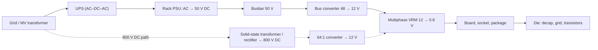
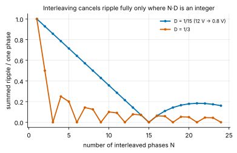

<!-- status: reviewed -->
# 22-10 · Datacenter Power Delivery

| | |
|---|---|
| **Course** | [22 · Power Electronics and Energy Conversion](../README.md) |
| **University equivalent** | An introduction, at senior-undergraduate depth, to topics usually taught in graduate power-electronics and power-integrity courses: distribution voltage and conductor loss, fixed-ratio bus converters, multiphase voltage regulators, load lines, PDN target impedance and decoupling, vertical and integrated power delivery (Erickson & Maksimović for converters; Swaminathan & Engin, *Power Integrity Modeling and Design*; Smith & Bogatin, *Principles of Power Integrity for PDN Design*) |
| **Prerequisites** | [22-07](22-07-converter-dynamics-and-control.md) (loops, load-step droop), [22-08](22-08-pmics.md) (DVS, AVS), [22-02](22-02-buck-converter-steady-state.md) (the buck), [22-05](22-05-magnetics-design.md) (coupled and trans-inductor magnetics), [07-03](../../07-circuit-analysis-2-transient-and-ac/chapters/07-03-second-order-rlc-transients.md) (RLC resonance), [07-11](../../07-circuit-analysis-2-transient-and-ac/chapters/07-11-three-phase-circuits.md) (three-phase power) |
| **Estimated study hours** | 8 |
| **Last verified** | 2026-11-25 |

**Learning objectives.** After this chapter you can:

1. Trace the conversion chain from the grid to a processor's transistors and compute its end-to-end efficiency and the facility power behind a chip.
2. Explain why distribution voltages rise with rack power, computing conductor current, $I^2R$ loss (including distributed loads) and copper mass, and compare AC and DC conductor capacity.
3. Size a multiphase voltage regulator: phase count, ripple cancellation from interleaving, current slew rate, and the load line.
4. Set a power-delivery network's target impedance, compute the package–die resonance and its first droop, and choose decoupling.
5. Compare lateral, vertical and integrated power delivery, and size energy storage for rack-level load swings.

## 1. Big picture

An AI accelerator draws around a kilowatt at under a volt, so a thousand amperes or more must arrive at its die with only a few tens of millivolts of error, while the rack it sits in draws over a hundred kilowatts from a grid that thinks in kilovolts. Every stage between the two converts voltage, loses a few percent as heat, and adds inductance that fights fast load changes. Datacenter power delivery is the engineering of that chain: which voltages to distribute, how many conversion stages to use and where, how to feed a chip whose current can jump by hundreds of amperes in nanoseconds, and how to keep a rack of synchronized accelerators from shaking the grid. It is now a first-order constraint on AI systems, not a supporting detail.

- **Rack power:** NVIDIA's GB200 NVL72 rack consumes "approximately 120kW" from a 50–51 V busbar [1]; the industry is moving to 800 V DC distribution for racks of up to a megawatt [2], [5], [6].
- **Board power:** intermediate bus converters step 48–54 V to about 12 V, or directly toward the core voltage.
- **Chip power:** multiphase voltage regulators with tens of phases deliver up to about a kiloampere per processor, positioned ever closer to the die (vertical power delivery, integrated regulators, backside power on the die).
- **Facility:** every watt lost in conversion is a watt the cooling system must remove; the efficiency chain and the facility's power usage effectiveness (PUE) multiply.

## 2. Intuition first

**Power distribution is a water system.** A city moves water through high-pressure mains because pressure, not pipe size, is cheap: the same flow of energy at higher pressure needs a thinner pipe. Near each building, pressure reducers step it down, and inside, a last valve at each tap delivers exactly the pressure the fixture wants. Electrical distribution does the same: high voltage (pressure) for transport, because conductor loss depends on current; step-down converters near the load; and a final regulator, the voltage regulator module (VRM), at the processor. The processor is a fixture that can open from a trickle to full flow in a nanosecond, so a small local tank (decoupling capacitance) right next to it must supply the first rush before the regulator, further up the pipe, can respond.

The analogy breaks down in two places. Water pipes have no inductance: in a power network, the conductors' inductance opposes changes in current and resonates with the capacitance, so a sudden load can make the voltage ring rather than just sag. And a water main's pressure does not need to be accurate to 3%; a processor's supply does.

## 3. Theory

### 3.1 The chain from grid to transistor

Power reaches a processor through a series of converters, each with efficiency $\eta_i$. The power drawn at the start of the chain for a chip power $P_{chip}$ is

$$
P_{in} = \frac{P_{chip}}{\prod_i \eta_i},
$$

so efficiencies multiply and losses compound. A conventional chain has an uninterruptible power supply (UPS) that rectifies the grid to charge batteries and inverts back to AC, a rack power supply (PSU) that converts AC to about 50 V DC, an intermediate bus converter (IBC) to about 12 V, and a multiphase voltage regulator to the core voltage. Typical component figures: double-conversion UPS efficiency "up to 97%" [17], a rack PSU at "Peak efficiency 97.5%" [8], and a 48 V-to-12 V bus converter at 96.6–97.0% between half and full load [16]; the hyperscalers' own requirement for such converters is 97% at full load and 98% at peak [19]. The final regulator, converting 12 V to under 1 V at hundreds of amperes, is the weakest stage: in Intel's model of a 1 kW GPU, the motherboard regulator takes 1252 W and delivers 1089 W, **87.0** % [25].

All of that loss becomes heat that the facility must remove. **Power usage effectiveness (PUE)** is the ratio of the facility's total power to the power delivered to IT equipment; Google reported a fleet average of 1.09 for 2025 against an industry survey average of 1.54 [18]. A chip's share of the grid is therefore its own power divided by the in-rack chain's efficiency, times the PUE (Example 22-10.3).

### 3.2 Why distribution voltage rises

For power $P$ at voltage $V$, the current is $I = P/V$ and the loss in a conductor of resistance $R$ is

$$
P_{loss} = I^2R = \frac{P^2R}{V^2}.
$$

At fixed power and conductor, loss falls as $1/V^2$; equivalently, at fixed loss, the copper cross-section, and so its mass, falls as $1/V^2$. Google began moving its racks to 48 V distribution in 2010, finding it "at least 30% more energy efficient and more cost effective" for its higher-power systems [11]; Vicor puts the conductor arithmetic plainly: "A 48V PDN has four times less current than a 12V PDN … This equates to 16x … the power loss" [13]. At a megawatt per rack even 50 V fails: NVIDIA writes that "using 54 VDC in a single 1 MW rack requires up to 200 kg of copper busbar" [2], which is why it, Google and Microsoft are moving to 800 V or ±400 V DC [2], [5], [6].

**Busbars and distributed loads.** A busbar of length $\ell$, cross-section $A$ and resistivity $\rho$ has resistance $R = \rho\ell/A$; supply and return together form a loop of $2R$. If all the current $I$ flowed the full length, the loss would be $I^2(2R)$. But a rack's loads tap off along the bar. With the load spread uniformly, the current at distance $x$ from the feed is $I(1 - x/\ell)$, and the loss is

$$
P_{loss} = \int_0^\ell \left[I\left(1 - \frac{x}{\ell}\right)\right]^2 \frac{2\rho}{A}\,dx = I^2(2R)\int_0^1 (1 - u)^2\,du = \frac{I^2(2R)}{3}.
$$

Units: A² × Ω = W. ✓ A distributed load costs a third of the lumped loss, because the far end of the bar carries little current.

**AC or DC?** A three-phase AC feed carries $P = \sqrt3 V_{LL}I\cos\varphi$ over three (or, with a neutral, four) conductors (07-11); a DC feed carries $P = V_{DC}I$ over two. Per conductor of the same current rating,

$$
\frac{P_{DC}/2}{P_{AC}/n_c} = \frac{n_c V_{DC}}{2\sqrt3\,V_{LL}\cos\varphi},
$$

with $n_c$ the number of AC conductors. For 800 V DC against 415 V AC at unity power factor this is **1.67** with three conductors and **2.23** with four, that is, **67** % or **123** % more power per conductor. The answer depends on these assumptions, which is one reason published comparisons differ (§9). DC also removes the reactive and harmonic currents that AC feeds to rectifier loads must carry.

### 3.3 Intermediate bus conversion

From 48–54 V, most boards step down in two stages: a bus converter to about 12 V, then point-of-load regulators. The bus converter is often **unregulated**: a fixed-ratio converter (a resonant LLC or a switched-capacitor stage run at a fixed 50% duty cycle, called a DC transformer or DCX) that divides its input by a fixed ratio, $V_{out} = V_{in}/n$. Without a regulation loop its switches can operate at their best point, with zero-voltage switching (22-06), so it is efficient and small; regulation is left to the stage that follows. That only works if the input voltage is narrow, which is why the Open Rack V3 high-power shelf adopts a "Narrow Range 48V Architecture" that, among other benefits, enables "4:1 fixed ratio converters and downstream conventional 12V PoL converters" [7]. For 800 V DC, NVIDIA describes "a late-stage, high-ratio 64:1 LLC converter" stepping directly to 12 V next to the GPU [3].

The alternative is to skip the 12 V bus. Vicor's factorized architecture regulates at 48 V and uses "current multipliers" with "current gains of up to 60x" next to the processor, so the high current exists only over the last centimetres [13].

### 3.4 The multiphase voltage regulator

A single buck phase can carry a few tens of amperes before its inductor, switches and heat become unmanageable, so a processor's regulator uses $N$ phases in parallel, each with its own switches ("power stage") and inductor, driven by one controller that staggers their switching instants by $T/N$ (**interleaving**). Three things improve.

- **Current per phase.** Each phase carries $I_{out}/N$, spreading heat across the board.
- **Ripple.** The inductor ripple currents partly cancel in the sum, and the residual repeats at $Nf_s$, so the output capacitor sees a smaller ripple at a higher frequency.
- **Slew rate.** All phases can turn on together during a load step, so the total current can rise at $N(V_{in} - V_{out})/L$.

**Deriving the ripple cancellation.** In a buck, each inductor current rises at $(V_{in} - V_o)/L$ for $DT$ and falls at $V_o/L$ for the rest of the period. Consider the sum over one interval $T/N$ (the sum repeats with that period). Let $m = \lfloor ND\rfloor$, the number of phases that are on at every instant (when $ND$ is not an integer, $m$ or $m + 1$ phases are on at any time). During the part of the interval in which $m + 1$ phases are on, which lasts $(ND - m)T/N$, the sum rises at

$$
\frac{d}{dt}\sum i = \frac{(m + 1)(V_{in} - V_o) - (N - m - 1)V_o}{L} = \frac{(m + 1)V_{in} - NV_o}{L}.
$$

With $V_o = DV_{in}$, this is $V_{in}(m + 1 - ND)/L$. Multiplying by the duration gives the peak-to-peak ripple of the summed current:

$$
\Delta I_{\Sigma} = \frac{V_{in}T}{L}\cdot\frac{(ND - m)(m + 1 - ND)}{N}.
$$

Check: for $N$ = 1, $m$ = 0, this is $V_{in}TD(1 - D)/L$, the single-phase ripple (22-02). ✓ The ripple vanishes whenever $ND$ is an integer, because the falling slopes then exactly cancel the rising ones. At the low duty cycles of 12 V to sub-volt conversion ($D \approx 0.07$), $ND$ stays below 1 until $N$ reaches about 15, so four to eight phases cancel only a modest share of the ripple; with 15 to 20 phases $ND$ reaches or passes 1 and cancellation is strong (complete at 15, Example 22-10.4). The higher ripple frequency and the shared current help at any phase count.

**Transient response.** When the load steps, the controller can drive all phases on at once, so the regulator's current rises at most at $N(V_{in} - V_o)/L$. Smaller inductors respond faster but ripple more, which is the tradeoff that trans-inductor (TLVR) designs address by coupling the phases (22-05). Until the regulator's current catches up, the output capacitors and, closer to the die, the package and on-die capacitance supply the difference (§3.6). Controllers also shed phases at light load to cut switching loss (22-07).

### 3.5 Load lines and adaptive voltage positioning

A processor's supply must stay within a window, say $V_{min}$ to $V_{max}$, through every load step. A regulator that holds the same voltage at every load must allow for both directions of transient: a step up droops below the setpoint and a step down overshoots above it, so the setpoint sits mid-window and each transient may use only half of it.

**Adaptive voltage positioning (AVP)** instead makes the regulator's output fall linearly with current along a **load line**:

$$
V_{out} = V_{ID} - R_{LL}I_{out},
$$

where $V_{ID}$ is the voltage the processor requested (its voltage identification code) and $R_{LL}$ is a deliberate output resistance. Intel specifies about 1 mΩ for server and desktop processors drawing a few hundred amperes: a "slope … 1.00 m? (mohm) with ±22mV TOB (Tolerance of Band)" for one Xeon family, and a maximum of 1.1 mΩ for a 280 A desktop part, an intended droop of **0.31** V at full current [22], [23]. As currents rise toward kiloamperes, $R_{LL}$ must shrink to keep $R_{LL}I_{max}$ within the window. Controllers make it a register: TI's TPS536C7B1 sets it from 0 to 8 mΩ in steps as fine as 7.8125 µΩ [20]. Choosing $V_{ID}$ near $V_{max}$ and $R_{LL} = (V_{max} - V_{min})/I_{max}$ has three effects.

- **The whole window serves each transient.** At light load the output sits high, so a load step can fall all the way to $V_{min}$; at heavy load it sits low, so a load release can rise to $V_{max}$. The output impedance allowed doubles (Example 22-10.5).
- **No overshoot to fight.** If the regulator's output impedance is made flat and equal to $R_{LL}$ across frequency, the transient response follows the load line exactly, with no ringing beyond it.
- **Lower power at high load.** The processor runs at a lower voltage exactly when it draws the most current, saving $\Delta V \cdot I$.

The cost is a higher voltage at light load, which raises leakage when the chip is idle, and the need for the processor's timing to be signed off at $V_{min}$, where it now spends its busiest moments. Around the load line sits a tolerance band for the controller's setpoint error, current-sense error and ripple, ±22 mV in the Xeon specification above [22].

### 3.6 The power-delivery network and target impedance

Between the regulator and the transistors lies the **power-delivery network (PDN)**: board planes and bulk capacitors, the socket or solder balls, the package's planes, vias and capacitors, the bumps, and the on-die power grid and decoupling capacitance. Seen from the die, it is an impedance $Z_{PDN}(f)$, and a load current change $\Delta I$ produces a voltage error of roughly $\Delta I\,|Z_{PDN}|$ at the frequencies the change contains. The design target is therefore a **target impedance**

$$
Z_{t} = \frac{\Delta V_{allowed}}{\Delta I_{max}},
$$

to be met from DC to the highest frequency the load current contains. Units: V/A = Ω. ✓ For a 0.8 V rail with a 25 mV allowance and a 100 A step, $Z_t$ = 250 µΩ.

The regulator controls the impedance only up to its loop bandwidth (tens to hundreds of kilohertz, 22-07); above that, capacitors must. Processor makers publish the requirement in exactly this form: Intel's AC load line for a 45 W laptop processor is 2.3 mΩ below 400 kHz, falling to 1.9 mΩ above 2 MHz [23], a target impedance specified over frequency. Each level of the hierarchy, from bulk capacitors through ceramic capacitors to package and die capacitance, covers a band, and each is separated from the next by inductance. Where an inductance $L$ feeds a capacitance $C$, the two form a parallel resonance at

$$
f_0 = \frac{1}{2\pi\sqrt{LC}},
$$

with a peak impedance set by the characteristic impedance $Z_0 = \sqrt{L/C}$ and the damping. The most important one is the package inductance against the on-die capacitance, typically resonating in the tens of megahertz. The scale of the problem is set by two numbers Intel quotes for client processors: the path from the platform regulator to the die has an inductance "of the order of ~1nH", and "the typical dI/dt for a microprocessor is around ~20A/ns" [24]. Across 1 nH, 20 A/ns would need $L\,di/dt$ = **20** V, twenty-five times the supply, so the regulator cannot supply fast changes at all; local capacitance must.

**The first droop.** Suppose the die's current steps by $\Delta I$ faster than the resonance can follow, with the regulator side held stiff. Before the step the package inductor carries the old current and the die voltage is at its setpoint. After it, the die capacitance must supply $\Delta I$ while the inductor current ramps up. For a lossless $L$–$C$ the deviation of the die voltage is

$$
v(t) = -\Delta I\,Z_0\sin(\omega_0t),
$$

a sine of amplitude $\Delta IZ_0$ (07-03), so the **first droop** reaches $\Delta I\sqrt{L/C}$ a quarter period after the step. Equivalently, the capacitor must hold the voltage while the inductor's energy catches up: $\tfrac12C\,v^2 = \tfrac12L\,\Delta I^2$ gives the same peak. Damping (capacitor ESR, grid resistance) reduces it, but the scaling stands: to cut the first droop, reduce the package inductance, increase the die capacitance, or slow the load's current change. Processors do all three, plus a fourth: on-die droop detectors that stretch the clock for a few cycles when the voltage sags.

### 3.7 Getting the current into the die

At a kiloampere, even micro-ohms matter: 25 µΩ in the path dissipates 25 W and drops 25 mV, 3% of a 0.8 V rail (Example 22-10.7). Three trends attack the last centimetres.

- **Vertical power delivery.** Instead of placing regulators beside the processor and spreading current laterally through board planes, place the power stages and inductors directly beneath it, on the back of the board, so current flows vertically through a few millimetres. Infineon's vertical modules, for example, claim current densities of 1.6 to 2 A/mm² [12].
- **Backside power delivery on the die.** Conventional chips route power down through the same metal stack as signals. Intel's PowerVia and TSMC's A16 deliver power from the back of the wafer instead, freeing signal routing and shortening the power path; Intel reported a frequency gain of more than 6% on its test chip [14], and TSMC lists A16 for 2027 [15].
- **Integrated voltage regulators (IVRs).** Moving the last conversion stage into the package or onto the die means the high current exists only over millimetres, with the package carrying a higher voltage and a smaller current. Intel's FIVR did this for its 4th-generation Core processors [28]: power switches, control and capacitors on the die, with air-core inductors in the package [25], switching at 140 MHz with a reported 90% composite efficiency at full load, fed from a platform rail of about 1.8 V [27], [24].

### 3.8 Rack dynamics and energy storage

AI training is synchronous: thousands of accelerators compute, then communicate, then compute again, so a rack's power can "swing from an 'idle' state of around 30% to 100% utilization and back again in milliseconds" [3]. Those swings appear at the facility and the grid as large, periodic load changes. One response is local energy storage that supplies the peaks: NVIDIA's GB300 power supplies fill spare volume with capacitors, "65 joules/GPU of energy storage", and NVIDIA reports the grid's peak demand during training reduced by 30% [9]. A capacitor bank charged between $V_1$ and $V_2$ releases $\tfrac12C(V_1^2 - V_2^2)$ (Example 22-10.8), so storing tens of joules at 50 V needs a fraction of a farad.

## 4. Worked examples

### Example 22-10.1 · Why racks need higher voltage (tier A)

**Setup.** A rack consumes 120 kW. Find the distribution current at (a) 50 V and (b) 800 V. (c) For the same conductor, by what factor does the $I^2R$ loss fall?

**Solution.**

- (a) $120\ \text{kW}/50\ \text{V}$ = **2400** A; (b) $120\ \text{kW}/800\ \text{V}$ = **150** A.
- (c) $(800/50)^2$ = **256**.

**Units check.** W/V = A. ✓

**Sanity check.** 2400 A is the current of a large welding plant, inside a rack; at 800 V the current is that of a large household main feed.

### Example 22-10.2 · A busbar's loss and copper (tier B)

**Setup.** A rack busbar pair (supply and return) is 1.5 m long, each bar 10 mm × 60 mm copper ($\rho$ = 1.72 × 10⁻⁸ Ω·m [29], density 8960 kg/m³). It carries the 2400 A of Example 22-10.1. Find (a) one bar's resistance and (b) the loop resistance, the loss (c) if the whole current flowed the full length and (d) with the load spread uniformly along the bar, and (e) the copper mass. (f) What would the distributed loss be at 800 V?

**Solution.**

- (a) $R = \rho\ell/A = 1.72 \times 10^{-8} \times 1.5/(600 \times 10^{-6})$ = **43.0** µΩ; (b) **86.0** µΩ.
- (c) $2400^2 \times 86.0\ \mu\Omega$ = **495** W; (d) a third of it, **165** W.
- (e) $2 \times 600 \times 10^{-6} \times 1.5 \times 8960$ = **16.1** kg.
- (f) $150^2 \times 86.0\ \mu\Omega/3$ = **0.645** W.

**Units check.** Ω·m × m/m² = Ω; m² × m × kg/m³ = kg. ✓

**Sanity check.** 165 W is **0.14**% of the rack's 120 kW, acceptable, but the bar is 16 kg of copper, and 2400 A in 600 mm² is **4.0** A/mm², about twice the **2.08** A/mm² of the Copper Development Association's still-air rating for a 1/4 × 4 in bar at a 30 °C rise [30]. A real busbar at this current is larger, or cooled. At a megawatt and 50 V the current grows by 1 MW/120 kW = 8.3 times, and keeping the same loss fraction needs 8.3 times the copper, about **134** kg for this geometry: the scale of the 200 kg NVIDIA cites [2].

### Example 22-10.3 · From chip to grid (tier B)

**Setup.** A conversion chain has a 97% UPS, a 97.5% rack PSU, a 98% bus converter and a 90% VRM (the first two as quoted in §3.1, the last two assumed). Find (a) the end-to-end efficiency and (b) the power drawn at the UPS input for 1 MW of chip power, and (c) the conversion loss. Find the facility power at a PUE of (d) 1.09 and (e) 1.54. PUE meters IT power at the UPS output (the rack-PSU input), so the UPS's own loss is already part of the facility overhead.

**Solution.**

- (a) $0.97 \times 0.975 \times 0.98 \times 0.90$ = **83.4** %.
- (b) $1/0.834$ = **1.20** MW; (c) **0.20** MW.
- The IT power is the rack-PSU input, $1/(0.975 \times 0.98 \times 0.90) = 1/0.860$ = **1.163** MW. (d) $1.09 \times 1.163$ = **1.27** MW; (e) $1.54 \times 1.163$ = **1.79** MW. Multiplying the UPS input by the PUE would count the UPS loss twice.

**Units check.** Ratios times MW. ✓

**Sanity check.** A sixth of the power is lost before it reaches a transistor, and the VRM alone accounts for more than half of that loss, which is why the last stage gets so much attention. The facility's overhead then multiplies the total.

### Example 22-10.4 · A multiphase regulator for a 1 kA processor (tier B)

**Setup.** A regulator converts 12 V to 0.8 V at 1000 A with 20 interleaved phases, each with 100 nH at 1 MHz. Find (a) the current per phase, (b) the duty cycle, (c) the single-phase ripple, (d) the summed ripple of 20 phases and (e) its frequency. (f) What summed ripple would 4 phases give, and (g) 15 phases? (h) What is the maximum slew rate of the total current?

**Solution.**

- (a) $1000/20$ = **50** A; (b) $0.8/12$ = **0.0667**.
- (c) $\Delta I = V_{in}D(1 - D)/(Lf_s) = 12 \times 0.0667 \times 0.9333/(100\ \text{nH} \times 1\ \text{MHz})$ = **7.47** A.
- (d) $ND$ = 1.333, $m$ = 1: $\Delta I_\Sigma = (12/0.1)(0.333)(0.667)/20$ = **1.33** A; (e) **20** MHz.
- (f) $ND$ = 0.267, $m$ = 0: $(120)(0.267)(0.733)/4$ = **5.87** A; (g) $ND$ = 1.000 exactly: **0** A.
- (h) $20 \times (12 - 0.8)/100\ \text{nH}$ = **2240** A/µs.

**Units check.** V·s/H = A. ✓

**Sanity check.** Interleaving 20 phases cuts the ripple to 1.33 A on a 1000 A output, but 15 phases would cancel it completely at this duty cycle: the phase count interacts with the conversion ratio. Even at 2240 A/µs, a 500 A step takes over 200 ns to supply; the capacitors cover that gap.

### Example 22-10.5 · Why a load line helps (tier B)

**Setup.** A processor rail must stay between 0.75 V and 0.85 V for loads from 0 to 1000 A. (a) Without a load line, with the setpoint at 0.80 V, what output impedance keeps a full 1000 A step inside the window? With AVP from 0.85 V at no load to 0.75 V at full load, find (b) the load line, (c) the voltage at 500 A, and (d) the output impedance allowed. (e) How much less power does the processor draw at 1000 A than at a fixed 0.80 V, and (f) what fraction is that?

**Solution.**

- (a) $50\ \text{mV}/1000\ \text{A}$ = **50** µΩ.
- (b) $R_{LL} = 0.10\ \text{V}/1000\ \text{A}$ = **0.10** mΩ; (c) $0.85 - 0.10\ \text{m}\Omega \times 500$ = **0.80** V.
- (d) **100** µΩ: a step from 0 to 1000 A may now move the full 100 mV.
- (e) $(0.80 - 0.75) \times 1000$ = **50** W; (f) $0.05/0.80$ = **6.25** %.

**Units check.** V/A = Ω; V × A = W. ✓

**Sanity check.** The load line doubles the allowed impedance, which halves the capacitance or bandwidth needed, and it saves power at peak load, at the cost of 50 mV more at idle.

### Example 22-10.6 · The package resonance and the first droop (tier C)

**Setup.** A die has 20 µF of on-die and in-package capacitance behind an effective package inductance of 2 pH (assumed). Its current steps by 100 A in much less than a nanosecond. Find (a) the resonant frequency, (b) the characteristic impedance, (c) the first droop with no damping and (d) when it occurs. (e) What target impedance allows 25 mV? (f) What capacitance would bring $Z_0$ down to that target? (g) With 0.1 mΩ of ESR in series with the capacitance, what is the first droop (by simulation)?

**Solution.**

- (a) $f_0 = 1/(2\pi\sqrt{2\ \text{pH} \times 20\ \mu\text{F}})$ = **25.2** MHz; (b) $Z_0 = \sqrt{2\ \text{pH}/20\ \mu\text{F}}$ = **316** µΩ.
- (c) $100 \times 316\ \mu\Omega$ = **31.6** mV; (d) a quarter period, $1/(4f_0)$ = **9.9** ns.
- (e) $25\ \text{mV}/100\ \text{A}$ = **250** µΩ; (f) $C = L/Z_t^2 = 2\ \text{pH}/(250\ \mu\Omega)^2$ = **32** µF.
- (g) The ESR adds an instant 10 mV step but damps the ring; the lab's ngspice run and the verify script both give a first droop of **26.5** mV at about 7 ns.

**Units check.** $\sqrt{\text{H}/\text{F}} = \sqrt{\Omega^2} = \Omega$. ✓

**Sanity check.** A 100 A step is 12.5% of an 800 A chip's current, yet its 31.6 mV first droop exceeds a 3% budget (24 mV at 0.8 V) at the package resonance. That is why processors limit their current slew (staggered clock gating, power-gating ramps) and why package capacitance and inductance are designed as carefully as the regulator.

### Example 22-10.7 · Lateral current through board planes (tier B)

**Setup.** A regulator beside a processor delivers 1000 A through board planes over a path 20 mm long and 50 mm wide. Each plane is 70 µm copper (2 oz), and the supply and return each use 8 planes in parallel. Find (a) the sheet resistance, (b) one plane's resistance over the path, (c) the loop resistance, (d) the loss, and (e) the voltage drop as a share of 0.8 V.

**Solution.**

- (a) $\rho/t = 1.72 \times 10^{-8}/70 \times 10^{-6}$ = **0.246** mΩ per square.
- (b) The path is 20/50 = 0.4 squares: **98.3** µΩ.
- (c) $2 \times 98.3/8$ = **24.6** µΩ.
- (d) $1000^2 \times 24.6\ \mu\Omega$ = **24.6** W; (e) 24.6 mV, **3.1** % of 0.8 V.

**Units check.** Ω·m/m = Ω per square. ✓

**Sanity check.** Tens of watts and a few percent of the voltage budget are lost in two centimetres of copper before the current reaches the socket. Moving the regulator under the processor shortens that path by an order of magnitude, which is the case for vertical power delivery.

### Example 22-10.8 · Energy storage for synchronized loads (tier B)

**Setup.** A GPU's power swings by 70% of a 1400 W maximum. (a) How long can 65 J of storage supply that swing? (b) What is the storage for 72 GPUs? (c) What capacitance at 50 V supplies 65 J while drooping to 45 V?

**Solution.**

- (a) $65/(0.70 \times 1400)$ = **66** ms.
- (b) $72 \times 65$ = **4.68** kJ.
- (c) $C = 2E/(V_1^2 - V_2^2) = 130/(2500 - 2025)$ = **0.274** F.

**Units check.** J/W = s; J/V² = F. ✓

**Sanity check.** Tens of milliseconds is enough to smooth the communication phases of a training step from the grid's point of view, but not to ride through a utility outage; that is the UPS's job.

<!-- answer-key -->

| ID | Quantity | Value | Unit |
|---|---|---|---|
| Ex 22-10.1a | current at 50 V | 2400 | A |
| Ex 22-10.1b | current at 800 V | 150 | A |
| Ex 22-10.1c | loss reduction factor | 256 | |
| Ex 22-10.2a | one bar's resistance | 43.0 | µΩ |
| Ex 22-10.2b | loop resistance | 86.0 | µΩ |
| Ex 22-10.2c | lumped loss | 495 | W |
| Ex 22-10.2d | distributed loss | 165 | W |
| Ex 22-10.2e | copper mass | 16.1 | kg |
| Ex 22-10.2f | distributed loss at 800 V | 0.645 | W |
| Ex 22-10.3a | end-to-end efficiency | 83.4 | % |
| Ex 22-10.3b | UPS input power | 1.20 | MW |
| Ex 22-10.3c | conversion loss | 0.20 | MW |
| Ex 22-10.3f | IT power (rack-PSU input) | 1.163 | MW |
| Ex 22-10.3d | facility power at PUE 1.09 | 1.27 | MW |
| Ex 22-10.3e | facility power at PUE 1.54 | 1.79 | MW |
| Ex 22-10.4a | current per phase | 50 | A |
| Ex 22-10.4b | duty cycle | 0.0667 | |
| Ex 22-10.4c | single-phase ripple | 7.47 | A |
| Ex 22-10.4d | summed ripple, 20 phases | 1.33 | A |
| Ex 22-10.4e | ripple frequency | 20 | MHz |
| Ex 22-10.4f | summed ripple, 4 phases | 5.87 | A |
| Ex 22-10.4g | summed ripple, 15 phases | 0 | A |
| Ex 22-10.4h | maximum current slew | 2240 | A/µs |
| Ex 22-10.5a | impedance without a load line | 50 | µΩ |
| Ex 22-10.5b | load line | 0.10 | mΩ |
| Ex 22-10.5c | voltage at 500 A | 0.80 | V |
| Ex 22-10.5d | impedance with AVP | 100 | µΩ |
| Ex 22-10.5e | power saved at 1000 A | 50 | W |
| Ex 22-10.5f | fraction saved | 6.25 | % |
| Ex 22-10.6a | resonant frequency | 25.2 | MHz |
| Ex 22-10.6b | characteristic impedance | 316 | µΩ |
| Ex 22-10.6c | undamped first droop | 31.6 | mV |
| Ex 22-10.6d | time of the first droop | 9.9 | ns |
| Ex 22-10.6e | target impedance | 250 | µΩ |
| Ex 22-10.6f | capacitance for Z0 = Zt | 32 | µF |
| Ex 22-10.6g | first droop with 0.1 mΩ ESR | 26.5 | mV |
| Ex 22-10.7a | sheet resistance | 0.246 | mΩ |
| Ex 22-10.7b | one plane over the path | 98.3 | µΩ |
| Ex 22-10.7c | loop resistance | 24.6 | µΩ |
| Ex 22-10.7d | loss | 24.6 | W |
| Ex 22-10.7e | drop as a share of 0.8 V | 3.1 | % |
| Ex 22-10.8a | ride-through time | 66 | ms |
| Ex 22-10.8b | rack storage | 4.68 | kJ |
| Ex 22-10.8c | capacitance at 50 V | 0.274 | F |
| Txt 22-10.a | per-conductor ratio, 3 AC conductors | 1.67 | |
| Txt 22-10.e | copper for a 1 MW, 50 V busbar at the same loss fraction | 134 | kg |
| Txt 22-10.n | busbar loss as a share of rack power (Ex 22-10.2) | 0.14 | % |
| Txt 22-10.f | Intel model: motherboard VR efficiency for a 1 kW GPU | 87.0 | % |
| Txt 22-10.g | intended droop of a 1.1 mΩ load line at 280 A | 0.31 | V |
| Txt 22-10.h | L di/dt for 1 nH at 20 A/ns | 20 | V |
| Txt 22-10.i | busbar current density in Example 22-10.2 | 4.0 | A/mm² |
| Txt 22-10.j | CDA rating of a 1/4 × 4 in bar (1342 A over 645.2 mm²) | 2.08 | A/mm² |
| Txt 22-10.k | Intel model: useful fraction of VR input, 1 kW GPU | 66.0 | % |
| Txt 22-10.l | Intel model: useful fraction of VR input, 5 kW GPU | 41.8 | % |
| Txt 22-10.m | Infineon quad-phase module: 280 A over 10 × 9 mm | 3.1 | A/mm² |
| Txt 22-10.b | per-conductor ratio, 4 AC conductors | 2.23 | |
| Txt 22-10.c | more power per conductor, 3 AC conductors | 67 | % |
| Txt 22-10.d | more power per conductor, 4 AC conductors | 123 | % |

## 5. Simulate it

The lab is [labs/22-10-lab/](../labs/22-10-lab/README.md). `pdn.py` collects the chapter's models: busbar resistance and distributed-load loss, AC and DC conductor capacity, chain efficiency and facility power, single-phase and interleaved ripple, slew rate, load lines, target impedance, the package resonance and first droop, plane resistance and storage capacitance. Two ngspice netlists:

- `multiphase.cir` drives four 100 nH inductors from ideal 0–12 V pulse sources a quarter period apart into a fixed 0.8 V output, and measures one phase's ripple and the summed ripple (Example 22-10.4).
- `pdn.cir` is Example 22-10.6's package and die: an AC sweep finds the impedance peak seen from the die, and a 100 A step with a 10 ps edge gives the first droop.

**Predict, then run:**

1. *Predict* one phase's ripple and the four-phase sum, then run `ngspice -b multiphase.cir`.
2. In the notebook, plot the summed ripple against phase count. *Predict* which counts cancel it at $D$ = 1/15.
3. *Predict* the resonant frequency, impedance peak and first droop of Example 22-10.6, then run `ngspice -b pdn.cir`.
4. Sweep the capacitor ESR. *Predict*: does more damping always reduce the first droop?
5. Repeat Example 22-10.2's busbar loss at 48, 400 and 800 V.

## 6. Engineering tradeoffs

| Knob | Improves | Costs | Typical decision owner |
|---|---|---|---|
| Higher distribution voltage (48 V → 800 V DC) | Conductor current, copper and $I^2R$ loss fall as $1/V^2$; fewer conversion stages | Touch and arc safety, DC protection and switching, a new supply chain, high-ratio conversion near the load | Facility and rack architects |
| Fixed-ratio instead of regulated bus converter | Efficiency and power density | Needs a narrow input range; regulation pushed downstream | Board power architect |
| More VRM phases | Current per phase, ripple frequency, transient slew | Board area, cost, controller complexity, light-load loss (shed phases) | VR designer with the board team |
| Smaller phase inductance | Faster current slew for load steps | Larger ripple and ripple loss; coupled or trans-inductor magnetics help | VR designer |
| Load line (AVP) | Doubles the output impedance allowed for the same window (halving the capacitance or bandwidth needed); lower power at peak load | Higher idle voltage and leakage; timing signed off at $V_{min}$ | SoC power architect with the VR team |
| More package and die capacitance | Lower $Z_0$ and first droop | Die and package area, on-die capacitor leakage, cost | Package and SoC teams |
| Damping (ESR) near $Z_0/2$ | Minimum first droop (damping ratio about 0.25, so some ringing remains) | Too much adds an instant resistive drop | Power-integrity engineer |
| Vertical power delivery | Lateral $I^2R$ loss and droop from the last centimetres | Regulators under a hot processor, board complexity, serviceability | Platform architect |
| Integrated regulators (IVR) | Path loss, per-domain fast DVFS, fewer board parts | Die area and heat on the die, efficiency of very-high-frequency conversion | SoC architect |
| Rack energy storage | Grid peaks and facility sizing | Volume in the PSU or rack, cost, control | Rack and facility architects |

## 7. Numbers to know

| Quantity | Typical value | Source |
|---|---|---|
| Conductor loss | $P^2R/V^2$; a uniformly tapped busbar loses $I^2R/3$ | §3.2 |
| Multiphase summed ripple | $(V_{in}T/L)(ND - m)(m + 1 - ND)/N$; zero when $ND$ is an integer | §3.4 |
| Load line | $R_{LL} = (V_{max} - V_{min})/I_{max}$ | §3.5 |
| Target impedance, first droop | $Z_t = \Delta V/\Delta I$; first droop $\approx \Delta I\sqrt{L/C}$ at $1/(4f_0)$ | §3.6 |
| AI rack power (as of Nov 2026) | about 120 kW (GB200 NVL72) today; racks of 800 kW to 1 MW and more specified | [1], [6] |
| Rack distribution (as of Nov 2026) | 48–54 V DC (ORv3: 51 V nominal, 46–52 V); ±400 V or 800 V DC for megawatt racks | [2], [5], [6], [33] |
| Rack PSU and bus converter efficiency (as of Nov 2026) | PSU 97.5% peak; 48 → 12 V converters 96.6–97.5%; OCP requirement 97% at full load | [8], [16], [19] |
| Smart power stage (as of Nov 2026) | 60–90 A per phase in a 5 × 6 mm package, switching up to 1–1.25 MHz | [21], [34], [35] |
| Processor load lines (as of Nov 2026) | about 1 mΩ for 200–300 A processors; ±20–22 mV tolerance band | [22], [23] |
| Client processor PDN | path inductance ~1 nH, current slew ~20 A/ns | [24] |
| Accelerator power (as of Nov 2026) | up to 1400 W per GPU; 2× rated power for up to 20 µs in OAM specs | [10], [26] |
| Busbar design | ≤ 30 °C rise; about 1.5–2.5 A/mm² for single bars (larger bars lower) | [30] |
| PUE (2025) | 1.09 (Google fleet) against 1.54 (industry survey) | [18] |

## 8. Common mistakes

- **Quoting one stage's efficiency.** Efficiencies multiply through the chain, and PUE multiplies the result (Example 22-10.3); a 97.5% PSU says little about the grid power per chip watt.
- **Using lumped $I^2R$ for a tapped busbar, or ignoring where the load sits.** Uniform taps cost a third of the lumped loss, a load at the midpoint half of it (Problem 22-10.2).
- **Comparing AC and DC "per conductor" without stating the conductor count and power factor.** The answer moves from 67% to 123% more power on those choices alone (§3.2).
- **Expecting interleaving to cancel ripple at low duty cycle.** At 12 V to 0.8 V, four phases cancel only a fifth of it (Example 22-10.4).
- **Sizing for TDP.** Accelerators may draw twice their rated power for up to 20 µs and 1.5× for milliseconds [6], [26]; regulators, capacitors and busbars must cover the excursions.
- **Meeting the target impedance only at low frequency.** The regulator's loop covers kilohertz; the package resonance at tens of megahertz needs capacitance and damping (Example 22-10.6).
- **Assuming more damping is always better.** Beyond about $Z_0/2$ the capacitor's ESR adds more droop than it removes (lab Part 4).
- **Comparing current densities without their basis.** A/mm² figures differ by whether the current is continuous or peak and whether the area includes keep-out (§9).

## 9. Practitioner lens

*State of the art as of Nov 2026. Sources are logged as R-444 to R-447, with R-082 and R-098.*

**Racks** [Established for specifications; Industry estimate for vendor benefit claims].

- *Today's 50 V racks.* NVIDIA's GB200 NVL72 converts AC to "nominal 50V-51V DC" in eight 33 kW power shelves with N+N redundancy for a rack consuming "approximately 120kW" [1]. The Open Rack V3 high-power shelf holds "6x 12kW PSU slots", up to 72 kW per shelf, on a "Narrow Range 48V Architecture" [7], and its 2000 A output connector allows "Max busbar +/- DC resistance … within 20uohm, i.e. max. 40mV voltage drop at 2000A current" [31].
- *Megawatt racks.* The OCP Mt. Diablo specification from Microsoft, Meta and Google covers racks "from 800kW to 1MW+" fed at ±400 V or 800 V DC, with peak loads of 175% of TDP for under 2 ms (Microsoft) and 180% for under 0.5 ms (Meta) [6]. NVIDIA plans "full-scale production of 800 VDC data centers" with its Kyber racks in 2027 [2]; NVIDIA, Google and Microsoft published a solid-state transformer specification in July 2026 [4]. NVIDIA's Vera Rubin NVL72 rack adds "a new liquid-cooled busbar" [32], an answer to the current density of Example 22-10.2.

**Boards and regulators** [Established].

- The hyperscalers' 48 V onboard requirements ask regulated 48 V-to-12 V converters for 97% at full load and 98% at peak, and fixed-ratio converters with ratios of 4, 5 and 8 for 97.5% at full load, with peak loads up to 250% of thermal design current for 10 ms [19].
- A smart power stage such as TI's CSD95490Q5MC carries "75-A Continuous Operating Current Capability" with "Over 95% System Efficiency at 30 A" in a 5 × 6 mm package [21]; Renesas's ISL99390 "Supports 90A DC current" with "±3% accuracy" current monitoring [34].
- A multiphase controller such as TI's TPS536C7B1 runs up to 12 phases at 300–2000 kHz, sets the load line over PMBus, and shares current within ±4.5% [20].

**Where the power goes, in Intel's model** [Industry estimate]. Intel's 2026 power-delivery white paper models a 1 kW GPU whose motherboard regulator takes 1252 W: 163 W is lost in the regulator, 89 W in $I^2R$, and 174 W is "wasted power (droop)", voltage margin above what the silicon needs, leaving 826 W, **66.0** %, as useful power. For a 5 kW GPU, the useful share falls to **41.8** %, because $I^2R$ grows with the square of a current already "in the multi-kiloamp range" [25]. These are Intel's model numbers, not measurements, but they show why vertical and integrated regulation are now on every accelerator roadmap.

**Vertical, backside and integrated delivery** [Established for disclosures; Industry estimate for vendor density claims].

- Infineon's vertical modules claim "industry's best current density" of 1.6 and then 2 A/mm² [12]; Vicor's 48 V current multipliers claim "5A/mm² TDC (continuous), 10A/mm² peak, and current gains of up to 60x" [13].
- Intel's PowerVia test chip showed "more than a 6 percent frequency boost" [14]; TSMC now lists its backside-power A16 process for 2027 [15].
- Intel's FIVR switched at 140 MHz with a reported 90% composite efficiency [27]. Intel's later work moves the inductors into coaxial magnetic structures and reports capacitive regulator chiplets at ">90% efficiency and 10 A/mm2" [25].

**Load dynamics** [Established for the design; vendor-measured result]. Rack power can swing from about 30% to 100% "in milliseconds" [3]. NVIDIA's GB300 power supplies hold "65 joules/GPU of energy storage", and NVIDIA reports the grid's peak demand during training cut by 30% [9].

**Marketing vs Reality.**

- *"85% more power" or "157% more power" through the same conductor.* NVIDIA's two blog posts give both figures for 800 V DC against 415 V AC [2], [3]. §3.2's per-conductor arithmetic gives 67% or 123% depending only on whether the AC neutral is counted. Ask for the conductor count, power factor and current rating behind any such number.
- *"Industry's best current density of 2 A/mm²."* The same release describes 280 A in a 10 × 9 mm module, which is **3.1** A/mm² by simple division [12]; the headline must use a different current (continuous rather than peak) or area (with keep-out). Compare densities only on a stated basis.
- *"98% efficient bus converter."* Peak efficiency, typically near half load; at full load the same class runs 96.6–97% and at 10% load about 96% [16], [19].
- *"A 1 kW accelerator."* Thermal design power, not the peak: OAM modules may draw twice their rated power for 20 µs [26], and the rack's power can swing by 70% in milliseconds [3].

**Questions for engineering leaders.**

1. **"What is your efficiency from the facility feed to the die at 30%, 50% and 100% load, and where do the losses go?"** *Strong:* per-stage numbers including the VRM, distribution $I^2R$ and voltage margin. *Evasive:* "Our PSU is 97.5% efficient."
2. **"What load steps does your PDN handle, and what is the first droop at the package resonance?"** *Strong:* the target impedance over frequency, measured droop at the die sense points, and the clock-stretching or di/dt limits behind it. *Evasive:* "We meet the VR specification."
3. **"How do you keep a rack of synchronized accelerators from disturbing the facility and the grid?"** *Strong:* local energy storage, firmware power ramps, and measurements at the facility feed. *Evasive:* "The UPS handles it."
4. **"What does 800 V DC change for safety, protection and service?"** *Strong:* DC breaking and arc management, touch-safe design, and the standards and specifications being followed. *Evasive:* "It's just higher voltage."
5. **"What current density do you quote, at what condition, over what area?"** *Strong:* continuous and peak, footprint with keep-out, and temperature. *Evasive:* a single A/mm² number.
6. **"Why lateral, vertical or integrated regulation for this product?"** *Strong:* a loss and droop budget for the last centimetres against the thermal cost of regulators under the processor. *Evasive:* "Vertical is the future."

## 10. Concept check

**Q1.** Why does a megawatt rack need hundreds of volts rather than 50 V?

Answer

At fixed power the current scales as $1/V$ and the conductor loss as $1/V^2$; at 50 V a megawatt is 20 kA, and keeping its loss acceptable needs hundreds of kilograms of copper. At 800 V the current is 1250 A.

**Q2.** Why does a busbar feeding many taps lose only a third of $I^2R$?

Answer

The current falls along the bar as each tap takes its share, so most of the length carries much less than $I$. Integrating $[I(1 - x/\ell)]^2$ along the bar gives one third of the lumped value.

**Q3.** When does interleaving cancel a multiphase regulator's ripple completely, and why is cancellation weak at 12 V to 0.8 V?

Answer

When $ND$ is an integer, the rising slopes of the on phases exactly cancel the falling slopes of the others. At $D \approx 0.07$, $ND$ stays below 1 until $N$ reaches about 15, so four to eight phases cancel only a modest share of the ripple; with 15 to 20 phases $ND$ reaches or passes 1 and cancellation is strong (complete at 15, Example 22-10.4). The ripple's higher frequency, $Nf_s$, helps at any phase count.

**Q4.** What does a load line buy, and what does it cost?

Answer

It lets each load transient use the whole voltage window instead of half, doubling the impedance allowed, and lowers the voltage (and power) at heavy load. The costs are a higher idle voltage and timing sign-off at the minimum voltage.

**Q5.** A die's current steps by 100 A. What sets the first droop, and when does it occur?

Answer

The package inductance against the die capacitance: about $\Delta I\sqrt{L/C}$, a quarter of the resonance period after the step. The regulator is far too slow to help.

**Q6.** Why can too much damping resistance make the first droop worse?

Answer

The resistance is in series with the capacitor that must supply the step, so it adds an instant drop $\Delta I\,R_{ESR}$. Beyond roughly $Z_0/2$ that drop exceeds what the damping saves in ringing.

**Q7.** Why are vertical and integrated regulators attractive for kiloampere accelerators?

Answer

Loss and droop in the last centimetres scale with the current squared and with path resistance and inductance. Shortening the high-current path (vertical delivery) or raising the voltage it carries (integrated regulators) attacks both.

Now work the [22-10 problem set](../problems/22-10-problems.md).

## 11. Key terms

[Power usage effectiveness (PUE)](../../../reference/glossary.md#power-usage-effectiveness-pue) · [Uninterruptible power supply (UPS)](../../../reference/glossary.md#uninterruptible-power-supply-ups) · [DC distribution (800 V)](../../../reference/glossary.md#dc-distribution-800-v) · [Busbar](../../../reference/glossary.md#busbar) · [Intermediate bus converter](../../../reference/glossary.md#intermediate-bus-converter) · [Fixed-ratio bus converter](../../../reference/glossary.md#fixed-ratio-bus-converter) · [Multiphase voltage regulator](../../../reference/glossary.md#multiphase-voltage-regulator) · [Interleaving (multiphase converters)](../../../reference/glossary.md#interleaving-multiphase-converters) · [Smart power stage](../../../reference/glossary.md#smart-power-stage) · [Phase shedding](../../../reference/glossary.md#phase-shedding) · [Trans-inductor voltage regulator](../../../reference/glossary.md#trans-inductor-voltage-regulator) · [Load line (voltage regulator)](../../../reference/glossary.md#load-line-voltage-regulator) · [Voltage identification (VID)](../../../reference/glossary.md#voltage-identification-vid) · [Tolerance band (voltage regulator)](../../../reference/glossary.md#tolerance-band-voltage-regulator) · [Power delivery network](../../../reference/glossary.md#power-delivery-network) · [Target impedance](../../../reference/glossary.md#target-impedance) · [Decoupling capacitor](../../../reference/glossary.md#decoupling-capacitor) · [First droop](../../../reference/glossary.md#first-droop) · [IR drop](../../../reference/glossary.md#ir-drop) · [Vertical power delivery](../../../reference/glossary.md#vertical-power-delivery) · [Backside power delivery](../../../reference/glossary.md#backside-power-delivery) · [Integrated voltage regulator (IVR)](../../../reference/glossary.md#integrated-voltage-regulator-ivr) · [Power smoothing](../../../reference/glossary.md#power-smoothing)

## 12. Connections

- **Previous:** [22-09](22-09-batteries-charging-fuel-gauging.md) closed the portable side of power; this chapter scales to racks. The converters come from [22-02](22-02-buck-converter-steady-state.md), [22-04](22-04-isolated-converters.md) and [22-06](22-06-converter-losses-and-wide-bandgap.md), the loops and droop from [22-07](22-07-converter-dynamics-and-control.md), and DVS and AVS from [22-08](22-08-pmics.md).
- **Prerequisites:** [07-03](../../07-circuit-analysis-2-transient-and-ac/chapters/07-03-second-order-rlc-transients.md) (the RLC resonance behind the first droop), [07-11](../../07-circuit-analysis-2-transient-and-ac/chapters/07-11-three-phase-circuits.md) (three-phase power), [19-06](../../19-digital-vlsi-design/chapters/19-06-power-and-low-power-design.md) (the processor's side of power).
- **Used later:** [22-12](22-12-power-systems-fundamentals.md) (the grid that feeds the facility, and the integration of large, fast-changing loads).
- **Next:** [22-11](22-11-electric-machines.md) turns from distributing power to converting it into motion.

> **Deeper:** see companion repo *LLM Inference Engineering* for how serving workloads shape accelerator power and its swings.

## 13. Further study

- M. Swaminathan and A. E. Engin, *Power Integrity Modeling and Design for Semiconductors and Systems*, Prentice Hall, 2007: PDN modeling, target impedance and decoupling.
- L. D. Smith and E. Bogatin, *Principles of Power Integrity for PDN Design—Simplified*, Prentice Hall, 2017: an intuitive treatment of the first droop, damping and the role of each capacitor level.
- K. Radhakrishnan's 2022 IEEE seminar on microprocessor power delivery [24] and Intel's 2026 white paper [25] for an industry view from regulator to die.
- The OCP specifications cited here [6], [7], [19], [26]: they are public and show what hyperscalers actually require.

## 14. Sources

1. NVIDIA, *DGX GB200/GB300 User Guide*, Hardware, accessed Nov 2026. [R-444]
2. NVIDIA Technical Blog, "NVIDIA 800 VDC Architecture Will Power the Next Generation of AI Factories," 20 May 2025 (updated 31 Jul 2025). [R-444]
3. NVIDIA Technical Blog, "Building the 800 VDC Ecosystem for Efficient, Scalable AI Factories," 13 Oct 2025. [R-444]
4. NVIDIA Blog, "Why Scaling AI Compute Performance Requires a New Power Architecture," 11 Aug 2026. [R-444]
5. Google Cloud Blog, "Enabling 1 MW IT racks and liquid cooling at OCP EMEA Summit," 29 Apr 2025. [R-444]
6. Open Compute Project, *Mt. Diablo Disaggregated Power Rack Specification* v1.0.0, effective 8 Oct 2026. [R-444]
7. Open Compute Project, *Open Rack V3 HPR V2 72kW Power Shelf*, Rev 1.0.0, 12 Jun 2026. [R-445]
8. Advanced Energy, *50 V 5.5 kW Open Rack V3 HPR PSU* data sheet (2026). [R-445]
9. NVIDIA Technical Blog, "How New GB300 NVL72 Features Provide Steady Power for AI," 28 Jul 2025. [R-444]
10. NVIDIA Technical Blog, "Inside NVIDIA Blackwell Ultra: The Chip Powering the AI Factory Era," 22 Aug 2025. [R-444]
11. Google Cloud Blog, "Google joins Open Compute Project to drive standards in IT infrastructure," 10 Mar 2016. [R-445]
12. Infineon press releases on vertical power delivery modules, 9 Oct 2024 and 10 Mar 2025. [R-447]
13. Vicor, "Powering AI processors using a 48V FPA," accessed Nov 2026. [R-447]
14. IEEE Spectrum, report on Intel PowerVia, June 2023. [R-447]
15. Tom's Hardware, report on TSMC's 2026 technology roadmap (A16 listed for 2027). [R-447]
16. Flex, *BMR491 0202/853* technical specification 28701-BMR491 02 Rev B, Aug 2025. [R-445]
17. Vertiv, *Liebert EXL S1* brochure SL-70645, 2020. [R-445]
18. Google, "Efficiency" (2025 PUE data), accessed Nov 2026. [R-445]
19. Open Compute Project, *48V Onboard Power Solution Requirements*, Base Specification v1.0.0, effective 15 Nov 2024. [R-445]
20. Texas Instruments, *TPS536C7B1* data sheet, SLUSDI9, Sep 2020. [R-446]
21. Texas Instruments, *CSD95490Q5MC* data sheet, SLPS669A (rev. Jan 2018). [R-446]
22. Intel, *2nd Gen Intel Xeon Scalable Processors Datasheet, Vol. One: Electrical*, 338845-001US, Apr 2019. [R-446]
23. Intel, *12th Generation Intel Core Processors Datasheet, Vol. 1 of 2*, 655258 Rev. 011, May 2025. [R-446]
24. K. Radhakrishnan, "Challenges & Innovations in Microprocessor Power Delivery," IEEE EPS Santa Clara Valley Chapter, 22 Jun 2022. [R-446]
25. K. Radhakrishnan et al., *Driving Power Delivery Innovations for the AI Data Center Era*, Intel Foundry white paper, Aug 2026. [R-447]
26. Open Compute Project, *OCP Accelerator Module Design Specification* v1.5 (2021–2022). [R-445]
27. H. Goto, report on Haswell's FIVR from Intel's ISSCC 2014 disclosures, *PC Watch*, 26 Feb 2014. [R-447]
28. E. A. Burton et al., "FIVR — Fully integrated voltage regulators on 4th generation Intel Core SoCs," *IEEE APEC 2014*, pp. 432–439, doi:10.1109/APEC.2014.6803344. [R-082]
29. National Bureau of Standards, *Copper Wire Tables*, Handbook 100, 1966. [R-445]
30. Copper Development Association, "DC Copper Busbar Ampacities," accessed Nov 2026. [R-445]
31. Open Compute Project, *ORv3 HPR 2000A DC Power Output Connector*, Rev 1.0.0, 23 Jun 2026. [R-445]
32. NVIDIA Blog, report on Vera Rubin and gigawatt AI factories at OCP, 13 Oct 2025. [R-444]
33. Open Compute Project, *Open Rack Base Specification Version 3*, Rev 1.0, 24 Aug 2022. [R-445]
34. Renesas, *ISL99390R5935* short-form data sheet, R16DS0066EU0101 Rev.1.01, Dec 2023. [R-446]
35. onsemi, *NCP303160* data sheet, Rev. 7, Aug 2024. [R-446]
