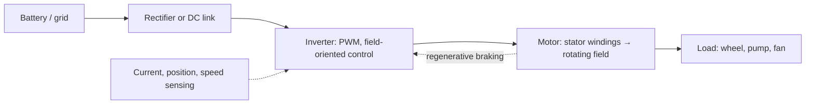
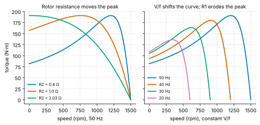

<!-- status: reviewed -->
# 22-11 · Electric Machines and Drives

| | |
|---|---|
| **Course** | [22 · Power Electronics and Energy Conversion](../README.md) |
| **University equivalent** | A junior-level electric machines and drives course at FE depth: DC machines, the rotating magnetic field, induction and synchronous machines with their equivalent circuits and torque–speed curves, and inverter-fed drives (Chapman, *Electric Machinery Fundamentals*; Fitzgerald & Kingsley, *Electric Machinery*; Mohan, *Electric Machines and Drives*) |
| **Prerequisites** | [07-11](../../07-circuit-analysis-2-transient-and-ac/chapters/07-11-three-phase-circuits.md) (three-phase power), [07-09](../../07-circuit-analysis-2-transient-and-ac/chapters/07-09-mutual-inductance-and-transformers.md) (transformers), [04-06](../../04-physics-for-ee/chapters/04-06-magnetic-fields-and-forces.md) and [04-07](../../04-physics-for-ee/chapters/04-07-faraday-lenz-and-inductance.md) (force on currents, induction), [22-05](22-05-magnetics-design.md) (magnetic circuits), [22-06](22-06-converter-losses-and-wide-bandgap.md) (power switches) |
| **Estimated study hours** | 6 |
| **Last verified** | 2026-11-25 |

**Learning objectives.** After this chapter you can:

1. Derive torque and back EMF from the Lorentz force and Faraday's law, and analyze a DC motor's speed–torque line, efficiency and control.
2. Show how three-phase windings create a rotating magnetic field, and compute synchronous speed, slip and rotor frequency.
3. Analyze an induction motor with its per-phase equivalent circuit: power flow, efficiency, the torque–slip curve, starting and maximum torque.
4. Compute a synchronous machine's power–angle relation and pull-out power, and explain PM and field-weakening operation.
5. Size an inverter-fed drive: V/f control, inverter output-voltage limits, fan and pump affinity laws, and an EV traction motor's constant-torque and constant-power regions.

## 1. Big picture

Electric machines turn electrical power into motion and back. Motors drive the pumps, fans and compressors of every building and factory, and, inside a datacenter, the chillers and fans that remove the heat of Chapter 22-10; rotating generators still produce most grid electricity; and traction motors with their inverters are the heart of an electric vehicle. All rotating machines rest on two laws, a force on a current in a magnetic field and a voltage induced by a changing flux, and on one engineering trick, a field that rotates. This chapter derives the three classic machines from those laws at the depth the FE exam expects, then adds the power electronics that has turned them into variable-speed drives.

- **Industry:** induction motors, increasingly on variable-frequency drives, run most pumps, fans and compressors.
- **Electric vehicles:** permanent-magnet and induction traction motors fed from 400 V or 800 V batteries through SiC or IGBT inverters.
- **Grid:** synchronous generators set the grid's frequency; wind turbines and storage connect through inverters (22-12).
- **Semiconductors:** motor-control MCUs, gate drivers, current sensors and power modules form a large market for the chips of Courses 18 and 22.

## 2. Intuition first

**A motor is a magnet chasing a magnet.** Picture a compass needle and a bar magnet you spin around it: the needle follows, lagging a little when you make it push something. In an AC machine, three stationary coils fed with three-phase currents create a magnetic field that rotates without anything moving; the rotor is the needle. In a *synchronous* machine the rotor carries its own magnet (permanent or electromagnet) and turns exactly with the field, lagging by an angle that grows with load. In an *induction* machine the rotor has no magnet of its own: the rotating field induces currents in it, and those currents make the rotor's field. Induction needs relative motion, so the rotor always runs slightly slower than the field, and that **slip** is what lets it make torque. A DC machine does the same with a stationary field and a mechanical switch (the commutator) that keeps reversing the rotor's current.

The analogy breaks down in one important way: a compass needle has no back-voltage. A spinning motor is also a generator, and the EMF it induces opposes the supply. That **back EMF**, not the winding resistance, is what limits a running motor's current, and it is why a stalled motor draws many times its running current.

## 3. Theory

As in 07-11, every AC phasor in this chapter is an RMS phasor, written without the rms subscript, so the complex power per phase is $\mathbf V\mathbf I^*$ with no factor of ½.

### 3.1 Force, EMF and energy conversion

A conductor of length $\ell$ carrying current $i$ perpendicular to a flux density $B$ feels a force $F = Bi\ell$ (04-06); a conductor moving at velocity $v$ across the field has an EMF $e = B\ell v$ induced in it (04-07). In a machine with conductors at radius $r$ turning at angular speed $\omega$ (rad/s), $v = \omega r$, the torque is $T = Fr$, and the two equations combine into the statement of energy conversion:

$$
e\,i = (B\ell\omega r)\,i = \omega\,(Bi\ell r) = T\omega .
$$

The electrical power absorbed by the back EMF equals the mechanical power delivered. Units: V × A = W = N·m × rad/s. ✓ Every machine below is a way of arranging $B$, $i$ and motion so that this exchange happens continuously.

### 3.2 The DC machine

In a DC machine a stationary field (from magnets or a field winding) produces a flux $\Phi$ per pole, and the commutator switches the rotor (armature) conductors so that those under each pole always carry current in the same direction. Summing the conductors' contributions gives two linear laws with the same machine constant $K$:

$$
E_a = K\Phi\,\omega, \qquad T = K\Phi\,I_a .
$$

For a permanent-magnet or separately excited motor, write $k = K\Phi$ (V·s/rad, identical to N·m/A). The armature has resistance $R_a$, so with applied voltage $V$:

$$
V = E_a + I_aR_a \quad\Rightarrow\quad \omega = \frac{V}{k} - \frac{R_a}{k^2}\,T .
$$

The speed falls linearly with torque from the **no-load speed** $V/k$ to zero at the **stall torque** $kV/R_a$, where the current $V/R_a$ is limited only by the winding resistance. Speed is controlled by the armature voltage (a chopper, 22-02); above base speed, reducing the field $\Phi$ (**field weakening**) raises the speed at the cost of torque per ampere. A **series** motor, with the field in series with the armature, has $\Phi \propto I_a$ and so $T \propto I_a^2$: enormous starting torque, which is why it powered trams and starter motors.

### 3.3 The rotating magnetic field

Place three identical windings around a stator, with their magnetic axes 120° apart, and feed them balanced three-phase currents $i_a = I_m\cos\omega t$, $i_b = I_m\cos(\omega t - 120°)$, $i_c = I_m\cos(\omega t + 120°)$. If each winding produces a flux density that varies as the cosine of the angle $\theta$ from its axis, the total at angle $\theta$ is

$$
B(\theta, t) = B_m\left[\cos\omega t\cos\theta + \cos(\omega t - 120°)\cos(\theta - 120°) + \cos(\omega t + 120°)\cos(\theta + 120°)\right].
$$

Using $\cos A\cos B = \tfrac12[\cos(A - B) + \cos(A + B)]$, each term contributes $\tfrac12\cos(\omega t - \theta)$, plus a term $\tfrac12\cos(\omega t + \theta - k \cdot 240°)$, and those three cancel because they are three equal phasors 240° apart. So

$$
B(\theta, t) = \tfrac32B_m\cos(\theta - \omega t),
$$

a field of constant amplitude whose peak sits at $\theta = \omega t$: it rotates at the electrical frequency without anything moving. A winding with $P$ poles (pole pairs $P/2$) repeats the pattern $P/2$ times around the stator, so the field rotates at the **synchronous speed**

$$
\omega_s = \frac{2\omega}{P}\ \text{rad/s}, \qquad n_s = \frac{120f}{P}\ \text{rpm}.
$$

A 4-pole machine on 50 Hz turns at 1500 rpm; on 60 Hz, 1800 rpm.

### 3.4 The induction machine

The rotor of an induction machine carries shorted conductors (a "squirrel cage"). If it turns at $n$, the field slides past it at $n_s - n$; the **slip**

$$
s = \frac{n_s - n}{n_s}
$$

measures that relative speed. The rotor's conductors see a field changing at the **slip frequency** $f_r = sf$, so their induced EMF and current are proportional to $s$: no slip, no rotor current, no torque. A motor runs at a slip of a few percent at rated load.

**The equivalent circuit.** Per phase, an induction machine is a transformer whose secondary (the rotor) is shorted and turning. Referred to the stator, its circuit has the stator resistance $R_1$ and leakage reactance $X_1$, a magnetizing reactance $X_m$ (the core's flux), the rotor leakage reactance $X_2$, and the rotor resistance divided by slip, $R_2/s$. The slip enters because the rotor's EMF is $s$ times the standstill value while its reactance is $s$ times too; dividing both by $s$ refers them to stator frequency, leaving $R_2/s$. Splitting it as $R_2 + R_2(1 - s)/s$ shows where the power goes:

- the **air-gap power** crossing to the rotor is $P_{ag} = 3I_2^2R_2/s$;
- the **rotor copper loss** is $3I_2^2R_2 = sP_{ag}$;
- the **mechanical power** developed is $P_{mech} = (1 - s)P_{ag}$;
- the **induced torque** is $T = P_{mech}/\omega_m = P_{ag}/\omega_s$, because $\omega_m = (1 - s)\omega_s$.

A motor at 3% slip therefore loses 3% of its air-gap power in the rotor, a direct link between slip and efficiency. From the input power, subtract stator copper and core losses to reach $P_{ag}$; from $P_{mech}$, subtract friction and windage to reach the output.

**The torque–slip curve.** Replace everything left of $R_2/s$, the source, $R_1$, $X_1$ and $X_m$, by its Thevenin equivalent $V_{th}$, $R_{th} + jX_{th}$. Then $I_2 = V_{th}/\sqrt{(R_{th} + R_2/s)^2 + (X_{th} + X_2)^2}$ and

$$
T(s) = \frac{3V_{th}^2\,(R_2/s)}{\omega_s\left[(R_{th} + R_2/s)^2 + (X_{th} + X_2)^2\right]} .
$$

At small slip, $R_2/s$ dominates the denominator and $T \approx 3V_{th}^2s/(\omega_sR_2)$: torque rises linearly with slip, which is why a loaded induction motor slows only a little. At large slip the reactances dominate and torque falls as $1/s$. The maximum lies where the load $R_2/s$ matches the source impedance magnitude (maximum power transfer, 06-09):

$$
s_{max} = \frac{R_2}{\sqrt{R_{th}^2 + (X_{th} + X_2)^2}}, \qquad T_{max} = \frac{3V_{th}^2}{2\omega_s\left[R_{th} + \sqrt{R_{th}^2 + (X_{th} + X_2)^2}\right]} .
$$

$T_{max}$ does not depend on $R_2$, but $s_{max}$ does: a higher-resistance rotor moves the peak toward standstill, raising the starting torque at the cost of running efficiency, the design choice behind the NEMA design letters. Starting ($s$ = 1) draws a current limited only by the leakage impedances, typically several times the rated current.

### 3.5 The synchronous machine

A synchronous machine's rotor carries a DC field winding or permanent magnets and turns at exactly $\omega_s$. Per phase, the stator sees the rotor's induced EMF $\mathbf{E}_f$, proportional to speed and field, behind the **synchronous reactance** $X_s$ (armature reaction plus leakage; resistance is small and neglected here). As a motor, $\mathbf{V} = \mathbf{E}_f + jX_s\mathbf{I}$. Take $\mathbf V = V\angle0$ and let $\mathbf{E}_f = E_f\angle{-\delta}$ lag it by the **power angle** $\delta$. Then

$$
\mathbf I = \frac{\mathbf V - \mathbf E_f}{jX_s} = \frac{E_f\sin\delta}{X_s} - j\,\frac{V - E_f\cos\delta}{X_s},
$$

and the complex power drawn per phase, $\mathbf V\mathbf I^*$, has real part $VE_f\sin\delta/X_s$ and imaginary part $(V^2 - VE_f\cos\delta)/X_s$. For three phases

$$
P = \frac{3VE_f}{X_s}\sin\delta , \qquad Q = \frac{3(V^2 - VE_f\cos\delta)}{X_s} \ \text{(absorbed)},
$$

with $V$ and $E_f$ phase (line-to-neutral) values. Units: V × V/Ω = W. ✓ As a generator, the current is reversed: $\mathbf E_f = \mathbf V + jX_s\mathbf I$ with $\mathbf E_f$ leading $\mathbf V$ by δ, and the same expression gives the power delivered. Power rises with $\delta$ to a maximum $3VE_f/X_s$ at $\delta$ = 90°, the **pull-out** limit beyond which the rotor slips out of synchronism. The field current sets $E_f$ and so, at a given power, the stator current's phase: when $E_f\cos\delta > V$ the machine is over-excited, $Q$ is negative and it supplies reactive power, which is why large ones are used for power-factor correction and why grid generators control voltage with their excitation (22-12).

**Permanent-magnet synchronous machines (PMSMs)** replace the field winding with magnets: no rotor losses, high efficiency and power density, at the cost of magnets (and their rare-earth supply) and a fixed field. Above **base speed**, the back EMF would exceed what the inverter can supply, so the drive injects stator current that opposes the magnet flux (field weakening), trading torque for speed so that power stays roughly constant. Interior-magnet designs add **reluctance torque** from rotor saliency, which helps at high speed.

### 3.6 Inverter-fed drives

Fed directly from the grid, an AC machine's speed is fixed by the line frequency. A **variable-frequency drive (VFD)** rectifies the supply to a DC link and uses a three-phase inverter, three half-bridges switched by PWM (22-06), to synthesize any frequency and voltage.

**Constant volts per hertz.** A winding's flux is proportional to $V/f$ (Faraday: $V \approx 4.44fN\Phi$). Holding $V/f$ at its rated ratio keeps the flux, and so the torque per ampere, constant while the speed changes; below the rated frequency the drive lowers the voltage in proportion. Above rated frequency the voltage cannot rise further, so the flux falls: the constant-power, field-weakening region.

**How much voltage an inverter can make.** With sine-triangle PWM at modulation index $m$, each leg's average output swings $\pm mV_{dc}/2$ about the DC-link midpoint, so the line-to-line fundamental has amplitude $\sqrt3\,mV_{dc}/2$ and rms value

$$
V_{LL,rms} = \frac{\sqrt3}{2\sqrt2}\,mV_{dc} \approx 0.612\,mV_{dc} .
$$

Adding a common-mode third harmonic (or using space-vector PWM) lets $m$ rise to $2/\sqrt3$ before the legs saturate, raising the maximum to $V_{dc}/\sqrt2 \approx 0.707V_{dc}$, **15.5** % more. Units: V. ✓

**Field-oriented control.** Modern drives measure the stator currents and rotor position, transform them into a frame rotating with the rotor flux, and control the flux-producing ($d$) and torque-producing ($q$) components separately, which makes an AC machine as controllable as a DC one. The same inverter runs in reverse during braking, returning energy to the DC link (**regenerative braking**).

**Why VFDs save energy.** For fans and centrifugal pumps, flow is proportional to speed and pressure to speed squared, so the power varies with the **cube** of speed (the affinity laws). Running a fan at 60% speed takes about 22% of full power, while throttling the flow with a damper at full speed saves far less.

## 4. Worked examples

### Example 22-11.1 · A permanent-magnet DC motor (tier A)

**Setup.** A 24 V PM DC motor has $R_a$ = 0.5 Ω and $k$ = 0.05 V·s/rad. Find (a) the no-load speed in rad/s and (b) in rpm, (c) the stall current and (d) the stall torque. At a load of 0.5 N·m, find (e) the current, (f) the back EMF, (g) the speed in rpm and (h) the efficiency (ignoring friction).

**Solution.**

- (a) $V/k = 24/0.05$ = **480** rad/s; (b) $480 \times 60/(2\pi)$ = **4584** rpm.
- (c) $24/0.5$ = **48** A; (d) $0.05 \times 48$ = **2.4** N·m.
- (e) $0.5/0.05$ = **10** A; (f) $24 - 10 \times 0.5$ = **19** V; (g) $19/0.05$ = 380 rad/s = **3629** rpm.
- (h) $P_{out} = T\omega$ = 190 W, $P_{in}$ = 240 W: **79.2** %.

**Units check.** V/(V·s/rad) = rad/s; (N·m/A)·A = N·m. ✓

**Sanity check.** The efficiency equals $E_a/V$ = 19/24, because the only loss is $I_a^2R_a$ and the back EMF absorbs the rest. At 5/24 of stall torque (about a fifth) the motor runs at 19/24 of no-load speed, exactly as the straight speed–torque line predicts.

### Example 22-11.2 · Synchronous speed and slip (tier A)

**Setup.** Find the synchronous speed of (a) a 4-pole machine on 50 Hz, (b) a 4-pole machine on 60 Hz and (c) a 2-pole machine on 60 Hz. A 4-pole, 50 Hz induction motor runs at 1460 rpm; find (d) its slip and (e) its rotor frequency.

**Solution.**

- (a) $120 \times 50/4$ = **1500** rpm; (b) **1800** rpm; (c) **3600** rpm.
- (d) $(1500 - 1460)/1500$ = **2.67** %; (e) $sf = 0.0267 \times 50$ = **1.33** Hz.

**Units check.** Hz × 60 s/min ÷ pole pairs = rpm. ✓

**Sanity check.** No two-pole machine on 60 Hz can turn faster than 3600 rpm without an inverter, which is why high-speed spindles and EV motors are inverter-fed.

### Example 22-11.3 · Power flow in an induction motor (tier B)

**Setup.** A 4-pole, 50 Hz induction motor draws 12.5 kW at a slip of 3%. Its stator copper loss is 400 W, core loss 300 W, and friction and windage 150 W. Find (a) the air-gap power, (b) the rotor copper loss, (c) the mechanical power developed, (d) the output power, (e) the efficiency, (f) the induced torque and (g) the output torque.

**Solution.**

- (a) $12\,500 - 400 - 300$ = **11 800** W; (b) $0.03 \times 11\,800$ = **354** W.
- (c) $11\,800 - 354$ = **11 446** W; (d) $11\,446 - 150$ = **11 296** W; (e) **90.4** %.
- (f) $\omega_s$ = 157.08 rad/s, so $P_{ag}/\omega_s$ = **75.1** N·m.
- (g) $\omega_m = 0.97 \times 157.08$ = 152.37 rad/s, so $11\,296/152.37$ = **74.1** N·m.

**Units check.** W/(rad/s) = N·m. ✓

**Sanity check.** The rotor copper loss is exactly $s$ times the air-gap power, so a motor running at 3% slip can never be more than 97% efficient, before any other loss.

### Example 22-11.4 · The torque–slip curve from the equivalent circuit (tier C)

**Setup.** A 400 V (line), 50 Hz, 4-pole, Y-connected induction motor has per-phase parameters $R_1$ = 0.5 Ω, $X_1$ = 1.0 Ω, $X_m$ = 30 Ω, $R_2$ = 0.4 Ω, $X_2$ = 1.0 Ω (assumed). Find (a) the Thevenin voltage and (b, c) impedance seen by the rotor, (d) the starting torque, (e) the slip at maximum torque, (f) the maximum torque, (g) the torque at 3% slip, and the stator current (h) at start and (i) at 3% slip.

**Solution.** $V_{ph} = 400/\sqrt3$ = 230.94 V.

- (a) $V_{th} = V_{ph}\,|jX_m/(R_1 + j(X_1 + X_m))|$ = **223.5** V.
- (b, c) $Z_{th} = jX_m(R_1 + jX_1)/(R_1 + j(X_1 + X_m))$ = **0.468** + j**0.975** Ω.
- (d) At $s$ = 1: $T = 3V_{th}^2R_2/\{\omega_s[(R_{th} + R_2)^2 + (X_{th} + X_2)^2]\}$ = **81.9** N·m.
- (e) $s_{max} = 0.4/\sqrt{0.468^2 + 1.975^2}$ = **0.197**; (f) $T_{max}$ = **190.9** N·m.
- (g) $T(0.03)$ = **65.4** N·m.
- (h) $|\mathbf{I}_1|$ at $s$ = 1: **107.0** A; (i) at $s$ = 0.03: **18.0** A.

**Units check.** V²/(Ω · rad/s) = W·s = N·m. ✓

**Sanity check.** Starting draws about six times the running current for a bit more torque, and the maximum torque is nearly three times the running torque: the motor rides through overloads but should be started with reduced voltage or a drive if the supply is weak. The lab's ngspice netlist computes the same currents from the full equivalent circuit.

### Example 22-11.5 · A synchronous motor's power angle (tier B)

**Setup.** A 400 V (line), Y-connected, 4-pole, 50 Hz synchronous motor has $X_s$ = 2 Ω per phase and $E_f$ = 260 V per phase. At a power angle of 20°, find (a) the phase voltage, (b) the power, (c) the torque and (d) the pull-out power.

**Solution.**

- (a) $400/\sqrt3$ = **230.9** V.
- (b) $3 \times 230.9 \times 260 \times \sin20°/2$ = **30.8** kW.
- (c) $30\,800/157.08$ = **196** N·m.
- (d) $3 \times 230.9 \times 260/2$ = **90.1** kW.

**Units check.** V²/Ω = W. ✓

**Sanity check.** At 30.8 kW the motor uses a third of its pull-out power, a comfortable stability margin; a sudden load step that pushed $\delta$ past 90° would stall it out of synchronism.

### Example 22-11.6 · Running a fan on a VFD (tier B)

**Setup.** A 400 V, 50 Hz, 4-pole induction motor with a rated slip speed of 40 rpm drives a fan. To run it at 30 Hz with constant flux, find (a) the voltage, (b) the synchronous speed and (c) the shaft speed if the load torque were unchanged (a constant-torque load keeps the same slip speed). (d) If the fan runs at 60% of rated speed, what fraction of rated power does it need? (e) The fan's torque actually falls as the square of speed. Taking the slip speed as proportional to torque at constant flux, find the fan's slip speed and (f) shaft speed at 30 Hz.

**Solution.**

- (a) $400 \times 30/50$ = **240** V; (b) $120 \times 30/4$ = **900** rpm; (c) $900 - 40$ = **860** rpm.
- (d) $0.6^3$ = **0.216** of rated power.
- (e) The rated speed is 1460 rpm, so at 30 Hz the slip speed is $40(n/1460)^2$ rpm and $n = 900 - 40(n/1460)^2$. Two iterations from $n$ = 900 give a slip speed of **14.7** rpm and (f) $n$ = **885** rpm, 60.6% of rated speed.

**Units check.** V/Hz × Hz = V. ✓

**Sanity check.** With the same flux, the same torque needs the same slip *speed*, not the same slip fraction, so the motor's speed curve shifts down in parallel. A fan's torque falls with speed, so its slip falls too, and it runs a little faster than the constant-torque estimate. A fan at 60% speed for most of the day uses about a fifth of full power: the basis of most VFD retrofits.

### Example 22-11.7 · How much voltage the inverter can make (tier A)

**Setup.** An EV inverter runs from an 800 V DC link. Find the maximum fundamental line-to-line rms voltage (a) with sine-triangle PWM at $m$ = 1 and (b) with third-harmonic injection or space-vector PWM, and (c) the ratio.

**Solution.**

- (a) $0.612 \times 800$ = **490** V; (b) $800/\sqrt2$ = **566** V; (c) **1.155**.

**Units check.** V. ✓

**Sanity check.** The extra 15.5% comes free from the common-mode third harmonic, which cancels between lines; every modern drive uses it.

### Example 22-11.8 · An EV motor's torque–speed envelope (tier B)

**Setup.** A traction motor delivers 400 N·m up to a base speed of 5000 rpm and constant power above it, up to 15 000 rpm (assumed). It drives 0.35 m-radius wheels through a 9:1 reduction. Find (a) the power at base speed, (b) the torque at 15 000 rpm, the wheel speed (c) in rpm and the vehicle speed (d) in m/s and (e) in km/h at 15 000 rpm.

**Solution.**

- (a) $400 \times 5000 \times 2\pi/60$ = **209** kW; (b) $209\ \text{kW}/(15\,000 \times 2\pi/60)$ = **133** N·m.
- (c) $15\,000/9$ = **1667** rpm; (d) $1667 \times 2\pi \times 0.35/60$ = **61.1** m/s; (e) **220** km/h.

**Units check.** N·m × rad/s = W; rpm × m × 2π/60 = m/s. ✓

**Sanity check.** Constant power above base speed means torque falls as $1/\omega$: at three times base speed the motor has a third of its torque, so EV acceleration is strongest from standstill and fades at high speed.

<!-- answer-key -->

| ID | Quantity | Value | Unit |
|---|---|---|---|
| Ex 22-11.1a | no-load speed | 480 | rad/s |
| Ex 22-11.1b | no-load speed | 4584 | rpm |
| Ex 22-11.1c | stall current | 48 | A |
| Ex 22-11.1d | stall torque | 2.4 | N·m |
| Ex 22-11.1e | current at 0.5 N·m | 10 | A |
| Ex 22-11.1f | back EMF at 0.5 N·m | 19 | V |
| Ex 22-11.1g | speed at 0.5 N·m | 3629 | rpm |
| Ex 22-11.1h | efficiency at 0.5 N·m | 79.2 | % |
| Ex 22-11.2a | 4-pole, 50 Hz | 1500 | rpm |
| Ex 22-11.2b | 4-pole, 60 Hz | 1800 | rpm |
| Ex 22-11.2c | 2-pole, 60 Hz | 3600 | rpm |
| Ex 22-11.2d | slip at 1460 rpm | 2.67 | % |
| Ex 22-11.2e | rotor frequency | 1.33 | Hz |
| Ex 22-11.3a | air-gap power | 11800 | W |
| Ex 22-11.3b | rotor copper loss | 354 | W |
| Ex 22-11.3c | mechanical power | 11446 | W |
| Ex 22-11.3d | output power | 11296 | W |
| Ex 22-11.3e | efficiency | 90.4 | % |
| Ex 22-11.3f | induced torque | 75.1 | N·m |
| Ex 22-11.3g | output torque | 74.1 | N·m |
| Ex 22-11.4a | Thevenin voltage | 223.5 | V |
| Ex 22-11.4b | Thevenin resistance | 0.468 | Ω |
| Ex 22-11.4c | Thevenin reactance | 0.975 | Ω |
| Ex 22-11.4d | starting torque | 81.9 | N·m |
| Ex 22-11.4e | slip at maximum torque | 0.197 | |
| Ex 22-11.4f | maximum torque | 190.9 | N·m |
| Ex 22-11.4g | torque at 3% slip | 65.4 | N·m |
| Ex 22-11.4h | starting current | 107.0 | A |
| Ex 22-11.4i | current at 3% slip | 18.0 | A |
| Ex 22-11.5a | phase voltage | 230.9 | V |
| Ex 22-11.5b | power at 20° | 30.8 | kW |
| Ex 22-11.5c | torque | 196 | N·m |
| Ex 22-11.5d | pull-out power | 90.1 | kW |
| Ex 22-11.6a | voltage at 30 Hz | 240 | V |
| Ex 22-11.6b | synchronous speed at 30 Hz | 900 | rpm |
| Ex 22-11.6c | shaft speed at 30 Hz | 860 | rpm |
| Ex 22-11.6d | fan power at 60% speed | 0.216 | |
| Ex 22-11.6e | fan slip speed at 30 Hz | 14.7 | rpm |
| Ex 22-11.6f | fan shaft speed at 30 Hz | 885 | rpm |
| Ex 22-11.7a | SPWM line voltage | 490 | V |
| Ex 22-11.7b | SVPWM line voltage | 566 | V |
| Ex 22-11.7c | ratio | 1.155 | |
| Ex 22-11.8a | power at base speed | 209 | kW |
| Ex 22-11.8b | torque at 15 000 rpm | 133 | N·m |
| Ex 22-11.8c | wheel speed | 1667 | rpm |
| Ex 22-11.8d | vehicle speed | 61.1 | m/s |
| Ex 22-11.8e | vehicle speed | 220 | km/h |
| Txt 22-11.a | SVPWM gain over SPWM | 15.5 | % |
| Txt 22-11.b | IE1 losses, 11 kW 4-pole | 1557 | W |
| Txt 22-11.c | IE2 losses | 1249 | W |
| Txt 22-11.d | IE3 losses | 1035 | W |
| Txt 22-11.e | IE4 losses | 790 | W |
| Txt 22-11.f | IE3 → IE4 loss reduction at 11 kW | 23.7 | % |
| Txt 22-11.g | slip of the ABB IE4 11 kW motor (1477 rpm) | 1.53 | % |
| Txt 22-11.h | its rated torque from P/ω | 71.1 | N·m |
| Txt 22-11.i | its current from P/(√3 V η cos φ) | 21.5 | A |
| Txt 22-11.j | slip of the IE2 version (1466 rpm) | 2.27 | % |
| Txt 22-11.k | LEAF base speed (80 kW, 280 N·m) | 2728 | rpm |
| Txt 22-11.l | LEAF constant-power range (to 10 390 rpm) | 3.8 | |
| Txt 22-11.m | neodymium mass fraction of Nd₂Fe₁₄B | 26.7 | % |

## 5. Simulate it

The lab is [labs/22-11-lab/](../labs/22-11-lab/README.md). `machines.py` collects the chapter's models: the DC motor, synchronous speed and slip, an `Induction` class with the Thevenin reduction, torque, maximum torque and stator current, power flow, the synchronous machine's power angle, V/f, inverter voltage limits, affinity laws and the EV envelope. Two ngspice netlists:

- `dcmotor.cir` starts Example 22-11.1's motor against its load, with 1 mH of armature inductance and 10⁻⁴ kg·m² of rotor inertia; the speed is the voltage on a capacitor of value $J$ charged by the net torque.
- `induction.cir` solves Example 22-11.4's per-phase circuit at 50 Hz, at standstill and at 3% slip, and computes the torque from the rotor current.

**Predict, then run:**

1. *Predict* the DC motor's final speed and current, its mechanical time constant and whether its current peak reaches the stall current; run `ngspice -b dcmotor.cir`.
2. *Predict* the starting and running torque and current of Example 22-11.4; run `ngspice -b induction.cir`.
3. In the notebook, plot torque against speed for three rotor resistances, then with constant V/f at four frequencies.
4. Plot the EV motor's torque and power against speed.

## 6. Engineering tradeoffs

| Knob | Improves | Costs | Typical decision owner |
|---|---|---|---|
| Higher rotor resistance (induction) | Starting torque, lower starting current | Running slip, rotor loss and efficiency | Motor designer, by application (NEMA design letter) |
| Permanent magnets instead of induction | Efficiency and power density, no rotor loss | Magnet cost and supply, back EMF at high speed (needs field weakening), demagnetization risk | Traction-motor architect |
| Wound-field synchronous rotor | No magnets, adjustable field, high-speed efficiency | Brushes or wireless exciter, rotor losses | Traction-motor architect |
| More poles | Lower speed and higher torque per ampere at a given frequency | Higher electrical frequency for the same speed, switching and core loss | Motor and drive designers |
| Variable-frequency drive | Speed control, soft start, energy saving (affinity laws) | Drive cost and loss (a few percent), harmonics, bearing currents, EMI | Plant engineer |
| Higher DC-link voltage (400 → 800 V) | Lower current for the same power, thinner cables, faster charging | 1200 V-class devices, insulation, cost | Vehicle architect |
| SiC instead of IGBT inverter | Lower switching and partial-load losses, higher frequency | Device cost, dv/dt stress on motor insulation | Inverter designer |
| Field weakening range | Higher top speed from the same machine | Lower torque and efficiency above base speed | Drive and vehicle teams |

## 7. Numbers to know

| Quantity | Typical value | Source |
|---|---|---|
| DC motor | $E_a = k\omega$, $T = kI_a$, $\omega = V/k - R_aT/k^2$ | §3.2 |
| Synchronous speed | $n_s = 120f/P$ rpm: 1500 (50 Hz) or 1800 (60 Hz) for 4 poles | §3.3 |
| Induction power split | rotor loss $sP_{ag}$, mechanical $(1 - s)P_{ag}$; rated slip about 1–5% | §3.4, [10] |
| Synchronous power | $P = 3VE_f\sin\delta/X_s$, pull-out at 90° | §3.5 |
| Inverter line voltage | $0.612mV_{dc}$ rms (sine-triangle); up to $0.707V_{dc}$ (space vector) | §3.6 |
| Fans and pumps | power ∝ speed³; 20% less speed saves about half the power | §3.6, [11] |
| Motors' share of electricity (as of Nov 2026) | 43–46% of global use (2006 data); 53% (2023, different method) | [1], [2] |
| IE classes, 11 kW 4-pole 50 Hz | IE1 87.6%, IE2 89.8%, IE3 91.4%, IE4 93.3% minimum | [4], [8], [22] |
| Regulation (as of Nov 2026) | EU: IE3 for 0.75–1000 kW since July 2021, IE4 for 75–200 kW since July 2023; US: IE4 levels for 100–250 hp from June 2027 | [4], [5], [6] |
| NEMA design B | starting current 600–700%, breakdown torque 175–300%, slip 1–5% of rated | [10] |
| Drive losses | 2–5% at nominal torque and speed, 10–30% at a quarter of each [Industry estimate] | [1] |
| EV traction (as of Nov 2026) | more than 90% PM synchronous; 1–2 kg of magnet per motor; peak motor efficiency above 97% | [12], [20], [21] |

## 8. Common mistakes

- **Mixing rpm and rad/s.** Torque is power divided by angular speed in rad/s; $n$ rpm is $2\pi n/60$ rad/s.
- **Dividing power by the wrong speed.** Induced torque is $P_{ag}/\omega_s$ or $P_{mech}/\omega_m$; output torque uses the output power and the shaft speed (Example 22-11.3).
- **Using line voltage in per-phase formulas.** For a Y-connected machine the per-phase voltage is $V_{LL}/\sqrt3$; the three-phase power is three times the per-phase power.
- **Forgetting that rotor loss is $sP_{ag}$.** An induction motor at 5% slip cannot exceed 95% efficiency.
- **Treating starting current as rated current.** Direct-on-line starting draws several times rated current (Example 22-11.4); the supply and protection must allow for it.
- **Running constant V/f to very low speed.** The stator resistance then takes a large share of the voltage and the flux and torque fall (lab Part 4).
- **Exceeding the inverter's voltage.** Above base speed the back EMF must stay below what the DC link can produce; that is the reason for field weakening, not a choice.
- **Pushing a synchronous machine past 90° of power angle.** Beyond pull-out it loses synchronism.

## 9. Practitioner lens

*State of the art as of Nov 2026. Sources are logged as R-448 to R-451.*

**Motors use about half the world's electricity** [Industry estimate]. The IEA estimated that electric motor-driven systems "account for between 43% and 46% of all global electricity consumption" (2006 data), "more than twice as much as lighting", with compressors, mechanical movement, pumps and fans as the main loads, and that these systems "operate at an efficiency of about 50%" once throttles and gears are counted [1]. An IEA technology programme's 2025 brief puts the 2023 share at 53% by a different method [2]; LBNL's assessment for the US DOE estimates 29% of US electricity [3]. The ranges differ in scope and method, but every estimate makes motors the largest single electrical end use.

**Efficiency classes and rules** [Established].

- IEC 60034-30-1 grades line-fed motors from "IE1 meaning low efficiency up to IE5 meaning the highest efficiency"; its 2025 edition adds IE5 to the table [7]. For an 11 kW, 4-pole, 50 Hz motor the minimum efficiencies are 87.6% (IE1), 89.8% (IE2), 91.4% (IE3) and 93.3% (IE4) [4], [8], [22], losses of **1557**, **1249**, **1035** and **790** W: each class cuts losses by roughly a fifth.
- The EU requires IE3 for three-phase motors from 0.75 to 1000 kW since July 2021, and IE4 for 75–200 kW motors with 2, 4 or 6 poles since July 2023 [4]. The US raises 100–250 hp motors to the IE4 level from June 2027, which DOE describes as "approximately … a 20 percent reduction of losses over Premium/IE3" [6]. The IEA's 2011 report put the IE3-to-IE4 step at 15% [1]; the table values above give **23.7** % at 11 kW, so treat the step as roughly 15–25%.

**A real motor, three ways** [Established]. ABB's catalog lists the same 11 kW, 4-pole frame (M3BP 160MLA 4) in three classes [9]. The IE4 version runs at 1477 rpm, a slip of **1.53** %, with 93.3% efficiency at full load, 93.4% at three-quarter load, a power factor of 0.79, 21.6 A at 400 V, a starting current 7.6 times rated, and starting and breakdown torques 2.7 and 3.7 times its 71.1 N·m rated torque [8]. The chapter's formulas reproduce the data sheet: $T = P/\omega$ gives **71.1** N·m and $I = P/(\sqrt3V\eta\cos\varphi)$ gives **21.5** A. The IE2 version of the same frame slips **2.27** % and weighs 135 kg against 188 kg for IE3 and IE4 [9]: lower slip means less rotor loss (§3.4), bought with more copper and iron.

**NEMA design letters** [Established]. US motors are classed by speed–torque shape. Design B, the most common, draws 600–700% of rated current at start, with breakdown torque of 175–300% and slip of 1–5%; Design D has 275% locked-rotor torque and 5–8% slip for high-inertia loads [10], the high-rotor-resistance trade of Problem 22-11.6.

**EV traction** [Established for benchmarks; Industry estimate for vendor claims].

- *Benchmarks.* Oak Ridge's teardown of the 2012 Nissan LEAF verified its "280 Nm and 80 kW" ratings, measured peak motor efficiency "above 97%" and inverter efficiency "above 99% for high speeds" [12]. Its 80 kW and 280 N·m imply a base speed of **2728** rpm and, with a 10 390 rpm maximum, a constant-power range of **3.8**:1 (Example 22-11.8's envelope). Later ORNL comparisons show motor power density rising from 4.2 kW/L (2012 LEAF) to 9.1 kW/L (2016 BMW i3) [13].
- *Machine types.* "Over 90% of the EVs marketed today use permanent-magnet synchronous motors" [20]; BMW's iX3 instead uses a current-excited synchronous motor, 210 kW and 400 N·m, in "a construction method that eliminates the need for rare earth materials" [14], and induction motors remain in some models [20].
- *Voltage and SiC.* Porsche's Taycan was the "first fully electric production vehicle with a system voltage of 800 volts", with inverters at "almost 98 per cent" efficiency [16]. An 800 V bus needs 1200 V-class switches [19]; ST's fourth-generation SiC MOSFETs, for example, come in 750 V and 1200 V classes for exactly these two buses [18]. Hyundai claims its SiC inverter improves "system efficiency by around 2~3 percent", about 5% more range [17].

**Magnets and supply** [Established for shares; Industry estimate for per-vehicle content]. A typical EV motor holds "1-2 kg of permanent magnet material" [21], of which neodymium is about **26.7** % by mass in ideal Nd₂Fe₁₄B; the IEA puts neodymium at 0.25–0.50 kg per vehicle [20]. In 2020 China held 58% of rare-earth mining and 92% of magnet production [21], the supply-chain exposure that rare-earth-free designs aim to remove.

**Drives** [Established for the physics; Industry estimate for savings]. DOE's tip sheet notes that, for fans and pumps with no static lift, "reducing speed (flow) by 20% can reduce power requirements by approximately 50%" [11]. The IEA puts drive losses at "2% to 5% at nominal torque and speed, and 10% to 30% at 25% torque and speed" [1], and LBNL finds about half of US motor systems running below 75% of full load [3], the population drives help most.

**Marketing vs Reality.**

- *"93% efficient motor."* BMW quotes this for the iX without saying whether it is peak or averaged over a drive cycle [15]; ORNL measured a peak above 97% on a 2012 motor [12]. Ask which.
- *"SiC adds 5% range."* The gain is concentrated at partial load, where IGBTs' fixed voltage drop hurts most; on a highway cycle it is smaller. It is a vendor figure for one vehicle [17].
- *"Rare-earth-free."* True of current-excited and induction machines, but they pay with rotor copper loss and, for current excitation, a way to feed the rotor; induction motors use 11–24 kg of copper per vehicle against 3–6 kg for PM motors [20].
- *"Up to 50% savings with a VFD."* Only on fans and pumps without static head; constant-torque loads save in proportion to speed, and the drive itself loses a few percent [1], [11].
- *"Pays back in 10 months."* ABB's IE4 example is a 45 kW motor running 24 hours a day at 0.1 EUR/kWh [8]; at partial load and part-time duty the payback stretches.

**Questions for engineering leaders.**

1. **"Why this traction-machine type, and what is our magnet exposure?"** *Strong:* PM, current-excited and induction options compared on efficiency over the drive cycle, cost and kilograms of rare earth (including dysprosium) per vehicle. *Evasive:* "Everyone uses PM."
2. **"What is the motor-plus-inverter efficiency over the drive cycle, and how was it measured?"** *Strong:* an efficiency map and cycle-weighted figure from a dynamometer. *Evasive:* a single peak number.
3. **"Where exactly does SiC save energy in our drive, and what does its dv/dt do to the motor?"** *Strong:* partial-load loss reduction quantified, plus insulation and bearing-current mitigation. *Evasive:* "SiC is more efficient."
4. **"Which of our industrial motors should be on drives?"** *Strong:* load profiles, static head, hours, and drive losses in the calculation. *Evasive:* "All of them."
5. **"Are we compliant with the EU IE3/IE4 and the 2027 US rules, and which products are exempt?"** *Strong:* a product-by-product list, including inverter-only motors and their separate treatment. *Evasive:* "We meet all standards."
6. **"What does an 800 V platform cost us in components and charging compatibility?"** *Strong:* 1200 V device supply, insulation and connector costs, and the 400 V charging path. *Evasive:* "800 V charges faster."

## 10. Concept check

**Q1.** Why does a stalled DC motor draw so much more current than a running one?

Answer

Running, the back EMF $k\omega$ opposes the supply and only the difference drives current through $R_a$. Stalled, there is no back EMF and the current is $V/R_a$, limited only by the winding resistance.

**Q2.** How do three stationary windings produce a rotating field?

Answer

Each winding's field pulsates along its own axis; with the windings 120° apart in space and their currents 120° apart in time, the sum is a field of constant amplitude, 1.5 times one winding's peak, whose maximum turns at the electrical frequency (divided by the pole pairs).

**Q3.** Why must an induction motor slip, and how does slip set its efficiency?

Answer

Rotor current is induced only if the field moves relative to the rotor. The rotor copper loss is $s$ times the air-gap power, so efficiency can never exceed $1 - s$.

**Q4.** What does raising the rotor resistance do to the torque–speed curve?

Answer

The peak torque stays the same but moves to higher slip (lower speed): starting torque rises, and the running slip and rotor loss rise too.

**Q5.** Why is a synchronous machine's power proportional to $\sin\delta$, and what happens beyond 90°?

Answer

The power transferred between two voltages through a reactance is $VE\sin\delta/X$. Beyond 90° more angle gives less power, so a load step pushes the rotor further behind until it loses synchronism.

**Q6.** Why does a VFD keep $V/f$ constant, and why does it need field weakening above base speed?

Answer

Flux is proportional to $V/f$, so constant $V/f$ keeps the torque per ampere. Above base frequency the voltage cannot rise further, so the flux falls with speed and power stays roughly constant.

**Q7.** Why do fans and pumps save so much energy on a VFD?

Answer

Their power scales with the cube of speed, so a modest speed reduction cuts power sharply (60% speed, about 22% power), whereas throttling at full speed wastes most of that.

Now work the [22-11 problem set](../problems/22-11-problems.md).

## 11. Key terms

[Torque](../../../reference/glossary.md#torque) · [Back-EMF](../../../reference/glossary.md#back-emf) · [Torque constant](../../../reference/glossary.md#torque-constant) · [Commutator](../../../reference/glossary.md#commutator) · [Field weakening](../../../reference/glossary.md#field-weakening) · [Rotating magnetic field](../../../reference/glossary.md#rotating-magnetic-field) · [Synchronous speed](../../../reference/glossary.md#synchronous-speed) · [Slip](../../../reference/glossary.md#slip) · [Induction machine](../../../reference/glossary.md#induction-machine) · [Squirrel-cage rotor](../../../reference/glossary.md#squirrel-cage-rotor) · [Breakdown torque](../../../reference/glossary.md#breakdown-torque) · [Synchronous machine](../../../reference/glossary.md#synchronous-machine) · [Synchronous reactance](../../../reference/glossary.md#synchronous-reactance) · [Power angle](../../../reference/glossary.md#power-angle) · [Permanent-magnet synchronous machine (PMSM)](../../../reference/glossary.md#permanent-magnet-synchronous-machine-pmsm) · [Reluctance](../../../reference/glossary.md#reluctance) · [Variable-frequency drive (VFD)](../../../reference/glossary.md#variable-frequency-drive-vfd) · [Volts-per-hertz control](../../../reference/glossary.md#volts-per-hertz-control) · [Modulation index (PWM)](../../../reference/glossary.md#modulation-index-pwm) · [Space-vector PWM](../../../reference/glossary.md#space-vector-pwm) · [Field-oriented control](../../../reference/glossary.md#field-oriented-control) · [Affinity laws](../../../reference/glossary.md#affinity-laws) · [Regenerative braking](../../../reference/glossary.md#regenerative-braking)

## 12. Connections

- **Previous:** [22-10](22-10-datacenter-power-delivery.md) distributed power; this chapter converts it into motion. The inverter's half-bridges and switches come from [22-06](22-06-converter-losses-and-wide-bandgap.md), and magnetic circuits from [22-05](22-05-magnetics-design.md).
- **Prerequisites:** [07-11](../../07-circuit-analysis-2-transient-and-ac/chapters/07-11-three-phase-circuits.md) (three-phase phasors and power), [07-09](../../07-circuit-analysis-2-transient-and-ac/chapters/07-09-mutual-inductance-and-transformers.md) (the transformer behind the induction circuit), [04-06](../../04-physics-for-ee/chapters/04-06-magnetic-fields-and-forces.md) and [04-07](../../04-physics-for-ee/chapters/04-07-faraday-lenz-and-inductance.md).
- **Used later:** [22-12](22-12-power-systems-fundamentals.md) (synchronous generators, power angle and grid stability).
- **Next:** [22-12](22-12-power-systems-fundamentals.md) puts generators, transformers and lines together into a grid.

## 13. Further study

- S. J. Chapman, *Electric Machinery Fundamentals*, 5th ed., McGraw-Hill, 2012: the DC, induction and synchronous machine chapters, at exactly this chapter's level.
- N. Mohan, *Electric Machines and Drives: A First Course*, Wiley, 2012: machines taught from the drive's point of view, with space vectors and field-oriented control.
- A. E. Fitzgerald, C. Kingsley and S. D. Umans, *Electric Machinery*, 7th ed., McGraw-Hill, 2014: deeper derivations of the rotating field and machine inductances.

## 14. Sources

1. P. Waide and C. U. Brunner, *Energy-Efficiency Policy Opportunities for Electric Motor-Driven Systems*, IEA Energy Efficiency Series Working Paper, 2011. [R-448]
2. IEA 4E Electric Motor Systems Annex, Policy Brief EMSA 9, "Electric motor systems: why are they important?", Dec 2025. [R-448]
3. Lawrence Berkeley National Laboratory, US motor systems market assessment (motors.lbl.gov), accessed Nov 2026. [R-448]
4. Commission Regulation (EU) 2019/1781, consolidated text 02019R1781-20230124. [R-449]
5. US Code of Federal Regulations, 10 CFR 431.25 (eCFR, as of 1 Nov 2026). [R-449]
6. US DOE, direct final rule on electric motor standards, 88 FR 36066, 1 Jun 2023. [R-449]
7. IEC 60034-30-1:2025, Ed. 2.0 (scope and foreword, from the public preview). [R-449]
8. ABB, *Process performance IE4 cast iron motors*, product note 9AKK107424 EN 03-2021. [R-449]
9. ABB, *Process Performance* motor catalog 9AKK105944 (02-2020). [R-449]
10. US DOE, *Premium Efficiency Motor Selection and Application Guide*, DOE/GO-102014-4107, Feb 2014. [R-449]
11. US DOE, *Improving Motor and Drive System Performance: A Sourcebook for Industry*, DOE/GO-102008-2317, and Motor Tip Sheet #11, 2008. [R-448]
12. T. Burress (ORNL), "Benchmarking of Competitive Technologies" (2012) and "Benchmarking State-of-the-Art Technologies" (2013), US DOE Annual Merit Review. [R-450]
13. T. Burress (ORNL), US DOE Annual Merit Review presentation EDT087, 2017. [R-450]
14. BMW Group PressClub, "The efficient drivetrain for the purely electric BMW iX3," 18 Dec 2019. [R-450]
15. BMW Group PressClub USA, "The BMW iX xDrive50: 5th generation eDrive and sustainability," 17 Mar 2021. [R-450]
16. Porsche, "The technology behind the new Porsche Taycan" (press kit), 4 Sep 2019. [R-450]
17. Hyundai Motor Group, E-GMP press release, 2 Dec 2020. [R-450]
18. STMicroelectronics, Generation 4 SiC press release, 24 Sep 2024. [R-450]
19. STMicroelectronics blog, "Silicon carbide," 12 Jul 2021. [R-450]
20. IEA, *The Role of Critical Minerals in Clean Energy Transitions*, May 2021 (revised March 2022). [R-451]
21. US DOE, *Rare Earth Permanent Magnets: Supply Chain Deep Dive Assessment*, 24 Feb 2022. [R-451]
22. ABB, *IEC 60034-30-1 standard on efficiency classes for low voltage AC motors*, technical note 9AKK107319 EN 05-2018. [R-449]
