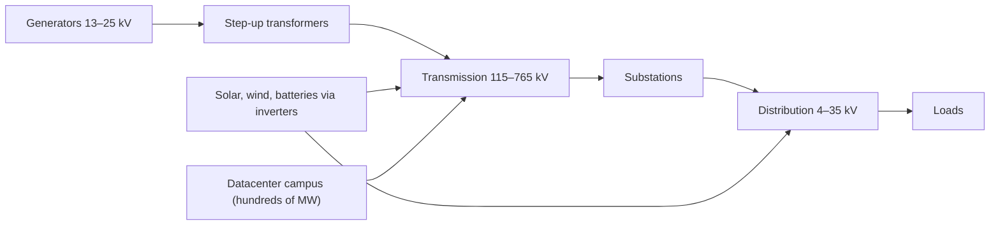
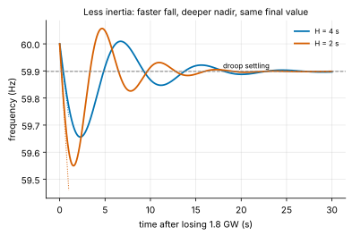
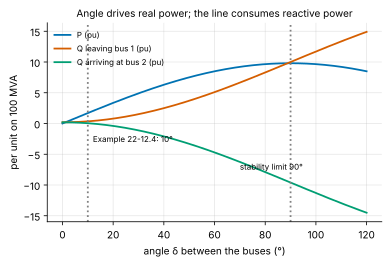

<!-- status: verified -->
# 22-12 · Power Systems Fundamentals

| | |
|---|---|
| **Course** | [22 · Power Electronics and Energy Conversion](../README.md) |
| **University equivalent** | An introductory power-systems analysis course at FE depth: the per-unit system, transformers and transmission lines in power systems, two-bus power flow, symmetrical and unsymmetrical faults, frequency control, and the grid integration of inverter-based resources, storage and large loads (Glover, Overbye & Sarma, *Power System Analysis and Design*; Grainger & Stevenson, *Power System Analysis*; Kundur, *Power System Stability and Control*) |
| **Prerequisites** | [07-11](../../07-circuit-analysis-2-transient-and-ac/chapters/07-11-three-phase-circuits.md) (three-phase circuits), [07-06](../../07-circuit-analysis-2-transient-and-ac/chapters/07-06-ac-power-and-power-factor.md) (complex power), [07-09](../../07-circuit-analysis-2-transient-and-ac/chapters/07-09-mutual-inductance-and-transformers.md) (transformers), [22-11](22-11-electric-machines.md) (synchronous machines), [22-10](22-10-datacenter-power-delivery.md) (datacenter loads) |
| **Estimated study hours** | 8 |
| **Last verified** | 2026-11-25 |

**Learning objectives.** After this chapter you can:

1. Put a power system into per-unit, change bases, and refer impedances through transformers.
2. Derive a transmission line's per-length inductance, capacitance, characteristic impedance and surge-impedance loading, and choose a short, medium or long line model.
3. Compute two-bus real and reactive power flow and the voltage drop along a line, and explain why angle controls real power and voltage magnitude controls reactive power.
4. Compute three-phase and single-line-to-ground fault currents with per-unit impedances and symmetrical components.
5. Derive the rate of change of frequency and the frequency response after a loss of generation or load, and explain what inverter-based resources and large datacenter loads change.

## 1. Big picture

The grid is the largest machine people have built: thousands of synchronous generators spinning in lockstep across a continent, linked by transmission lines and transformers, balancing supply and demand every second. Power systems engineering is how it stays balanced and how it survives faults: how voltage and power flow through a network, what current a short circuit draws, and how fast frequency falls when a large plant trips. That world is changing fast. Solar, wind and batteries connect through inverters instead of spinning machines, and AI datacenters are adding loads of hundreds of megawatts that switch in milliseconds. A chip industry that builds those inverters and those datacenters now sits on both sides of the grid's hardest problems, which is why this chapter ends Course 22.

- **Datacenters:** US datacenters used 4.7% of US electricity in 2024, and LBNL projects 9.5–15.3% by 2030 [2].
- **Inverter-based resources:** wind and solar supplied 17.2% of US utility-scale generation in 2025 [4], with no inherent inertia.
- **Storage:** US utility-scale batteries reached nearly 52 GW by mid-2026 [17].
- **Interconnection:** projects now wait more than five years from request to operation [15].

## 2. Intuition first

**The grid is a giant flywheel with many hands on it.** Every synchronous generator is a heavy spinning mass, and all of them turn at the same electrical speed: the grid frequency. Load is a hand braking the flywheel; generation is a hand pushing it. If the hands are balanced, the speed holds; if a large generator trips, the flywheel slows, and the stored kinetic energy buys time (seconds) until governors push harder. The heavier the flywheel (the more inertia), the slower the frequency falls. Power flows across the network from where the "push" leads in angle to where it lags, like a coupled set of springs stretched between the machines.

The analogy breaks down in two places that matter today. Inverter-based solar, wind and batteries have no mass connected to the grid, so they add generation without adding flywheel, unless their controls are programmed to emulate it. And modern loads are not passive brakes: a datacenter's power electronics can disconnect hundreds of megawatts in a few cycles when the voltage dips.

## 3. Theory

### 3.1 The per-unit system

A power system mixes voltages from 400 V to 765 kV, connected through transformers. Expressing every quantity as a fraction of a **base** removes the transformer turns ratios and makes values from different equipment comparable. Choose a three-phase power base $S_b$ for the whole system and a line-to-line voltage base $V_b$ in each zone, with zone bases related by the transformers' ratios. Then

$$
I_b = \frac{S_b}{\sqrt3\,V_b}, \qquad Z_b = \frac{V_b^2}{S_b},
$$

and any quantity in per unit (pu) is its actual value divided by its base. Units: V²/VA = Ω. ✓ Because the voltage bases follow the turns ratio, an ideal transformer becomes a 1:1 connection in per unit, and its impedance is the same seen from either side.

Equipment impedances are quoted in per unit on their own ratings, so to combine them they must be converted to the system base:

$$
Z_{pu,new} = Z_{pu,old}\left(\frac{V_{b,old}}{V_{b,new}}\right)^2\frac{S_{b,new}}{S_{b,old}} .
$$

A further benefit: per-unit impedances of a type of equipment fall in narrow ranges whatever its size (transformer leakage impedances of a few to about fifteen percent, for example), so a value far outside the range flags a data error.

### 3.2 Transmission lines

**Inductance.** Consider one conductor of a three-phase line with equilateral spacing $D$ (or the geometric mean of the three spacings). Ampère's law (04-06) gives the field around a conductor carrying $i$: $B = \mu_0i/(2\pi x)$ outside it. The flux linking the conductor out to distance $D$, plus the internal flux, gives, with the return currents in the other phases summing to $-i$,

$$
L = \frac{\mu_0}{2\pi}\ln\frac{D}{r'}\ \text{H/m},
$$

where $r'$ is the conductor's geometric mean radius ($0.7788r$ for a solid round conductor; for a bundle of several subconductors, an equivalent larger value). **Capacitance** follows the same geometry with the electric field: $C = 2\pi\varepsilon_0/\ln(D/r)$ F/m to neutral. Both depend only logarithmically on geometry, which is why per-length reactances of overhead lines cluster around 0.3–0.5 Ω/km at 60 Hz [16].

**Characteristic impedance and surge-impedance loading.** A lossless line's characteristic impedance is $Z_c = \sqrt{L/C}$, and waves travel at $1/\sqrt{LC}$, close to the speed of light for overhead lines. A line terminated in $Z_c$ is flat: the reactive power its series inductance absorbs, $I^2\omega L$ per metre, exactly equals what its shunt capacitance generates, $V^2\omega C$ per metre, because $V/I = \sqrt{L/C}$. That load is the **surge-impedance loading (SIL)**:

$$
\text{SIL} = \frac{V_{LL}^2}{Z_c} .
$$

Below SIL a line generates net reactive power and its voltage tends to rise; above it, the line absorbs reactive power and the voltage sags. An unloaded long line's far end rises above the sending voltage (the **Ferranti effect**), $V_R = V_S/\cos(\beta\ell)$ with $\beta = \omega\sqrt{LC}$.

**Which model.** Short lines (under about 80 km) are a series impedance $R + jX$; medium lines (80–240 km) add half the shunt capacitance at each end (the nominal π); long lines need the distributed solution with $Z_c$ and the propagation constant. A common planning rule loads lines to about 3 × SIL below 80 km, 1.75 × SIL for 80–240 km, and SIL beyond [16].

### 3.3 Power flow between two buses

Connect a bus at voltage $\mathbf{V}_1 = V_1\angle\delta$ to a bus at $\mathbf{V}_2 = V_2\angle0$ through a reactance $X$ (resistance neglected; transmission lines have $X/R$ of 9 to 26 [16]). The current is $\mathbf{I} = (\mathbf{V}_1 - \mathbf{V}_2)/(jX)$, and the complex power delivered into the line at bus 1 is $S_1 = \mathbf{V}_1\mathbf{I}^*$. Expanding,

$$
P = \frac{V_1V_2}{X}\sin\delta, \qquad Q_1 = \frac{V_1^2 - V_1V_2\cos\delta}{X}, \qquad Q_2 = \frac{V_1V_2\cos\delta - V_2^2}{X},
$$

with $Q_2$ the reactive power arriving at bus 2. Real power flows from the leading to the lagging bus and is controlled mainly by the **angle**; reactive power flows from the higher-voltage to the lower-voltage bus and is controlled mainly by the **voltage magnitudes**. The maximum transfer, $V_1V_2/X$ at $\delta$ = 90°, is the steady-state stability limit (the same law as the synchronous machine of 22-11). Real networks have many buses, and the power-flow equations, one $P$ and one $Q$ balance per bus, are solved iteratively (Newton–Raphson) by planning software.

**Voltage drop.** For a line with $R$ and $X$ carrying $P$ and $Q$ at voltage $V$, the drop is approximately

$$
\Delta V \approx \frac{RP + XQ}{V},
$$

so on high-$X/R$ transmission the reactive power dominates the voltage drop, which is why reactive compensation (capacitor banks, static VAR compensators, inverters) controls voltage. This is a first-order estimate: the current also creates a quadrature drop $\delta V = (XP - RQ)/V$, which adds roughly $\delta V^2/(2V)$ to the magnitude, a correction that matters on long or heavily loaded lines (Example 22-12.9).

### 3.4 Faults and protection

A **fault** is an unintended path for current: a lightning flashover, a fallen conductor, a failed insulator. The most severe is a balanced **three-phase fault**. In per unit, with the prefault voltage $V_f$ (usually 1.0 pu) and the Thevenin impedance $Z_{th}$ of the network at the fault (generators represented by their subtransient reactances $X''_d$),

$$
I_f = \frac{V_f}{Z_{th}}, \qquad S_{f} = \frac{S_b}{Z_{th,pu}} \text{ (fault MVA)} .
$$

Breakers must interrupt this current, and the fault MVA (or **short-circuit level**) measures how stiff the grid is at that point.

**Unbalanced faults and symmetrical components.** Most faults involve one phase to ground. Fortescue showed that any unbalanced set of three phasors is the sum of three balanced sets: positive sequence ($a$-$b$-$c$), negative sequence ($a$-$c$-$b$) and zero sequence (all in phase), using the operator $a = 1\angle120°$. Each sequence sees its own network impedance ($Z_1$, $Z_2$, $Z_0$). For a **single-line-to-ground** fault on phase $a$, the boundary conditions ($I_b = I_c = 0$, $V_a = 0$) force the three sequence currents to be equal and the three sequence networks to be in series, so

$$
I_a = 3I_{a1} = \frac{3V_f}{Z_1 + Z_2 + Z_0} .
$$

When $Z_0 < Z_1$, as with solidly grounded transformers near the fault, the ground fault exceeds the three-phase fault (Problem 22-12.8).

**Protection.** Relays measure currents and voltages and trip breakers: overcurrent relays with time–current curves coordinated so the breaker nearest the fault opens first, distance relays that measure impedance to the fault, and differential relays that compare currents into and out of a transformer or bus. Clearing times are a few cycles.

### 3.5 Frequency, inertia and droop

**The swing equation.** The rotating machines store kinetic energy $E_k = HS$, where $S$ is their rated power and $H$ the **inertia constant** in seconds: the time the stored energy could supply rated power. Typical $H$ is about 4 s for gas and coal units and 5.9 s for nuclear, while wind and solar contribute none [5]. If generation falls short of load by $\Delta P$, the energy drains at $\Delta P$; with $E_k \propto f^2$,

$$
\frac{dE_k}{dt} = \frac{2E_k}{f_0}\frac{df}{dt} = -\Delta P \quad\Rightarrow\quad \text{RoCoF} = \frac{df}{dt} = -\frac{\Delta P\,f_0}{2HS} .
$$

Units: W × Hz/(s × W) = Hz/s. ✓ This **rate of change of frequency** is set by inertia alone, in the first second, before any control acts. Less inertia means a faster fall; ENTSO-E notes that "transients with RoCoF higher than 1 Hz/s are not manageable by system protections" [5].

**Droop.** Each governed generator raises its output in proportion to the frequency drop, with a **droop** $R$: a 5% droop unit goes from zero to full output over a 5% frequency change, so its response is $\Delta P_g = -(S/R)(\Delta f/f_0)$. Many units share a load change in proportion to $S/R$, and the frequency settles where total governor response plus load damping (motors slow down and draw less) equals $\Delta P$:

$$
\Delta f_{ss} = -\frac{\Delta P}{\sum S_i/(R_if_0) + D},
$$

with $D$ the load damping in MW/Hz. Governors respond in seconds, so the frequency first falls at the inertial RoCoF, reaches a lowest point (the **nadir**) when governor output catches up, and recovers to $\Delta f_{ss}$; slower secondary control (automatic generation control) then restores 60 Hz over minutes. Underfrequency load shedding is the last line of defence.

### 3.6 Inverter-based resources, storage and large loads

**Inverter-based resources (IBRs)** follow the grid's voltage with a phase-locked loop and inject current; they have no inherent inertia and limit fault current to about rated current. Their controls are fast, which is both the problem and the cure. NERC's investigations of two Texas events found 1,112 MW of solar output and then 1,711 MW of IBR output lost to control and protection behaviour during ordinary transmission faults [8], [9]. Standards now require IBRs to ride through faults and support the grid: IEEE 1547-2018 for distributed resources and IEEE 2800-2022 for transmission-connected plants [18], [19]. **Grid-forming** inverters, which set their own voltage and frequency like a synchronous machine, and **fast frequency response** from batteries, which can act faster than any governor, partly replace the lost inertia.

**Large loads.** Datacenters are now large enough to matter to the bulk system. In July 2024, a fault sequence on a 230 kV line led about 1,500 MW of "exclusively data center-type load" to transfer to backup power within seconds [10], a sudden loss of load that raises frequency and voltage. NERC has since issued alerts and proposed registering large computational loads [12], [13]. The same physics applies in reverse to the synchronized training swings of 22-10.

## 4. Worked examples

### Example 22-12.1 · Setting up per-unit bases (tier A)

**Setup.** A 100 MVA system has a 13.8 kV generator zone and a 230 kV transmission zone joined by a 13.8/230 kV transformer. Find, in each zone, (a, b) the impedance base and (c, d) the current base. (e) Express a 50 Ω line impedance at 230 kV in per unit.

**Solution.**

- (a) $230^2/100$ = **529** Ω; (b) $13.8^2/100$ = **1.904** Ω.
- (c) $100\ \text{MVA}/(\sqrt3 \times 230\ \text{kV})$ = **251.0** A; (d) at 13.8 kV, **4184** A.
- (e) $50/529$ = **0.0945** pu.

**Units check.** kV²/MVA = Ω; MVA/kV = A. ✓

**Sanity check.** The current base is 16.7 times larger on the low-voltage side, the turns ratio: in per unit the transformer disappears.

### Example 22-12.2 · Changing base (tier A)

**Setup.** A 50 MVA transformer has 8% impedance on its own rating. Express it on a 100 MVA base at the same voltage.

**Solution.** $0.08 \times 100/50$ = **0.16** pu.

**Units check.** Dimensionless. ✓

**Sanity check.** A smaller transformer looks like a larger impedance on a larger base: it carries the same per-unit current with twice the drop.

### Example 22-12.3 · A 345 kV line's parameters (tier B)

**Setup.** A 345 kV, 60 Hz line has an equivalent phase spacing of 8 m, a bundle geometric mean radius of 0.10 m for inductance and an equivalent radius of 0.12 m for capacitance (assumed). Find (a) the inductance per metre, (b) the capacitance per kilometre, (c) the reactance per kilometre, (d) the characteristic impedance, (e) the SIL and (f) the wave speed as a fraction of $c$.

**Solution.**

- (a) $2 \times 10^{-7}\ln(8/0.10)$ = **0.876** µH/m.
- (b) $2\pi\varepsilon_0/\ln(8/0.12)$ = **13.25** nF/km.
- (c) $2\pi \times 60 \times 0.876 \times 10^{-3}$ = **0.330** Ω/km.
- (d) $\sqrt{L/C}$ = **257** Ω; (e) $345^2/257$ = **463** MW; (f) **0.979**.

**Units check.** $\sqrt{\text{H/F}}$ = Ω; kV²/Ω = MW. ✓

**Sanity check.** Published typical values for 345 kV lines are 0.376 Ω/km, 290 Ω and 410 MW [16]: the same range, with the differences set by conductor bundling and spacing. The wave speed below $c$ reflects using different radii for $L$ and $C$.

### Example 22-12.4 · Two-bus power flow (tier B)

**Setup.** Bus 1 at 1.0 pu leads bus 2 at 0.98 pu by 10°, through $X$ = 0.1 pu on a 100 MVA base. Find (a) the real power in per unit and (b) in MW, the reactive power (c) leaving bus 1 and (d) arriving at bus 2, and (e) the maximum transferable power.

**Solution.**

- (a) $1.0 \times 0.98\sin10°/0.1$ = **1.70** pu; (b) **170** MW.
- (c) $(1 - 0.98\cos10°)/0.1$ = **0.349** pu; (d) $(0.98\cos10° - 0.98^2)/0.1$ = **0.047** pu.
- (e) $0.98/0.1$ = **9.80** pu.

**Units check.** pu × pu / pu = pu. ✓

**Sanity check.** The difference between (c) and (d), 0.302 pu, is the line's reactive loss $I^2X$. Ten degrees carry 17% of the maximum, a typical operating margin.

### Example 22-12.5 · A three-phase fault (tier B)

**Setup.** In Example 22-12.1's system, the generator has $X''_d$ = 0.20 pu and the transformer 0.10 pu (both on 100 MVA). A bolted three-phase fault occurs at the 230 kV terminals of the transformer, with 1.0 pu prefault voltage. Find (a) the fault current in per unit, (b) in amperes at 230 kV, (c) the fault MVA and (d) the generator's current.

**Solution.**

- (a) $1/(0.20 + 0.10)$ = **3.33** pu; (b) $3.33 \times 251.0$ = **837** A; (c) **333** MVA.
- (d) $3.33 \times 4184$ = **13.9** kA.

**Units check.** pu × A = A. ✓

**Sanity check.** The same per-unit current is 837 A on one side of the transformer and 13.9 kA on the other: breakers on the generator side face currents 16.7 times larger.

### Example 22-12.6 · A single-line-to-ground fault (tier B)

**Setup.** At the same bus, $Z_1 = Z_2$ = j0.30 pu and $Z_0$ = j0.15 pu (assumed). Find the fault current (a) in per unit and (b) in amperes.

**Solution.** (a) $3/(0.30 + 0.30 + 0.15)$ = **4.00** pu; (b) $4.00 \times 251.0$ = **1004** A.

**Units check.** pu. ✓

**Sanity check.** With $Z_0$ half of $Z_1$, the ground fault is 20% larger than the three-phase fault, which is why ground-fault duty sets some breaker ratings.

### Example 22-12.7 · Inertia and the rate of change of frequency (tier B)

**Setup.** A 60 Hz system has 50 GW of synchronous generation online with $H$ = 4 s and loses 1.8 GW of generation. Find (a) the initial RoCoF and (b) how long the frequency would take to fall 0.5 Hz at that rate. With inverter-based generation replacing half the inertia ($H$ = 2 s), find (c) the RoCoF and (d) the time. (e) For ERCOT's critical inertia of 100 GW·s and a 2,805 MW loss [7], what is the RoCoF?

**Solution.**

- (a) $1.8 \times 60/(2 \times 4 \times 50)$ = **0.27** Hz/s; (b) $0.5/0.27$ = **1.85** s.
- (c) **0.54** Hz/s; (d) **0.93** s.
- (e) $2805 \times 60/(2 \times 100\,000)$ = **0.84** Hz/s.

**Units check.** MW × Hz/(s × MW) = Hz/s. ✓

**Sanity check.** Halving inertia halves the time governors have to respond, which is why low-inertia grids need fast frequency response from batteries and inverters. ERCOT's critical value keeps the RoCoF below the 1 Hz/s that protection can manage [5].

### Example 22-12.8 · Sharing a load change by droop (tier A)

**Setup.** A 500 MW generator with 5% droop picks up 50 MW alone (no load damping). (a) What is the frequency change? (b) If ten identical units share the change, what is it?

**Solution.**

- (a) $\Delta f = -R(\Delta P/S)f_0 = -0.05 \times (50/500) \times 60$ = **−0.30** Hz.
- (b) Ten units give ten times the response per hertz: **−0.030** Hz.

**Units check.** Dimensionless × Hz. ✓

**Sanity check.** A large interconnection's frequency barely moves for a 50 MW change because thousands of units share it.

### Example 22-12.9 · Connecting a datacenter (tier C)

**Setup.** A 300 MW datacenter at 0.98 power factor connects through 20 km of 230 kV line with $x$ = 0.489 Ω/km and $X/R$ = 8.9 [16]. Find (a) the line current, (b) the reactive power, (c) the line reactance and (d) resistance, (e) the voltage drop and (f) its percentage. (g) If the grid's short-circuit level at the substation is 3000 MVA, what is the short-circuit ratio?

**Solution.**

- (a) $300\ \text{MW}/(\sqrt3 \times 230\ \text{kV} \times 0.98)$ = **768** A; (b) $300\tan(\cos^{-1}0.98)$ = **60.9** Mvar.
- (c) $0.489 \times 20$ = **9.78** Ω; (d) $9.78/8.9$ = **1.10** Ω.
- (e) $(1.10 \times 300 + 9.78 \times 60.9)/230$ = **4.02** kV; (f) **1.75** %.
- (g) $3000/300$ = **10**.
- (h) Solving the phasors exactly (receiving end at 230 kV, current lagging by $\cos^{-1}0.98$) gives a drop of **4.36** kV, (i) **1.89** %.

**Units check.** (Ω × MW)/kV = kV. ✓

**Sanity check.** The first-order formula is 8% low here: the quadrature drop $(XP - RQ)/V$ = 12.5 kV adds about $12.5^2/(2 \times 230)$ = 0.34 kV to the magnitude. A short-circuit ratio of 10 is comfortably stiff; a large campus on a weak, remote line (ratio near 3) would see its voltage swing with every load change, and its power electronics could react to the grid as much as the grid to them (§9).

<!-- answer-key -->

| ID | Quantity | Value | Unit |
|---|---|---|---|
| Ex 22-12.1a | impedance base at 230 kV | 529 | Ω |
| Ex 22-12.1b | impedance base at 13.8 kV | 1.904 | Ω |
| Ex 22-12.1c | current base at 230 kV | 251.0 | A |
| Ex 22-12.1d | current base at 13.8 kV | 4184 | A |
| Ex 22-12.1e | line impedance | 0.0945 | pu |
| Ex 22-12.2 | transformer on 100 MVA | 0.16 | pu |
| Ex 22-12.3a | inductance | 0.876 | µH/m |
| Ex 22-12.3b | capacitance | 13.25 | nF/km |
| Ex 22-12.3c | reactance | 0.330 | Ω/km |
| Ex 22-12.3d | characteristic impedance | 257 | Ω |
| Ex 22-12.3e | surge-impedance loading | 463 | MW |
| Ex 22-12.3f | wave speed over c | 0.979 | |
| Ex 22-12.4a | real power | 1.70 | pu |
| Ex 22-12.4b | real power | 170 | MW |
| Ex 22-12.4c | reactive power leaving bus 1 | 0.349 | pu |
| Ex 22-12.4d | reactive power arriving at bus 2 | 0.047 | pu |
| Ex 22-12.4e | maximum power | 9.80 | pu |
| Ex 22-12.5a | three-phase fault current | 3.33 | pu |
| Ex 22-12.5b | fault current at 230 kV | 837 | A |
| Ex 22-12.5c | fault MVA | 333 | MVA |
| Ex 22-12.5d | generator current | 13.9 | kA |
| Ex 22-12.6a | ground-fault current | 4.00 | pu |
| Ex 22-12.6b | ground-fault current | 1004 | A |
| Ex 22-12.7a | RoCoF with H = 4 s | 0.27 | Hz/s |
| Ex 22-12.7b | time to fall 0.5 Hz | 1.85 | s |
| Ex 22-12.7c | RoCoF with H = 2 s | 0.54 | Hz/s |
| Ex 22-12.7d | time to fall 0.5 Hz | 0.93 | s |
| Ex 22-12.7e | ERCOT critical-inertia RoCoF | 0.84 | Hz/s |
| Ex 22-12.8a | frequency change, one unit | −0.30 | Hz |
| Ex 22-12.8b | frequency change, ten units | −0.030 | Hz |
| Ex 22-12.9a | line current | 768 | A |
| Ex 22-12.9b | reactive power | 60.9 | Mvar |
| Ex 22-12.9c | line reactance | 9.78 | Ω |
| Ex 22-12.9d | line resistance | 1.10 | Ω |
| Ex 22-12.9e | voltage drop | 4.02 | kV |
| Ex 22-12.9f | voltage drop | 1.75 | % |
| Ex 22-12.9g | short-circuit ratio | 10 | |
| Ex 22-12.9h | exact voltage drop | 4.36 | kV |
| Ex 22-12.9i | exact voltage drop | 1.89 | % |
| Ex 22-12.9j | quadrature drop | 12.5 | kV |
| Ex 22-12.9k | second-order correction | 0.34 | kV |
| Ex 22-12.4f | line reactive loss | 0.302 | pu |
| Txt 22-12.a | wind and solar share of US utility-scale generation, 2025 | 17.2 | % |

## 5. Simulate it

The lab is [labs/22-12-lab/](../labs/22-12-lab/README.md). `grid.py` collects the chapter's models: per-unit bases and base changes, line parameters and SIL, two-bus power flow and voltage drop, fault currents, RoCoF and droop, and a swing-equation frequency-response model with an aggregate governor. Two ngspice netlists:

- `powerflow.cir` solves Example 22-12.4 in volts and ohms (230 kV, 52.9 Ω) by AC analysis and computes $P$ and $Q$ from $3\mathbf{V}\mathbf{I}^*$.
- `freq.cir` integrates the swing equation and a first-order governor as two capacitor voltages, the frequency deviation and the governor's extra output, after a 1.8 GW loss.

**Predict, then run:**

1. *Predict* Example 22-12.4's power flow and run `ngspice -b powerflow.cir`.
2. *Predict* the RoCoF and the settled deviation after the 1.8 GW loss; *guess* the nadir; run `ngspice -b freq.cir`.
3. In the notebook, halve the inertia and compare the nadir and its timing.
4. Sweep the angle in the two-bus system and the ratio $Z_0/Z_1$ in the fault calculation.

## 6. Engineering tradeoffs

| Knob | Improves | Costs | Typical decision owner |
|---|---|---|---|
| Higher transmission voltage | Power per corridor, losses ($1/V^2$), SIL | Tower height, clearances, insulation and substation cost | Transmission planner |
| Series or shunt compensation | Transfer capability and voltage control | Equipment cost; series capacitors add resonance risks | Transmission planner |
| HVDC instead of AC | Long-distance and undersea transfer, controllable flow, no stability limit | Converter stations, cost at short distances | Transmission planner |
| More synchronous inertia (or synchronous condensers) | Lower RoCoF, slower frequency change, fault current | Fuel or capital for machines that may not produce energy | System operator |
| Grid-forming inverters and fast frequency response | Inertia-like support without rotating mass | Inverter oversizing, standards and validation | Plant developer with the system operator |
| Tighter ride-through requirements | Fewer cascading trips of IBRs and large loads | Equipment and protection redesign | Standards bodies, system operator |
| Faster protection | Less equipment damage and better stability | Selectivity and coordination effort | Protection engineer |
| Datacenter voltage ride-through settings | Fewer sudden load losses | Risk to IT equipment during deep sags | Datacenter operator with the utility |

## 7. Numbers to know

| Quantity | Typical value | Source |
|---|---|---|
| Per-unit bases | $Z_b = V_b^2/S_b$, $I_b = S_b/(\sqrt3V_b)$ | §3.1 |
| Overhead lines (60 Hz) | 0.33–0.49 Ω/km; $Z_c$ 250–380 Ω; SIL 140 MW (230 kV) to 2250 MW (765 kV); $X/R$ 9–26 | [16] |
| Two-bus power | $P = V_1V_2\sin\delta/X$; stability limit at 90° | §3.3 |
| Ground fault | $3V_f/(Z_1 + Z_2 + Z_0)$ | §3.4 |
| RoCoF | $\Delta Pf_0/(2HS)$; above 1 Hz/s not manageable by protection | §3.5, [5] |
| Inertia constants | nuclear 5.9 s, gas and coal 4.2 s, hydro 2.7–3.7 s, wind and solar 0 | [5] |
| Governor droop | typically 5% | §3.5 |
| US generation mix, 2025 | gas 40.9%, nuclear 17.7%, coal 16.6%, wind 10.4%, utility solar 6.8%, hydro 5.5% | [4] |
| US datacenters (as of Nov 2026) | 192 TWh, 4.7% of US electricity in 2024; 9.5–15.3% projected for 2030 | [2] |
| Global datacenters (as of Nov 2026) | about 415 TWh, 1.5% of world electricity in 2024; about 945 TWh in 2030 (base case) | [3] |
| US battery storage (as of Nov 2026) | 43.6 GW at end of 2025; nearly 52 GW by mid-2026 | [17] |
| Interconnection queue (as of Nov 2026) | about 2,061 GW active at end of 2025; request to operation over 5 years | [15] |

## 8. Common mistakes

- **Mixing line and phase quantities.** Three-phase power is $\sqrt3V_{LL}I_L\cos\varphi$; per-phase calculations use $V_{LL}/\sqrt3$. In per unit the factor disappears, which is one reason to use it.
- **Forgetting to change base.** Equipment impedances are on their own ratings; combine them only after converting to the system base (Example 22-12.2).
- **Treating $\Delta V \approx (RP + XQ)/V$ as exact.** It is first order; on long or heavily loaded lines the quadrature drop adds measurably (Example 22-12.9).
- **Assuming the three-phase fault is always the worst.** With a low zero-sequence impedance, the ground fault is larger (Problem 22-12.8).
- **Confusing RoCoF with the final deviation.** Inertia sets the initial slope and the nadir; droop and load damping set where frequency settles.
- **Thinking inverters fix inertia automatically.** Grid-following inverters add none; they need specific control (grid-forming or fast frequency response) to help.
- **Treating datacenters as passive loads.** Their power electronics and protection settings can drop or restore hundreds of megawatts in seconds (§9).

## 9. Practitioner lens

*State of the art as of Nov 2026. Sources are logged as R-452 to R-457.*

**Datacenter demand** [Established for historical data; Industry estimate for projections]. LBNL's 2025 update puts US datacenter use at "192 terawatt-hours (TWh), accounting for 4.7% of total U.S. electricity consumption" in 2024, and projects 649 TWh (11.8%) in 2030 in its reference case, within a range of "521–843 TWh, equal to 9.5–15.3%" [2]; its earlier report had 4.4% in 2023 [1]. Globally, the IEA estimated "around 1.5% of the world's electricity consumption in 2024, or 415 terawatt-hours", rising to "around 945 TWh" by 2030 in its base case [3]. LBNL attributes a third of US load growth over 2024–2030 to datacenters [2].

**Generation mix** [Established]. In 2025, natural gas generated 40.9% of US utility-scale electricity, nuclear 17.7%, coal 16.6%, wind 10.4%, utility-scale solar 6.8% and hydro 5.5% [4]. Batteries are the fastest-growing resource: "a record 15 GW added in 2025", and nearly 52 GW installed by mid-2026 [17].

**Inertia and inverter-based resources** [Established].

- ENTSO-E's inertia report lists typical inertia constants and warns that RoCoF above 1 Hz/s is "not manageable by system protections" [5]; its RoCoF withstand guidance asks equipment to tolerate ±2 Hz/s over 500 ms [6].
- ERCOT, with little synchronous coupling to its neighbours, computes a critical inertia of about 100 GW·s for its largest credible 2,805 MW loss, and recorded a minimum of 109 GW·s in March 2021 [7].
- NERC's reports on two Texas disturbances found 1,112 MW of solar lost in 2021 (the largest single cause a phase-locked-loop loss of synchronism) [8], and 1,711 MW of IBR output plus 844 MW of synchronous generation, 2,555 MW in all, in 2022, an event that "nearly exceeded" the state's resource-loss protection criteria [9].
- IEEE 1547-2018 sets ride-through categories for distributed resources and requires them to "restore output to 80% of pre-disturbance active current within 0.4 s" [18]; IEEE 2800-2022 sets ride-through, current-response and fast-frequency-response requirements for transmission-connected IBRs [19].

**Large loads** [Established]. NERC's review of a July 2024 event found that a lightning-arrester failure and automatic reclosing produced "6 successive system faults in an 82-second period", after which about 1,500 MW of "exclusively data center-type load" transferred to backup power, much of it staying off for hours [10]. NERC has since issued alerts about "multiple events during which 1,000+ MW of unexpected Large Loads output reduction occurred" [12] and proposed registering large computational loads as a new class of grid entity [13]; its Large Loads Task Force describes datacenter ramps such as 450 MW to 40 MW in 36 seconds [11].

**Interconnection** [Established]. LBNL's queue study counted about 2,290 GW of generation and storage seeking connection at the end of 2024, and a median of 55 months from request to commercial operation for projects built in 2024, against 36 months in 2015 [14]; its 2026 edition reports about 2,061 GW and waits now over five years [15].

**Marketing vs Reality.**

- *"Datacenters will use X% of electricity by 2030."* Projections span a wide range (9.5–15.3% in LBNL's own update [2]); ask for the scenario, the assumed utilization and whether it is consumption or interconnection capacity.
- *"Batteries replace inertia."* Batteries can respond faster than governors, but only if their inverters are configured for fast frequency response or grid forming; a grid-following battery at full charge adds nothing to RoCoF.
- *"Our facility is a flexible load."* A load that drops 1,500 MW in seconds is flexible in the wrong direction; ask for ride-through settings and the transfer logic to backup [10].
- *"Interconnection in 18 months."* The median for 2024 projects was 55 months [14]; ask which studies are complete and what network upgrades are assigned.

**Questions for engineering leaders.**

1. **"What are your datacenter's voltage ride-through settings and transfer-to-backup logic?"** *Strong:* settings coordinated with the utility, tested against multi-fault sequences. *Evasive:* "The UPS handles it."
2. **"How much of your new campus load is firm, and how fast can it ramp?"** *Strong:* ramp rates, curtailment agreements and the impact on the local short-circuit ratio. *Evasive:* "We'll be flexible."
3. **"Are your inverters grid-following or grid-forming, and what fast frequency response do they provide?"** *Strong:* control mode, response time and IEEE 2800 compliance. *Evasive:* "They meet code."
4. **"What is the short-circuit ratio at your point of interconnection?"** *Strong:* the number, and the control tuning for a weak grid. *Evasive:* "The utility checked it."
5. **"Where is the project in the interconnection queue, and what upgrades are assigned?"** *Strong:* study stage, upgrade costs and timeline risk. *Evasive:* "We expect approval soon."

## 10. Concept check

**Q1.** Why does the per-unit system make transformers disappear?

Answer

The voltage bases on the two sides follow the turns ratio, so an ideal transformer's voltage and current ratios become 1:1 in per unit, and its impedance is the same from either side.

**Q2.** What is surge-impedance loading, and what happens to the voltage above and below it?

Answer

$V_{LL}^2/Z_c$, the load at which the line's series inductance absorbs exactly the reactive power its capacitance generates. Below it the line has surplus reactive power and the voltage rises; above it the line consumes reactive power and the voltage sags.

**Q3.** Why does angle control real power and voltage magnitude control reactive power?

Answer

With $X \gg R$, $P = V_1V_2\sin\delta/X$ depends mainly on the angle, while $Q$ depends on $V_1^2 - V_1V_2\cos\delta$, which near small angles is set by the voltage difference.

**Q4.** When is a single-line-to-ground fault larger than a three-phase fault?

Answer

When $Z_0 < Z_1$ (with $Z_2 = Z_1$): $3/(2Z_1 + Z_0)$ then exceeds $1/Z_1$.

**Q5.** After a large generator trips, what sets the initial RoCoF, the nadir and the final frequency?

Answer

Inertia alone sets the initial slope, $\Delta Pf_0/(2HS)$. The nadir depends on inertia and on how fast governors and other fast responses act. The final value depends only on droop and load damping.

**Q6.** Why do inverter-based resources make frequency control harder, and how can they help?

Answer

Grid-following inverters add generation without rotating mass, so inertia falls and RoCoF rises. With grid-forming control or fast frequency response, the same inverters can respond faster than any governor.

**Q7.** Why are large datacenters a new kind of grid problem?

Answer

They are large (hundreds of megawatts), concentrated, and behind power electronics whose protection can drop the whole load in seconds during a voltage disturbance, as in NERC's July 2024 event.

Now work the [22-12 problem set](../problems/22-12-problems.md).

## 11. Key terms

[Per-unit system](../../../reference/glossary.md#per-unit-system) · [Characteristic impedance](../../../reference/glossary.md#characteristic-impedance) · [Surge-impedance loading (SIL)](../../../reference/glossary.md#surge-impedance-loading-sil) · [Ferranti effect](../../../reference/glossary.md#ferranti-effect) · [Power flow](../../../reference/glossary.md#power-flow) · [Power angle](../../../reference/glossary.md#power-angle) · [Symmetrical components](../../../reference/glossary.md#symmetrical-components) · [Fault MVA](../../../reference/glossary.md#fault-mva) · [Short-circuit ratio](../../../reference/glossary.md#short-circuit-ratio) · [Inertia constant](../../../reference/glossary.md#inertia-constant) · [Rate of change of frequency (RoCoF)](../../../reference/glossary.md#rate-of-change-of-frequency-rocof) · [Governor droop](../../../reference/glossary.md#governor-droop) · [Frequency nadir](../../../reference/glossary.md#frequency-nadir) · [Inverter-based resource (IBR)](../../../reference/glossary.md#inverter-based-resource-ibr) · [Grid-forming inverter](../../../reference/glossary.md#grid-forming-inverter) · [Ride-through](../../../reference/glossary.md#ride-through) · [Interconnection queue](../../../reference/glossary.md#interconnection-queue) · [Phase-locked loop (PLL)](../../../reference/glossary.md#phase-locked-loop-pll)

## 12. Connections

- **Previous:** [22-11](22-11-electric-machines.md) supplied the synchronous machine whose power-angle law reappears here; [22-10](22-10-datacenter-power-delivery.md) showed the datacenter side of the grid connection.
- **Prerequisites:** [07-11](../../07-circuit-analysis-2-transient-and-ac/chapters/07-11-three-phase-circuits.md), [07-06](../../07-circuit-analysis-2-transient-and-ac/chapters/07-06-ac-power-and-power-factor.md), [07-09](../../07-circuit-analysis-2-transient-and-ac/chapters/07-09-mutual-inductance-and-transformers.md), and the inverters of [22-06](22-06-converter-losses-and-wide-bandgap.md).
- **Used later:** the Course 22 exam and the FE preparation track; capstones that size datacenter power and storage.
- **Next:** this chapter completes Course 22's chapters; the course wrap-up (exam, equation sheet, flashcards and audit) follows.

## 13. Further study

- J. D. Glover, T. J. Overbye and M. S. Sarma, *Power System Analysis and Design*, 6th ed., Cengage, 2017: per unit, lines, power flow, faults and symmetrical components at this chapter's level.
- P. Kundur, *Power System Stability and Control*, McGraw-Hill, 1994: the swing equation, governors and frequency control in depth.
- The NERC reports cited here [8], [9], [10], [11]: real events explained by the people who investigate them.

## 14. Sources

1. US DOE release on LBNL's *2024 United States Data Center Energy Usage Report* (LBNL-2001637), 20 Dec 2024. [R-452]
2. LBNL, *United States Data Center Energy Usage Report: 2025 Update*, LBNL-2001758, June 2026. [R-452]
3. IEA, *Energy and AI*, April 2025. [R-452]
4. US EIA, *Electric Power Monthly*, Tables 1.1 and 1.1.A (released 24 Nov 2026). [R-453]
5. ENTSO-E, *Inertia and Rate of Change of Frequency (RoCoF)*, version 17, 16 Dec 2020. [R-454]
6. ENTSO-E, RoCoF withstand capability guidance, 31 Jan 2018. [R-454]
7. ERCOT, *Inertia: Basic Concepts and Impacts on the ERCOT Grid*, white paper (rev. 2 Dec 2024). [R-454]
8. NERC, *Odessa Disturbance* report, September 2021. [R-454]
9. NERC, *2022 Odessa Disturbance* report, December 2022. [R-454]
10. NERC, *Incident Review: Considering Simultaneous Voltage-Sensitive Load Reductions*, 8 Jan 2025. [R-455]
11. NERC Large Loads Task Force, white paper, July 2025. [R-455]
12. NERC, Level 2 Alert on large loads, 9 Sep 2025. [R-455]
13. NERC, Level 3 Alert on computational loads, 4 May 2026 (copy hosted by the New York State Reliability Council). [R-455]
14. LBNL, *Queued Up: 2025 Edition* (data through 2024), December 2025. [R-456]
15. American Public Power Association, report on LBNL's *Queued Up: 2026 Edition*, 1 Jul 2026. [R-456]
16. University of Utah, ECE 3600 lecture notes on transmission lines (Spring 2025). [R-456]
17. US EIA, *Today in Energy* articles on battery storage, 12 Mar 2025, 20 Feb 2026 and 7 Aug 2026. [R-456]
18. EPRI (Boemer and Walling), IEEE 1547-2018 overview, PJM workshop, October 2018. [R-457]
19. EPRI, NAGF, NATF and NERC, joint webinar on IEEE 2800-2022, 3 May 2022. [R-457]
