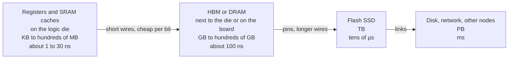
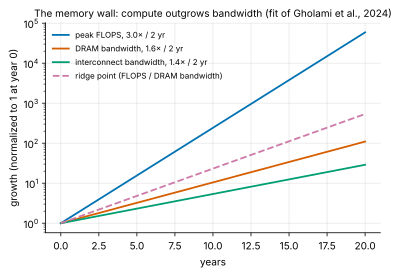
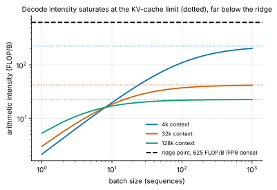

<!-- status: verified -->
# 23-01 · The Memory Hierarchy and the Memory Wall

| | |
|---|---|
| **Course** | [23 · Memory and Storage Technology](../README.md) |
| **University equivalent** | The opening lectures of a senior memory-systems elective: the memory hierarchy as a technology stack, energy and bandwidth of data movement, and the memory wall (Jacob, Ng & Wang, *Memory Systems: Cache, DRAM, Disk*, ch. 1; Hennessy & Patterson, *Computer Architecture: A Quantitative Approach*, ch. 2; Sze, Chen, Yang & Emer, *Efficient Processing of Deep Neural Networks*, ch. on dataflows and data movement) |
| **Prerequisites** | [14-09](../../14-computer-organization-and-architecture/chapters/14-09-memory-hierarchy-and-caches.md) (caches, AMAT, Little's law), [14-15](../../14-computer-organization-and-architecture/chapters/14-15-roofline-and-benchmarks.md) (the roofline), [14-14](../../14-computer-organization-and-architecture/chapters/14-14-ai-accelerators.md) (decode intensity at batch 1), [19-05](../../19-digital-vlsi-design/chapters/19-05-interconnect.md) (wire capacitance), [22-01](../../22-power-electronics-and-energy-conversion/chapters/22-01-power-conversion-principles.md) (the ½CV² charging loss) |
| **Estimated study hours** | 4 |
| **Last verified** | 2026-11-25 |

**Learning objectives.** After this chapter you can:

1. Place each memory technology in the hierarchy by capacity, latency, bandwidth and energy per bit, and explain from its cell and its wires why it sits there.
2. Derive the energy of moving a bit on a wire from $CV^2$, and convert between energy per bit, bandwidth and power.
3. Compute an interface's bandwidth from its width and pin rate, and the data in flight it needs from Little's law.
4. Quantify the memory wall as the growth of a machine's ridge point, using published compute and bandwidth trends.
5. Derive the arithmetic intensity, capacity limit, step time and memory energy of transformer decoding with a KV cache, and show why decoding stays memory-bound at any batch size.

## 1. Big picture

A processor can only compute on data that is next to it, and almost none of its data is. Each level of the memory hierarchy (registers, SRAM caches, DRAM, flash, and disks or the network) trades capacity against speed, and each level is built from a different device in a different process. In 2026 the bottleneck in most of the computing that matters commercially is not arithmetic but moving data: across a die, off a die to DRAM, and between chips. A 45 nm study found that reading 32 bits from DRAM cost about 173 times as much energy as a 32-bit floating-point multiply [1], and the gap has not closed since. Peak accelerator compute has grown faster than memory bandwidth for twenty years [9]. That is the **memory wall**, and AI inference has hit it hard.

- **Accelerators:** HBM stacks set an AI GPU's bandwidth, much of its cost and a large share of its power. One study measured about 35% of an H200's 700 W in its HBM3E [4].
- **Inference economics:** generating each token of a large language model reads every weight and the whole key–value cache once, so tokens per second per GPU are set by bytes per second, not FLOPS (§3.7).
- **CPUs and SoCs:** DRAM latency has barely moved in two decades [11], so cores hide it with caches and many outstanding requests (§3.5).
- **Wearables and IoT:** the energy of a memory access often exceeds that of the computation it feeds. Keeping data in local SRAM is the main lever for battery life.
- **Deal flow:** HBM, CXL memory expansion, near-memory compute and SRAM-heavy accelerators are all bets on where the wall moves next (§9).

## 2. Intuition first

Think of a city's food supply. A kitchen counter holds a little and is within arm's reach. The pantry holds more and takes a few steps. The supermarket holds far more, but each trip costs time and fuel, and the warehouse is a truck ride away. Nobody stores everything on the counter, because counters are expensive per item. Nobody cooks from the warehouse, because each fetch takes too long. The hierarchy works because most meals use a few ingredients over and over: *locality*.

Two numbers describe each trip: how long it takes (latency) and how much it can carry per hour (bandwidth). A third number, how much fuel each item costs (energy per bit), has become the one that matters most. A multiply is a flick of the wrist. Fetching its operands from DRAM is a drive across town.

Where the analogy breaks down: food is consumed, while data is copied, so the same byte can sit at several levels at once and must be kept consistent (coherence, 14-12). And unlike a grocery trip, a memory trip's cost is mostly the *wires*: charging the capacitance of every millimetre the bits travel.

*Each step to the right gains roughly 10 to 1000 times in capacity and loses as much in latency and energy per bit. The orders of magnitude are illustrative; §7 gives sourced values.*

## 3. Theory

### 3.1 The hierarchy as a technology stack

Chapter 14-09 treated the hierarchy as an architect sees it: hit rates, average memory access time (AMAT) and cache organization. Here we look at what each level is made of, because the device and its wires set the numbers.

| Level | Storage element | Why it sits there |
|---|---|---|
| Registers, L1, L2 | 6-transistor SRAM cell in the logic process (23-02) | Fast and logic-compatible, but about six transistors per bit, so costly per bit |
| Last-level cache | Large SRAM arrays, sometimes stacked dies | Same cell. Its long wires add latency and energy |
| Main memory | DRAM: one transistor and one capacitor per bit (23-03), in its own process | About an order of magnitude denser than SRAM, but slow to sense, and it must be refreshed |
| HBM | DRAM dies stacked on a base die, beside the processor on an interposer (23-05) | DRAM density with thousands of short wires |
| Storage | NAND flash, many bits per cell, stacked in 3D (23-06) | Cheapest per bit, non-volatile, microseconds to read, wears out |

Two physical facts organize the table. First, a denser cell needs a separate, specialized process, which pushes it off the logic die, and off-die means longer, higher-capacitance wires. Second, a bigger array has longer wordlines and bitlines, so even within one technology, capacity costs latency and energy. The hierarchy is therefore not an engineering preference. It is the cost-minimizing way to combine devices whose cost per bit and access cost differ by orders of magnitude.

### 3.2 The energy of moving a bit

**Charging a wire.** A wire of capacitance $C$ (F) is charged from 0 to $V$ (V) by a driver connected to a supply at $V$. The supply delivers charge $Q = CV$ at voltage $V$, so it supplies energy

$$
E_{supply} = QV = CV^2 .
$$

The capacitor ends up storing $\tfrac12CV^2$, so the other $\tfrac12CV^2$ is dissipated in the driver's resistance, whatever that resistance is (22-01 derived this). When the wire later discharges to 0, the stored half is dissipated in the pull-down, and the supply delivers nothing. Each full cycle, 0 → 1 → 0, costs $CV^2$ from the supply, all of it drawn on the rising edge. Units: F·V² = C·V = J.

**Per bit.** A wire carrying a bit stream draws energy only on its 0 → 1 transitions. If the probability that a given bit is a 1 following a 0 is $p_{01}$, the average energy per bit is

$$
E_b = p_{01}\,CV^2 .
$$

For random data, each bit is independently 0 or 1, so $p_{01} = \tfrac12 \cdot \tfrac12 = \tfrac14$. Alternating data (0101…) has $p_{01} = \tfrac12$, and constant data has $p_{01} = 0$. On-chip wires have about 0.2 fF/µm, roughly constant across process nodes, because width, thickness and spacing shrink together (19-05). So a millimetre of wire is about 200 fF, and at 0.75 V random data costs about 28 fJ per bit per millimetre (Example 23-01.2). That looks tiny until it is multiplied by a terabyte per second and tens of millimetres.

**Off-chip links.** A wire leaving the package is a transmission line. It must be terminated in its characteristic impedance (about 50 Ω) to avoid reflections (21-02). A terminated driver passes a current $I$ through the termination for the whole bit time $T_b$, not just at transitions. Its energy per bit is about $V_{DD}IT_b$, and it draws static power whenever the link is active, even if no useful data flows. Horowitz put DRAM I/O at "over 20pJ/bit", with static power on top [1]. Wide, short, low-swing interfaces such as HBM's interposer wires exist to escape this. In the HBM2 analysis below, the I/O is the smallest part of the energy.

**Inside the DRAM.** O'Connor et al. modelled an HBM2 access at about 3.9 pJ/bit and split it three ways [3]:

- moving data across the DRAM die to its through-silicon vias: 2.24 pJ/bit;
- the interposer I/O: 0.3 pJ/bit;
- row activation: 1.21 pJ/bit on average.

The surprise is that the DRAM's own internal wires cost the most. Activation is the other lesson. Opening a row senses and restores every bit in it, typically a kilobyte, whether one byte or all of them are then read. The activation energy per *useful* bit is

$$
E_{act,b} = \frac{E_{row}}{N_{used}} ,
$$

so an access pattern that uses 64 bytes of a 1 KB row pays 16 times the activation energy per bit of one that streams the whole row. Locality saves energy as well as time.

> **Math refresher — expected value of a transition.** For random bits, the four equally likely pairs of consecutive bits are 00, 01, 10 and 11. Only 01 charges the wire, so the expected number of charging events per bit is 1/4. For any stationary bit stream, $p_{01}$ is the fraction of positions where a 1 follows a 0. Bus-encoding schemes (for example, sending a word inverted when that toggles fewer wires) work by lowering $p_{01}$.

### 3.3 Energy per bit, bandwidth and power

Power is energy per second. A memory system delivering bandwidth $BW$ (bytes per second) at energy $E_b$ per bit draws

$$
P = 8\,BW\,E_b .
$$

Units: B/s × bit/B × J/bit = W. Read in reverse, a power budget caps bandwidth: $BW_{max} = P_{budget}/(8E_b)$. O'Connor et al. framed the HBM decision this way [3]. A 300 W GPU card could spend about 20%, 60 W, on DRAM, which caps GDDR5 at 14.0 pJ/bit to about 536 GB/s but lets HBM2 at 3.9 pJ/bit reach about 1.92 TB/s (Example 23-01.3). The energy per bit, not the pin count, decided which memory a high-bandwidth GPU could use.

Measured systems include everything the model leaves out: refresh, standby currents, clocking and controller activity. Olgun et al. measured an H200's HBM3E at up to 248 W while it sustained 4.52 TB/s, 94% of its 4.8 TB/s peak [4]. Dividing power by delivered bits gives an *all-in* 6.86 pJ/bit. That is not a contradiction of the 3.9 pJ/bit model: the two count different things. An all-in figure is the one that sets the power supply and the cooling.

### 3.4 Bandwidth from pins and wires

A parallel interface of $N$ data pins, each carrying $r$ bits per second, delivers

$$
BW = \frac{N r}{8} .
$$

There are two ways to raise it: more pins or faster pins. Faster pins cost energy, because past a few gigabits per second the channel's loss needs equalization and precise clocking. They also cost distance, because loss rises with frequency and length. More pins cost area and, above all, **die edge** ("beachfront"). The signals must leave the processor die through bumps along its perimeter, and the perimeter grows only as the square root of the area.

HBM takes the more-pins route. It places DRAM stacks millimetres from the processor on a silicon interposer, whose wires are short and fine enough to carry 1,024 data bits per stack (2,048 in HBM4) at modest rates. NVIDIA's Blackwell Ultra uses eight stacks behind "16 × 512-bit controllers (8,192-bit total width)" for 8 TB/s [5]. That works out to under 8 Gb/s per pin (Example 23-01.4). A desktop DDR5 system takes the other route: two 64-bit channels at 6,000 MT/s give 96 GB/s [12], from 128 data pins running on a motherboard. The bandwidth gap, about 83 times, comes almost entirely from the pin count (64 times as many), and the pin count comes from the packaging.

### 3.5 Latency, concurrency and Little's law

Latency is how long one access takes. Bandwidth is how many bytes arrive per second when many accesses overlap. They are linked by Little's law (14-09): in any stable system, the average number of items inside equals their arrival rate times the average time each spends inside, $L = \lambda W$. For memory, the data that must be in flight to sustain a bandwidth is

$$
D_{flight} = BW \times t_{lat} .
$$

Units: B/s × s = B. A memory system cannot deliver its bandwidth unless the processor keeps that much data requested and not yet returned. Divided by the request size, this gives the number of requests that must be outstanding.

> **Going deeper — why Little's law holds.** Plot the number of requests in flight, $n(t)$, against time over a long interval $T$. The area under the curve, $\int_0^T n\,dt$, can be counted two ways: as the average occupancy times $T$, or as the sum of every request's time in flight. The second is the number of requests, $\lambda T$, times their average latency $W$. Equating the two, $\bar n\,T = \lambda T\,W$, so $\bar n = \lambda W$. Nothing about the arrival process or service order was assumed, which is why the law applies to DRAM queues, store buffers and networks alike.

The law explains why GPUs keep tens of thousands of threads resident: an accelerator streaming 8 TB/s with an assumed 600 ns loaded latency needs about 4.8 MB in flight, some 75,000 64-byte requests (Example 23-01.5). It also explains why DRAM latency matters even to bandwidth-bound work. Lee et al. found that over an 11-year span in which DRAM cost per bit fell 16-fold, the row-activation and row-cycle times (tRCD and tRC) improved by only 30.5% and 26.3% [11]. The cause is physics: the long, heavily loaded bitlines that sensing must swing (23-03). A current desktop CPU sees "just over 70 ns" to DRAM [12], about what a CPU saw a decade earlier.

### 3.6 The memory wall

Wulf and McKee named the memory wall in 1995 [10]. Their argument is a two-line model. If a fraction $h$ of accesses hit in a cache of access time $t_c$ and the rest go to memory at $t_m$, the average access time is

$$
t_{avg} = h\,t_c + (1 - h)\,t_m .
$$

If processor speed (and with it $t_c$, measured in cycles of a faster clock) improves faster than DRAM's $t_m$, then however close $h$ gets to 1, the second term eventually dominates and performance tracks memory, not logic.

Today the wall is mostly about bandwidth. Recall the **ridge point** of the roofline (14-15): peak compute divided by memory bandwidth, the arithmetic intensity (FLOP per byte) a kernel needs to keep the arithmetic busy. If peak FLOPS grow by a factor $r_F$ every two years and bandwidth by $r_B$, the ridge point grows by $r_F/r_B$ every two years. Gholami et al. fitted 20 years of server hardware at $r_F$ = 3.0 and $r_B$ = 1.6 per two years for DRAM (1.4 for interconnect) [9]. The ridge therefore grows about 1.9 times every two years, roughly 23 times a decade (Example 23-01.6). Each generation, a kernel must reuse each byte about twice as often just to stay compute-bound. Lower-precision formats raise the quoted ridge further. NVIDIA quotes Blackwell Ultra's dense NVFP4 rate at three times its dense FP8 rate (15 against 5 PF) at the same bandwidth [5], so its ridge triples. A kernel keeps its place relative to the ridge only if its data shrinks to 4 bits too.

> **Math refresher — compound growth.** A quantity growing by a factor $r$ every two years grows by $r^{t/2}$ in $t$ years. Its doubling time is $2\ln 2/\ln r$ years. Ratios of exponentials are exponentials: $r_F^{t/2}/r_B^{t/2} = (r_F/r_B)^{t/2}$.

### 3.7 Why AI inference is memory-bound

Example 14-14.6 showed that a language model decoding one token at batch size 1 performs about 2 FLOP per weight while reading every weight once. That is an intensity near 1 FLOP per weight byte, hundreds of times below an accelerator's ridge. Batching $B$ sequences reuses each weight $B$ times. Counting weights alone, that seemed to promise compute-bound operation at a few hundred sequences. The **key–value (KV) cache** breaks that promise.

**The model.** A decoder-only transformer has $P$ parameters stored at $b_w$ bytes each, so the weights occupy $W = Pb_w$ bytes. It has $L$ layers, each with $n_q$ query heads and $n_{kv}$ key–value heads of dimension $d_h$, so its model width is $d = n_qd_h$. To generate the next token, each layer's attention compares the new query with the stored keys and values of every earlier token in the sequence. Those are kept in the KV cache, at $b_{kv}$ bytes per element.

**KV bytes per token.** Every token of context adds one key and one value vector per layer and KV head:

$$
k = 2\,L\,n_{kv}\,d_h\,b_{kv}\quad\text{bytes per token}.
$$

A sequence of context length $n$ holds $kn$ bytes. One decode step for a batch of $B$ sequences reads every weight once and every sequence's whole KV cache:

$$
\text{bytes per step} = W + Bkn .
$$

**FLOPs per step.** The weight matrix multiplications cost 2 FLOP per parameter per sequence. Attention costs, per layer and per sequence, a query-times-keys product ($d$ multiply-adds per context token) and a weights-times-values product (another $d$), so $4Ld\,n$ FLOP. In total,

$$
\text{FLOPs per step} = B\,(2P + 4Ldn) .
$$

**Intensity.** Dividing,

$$
I(B) = \frac{B\,(2P + 4Ldn)}{W + Bkn} .
$$

At $B = 1$ and short context this is about $2P/W = 2/b_w$, the weights-only result. As $B$ grows, the KV term takes over the denominator, and

$$
\lim_{B\to\infty} I(B) = \frac{2P + 4Ldn}{kn} .
$$

Unlike the weights, each sequence's KV cache is read once per step and serves only that sequence, so batching cannot amortize it. The attention part alone has intensity

$$
\frac{4Ld\,n}{kn} = \frac{4Ln_qd_h}{2Ln_{kv}d_hb_{kv}} = \frac{2\,(n_q/n_{kv})}{b_{kv}} ,
$$

which depends on neither batch size nor context length. With 8 query heads sharing each KV head and 1-byte KV entries it is 16 FLOP/B, far below any modern ridge point. Decode attention is memory-bound by construction. The only levers are fewer or smaller KV entries (grouped-query attention, quantized KV caches) or more bandwidth.

**Capacity.** The KV cache also fills memory. With capacity $M$, the largest batch that fits is

$$
B_{max} = \left\lfloor \frac{M - W}{kn} \right\rfloor ,
$$

ignoring activations and fragmentation. Long contexts cut the batch, which cuts the weight reuse, which pushes decoding further below the ridge.

**Step time and energy.** The roofline bound on a step is the slower of moving the bytes and doing the FLOPs:

$$
t_{step} \ge \max\!\left(\frac{W + Bkn}{BW},\ \frac{B(2P + 4Ldn)}{F_{peak}}\right) .
$$

The memory energy per generated token is $8(W + Bkn)E_b/B$. Example 23-01.7 works a 70-billion-parameter model on a 288 GB, 8 TB/s GPU: memory time exceeds compute time by about 20 times, and even an unlimited batch could not raise the intensity past about 42 FLOP/B.

**Prefill is different.** Processing a prompt of $T$ tokens at once reuses each weight $T$ times in one pass, so its intensity scales with $T$ and long prompts are compute-bound. Serving systems split the two phases because they stress different resources.

> **Deeper:** see companion repo *LLM Inference Engineering* for batching schedulers, KV-cache paging, speculative decoding and disaggregated prefill and decode.

## 4. Worked examples

### Example 23-01.1 · What a byte costs (tier A)

**Setup.** Horowitz's 45 nm table gives a 32-bit floating-point multiply 3.7 pJ, a 32-bit floating-point add 0.9 pJ, a 32-bit read from an 8 KB SRAM 5 pJ and a 32-bit DRAM read 640 pJ [1], [2]. Find (a) the ratio of a DRAM read to a multiply; the energy of a multiply-accumulate with both operands read (b) from DRAM, with the share spent on memory (c), and (d) from the SRAM, with its memory share (e). (f) If each word fetched from DRAM into the SRAM is then used $R$ times, how large must $R$ be for the DRAM energy per multiply-accumulate to fall to the arithmetic's?

**Solution.**

- (a) 640/3.7 = **173**.
- (b) Two reads, a multiply and an add: $2 \times 640 + 3.7 + 0.9$ = **1284.6** pJ, of which (c) $2 \times 640/1284.6$ = **99.6** % is memory.
- (d) From SRAM: $2 \times 5 + 3.7 + 0.9$ = **14.6** pJ, with (e) $2 \times 5/14.6$ = **68.5** % in memory.
- (f) Each word's DRAM energy is shared over $R$ uses, so the DRAM part per multiply-accumulate is $2 \times 640/R$. Setting it equal to the arithmetic's $3.7 + 0.9$ pJ gives $R = 2 \times 640/(3.7 + 0.9)$ = **278**.

**Units check.** pJ/pJ is dimensionless; pJ add to pJ. ✓

**Sanity check.** Horowitz's own rule is that extreme efficiency needs "roughly a thousand operations" per DRAM fetch [1]. Our 278 counts only one multiply-accumulate's arithmetic and ignores the SRAM reads, so the same order of magnitude is reassuring. Even an on-chip SRAM read costs more than the arithmetic it feeds, which is why accelerators keep operands in registers and reuse them.

### Example 23-01.2 · Moving a bit across a die (tier B)

**Setup.** An on-chip wire has 0.2 fF/µm (19-05), and the supply is 0.75 V (assumed). Find (a) the capacitance of 1 mm of wire and (b) the energy the supply delivers per 0 → 1 transition. (c) What is the average energy per bit per millimetre for random data? A 512-bit bus carries data 20 mm across a large die at 2 GHz: find (d) the energy per bit and (e) the bus power. (f) What would it cost to carry 8 TB/s the same 20 mm at this energy per bit?

**Solution.**

- (a) $0.2\ \text{fF/µm} \times 1000\ \mu\text{m}$ = **200** fF.
- (b) $CV^2 = 200\ \text{fF} \times (0.75\ \text{V})^2$ = **112.5** fJ.
- (c) $p_{01} = 1/4$, so $112.5/4$ = **28.125** fJ per bit per millimetre.
- (d) Over 20 mm: $28.125 \times 20$ fJ = **0.5625** pJ/bit.
- (e) $512 \times 2\ \text{GHz} \times 0.5625\ \text{pJ}$ = **0.576** W.
- (f) $8 \times 8\ \text{TB/s} \times 0.5625\ \text{pJ}$ = **36** W.

**Units check.** fF × V² = fJ; bit/s × J/bit = W. ✓

**Sanity check.** 36 W just to move a GPU's HBM traffic across the die at full swing is a large fraction of the power budget. This is why on-die networks use low-swing signalling (energy $\propto CV_{swing}V_{DD}$ rather than $CV_{DD}^2$) and why floorplans keep memory controllers near the HBM stacks they serve. The lab checks (b) in ngspice and shows that the wire's resistance does not change it.

### Example 23-01.3 · A power budget sets the bandwidth (tier B)

**Setup.** (a, b) A GPU card may spend 60 W on DRAM [3]. What bandwidth does that allow at 14.0 pJ/bit (GDDR5) and at 3.9 pJ/bit (HBM2)? An H200's HBM3E was measured at 248 W while sustaining 4.52 TB/s against a 4.8 TB/s peak [4]: find (c) the all-in energy per bit, (d) that power as a share of the 700 W board and (e) the sustained share of peak. (f, g) A next-generation GPU streams 8 TB/s. What memory power does that imply at the all-in 6.86 pJ/bit and at the modelled 3.9 pJ/bit, and (h, i) what share of a 1,400 W board is each?

**Solution.**

- (a) $60/(14.0 \times 10^{-12})/8$ = **536** GB/s.
- (b) $60/(3.9 \times 10^{-12})/8$ = **1.92** TB/s.
- (c) $248/(8 \times 4.52 \times 10^{12})$ = **6.86** pJ/bit.
- (d) 248/700 = **35.4** %; (e) 4.52/4.8 = **94.2** %.
- (f) $8 \times 8 \times 10^{12} \times 6.86 \times 10^{-12}$ = **439** W; (g) at 3.9 pJ/bit, **250** W.
- (h) 439/1400 = **31.4** %; (i) 250/1400 = **17.8** %.

**Units check.** W ÷ (J/bit) = bit/s; ÷ 8 = B/s. ✓

**Sanity check.** The modelled and all-in figures differ by almost two times, and the gap is the background power a real memory draws whatever it moves. Both lead to the same conclusion: at terabytes per second, every picojoule per bit is tens of watts, so memory energy, not pin count, is now the binding constraint.

### Example 23-01.4 · Bandwidth from pins (tier A)

**Setup.** Blackwell Ultra's HBM has 8,192 data bits in total across eight stacks, for 8 TB/s [5]. Find (a) the pin rate and (b) the bandwidth per stack. (c) Micron quotes HBM3E pin speeds "more than 9.2Gbps" and stack bandwidth "greater than 1.2TB/s" for a 1,024-bit stack [8]: what pin rate does 1.2 TB/s need, and (d) what does 9.2 Gb/s give? (e) If a GPU's 19.2 TB/s comes from eight 2,048-bit HBM4 stacks (stack count assumed), what pin rate is that? (f) A desktop has two 64-bit DDR5 channels at 6,000 MT/s: find its bandwidth, and (g) the ratio of the 8 TB/s GPU to it.

**Solution.**

- (a) $8 \times 8 \times 10^{12}/8192$ = **7.81** Gb/s.
- (b) 8 TB/s / 8 = **1.0** TB/s.
- (c) $8 \times 1.2 \times 10^{12}/1024$ = **9.375** Gb/s; (d) $9.2 \times 10^9 \times 1024/8$ = **1.18** TB/s.
- (e) $8 \times 19.2 \times 10^{12}/(8 \times 2048)$ = **9.375** Gb/s.
- (f) $2 \times 64 \times 6.0 \times 10^9/8$ = **96** GB/s; (g) 8000/96 = **83.3**.

**Units check.** bits × bit/s ÷ (bit/B) = B/s. ✓

**Sanity check.** The shipping GPU runs its HBM3E below the memory's headline pin speed. Products often derate rates for power, signal integrity or yield, so a datasheet's top speed bin is not a system's operating point. The 83 times gap to DDR5 comes from 64 times the pins (8,192 against 128) at a similar rate.

### Example 23-01.5 · Keeping the pipe full (tier B)

**Setup.** (a, b) An accelerator streams 8 TB/s, and its loaded memory latency is 600 ns (assumed). How much data must be in flight, and how many 64-byte requests is that? (c, d) A desktop CPU has 96 GB/s of DRAM bandwidth and about 70 ns of latency [12]. How much data, and how many 64-byte cache lines, must be outstanding to use it all?

**Solution.**

- (a) $8 \times 10^{12} \times 600 \times 10^{-9}$ = **4.8** MB; (b) $4.8\ \text{MB}/64\ \text{B}$ = **75 000** requests.
- (c) $96 \times 10^9 \times 70 \times 10^{-9}$ = **6720** B; (d) 6720/64 = **105** lines.

**Units check.** B/s × s = B. ✓

**Sanity check.** A single CPU core cannot keep 105 misses outstanding, so one thread cannot saturate DRAM. Many cores, hardware prefetchers and out-of-order windows together supply the concurrency. The GPU needs about 714 times as many requests in flight, which it gets from tens of thousands of resident threads. Latency is hidden by parallelism, not removed.

### Example 23-01.6 · The memory wall in numbers (tier B)

**Setup.** Gholami et al. fit peak FLOPS at 3.0×, DRAM bandwidth at 1.6× and interconnect bandwidth at 1.4× every two years [9]. Find the growth of each over 20 years: (a) FLOPS, (b) DRAM bandwidth and (c) interconnect bandwidth. Find the ridge point's growth (d) every two years and (e) per decade. From NVIDIA's dense specifications [5], [7], find the ridge points of (f) H100 at FP8 (2 PF, 3.35 TB/s), (g) Blackwell Ultra at FP8 (5 PF, 8 TB/s), (h) Blackwell Ultra at NVFP4 (15 PF), (i) Rubin at NVFP4 (35 PF, 19.2 TB/s) and (j) Rubin at FP8 (17.5 PF). From H100 to Rubin, by what factor did (k) bandwidth and (l) dense FP8 compute grow, and (m) what is their ratio?

**Solution.**

- (a) $3.0^{10}$ = **59 049**; (b) $1.6^{10}$ = **110**; (c) $1.4^{10}$ = **28.9**. These match the paper's rounded 60,000×, 100× and 30×.
- (d) 3.0/1.6 = **1.875**; (e) $1.875^5$ = **23.2**.
- (f) $2 \times 10^{15}/3.35 \times 10^{12}$ = **597** FLOP/B; (g) **625**; (h) **1875**; (i) $35 \times 10^{15}/19.2 \times 10^{12}$ = **1823**; (j) **911**.
- (k) 19.2/3.35 = **5.73**; (l) 17.5/2 = **8.75**; (m) 8.75/5.73 = **1.53**.

**Units check.** FLOP/s ÷ B/s = FLOP/B. ✓

**Sanity check.** Within one format, the H100-to-Rubin ridge rose about 1.5 times (597 to 911 FLOP/B). Switching from FP8 to NVFP4 roughly doubled it again (911 to 1823). Much of the apparent compute growth is precision, and every halving of precision doubles the reuse a kernel needs to stay compute-bound.

### Example 23-01.7 · Decoding with a KV cache (tier C)

**Setup.** A dense model has 70 billion parameters in FP8 (1 byte each), 80 layers, 64 query heads and 8 KV heads of dimension 128, and an FP8 KV cache (all assumed). It serves 32,768-token contexts on a GPU with 288 GB, 8 TB/s and 5 PF of dense FP8 [5]. Find (a) the KV bytes per token, (b) the KV cache per sequence and (c) the largest batch that fits. At that batch, find (d) the bytes per step, (e) the memory time per step, (f) the tokens per second, (g) the FLOPs per step, (h) the compute time per step and (i) the ratio of memory to compute time. Find (j) the intensity, (k) the attention intensity and (l) the intensity limit as the batch grows without bound.

**Solution.**

- (a) $k = 2 \times 80 \times 8 \times 128 \times 1$ = **163 840** B.
- (b) $kn = 163\,840 \times 32\,768$ = **5.369** GB.
- (c) $(288 - 70)\ \text{GB}/5.369\ \text{GB}$, rounded down: **40** sequences.
- (d) $70 + 40 \times 5.369$ = **284.7** GB; (e) $284.7\ \text{GB}/8\ \text{TB/s}$ = **35.6** ms; (f) $40/35.6\ \text{ms}$ = **1124** tokens/s.
- (g) $40 \times (2 \times 70 \times 10^9 + 4 \times 80 \times 64 \times 128 \times 32\,768)$ = **9.04** TFLOP, with $d = 64 \times 128$; (h) at 5 PF, **1.81** ms; (i) $35.6/1.81$ = **19.7**.
- (j) The ratio of (g) to (d): **31.7** FLOP/B.
- (k) $2 \times (64/8)/1$ = **16** FLOP/B.
- (l) $(2 \times 70 \times 10^9 + 4 \times 80 \times 64 \times 128 \times 32\,768)/(5.369 \times 10^9)$ = **42.1** FLOP/B.

**Units check.** layers × heads × dimension × B = B; FLOP/B. ✓

**Sanity check.** The ridge is 625 FLOP/B, and no batch can lift this workload past 42. Here the KV cache, not the weights, is three quarters of the traffic (214.7 of 284.7 GB). The levers are a smaller cache (fewer KV heads, 4-bit entries), shorter contexts or more bandwidth. Faster arithmetic would change nothing.

### Example 23-01.8 · Memory energy per token (tier B)

**Setup.** For Example 23-01.7 at the all-in 6.86 pJ/bit of Example 23-01.3, find (a) the memory energy per decode step and (b) per token at batch 40. At batch 1, with the same context, find (c) the bytes per step, (d) the energy per token and (e) its ratio to the batch-40 figure.

**Solution.**

- (a) $8 \times 284.7 \times 10^9 \times 6.86 \times 10^{-12}$ = **15.6** J per step; (b) dividing by 40, **0.391** J per token.
- (c) At batch 1 the step reads the weights and one cache, $70 + 5.369$ = **75.37** GB; (d) $8 \times 75.37 \times 10^9 \times 6.86 \times 10^{-12}$ = **4.14** J per token; (e) **10.6** times as much.

**Units check.** B × bit/B × J/bit = J. ✓

**Sanity check.** Batching amortizes only the weights, so the per-token energy falls by 10.6 times, not by 40. A serving system's cost per token is set by how full its memory is, which is why memory capacity is sold as an inference-cost lever.

<!-- answer-key -->

| ID | Quantity | Value | Unit |
|---|---|---|---|
| Ex 23-01.1a | DRAM read / FP multiply | 173 | |
| Ex 23-01.1b | MAC energy, operands from DRAM | 1284.6 | pJ |
| Ex 23-01.1c | memory share, DRAM | 99.6 | % |
| Ex 23-01.1d | MAC energy, operands from SRAM | 14.6 | pJ |
| Ex 23-01.1e | memory share, SRAM | 68.5 | % |
| Ex 23-01.1f | reuse for DRAM energy to match arithmetic | 278 | |
| Ex 23-01.2a | capacitance of 1 mm | 200 | fF |
| Ex 23-01.2b | supply energy per 0→1 transition | 112.5 | fJ |
| Ex 23-01.2c | energy per bit per mm, random data | 28.125 | fJ |
| Ex 23-01.2d | energy per bit over 20 mm | 0.5625 | pJ |
| Ex 23-01.2e | 512-bit bus power | 0.576 | W |
| Ex 23-01.2f | power to move 8 TB/s 20 mm | 36 | W |
| Ex 23-01.3a | bandwidth at 14.0 pJ/bit in 60 W | 536 | GB/s |
| Ex 23-01.3b | bandwidth at 3.9 pJ/bit in 60 W | 1.92 | TB/s |
| Ex 23-01.3c | H200 all-in energy per bit | 6.86 | pJ |
| Ex 23-01.3d | HBM3E share of 700 W | 35.4 | % |
| Ex 23-01.3e | sustained share of peak | 94.2 | % |
| Ex 23-01.3f | 8 TB/s at the all-in energy | 439 | W |
| Ex 23-01.3g | 8 TB/s at 3.9 pJ/bit | 250 | W |
| Ex 23-01.3h | share of 1400 W, all-in | 31.4 | % |
| Ex 23-01.3i | share of 1400 W, modelled | 17.8 | % |
| Ex 23-01.4a | Blackwell Ultra pin rate | 7.81 | Gb/s |
| Ex 23-01.4b | bandwidth per stack | 1.0 | TB/s |
| Ex 23-01.4c | pin rate for 1.2 TB/s per stack | 9.375 | Gb/s |
| Ex 23-01.4d | stack bandwidth at 9.2 Gb/s | 1.18 | TB/s |
| Ex 23-01.4e | pin rate for 19.2 TB/s on 16,384 bits | 9.375 | Gb/s |
| Ex 23-01.4f | dual-channel DDR5-6000 bandwidth | 96 | GB/s |
| Ex 23-01.4g | GPU-to-desktop bandwidth ratio | 83.3 | |
| Ex 23-01.5a | data in flight, accelerator | 4.8 | MB |
| Ex 23-01.5b | 64-byte requests in flight | 75000 | |
| Ex 23-01.5c | data in flight, CPU | 6720 | B |
| Ex 23-01.5d | cache lines in flight, CPU | 105 | |
| Ex 23-01.6a | FLOPS growth over 20 years | 59049 | |
| Ex 23-01.6b | DRAM bandwidth growth over 20 years | 110 | |
| Ex 23-01.6c | interconnect growth over 20 years | 28.9 | |
| Ex 23-01.6d | ridge growth per two years | 1.875 | |
| Ex 23-01.6e | ridge growth per decade | 23.2 | |
| Ex 23-01.6f | H100 FP8 ridge | 597 | FLOP/B |
| Ex 23-01.6g | Blackwell Ultra FP8 ridge | 625 | FLOP/B |
| Ex 23-01.6h | Blackwell Ultra NVFP4 ridge | 1875 | FLOP/B |
| Ex 23-01.6i | Rubin NVFP4 ridge | 1823 | FLOP/B |
| Ex 23-01.6j | Rubin FP8 ridge | 911 | FLOP/B |
| Ex 23-01.6k | bandwidth growth, H100 to Rubin | 5.73 | |
| Ex 23-01.6l | FP8 compute growth, H100 to Rubin | 8.75 | |
| Ex 23-01.6m | compute-to-bandwidth growth ratio | 1.53 | |
| Ex 23-01.7a | KV bytes per token | 163840 | B |
| Ex 23-01.7b | KV cache per sequence | 5.369 | GB |
| Ex 23-01.7c | largest batch | 40 | |
| Ex 23-01.7d | bytes per step | 284.7 | GB |
| Ex 23-01.7e | memory time per step | 35.6 | ms |
| Ex 23-01.7f | tokens per second | 1124 | |
| Ex 23-01.7g | FLOPs per step | 9.04 | TFLOP |
| Ex 23-01.7h | compute time per step | 1.81 | ms |
| Ex 23-01.7i | memory-to-compute time ratio | 19.7 | |
| Ex 23-01.7j | decode intensity | 31.7 | FLOP/B |
| Ex 23-01.7k | attention intensity | 16 | FLOP/B |
| Ex 23-01.7l | intensity limit | 42.1 | FLOP/B |
| Ex 23-01.8a | memory energy per step | 15.6 | J |
| Ex 23-01.8b | memory energy per token, batch 40 | 0.391 | J |
| Ex 23-01.8c | bytes per step, batch 1 | 75.37 | GB |
| Ex 23-01.8d | memory energy per token, batch 1 | 4.14 | J |
| Ex 23-01.8e | batch-1 to batch-40 ratio | 10.6 | |
| Txt 23-01.a | DRAM read / FP multiply (Big picture, Q1) | 173 | |
| Txt 23-01.b | wire energy per bit per mm, rounded (§3.2) | 28 | fJ |
| Txt 23-01.c | GDDR5 / HBM2 energy-per-bit ratio (Q3) | 3.6 | |
| Txt 23-01.d | GPU-to-desktop bandwidth ratio, rounded (§3.4) | 83 | |
| Txt 23-01.e | activation penalty, 64 B used of a 1 KB row | 16 | |
| Txt 23-01.f | KV-cache traffic per decode step (Ex 23-01.7) | 214.7 | GB |
| Txt 23-01.g | pin-count ratio, 8,192 against 128 | 64 | |
| Txt 23-01.h | ridge growth per two years, rounded (§3.6) | 1.9 | |
| Txt 23-01.i | ridge growth per decade, rounded (§3.6) | 23 | |
| Txt 23-01.j | memory-to-compute time ratio, rounded (§3.7) | 20 | |
| Txt 23-01.k | intensity limit, rounded (§3.7) | 42 | FLOP/B |
| Txt 23-01.l | GPU-to-CPU requests in flight (Ex 23-01.5) | 714 | |
| Txt 23-01.m | H100-to-Rubin FP8 ridge growth (Ex 23-01.6) | 1.5 | |
| Txt 23-01.n | Blackwell Ultra NVFP4-to-FP8 rate ratio (§3.6) | 3 | |

## 5. Simulate it

The lab is [labs/23-01-lab/](../labs/23-01-lab/README.md). `memwall.py` collects the chapter's models: wire energy, power budgets, interface bandwidth, Little's law, ridge points and the transformer decode model with its KV cache. The netlist `wire_energy.cir` charges a 1 mm wire, modelled as a 20-section RC ladder (200 fF and 2 kΩ in total), through a driver from a 0.75 V step and integrates the energy the source delivers.

**Predict, then run:**

1. *Predict* the energy the source delivers when the 200 fF wire charges to 0.75 V, and how much of it the resistors dissipate. Run `ngspice -b wire_energy.cir`. Then change the driver resistance tenfold. *Predict* first: does the energy change?
2. In the notebook, plot decode intensity against batch size for 4k, 32k and 128k contexts, with the GPU's ridge point. *Predict* each curve's asymptote from §3.7 before plotting.
3. Halve the KV-cache precision (FP8 to 4-bit). *Predict* the change in the largest batch, the step time and the intensity limit, then compute them.
4. Use Little's law to find the latency at which 75,000 outstanding requests stop being enough for 8 TB/s. *Predict*: what happens to bandwidth if latency doubles under load?

## 6. Engineering tradeoffs

| Knob | Improves | Costs | Typical decision owner |
|---|---|---|---|
| Larger on-die SRAM | Fewer DRAM accesses, energy per access, latency | Die area at about six transistors per bit; leakage; longer wires inside the array | SoC architect |
| HBM instead of DDR or GDDR | Bandwidth per watt and per mm of die edge | Interposer and stacking cost, supply constraints, capacity per stack, thermal limits | System architect, sourcing |
| More HBM stacks | Bandwidth and capacity | Die edge, interposer size, package power and cost | Package architect |
| Faster pins | Bandwidth per pin | Energy per bit (equalization, clocking), reach, signal integrity | Interface/PHY team |
| Low-swing on-die signalling | Energy per bit on long wires | Noise margin, receivers, design effort | Physical design |
| Lower-precision weights and KV cache | Bytes per token, capacity, energy | Accuracy, calibration effort | ML/model team with hardware |
| Larger batch | Weight reuse, cost per token | Latency per user; KV capacity | Serving-system owner |
| Grouped-query attention (fewer KV heads) | KV bytes per token, capacity | Model quality at a given size; set at training time | Model architects |

## 7. Numbers to know

| Quantity | Value | Source |
|---|---|---|
| Energy, 45 nm, 0.9 V | 32-bit FP multiply 3.7 pJ; 32-bit SRAM read (8 KB) 5 pJ; 32-bit DRAM read 640 pJ | Horowitz [1], [2] |
| On-chip wire | about 0.2 fF/µm; about 28 fJ per bit per mm at 0.75 V, random data | 19-05; §3.2 |
| HBM2 access energy (modelled, 2017) | about 3.9 pJ/bit: 2.24 on-die movement, 0.3 I/O, 1.21 activation | [3] |
| H200 HBM3E, measured (as of Oct 2026) | up to 248 W at 4.52 TB/s sustained (94% of 4.8 TB/s peak), about 35% of 700 W | [4] |
| GPU memory (as of Nov 2026) | H100 80 GB, 3.35 TB/s; H200 141 GB, 4.8 TB/s; Blackwell Ultra 288 GB, 8 TB/s; Rubin 288 GB HBM4, 19.2 TB/s | [5], [7] |
| HBM3E stack (as of Nov 2026) | 1,024 bits, above 9.2 Gb/s per pin, above 1.2 TB/s, 36 GB in 12-high | [8] |
| Desktop DDR5 (2024) | dual-channel DDR5-6000: 96 GB/s; "just over 70 ns" latency | [12] |
| DRAM latency trend | tRCD and tRC improved 30.5% and 26.3% while cost per bit fell 16× (11 years) | [11] |
| Memory wall | peak FLOPS 3.0×, DRAM bandwidth 1.6×, interconnect 1.4× per two years (20-year fit) | [9] |
| Little's law | data in flight = bandwidth × latency | §3.5 |
| KV cache | $2Ln_{kv}d_hb_{kv}$ bytes per token; decode attention intensity $2(n_q/n_{kv})/b_{kv}$ | §3.7 |

## 8. Common mistakes

- **Quoting peak bandwidth as achieved.** Peak is pins times rate. Sustained bandwidth is lower: 94% in one well-tuned read benchmark [4], often much less with poor locality or mixed reads and writes.
- **Counting only the weights in decode traffic.** At long context the KV cache dominates (Example 23-01.7), and it does not amortize over the batch.
- **Mixing modelled and all-in energy per bit.** A model's 3.9 pJ/bit and a measurement's 6.86 pJ/bit count different things; say which.
- **Charging $\tfrac12CV^2$ per transition.** The supply delivers $CV^2$ on each rising edge. Half is stored, then dissipated on the falling edge.
- **Comparing ridge points across formats.** A dense FP8 ridge and a sparse FP4 ridge differ by a factor of about four for format and two for sparsity. Compare like with like.
- **Treating latency and bandwidth as independent.** By Little's law, a latency increase under load lowers delivered bandwidth unless more requests are put in flight.
- **Assuming a capacity number means a model fits.** Capacity must also hold the KV cache, activations and runtime overhead (§9).

## 9. Practitioner lens

**State of the art (as of Nov 2026).**

- *Accelerators* [Established as vendor specification]. NVIDIA lists H100 at 80 GB and 3.35 TB/s, H200 at 141 GB and 4.8 TB/s, Blackwell at 192 GB and 8 TB/s, and Blackwell Ultra at 288 GB and 8 TB/s in eight 12-high HBM3E stacks [5]. Rubin's page lists 288 GB of HBM4 at 19.2 TB/s per GPU [7].
- *Rack scale* [Established as vendor specification]. A GB300 NVL72 rack holds 20 TB of HBM at up to 576 TB/s, plus 17 TB of LPDDR5X attached to its Grace CPUs at 14 TB/s [6]. The CPU memory has nearly the capacity of the HBM at a small fraction of its bandwidth (14 against 576 TB/s), which is the hierarchy in one line.
- *Memory power* [Industry estimate]. A 2026 preprint measured up to 248 W of HBM3E power on H200, about 35% of the board, and modelled HBM4 read energy at 6.24–6.73 pJ/bit [4].
- *SRAM-centric designs* [Established as vendor specification]. Cerebras' wafer-scale WSE-3 carries 44 GB of on-chip SRAM [13]. That is enough for a model of about 44 billion parameters at one byte each, so larger models stream from external memory.
- *The trend* [Established for the fit]. Peak FLOPS have grown 3.0 times every two years against 1.6 for DRAM bandwidth [9]. Recent GPUs have grown bandwidth faster than that fit (5.73 times from H100 to Rubin), but dense FP8 compute grew faster still (Example 23-01.6). Whether the wall is "getting worse" depends on which formats and generations are compared **[Contested]**.

**Why it matters commercially.** HBM is now a large share of an accelerator's bill of materials and a supply-constrained input, so memory vendors' capacity and yields gate GPU shipments (23-05). Inference cost per token is set by bytes moved per token (Example 23-01.8), which is why model architects shrink KV caches and why serving companies buy capacity, not just FLOPS. Interconnect bandwidth, growing slowest of all [9], decides how well models split across chips.

> **Deeper:** see companion repo *Datacenter Networking* for scale-up and scale-out fabrics, and *LLM Inference Engineering* for KV-cache management.

**Marketing vs Reality.**

- *"8 TB/s."* That is peak: pins times rate. A well-tuned read stream sustained 94% on H200 [4]; real kernels with writes and scattered access get less. Ask for achieved bandwidth on the buyer's workload.
- *"300B+ parameter models without memory offloading"* [5]. 288 GB holds 300 billion parameters only below one byte each, that is at FP4 or FP6. At FP8 the weights alone exceed the memory, and any model also needs room for its KV cache.
- *Sparse versus dense FLOPS.* Rubin's 50 PF NVFP4 inference figure is a sparse specification; the dense training figure is 35 PF [7]. Ridge-point and utilization claims must say which.
- *"Compute-in-memory removes the memory wall."* It moves some arithmetic to the data, but the analog or digital arrays still have to load weights, handle precision and talk to the rest of the system (23-09). Ask what fraction of the workload's bytes it actually avoids moving.

**Questions for engineering leaders.**

1. **"What bandwidth does your memory system sustain on our workload, and what limits it?"** *Strong:* a measured fraction of peak for the target kernels, with the limiter named (bank conflicts, read/write turnarounds, outstanding-request limits). *Evasive:* the datasheet's peak.
2. **"What is your all-in energy per bit at the board, and how does it split between DRAM core, I/O and controller?"** *Strong:* a measured number with a breakdown and its operating point (pin rate, utilization, temperature). *Evasive:* a component-level pJ/bit from a slide.
3. **"For our longest contexts, how many concurrent sequences fit, and what is the step time?"** *Strong:* a capacity budget with weights, KV cache, activations and fragmentation, and a step-time model that matches measurement. *Evasive:* "the model fits."
4. **"How does your design's ridge point compare with our kernels' intensity, at the precision we will run?"** *Strong:* both numbers in the same format, dense, and a plan for the kernels below the ridge. *Evasive:* peak sparse FLOPS.
5. **"What happens to performance when memory latency doubles under load?"** *Strong:* the outstanding-request capacity (Little's law) and measured loaded latency curves. *Evasive:* idle latency only.

## 10. Concept check

**Q1.** Why does a 32-bit DRAM read cost about 173 times a 32-bit floating-point multiply at 45 nm?

Answer

The multiply's energy is a few thousand transistors switching locally. The DRAM read charges long, high-capacitance wires: bitlines and the internal datapath inside the DRAM, then terminated I/O across the board. Energy per bit is set by capacitance times voltage squared over the distance travelled, and the DRAM path is orders of magnitude longer.

**Q2.** A wire's driver resistance doubles. What happens to the energy per transition?

Answer

Nothing. The supply still delivers $CV^2$, of which $\tfrac12CV^2$ is stored and $\tfrac12CV^2$ dissipated in the resistance. A larger resistance only makes the transition slower (22-01, and the lab).

**Q3.** Why did GPU makers move from GDDR to HBM?

Answer

At a fixed memory power budget, bandwidth is power divided by energy per bit. HBM's short interposer wires and wide, slower interface cut energy per bit about 3.6 times against GDDR5 (3.9 against 14.0 pJ/bit), which raised the bandwidth a 60 W budget allows from about 536 GB/s to about 1.92 TB/s [3]. Die edge also limits how many fast off-package pins fit.

**Q4.** Bandwidth is 8 TB/s and latency doubles under load. If the processor cannot add more outstanding requests, what happens?

Answer

By Little's law, with a fixed amount of data in flight, delivered bandwidth equals data in flight divided by latency. It halves.

**Q5.** Why does batching help decode throughput less at long context?

Answer

Batching amortizes the weight reads over $B$ sequences, but each sequence's KV cache is read once per step for that sequence only. At long context the KV cache dominates the bytes per step, and the intensity saturates at $(2P + 4Ldn)/(kn)$.

**Q6.** What does grouped-query attention do to decode's memory traffic?

Answer

Fewer KV heads ($n_{kv} < n_q$) shrink the KV cache per token in proportion, and raise the attention intensity to $2(n_q/n_{kv})/b_{kv}$. More sequences fit and each step reads fewer bytes.

**Q7.** Why does the ridge point rise when an accelerator moves from FP8 to FP4?

Answer

The quoted FLOPS rise (two to three times for NVIDIA's dense FP4 against FP8 [5]) while the bandwidth stays the same, so the ridge rises by the same factor. A kernel keeps its place only if its data really shrinks to 4 bits; otherwise it falls further below the ridge.

**Q8.** The model of 3.9 pJ/bit and the measurement of 6.86 pJ/bit disagree. Which should a power-supply designer use?

Answer

The all-in measurement, at the workload's utilization. It includes background, refresh and standby currents and the effect of real access patterns. The model is for comparing architectures.

Problem set: [23-01 problems](../problems/23-01-problems.md).

## 11. Key terms

[Memory hierarchy](../../../reference/glossary.md#memory-hierarchy) · [Memory wall](../../../reference/glossary.md#memory-wall) · [Energy per bit](../../../reference/glossary.md#energy-per-bit) · [Switching energy](../../../reference/glossary.md#switching-energy) · [Activation energy (DRAM)](../../../reference/glossary.md#activation-energy-dram) · [Beachfront (die edge)](../../../reference/glossary.md#beachfront-die-edge) · [Little's law](../../../reference/glossary.md#littles-law) · [Bytes in flight](../../../reference/glossary.md#bytes-in-flight) · [Ridge point](../../../reference/glossary.md#ridge-point) · [Machine balance](../../../reference/glossary.md#machine-balance) · [Arithmetic intensity](../../../reference/glossary.md#arithmetic-intensity) · [KV cache](../../../reference/glossary.md#kv-cache) · [Grouped-query attention](../../../reference/glossary.md#grouped-query-attention) · [Decode and prefill](../../../reference/glossary.md#decode-and-prefill) · [High Bandwidth Memory (HBM)](../../../reference/glossary.md#high-bandwidth-memory-hbm)

## 12. Connections

- **Previous:** Course 14 built the architect's view: caches and AMAT ([14-09](../../14-computer-organization-and-architecture/chapters/14-09-memory-hierarchy-and-caches.md)), the roofline ([14-15](../../14-computer-organization-and-architecture/chapters/14-15-roofline-and-benchmarks.md)) and decode at batch 1 ([14-14](../../14-computer-organization-and-architecture/chapters/14-14-ai-accelerators.md)). Wire capacitance comes from [19-05](../../19-digital-vlsi-design/chapters/19-05-interconnect.md), and the charging loss from [22-01](../../22-power-electronics-and-energy-conversion/chapters/22-01-power-conversion-principles.md).
- **Next:** [23-02](23-02-sram-technology.md) opens the SRAM cell that fills the top of the hierarchy.
- **Used later:** [23-03](23-03-dram-cells-arrays-refresh.md) derives the bitline physics behind DRAM latency and activation energy; [23-04](23-04-dram-interfaces.md) and [23-05](23-05-hbm-in-depth.md) the interfaces and stacks behind §3.4; [23-09](23-09-compute-in-memory.md) asks how much compute-in-memory moves the wall.

## 13. Further study

- B. Jacob, S. W. Ng and D. T. Wang, *Memory Systems: Cache, DRAM, Disk*, Morgan Kaufmann, 2008, ch. 1 (the hierarchy) and the DRAM energy chapters.
- J. L. Hennessy and D. A. Patterson, *Computer Architecture: A Quantitative Approach*, 6th ed., ch. 2 (memory hierarchy design) and ch. 7 (domain-specific architectures).
- V. Sze, Y.-H. Chen, T.-J. Yang and J. S. Emer, *Efficient Processing of Deep Neural Networks*, Morgan & Claypool, 2020: why data movement dominates and how dataflows reduce it. MIT 6.5930 lecture slides [2] follow it.
- O. Mutlu, ETH Zürich *Computer Architecture* lectures on memory systems (freely available online).
- M. Horowitz's ISSCC 2014 plenary [1]: five pages that frame the whole course.

## 14. Sources

1. M. Horowitz, "1.1 Computing's energy problem (and what we can do about it)," *ISSCC Dig. Tech. Papers*, 2014, pp. 10–14, doi:10.1109/ISSCC.2014.6757323. [R-458]
2. V. Sze and J. Emer, MIT 6.5930 lecture L11, slide "Memory Access Cost for DRAM is Expensive", reproducing [1]'s Fig. 1.1.9, <https://csg.csail.mit.edu/6.5930/lectures/L11-Advanced_Tech.pdf>. [R-458]
3. M. O'Connor, N. Chatterjee et al., "Fine-Grained DRAM: Energy-Efficient DRAM for Extreme Bandwidth Systems," *MICRO-50*, 2017, pp. 41–54, doi:10.1145/3123939.3124545. [R-459]
4. A. Olgun et al., "Understanding the Power Consumption of Modern High Bandwidth Memory: Experimental Analysis and Modeling Using Real HBM2 DRAM Chips," arXiv:2610.14244, Oct 2026 (preprint). [R-459]
5. NVIDIA Technical Blog, "Inside NVIDIA Blackwell Ultra: The Chip Powering the AI Factory Era," Aug 2025, Table 2, <https://developer.nvidia.com/blog/inside-nvidia-blackwell-ultra-the-chip-powering-the-ai-factory-era>. [R-460]
6. NVIDIA, "GB300 NVL72" specifications, <https://www.nvidia.com/en-us/data-center/gb300-nvl72/>, read Nov 2026. [R-460]
7. NVIDIA, "Vera Rubin NVL72" specifications, <https://www.nvidia.com/en-us/data-center/vera-rubin-nvl72/>, read Nov 2026. [R-460]
8. Micron, "HBM3E" product page, <https://www.micron.com/products/memory/hbm/hbm3e>, read Nov 2026. [R-460]
9. A. Gholami et al., "AI and Memory Wall," *IEEE Micro* 44(3):33–39, 2024, doi:10.1109/MM.2024.3373763; arXiv:2403.14123. [R-461]
10. W. A. Wulf and S. A. McKee, "Hitting the memory wall," *ACM SIGARCH Computer Architecture News* 23(1):20–24, 1995, doi:10.1145/216585.216588. [R-461]
11. D. Lee et al., "Tiered-Latency DRAM: A Low Latency and Low Cost DRAM Architecture," *HPCA*, 2013, pp. 615–626, doi:10.1109/HPCA.2013.6522354; retrospective arXiv:1805.03048. [R-462]
12. Chips and Cheese, "AMD's Ryzen 9950X: Zen 5 on Desktop," 14 Aug 2024, <https://chipsandcheese.com/p/amds-ryzen-9950x-zen-5-on-desktop>. [R-462]
13. Cerebras, "Cerebras Systems Unveils World's Fastest AI Chip with Whopping 4 Trillion Transistors," 13 Mar 2024, <https://www.cerebras.ai/press-release/cerebras-announces-third-generation-wafer-scale-engine>. [R-463]
