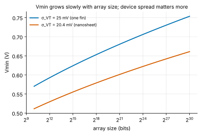
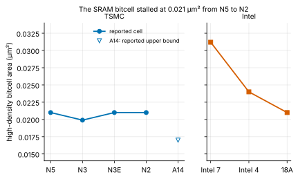

<!-- status: reviewed -->
# 23-02 · SRAM Technology

| | |
|---|---|
| **Course** | [23 · Memory and Storage Technology](../README.md) |
| **University equivalent** | The SRAM-technology lectures of a senior memory or advanced-VLSI elective: bitcell scaling, variability and minimum voltage, read and write assist circuits, and SRAM in FinFET and nanosheet nodes (Rabaey, Chandrakasan & Nikolić, *Digital Integrated Circuits*, ch. on memories; Weste & Harris, *CMOS VLSI Design*, SRAM chapter; Pavlov & Sachdev, *CMOS SRAM Circuit Design and Parametric Test in Nano-Scaled Technologies*) |
| **Prerequisites** | [19-08](../../19-digital-vlsi-design/chapters/19-08-sram-design.md) (the 6T cell, cell and pull-up ratios, SNM, yield), [20-11](../../20-analog-and-mixed-signal-ic-design/chapters/20-11-layout-matching-pvt.md) (Pelgrom's law), [23-01](23-01-memory-hierarchy-and-memory-wall.md) (where SRAM sits in the hierarchy), [03-02](../../03-probability-statistics-and-random-variables/chapters/03-02-random-variables-and-distributions.md) (the normal tail) |
| **Estimated study hours** | 4 |
| **Last verified** | 2026-11-25 |

**Learning objectives.** After this chapter you can:

1. Explain what sets an SRAM bitcell's area, why it stopped shrinking in the late FinFET nodes, and what nanosheets change.
2. Distinguish bitcell density from macro density, and compute array efficiency and the density and speed effects of longer bitlines.
3. Derive the margin, in standard deviations, a large array needs, and the minimum operating voltage it implies.
4. Quantify wordline-underdrive read assist and negative-bitline write assist with a square-law model, and confirm them in a circuit simulator.
5. Estimate SRAM leakage, retention savings and the die-area cost of a stalled SRAM shrink.

## 1. Big picture

Every processor's caches, register files and buffers are SRAM: six transistors per bit, built in the logic process, fast and simple to use, and expensive in area. For decades SRAM shrank with each node like logic did. Then it stopped. TSMC's N3E bitcell is the same 0.021 µm² as N5's [3], and the N2 bitcell is still 0.021 µm² [1]. Logic kept shrinking, so the share of each die spent on cache grew, and so did its share of the wafer bill. The fight to keep SRAM shrinking, and to keep it working at low voltage, is now one of the main stories of advanced-node design.

- **Server CPUs and AI accelerators:** last-level caches of hundreds of megabytes take a large and growing share of the die. Every square millimetre is paid for at leading-edge wafer prices.
- **Phones and wearables:** the SRAM's minimum operating voltage often sets the whole chip's lowest voltage, and its leakage sets standby battery drain.
- **Foundry competition:** SRAM density and Vmin are headline metrics at each node launch (§9), and they shape which node a product picks.
- **New devices:** nanosheet (gate-all-around) transistors, backside power and stacked transistors each change the SRAM story differently (§3.7).

## 2. Intuition first

An SRAM cell is two inverters in a loop, each holding the other in place, plus two access switches to the bitlines (19-08). Think of it as two people leaning against each other back to back: stable, but only as long as neither is pushed too hard. Reading opens a door to the bitline, which pushes on the side storing 0; the cell must not topple. Writing pushes through the same door on purpose and must topple it. The access transistor therefore has to be weak enough not to upset a read and strong enough to force a write.

Variation makes it harder. No two transistors are identical: each has a slightly different threshold voltage because of the random number and position of dopant atoms and the roughness of its edges. In a 64 MiB cache with half a billion cells, the worst cell typically sits about 5.9 standard deviations from the average, and a 99% yield needs every cell to have 6.6 standard deviations of margin. Lowering the supply shrinks every margin, so the worst cell sets how low the voltage can go. **Assist circuits** tilt the contest at the moment it matters: weaken the door during a read, strengthen it during a write.

Where the analogy breaks down: the cell's "push" is not a fixed force but a current that depends on the very voltages it changes, so the outcome is set by where the transistors' currents balance (§3.4–3.5).

```text
              VDD                 VDD
               |                   |
             [PU]                [PU]           PU: pull-up (PMOS)
   BL          |                   |        BLB PD: pull-down (NMOS)
   |   [PG]--- Q ------\  /------ QB ---[PG]   |  PG: pass gate (NMOS),
   |    |      |        \/         |      |    |      gate = wordline
   |    WL   [PD]       /\       [PD]     WL   |
               |       /  \        |
              GND  (Q drives the gates of the other side, QB this side)
```

*The 6T cell. Each storage node is an inverter's output and the other inverter's input. The wordline (WL) turns on both pass gates to connect Q and QB to the bitlines BL and BLB.*

## 3. Theory

### 3.1 What sets a bitcell's area

A 6T cell is drawn as a tightly packed tile, mirrored with its neighbours so that they share contacts and wells. Its width is a small, fixed number of **contacted poly pitches** (the spacing of gate lines, with room for a contact between them), and its height is a fixed number of fin or device tracks. To first order,

$$
A_{cell} \approx n_x\,P_{gate} \times n_y\,P_{track} ,
$$

where $n_x$ and $n_y$ are integers set by the cell's topology. Unlike a logic cell, an SRAM cell cannot shrink by clever routing; it is already the densest layout the design rules allow. So it shrinks only when $P_{gate}$ or $P_{track}$ do, or when a new device lets $n_x$ or $n_y$ fall.

**Why FinFET SRAM stalled.** In a FinFET, a transistor's width comes in whole fins. The cell's strength ratios (19-08), pass gate against pull-down for reads and pull-up against pass gate for writes, can only be integers. The densest cell uses one fin for every device. A faster, more stable cell uses two fins for the pass gates and pull-downs and one for the pull-ups [1], at the cost of more tracks. In the last FinFET nodes, gate and fin pitches barely moved, because shrinking them further raised resistance and variation more than it saved area. TSMC's N3 bitcell was 0.0199 µm², only about 5% smaller than N5's 0.021 µm², and N3E returned to 0.021 µm² [3].

**What nanosheets change.** A nanosheet (gate-all-around) transistor is a stack of horizontal silicon ribbons wrapped by the gate, and the ribbon width can be set device by device. A pull-down and pass gate that needed two fins can be one narrower stack that still carries more current, because the stacked sheets have more total channel width [1]. Ratios no longer have to be integers. Intel reported a density gain of up to 23% [1], and a high-current cell whose pull-down is wider than its pass gate for a lower minimum voltage [1]. TSMC kept the 0.021 µm² cell at N2 and spent nanosheets' gains elsewhere (§3.2).

### 3.2 Cell density versus macro density

Nobody ships a bare bitcell. An SRAM **macro** wraps the array in periphery: row decoders and wordline drivers along one edge; precharge, column multiplexers, sense amplifiers and write drivers at the end of each bitline; timing and redundancy logic. The **array efficiency** is

$$
\eta_{array} = \frac{N_{bits}\,A_{cell}}{A_{macro}} = \frac{\rho_{macro}}{1/A_{cell}} ,
$$

the macro's density divided by the raw density of the bitcells alone. A 0.021 µm² cell alone would give 47.6 × 10⁶ bits/mm². Both Intel 18A's and TSMC N2's densest macros reached 38.1 Mb/mm² with that cell [1], an array efficiency of about 80% (Example 23-02.1).

**Longer bitlines.** Each bitline's column periphery is shared by the $N$ cells on it, so the area per bit is

$$
a_{bit} = A_{cell} + \frac{A_{col}}{N} + a_{other} ,
$$

where $A_{col}$ is the column periphery's area and $a_{other}$ the remaining overhead per bit. Doubling $N$ halves the second term. TSMC's N2 macro did exactly this. "Typically, the bit line has been stuck at 256 bits for a while. For N2…we can extend that to 512. It improves the density by close to 10 percent" [1].

The price is speed. A read develops a voltage difference $\Delta V$ on the bitline by discharging it with the cell's current $I_{cell}$ (19-08):

$$
t_{BL} = \frac{(N c_{cell} + C_{fix})\,\Delta V}{I_{cell}} ,
$$

where $c_{cell}$ is the capacitance each cell adds to the bitline and $C_{fix}$ the sense amplifier's and wiring's. Doubling $N$ nearly doubles the time unless the cell current rises. TSMC paired its longer bitline with nanosheet transistors, whose tunable widths and extra drive can supply the extra cell current (Example 23-02.6) [1]. The same tradeoff explains why the densest macros are not the fastest. Synopsys matched 38.1 Mb/mm² on a 3 nm FinFET process, but at 2.3 GHz, against 4.2 GHz for TSMC's fastest N2 SRAM and 5.6 GHz for Intel's [1].

### 3.3 Variation, sigma and minimum voltage

**Mismatch.** Each transistor's threshold voltage deviates randomly from its nominal value. Pelgrom's law (20-11) gives the standard deviation as

$$
\sigma_{V_{TH}} = \frac{A_{VT}}{\sqrt{WL}} ,
$$

where $W$ and $L$ are the gate's effective width and length and $A_{VT}$ (mV·µm) is a process constant [5]. Here $A_{VT}$ is quoted per device. 20-11, like Pelgrom's original paper, defines it for the threshold *difference* of a matched pair, which is $\sqrt2$ times larger: Example 23-02.3's 1.0 mV·µm per device corresponds to a pair coefficient of 1.41 mV·µm. Check which convention a data sheet uses before comparing. Bitcell transistors are the smallest on the chip, so their mismatch is the largest.

**How many sigmas.** A cell fails when a margin (read stability, writability or read current), which is a random variable with mean $\mu$ and standard deviation $\sigma$, falls below zero. 19-08 showed that an array of $N$ independent cells works with probability $P = e^{-NQ(\mu/\sigma)}$, where $Q$ is the normal tail. Solving for the margin needed to reach a yield $Y$ without repair,

$$
Q(k) = \frac{-\ln Y}{N}, \qquad k = \frac{\mu}{\sigma} = Q^{-1}\!\left(\frac{-\ln Y}{N}\right) .
$$

$k$ grows only slowly with $N$, because the normal tail falls so fast: about 6.0 for a 1 MiB array and 6.6 for 64 MiB at 99% yield (Example 23-02.3). Redundant rows and columns and error-correcting codes (17-08) let a few cells fail, which lowers the $k$ each cell needs.

**Vmin.** Margins shrink as the supply falls. Over the range of interest, model a margin's mean as linear in the supply, $\mu(V) = s\,(V - V_0)$, where $s$ is its slope and $V_0$ the voltage at which it vanishes. Model its spread as proportional to the threshold mismatch, $\sigma = g\,\sigma_{V_{TH}}$, where $g$ is the margin's sensitivity. Requiring $\mu \ge k\sigma$ gives the minimum operating voltage

$$
V_{min} = V_0 + \frac{k\,g\,\sigma_{V_{TH}}}{s} .
$$

Three levers lower $V_{min}$: smaller mismatch (bigger devices, nanosheets' better uniformity [1]), a smaller $k$ (repair and ECC), and assists that raise the margin's slope or its value at a given supply. The SRAM's $V_{min}$ is often higher than logic's, which is why many chips give SRAM arrays their own supply rail. In a **dual-rail** design the bitcells run on a higher, steadier rail while the periphery scales down with the logic. Synopsys' 3 nm design runs its cells from 540 mV to 1.4 V and its periphery as low as 380 mV [1].

### 3.4 Read assist: underdriving the wordline

During a read, the bitline is precharged to $V_{DD}$, and the pass gate connects it to the node storing 0. The pass gate pulls that node up while the pull-down holds it down, so the node rises to a **read-disturb voltage** $V_{rd}$. If $V_{rd}$ exceeds the other inverter's switching threshold, the cell flips. At the balance point the pass gate is saturated (its drain is the bitline at $V_{DD}$) and the pull-down is in its linear region, so with square-law devices (09-08):

$$
\tfrac12 k_{PG}\,(V_{WL} - V_{rd} - V_{TN})^2 = k_{PD}\left[(V_{DD} - V_{TN})V_{rd} - \tfrac12V_{rd}^2\right] .
$$

For the common FinFET high-density cell with $k_{PG} = k_{PD}$ and $V_{WL} = V_{DD}$, write $a = V_{DD} - V_{TN}$. The equation becomes $V_{rd}^2 - 2aV_{rd} + \tfrac12a^2 = 0$, whose smaller root is

$$
V_{rd} = (V_{DD} - V_{TN})\left(1 - \frac{1}{\sqrt2}\right) .
$$

**Underdriving** the wordline, $V_{WL} < V_{DD}$, weakens the pass gate and lowers $V_{rd}$: a read assist. It also lowers the read current, the pass gate's current at the balance point, so the bitline develops its signal more slowly. Underdrive buys stability with speed (Example 23-02.4).

### 3.5 Write assist: a negative bitline

To write a 0 into a node holding 1, the bitline is driven to 0 and the pass gate pulls the node down against the pull-up. The other inverter, whose input is this node, flips once the node falls below that inverter's **switching threshold** $V_M$. For an inverter with both devices saturated at its threshold (19-01),

$$
V_M = \frac{V_{DD} - |V_{TP}| + rV_{TN}}{1 + r}, \qquad r = \sqrt{k_N/k_P} .
$$

The written node settles where the pass-gate and pull-up currents balance:

$$
I_{PG}(V_{GS} = V_{DD} - V_{BL},\ V_{DS} = V_w - V_{BL}) = I_{PU}(V_{SG} = V_{DD},\ V_{SD} = V_{DD} - V_w) .
$$

The write succeeds if $V_w < V_M$. A slow pass gate (high $V_{TN}$) and a fast pull-up (low $|V_{TP}|$) raise $V_w$, and at a few sigma of mismatch the write fails.

**Negative-bitline (NBL) assist.** Driving the bitline below ground, to $V_{BL} = -V_{nbl}$, raises the pass gate's gate-source voltage by $V_{nbl}$ and its drain-source voltage too, so it sinks more current and pulls $V_w$ lower. Example 23-02.5 finds that about 43 mV of negative bitline rescues a write that a 50 mV mismatch had broken. Other write assists lower the cell's supply during the write to weaken the pull-up, or boost the wordline above $V_{DD}$. Each costs something: a negative bitline needs a charge pump or a capacitive kick, and it stresses the pass gate's oxide. A collapsed cell supply puts the half-selected cells on the same supply at risk of losing their data.

> **Going deeper — dynamic margins and importance sampling.** The equilibrium analysis here is static. Real reads and writes last a few hundred picoseconds, so a cell can survive a disturbance that would flip it given unlimited time, and fail a write that would eventually complete. Production margins come from transient Monte Carlo simulation. Because failure rates of 10⁻⁹ to 10⁻¹² are too rare to sample directly, engineers use importance sampling: they sample from a distribution shifted toward the failure region and reweight the results (03-05).

### 3.6 Leakage, retention and power

Every idle cell leaks: subthreshold current through its off transistors, gate leakage and junction leakage. An array of $N$ bits leaking $i_{bit}$ each at supply $V$ draws $P = N\,i_{bit}\,V$. Subthreshold leakage falls steeply as the supply drops, because drain-induced barrier lowering weakens (19-06). Model it as halving for every $\Delta V_{1/2}$ of supply drop. Then lowering an idle array from its operating voltage to a **retention voltage** cuts its power by

$$
\frac{P_{op}}{P_{ret}} = \frac{V_{op}}{V_{ret}}\;2^{(V_{op} - V_{ret})/\Delta V_{1/2}} .
$$

The retention voltage must stay above the **data-retention voltage**, below which the cross-coupled inverters' gain is too low to hold the state. Example 23-02.7 finds a factor of about 9 for a 250 mV drop. Large caches therefore have sleep states that drop the array to retention and switch off the periphery entirely.

### 3.7 New devices and new integration

- **Nanosheets** give free device widths and better uniformity (§3.1, §3.3). TSMC spent them on longer bitlines; Intel on a smaller high-current cell [1]. TSMC described N2's SRAM density as an 11% gain over N3, after N3 had managed only 6% over its predecessor [2]; its ISSCC macro paper quotes 12% [1]. Such small differences usually reflect what is counted (bitcell array or full macro) and the reference point.
- **Backside power** moves the power grid under the transistors. Intel found it would *grow* the bitcell by 10% if used inside the array, so it uses it only in the periphery and at the array's edge [1].
- **Stacked transistors (CFET)** put the n-type device on top of the p-type one, which could finally shrink $n_y$ (§3.1). TSMC's A14 paper, due at IEDM in December 2026, reportedly claims a high-density cell under 0.017 µm², the first real cell shrink since N5 [4].
- **3D stacking** puts SRAM on its own die, bonded face to face with the logic die. The logic die is then free of most of its cache, and each die can use the process that suits it.
- **Other memories** compete for the last level: embedded DRAM is denser but must be refreshed, and MRAM is non-volatile and dense but slower to write (23-08).

> **Going deeper — soft errors.** An alpha particle from packaging materials, or a secondary particle from a cosmic-ray neutron, leaves a trail of charge in the silicon. If a storage node collects more than its *critical charge*, the cell flips with no damage to the device: a **soft error**. Smaller cells store less charge but also present a smaller target, so the error rate per bit has changed less with scaling than the shrinking node charge suggests. A single strike can upset several neighbouring cells (a **multi-bit upset**). Arrays therefore *interleave* columns, placing physically adjacent cells in different ECC words, so that one strike causes at most one error per word, which single-error-correcting ECC (17-08) then fixes. Periodic scrubbing rewrites corrected data before a second error accumulates.

## 4. Worked examples

### Example 23-02.1 · Cell versus macro density (tier A)

**Setup.** Intel 18A's and TSMC N2's densest macros reach 38.1 Mb/mm² with a 0.021 µm² bitcell [1]. Taking 1 Mb = 10⁶ bits, find (a) the raw bitcell density and (b) the array efficiency. (c) By how much is N3's 0.0199 µm² cell smaller than N5's 0.021 µm² [3]? A future 0.017 µm² cell (A14's reported bound [4]) is used: find (d) its raw density and (e) the macro density at the same 80% array efficiency. (f) What area does 64 MB of cache (512 Mb) take at 38.1 Mb/mm²?

**Solution.**

- (a) $1/0.021\ \mu\text{m}^2$ = **47.6** × 10⁶ bits/mm².
- (b) 38.1/47.6 = **80.0** %.
- (c) $1 - 0.0199/0.021$ = **5.2** %.
- (d) $1/0.017$ = **58.8** × 10⁶ bits/mm²; (e) $0.80 \times 58.8$ = **47.1** Mb/mm².
- (f) 512/38.1 = **13.4** mm².

**Units check.** 1/µm² × 10⁶ µm²/mm² = 10⁶/mm². ✓

**Sanity check.** A fifth of the best macro is periphery, and faster macros spend more on it. A cache's real density can be well below the headline. Memory papers also use "Mb" loosely; with 2²⁰ bits per Mb, the same macro's efficiency would be 4.9% higher (Problem 23-02.2).

### Example 23-02.2 · When the cache stops shrinking (tier B)

**Setup.** A die is 40% SRAM by area (assumed). It moves to a node where logic shrinks 1.6 times (assumed) but the bitcell does not shrink at all, as from N5 to N3E [3]. Find (a) the new die area as a fraction of the old, (b) the SRAM share of the new die and (c) the effective area shrink.

**Solution.**

- (a) The SRAM keeps its area and the logic's falls to $0.6/1.6$, so $0.40 + 0.6/1.6$ = **77.5** % of the old die.
- (b) $0.40/0.775$ = **51.6** %.
- (c) $1/0.775$ = **1.29** times, against 1.6 for logic.

**Units check.** Fractions of area. ✓

**Sanity check.** If the new node's wafers cost more than 1.29 times as much per square millimetre, this die costs more to make after the shrink. That is why architects push caches to cheaper nodes on separate stacked dies, and why a node's SRAM density matters to product cost as much as its logic density.

### Example 23-02.3 · How many sigmas, and how low a voltage (tier B)

**Setup.** (a, b) Find the margin, in standard deviations, a 1 MiB (8 Mib = 2²³ bits) and a 64 MiB (2²⁹ bits) array need for 99% yield without repair. A cell transistor has $A_{VT}$ = 1.0 mV·µm, $L$ = 16 nm and an effective width of 100 nm for one fin or 150 nm for a nanosheet stack (all assumed): find (c) σ_VTH for the fin and (d) for the nanosheet. A margin has slope $s$ = 0.2 V/V, vanishes at $V_0$ = 0.25 V and has σ = 0.6 σ_VTH (assumed). Find $V_{min}$ for (e) 1 MiB of fins, (f) 64 MiB of fins and (g) 64 MiB of nanosheets.

**Solution.**

- (a) $Q(k) = -\ln 0.99/2^{23}$, so $k$ = **5.97**; (b) for $2^{29}$ bits, **6.61**.
- (c) $\sigma_{V_{TH}} = 1.0/\sqrt{0.10 \times 0.016}$ = **25.0** mV; (d) $1.0/\sqrt{0.15 \times 0.016}$ = **20.4** mV.
- (e) $V_{min} = 0.25 + 5.97 \times 0.6 \times 0.025/0.2$ = **0.698** V; (f) with $k$ = 6.61, **0.746** V; (g) with 20.4 mV, **0.655** V.

**Units check.** mV·µm/µm = mV; V + (V/V)⁻¹ × V = V. ✓

**Sanity check.** Making the array 64 times larger costs about 48 mV of Vmin here, because $k$ grows only from 5.97 to 6.61. Making each device 50% wider gains about 91 mV. Device uniformity, not array size, is the bigger lever, which is why nanosheets' tighter spread matters.

### Example 23-02.4 · Read assist by wordline underdrive (tier B)

**Setup.** A high-density cell has $k_{PG} = k_{PD}$ = 100 µA/V², $V_{TN}$ = 0.3 V and $V_{DD}$ = 0.7 V (assumed). Find the read-disturb voltage with the wordline (a) at 0.7 V and (b) underdriven to 0.6 V; the read current (c) at 0.7 V and (d) at 0.6 V; and (e) their ratio.

**Solution.**

- (a) $(0.7 - 0.3)(1 - 1/\sqrt2)$ = **0.117** V.
- (b) Solve $\tfrac12(0.3 - V_{rd})^2 = 0.4V_{rd} - \tfrac12V_{rd}^2$ (in units of $k$): $V_{rd}^2 - 0.7V_{rd} + 0.045 = 0$, so $V_{rd}$ = **0.0716** V.
- (c) $\tfrac12 \times 100\ \mu\text{A/V}^2 \times (0.7 - 0.117 - 0.3)^2$ = **4.00** µA; (d) $\tfrac12 \times 100 \times (0.6 - 0.0716 - 0.3)^2$ = **2.61** µA; (e) **0.652**.

**Units check.** A/V² × V² = A. ✓

**Sanity check.** Even without underdrive the read is stable: 0.117 V is well below the other inverter's switching threshold, about $V_{DD}/2$ = 0.35 V for a symmetric inverter. A 100 mV underdrive cuts the disturbance by 39% but the read current by 35%. The bitline takes about 1.5 times as long to develop its signal, so designers apply underdrive only as far as stability demands. The lab confirms all four values in ngspice.

### Example 23-02.5 · Negative-bitline write assist (tier C)

**Setup.** The cell of Example 23-02.4 has pull-ups of $k_{PU}$ = 80 µA/V² and $|V_{TP}|$ = 0.3 V (assumed). Find (a) the switching threshold $V_M$ of the inverter that must flip, (b) the written node's voltage with nominal devices and the bitline at 0, and (c) the same with a 50 mV mismatch against the write: pass gate $V_{TN}$ 0.35 V, pull-up $|V_{TP}|$ 0.25 V. (d) What negative bitline voltage restores the write?

**Solution.**

- (a) $r = \sqrt{100/80}$ = 1.118, so $V_M = (0.7 - 0.3 + 1.118 \times 0.3)/2.118$ = **0.347** V.
- (b) With the bitline at 0, the written node ends up low, so the pass gate (gate 0.7 V, overdrive 0.4 V) is in its linear region while the pull-up ($V_{SG}$ = 0.7 V, overdrive 0.4 V) is saturated. Solve $100\left[0.4V_w - \tfrac12V_w^2\right] = \tfrac12 \times 80 \times 0.4^2$, that is $V_w^2 - 0.8V_w + 0.128 = 0$: $V_w$ = **0.221** V, below $V_M$, so the write succeeds.
- (c) With the mismatch the pass gate's overdrive falls to 0.35 V and the pull-up's rises to 0.45 V. Now the pull-up wins: the node stays high, the pass gate saturates and the pull-up is linear. Solve $\tfrac12 \times 100 \times 0.35^2 = 80\left[0.45\,(0.7 - V_w) - \tfrac12(0.7 - V_w)^2\right]$: $V_w$ = **0.472** V, above $V_M$, so the write fails.
- (d) Solve for the bitline voltage at which $V_w = V_M$: **−43.0** mV.

**Units check.** Each balance equates two currents (A) and solves for a voltage. ✓

**Sanity check.** A 50 mV mismatch moved the written node by 251 mV, which shows how sensitive a ratioed fight is to mismatch. A negative bitline of similar size to the mismatch restores the write, because it raises the pass gate's overdrive volt for volt. The lab simulates all four cases.

### Example 23-02.6 · Longer bitlines: density against speed (tier B)

**Setup.** A 0.021 µm² cell has 1.0 µm² of column periphery per bitline and 0.0012 µm² of other overhead per bit (assumed). Find the area per bit and macro density for (a, b) 256 and (c, d) 512 cells per bitline, and (e) the density gain. Each cell adds 0.1 fF to its bitline, the sense amplifier and wiring add 5 fF, the read needs 100 mV and the cell sinks 20 µA (assumed). Find the bitline time for (f) 256 and (g) 512 cells, and (h) their ratio.

**Solution.**

- (a) $0.021 + 1.0/256 + 0.0012$ = **0.02611** µm²; (b) **38.3** Mb/mm².
- (c) $0.021 + 1.0/512 + 0.0012$ = **0.02415** µm²; (d) **41.4** Mb/mm²; (e) **8.1** %.
- (f) $(256 \times 0.1 + 5)\ \text{fF} \times 0.1\ \text{V}/20\ \mu\text{A}$ = **153** ps; (g) $(51.2 + 5) \times 0.1/20$ = **281** ps; (h) **1.84**.

**Units check.** fF × V/µA = 10⁻¹⁵ C/10⁻⁶ A = 10⁻⁹ s, so ns; 0.153 ns = 153 ps. ✓

**Sanity check.** The gain matches the "close to 10 percent" TSMC reported [1], and the speed cost is nearly a doubling. To read as fast with twice the cells, the cell current must rise by the same 1.84 times, which is the kind of gain nanosheets' extra drive must supply.

### Example 23-02.7 · Leakage and retention (tier B)

**Setup.** A 64 MiB cache (2²⁹ bits) leaks 5 pA per bit at 0.7 V (assumed). Find (a) the leakage current and (b) the power. Dropping the idle array to 0.45 V, with leakage halving for every 100 mV of supply drop (assumed), find (c) the leakage factor, (d) the retention current, (e) the retention power and (f) the power saving.

**Solution.**

- (a) $2^{29} \times 5\ \text{pA}$ = **2.68** mA; (b) × 0.7 V = **1.88** mW.
- (c) $2^{-250/100}$ = **0.177**; (d) (a) × (c) = **0.475** mA; (e) × 0.45 V = **0.214** mW; (f) (b)/(e) = **8.80** times.

**Units check.** bits × A = A; A × V = W. ✓

**Sanity check.** A few milliwatts is negligible in a server. A wearable's SoC holds a few megabytes, not 64 MiB, but at about 3.3 µW per MiB in retention here its SRAM can still be the largest always-on load. The voltage drop saves more than its own ratio (1.56) because leakage falls exponentially.

<!-- answer-key -->

| ID | Quantity | Value | Unit |
|---|---|---|---|
| Ex 23-02.1a | raw bitcell density | 47.6 | 10⁶/mm² |
| Ex 23-02.1b | array efficiency | 80.0 | % |
| Ex 23-02.1c | N3 cell shrink against N5 | 5.2 | % |
| Ex 23-02.1d | raw density of a 0.017 µm² cell | 58.8 | 10⁶/mm² |
| Ex 23-02.1e | macro density at 80% efficiency | 47.1 | Mb/mm² |
| Ex 23-02.1f | area of 64 MB | 13.4 | mm² |
| Ex 23-02.2a | new die area | 77.5 | % |
| Ex 23-02.2b | SRAM share of the new die | 51.6 | % |
| Ex 23-02.2c | effective area shrink | 1.29 | |
| Ex 23-02.3a | sigma needed, 1 MiB | 5.97 | |
| Ex 23-02.3b | sigma needed, 64 MiB | 6.61 | |
| Ex 23-02.3c | σ_VTH, one fin | 25.0 | mV |
| Ex 23-02.3d | σ_VTH, nanosheet | 20.4 | mV |
| Ex 23-02.3e | Vmin, 1 MiB, fins | 0.698 | V |
| Ex 23-02.3f | Vmin, 64 MiB, fins | 0.746 | V |
| Ex 23-02.3g | Vmin, 64 MiB, nanosheets | 0.655 | V |
| Ex 23-02.4a | read-disturb voltage, 0.7 V wordline | 0.117 | V |
| Ex 23-02.4b | read-disturb voltage, 0.6 V wordline | 0.0716 | V |
| Ex 23-02.4c | read current, 0.7 V wordline | 4.00 | µA |
| Ex 23-02.4d | read current, 0.6 V wordline | 2.61 | µA |
| Ex 23-02.4e | read-current ratio | 0.652 | |
| Ex 23-02.5a | switching threshold | 0.347 | V |
| Ex 23-02.5b | written node, nominal | 0.221 | V |
| Ex 23-02.5c | written node, 50 mV mismatch | 0.472 | V |
| Ex 23-02.5d | negative bitline needed | -43.0 | mV |
| Ex 23-02.6a | area per bit, 256 cells | 0.02611 | µm² |
| Ex 23-02.6b | macro density, 256 cells | 38.3 | Mb/mm² |
| Ex 23-02.6c | area per bit, 512 cells | 0.02415 | µm² |
| Ex 23-02.6d | macro density, 512 cells | 41.4 | Mb/mm² |
| Ex 23-02.6e | density gain | 8.1 | % |
| Ex 23-02.6f | bitline time, 256 cells | 153 | ps |
| Ex 23-02.6g | bitline time, 512 cells | 281 | ps |
| Ex 23-02.6h | time ratio | 1.84 | |
| Ex 23-02.7a | leakage current | 2.68 | mA |
| Ex 23-02.7b | leakage power | 1.88 | mW |
| Ex 23-02.7c | leakage factor at 0.45 V | 0.177 | |
| Ex 23-02.7d | retention current | 0.475 | mA |
| Ex 23-02.7e | retention power | 0.214 | mW |
| Ex 23-02.7f | power saving | 8.80 | |
| Txt 23-02.a | ratio r in Example 23-02.5 | 1.118 | |
| Txt 23-02.b | 1 MiB array sigma, rounded (§3.3) | 6.0 | |
| Txt 23-02.c | 64 MiB array sigma, rounded (§3.3) | 6.6 | |
| Txt 23-02.d | Vmin cost of a 64× larger array | 48 | mV |
| Txt 23-02.e | Vmin gain of 50% wider devices | 91 | mV |
| Txt 23-02.f | disturbance reduction by underdrive | 39 | % |
| Txt 23-02.g | read-current reduction by underdrive | 35 | % |
| Txt 23-02.h | bitline slowdown from underdrive | 1.5 | |
| Txt 23-02.i | written-node shift from the mismatch | 251 | mV |
| Txt 23-02.j | supply ratio 0.7/0.45 | 1.56 | |
| Txt 23-02.k | NBL needed, rounded (§3.5) | 43 | mV |
| Txt 23-02.l | retention saving, rounded (§3.6) | 9 | |
| Txt 23-02.m | 2²⁰-bit Mb efficiency increase (Ex 23-02.1) | 4.9 | % |
| Txt 23-02.n | extra sigma from 1 MiB to 64 MiB (Q3) | 0.65 | |
| Txt 23-02.o | expected worst of 2^29 normal draws | 5.9 | |
| Txt 23-02.p | 99% yield margin for 64 MiB | 6.6 | |
| Txt 23-02.q | pair coefficient for 1.0 mV um per device | 1.41 | mV·µm |
| Txt 23-02.r | retention power per MiB | 3.3 | µW |
| Txt 23-02.s | symmetric inverter threshold at 0.7 V | 0.35 | V |
| Txt 23-02.t | Intel cell-area reduction, 0.024 to 0.021 | 12.5 | % |
| Txt 23-02.u | half a billion cells, 2^29 | 5.4e8 | |

## 5. Simulate it

The lab is [labs/23-02-lab/](../labs/23-02-lab/README.md). `sramtech.py` holds the chapter's models. The netlist `assist.cir` builds the cell's pieces with square-law (level-1) transistors:

- an inverter with its output tied to its input, which settles at its switching threshold;
- three write half-cells: nominal, with a 50 mV mismatch, and with that mismatch plus a −43 mV bitline;
- two read half-cells, with the wordline at 0.7 V and at 0.6 V.

The notebook runs a Monte Carlo of write failures against the negative-bitline voltage, plots $V_{min}$ against array size, and sweeps bitline length.



**Predict, then run:**

1. *Predict* $V_M$, the three written-node voltages and the two read-disturb voltages, then run `ngspice -b assist.cir`.
2. In the notebook, draw 20,000 random cells, each with one combined mismatch δ of σ = 25 mV between the pass gate and pull-up, and count write failures with no assist. *Predict* first: is the failure rate closer to 10⁻¹ or 10⁻⁶? Repeat with −50 mV and −100 mV of bitline.
3. Plot $V_{min}$ against array size. *Predict* how much 1,024 times more bits costs.
4. Sweep cells per bitline from 64 to 1024. *Predict* where the density gain flattens.



## 6. Engineering tradeoffs

| Knob | Improves | Costs | Typical decision owner |
|---|---|---|---|
| High-density (all one-fin) cell | Area | Read current, Vmin, speed | Memory-compiler team |
| High-current cell (wider pass gate and pull-down) | Speed, Vmin | Area | Memory-compiler team |
| Longer bitlines | Macro density (fewer sense amplifiers) | Bitline delay, read energy | Memory designer |
| Wordline underdrive (read assist) | Read stability, Vmin | Read current and speed | Memory designer |
| Negative bitline (write assist) | Writability, Vmin | Charge pump or kick capacitor, oxide stress, energy | Memory designer |
| Dual rail (cells on a separate supply) | Logic can scale voltage below SRAM Vmin | Level shifters, an extra rail and regulator | SoC power architect |
| Redundancy and ECC | Lower sigma per cell, so lower Vmin and better yield | Area, latency, test time | Memory and test teams |
| Retention sleep mode | Standby power | Wake-up latency, retention-voltage margin | SoC power architect |
| Stacked SRAM die | Logic-die area; each die on its own process | Bonding cost, thermal coupling, test complexity | Package architect |

## 7. Numbers to know

| Quantity | Value | Source |
|---|---|---|
| HD bitcell (TSMC) | N5 0.021 µm²; N3 0.0199 µm²; N3E 0.021 µm²; N2 0.021 µm² | [1], [3] |
| HD bitcell (Intel) | Intel 7 0.0312 µm²; Intel 4 0.024 µm²; 18A 0.021 µm² | [1], [3] |
| Best macro density (ISSCC 2025) | 38.1 Mb/mm² (Intel 18A and TSMC N2), about 80% array efficiency | [1]; Example 23-02.1 |
| TSMC N2 SRAM gain | 11% over N3; N3 was 6% over N5 | [2] |
| Bitline length (TSMC) | 256 cells, extended to 512 at N2 for "close to 10 percent" density | [1] |
| Next shrink (reported, Dec 2026 paper) | A14 HD cell under 0.017 µm² | [4] |
| Sigma for a large array | about 6 to 7 (Example 23-02.3) | §3.3 |
| Read disturb, equal pass gate and pull-down | $(V_{DD} - V_{TN})(1 - 1/\sqrt2)$ | §3.4 |
| Dual-rail ranges (Synopsys 3 nm) | cells 540 mV–1.4 V; periphery to 380 mV | [1] |

## 8. Common mistakes

- **Quoting bitcell density as macro density.** The periphery takes about a fifth of the best macro and more of a fast one.
- **Assuming SRAM scales with logic.** From N5 to N3E it did not scale at all [3]. Cache-heavy dies benefit far less from a new node than logic-heavy ones.
- **Treating 6σ as a universal constant.** The required margin depends on the array size, the yield target and the repair available (§3.3).
- **Ignoring the speed cost of assists and density tricks.** Underdrive slows reads; longer bitlines slow everything unless the cell current rises.
- **Forgetting half-selected cells.** An assist applied to a row or column also stresses cells that are not being accessed.
- **Confusing the data-retention voltage with Vmin.** A cell can hold its data at a voltage far below the one at which it can be read and written reliably.

## 9. Practitioner lens

**State of the art (as of Nov 2026).**

- *Density* [Established as reported]. At ISSCC 2025, Intel 18A and TSMC N2 each reported a 38.1 Mb/mm² macro with a 0.021 µm² cell, a density gain of up to 23% for Intel and 12% for TSMC [1] (Intel's cell area itself fell from 0.024 to 0.021 µm², 12.5%). TSMC attributed much of its gain to doubling bitline length to 512 cells [1].
- *The stall* [Established as reported]. TSMC's high-density cell has been 0.021 µm² since N5. N3 reached 0.0199 µm², but N3E went back to 0.021 µm² [3].
- *Next* [Industry estimate]. TSMC's A14 paper at IEDM 2026 reportedly claims a cell under 0.017 µm² [4]. That is a test-structure upper bound from an abstract; re-check the paper after 14 Dec 2026.
- *Low voltage* [Established as reported]. Nanosheets' better uniformity and Intel's wider pull-down improve Vmin [1]. Dual-rail designs let the periphery scale down to 380 mV in Synopsys' 3 nm design [1].
- *Backside power* [Established as reported]. Intel uses it in the SRAM periphery only, because inside the cell it would cost 10% area [1].

**Why it matters commercially.** When SRAM stops shrinking, every megabyte of cache costs more on each new node. Product teams respond by moving cache onto separately made dies stacked on the logic (the economics of Example 23-02.2), by choosing smaller caches with smarter replacement, or by giving AI accelerators more on-chip SRAM only where it replaces costly HBM traffic (23-01). A node's SRAM density and Vmin are therefore part of the foundry's sales pitch and the customer's cost model.

**Marketing vs Reality.**

- *"Densest SRAM ever: 38.1 Mb/mm²."* That is the densest macro configuration, not the cache a fast core uses. Synopsys reached the same density on 3 nm at 2.3 GHz, against 4.2 and 5.6 GHz for TSMC's and Intel's fastest versions [1]. Ask for density at the target frequency and Vmin.
- *"SRAM scaling is back at 2 nm."* The cell did not shrink; the gain came mostly from periphery and longer bitlines [1]. The first real cell shrink since N5 is A14's reported bound [4], not yet shipping.
- *"Backside power shrinks everything."* Not the bitcell, which it would enlarge [1].
- *"Vmin of X mV."* Ask at what array size, yield, temperature and assist configuration. Each changes the answer by tens of millivolts (Example 23-02.3).

**Questions for engineering leaders.**

1. **"What is your cache's macro density and array efficiency at the frequency and voltage you will ship?"** *Strong:* macro-level numbers for the configurations used, with periphery overhead. *Evasive:* the bitcell area.
2. **"What sets your SRAM Vmin, and which assists do you use?"** *Strong:* the limiting margin (read, write or access time), the assist voltages, their cost, and silicon Vmin distributions. *Evasive:* a single typical number.
3. **"How much of your die is SRAM, and how does that change on the next node?"** *Strong:* an area and cost model with separate logic and SRAM scaling factors (Example 23-02.2). *Evasive:* "the node gives us 1.6× density."
4. **"What repair and ECC do your arrays have, and what failure rate do they absorb?"** *Strong:* spare rows and columns per bank, the ECC scheme, and the resulting sigma target. *Evasive:* "we design to 6 sigma."
5. **"Would stacking the cache on a separate die pay off for us?"** *Strong:* a comparison of bonded-die cost, thermal impact and test flow against the logic-die area saved. *Evasive:* "it's the future."

## 10. Concept check

**Q1.** Why did the SRAM bitcell stop shrinking while logic kept shrinking?

<details><summary>Answer</summary>

The cell is already the densest layout the rules allow, so it shrinks only with gate and track pitch or a new device topology. In the late FinFET nodes those pitches barely moved, and fin quantization forced integer device widths. Logic kept shrinking through cell-library and routing improvements that SRAM cannot use.

</details>

**Q2.** How did TSMC raise N2's SRAM macro density without a smaller cell?

<details><summary>Answer</summary>

It put 512 cells on each bitline instead of 256, halving the column periphery per bit, which gave close to 10% more density [1]. Nanosheets' extra cell current paid for the longer, slower bitline.

</details>

**Q3.** Why does the required margin in sigmas grow so slowly with array size?

<details><summary>Answer</summary>

The normal tail falls faster than exponentially, so each extra sigma of margin cuts the failure probability by a large factor. Going from 1 MiB to 64 MiB needs only 0.65 more sigma (Example 23-02.3).

</details>

**Q4.** Why does a negative bitline help a write but not a read?

<details><summary>Answer</summary>

During a write, the pass gate must overpower the pull-up, and a negative bitline raises its overdrive. During a read, the bitline is precharged high and the problem is the opposite: the pass gate must be weak enough not to flip the cell.

</details>

**Q5.** What does wordline underdrive cost?

<details><summary>Answer</summary>

Read current, and so speed: in Example 23-02.4, 100 mV of underdrive cut the read current by 35%. It also needs a separate wordline supply or a regulator.

</details>

**Q6.** Why does Intel keep backside power out of the bitcell?

<details><summary>Answer</summary>

Inside the cell, its connections would enlarge the cell by about 10% [1]. In the periphery it shrinks circuits and frees routing.

</details>

**Q7.** Why can a cache keep its data at a voltage where it cannot be read?

<details><summary>Answer</summary>

Holding data needs only enough inverter gain to keep the loop bistable. Reading and writing need the ratioed fights between pass gate, pull-down and pull-up to resolve correctly, and enough current to develop a bitline signal in time. Both need more voltage.

</details>

Problem set: [23-02 problems](../problems/23-02-problems.md).

## 11. Key terms

[Bitcell](../../../reference/glossary.md#bitcell) · [SRAM macro](../../../reference/glossary.md#sram-macro) · [Array efficiency](../../../reference/glossary.md#array-efficiency) · [Contacted poly pitch](../../../reference/glossary.md#contacted-poly-pitch) · [Fin quantization](../../../reference/glossary.md#fin-quantization) · [Nanosheet](../../../reference/glossary.md#nanosheet) · [Pelgrom's law](../../../reference/glossary.md#pelgroms-law) · [Minimum operating voltage (Vmin)](../../../reference/glossary.md#minimum-operating-voltage-vmin) · [Read-disturb voltage](../../../reference/glossary.md#read-disturb-voltage) · [Read assist](../../../reference/glossary.md#read-assist) · [Write assist](../../../reference/glossary.md#write-assist) · [Negative-bitline write assist](../../../reference/glossary.md#negative-bitline-write-assist) · [Dual-rail SRAM](../../../reference/glossary.md#dual-rail-sram) · [Data-retention voltage](../../../reference/glossary.md#data-retention-voltage) · [Backside power delivery](../../../reference/glossary.md#backside-power-delivery)

## 12. Connections

- **Previous:** [23-01](23-01-memory-hierarchy-and-memory-wall.md) placed SRAM at the top of the hierarchy; [19-08](../../19-digital-vlsi-design/chapters/19-08-sram-design.md) designed the cell, its ratios and its sense path; [20-11](../../20-analog-and-mixed-signal-ic-design/chapters/20-11-layout-matching-pvt.md) derived Pelgrom's law.
- **Next:** [23-03](23-03-dram-cells-arrays-refresh.md) trades the six-transistor cell for one transistor and a capacitor.
- **Used later:** [23-08](23-08-emerging-memories.md) compares MRAM and other candidates for the last-level cache; [23-09](23-09-compute-in-memory.md) computes inside SRAM arrays.

## 13. Further study

- J. M. Rabaey, A. Chandrakasan and B. Nikolić, *Digital Integrated Circuits*, 2nd ed., ch. 12 (memories): the cell, assists and periphery.
- A. Pavlov and M. Sachdev, *CMOS SRAM Circuit Design and Parametric Test in Nano-Scaled Technologies*, Springer, 2008: margins, variation and test.
- E. Seevinck, F. J. List and J. Lohstroh's static-noise-margin paper [6], the origin of the butterfly-curve method used in 19-08.
- The ISSCC SRAM session papers each February and the IEDM platform papers each December, reported in IEEE Spectrum [1], [2].

## 14. Sources

1. S. K. Moore, "Intel, Synopsys, TSMC All Unveil Record Memory Densities," *IEEE Spectrum*, 26 Feb 2025 (reporting ISSCC 2025 papers 29.1 and 29.2), <https://spectrum.ieee.org/sram-intel-tsmc>. [R-464]
2. *IEEE Spectrum*, report on TSMC's N2 platform paper (G. Yeap et al., IEDM 2024), Dec 2024, <https://spectrum.ieee.org/tsmc-n2>. [R-464]
3. Tom's Hardware, "TSMC's 3nm Node: No SRAM Scaling Implies More Expensive CPUs and GPUs," Dec 2022 (reporting TSMC's IEDM 2022 paper via WikiChip), <https://www.tomshardware.com/news/no-sram-scaling-implies-on-more-expensive-cpus-and-gpus>. [R-464]
4. Hardware Busters, "TSMC A14 SRAM Cell Drops Below 0.017 µm², the First Real Shrink Since N5," 27 Oct 2026, <https://hwbusters.com/news/tsmc-a14-sram-cell-drops-below-0-017-um2-the-first-real-shrink-since-n5/>. [R-464]
5. M. J. M. Pelgrom, A. C. J. Duinmaijer and A. P. G. Welbers, "Matching properties of MOS transistors," *IEEE J. Solid-State Circuits* 24(5):1433–1439, 1989, doi:10.1109/JSSC.1989.572629.
6. E. Seevinck, F. J. List and J. Lohstroh, "Static-noise margin analysis of MOS SRAM cells," *IEEE J. Solid-State Circuits* 22(5):748–754, 1987, doi:10.1109/JSSC.1987.1052809.
